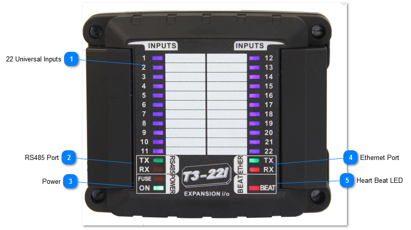
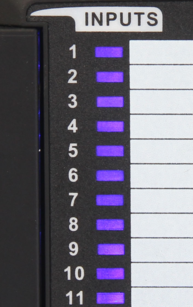
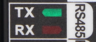
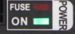
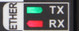

T3-22i MODULE

The T3-22i input Module has twenty-two universal inputs which can be set up for the common sensor signals and pulse counting. The hardware and software setup is the same as for the T3 controllers which are explained in detail here:
inputs
.

All connections including the inputs, RS485 ports are all well protected from short circuits and accidental connections to 24vac.

The input signals have the following characteristics:

All inputs can be software configured for sensing either analog or digital signals. The analog inputs can have one of four ranges: 0-3V, 0-10V, thermistor/ dry contact, and 4-20ma. Once the jumper is set up you then set up the engineering units and sensor signal type in software from the many built in software ranges. You can also configure your own custom sensors using your own table of voltages versus signal.

Digital Inputs are wired to dry contacts to detect the open and closed states, there is an internal pullup resistor to provide the excitation voltage for the dry contacts. When the contact is closed, the controller will read 0V or 'closed' and when the contact is open the controller will see the 3V pullup voltage and show 'open'. You can also select from many other ranges such as ON-OFF , the reverse of that: OFF-ON, or OPEN/CLOSED and so on. You can also set up your own wording such as UP-DOWN.

<table>
  <tr><td><strong>22 Universal Inputs</strong>There are 22 inputs that can be software configured for sensing either analog or digital signals.Each input has an LED for a quick visual indication of the input state and writeable area for labelling. For analog ranges the leds will dim according to the voltage on the input terminal. For binary ranges teh LED can be set to be on when a contact is closed or the reverse for on when the contacts are open.</td></tr>
</table>

<table>
  <tr><td><strong>RS485 Port</strong>RS485 port supports either Bacnet MSTP protocol and Modbus RTU at baud rates up to 112k baud.</td></tr>
</table>

<table>
  <tr><td><strong>Power</strong>The fuse LED lights up when there is a ground loop or other wiring mistake in the system. When the problem is fixed the fuse will cool down and normal operation should resume. If this LED is stuck in the on condition with no other sensors and network connected, then there is a hardware problem.</td></tr>
</table>

<table>
  <tr><td><strong>Ethernet Port</strong>The device supports both Bacnet and Modbus over the 100MB ethernet port. Both protocols can be used simultaneously. The device is not a router however, communications from the RS485 port will not be routed over to the ethernet port. For this type of routing, please refer to the T3-controller series.</td></tr>
</table>

<table>
  <tr><td><strong>Heart Beat LED</strong>The beat led will blink once every second or so during normal operation. In the first 10 seconds after power up, the beat LED will be flashing two times quickly, a pause, then two more blips in a repeating manner. This mode is called the 'isp' mode or in system programming mode, during this time it is possible to load firmware using the ISPTool. Even if there is a bad firmware update you can always get into this ISP mode by cycling power to save a bricked module. If the unit does not start with the two blip isp mode and then switch to the one blip for normal operation then there's a problem with the hardware and/or firmware. Flashing the unit with a fresh copy of the firmware is the best bet, in the first few seconds after power up if necessary. Normally firmware is updated during the 'normal' mode with the unit in operation and beat led flashing once every second. From the T3000 application you can go to help -&gt; check for updates and follow the firmware update prompts.</td></tr>
</table>
