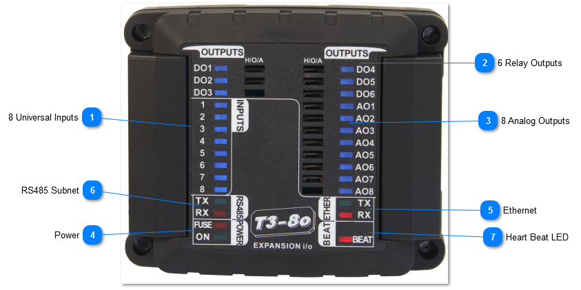
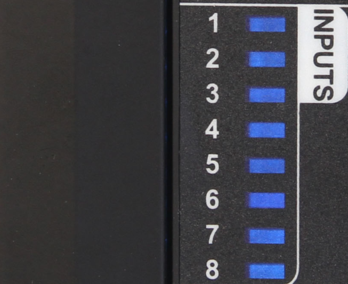
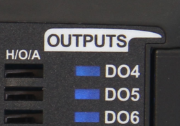
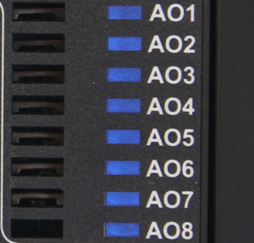
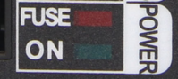
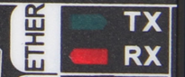
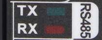

T3-8o MODULE

The T3-8o Output Module has eight universal inputs which can be set up for the common sensor signals and pulse counting. The hardware and software setup is the same as for the T3 controllers which are explained in detail here:
inputs

There are 6 relay dry contacts with a rating of 5A/24VAC on each of the DO's. Then there are eight analog output signals, they operate form 0-10V and have a drive current of 100ma each. Thanks to this relatively high drive current it is possible to energize a 12VDC relay with the output directly, this allows the system designer to convert any of the analog outputs to a relay output if necessary. The reverse is not true though, a relay output cannot operate in 10V analog mode on this module, though it can be set up to operate in PWM mode which is useful for electric heating applications.

Each output has an LED for a quick visual indication of the output state, in the case of an analog output the LED dims according to the percentage on. Each output also has an LED and a manual override switch for local operation.

All connections including the inputs, outputs, RS485 ports are all well protected from short circuits and accidental connections to 24vac.

The input signals have the following characteristics:

All inputs can be software configured for sensing either analog or digital signals. The analog inputs can have one of four ranges: 0-3V, 0-10V, thermistor/ dry contact, and 4-20ma. Once the jumper is set up you then set up the engineering units and sensor signal type in software from the many built in software ranges. You can also configure your own custom sensors using your own table of voltages versus signal.

Analog Outputs are used for modulating type actuators, variable speed drives, valves and damper motors. They are fixed in hardware to operate over 0-10V and can source a maximum of 100 mA per channel. If your application calls for more binary outputs, any spare analog outputs can be set up as relay outputs by wiring to an external relay, the 100ma drive is enough to energize the smaller 12VDC coil relays. Then in software, the output range is configured as on/off binary mode.

Digital Inputs are wired to dry contacts to detect the open and closed states, there is an internal pull up resistor to provide the excitation voltage for the dry contacts. When the contact is closed, the controller will read 0V or 'closed' and when the contact is open the controller will see the 3V pullup voltage and show 'open'. You can also select from many other ranges such as ON-OFF , the reverse of that: OFF-ON, or OPEN/CLOSED and so on. You can also set up your own wording such as UP-DOWN.

The Relay Outputs are dry contact relays rated at 2A, 120VAC. Both sides of the relay are wired to the terminal block so you can assign any relay to its own independent circuit. You can also common up the relays to share a common ground or supply using jumpers or a strip wired into the terminal block.

There are

<table>
  <tr><td><strong>8 Universal Inputs</strong>There are eight inputs that can be software configured for sensing either analog or digital signals.Each input has an LED for a quick visual indication of the input state.</td></tr>
</table>

<table>
  <tr><td><strong>6 Relay Outputs</strong>There are six digital outputs,wired to dry contacts to detect the open and closed states.Each output has an LED for a quick visual indication of the output state and a manual override switch for local operation.</td></tr>
</table>

<table>
  <tr><td><strong>8 Analog Outputs</strong>There are six analog outputs,used for modulating type actuators, variable speed drives, valves and damper motors.Each output has an LED for a quick visual indication of the output state and a manual override switch for local operation.</td></tr>
</table>

<table>
  <tr><td><strong>Power</strong>The fuse LED lights up when there is a ground loop or other wiring mistake in the system. When the problem is fixed the fuse will cool down and normal operation should resume. If this LED is stuck in the on condition with no other sensors and network connected, then there is a hardware problem.</td></tr>
</table>

<table>
  <tr><td><strong>Ethernet</strong>The device supports both Bacnet and Modbus over the 100MB ethernet port. Both protocols can be used simultaneously. The device is not a router however, communications from the RS485 port will not be routed over to the ethernet port. For this type of routing, please refer to the T3-controller series.</td></tr>
</table>

<table>
  <tr><td><strong>RS485 Subnet</strong>RS485 port supports either Bacnet MSTP protocol and Modbus RTU.</td></tr>
</table>

<table>
  <tr><td><strong>Heart Beat LED</strong>The beat led will blink once every second or so during normal operation. In the first 10 seconds after power up, the beat LED will be flashing two times quickly, a pause, then two more blips in a repeating manner. This mode is called the 'isp' mode or in system programming mode, during this time it is possible to load firmware using the ISPTool. Even if there is a bad firmware update you can always get into this ISP mode by cycling power to save a bricked module. If the unit does not start with the two blip isp mode and then switch to the one blip for normal operation then there's a problem with the hardware and/or firmware. Flashing the unit with a fresh copy of the firmware is the best bet, in the first few seconds after power up if necessary. Normally firmware is updated during the 'normal' mode with the unit in operation and beat led flashing once every second. From the T3000 application you can go to help -&gt; check for updates and follow the firmware update prompts.</td></tr>
</table>
