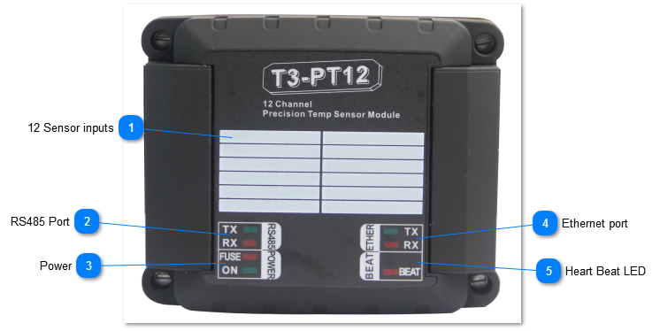
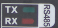
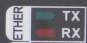

T3-PT12

The T3-PT12 is a precision temperature measurement module which can accept up to twelve instrument grade sensors.

The unit accepts platinum Pt elements, either 100 ohm or 1k ohm variety. It also can accept 10k thermistors, Type II and Type III. Cabling can be accomplished using two , three or four wire connections. Communications is supported over Bacnet and Modbus over both RS485 and the Ethernet ports. All readings and the various settings are available as Bacnet objects and Modbus registers.

The unit has12 Analog PT100 or PT1000 Inputs,supports both MSTP and IP connections.

The RS485 port has separate upstream and a downstream connectors to make troubleshooting easier.

Each input as well as the RS485 connections have a separate screw terminal, there’s no need to gang two wires under one terminal for any of the terminations.

<table>
  <tr><td><strong>12 Sensor inputs</strong>Writeable area for labelling the sensors</td></tr>
</table>

<table>
  <tr><td><strong>RS485 Port</strong>RS485 port supports either Bacnet MSTP protocol and Modbus RTU.</td></tr>
</table>

<table>
  <tr><td><strong>Power</strong>The fuse LED lights up when there is a ground loop or other wiring mistake in the system. When the problem is fixed the fuse will cool down and normal operation should resume. If this LED is stuck in the on condition with no other sensors and network connected, then there is a hardware problem.</td></tr>
</table>

<table>
  <tr><td><strong>Ethernet port</strong>The device supports both Bacnet and Modbus over the 100MB ethernet port. Both protocols can be used simultaneously. The device is not a router however, communications from the RS485 port will not be routed over to the ethernet port. For this type of routing, please refer to the T3-controller series.</td></tr>
</table>

<table>
  <tr><td><strong>Heart Beat LED</strong>The beat led will blink once every second or so during normal operation. In the first 10 seconds after power up, the beat LED will be flashing two times quickly, a pause, then two more blips in a repeating manner. This mode is called the 'isp' mode or in system programming mode, during this time it is possible to load firmware using the ISPTool. Even if there is a bad firmware update you can always get into this ISP mode by cycling power to save a bricked module. If the unit does not start with the two blip isp mode and then switch to the one blip for normal operation then there's a problem with the hardware and/or firmware. Flashing the unit with a fresh copy of the firmware is the best bet, in the first few seconds after power up if necessary. Normally firmware is updated during the 'normal' mode with the unit in operation and beat led flashing once every second. From the T3000 application you can go to help -&gt; check for updates and follow the firmware update prompts.</td></tr>
</table>
