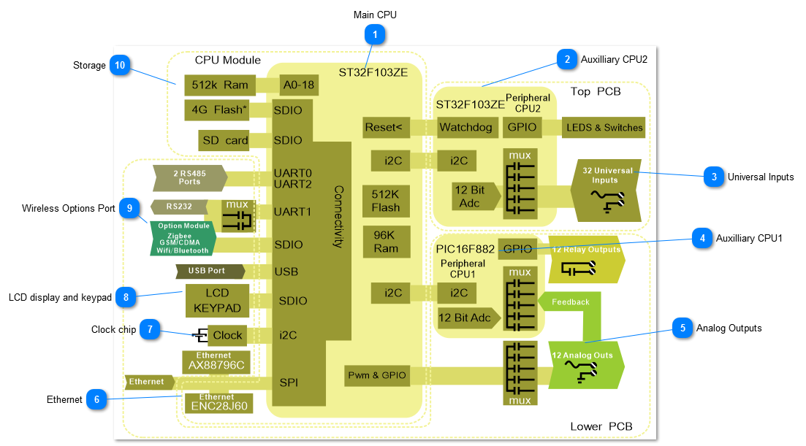
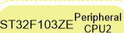
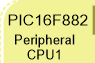
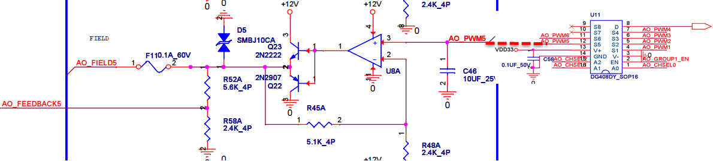
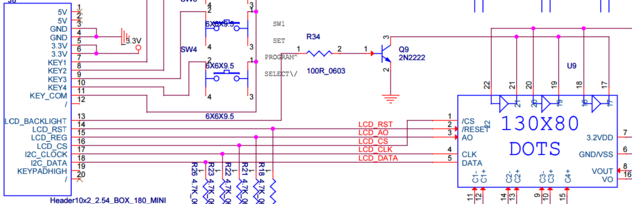
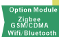
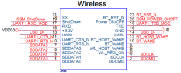
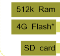

Here is an overview of the hardware architecture of the T3 controllers which is comprised of three main boards: the CPU core module, a lower PCB which has the outputs and the top PCB which deals with the inputs. There are two auxilliary CPUs communicate to the main CPU over I2C connections and handle the peripherals, one on the top board primairly for the inputs and one on the lower board mainly for the outputs.

.

·

·

<table>
  <tr><td><strong>Main CPU</strong>The heart of the T3 controllers is a 32 bit, ST32F103ZE Arm processor from the M3 core family. This is a high performance CPU operating at up to 120 Mips which is plenty of processing power for controlling typical HVAC applications while maintaining fast and responsive communications. Earlier versions of the product shipped before Q1 2017 use the Asix AX11015 which is a general purpose CPU running at 100 Mips with an on board Ethernet controller. Due to some issues handling multiple connections over TCP we migrated to the Arm based chip which has solved that as well as opened up other capabilities thanks to the extra serial ports on the Arm chip. The 200 pin SODIMM socket which hosts the main CPU can also be populated with a 'Raspberry Pi compute 3' module which runs the Rasbian operating system, and now also the Win10 IoT environment. There is currently not much of software support for the Pi version but the hardware is in production and the open source project behind it is slowly gaining steam: <a href="https://github.com/temcocontrols/T3000_CrossPlatform">T3000 Cross platform project</a></td></tr>
</table>

<table>
  <tr><td><strong>Auxilliary CPU2</strong>This CPU resides on the upper level PCB and is in charge of the analog inputs as well as monitoring the LEDs and hand-off-auto switches. It communicates to the main CPU over a dedicated I2C link. The auxiliary CPU also plays the role of the watchdog, should the main CPU lock up due to an electrical surge the auxilliary CPU, after a period of approximately ten seconds, will reset the main CPU by toggling the reset line. When normal operation resumes the on board logic and programming are automatically loaded and operation resumes without user intervention.</td></tr>
</table>

<table>
  <tr><td><strong>Universal Inputs</strong>The universal inputs are managed by the auxiliary CPU#2 on the top PCB. All inputs are digitized by this CPU using 12bit a/d conversion which are then read by the main CPU over the I2C bus. The inputs can be practically any type of input such as thermistor, dry contact, 0-3V, 0-10V and 4-20ma signals. The CPU manages the routing of these signals through the appropriate hardware by routing the signal from the field devices through various on board resistors and voltage dividers. Because of this hardware there is no need to physically adjust jumpers to set the type of signal, the setting is performed in software and the CPU will manage the muxing of the signals in firmware. More can be read about the input signal handling here: <a href="../../../../../../QN/temcocontrols/temco-platform/control/inputs/inputs.md">Inputs</a></td></tr>
</table>

<table>
  <tr><td><strong>Auxilliary CPU1</strong>The Auxilliary CPU on the lower PCB is in charge of enabling the relays and monitoring the analog output feedback signals. This chip communicates to the main CPU over a dedicated I2C connection.</td></tr>
</table>

<table>
  <tr><td><strong>Analog Outputs</strong>The analog outputs of the T3 controllers is derived from a pair of PWM signals on the main CPU module, these two signals are each multiplexed to several channels using a multiplexor chip, U11 in the partial schematic below. Each of the PWM square wave signals is buffered and smoothed out by a charge storage capacitor, C46 in this example for channel 5. Since the multiplexing is occurring very quickly the single PWM channel can produce several analog output signals which are stable with no jitter. The analog outputs are buffered by an opamp and two transistors to allow sourcing of up to 100ma at 10VDC on each output. The sinking transistor Q22 provides extra drive to zero volts when connecting to adjustable speed drives and LED lighting ballasts, these devices may require up to 20ma in actual sinking current to get the signal down to full zero volts. The D5 double acting transorb provides fast protection against static electricity and wiring mistakes in the field. Once D5 begins to conduct the fuse F11 will warm up, eventually going to open circuit and protecting the D5 transorb. Once the wiring mistake is corrected the current goes down and F1 cools off and begins conducting again. Normal operation resumes. Finally, there is an analog feedback signal which is routed to the auxilliary CPU#1, this improves the accuracy of the analog outputs to less than 0.1V even with varying output loads. This unique feature allows the T3 able to detect wiring mistakes and hardware failures on the analog outputs greatly assisting the commisssioning crew and later, the maintenance crew with their troubleshooting. </td></tr>
</table>

<table>
  <tr><td><strong>Ethernet</strong>The Ethernet coprocessor is a separate chip from the main CPU, greatly reducing the computing load on the main CPU. The ENC28J60 chip is made especially for embedded devices providing 10/100 Mbps thoughput with packet buffering and checksum off loading. The chip supports auto MDIX changeover which means you can connect a PC directly to the controller with either a regular Ethernet patch cable or a crossover cable, the controller will work with either setup. The Ethernet chip communicates to the main Arm CPU over a high performance SPI slave interface. There is a second Ethernet chip on board the main motherboard which is the ax88796C and is similar to the ENC28J60 and is not normally populated. If you;'re working with the Pi version of this controller this chip is required.</td></tr>
</table>

<table>
  <tr><td><strong>Clock chip</strong>The real time clock for the Arm based controllers is on board the CPU directly,it can store time even during prolonged power outages. In the case of the Raspberry Pi version of the product, since the Pi compute does not have an on board clock this IC will handle the time keeping chores. If you're working with the Pi version this chip should be populated.</td></tr>
</table>

<table>
  <tr><td><strong>LCD display and keypad</strong>The main Arm CPU communicates to the LCD over a total of six GPIO lines and uses an additional five GPIO lines for the keypad. The ribbon cable can be extended up to a meter or so in order to mount the keypad outside the enclosure. The display is a 130x 80 dot matrix display with backlight. There are plans to support larger displays and touch screens on the roadmap. Here is a partial schematic of the keypad and display header connections in case you care to make your own cables. </td></tr>
</table>

<table>
  <tr><td><strong>Wireless Options Port</strong>The wireless options port is a header accommodates various wireless option modules. The socket can be fitted with a GSM/CDMA cellular modem allowing connections where there is no internet available. There is also a zigbee 900hz option module which allows connecting to the growing collection of zigbee equipment on the market. The connection from the main CPU to this socket is accomplished with several GPIO, USB, UART and SDIO which means this socket will support present and upcoming standards as they come onto the market. Work is under way on a bluetooth module supporting the new BT5 spec which doubles the speed or regular bluetooth, and increases the range by four. </td></tr>
</table>

<table>
  <tr><td><strong>Storage</strong>Ram: The CPU module has an external 512k ram chip on board which supports the main application. SD Card: This slot accommodates an SD card up to 32G in size, its used for storing trend logs and graphics templates for the building. The slot is accessible without taking the lid off the controller, the slot is located along the edge of the lower PCB, opposite the ethernet connector on early models and near the ethernet connector on later models. *Flash Chip: This chip performs the same function as the SD card slot, only its on board the CPU module directly so the SD card is not required. This flash chip was added on production starting in Q1 or 2017 so your model may not have the chip in which case you'll need to insert an flash card in the SD slot. You can tell if have this chip by looking at the device info details in the T3000 front end.</td></tr>
</table>
