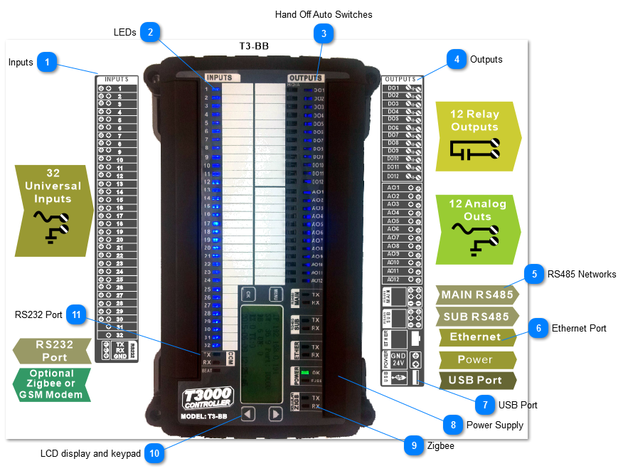
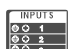
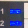
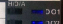
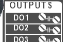
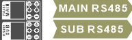
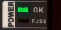
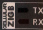
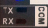

The T3 controllers are stand alone programmable controllers which can operate on their own independent of the PC and don't require servers or cloud services to perform their job. Each of the panels has an Ethernet port and two RS485 subnets. Communications protocols include Bacnet and Modbus both of which operate over ethernet IP and the RS485 ports.

Expansion i/o can be added using expansion modules which come in a variety of i/o types and counts to fit the application. The expansion modules are usually located in the same control cabinet as the controller but the designer is free to locate them remotely, they connect to the main controller over twisted pair RS485 so they can be located several hundred meters if necessary. There is an Ethernet port on most models of the T3 expansion modules, this port can be used by integrators for managing the i/o blocks over IP but when integrating to the T3 controller, these should be connected over RS485.

The T3000 Controller hardware is shown below. The hardware has many hardware features which make the controller easy to commission and manage over the life cycle of the building. Each output has a hand-off-auto switch which will override the controller logic during troubleshooting. There are plenty of LEDs to see the status at a glance, all the terminal blocks are pluggable. Each input and output has its own pair of terminals to make wiring simple, most devices are connected to the controller with a single wire going to a single terminal. There is no need to join up grounds on an external ground lug. Each RS485 network connection has a separate upstream and a downstream connector to make RS485 debugging easy. In summary, this controller hardware is made with the building operator and controls technicians in mind, making both installation and maintenance easier.

The controller is powered by an Arm M3 core processor operating at 120Mips which is plenty of power for the typical controls application. Communications are reliable over all the ports simultaneously while still running the user prgramming at least once per second, no matter how much logic the user has worked up in the application.

The following section describes the main features of the controller. More information on the T3 hardware is described in the next section entitled
Hardware Architecture
.

·

<table>
  <tr><td><strong>Inputs</strong>The Inputs are called 'universal inputs' which means by selecting the appropriate range you can deal with control signals from most any typical HVAC field device you are likely to encounter: dry contacts, thermistors and transducers can all be wired to the intput terminals with no interfacing required. The front end software lets you set up the range and the engineering units for each of the inputs. There are no hardware jumpers to set as is often the case with other controllers, sensor type and range are all selected in software from the GUI. Custom ranges can be set up for transducers, for example a 100psi transducer with a 4-20ma signal can be set up easily in the front end software including the custom range and custom engineering units. Pulse counting is supported at 1hz on any input of the T3 controllers and many of the T3 i/o expansion modules as well. There are some 1khz high speed pulse counters some inputs as well, see the <a href="../../../../../../QN/temcocontrols/temco-platform/control/inputs/pulse-counting.md">pulse counting</a> section for more details. Each input has an LED for visual indication of the status of each point. The inputs are protected against surges from static and lightning, as well as ground loops due to wiring mistakes.</td></tr>
</table>

<table>
  <tr><td><strong>LEDs</strong>There are many LED's which show the controller status at a glance, all of the inputs and outputs have their own LED. All of the communications ports have a TX and RX led. The power supply, heartbeat and fuse also have leds. The analog inputs and output LEDS will dim proportionally to the voltage on the terminal. Inputs which are set to an unused range will be off. The LEDS can be also configured in the reverse sense to accomodate normally closed relays. Normally the LED will be off when the contacts are open and on when the contacts are closed. When the input is configured for the reverse sense the LED works in reverse from that, ie. the LED is on when the contacts are open and off when the contacts are open.</td></tr>
</table>

<table>
  <tr><td><strong>Hand Off Auto Switches</strong> Each of the outputs has a manual override switch. Should the panel go down or the operator need to do some testing, the outputs can be managed with switches. If the operator forgets to put the switch back into the auto position an alarm will sound at the operator terminal as a reminder. The current state of all the hand off auto switches is shown in the GUI and also reflected in the relevant modbus registers / bacnet variables.</td></tr>
</table>

<table>
  <tr><td><strong>Outputs</strong>There are two types of outputs, the relay outputs and analog 0 to 10V outputs. The relays are dry contacts with a UL listed rating of 120vac at 5 amps. The analog outputs are 0-10V signal with 100ma drive capability. The analog signal can be wired directly to an external 12VDC relay and configured as relay outputs if the application calls for more binary outputs. The analog outputs are also capable of sourcing 20ma per channel at the zero volt output setting, this enables the use with dimming ballasts which require an actual sinking current to turn down to the fully dimmed or 'off' state.</td></tr>
</table>

<table>
  <tr><td><strong>RS485 Networks</strong>There are two RS485 networks on each controller, one is labeled 'main' and the other 'sub' though they are functionally equivalent. Typically the subnet is used for expansion I/O and the main is used for controller-to-controller level connections. The ports can be set up for Modbus RTU protocol and Bacnet MSTP protocol at baud rates up to 112k. Each of the networks can run a different protocol, MSTP on the main and Modbus on the sub for example.To make debugging in the field easier there are two connectors for each of the two RS485 ports which are connected internally on board the controller. Conceptually they can be thought of as one connector going to the 'upstream' devices and the other goes to the 'downstream' devices though they are connected inside the controller to each other. The ports are not galvanically isolated but there is plenty of hardware protection against wiring mistakes and lightning surges. When there are ground loops in the system the two fuses will open up to protect the controller, once the loop is sorted out the fuse closes and communications are restored. There is more information on setting up and the use of the RS485 ports here: <a href="../../../../../../QN/temcocontrols/temco-platform/t3-controller-hardware/communications-ports.md">Communications Ports</a></td></tr>
</table>

<table>
  <tr><td><strong>Ethernet Port</strong>The Ethernet port is 100Mbaud/10Mbaud auto switchover. The controller can talk both Bacnet and Modbus protocols over IP, simultaneously if the application calls for it.</td></tr>
</table>

<table>
  <tr><td><strong>USB Port</strong>The USB port is available for ad-hoc connections and debugging, it supports Modbus RTU slave only at the moment. When there is an optional GSM modem installed on the controller the USB port will be occupied by the GSM functions.</td></tr>
</table>

<table>
  <tr><td><strong>Power Supply</strong>The controller can operate on AC or DC from 12V on up to 24V. Power consumption is 10 watts maximum with all relays on and all analog outputs loaded to 100%. The OK led will light up when power is applied and the FUSE led will light up when there is a ground loop or hardware problems with the controller. The fuse is self resetting and operation will resume normally once the wiring issues are straightened out.There hardware is well protected from surge and brownout conditions. When power goes outside the normal bands the controller will gracefully power down without the relay outputs chattering.</td></tr>
</table>

<table>
  <tr><td><strong>Zigbee</strong>The T3-BB and T3-LB models support an optional zigbee module which can connect wirelessly to zigbee thermostats and other devices over a mesh network. Communications activity will show on the two LEDs shown.</td></tr>
</table>

<table>
  <tr><td><strong>LCD display and keypad</strong>There is a display on the T3-BB model which shows the current IP address and communications activity. Currently the keypad has no menu system built in, all settings are accessed through the communications ports.</td></tr>
</table>

<table>
  <tr><td><strong>RS232 Port</strong>The T3-BB has an RS232 port which supports Modbus and built in drivers for integrating with a few devices such as power meters, weigh scale and so on. The port is currently not available to the user application other than these built in modbus and fixed purpose functions. If you have an application which calls for communicating to a particular device just let us know and we'll be glad to integrate it.</td></tr>
</table>
