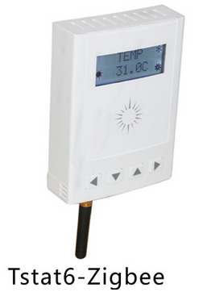

Wireless Connectivity:

The system supports an optional zigbee add-on module which enables connecting to wireless thermostats and other zigbee devices. The zigbee devices form a mesh which makes the network more robust than a regular point to point type network. If a particular node experiences interference or goes offline the network will heal itself and work around the problem node.

The system also supports a GSM module for remote connectivity where there is no internet connection available. Most mobile carriers can be accommodated with either the GSM modems over 3G networks. There is no CDMA option as of this writing, Feb 2017. You will need to locally source a prepaid sim card which is then inserted into the wireless module and allows connecting to remote sites such as boats, tractor trailers, remote cabins and so on. The only charges are the local carrier fees which are available for a flat rate per gig of data with no monthly fees, as arranged with the local carriers yourself.

Wifi and bluetooth connections are in the product pipeline, expected to be in production in mid 2017.

TBD: Show zigbee, wifi, bluetooth and GSM modules here.

