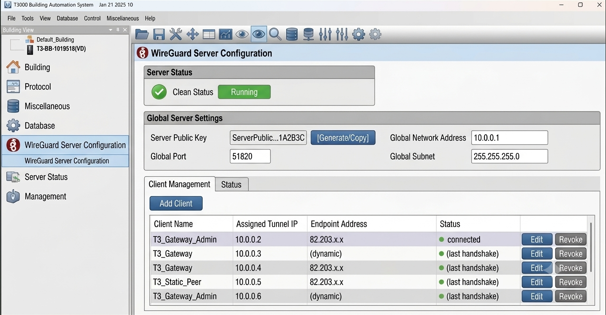
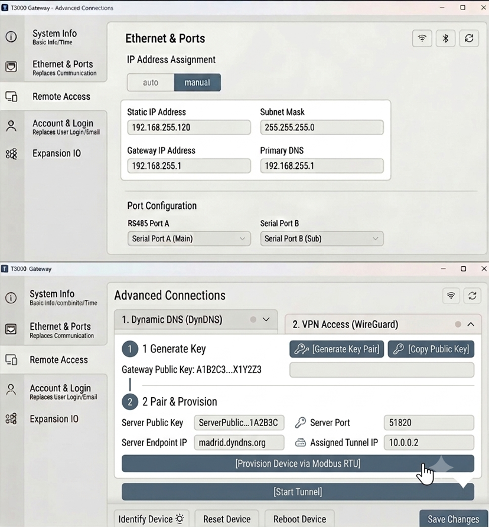
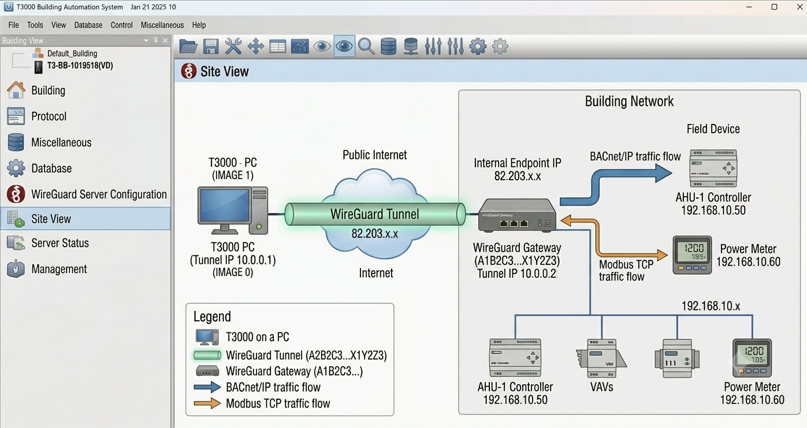

WireGuard carries the same job as [PTP](ptp-client.md) — reaching a panel that is behind a router — with one difference that changes the layout of the feature: a WireGuard gateway is an edge router, so it reaches **an entire building network**, not one controller. What T3000 configures is therefore a *remote site*, not a remote device.

This page describes the design. The screens below are the proposed interface.

## What a remote site holds

A site is one entry describing a gateway and the tunnel to it:

| Field | What it is |
|---|---|
| Remote site name | an identifier, so several properties can be kept apart |
| Public IP address or domain name | the gateway's reachable WAN address |
| WireGuard port | the port the gateway listens on; 51820 by default |
| VPN IP address | the address inside the tunnel |
| Public and private keys | the key pair that identifies each end |
| Pre-shared key | optional, an extra layer on top of the keys |
| Connection status | Idle, Connecting, Connected, or Error |

The key pair is generated by T3000 and not typed. That is the point of the feature: a technician never edits a configuration file, and the private key never has to be handed to anyone.

## Provisioning a gateway

The parameters have to reach the hardware somehow, and the hardware is on the far side of the link that is not up yet. The design solves this by provisioning over the local Modbus RTU connection first:

1. **Create the site** in the T3000 profile.
2. **Define the server side** — the public port and the subnets the tunnel will carry.
3. **Generate both key pairs**, host and gateway, in one step.
4. **Push the parameter stack over Modbus RTU** — the gateway's private key, T3000's public key, the tunnel addresses and the port rules — written to the gateway's own non-volatile memory.
5. **Register the client** in the server list once the download succeeds.
6. **Start the tunnel** on the host PC.

Steps 1 to 5 need no tunnel, which is the whole reason the order works: the local serial link carries the settings that make the remote link possible.

## The two screens

The server screen is the master view: whether the service is running, the server's public key, and the client matrix — each endpoint with its assigned tunnel address and its WAN endpoint.

The gateway screen is the deployment view, deliberately reduced to two actions: generate the keys, then press **Provision Device via Modbus RTU**. Everything it pushes is inherited from the server screen rather than typed again.

## Running the tunnel

T3000 owns the lifecycle rather than leaving it to a service console. It assembles the configuration from the database fields, starts, pauses and stops the interface, polls the endpoint for uptime and byte counters, and reconnects with a back-off when a link drops.

The status the operator sees is therefore one of five things, and the last two are worth keeping apart:

| Status | Meaning |
|---|---|
| Connected | the tunnel is up and the endpoint answers |
| Connecting | the interface is up, the handshake has not completed |
| Disconnected | stopped, or the link was lost |
| Authentication error | the keys do not match — the tunnel will never come up until they do |
| Configuration error | the parameters themselves are wrong |

## What the site sees

Once the tunnel is up the gateway is a transparent bridge: it receives the encrypted traffic from the T3000 host, decapsulates it, and routes it to the internal network unchanged. To the point table, a BACnet/IP controller behind the gateway behaves like one on the local segment — the protocol is not wrapped or rewritten at either end.

## Status

This is a proposed framework, not a released feature. The field list, the provisioning order and the status values above are the contract the implementation is being built against; treat a T3000 that shows no WireGuard screen as current behaviour rather than a fault.

## Related

- [PTP remote connection](ptp-client.md) — the connection this replaces for whole-site access.
- [IP Settings](ip-settings.md) — addressing on the local segment.
