**Temco Platform is the application Temco Controls writes its product documentation in.** Each product's pages live in a **project** — one folder on your own disk — and the application builds that folder into a website, a printable PDF and a Windows help file. Publishing puts the website on **Temco Learn**, the site readers open at `https://temcocontrols.github.io/temco-learn/`.

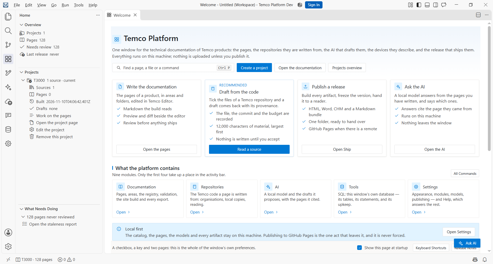

**Temco Platform** creates the project, writes and reviews the pages, runs the build, and publishes the result to Temco Learn.

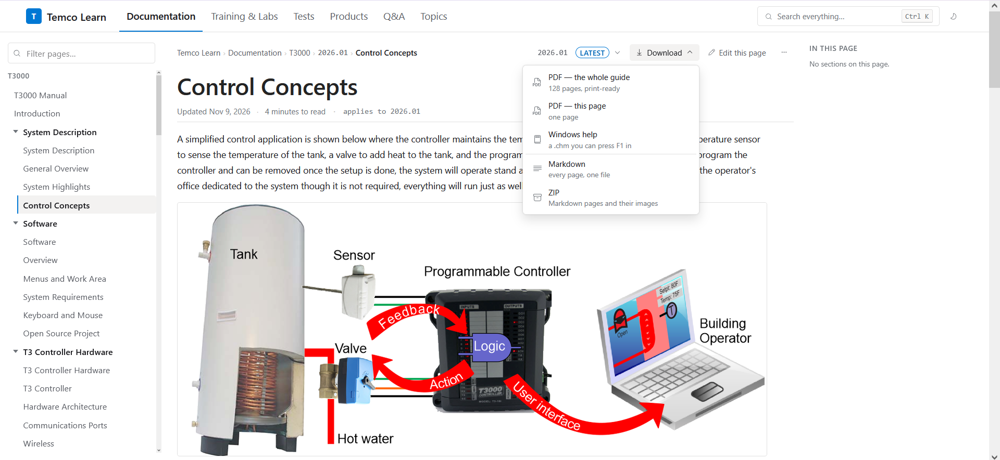

**Temco Learn** is the site a reader opens. Everything on it — the pages, the search, the PDF, the help file — came from a build that was published.

This guide takes one product, T3000, from an empty folder to a live page in eight steps: create the project, write the pages, build the site, build the project's own outputs, add the build to the site, make the downloads, serve it and look, then publish. Each step names the command it runs and the file it leaves behind, and the folders and the site clone the first step reads are set in [Before you start](#before-you-start).

## The application and the site

Temco Platform and Temco Learn are two halves of one idea, and they meet in a single place: a copy of a project's build.

```text
you, writing          Temco Platform              the site clone            Temco Learn
a page          →      builds and publishes  →     one commit on main   →    what a reader opens
```

**In the application**, a project is one folder of Markdown. It starts empty, from a template, or from something that already exists — a folder, a repository, a document. Three features carry it to a published build: **#1 Home** creates it, **#2 Documentation** writes the pages and runs the build, and **#4 Temco Learn** makes the downloads and publishes the result. The fourth, **#3 Repositories**, is for documenting code: it lists the sources a project can read — a repository, a folder, a document — and reads one into the catalog, so a draft can be written from a file of it. [Part 1](#part-1--temco-platform-the-application) takes each feature in turn; the [appendix](#appendix--every-control-and-its-command) names the buttons.

**On the site**, a reader moves down five levels — the home page, a section, a project, a version, the page. One catalog writes all five, so a page you publish appears at every level at once, and a version you add never overwrites the one before it. [Part 2](#part-2--temco-learn-the-site) shows what each level holds.

**A source gives material, not pages.** Reading one records the registry it declares, the pages that registry names, and the code files a draft may quote; a draft then waits in the Review Center until a person accepts it. The downloads follow the same rule: the PDF needs a browser and the help file needs `hhc.exe`, the site's deploy has neither, so both are made here and committed.

## What is in this guide

| Section | The question it answers |
|---|---|
| [Part 1 — Temco Platform](#part-1--temco-platform-the-application) | What is in the application, and what does each of the eight features do? |
| [Part 2 — Temco Learn](#part-2--temco-learn-the-site) | What does a reader see on the site, from the address down to one page? |
| [Part 3 — The walk](#part-3--the-walk-step-by-step) | How does one project go from an empty folder to a live page? |
| [Part 4 — Temco Editor](#part-4--temco-editor) | How do I write, format and check a page? |
| [Part 5 — Beyond the flow](#part-5--beyond-the-flow-and-when-it-goes-wrong) | What else can a project do, and what do I do when a step fails? |
| [Appendix](#appendix--every-control-and-its-command) | Which button runs which command? |

A command id in brackets (`temcoDocs.buildSite`) is what the Command Palette (`Ctrl+Shift+P`) runs when the button it belongs to is greyed out, and `~` is your home folder.

## Part 1 — Temco Platform, the application

Temco Platform has eight features, the eight you see down the activity bar on the left.

| # | Feature | In a word |
|---|---|---|
| [#1](#1-home) | **Home** | the library, and what needs doing |
| [#2](#2-documentation) | **Documentation** | pages, the editor, the build |
| [#3](#3-repositories) | **Repositories** | documenting code from its source |
| [#4](#4-temco-learn) | **Temco Learn** | the site, from this side |
| [#5](#5-ai) | **AI** | a draft beside the page |
| [#6](#6-forum) | **Forum** | the community site |
| [#7](#7-tools) | **Tools** | the platform's own database |
| [#8](#8-settings) | **Settings** | the six settings pages |

### #1 Home

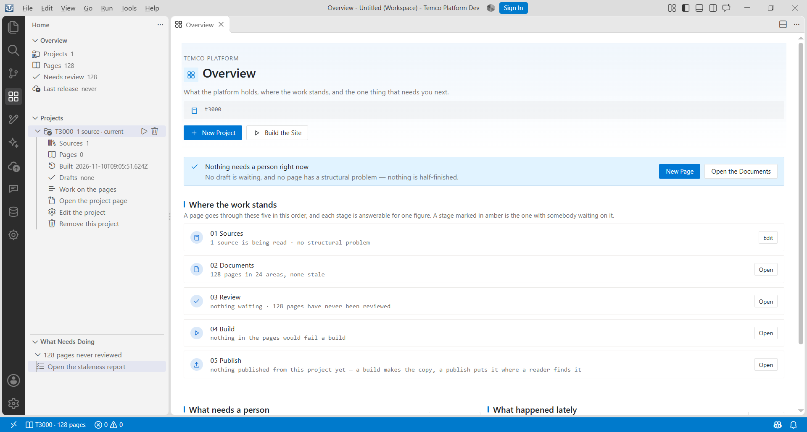

The projects on this machine, and the work waiting on them.

- **Overview** — four rows: *Projects*, *Pages*, *Needs review*, *Last release*. Each carries a count at its right, and opens the page behind it.
- **Projects** — one row per project. The row opens that project.
- **What needs doing** — what is unfinished: a screenshot with no page yet, a page the code has changed since, a page nobody has reviewed. A row runs the command that deals with it.

The **Overview** button on the panel's title opens the Dashboard page: the same counts broken down by source and area, and **Recent Activity** behind **All Activity**.

### #2 Documentation

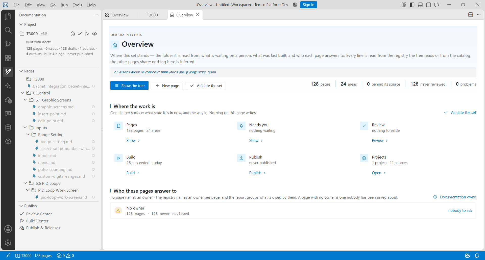

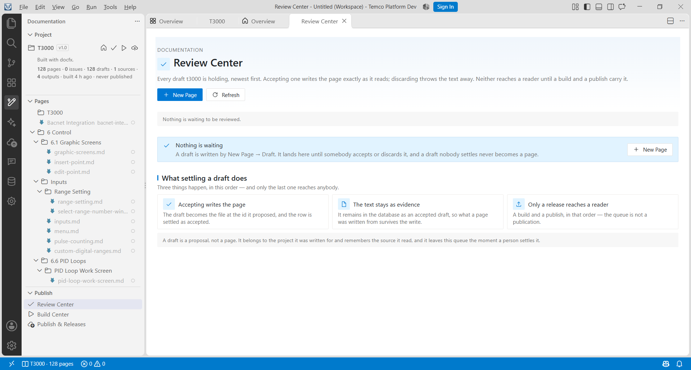

The pages of one project, and the build that turns them into a site.

- **Project** — the selected project: its pages, the outputs it is set to produce, its counts, and the button that builds it.
- **Pages** — areas, chapters and pages as a tree. A row renames, moves or retires a page, or creates the file a `missing` row is waiting for.
- **Publish** — three pages behind it: **Review Center** (drafts waiting, each settled on its own page), **Build Center** (every build, and the files it wrote), and **Publish & Releases** (a build held under a version).

### #3 Repositories


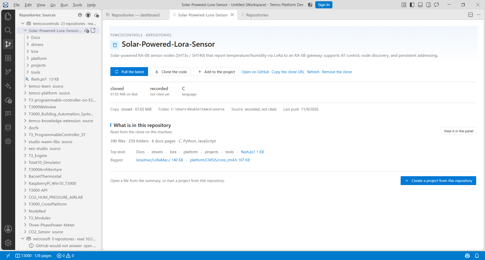

Sources for documenting code. A project cites them rather than copying them, and a project made empty or from a template reads none.

- **Sources** (the panel) — enterprises, their repositories, and the files inside one. `source` marks a repository this project cites.
- **The Repositories** (first title button) — the enterprise's repositories, one row each, with **Start**, **New project**, **Open**, **Clone** and **Remove copy**.
- **Dashboard** (second title button) — every clone, what changed since its last read, and the pages that name those files.
- **Settings** (a link on the page) — the working area, the projects folder, and the GitHub token. The first two are set in [Before you start](#before-you-start).

Reading never writes back. The catalog keeps what a source declares, and the one command that touches a clone applies a drafted change as a patch, after a question that names it.

### #4 Temco Learn

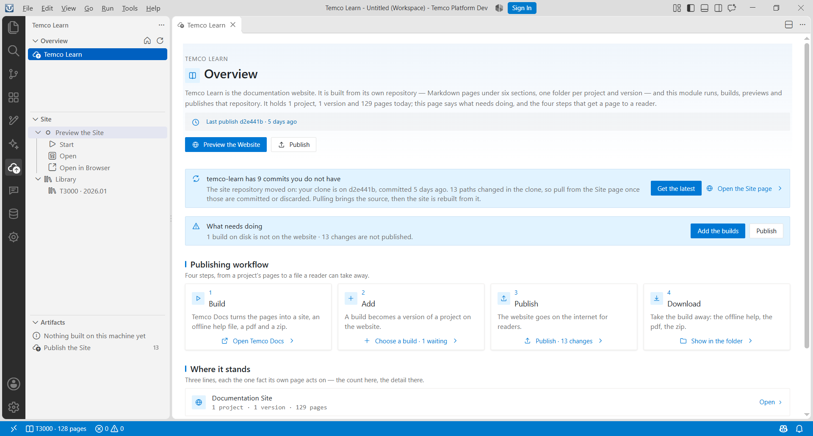

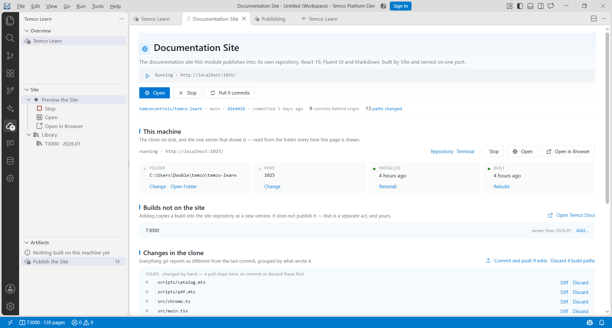

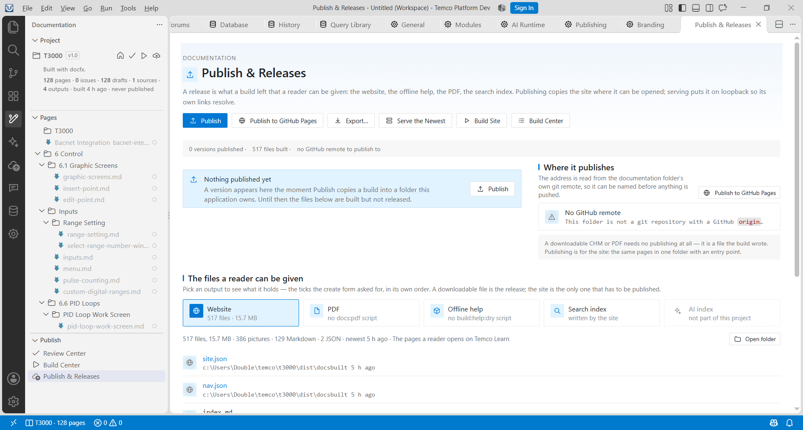

The site from this side: what is on it, what is waiting to go on it, and what a build wrote.

- **Overview** — what needs doing (*a build on disk is not on the website*, *changes are not published*, each with its button), the four steps from a page to a reader — Build, Add, Publish, Download — and where the site stands.
- **Documentation Site** — four questions and the button that changes each: is it cloned, installed, built, running. A **Refresh** beside **Pull** reads the clone again — it fetches first, so "16 commits" is what the remote has and not what the last fetch saw — and every act that takes time (a pull, a discard, a commit and push) says what it did in one line at the top of the page, above the activity area that holds the detail. The log shows its last five lines, with **Show more** for the whole of it, and it sits right under the title rather than at the bottom, because that is where a press leaves the eye.
- **Artifacts** — what a build wrote, per project: the site, the PDF, the `.chm`, the zip, the Word document, single pages. A project with no `.chm` simply has no `.chm` row.
- **Publishing** — what changed since the last publish, the steps, and the button. It is also where step 8 sends you.

### #5 AI

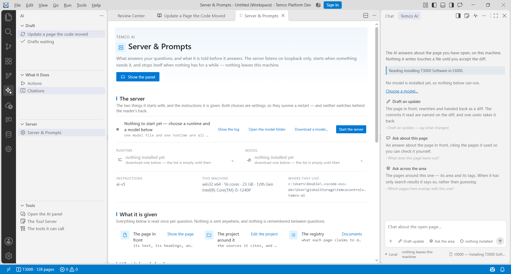

A local model that writes beside the page, and the record of what it used.

- **Draft** — *Update a page the code moved* (the pages the generator flagged, and the files under them) and *Drafts waiting* (what the model produced, before anyone settles it).
- **What it does** — *Actions* (the five acts, and the page each starts on) and *Citations* (the pages the answers leant on, looked up again).
- **Server** — *Server & Prompts*: the runtime, the model, and what the model is told.
- **Tools** — the AI panel itself, the tool server and whether it is running, and every call the model may make.

Nothing is applied without you: a draft waits in the Review Center, and accepting one is a single undoable edit.

### #6 Forum

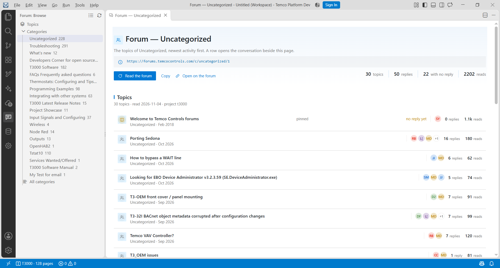

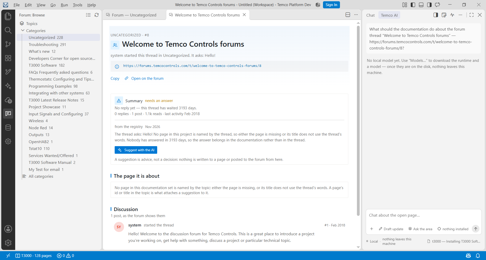

The community site, and what the documentation should do about each thread.

- **Browse** — the categories with how many topics each holds. A category opens as a table of topics; a topic opens as a tab with the conversation and the page whose title the thread uses.
- **The suggestion** — **Suggest with the AI** writes one from the registry at once, badged *from the registry*; then the AI panel answers, its text replaces the draft, badged *AI*, and stays on the topic for the next person.
- **All Topics** — the whole forum in one page, in the site's own order.

Nothing is posted from here, because the forum owns the conversation, and a topic nobody has answered in a month is called out rather than left in the table.

### #7 Tools

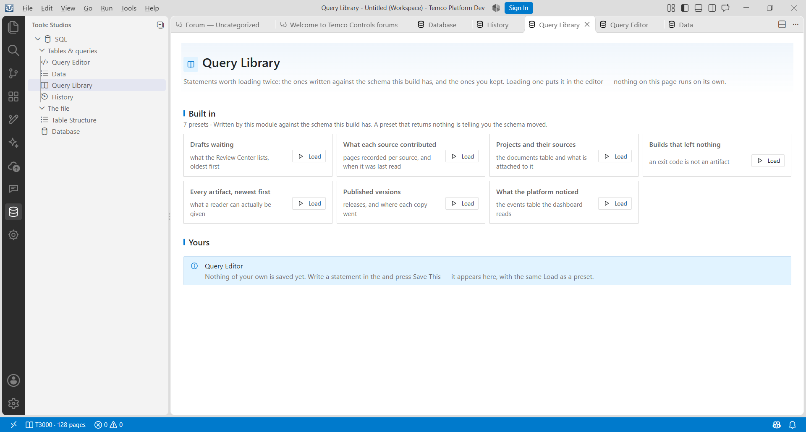

Studios for looking at the platform rather than at a page. One is built:

- **SQL** — the platform's own database, in two jobs. *Tables & queries*: Query Editor, Data, Table Structure, Query History, Query Library. *The file*: where it lives, its integrity, a backup, a reset.
- A query runs read-only unless you take the writing command.
- Devices, I/O, BACnet and Network are not built yet. The panel is a table, so each one arrives as a row when it is.

### #8 Settings

The six pages the application is configured from, in the order the panel lists them.

**General** — the theme, the startup view, breadcrumbs, telemetry, and the update channel.

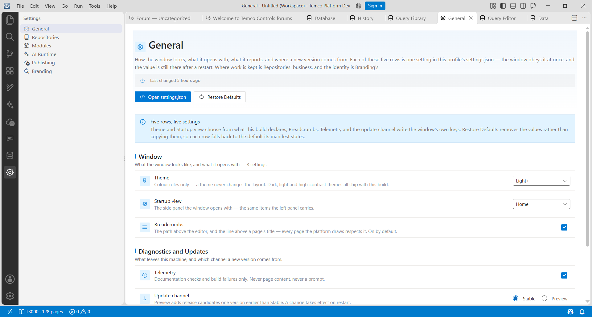

**Repositories** — the default enterprise, where clones are kept, where projects are made, and the GitHub token.

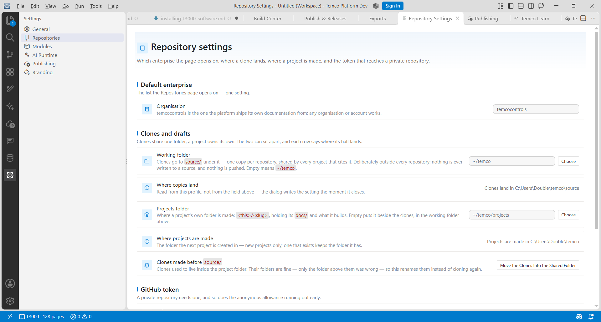

**Modules** — the modules loaded into this window, and what each owns.

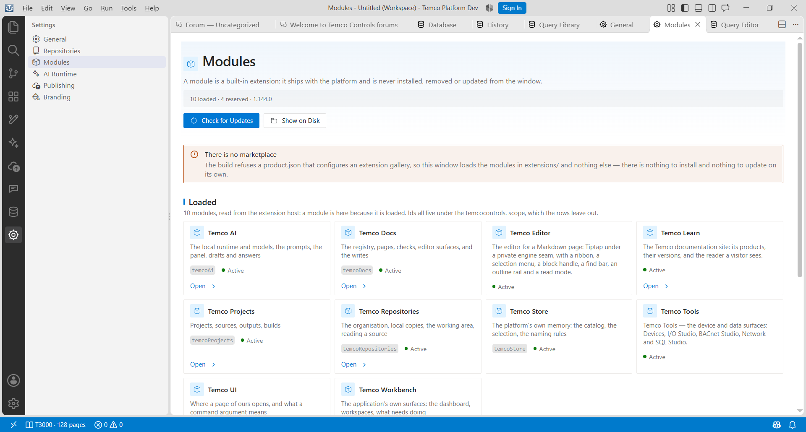

**AI Runtime** — the local model, the servers that run it, and what they may reach.

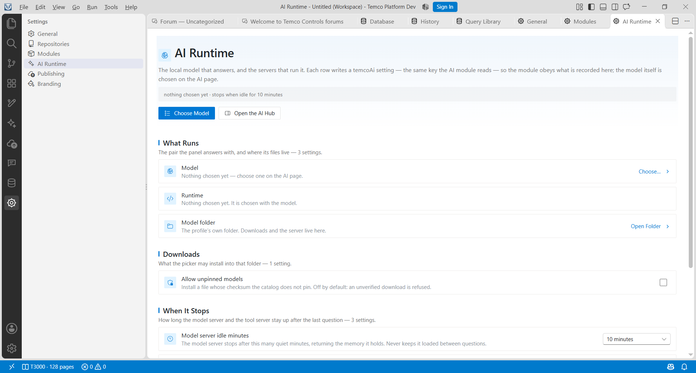

**Publishing** — where a release goes, and what it may overwrite.

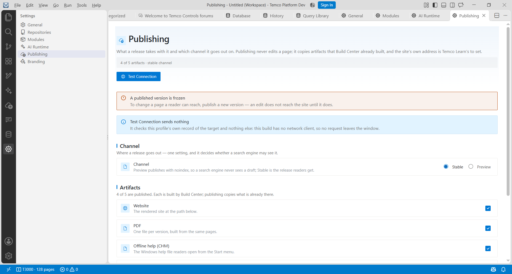

**Branding** — the mark, the colour roles and the identity.

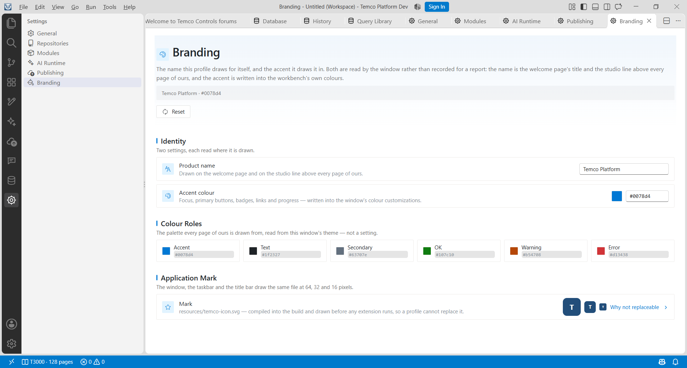

Every page writes to your **user** settings — the same file `settings.json` holds — so a choice belongs to the machine rather than to a folder. Repositories has a **Save** button, so read the resolved lines under its fields rather than trusting what you typed.

### Before you start

| You need | Why |
|---|---|
| the application, installed and running | this guide is about using it, not installing it |
| Node 22, and the site clone at `~/temco/temco-learn` | the site's scripts and catalog run on Node, and the site is its own repository. The Site page clones it for you |
| write access to `temcocontrols/temco-learn` | step 8 pushes a commit there. Everything before it still works without it |
| git configured with your GitHub account | a publish is a `git add`, a `commit` and a `push`, in your name |

Once per machine, in the clone: `npm ci`, then `npx playwright install chromium` — the PDFs are printed by a browser. A Windows help file needs HTML Help Workshop (`hhc.exe`); without it the site has no `.chm`.

The first run takes about an hour, mostly in steps 1 and 6. A publish after that takes about two minutes.

Three settings decide every path:

| Setting | Where | Meaning |
|---|---|---|
| `temcoRepositories.workspaceFolder` | Settings ▸ Repositories ▸ Working folder | the working area: clones go to `<it>/source/<repository>` |
| `temcoRepositories.projectsFolder` | Settings ▸ Repositories ▸ Projects folder | a project's folder is made at `<it>/<slug>` |
| `temcoLearn.siteRepo` | the Site page ▸ **Choose the Site Folder**, or the setting | the site clone, `~/temco/temco-learn` unless you say otherwise |

The two lines under the fields are the resolved answer: `Clones land in …\temco\source` and `Projects are made in …\temco\projects`. A value you typed but did not save is not in them yet, and `Projects are made in …\temco` means that folder is empty, so new projects land beside the clones.

## Part 2 — Temco Learn, the site

A reader opens the address and moves down five levels. Every level is written by the same catalog, so a page you publish appears at all five at once.

### #1 The home page

The site's sections as tiles, with Documentation where a product appears.

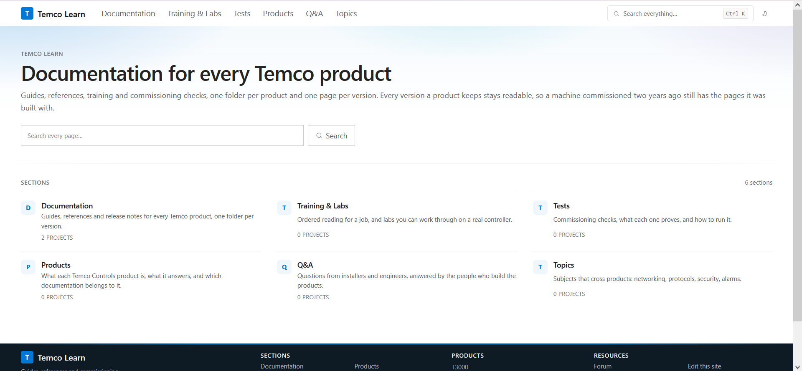

### #2 A section

The projects filed under it, each with its title, its summary and its newest version.

### #3 A project

Every version you have added, newest first.

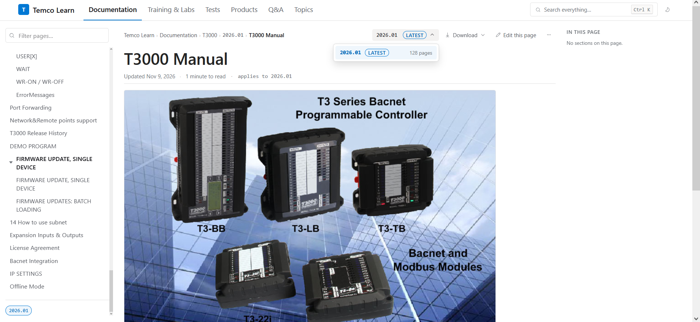

### #4 A version

That version's pages, in the order the registry gives them.

### #5 A page

The page, its "in this page" list, and the previous and next links.

### Past the five levels

Four things a reader meets that are not a level:

- **the version selector**, at the top of every page: it switches between the versions of the project you are reading, so an older edition stays readable after a new one is added. A version is never overwritten.
- **the download menu**, which offers the whole-guide PDF and, when it compiled, the Windows help file — the files [step 6](#step-6--make-the-downloads) makes and commits.
- **search**, which is the index a build shipped rather than something the site works out, so a page that never reached a build cannot be found.
- **feedback**, which records what a reader says was wrong and lands back in the application, where a draft is written and someone accepts it.

What the site holds on disk is in [The two files you will edit](#the-two-files-you-will-edit), with the others in [The same flow, as files](#the-same-flow-as-files-t3000).

## Part 3 — The walk, step by step

### What you are making

Six things take part:

| Thing | Is | Lives in |
|---|---|---|
| **A project** | one body of documentation: its name, its pages, and the outputs it should produce | `<projectsFolder>/<slug>/`, for example `~/temco/projects/t3000` |
| **A page** | one Markdown file, listed in the project's registry | `<project>/docs/<area>/*.md`, listed in `docs/help/registry.json` |
| **A picture** | a screenshot or diagram a page points at, like `` | `<project>/docs/media/`. The build copies everything under `docs/` that is not a page |
| **A build** | the rendered site, made from those pages | `<project>/dist/site`, or `dist/docs` when your own generator wrote it |
| **The site** | the Temco Learn repository: a React app that reads a catalog of projects | `temcoLearn.siteRepo`, by default `~/temco/temco-learn` |
| **The published page** | what a reader opens on the internet | GitHub Pages, served from the site's `main` branch |

The first three are yours. The site is its own repository and the published page belongs to GitHub, which is why the flow has separate steps rather than one button — and why each step can fail in its own way.

The flow is five acts in three places:

```text
YOUR PROJECT              ──▶ THE SITE CLONE             ──▶ GITHUB, THEN READERS
write, then build             add, then the downloads        publish, then CI deploys
~/temco/projects/t3000        ~/temco/temco-learn            temcocontrols/temco-learn
```

The acts are write, build, add, the downloads, publish — one command each, and steps 1 to 8 are those acts with the details filled in. When you are done, T3000 has a card under **Documentation**, every version you added is selectable with its own **Downloads** menu, your pages answer searches — and one commit on `main` has been deployed by CI, a minute after it was pushed.

A few words mean something narrower here than elsewhere:

| Word | Means |
|---|---|
| **registry** | `docs/help/registry.json`: every page's title, where it sits, whether it ships. The application reads it, and a build renders it |
| **area**, **chapter** | the top level of the documentation, and the folder a page sits in inside it |
| **page id** | the page's path under `docs/` without the `.md`: `t3000/commissioning/ports` is `docs/t3000/commissioning/ports.md` |
| **version** | one fixed entry of a project on the site, such as `1.0`. A rebuild becomes a new version rather than overwriting an old one. It becomes a folder and an address (`/t3000/1.0/`), so it is typed in digits — `1.0`, `17.4`, or a dated edition `2026.01` — never `v1.0` |
| **section** | the category a project appears under on the site: `documentation`, `training`, `tests`, `products`, `qa` or `topics` |
| **catalog** | `public/catalog.json` in the site, the one file the site's app reads to know what exists |
| **downloads** | the PDFs and help files the site serves. The deploy cannot build them, so they are made on your machine and committed |
| **guard** | the site's check that every catalogued version has its downloads. CI runs it, and so does a publish before it commits |

### Step by step

Each step does one thing and leaves something to check: **You should see** names a file or a screen, and **If not** names the usual cause, so a step that fails says so rather than showing up three steps later. The first four write and build the project, the next three take that build to the site and give it its downloads, and the last one publishes. Take them in order — each step reads what the one before it wrote. When the first publish is done, [Running it again](#running-it-again) is the short version.

### Step 1 — create a project

**Create a Project** (`temcoProjects.newProject`). Give it the name `T3000` and the version `1.0`, and leave the outputs ticked: *Website*, *PDF*, *Offline help* and *Search index*.

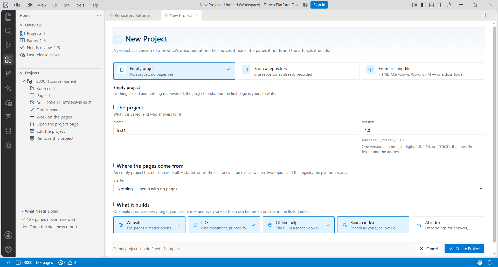

**Where the pages come from** is the choice that decides what exists once the form closes:

| Starting point | What it does |
|---|---|
| **Start empty** | records the project and nothing else. Its folder, `docs/help/registry.json` and one area come from **Create the Project's Documentation Folder** (`temcoDocs.createProjectFolder`) |
| **From a template** | writes a starter tree under the folder field — `docs/help/registry.json`, one area, two topics — named after the project, so `T3000` becomes `<projectsFolder>/t3000` |
| **From a folder** | cites a folder that already exists on this machine as the pages it reads; nothing is copied |
| **From a repository** | cites what the platform has already read — repositories, files and folders |
| **Import a document set** | converts Word, RTF, HTML, an HTML folder or a CHM **once** into `docs/` and a registry |

Either way, the project is recorded under the slug of its name (`T3000` becomes `t3000`), the sources it cites are recorded with it, and the outputs become its recipe. No source is ever written to. A project is a set of references, and its own folder holds only what the project itself writes.

| | |
|---|---|
| **You should see** | `~/temco/projects/t3000/docs/help/registry.json`, and T3000 in the Library |
| **If not** | the folder is the slug of the name, so look in `~/temco/projects/` for what was actually made. A project created before you set the projects folder keeps the folder it already has; only new ones move |

The folder is added to the window so that its `docs/` shows in Explorer. That is expected, and nothing needs doing about it.

### Step 2 — write the pages

**New Page** (`temcoDocs.newPage`) with T3000 selected. It opens a **form** rather than a prompt: the place is already chosen from the row you were on, and the form shows the kind of page, the file it will write, and the body it starts from. The palette offers the kinds alongside it (*New Article*, *New Task*, *New Reference*, *New Troubleshooting*, *New Release Note*), and they differ only in their starter headings.

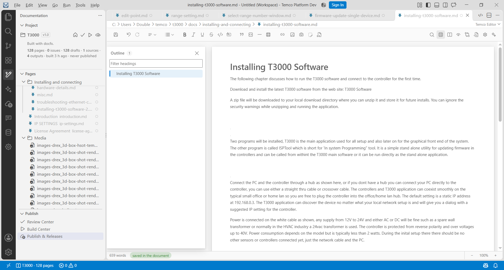

| In the form | Decides |
|---|---|
| the kind | the starter headings: *Task* gives steps, *Reference* gives a table, *Troubleshooting* gives symptom, cause and fix |
| area and chapter | where the file is written, as `docs/<area>/<chapter>/<title>.md` |
| the title | the page's name in the navigation, in search and in the tree. It is **not** the file name until you accept |
| which source | asked only when the project cites more than one folder |

You are then in the editor. Each page is a Markdown file **and** a row in `docs/help/registry.json`. Three rules explain almost every surprise you will meet later:

| Rule | What it means |
|---|---|
| the **page id is its path** under `docs/`, without `.md` | `docs/t3000/commissioning/ports.md` has the id `t3000/commissioning/ports`, and the registry must name it exactly that |
| `ship: false` keeps a page out of the built site | a page can exist and be edited, and still never appear |
| `order` decides the position inside a chapter | two pages sharing a title or an `order` are a warning, not an error |

A page that is registered but whose file does not exist is an **error**, and the module reports it on refresh. That is what makes the `missing` rows in `Pages` mean something.

**Everything else you will want on a page** lives on its row: *Rename the Page Title*, *Move Up*, *Move Down*, *Retire* (keeps the file, drops it from the site), *Create the Missing Page File* (fills a `missing` row), and *New Folder…* (`temcoDocs.newChapter`) for a new chapter.

| | |
|---|---|
| **You should see** | a Markdown file under `~/temco/projects/t3000/docs/<area>/`, and `registry.json` listing it |
| **If not** | the project has to be the **selected** project. The docs module reads the folders that project cites, not whatever folder happens to be open. A message about there being "no area to put a page in" means the project has no area yet: create a chapter, or start the project from a template |

Come back to this step whenever you have more to write. Nothing downstream notices until you build. Writing itself is [Part 4 — Temco Editor](#part-4--temco-editor), later in this guide.

### Step 3 — build the site

**Build the Site** (`temcoDocs.buildSite`), or *Build the Site* on the project page. It builds the project that is **selected**, reading the folders that project cites, so the folder does not have to be open in the window.

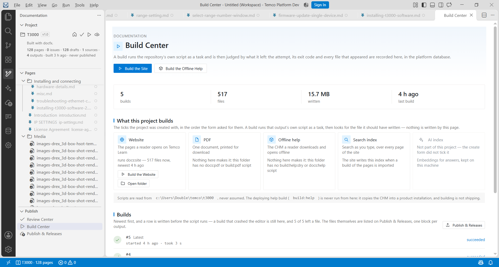

Two things can produce the site, and what is in the folder decides which one runs:

| In the project folder | What runs | Where the site lands |
|---|---|---|
| a `package.json` with `docs:site` or `docs:build` | that script, after `docs:registry` when the repository has one | wherever the script writes, commonly `dist/site` or docfx's `dist/docs` |
| neither | the **built-in generator** | `<project>/dist/site` |

Either way, the attempt is recorded in the Build Center (`temcoDocs.builds`), and every file the build wrote is recorded against it, so **Publish & Releases** (Documentation ▸ Publish) can list real files rather than hopes.

| | |
|---|---|
| **You should see** | `~/temco/projects/t3000/dist/site/index.html`, and a row in the Build Center (`temcoDocs.builds`) |
| **If not** | a project made here has no `package.json`, so the built-in generator writes the site, and the log says what it read. If your repository does have `docs:site` or `docs:build`, that script runs instead, and it may write `dist/docs` |

The exit code is never the verdict. What counts is a file that did not exist before the run and does now. A generator that exits 0 and writes nothing has failed; one that exits 1 after writing the site has not.

### Step 4 — build the project's own outputs (only for a repository)

Skip it unless T3000 cites a real repository clone under `~/temco/source/`. **Temco Projects: Build** (`temcoProjects.buildProject`) takes the outputs you ticked and runs the repository's own script for each one, **once each**:


| Ticked output | Script it looks for, in the repository |
|---|---|
| Website | `docs:site`, else `docs:build` |
| Offline help | `build:help:dry` |
| PDF | `build:help:dry`, else `docs:pdf` |
| Search index, AI index | nothing: no script here writes them |

Two of the ticks have no script here: **Search index** is the index the site loads, which the site builds with its own `npm run search`, and **AI index** is embeddings kept on this machine. Everything a build writes lands inside your project folder — the site in `dist/site`, or `dist/docs` when a repository's own generator wrote it, and the PDF and the `.chm` wherever the script puts them, commonly `dist/` or a `HelpDocs` folder beside the repository.

`docs:registry` runs first whenever the repository has it, because it is what the other scripts read their structure from. The build then records every file that appeared during the run, whatever the exit codes said.

| | |
|---|---|
| **You should see** | the **Output** panel open on the channel **`Temco Projects`** (`View → Output`), running `docs:registry`, then the scripts above, and listing the files they left behind |
| **If not** | the warning names the scripts it looked for. A repository with none of them runs nothing, which is the honest answer. A scaffolded project has no `package.json` at all, so step 3 is its build, and this step is not for it |

This is the step that produces a PDF or a `.chm` **for the docs module**: the copies it records and Publish & Releases lists, under their own output. The PDF that the website serves is a different file, made in step 6 from the site's own content.

### Step 5 — add the build to the site

**Add This Build to the Site** (`temcoLearn.addBuild`), or *Choose a build* on the **Publishing** page (Temco Learn ▸ Publish — a different page from Documentation ▸ Publish & Releases); **Add a Build to the Site** (`temcoLearn.addBuilds`) lists every build on disk.


It finds every `dist/site` and `dist/docs` two folders below the window's folders, the projects folder and the working folder, and offers the ones that contain an `index.html` or, for a documentation project, an `index.md`. A Markdown build is added as content, so its pages become editable pages of the site; an HTML build is copied beside the catalog as it came. The box then names the project it will land in (`project t3000`) and asks one question: which version. Type `1.0`.

What happens with your answer:

| | |
|---|---|
| copies | the whole build folder into `<siteRepo>/public/imported/t3000/1.0/`. Adding the same version again **replaces** it |
| records | `<siteRepo>/content/t3000/site.json`, holding the title and the section. A new project defaults to `documentation` |
| catalogs | runs the site's own `npm run catalog`, which rewrites `public/catalog.json`, `public/search.json`, `public/content/` and the download bundles |
| opens | the site page for that project and version, so the result is one click away |

| | |
|---|---|
| **You should see** | `~/temco/temco-learn/public/imported/t3000/1.0/index.html`, `content/t3000/site.json`, and `t3000` with version `1.0` in `public/catalog.json` |
| **If not** | the build must contain an `index.html`. The catalog is rebuilt by this step, so a failure here means the clone has no `npm ci` yet, or has no `catalog` script |

The project's id is **its folder's name**, so a build in `<projectsFolder>/t3000/…` is always `t3000`, whatever its pages call themselves. Its section is `documentation` unless `site.json` says otherwise.

**Repeat this step every time you rebuild.** A build is copied as one version, so a changed site is a *new* version (`1.1`, `2.0`). Re-adding `1.0` replaces what is already there, which is what you want only when you are fixing that same version.

Adding a build is a local act. Nothing is published by this step.

### Step 6 — make the downloads

**Make the Downloads** (`temcoLearn.site.downloads`) is the step between *Add* and *Publish* on the Publishing page.

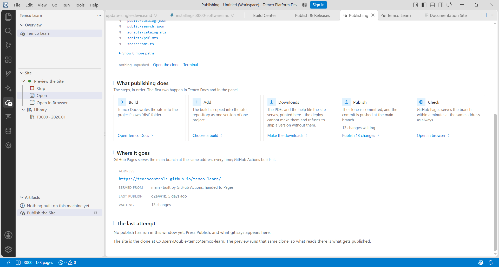

It runs the site's own scripts in this order, and stops at the first real failure:

| Script | Makes | If it fails |
|---|---|---|
| `build:fast` | the catalog, the search index and the bundle the PDFs are printed from | fatal: nothing else can run |
| `pdf --strict` | one PDF per version, and one per Markdown page, mirrored into `public/pdf/` | fatal, usually because there is no browser: run `npx playwright install chromium` |
| `chm` | the help files and `public/download/manifest.json` | only a warning: a machine without `hhc.exe` still has a site |

| | |
|---|---|
| **You should see** | `public/pdf/t3000/1.0.pdf`, `public/download/manifest.json`, and `public/chm/…` only when the help compiler is on the machine |
| **If not** | the message names the step that failed: the site build, the PDFs (browser missing), or the help files (a warning, never fatal) |

These files are the one thing the deploy cannot make for you. The site's CI has no browser and no `hhc.exe`, so the PDF is printed here and committed, and the deploy **refuses to ship a version whose PDF is missing**. That refusal is the guard you will meet in step 8 if you skip this step.

**Come back to this step every time you finish step 5.** Each new version needs its own PDF, and the guard counts versions rather than projects.

### Step 7 — look at it before publishing

**Start the Site** (`temcoLearn.site.start`).

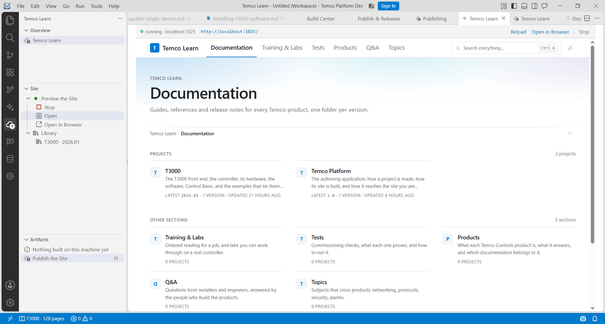

It builds the site first if `dist/index.html` is not there, then serves the built pages on one port: `temcoLearn.sitePort`, 1025 by default. What you are looking at is the **clone**, with the catalog that step 5 wrote. It is what a reader will see, minus the address.

| Look at | Because |
|---|---|
| the project's card under its section | the section came from `content/t3000/site.json`, so a wrong section is a one-line fix there |
| the version selector | every version you added is listed, and `1.0` should be there after step 5 |
| a page's navigation and content | an empty page means the Markdown is empty, not that the build failed |
| the downloads menu | it lists what step 6 committed, so an empty menu means the manifest is missing |
| search | this is the site's own index, and a page missing from it has `ship: false` |

| | |
|---|---|
| **You should see** | `http://localhost:1025/` with T3000 under **Documentation**, and its page opening from the card |
| **If not** | the port is `temcoLearn.sitePort`; the site's log in the panel says whether the build or the server is the problem |

If a page is missing, it is either unregistered or marked `ship: false`, so go back to step 2 rather than rebuilding. **Stop the Site** (`temcoLearn.site.stop`) when you are finished. The open port, not the process, is the proof that it is running.

### Step 8 — publish

**Publish** (`temcoLearn.publish`) opens the publishing page: what changed, the steps of a publish in order, and the button. Press *Publish* there and confirm the message. **Publish Now** (`temcoLearn.publishNow`) does the same thing from the palette.

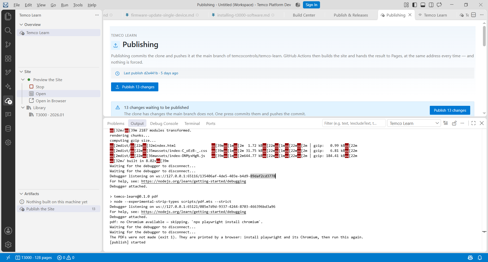

It does four things in order, and it stops at the first one that says no:

1. runs the site's `catalog`, so that what is committed matches what the pages say
2. runs the site's **`guard`**, the same gate its CI runs, and refuses to commit when a version is missing a download
3. runs `git add --all` and makes one commit. The message defaults to `docs: publish the site (<date>)`, and you can replace it
4. runs `git push origin HEAD:main`

Nothing is ever force-pushed. If `main` carries work this clone does not know about, the push is refused, the commit stays local, and a pull followed by another publish fast-forwards it.

Then the site's CI takes over. `pages.yml` runs its checks, builds the site, runs the same guard, and deploys `dist` to GitHub Pages at the address the log printed. A `v*` tag matching `package.json` instead packs the whole site as a zip for handing to somebody.

| | |
|---|---|
| **You should see** | in the clone, `git log -1 --stat` shows the commit and `git status` is clean. The log says `pushed <commit>`, the GitHub Actions run on `main` is green, and the address the log printed loads the page a minute later |
| **If not** | *the guard refused it* means step 6 was skipped for some version. The log names the missing file, and nothing was committed. *A refused push* means the clone is behind: pull, then publish again |

A publish carries everything waiting in the clone, not only the project you were working on. If that is not what you want, open the publishing page first: it lists the paths the commit would take before you press the button.

### Running it again

After the first publish, the loop is shorter than the guide above, because the folders, the project and the site clone already exist. What you re-run depends on what changed:

| What changed | Build | Add | Downloads | Publish |
|---|---|---|---|---|
| pages only, same version | ✓ | ✓ (same version — it replaces) | ✓ | ✓ |
| pages, and this is a new release | ✓ | ✓ (new version) | ✓ | ✓ |
| nothing — you only want to push someone else's changes | — | — | — | ✓ |
| the site's own code or content | — | — | — | ✓ |

The four commands, in order:

```text
Build the Site                  temcoDocs.buildSite
Add This Build to the Site      temcoLearn.addBuild
Make the Downloads              temcoLearn.site.downloads
Publish                         temcoLearn.publish
```

Two habits save the most time. **Add a new version for a new release**, because re-adding the same version replaces it and readers lose the old one. And **redo the downloads every time you add a version**, because the guard counts versions, so a new version without its PDF blocks the publish rather than the deploy.

### The same flow, as files: T3000

```text
~/temco/projects/t3000/                   the project, and only the project
├── docs/help/registry.json               the page registry
├── docs/commissioning/*.md               your pages
└── dist/site/index.html                  step 3: the site build

~/temco/temco-learn/                      the site clone
├── content/t3000/site.json               step 5: the title and the section
├── public/imported/t3000/1.0/index.html  step 5: the build's own pages
├── public/pdf/t3000/1.0.pdf              step 6: the whole-guide PDF
├── public/chm/t3000/1.0.chm              step 6: the help file, when it compiles
├── public/download/manifest.json         step 6: what the download menu offers
├── public/catalog.json                   what the site reads, rewritten by steps 5 and 8
└── dist/                                 step 8: what CI deploys
```

### The two files you will edit

Everything else in the arrangement is written for you. These two are yours, and knowing their shape lets you tell a wrong page from a wrong build without guessing.

**`~/temco/projects/t3000/docs/help/registry.json`** is written by the create flow and by every page you add. It is the only list of pages; nothing else decides what exists.

```json
{
  "version": 1,
  "areas": { "t3000": { "title": "t3000", "audience": "user", "noindex": false } },
  "pages": {
    "t3000/commissioning/ports": {
      "title": "Ports and wiring",
      "area": "t3000", "chapter": "commissioning", "order": 10,
      "audience": "user", "ship": true, "owner": "docs"
    }
  }
}
```

`ship: false` leaves a page out of the built site, and `order` decides its place inside the chapter. The key (`t3000/commissioning/ports`) must equal the file's path under `docs/`, or the page counts as missing.

**`~/temco/temco-learn/content/t3000/site.json`** is written once by step 5 and kept after that: the project's name, and the section it is filed under.

```json
{ "title": "T3000", "section": "documentation" }
```

Add `"summary"` for the sentence on the project's card, and change `"section"` to move the whole project to another category.

The third file, `public/catalog.json`, is generated and never edited. A `"kind": "build"` row in it is the giveaway that the page came from your build rather than from the site's own content — and if your version is not listed after step 5, the catalog did not run.

## Part 4 — Temco Editor

A page opens in **Temco Editor**, the editor that owns `*.md`. It has one row of controls above the text, the text in the middle, and a **Page** container on the far right. The headings you see in the text are the page's prose; its title in the navigation comes from the registry, so renaming one does not rename the other.


### The ribbon, left to right

| Group | Holds |
|---|---|
| undo / redo | `Ctrl+Z`, `Ctrl+Y`. This is the page's own history, not git's |
| **Style** | paragraph or heading level, and the alignment of the block |
| **Lists** | bullet, numbered and task lists |
| **Marks** | bold `Ctrl+B` · italic `Ctrl+I` · underline `Ctrl+U` · strikethrough `Ctrl+Shift+X` · inline code `Ctrl+E` · highlight `Ctrl+Shift+H` |
| **Blocks** | quote `Ctrl+Shift+B` · code block `Ctrl+Alt+C` · horizontal rule · table |
| **Insert** | **Picture**, **Screenshot**, **Annotate** (only when a picture is selected), **Link to page** |
| `···` | everything the row has no space for, including *Open the source* (the plain Markdown, for a paste that must not be reformatted) and *Page properties* |
| right group | Find `Ctrl+F` · Outline `Ctrl+Alt+O` · **Read the page**, which toggles to *Edit the page* · Preview `Ctrl+Alt+P` · Diff `Ctrl+Alt+D` · Source · Page properties |

The same actions are in the editor title bar and in the right-click menu under **Temco Markdown**, so nothing is reachable only from the ribbon.

**Read the page** is the one people miss. It turns the editor into the rendered page, links and all, without opening Preview. Toggle it back when you want to edit again.

### Pictures

Click a picture once to select it. A ring appears, with drag handles at its edges. Drag a handle to resize, and the width is written into the Markdown title as `"w=480"`, so the built site and the offline help honour it too.

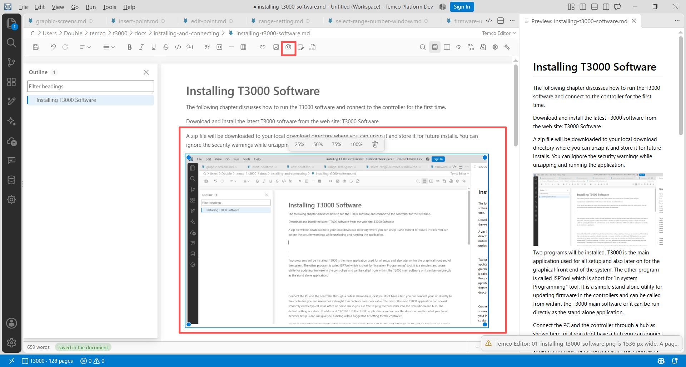

With a picture selected, the inline menu offers the widths **25% · 50% · 75% · 100%** and **Delete**. `Ctrl+Z` puts a resize back. Nothing is written to the file until the editor saves, so an experiment costs you nothing until you decide to keep it.

**Screenshot** inserts a capture straight into the page's `media/` folder. A capture taken with no page open waits in **Needs You**, where *Attach the Screenshot to a Page…* files it later. **Annotate** draws on the selected picture, and one arrow on a screenshot is often worth a paragraph of text.

### The Page container, on the right

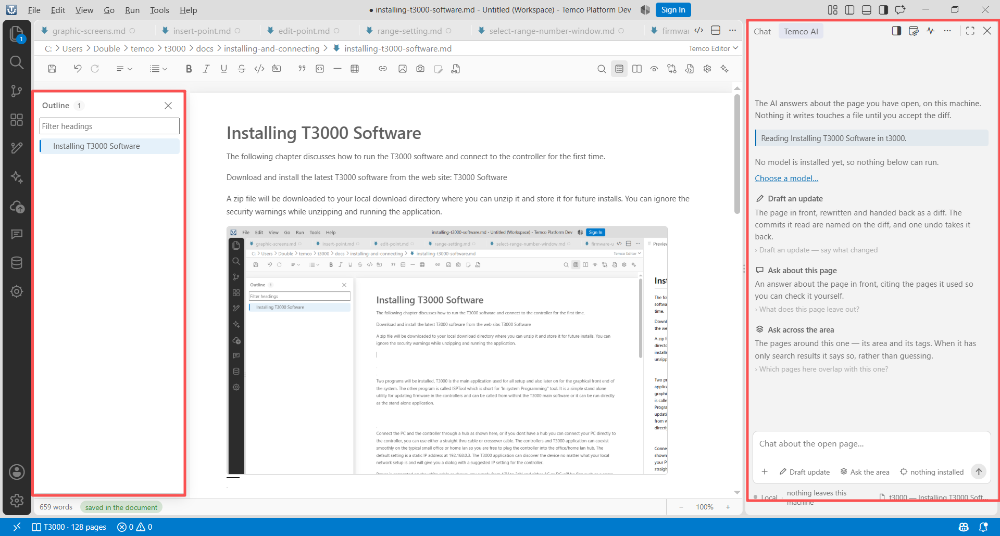

Two things live there. The **Outline** lists the page's headings, and clicking one jumps to it. The **Draft** appears when the AI module has written one. A draft is never applied by itself: you accept it, and it becomes a single undoable edit.

### Preview, Diff and Source

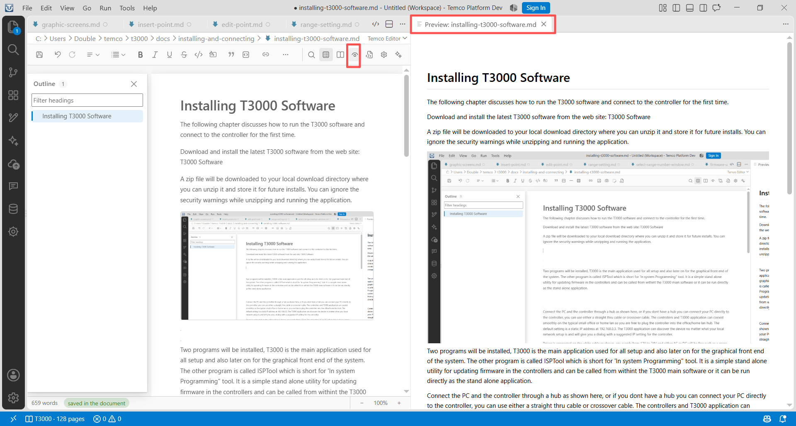

| Control | Shows | Use it when |
|---|---|---|
| **Preview** `Ctrl+Alt+P` | the page as the build renders it, in a tab of its own | you are checking a table, a callout or a picture width |
| **Diff with HEAD** `Ctrl+Alt+D` | what changed since the last commit | before publishing, especially on someone else's page |
| **Source** | the raw Markdown | a paste keeps coming out wrong |
| Page properties | a **read-only sheet** of the page's registry entry: title, area, chapter, order, `ship` and audience, plus the two ways to change it (the registry, or the page) | a page does not appear where you expect |

### Keyboard, all in one place

| Shortcut | Does |
|---|---|
| `Ctrl+B` / `Ctrl+I` / `Ctrl+U` | bold / italic / underline |
| `Ctrl+Shift+X` | strikethrough |
| `Ctrl+E` | inline code |
| `Ctrl+Shift+H` | highlight |
| `Ctrl+Shift+B` / `Ctrl+Alt+C` | block quote / code block |
| `Ctrl+F` | find in the page |
| `Ctrl+Alt+O` | outline |
| `Ctrl+Alt+P` / `Ctrl+Alt+D` | preview / diff with HEAD |
| `Ctrl+Z` / `Ctrl+Y` | undo / redo |
| `Ctrl+S` | save the page to disk |

## Part 5 — Beyond the flow, and when it goes wrong

### Beyond the flow

A project can do more than publish. None of the following is needed to get a page live, and all of it is available once you have one.

#### Bringing in material that already exists

A **source** is where pages are written from: a repository, a folder, or a document. There are two doors to the same result: the project's own page (`temcoProjects.editProject`), or the `Pages` view title → **Add a Source** (`temcoProjects.addSource`, the plug beside `＋`).

If you already have a `docs/` folder, create the project with **From existing files** and choose that folder or file. A folder that already has `docs/help/registry.json` is cited as it stands, and nothing is copied. Anything else (Markdown, HTML, Word `.docx`, or a compiled `.chm`) is converted **once** into `docs/` and a registry, so from then on it is ordinary pages. A source is recorded once and can be cited by more than one project, and nothing is ever written back to it.

#### Checking before you build

**Validate** (`temcoDocs.validate`) answers one question: would a reader find a broken link, a missing page, or a page nobody registered? It reports in the Problems panel. A build does not fail on what it finds; the published site simply contains it. So run it before step 3.

#### Releasing a build locally

**Publish** on the Publish & Releases page (`temcoDocs.publishRelease`) is not publishing to the site. It copies the last build's artifacts into the application's own storage, at `published/<project>/<version>` with a manifest, behind a confirmation that names the version, the destination and the file count. `temcoDocs.openPublished` opens that copy, `temcoDocs.servePublished` serves it and `temcoDocs.stopServing` stops it. Use it to hand a build to somebody, or to keep a version that will not change. Nothing is pushed anywhere.

#### Exporting

**Export…** on **Publish & Releases**, or **Exports** in the Command Palette (`temcoDocs.export` — it has no button of its own in the activity bar), opens the Exports page, which tells you what you get before you get it. Every export writes into the project's `dist/`, and the notification offers *Show in Folder*.

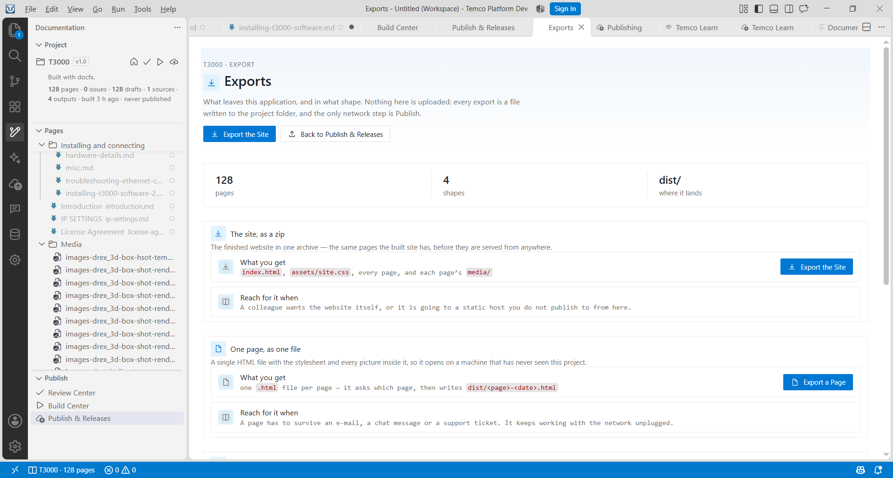

| Shape | Command | You get |
|---|---|---|
| the site, as a zip | `temcoDocs.exportSite` | `index.html`, `assets/site.css`, every page and each page's `media/`: the finished website before it is served from anywhere |
| one page, as one file | `temcoDocs.exportPage` | a single `.html` with the stylesheet inlined and every picture a `data:` URI, so it opens on a machine that has never seen the project |
| one page, as a Word document | `temcoDocs.exportDocx` | a `.docx` with headings, lists, tables and the pictures embedded: the format reviewers ask for |
| the pages, as a Markdown bundle | `temcoDocs.exportMarkdown` | every `.md`, each folder's `media/` and `registry.json`: the sources, for another tool or for an archive |

Nothing is uploaded. A page with very large pictures makes a very large single file, so export the site as a zip when the pictures matter more than the convenience.

### When something else goes wrong

Each step names its own failure. These are the ones that are not about a step:

| What you see | What it means | What to do |
|---|---|---|
| Build the Site says *has no pages marked for publishing* | no page is registered for the site, or every registered page is missing its file | open `Pages`, look for `missing` rows, and use **Create the Missing Page File** |
| an export says *has no pages to export* | no registered page has a file yet | create or generate the pages first |
| a single-file page shows a broken picture | the picture's path in the Markdown is wrong, or it is not under the page's `media/` | fix the reference, because the same link is broken on the site |
| the editor shows raw Markdown | the file opened as text | in `Pages`, right-click the page → **Open the Page**; or in Explorer, **Reopen Editor With…** → **Temco Editor** |
| a picture is full width on the web but small in the editor | the page is older than the width support | reselect the picture, drag a handle, save |
| **The Temco Editor surface is not built** — `markdown.js`, `markdown.css` are missing | the window is running compiled extension-host code whose webview bundle was never built, or was removed by a build that cleans `out/` | `npm run compile-temco` from the repository root, then **Developer: Reload Window**. A plain `npm run compile` stops before the webviews when an earlier check fails, so the application compiles and its pages still have no surface |

The output explains itself. `View → Output` offers one channel per feature, and the name on the dropdown is the part of the application that wrote the line: **`Temco Docs`** for the site build and the outputs it makes, **`Temco Projects`** for a project's own build (step 4), and **`Temco Learn`** for adding a build, the downloads, the serve and the publish. Every decision is written there with the path it used.

## Appendix — every control, and its command

The buttons you will go looking for, grouped by where they live: the activity bar, the editor, the pages themselves, the site, and Settings. The command id beside each one runs the same action from the Command Palette (`Ctrl+Shift+P`), and every id here was checked against the manifests, so if a row is in a table, the command exists.

### Projects (activity bar)

| Button | Where | Command |
|---|---|---|
| **Create a Project** | `Projects` view title `+` | `temcoProjects.newProject` |
| **Find Projects on Disk** | `Projects` view title 🔍, or the row naming the folders it found | `temcoProjects.discover` |
| **Open the Project Page** | `Projects` view title | `temcoProjects.openProjectPage` |
| **Remove All Projects** | `Projects` view title | `temcoProjects.removeAllProjects` |
| **Start** (open a project) | right-click a project row | `temcoProjects.openProject` |
| **Edit** (sources of a project) | right-click a project row | `temcoProjects.editProject` |
| **Project Detail** | right-click a project row | `temcoDocs.projectPage` |
| **Build** (the project's own build) | right-click a project row | `temcoProjects.buildProject` |
| **Stop Working on a Project** | right-click the *current* row | `temcoProjects.clearProject` |

### Documentation (activity bar)

| Button | Where | Command |
|---|---|---|
| **New Page** | `Pages` title `＋` | `temcoDocs.newPage` |
| **New Folder…** | `Pages` title 📁 | `temcoDocs.newChapter` |
| **Add a Source** | `Pages` title 🔌 | `temcoProjects.addSource` |
| **Capture a Screenshot** | `Pages` title 📷 | `temcoDocs.captureImage` |
| **Paste Screenshot** | `Pages` title 📋 | `temcoDocs.pasteImage` |
| **Switch Project…** | `Pages` title `⇄` | `temcoDocs.switchProject` |
| **Refresh** | every view title ⟳ | `temcoDocs.refresh` |
| **Open the Page** | `Pages` `…` / page row | `temcoDocs.openPage` |
| **Validate** | `Pages` `…` | `temcoDocs.validate` |
| **Overview** | `Pages` `…` | `temcoDocs.overview` |
| **Open Registry** | `Pages` `…` | `temcoDocs.openRegistry` |
| **Import a Word Document** | `Pages` `…` | `temcoDocs.importDocx` |
| **Create the Missing Page File** | right-click a `missing` row | `temcoDocs.createPage` |
| **Rename the Page Title / Move Up / Move Down / Retire** | right-click a page | `temcoDocs.renamePage`, `.movePageUp`, `.movePageDown`, `.retirePage` |
| **Attach the Screenshot to a Page…** | right-click a capture in `Needs You` | `temcoDocs.attachCapture` |
| **Build the Site** | `Publish` title 🌐 | `temcoDocs.buildSite` |
| **Publish to GitHub Pages** | `Publish` title ☁ | `temcoDocs.publishSite` |
| **Build the Offline Help** | `Publish` title 📦 | `temcoDocs.buildHelp` |
| **Export…** | Publish & Releases (opens the Exports page) | `temcoDocs.export` |
| **Export the Site as a Zip** | palette | `temcoDocs.exportSite` |
| **Export the Page as HTML** | palette, page right-click | `temcoDocs.exportPage` |
| **Export the Pages as a Markdown Bundle** | palette | `temcoDocs.exportMarkdown` |
| **Export the Page as Word** | Exports page, palette | `temcoDocs.exportDocx` |
| **Review Center** (row) | `Publish` view | `temcoDocs.review` → opens the Review Center page |
| **Build Center** (row) | `Publish` view | `temcoDocs.builds` → opens the Build Center page |
| **Publish & Releases** (row) | `Publish` view | `temcoDocs.releases` → opens the Publish & Releases page |

### Editor (while a page is open)

| Button | Where | Command |
|---|---|---|
| **Bold / Italic / Link to a Page / Format…** | editor title | `temcoDocs.format.bold`, `.italic`, `.linkPage`, `.pick` |
| **Preview the Page** | editor title, `Ctrl+Alt+P` | `temcoDocs.previewPage` |
| **Diff the Page with HEAD** | editor title, `Ctrl+Alt+D` | `temcoDocs.diffPage` |
| **Page Properties** | editor title | `temcoDocs.pageProperties` |
| **Capture / Paste Screenshot** | editor title | `temcoDocs.captureImage`, `temcoDocs.pasteImage` |
| **Open the source** (plain text) | editor title, ribbon `···` | `temcoEditor.openSource` |
| **Temco Markdown** (whole menu) | editor right-click | submenu with every format verb |

### The pages themselves

| Button | On the page | Command |
|---|---|---|
| **Build Site** | Build Center, Publish & Releases | `temcoDocs.buildSite` |
| **Build the Website / PDF / …** (one card per output) | Build Center | `temcoDocs.buildOutput` |
| **Build Offline Help** | Build Center, Publish & Releases | `temcoDocs.buildHelp` |
| **Refresh** | Review Center | `temcoDocs.review` |
| **Open folder** | Build Center, Publish & Releases | `temcoDocs.revealArtifactFolder` |
| **Open** (a file) | Publish & Releases → a build | `temcoDocs.openArtifact` |
| **Publish** | Publish & Releases | `temcoDocs.publishRelease` |
| **Publish to GitHub Pages** | Publish & Releases | `temcoDocs.publishSite` |
| **Export…** | Publish & Releases | `temcoDocs.export` |
| **Serve / Serve the Newest** | Publish & Releases, release rows | `temcoDocs.servePublished` |
| **Open** (a release) | Publish & Releases → release rows | `temcoDocs.openPublished` |
| **Stop Serving the Site** | palette | `temcoDocs.stopServing` |

### The site

| Button | On the page | Command |
|---|---|---|
| **Start the Site** | Documentation Site | `temcoLearn.site.start` |
| **Stop the Site** | Documentation Site | `temcoLearn.site.stop` |
| **Build the Site** (the site itself) | Documentation Site | `temcoLearn.site.build` |
| **Refresh** (read the clone again) | Documentation Site | `temcoLearn.site.refresh` |
| **Pull** | Documentation Site | `temcoLearn.site.pull` |
| **Discard** (back to the commit, or gone from disk) | Documentation Site | `temcoLearn.site.discard` |
| **Commit and push** | Documentation Site | `temcoLearn.site.commit` |
| **Make the Downloads** | Publishing, Documentation Site | `temcoLearn.site.downloads` |
| **Add a Build to the Site** | Publishing | `temcoLearn.addBuilds` |
| **Publish** | Publishing | `temcoLearn.publish` |
| **Publish Now** | Publishing | `temcoLearn.publishNow` |

### Settings

| Button | On the page | Command |
|---|---|---|
| **General** | Settings | `temcoWorkbench.settings.general` |
| **Modules** | Settings | `temcoWorkbench.settings.modules` |
| **AI Runtime** | Settings | `temcoWorkbench.settings.ai` |
| **Branding** | Settings | `temcoWorkbench.settings.branding` |
| **Publishing** | Settings | `temcoWorkbench.settings.publishing` |
| **Repositories** | Settings | `temcoRepositories.settings` |
| **Check the Platform for Updates** | Modules | `temcoWorkbench.settings.checkUpdates` |
| **Test the Publish Target** | Publishing | `temcoWorkbench.settings.testPublish` |
