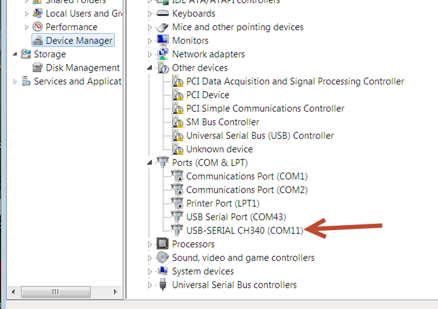

This is the normal, start-to-finish procedure for putting application firmware on a Tstat11 that already boots and communicates over RS485. It is intentionally different from the bootloader recovery procedure and from deploying a screen.

To read the whole picture first — which file is which and where it lands — see [The firmware map](00-firmware-overview.md). If the device does not boot at all, this is the wrong page: use [Full reflash](03-full-reflash.md).

## 1. Choose the right operation

Before changing anything, identify what you are trying to do:

| Goal | Do this | Recompile firmware? |
|---|---|---|
| Change a touchscreen screen | Deploy the screen JSON with Design Studio | No |
| Correct a controller firmware problem | Install `temco_app.bin` with T3000 | Maybe—the binary may already exist |
| Recover or initialize the complete ESP32-S3 flash | Use Flash Download Tool with the four-file bootloader package, then load `temco_app.bin` in T3000 | Recovery files required |

A Tstat11 has an existing bootloader when it leaves the factory. **Do not reinstall the bootloader or partition table for a normal update.**

## 2. What you need for a normal update

- A Tstat11 controller
- Stable 24 V AC or DC power for the controller
- A USB-to-RS485 adapter
- T3000 software
- The approved controller application image named `temco_app.bin`
- Continuous power and RS485 connection during the update

Download T3000 from the [TEMCO software page](https://assets.temcocontrols.com/products/t3_series_programmable_bacnet__amp_modbus_controller/software_file/09T3000Software-4.zip).

The application package may also contain `ota_data_initial.bin`. T3000's normal RS485 update selects **`temco_app.bin` only**. The OTA-data file belongs to a complete flash layout; do not select it as the application firmware in T3000.

## 3. Choose firmware

Use one of these sources, in this order of preference:

1. **Production-approved release** — the preferred choice for a deployed device.
2. **Successful GitHub Actions firmware artifact** — useful for testing a known development commit.
3. **A locally built `build\temco_app.bin`** — useful when developing and testing a change.

A GitHub artifact is the latest automated build, not automatically a production release. Confirm the branch, commit, build result and Tstat11 compatibility before flashing it.

If using the firmware repository, the currently documented CI artifact is from branch `CB-Tstate-11`, commit `fc13533`, and GitHub Actions build #75. Open the [successful build](https://github.com/temcocontrols/T3-programmable-controller-on-ESP32/actions/runs/44465312692), download its `firmware` artifact, and extract `temco_app.bin`.

Do not use an arbitrary firmware image merely because its file name is `temco_app.bin`.

## 4. Record the device state

Before updating:

1. Power the Tstat11 normally.
2. In T3000, scan for and select the device.
3. Confirm that the product/model shown is Tstat11.
4. Record the device serial number.
5. Record the current firmware version.
6. Record the configured RS485 address and communication settings.
7. If the site relies on custom settings, export or otherwise back up the controller configuration using the site's normal procedure.

Stop if the displayed model does not match the device or firmware target.

## 5. Connect the device

1. Connect the USB-to-RS485 adapter to the computer.
2. Connect its RS485 terminals to the Tstat11's RS485 terminals.
3. Observe the adapter's polarity and the device's terminal markings; do not guess A/B polarity.
4. Open Windows Device Manager and note the adapter's COM port.
5. Keep the Tstat11 on its stable 24 V supply.
6. Open T3000 and scan for the device.
7. Select the Tstat11 in the device list.

The screenshot shows a USB-to-TTL adapter; a USB-to-RS485 adapter appears the same way. What matters is the `COMxx` number, which T3000 asks for in the next step.

If the device does not appear, solve the connection before attempting an update.

## 6. Install the application firmware

1. In T3000, select **Tools → Load firmware for a single device**.
2. Select the COM port assigned to the USB-to-RS485 adapter.
3. Select **115200 baud**.
4. Select the confirmed `temco_app.bin` file.
5. Recheck that the selected online device is the intended Tstat11.
6. Start the firmware load.
7. Keep power and RS485 connected until T3000 reports completion and the controller has rebooted.

Do not start a second update, remove power, or disconnect the adapter merely because the screen becomes blank during the transfer or reboot.

The update protocol saves progress and supports resuming an interrupted RS485 transfer. That is a recovery feature, not a reason to interrupt the update intentionally.

## 7. Verify the update

After the device restarts:

1. Scan again in T3000.
2. Confirm that the same serial number appears.
3. Confirm the expected firmware version or build identity.
4. Check the display, I/O, RS485 communication and BACnet/Modbus access used by the installation.
5. Check persistent schedules, network settings and other site-critical configuration.
6. Run a short functional test appropriate to the site.

If the expected version is not visible, do not immediately flash a different bootloader. First confirm that the update completed, the correct firmware file was selected, and the intended device was addressed.

## 8. If the normal update fails

### Device is not found before the update

- Check 24 V power.
- Check A/B polarity and the RS485 wiring.
- Confirm the COM port in Device Manager.
- Disconnect other software using the same COM port.
- Confirm that the adapter is suitable for the network and baud rate.

### Transfer is interrupted

- Restore power and the original RS485 connection if possible.
- Restart T3000's single-device firmware loader with the same firmware file.
- Use the tool's resume behavior where available.
- Do not erase or directly program the flash during a recoverable transfer.

### Device boots but behaves incorrectly

- Record the model, serial number, old version, new version and observed symptom.
- Confirm that the image was intended for Tstat11.
- Re-test with the known-good firmware selected for the site.
- Contact the firmware owner before changing partition, signature or bootloader settings.

### Device no longer boots or the boot/update environment is missing

That is not a firmware update — it is a **full reflash**, done over UART with the Espressif Flash Download Tool. Follow [Full reflash with the Flash Download Tool](03-full-reflash.md) for the four files, their addresses, the tool configuration and the T3000 step that follows.

Do not continue on this page hoping the RS485 update will recover it, and do not reuse T3-Nano or TSTAT10 jumper instructions without confirming the Tstat11 hardware.

## 9. Completion checklist

- [ ] Correct Tstat11 model and serial number confirmed
- [ ] Firmware source, branch/commit or release identified
- [ ] Current version and configuration recorded
- [ ] Correct `temco_app.bin` selected for a normal update
- [ ] Power and RS485 remained connected during transfer
- [ ] Device rebooted and was discovered again
- [ ] Expected version and basic operation verified
- [ ] Site-critical settings and communications verified

For source builds, continue with [Developer guide: build and validate firmware](02-developer-build-guide.md). For protocol and recovery internals, see [How a firmware update runs](../bootloader/update-flow.md).
