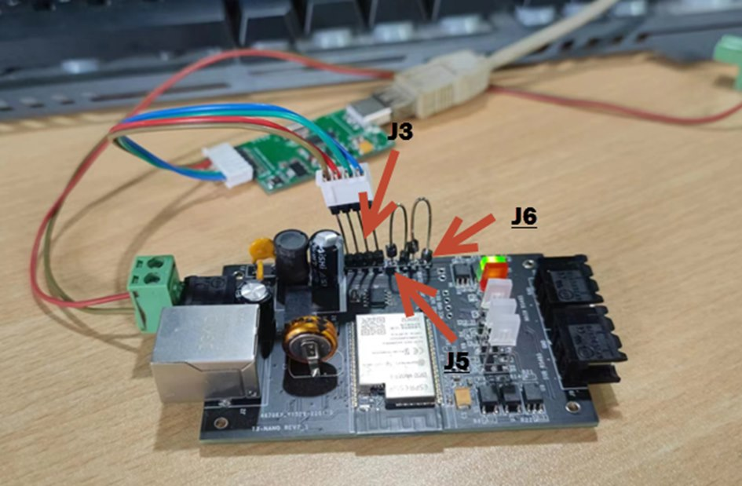
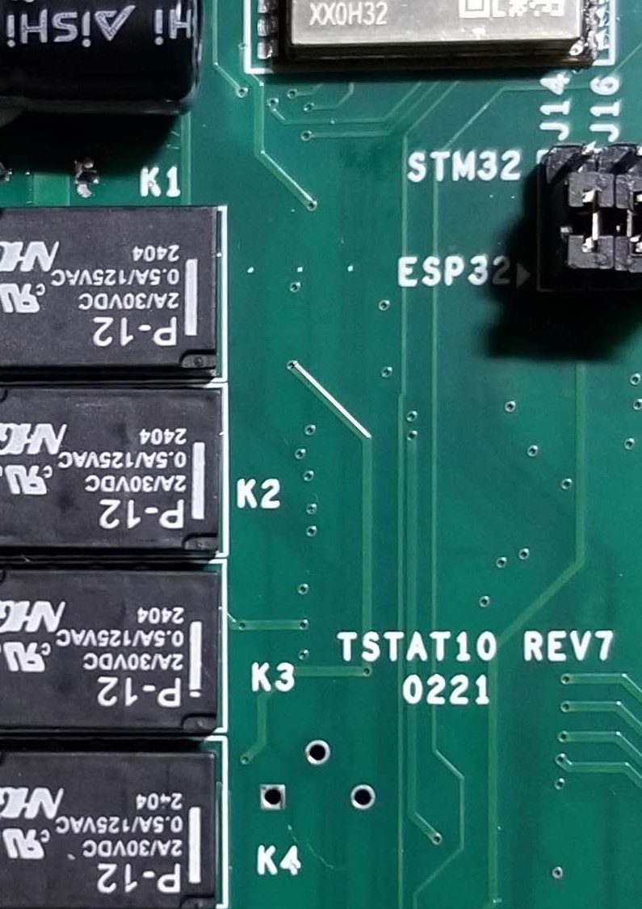
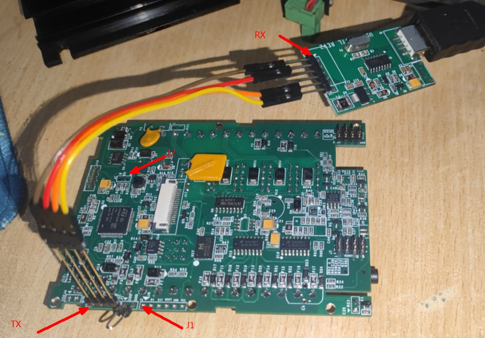
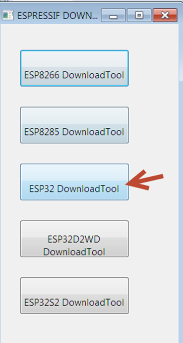
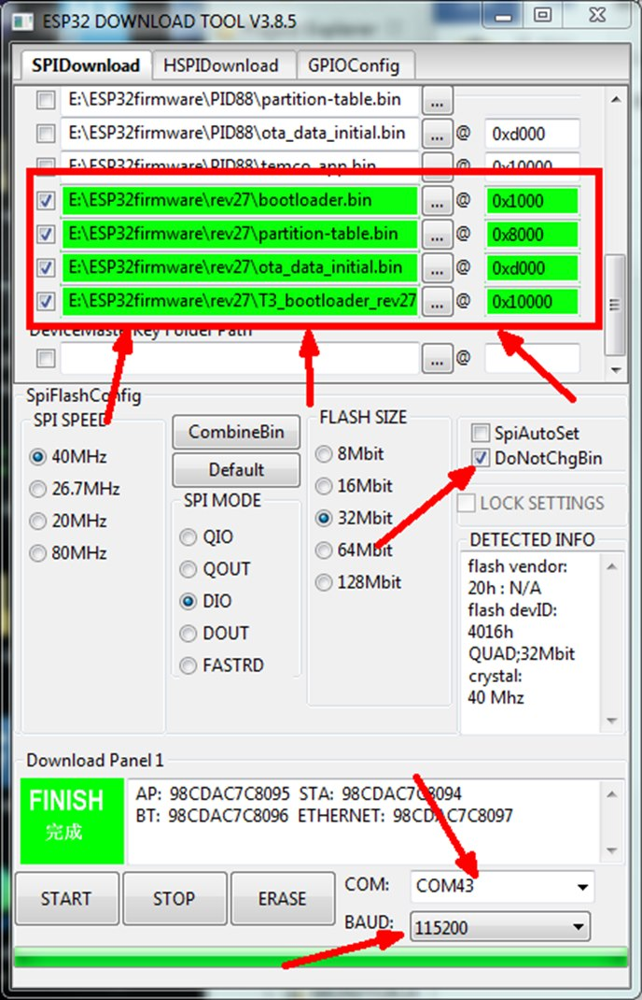

This page is the recovery route: it writes the complete ESP32-S3 boot/update environment over UART. Use it when the device will not boot, when it shows "waiting for firmware" and refuses updates, or when a hardware developer has told you to do a full reflash.

A device that boots normally does **not** need this. Use the [beginner guide](01-user-update-guide.md) instead.

## 1. What it writes, and what it does not

```text
   Flash Download Tool over UART
   ─────────────────────────────
   bootloader.bin        @ 0x00000     ← stage-1, runs at reset
   partition-table.bin   @ 0x08000     ← flash map
   ota_data_initial.bin  @ 0x19000     ← "no application selected"
   T3_bootloader.bin     @ 0x20000     ← update manager (factory app)

   then, over RS485 with T3000
   ────────────────────────────
   temco_app.bin         → ota_0 @ 0x120000   ← the controller
```

After this procedure the device has the update environment only. The controller application is still installed separately, with T3000.

## 2. What you need

- The Tstat11 board, powered as instructed for the revision
- A UART path to the ESP32-S3 and the board's way into download mode
- The Flash Download Tool folder:

```text
C:\Users\Double\Desktop\T3-S\flash_download_tool\flash_download_tool
```

- The four-file package:

```text
C:\Users\Double\Desktop\T3-S\Firmware\latest\bootloader\
```

- T3000 and a USB-to-RS485 adapter for the second stage
- The approved `temco_app.bin`

## 3. Confirm the four files before you start

| File | Address in the tool |
|---|---:|
| `bootloader.bin` | `0x0` |
| `partition-table.bin` | `0x8000` |
| `ota_data_initial.bin` | `0x19000` |
| `T3_bootloader.bin` | `0x20000` |

Verify the package: the decoded partition table must show `factory` at `0x20000` with size `1M`, and `ota_0` at `0x120000` with size `6M`.

```powershell
& 'C:\Espressif\python_env\idf5.5_py3.11_env\Scripts\python.exe' `
  'C:\Espressif\frameworks\esp-idf-v5.5.3\components\partition_table\gen_esp32part.py' `
  'C:\Users\Double\Desktop\T3-S\Firmware\latest\bootloader\partition-table.bin'
```

If it shows `0x10000` / `0x110000`, that package belongs to the older ESP32 line and must not be used on a Tstat11.

## 4. Connect the board and enter download mode

> **These photographs are legacy boards.** `flashing-04` is a T3-Nano and `flashing-10` / `flashing-11` are a TSTAT10. They show the *shape* of the job — a USB-to-TTL adapter, a header, and a jumper that holds the ESP32 in download mode — not the Tstat11 connector. Confirm the Tstat11 header, pin order and jumper with the hardware developer before connecting anything.







A USB-to-TTL adapter at 3.3 V is what these boards use. If the adapter cannot supply enough current, power the board from its own 24 V supply.

## 5. Configure the tool

Start `flash_download_tool_3.9.9_R2.exe`, then choose the ESP32-S3 target and UART mode.




The tool must show exactly these four rows. Note the addresses: the bootloader is at `0x0`, not `0x1000`, because this is an ESP32-S3 build with `CONFIG_BOOTLOADER_OFFSET_IN_FLASH=0x0`.

```text
C:\Users\Double\Desktop\T3-S\Firmware\latest\bootloader\bootloader.bin        @ 0x0
C:\Users\Double\Desktop\T3-S\Firmware\latest\bootloader\partition-table.bin   @ 0x8000
C:\Users\Double\Desktop\T3-S\Firmware\latest\bootloader\ota_data_initial.bin  @ 0x19000
C:\Users\Double\Desktop\T3-S\Firmware\latest\bootloader\T3_bootloader.bin     @ 0x20000
```


Select the COM port shown in Device Manager. The saved configuration in this folder uses `COM5`; confirm the actual port rather than copying it.



## 6. Run it

1. Click **START**.
2. Wait for all four files to report their MD5 verification as matching.
3. When the tool reports **Finish**, leave download mode.
4. Power-cycle the board as instructed.

A successful run looks like four consecutive `Hash of data verified` lines, one per file. A partially written set is not usable — rerun the whole four-file download rather than continuing.

## 7. After the reflash: install the controller application

The device now runs the update manager, not the controller. It will typically sit at "waiting for firmware".

1. Connect USB-to-RS485 and open T3000.
2. Scan for the device and select it.
3. **Tools → Load firmware for a single device**.
4. COM port of the adapter, `115200` baud, and the approved `temco_app.bin`.
5. Wait for completion and reboot.

Do not select `ota_data_initial.bin` here. It is not a firmware image.

The full sequence, from the T3000 side, is in the [beginner guide](01-user-update-guide.md).

## 8. Which build is in this package

The files in `Firmware\latest\bootloader` come from a GitHub Actions build, not from a local `main` checkout:

| Fact | Value |
|---|---|
| Workflow | Build Firmware #47, `T3_Bootloader` |
| Branch | `Bhavik_Tstate11` |
| Commit | `95d60a06` — "Updated partition to store Dynamic screen data" |
| Run | <https://github.com/temcocontrols/T3_Bootloader/actions/runs/34086246535> |
| Artifact | `firmware`, id `10005379381`, created 2026-09-07 05:21:55 UTC |
| Evidence | artifact time matches the local file timestamps and the decoded partition table |
| Expiry | 2026-12-06 |

Later successful builds exist on the same branch — #48, #49 and #50 — so "latest" in the folder name does not mean the newest commit. Keep a verified copy of the package; the artifact link will expire.

## 9. Rebuilding this package from source

The source is `C:\QN\temcocontrols\T3_Bootloader` on branch **`Bhavik_Tstate11`**. The repository's `main` branch is the older ESP32 / 4 MB line and cannot produce these files.

```powershell
Set-Location "C:\QN\temcocontrols\T3_Bootloader"
git fetch origin
git switch --track origin/Bhavik_Tstate11
idf.py fullclean
idf.py build
```

To reproduce this exact package rather than newer code, switch to the commit first:

```powershell
git switch --detach 95d60a06
```

The build and verification details are in the [developer guide](02-developer-build-guide.md).

## 10. If it fails

| Symptom | Likely cause |
|---|---|
| Tool cannot connect | Wrong COM port, board not in download mode, or another program holding the port |
| Connects, then stops early | Power or cable quality; retry with a shorter cable and the board on its own 24 V supply |
| One file verifies, the next does not | Address typo in that row; the four addresses are fixed |
| Flashes fine, device does nothing | `ota_data_initial.bin` written at the wrong address, or the image set is not the ESP32-S3 one |
| Device shows "waiting for firmware" afterwards | Expected — install `temco_app.bin` with T3000, step 7 |
| T3000 update then fails | The installed partition table does not match the application's expectations; see [How flash is divided](../hardware/flash-layout.md) |

Never flash a single file from this set alone, and never use `temco_app.bin` in place of `T3_bootloader.bin`.
