Normally the bootloader is already in the product when it ships, and a firmware update goes through T3000 over RS485. Use the [beginner guide](01-user-update-guide.md) for the complete normal Tstat11 workflow.

For the current T3-S/Tstat11 full-reflash flow, use the confirmed four-file Flash Download Tool package and address map documented in the [beginner guide](01-user-update-guide.md) and [developer guide](02-developer-build-guide.md). The four-file stage installs the first-stage bootloader, partition table, OTA data and `T3_bootloader.bin`; T3000 then installs the normal `temco_app.bin` over RS485.

The T3-Nano and TSTAT10 procedures below are retained as legacy hardware reference. Their headers, jumpers and download sequences must not be mixed into the Tstat11 procedure.

***In general, there is no need to personally load the Bootloader firmware to the product, it is already done before the factory.***
***In special cases, follow the steps below to reload the Bootloader firmware.***

## Update the main firmware
Download T3000 software,<https://assets.temcocontrols.com/products/t3_series_programmable_bacnet__amp_modbus_controller/software_file/09T3000Software-4.zip>.
Connect the device to PC with RS485, open T3000, click the icon to search for the device, if the connection is normal, the device will appear in the list.
Select the device you want to update and click *Tools->Load firmware for a single* device to start the update.

## Load the bootloader firmware to T3-nano
> #### 1.   Software tools and firmware
> -	ESP32 download firmware tool and ESP32 firmware
> <https://temcocontrols.com/ftp/file/flash_download_tool_v3.8.5.zip>
> <https://temcocontrols.com/ftp/file/BootloaderT3NanoRev27.zip>
> - CH340SerSetup  for  USB-to-TTL debug board
> <https://temcocontrols.com/ftp/file/CH340SerSetup.zip>
> - UartAssist.exe  print debug messages via USB-to-TTL board
> <https://temcocontrols.com/ftp/file/UartAssist.zip>
> #### 2.	Print Debugging Information
> - Plug USB-to-TTL debug board to your PC , Download and install CH341 driver , you will find a new USB-SERIAL CH340(COMXX) under device manager->Ports .
> 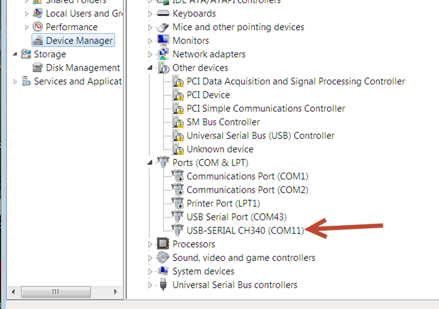
> - Connect the USB-to-TTL debugging board and motherboard J4 through the male and female connector , pay attention to keep MARK point in the same position .
> 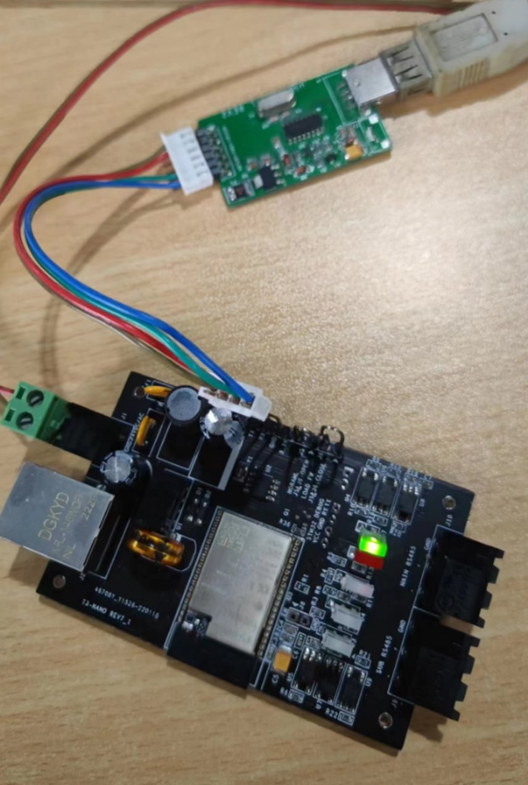
> - Power on and open commUart  Assistant which print some messages about sensors.
> 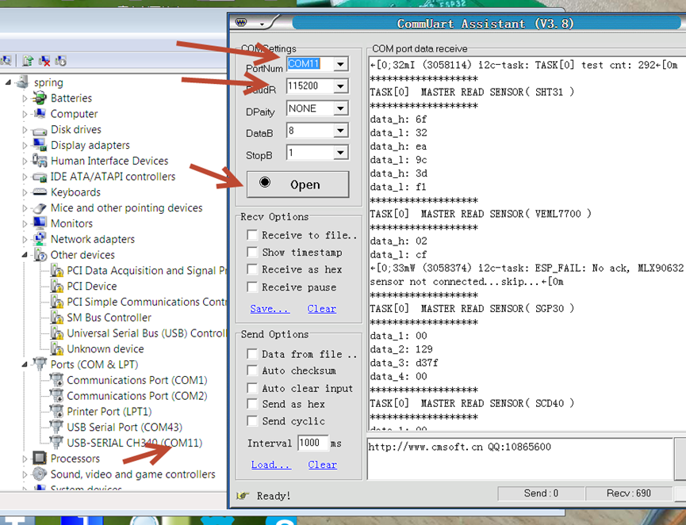
> #### 3.	ESP32 update firmware .
> - Hardware connection
> USB-to-TTL connect to J3 , Short J5 and J6 by a jumper until the end of the download firmware ,  turn on 24V power .
> 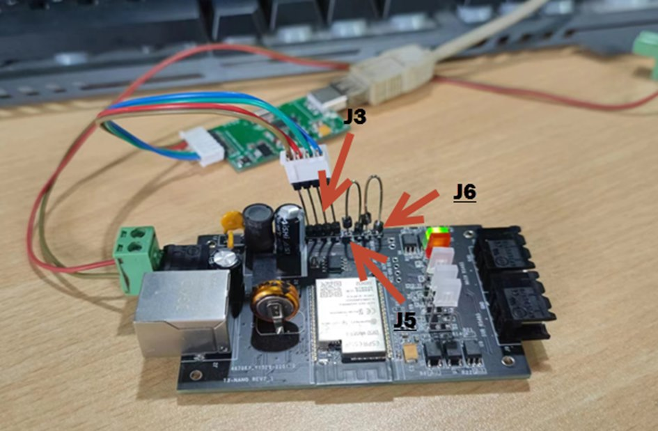
> - Set ESP32 firmware download tool configurations.
> Run flash_download_tool_3.8.5.exe , Tools -> Developer Mode -> ESP32 Download Tool,
Set some options as shown .
> 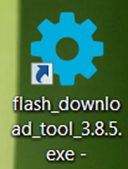 
> 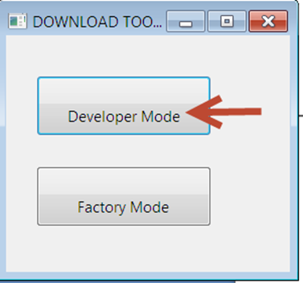 
> 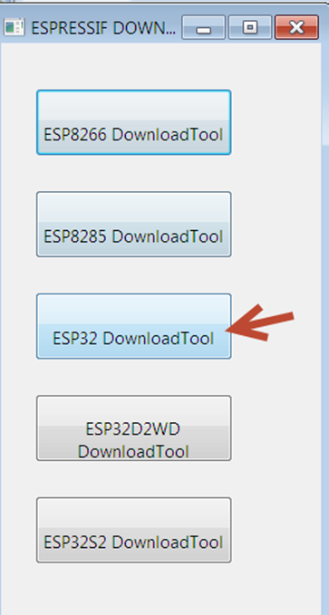 
> ***ESP32 firmware contains four parts***
> 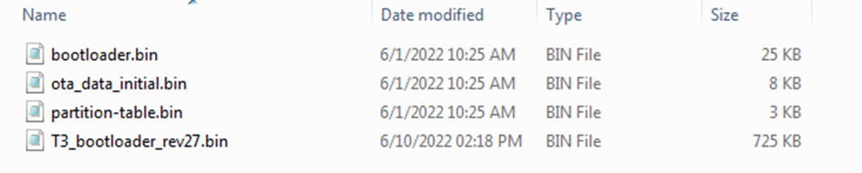 
> 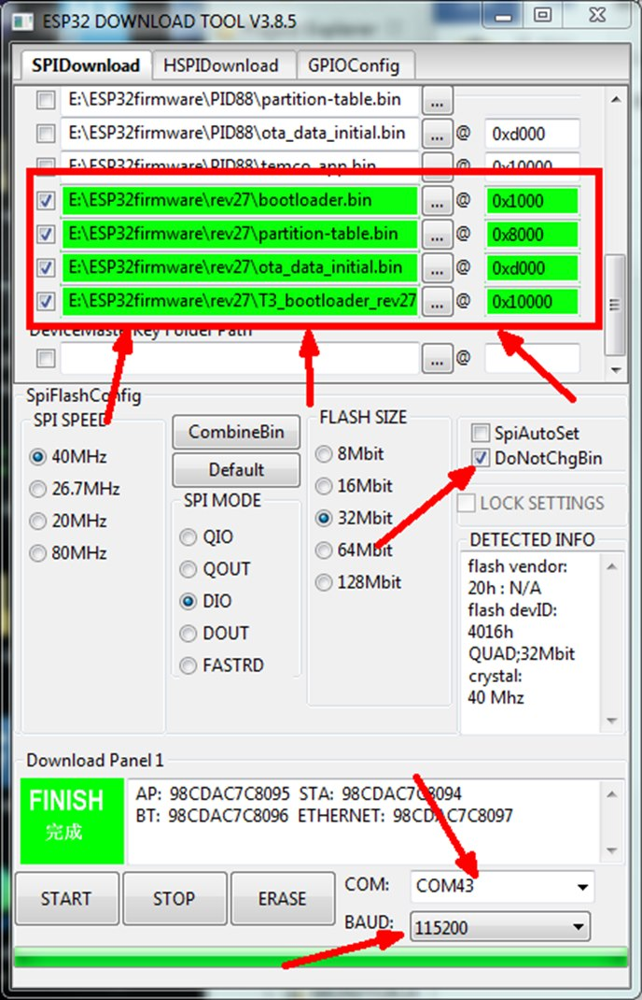 
> - Click the Start button to download the latest firmware .
When it show Finish , please remove jumper on J5 & J6 and power on again,
If UartAssist.exe is running  , you can see debugging messages .

## Load the bootloader firmware to TSTAT10
> #### 1.	Connect TSTAT10 J3 to USB with a USB to TTL debug board
> 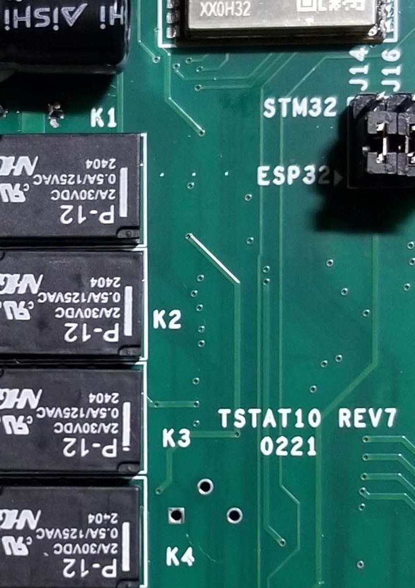 
> Jumper J1, so that after restarting, it will enter flash download mode, momentarily jumper J2, and TSTAT10 will restart and prepare to download the bootloader.
> USB to TTL dongle has a 3.3V power supply, and if power supply is insufficient, you can connect 24V power to the TSTAT10.
> 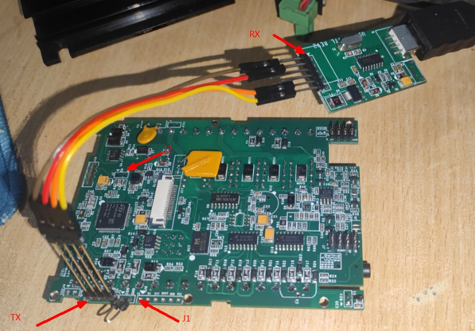
> #### 2. The steps to use the ESP32 flash downloader software are the same as the T3-nano.
> #### 3. Keep in mind that the ESP32 flash downloader tool is only used to install the bootloaders and partition information.
> #### 4. On a TSTAT10 with its RS485 port, a USB to RS485 adapter can be used by the flash download tool embedded within the T3000 software
> Power the TSTat10 with 24V AC or DC
> Connect the USB to RS485 adapter to your computer and the jack on the TSTAT10.
> Launch the T3000 software and select Tools -> Load firmware to a single device
> Then select the com port of your adapter, the baud rate as 115200 and the temco_app.bin file from your build path
> Press the flash button and the device will be programmed with your binary before rebooting to launch
