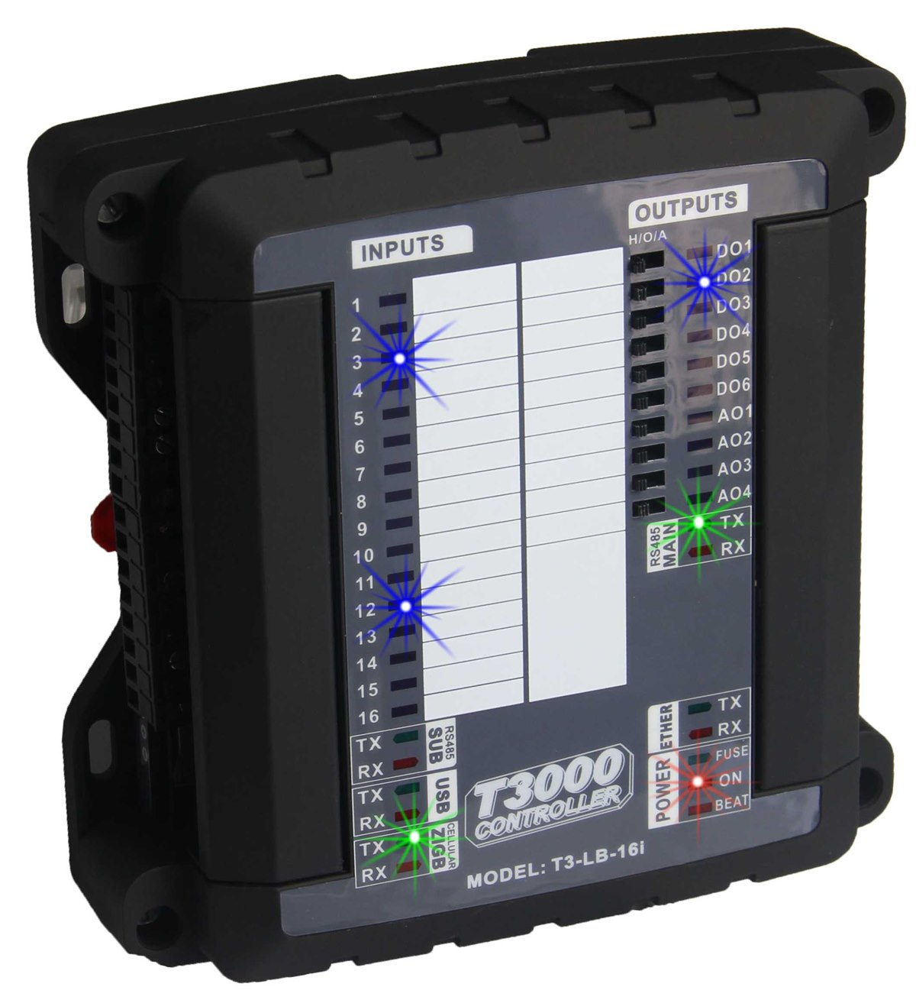
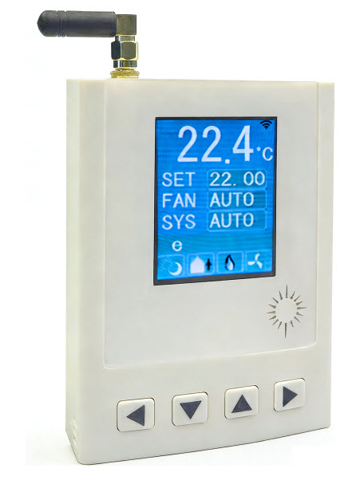

The same firmware image runs on several Temco products. This page is the product list, because a behaviour that looks wrong on one model is often correct on another: the model id decides the IO envelope, the protocol surface and whether there is a display at all.

This project implements the core firmware used in TEMCO programmable HVAC and building automation controllers.

It provides Ethernet, WiFi, and RS485 connectivity, and exposes sensors, I/O, and control logic through standard Modbus and Bacnet protocols. Devices running this firmware can be accessed by third-party systems via Modbus and Bacnet, or automatically scanned, configured, and monitored using TEMCO’s T3000 software.

The same codebase is shared across multiple TEMCO products to provide a consistent, fully programmable building automation platform.

## Products Using This Project

### T3 Series Programmable Bacnet & Modbus Controller
The T3 controllers and Tstat10 are general-purpose programmable HVAC and building automation controllers.

This project provides its core communication, networking, and protocol handling, enabling multi-protocol operation (Modbus RTU/IP and Bacnet MSTP/IP) over Ethernet, WiFi, and RS485, with support for expandable I/O and advanced control logic via T3000.

#### Highlights
- Programmable HVAC and building automation controller
- Ethernet, WiFi, RS485 connectivity supported by this firmware
- Modbus RTU / IP and Bacnet MSTP / IP protocol support
- Expandable I/O architecture for scalable systems
- Discovered, configured, and maintained using T3000 software
- No licenses or recurring cloud fees

### TSTAT10 Fully Programmable Thermostat
TSTAT10 is a programmable thermostat and room controller with a local color LCD display and universal I/O.

This project enables its ESP32 networking stack, RS485 communication, and protocol integration, allowing the device to operate as part of a larger building automation system while remaining configurable through T3000 or direct register access.

#### Highlights

- Fully programmable thermostat and room controller
- Universal I/O configurable by software
- RS485 communication with Modbus and Bacnet support
- Local color LCD display with real-time data visualization
- Well-documented register map for esay integration
- Seamless integration with T3000 software

