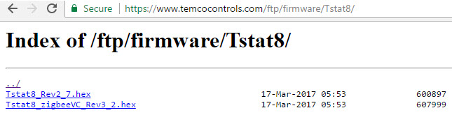
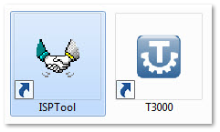
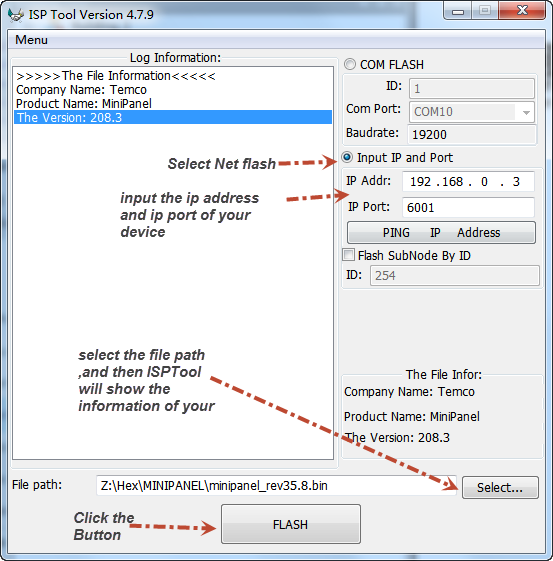

Using the Tstat8 as an example

1> Download the latest firmware from [temcocontrols.com](http://www.temcocontrols.com/ftp/firmware/MINIPANEL/) ,or paste "http://www.temcocontrols.com/ftp/firmware/Tstat8" to your browser .

Select the version that you want to update to download .

If you get the latest firmware from temco's engineer, don't need the step 1.

2> If your computer didn't install the T3000 ,please download [T3000.zip](http://temcocontrols.com/ftp/software/9TstatSoftware.zip) .

If you have installed the T3000,don't need the step2.

3> Click the icon of ISPTool

and then show a window.

**If you want to update other device ,using Com port ,please select "COM FLASH"**

**And then input the Modbus ID of your device .If you don't know your Modbus ID ,you can try flash the device ,using the 255.**

**select your Com Port .**

**and then just click the button of "FLASH"**

**notes: If you don't know the ip address and ip port of the device, don't care about the two parameters .**

**ISPTool will show the right message in the blank area ,including the ip and ip port.**

### The contents of FIRMWARE UPDATE, SINGLE DEVICE
