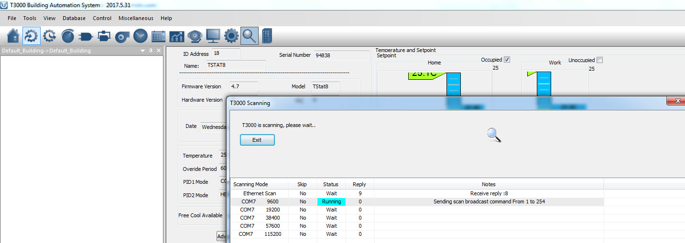
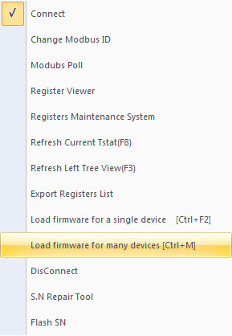
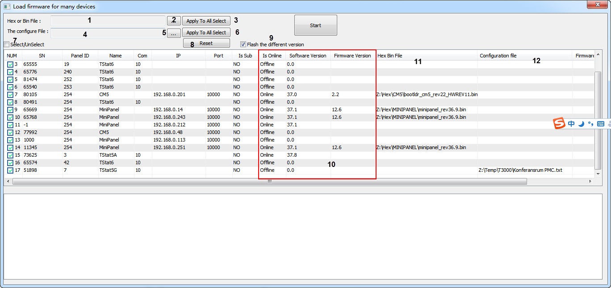

1.You must find your devices by T3000 , using "Scan"

2 “Load firmware for many devices”

1

show the path of a hex or bin file

2

click to select the path of a hex or bin file

3

"Apply To All Select" ,the path of the hex or bin(1) will automatically fill in the column of "Hex Bin File" , matching with the column of "Name"

4

show the path of a configuration file

5

click to select the path of a configuration file

6

"Apply To All Select" ,the path of the configuration file (4) will automatically fill in the column of "Configuration File" , matching with the column of "Name"

7

Select/Unselect

8

Reset ,to clear the column of "Hex Bin File" and the column of "Configuration File"

9

if selected ,T3000 will compare the "Software Version" with "Firmware Version", Only if the Firmware Version is the latest, T3000 will update .

10

When you show the window, the tree column will show the values ,automatically.

11

show the path of a hex or bin matching with the device. clicking the blank to select the file ,the file will be checked whether the file is fit the product or not .

12

show the path of a configuration file matching with the device. clicking the blank to select the file ,the file will be checked whether the file is fit the product or not .
