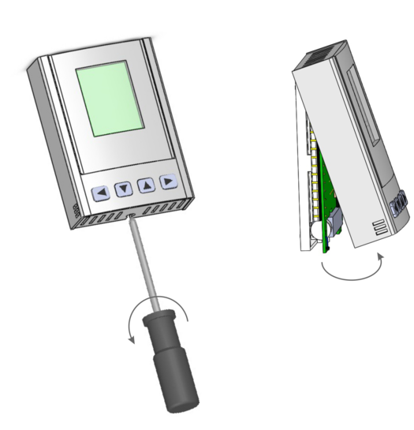
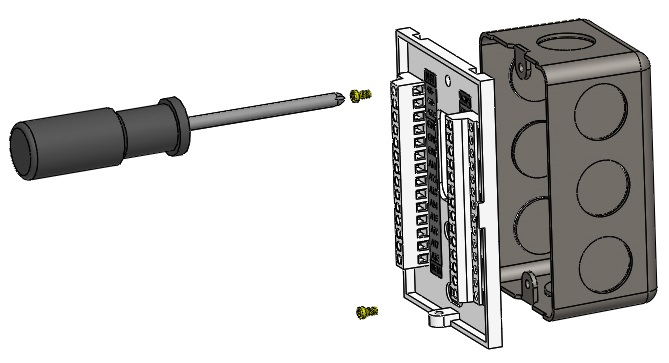
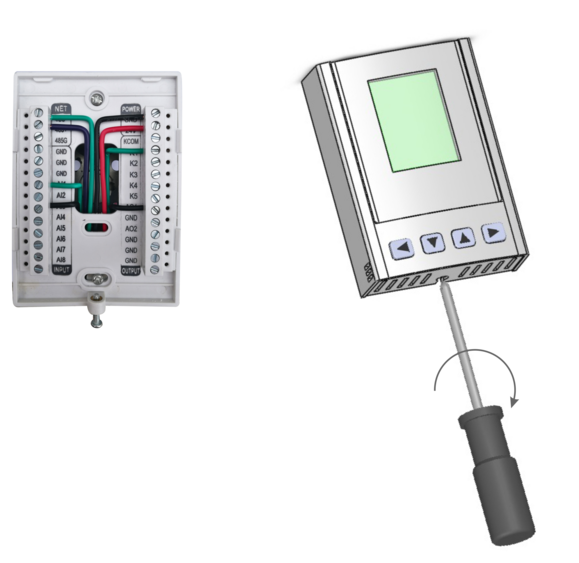

The Installation Mounting includes Wall Mount and/or Electrical Box Mount.You can install Tstat8 as following steps:

**1)**Unfasten the screw located at the base and lift off the front panel of the enclosure.

**2)**Fasten the screws on the backplate to the wall or electrical box.

**3)**Connect the wires to the terminals and re-attach the front panel.

** **
