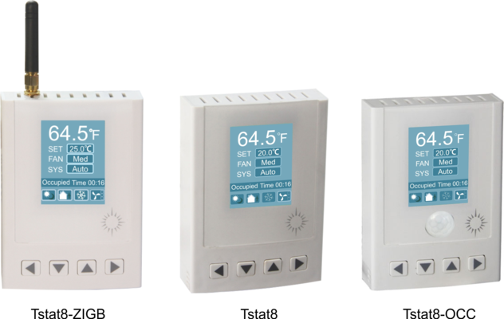

This full-featured thermostat is designed for cooling and heating systems in residential and commercial buildings. The thermostat can be configured for use with air handlers,fan coils, VAV’s, modulating valves and many other HVAC applications. All models support BACnet and Modbus protocols which allows for easy integration with big name control systems like Niagara, Siemens,Honeywell, Johnson Controls, Delta, Reliable and Kreuter just to name a few.There are fie relays outputs and two analog outputs as well as 8 universal inputs. These can be confiured using the T3000 free software avialable for download. There are more than 300 settings with many options. This makes it possible to confiure these devices for most any HVAC application. Once the unit is confiured, you can save the fie and copy it to other controllers and backup project settings.Options are available for occupancy, zigbee wireless and humidity / enthalpy control.

### The contents of Introduction
