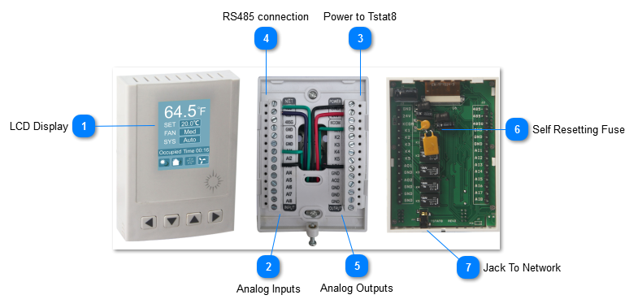
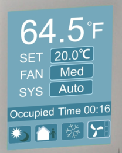
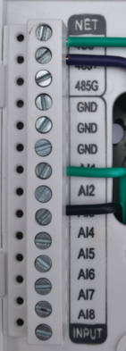
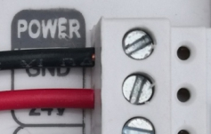
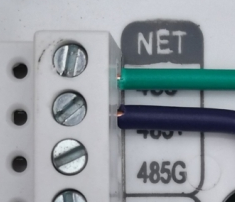
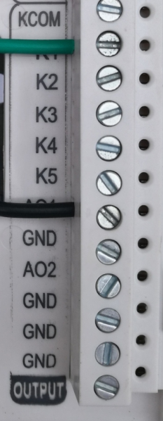
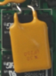
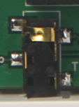

## LCD Display

Color LCD display,2.4 inch diagonal

## Analog Inputs

Analog inputs,8 universal inputs ,10k therm, contacts, 4-20ma, 0-5V,0-10V

## Power to Tstat8

The power supply can be any 12V to 24V supply, AC or DC with capacity of approximately 2 watts. Surge and reverse polarity protected with slow blow self resetting fuse on board.

## RS485 connection

RS485 connection,BACnet MS/TP and Modbus RTU protocols over RS485.

## Analog Outputs

Analog outputs,5 relay outputs 24vac @ 2 amps;2 analog outputs 10V @100mA.

## Self Resetting Fuse

## Jack To Network

