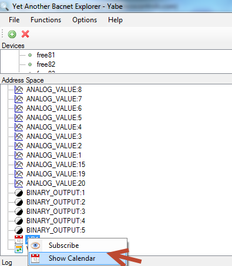
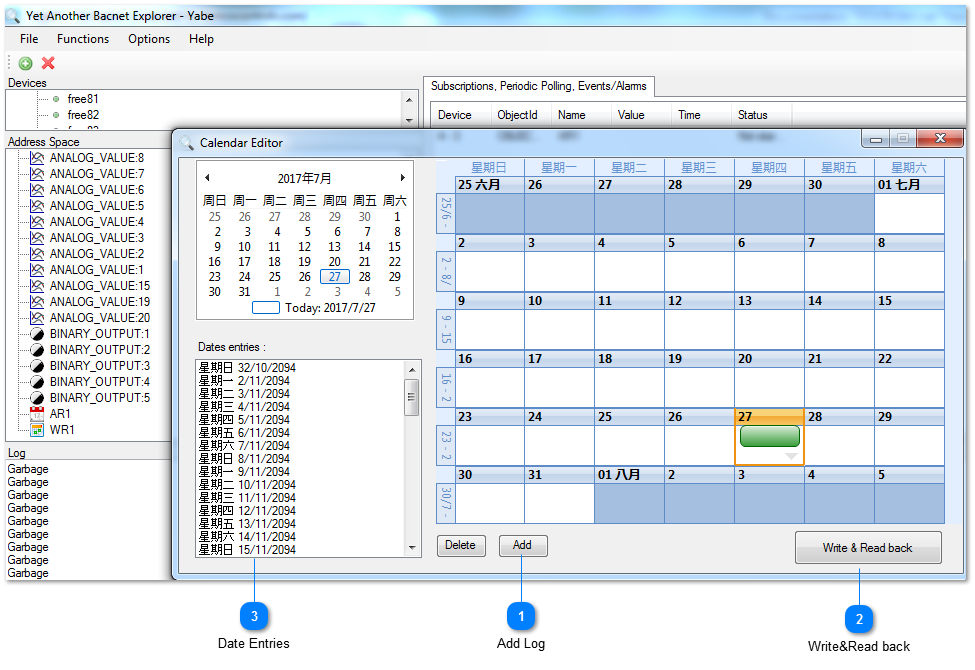
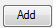
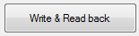
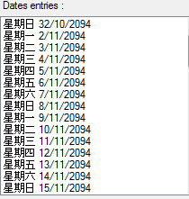

Step4.Right click “AR1” log to set up annual routine date.You can set up the annual date from this tab.

## Add Log

Click to add the date.

## Write&Read back

Click to write & read back.

## Date Entries

Click to choose the date.
