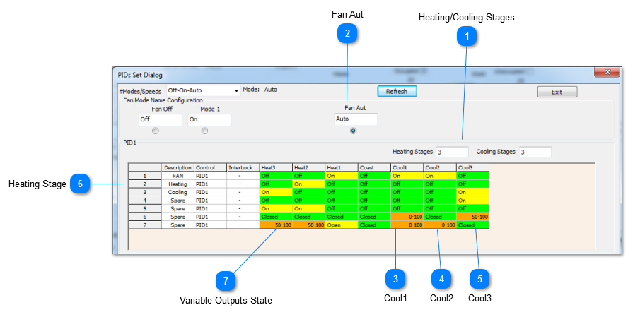
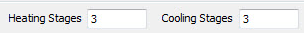
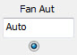
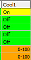
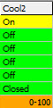
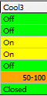
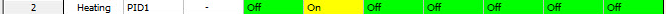
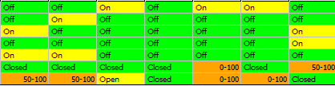

## Heating/Cooling Stages

Here we set how many stages of heating and cooling the system will have. Since this is a three speed fan we can set three heating/cooling at this tab.If we set 2 or other number of heating and cooling stages,there will be corresponding quantity of tabs.

## Fan Aut

Now select the Auto mode. The state of each of the outputs has been set to on, off or modulating on all of the various states.

## Cool1

In the first stage of cooling, output1 is on for low speed fan operation and the cooling valve is modulating open from 0-50%.

## Cool2

In stage 2 of cooling, the medium fan speed is on and the valve is opening up from 50 to 100%.

## Cool3

In stage 3 cooling the high speed fan is on and the valve is set once again to modulate from 50 to 100% .

## Heating Stage

The same sequence is set up to the right of the table for the three stages of heating. The heating valve modulates open as shown and the cooling valve is closed for all stages of heating.

## Variable Outputs State

Each cell represents the state of a particular output at a certain stage of heating, cooling or coasting. In the coasting stage, all the outputs are off.
