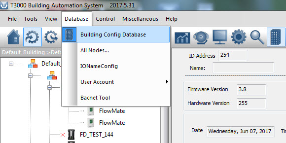
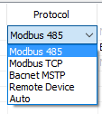
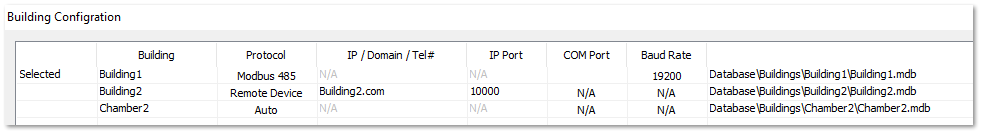

<Building Configuration

** **

notes: When protocol is auto ,IP ,Port ,Com Port ,Baud Rate disable.

When protocol is Modbus Tcp or Romote Device ,Ip,Port enable ,Comport Baud Rate disable.

When protocol is Modbus 485 or Bacnet MSTP ,IP,Port disable ,Comport Baud Rate enable.
