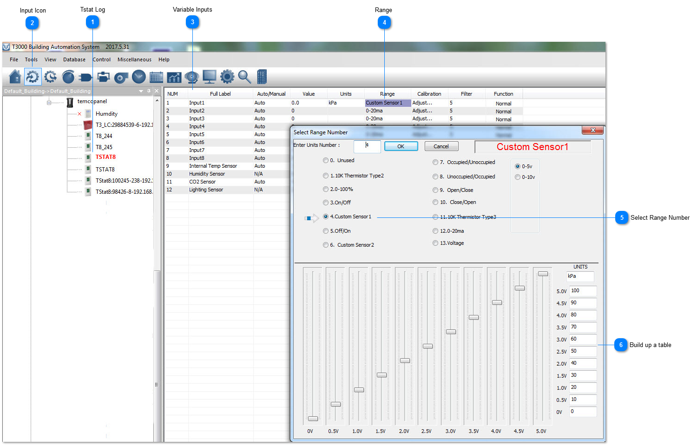
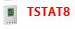
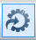
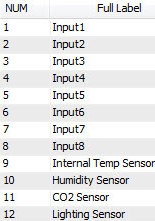
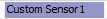
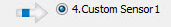
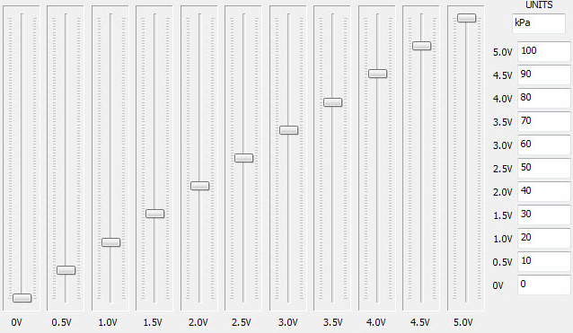

As an example of a custom sensor, here we have built up a table for a custom sensor operating from 0 to 5V over the range of 0-100psi.

## Tstat Log

Select the thermostat from the tree.

## Input Icon

Click on the INPUTS icon.

## Variable Inputs

Give each input a name.

## Range

Set the range for the input by clicking on this column.

## Select Range Number

Select from the various ranges or build your own.

## Build up a table

As an example of a custom sensor, here we have built up a table for a custom sensor operating from 0 to 5V over the range of 0-100psi.
