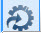
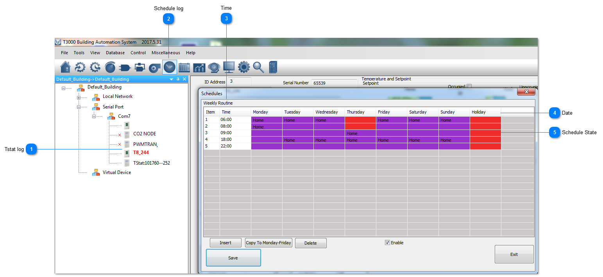
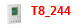
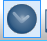
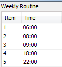
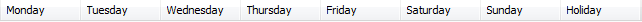
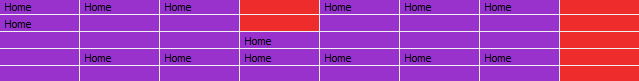
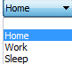

The schedules can be managed using T3000 software.Below are the steps:

Step1.Visit 107.170.34.189/ftp/software/9TstatSoftware.zip ,download T3000 software and install it;

Step2.Plug Tstat8 in power,connect Tstat8 to PC via RS485 or Ethernet;

Step3.Start T3000 software,click  to scan,then you can find Tstat8 as below.

## Tstat log

Click to select the thermostat.

## Schedule log

Click to show schedule details.

## Time

This is the time list.

## Date

The date diaplays from Monday to Sunday and Holiday.

## Schedule State

The tab shows the schedule state:Home/Work/Sleep.

