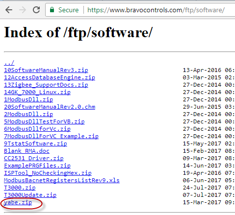
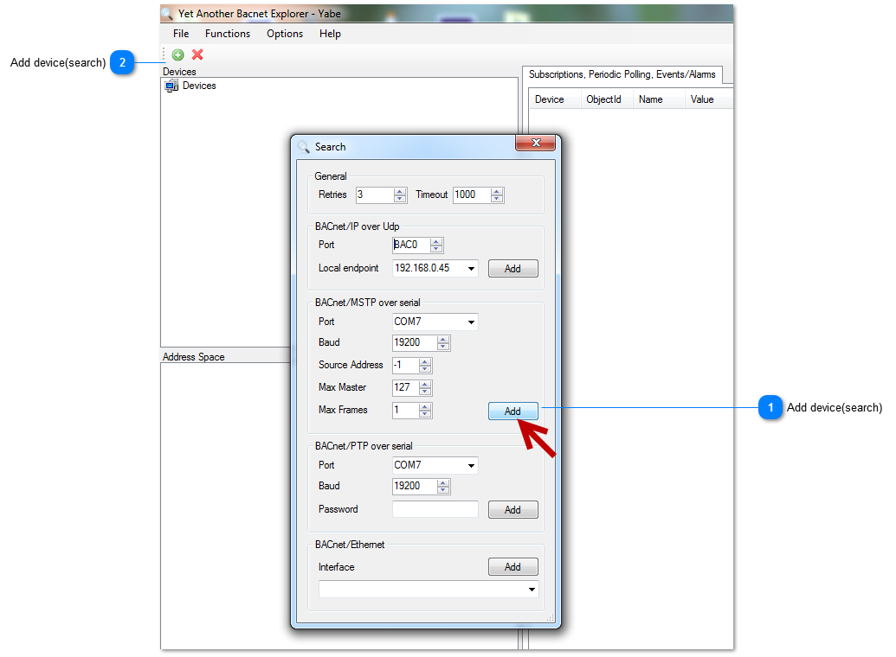

The schedules can be managed using Bacnet.Download Yabe software as the link:107.170.34.189/ftp/software/yabe.zip and install it.Connect Tstat8 to the computer,select Bacnet protocol.Start the Yabe software,add the device.

## Add device(search)

Click to add via BACnet/MSTP .

## Add device(search)

Click to add device.

### The contents of Managing schedules using Bacnet
