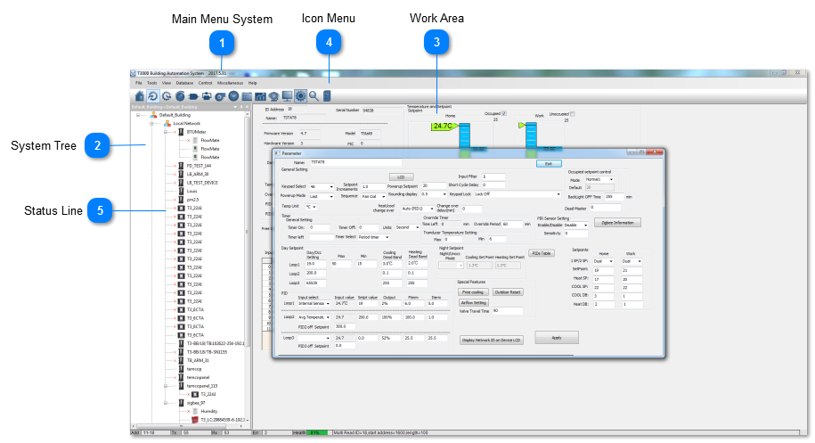
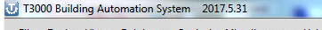
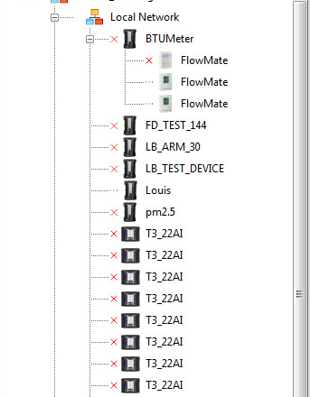
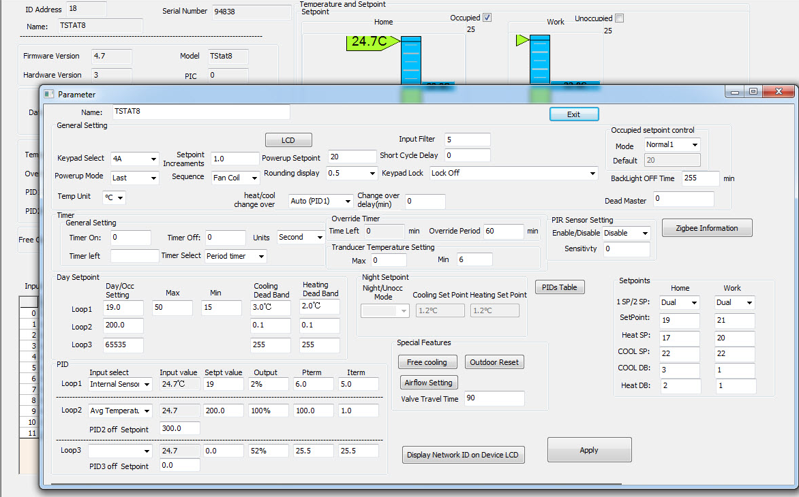
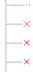

Tstat8 uses T3000 software to communicate with others.This is the Menu and Work Area of T3000 Building Automation System,including Main Menu System,Icon Menu,Work Area,System Tree,Status Line.

## Main Menu System

The main Menu system shows along the top of the screen.

## System Tree

The System Tree section shows in this window area along the left hand panel. The tree can be turned off and sorted & edited in different ways. Items which are offline will have a small red 'X' near the node. The tree is described in more detail here in the [System Tree section](../firmware-update-single-device/firmware-update-single-device.md).

## Work Area

This is the main work area which can be text based for working with grids and setup screens, or it can be graphical for working with the operator displays and floorplans. Setting up graphical displays is described in the Graphical Screens section

## Icon Menu

Shortcuts to the most commonly used work areas of the system. Inputs, Outputs, User screens, trend logs and so on all presented here in icon format. There are also these same items available from the text menu system.

Hover text will show the function of each of these icons when you place the mouse over the icons without pressing any buttons.

## Status Line

The communications status line shows the address of the device which is currently communicating in the Add box. The RX and TX numbers show how many packets have been sent to the current device in the current session, each time you click on a different device the numbers will reset to zero. The ERR box shows the number of errors in the current session with the current device. The Health box shows the percentage of successful packets for the current session for up to 100 packets. When the session hits more than 100 packets the earlier packets are pushed out of the tally, only the latest 100 are used in the math. Finally the status line shows some brief information of the data which is being sent and the status.
