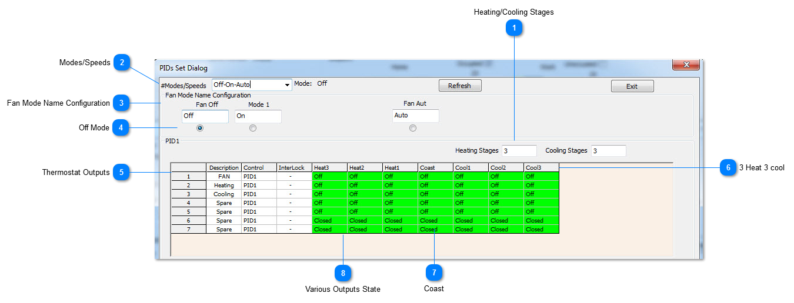
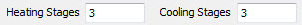
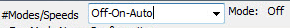
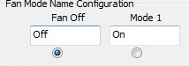
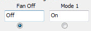
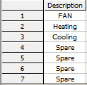
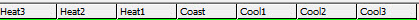
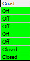
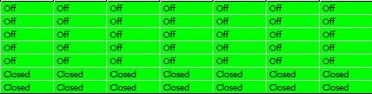

## Heating/Cooling Stages

Here we set how many stages of heating and cooling the system will have. Since this is a three speed fan we can set three heating/cooling at this tab.If we set 2 or other number of heating and cooling stages,there will be corresponding quantity of tabs.

## Modes/Speeds

Select here from the available options, this establishes the various modes the thermostat will operate in and also whether the user will be able to set the stat in certain modes or not. For example if you select OFF-ON-AUTO the user will be able to select up to three modes from the keypad: OFF, ON and AUTO mode. If we had selected only OFF-AUTO, the user will only be able to see select from the OFF and AUTO modes. Keep in mind that the keypad can be locked as well, this is a separate setting, but this is where we set the number of modes the system will operate in.

## Fan Mode Name Configuration

Each of these modes we established in the tab at 2 can be renamed along the row here at tab 3.

## Off Mode

Now we set up which of the outputs will do what in each of the various stages and modes. We have selected the OFF mode and the state of the outputs is for the off mode.

## Thermostat Outputs

Each row represents one of the thermostat outputs.

## 3 Heat 3 cool

Each column represents a certain stage of heating or cooling. Heating is to the left and Cooling is to the right. The columns to the left represent increasing responses to the temperature being below setpoint. Moving to the right are increasing responses to the room temperature being over setpoint.

## Coast

The center column represents the thermostat at rest, the setpoint is satisfied and the system is coasting.

## Various Outputs State

Here are the states for the various outputs to each stage of cooling, heating and coasting. Since we have selected the OFF mode at tab18, all the outputs will be OFF with the system is set to OFF mode.
