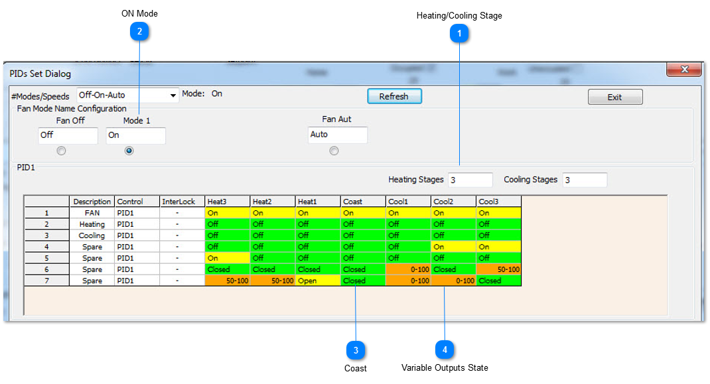
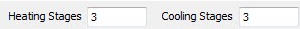
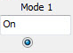
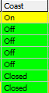
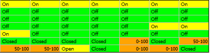

## Heating/Cooling Stage

Here we set how many stages of heating and cooling the system will have. Since this is a three speed fan we can set three heating/cooling at this tab.If we set 2 or other number of heating and cooling stages,there will be corresponding quantity of tabs.

## ON Mode

Now select the ON mode, this is generally used if you would like to allow the user to manually turn on the fan to get some fresh air in the zone.

## Coast

The stages of heating and cooling are set up exactly as everything was done in the Auto mode,the only difference is the Coast tab, you can see that the fan will be on in the coasting mode. This means even when the setpoint is satisfied at least the low speed fan will be on and the heating & cooling valves will be closed.

## Variable Outputs State

In all other stages of heating stage three on over to cooling stage3, the fan and valve are sequenced just like they were in the auto table.
