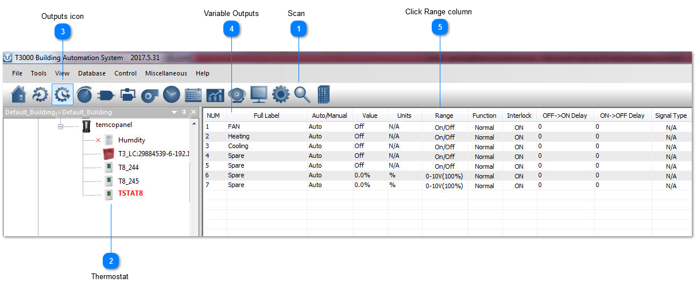
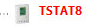
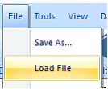
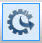
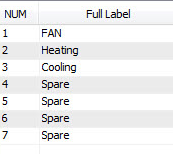
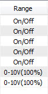

## Scan

## Scan the network and discover all devices.

## Thermostat

Select the thermostat from the tree.

For a fast way to set up the stat you can just load the config file, attached. The steps I did to create this config file are explained below.

## Outputs icon

Select the outputs icon.

## Variable Outputs

Click to give each output a name and a range, in the case of the fan the outputs are on-off and the valves are modulating 0-10V = 0-100% which are the default ranges already.

## Click Range column

Click the Range column to see many options available for the range setting such as PWM and floating three wire control for modulating actuators using two relay outputs.
