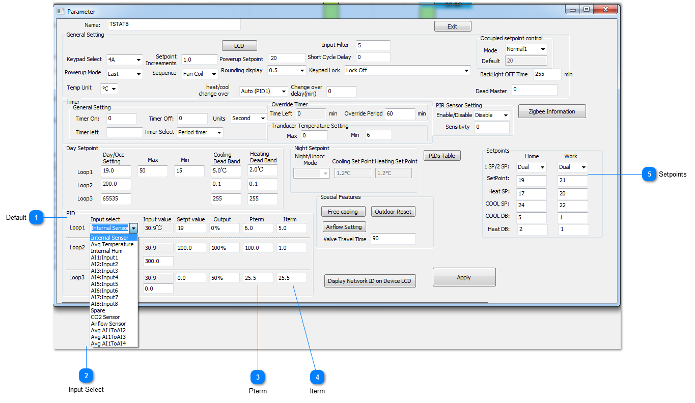
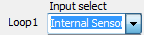
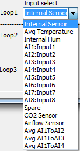
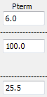
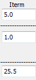
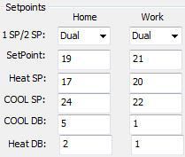

PID loop

## Default

Now we set up the PID loop, for the most part you can leave the settings at their default.

You can select which of the inputs will provide feedback for the PID loop, the default is the internal temperature sensor.

## Input Select

For the PID feedback you can select from many options such as the average of some sensors, any of the 8 external sensors or the internal humidity or C02 sensor if it has one.

## Pterm

This is the PID proportional setting. The default value of 6 means that the PID loop will output a full response when the temperature error is 6 degrees, in this case celcius, away from setpoint. So if the setpoint were 20C, the maximum heating to the maximum cooling will occur over a span of 6 degrees. When we’re three degrees below setpoint we’ll be in stage 3 heating and when we’re 3 degrees above setpoint the PID will be at stage 3 cooling.

## Iterm

This is the integral term. This is a nudge factor so that if the temperature is hovering a little ways below the setpoint for a long period eventually the integral term will accumulate some error over time and begin to bring on the next stage of heating. During commissioning this term can be set to zero because it can wind-up and cause confusion. For example the room is just below the setpoint by half a degree or so you would think the unit will be in stage1 heat yet it is running at high speed. It is the integral term which has wound up and is calling for stage three. When commissioning is done you can enter something for the I term to get better PID loop action, the default value of 5 is reasonable and means you can get an extra 5% of PID action for every degC – hour of accumulated error.

A small value for the P term means the PID loop will be more sensitive to a deviation from setpoint. A small term for the I term means the PID loop will be lazy over time.

Small P = hyperactive

Small I = lazy, over time.

## Setpoints

Finally set up the setpoints. Dual setpoints operate like a residential thermostat where you can set up a separate heating and cooling setpoint. Single setpoints are more for commercial settings where you would like to keep things simple and let the user adjust only a single setpoint up or down. The HOME and WORK columns show the heating and cooling setpoints for occupied (home) and unoccupied modes (work). There are other modes which we need to add to this dialog, SLEEP and AWAY which are common with residential thermostats. In single setpoint mode there is only one setpoint we talk about, so the heating setpoint is calculated from the ‘setpoint’ minus the heating deadband. Similarly, the cooling setpoint is equal to the ‘setpoint’ plus the cooling deadband.
