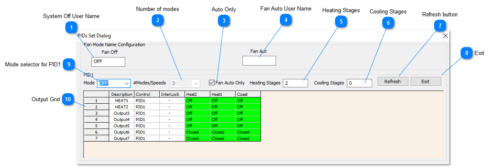

## System Off User Name

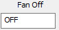

User name for when the system is off, can change this field to show "SHUTDOWN" , "UNOCCUPIED" or any other user defined name.

## Number of modes

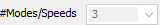

Define the number of modes for the system. Most systems will have at least two for the ON and OFF modes. Other systems like a fan coil with a multi speed fan would have five: OFF-LOW-MED-HI-AUTO. The minimum number of modes is fixed as 3 for ON-OFF and AUTO but you can add more to suit the application.

## Auto Only

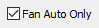

Check this box if you don't want to let the user step into the manual modes, the system will take care of staging the system from stage 1 cool to stage 2 cool and so on automatically. If you want the user to have more control at the keypad to let them put the system on manually, to move some air in the room for example by setting the fan on manually, leave this box unchecked. Note that in this case, the system may not run at its optimum efficiency, the fan would be running full time even when the setpoint is achieved.

## Fan Auto User Name

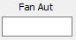

This is the user defined name for when the system is in the auto mode. It could be changed to RUNNING or OCCUPIED or whatever suits the application.

## Heating Stages

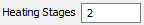

This is the number of stages of heating in the system. A single stage heater would set this item to 1. A two stage air conditioned would set this to two and so on.

## Cooling Stages

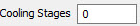

This is the number of stages of cooling in the system. For a single stage air conditioner set this to 1. For an air handler with two stages of cooling, set this to two and so on.

## Refresh button

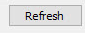 Self explanatory, hit this button to refresh the screen.

## Exit

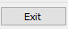 Saves the current changes and leaves the setup screen

## Mode selector for PID1

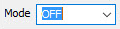

There are several tables to define the staging of the outputs in each mode of operation. Once the number of modes & speeds has been set this tab lets you view the output grid for each of the modes. Note that you can change the names of these modes so your screen may look a little different than described here.

If you have 3 modes of operation, this tab will have the OFF-ON-AUTO.

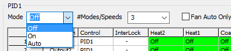

However, if you set the Fan Auto Only box, the ON mode normally reserved for the manual ON settings will be disabled and the manual ON table option is no longer visible.

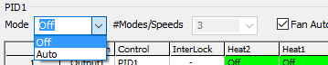

## Output Grid

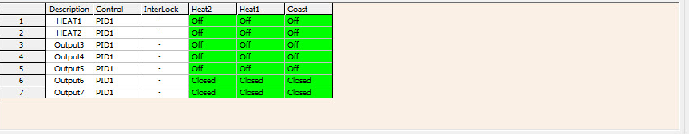

Here is where you define which output will be active for a given stage of heating or cooling. Each row represents one of the outputs and each column represents a certain stage of heating or cooling.

There are one or more 'Mode' tables, each of which is represented by one of these grids with on and off settings for each output over each stage of operation. Normally the occupied mode and the unoccupied mode are enough for a typical HVAC application but you are able to define more modes, such as low-medium-hi in the case of a three speed fan coil system. In the example above, the OFF mode is currently selected so the grid shows the output states when the system is operating in the OFF mode.

There are two collumns called heat1 and heat2 for the two stages of heating and no columns for cooling since cooling is set to zero. The Coast column represents the state of the outputs when the setpoint is satisfied and the system is said to be 'coasting'. In this example, all the cells are OFF so the system will not try to maintain the setpoint in this mode, all outputs are truly OFF. In cold weather you may want to maintain a certain unoccupied setpoint to keep the pipes from freezing in the building in which case the stage 2 heating would have some of the outputs flipped to ON.
