Step1.Visit 107.170.34.189/ftp/software/9TstatSoftware.zip, download T3000 software and install it;

Step2.Plug Tstat8 in power,connect Tstat8 to PC via RS485 or Ethernet;

Step3.Start T3000 software,click  to scan,then you can find Tstat8 as below.

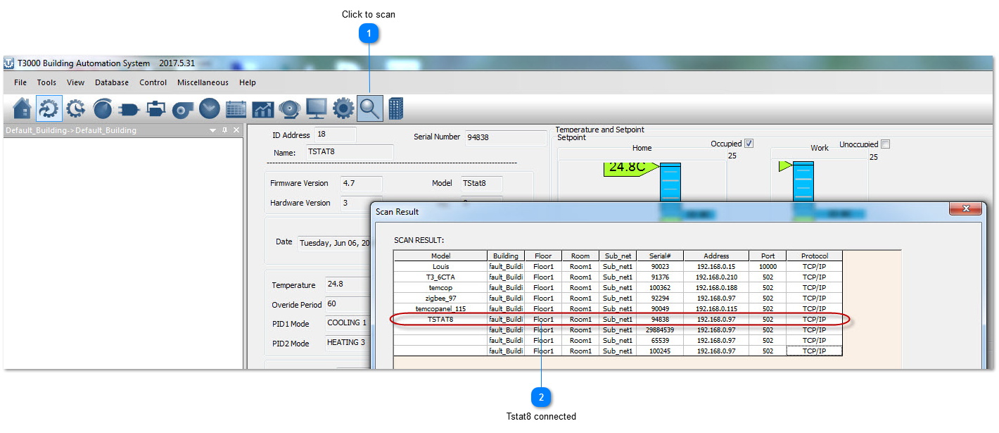

4. Click Tstat8 log, then click  , this will display all of the Tstat8 inputs. Change the name of the input and range that fis the application.

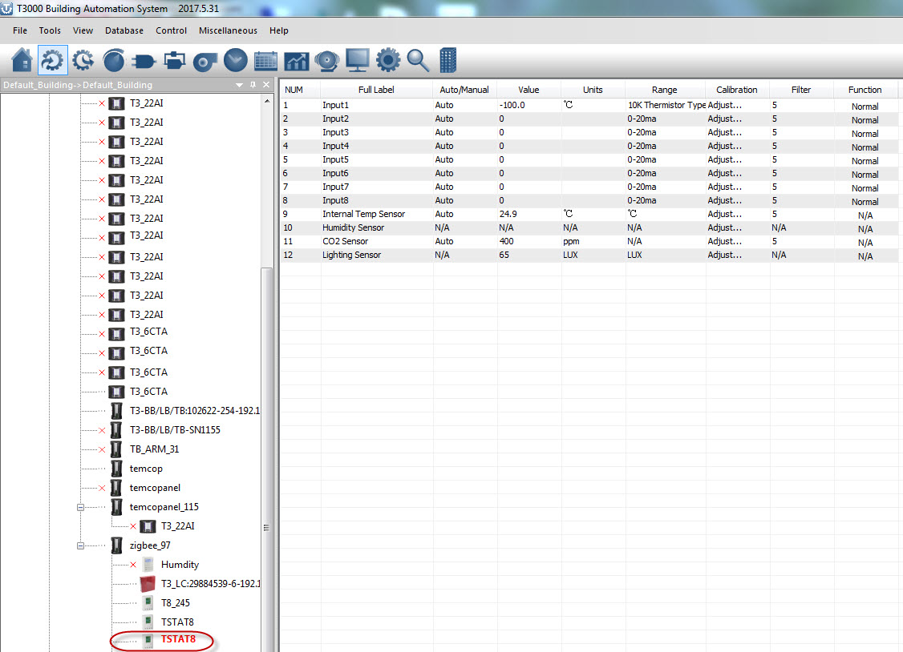

5.Click  to see the status of the Tstat8. This window will display setpoints, temperature, inputs and outputs.

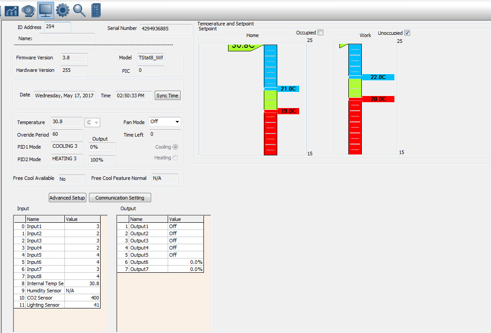

6.Click  to show parameter tab below,you can do the settings.For example,click”PIDs Tables”to”PIDs set Dialog”,click to set “Heating Stages”value.

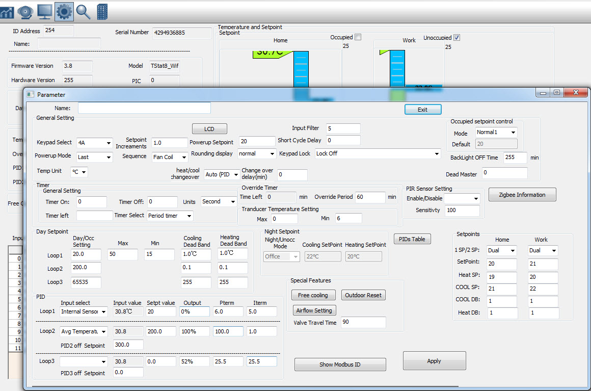

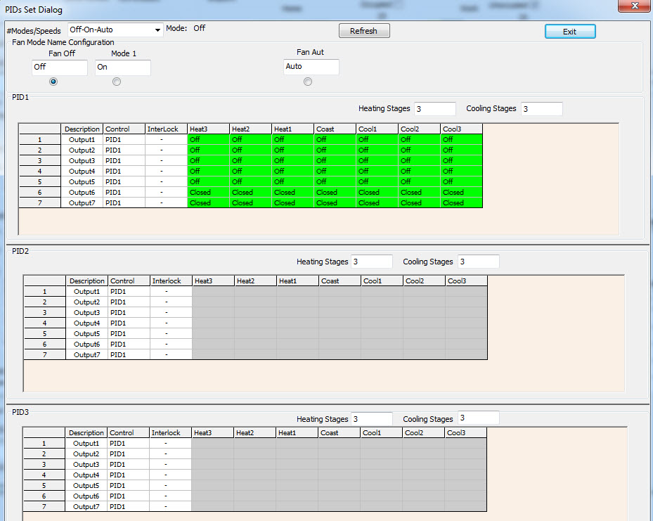

7.Click the schedule icon  to go to schedule window,you can do schedule settings.

Each day we support 6 events, and you can select the mode for each event:

For home mode, unit will use day setpoint to control the outputs;

For work mode, it will use night setpoint to control the outputs;

For sleep mode, it will use sleep setpoint to control the outputs

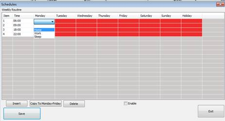

For example as below:

when time is between 6:00 to 9:00, unit will work on home mode;

when time is between 9:00 to 18:00, unit will work on work mode;

when time is between 18:00 to 22:00, unit will work on home mode;

when time is between 22:00 to Tuesday 6:00, unit will work on sleep mode

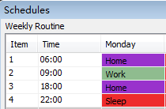

After you setup the Monday schedule, you can copy the Monday setting from Tuesday to Friday,

then you can use the “Copy To Monday-Friday” function to copy the setting.

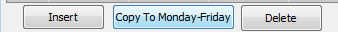

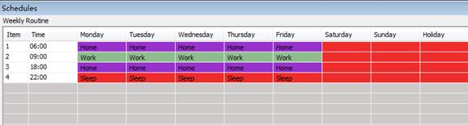

If you need different setting for each day, you can use insert function to edit your schedule, for

example, on Saturday, double click the window and it will show a small dialog to insert new event

and you can set up the time.

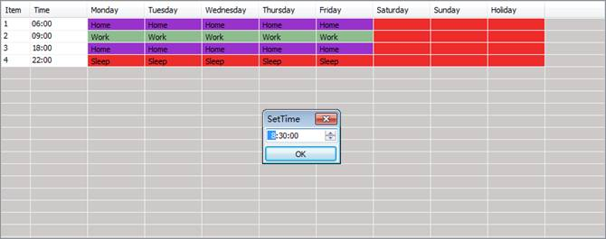

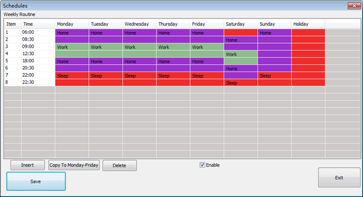

So on Saturday, when time is between 8:30 to 12:30, unit will work on home mode;when time

is between 12:30 to 20:30, unit will work on work mode; when time is between 20:00 to 22:30,

unit will work on home mode;when time is between 22:30 to Sunday 6:00, unit will work on sleep

mode.

**Note:**Select “Enable” option to enable schedule function.After edit schedule, make sure click the

save button to save the setting !

## Click to scan

## Tstat8 connected

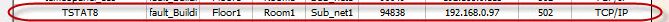
