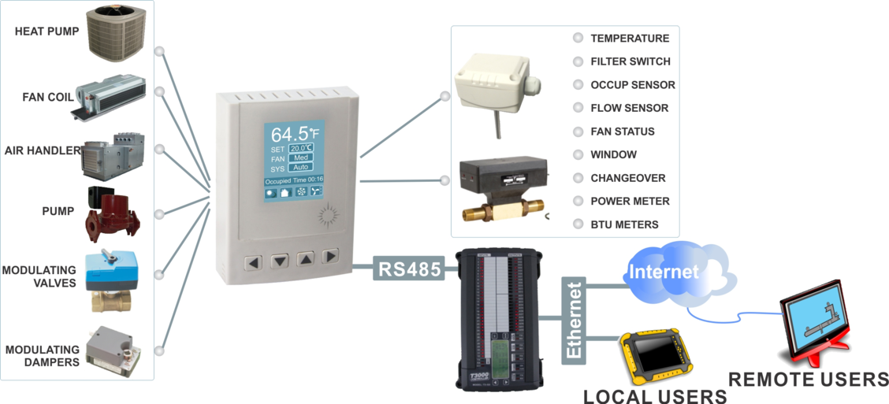
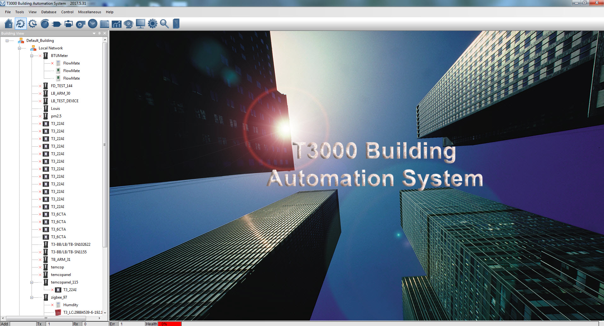

Tstat8 uses T3000 software to communicate with others.The T3000 Building Automation System is a complete solution which allows a building operator to manage the indoor environment of commercial, institutional and residential buildings. Equipment such as chillers, air handlers, boilers, fans, lights, pumps, dampers, valves and other mechanical equipment can be scheduled and controlled according to the sequence defined by the control system designers. Extensive monitoring and logging features allow the operator to see what is going on in their building to proactively improve comfort and efficiency. The system has powerful communications capabilities making it possible to integrate with other systems and can scale to virtually any size from a home sized system on up to a university campus with many buildings.

An operator with the appropriate privileges may access the entire system regardless of whether they are logged on over the internet or locally from a PC inside the building. End users and tenants can be set up with access to only their own areas which gives them the power to control their own area as they like.

Simultaneous users may access the system over one of the many communications channels. Alarms, system graphics and trend data are stored directly on the controller so there is no central server or single point of failure.

Interactive graphic displays, floor plans and custom menus make operation simple for any user. The flexible T3000 hardware and software makes it easy to configure and reconfigure the system throughout the life of the building. The system is primarily targeted at HVAC applications but can also be used for many other applications such as lighting, green houses and other light industrial systems. The system also supports industry the standard bacnet and modbus protocols which means its possible to integrate with access control systems, lighting, power meters and others to form a complete building management system.

### The contents of T3000 Software
