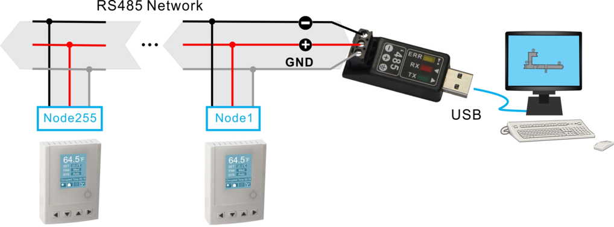

Hightlights:

•

• Baudrates of 1.2k,4.8k,9.6k,14.4k,19.2k, 38.4k, 57.6k, 76.8k and 115.2k.

• Well documented register list for easy integration with other systems.

• Easily configure the thermostat for practically any application.

### The contents of Tstat8 Software
