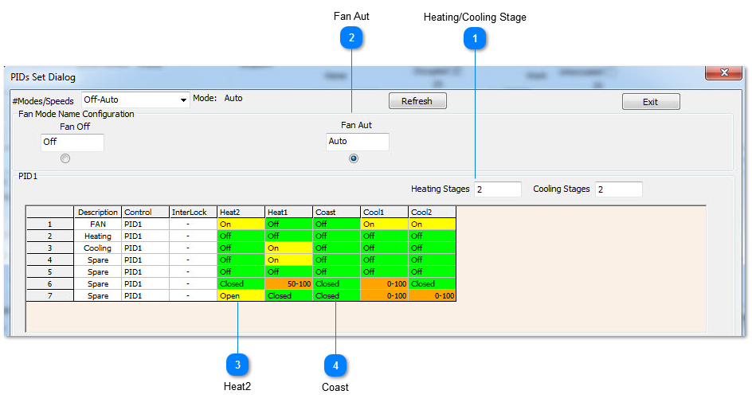
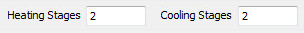
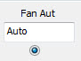
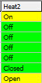
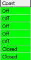

## Heating/Cooling Stage

Set the number of stages of heating and cooling.

## Fan Aut

Fill in the grid for the Auto mode.

## Heat2

Heat2 will be on in the column called Heat2 and off for the other stages and so on. The fan is on all the time as shown by the FAN row with all yellow entries.

## Coast

You could optionally turn the fan off during coasting by setting the cell to OFF.
