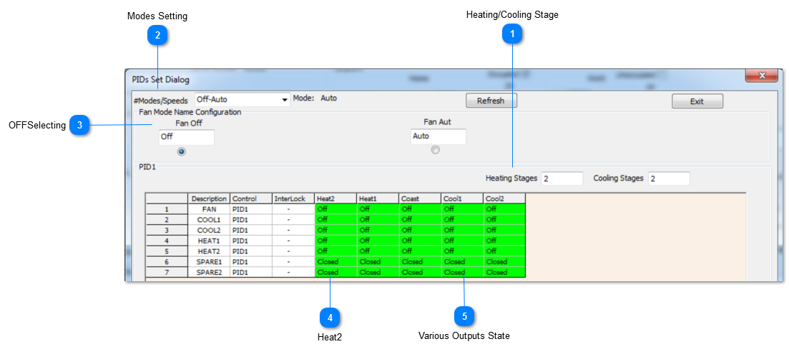
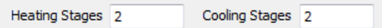
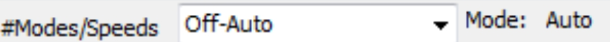
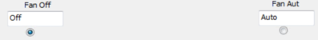
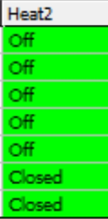
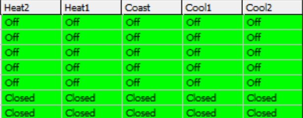

## Heating/Cooling Stage

Set the number of stages of heating and cooling.

## Modes Setting

You can set the number of modes at the tab, two modes have been selected here with the default names as Off and Auto.

## OFFSelecting

You can rename them by editing the names at the tab.Next we’ll edit the Off table by selecting the radio button. The grid shown represents the outputs when the stat is in the off mode.

## Heat2

The center column represents the coasting mode, everything is off there as well.

## Various Outputs State

Each row is one output and the columns represent the outputs in each of the stages of heating and cooling. In this example, everything is off for all 2 stages of heat and two cool.
