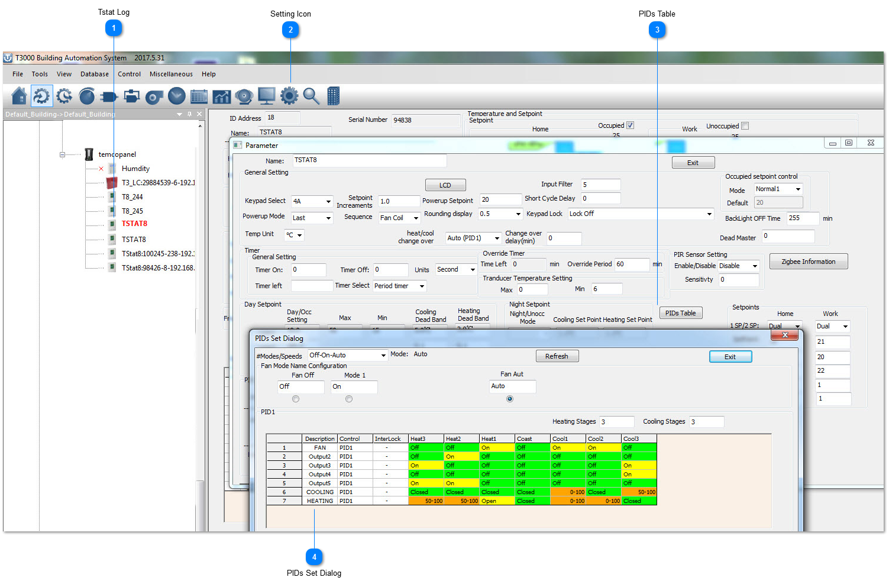
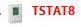
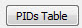
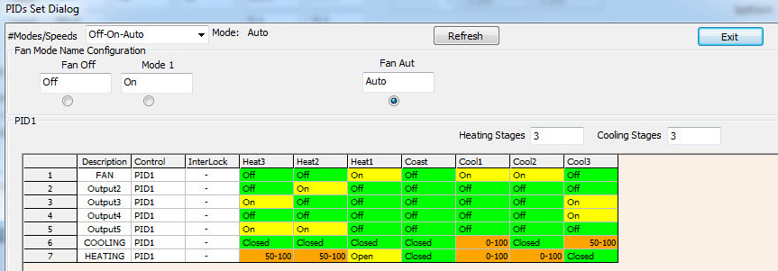

## Tstat Log

Click on the gear icon to get to the advanced settings.

## Setting Icon

Click to get to the PID tables, this is where we assign outputs to act over each stage of heating and cooling.

## PIDs Table

<TODO>: Insert description text here...

## PIDs Set Dialog

PIDs Set Dialog shows the details of the setting.

### The contents of Two heat two cool setting
