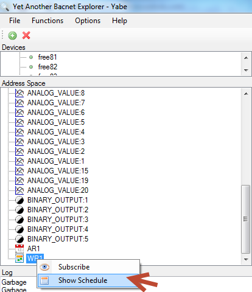
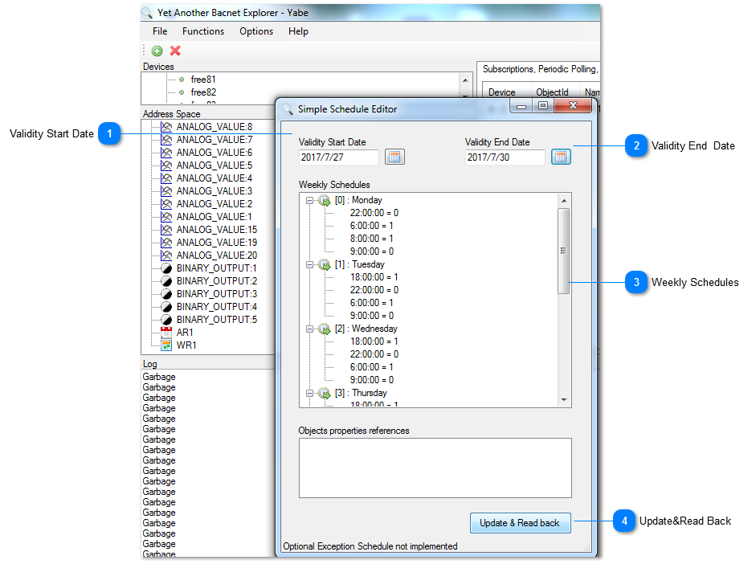
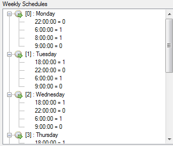

Right click “WR1” log (weekly routines) to set up the weekly schedule date.For the weekly routine, if status = 1, means unit will go to occupied and if status = 0, means unit will go to unoccupied. When the time is set up, click “Update & Read back” button to save and read the setting back.

## Validity Start Date

Click to set the start date.

## Validity End Date

Click to set the End date.

## Weekly Schedules

This tab shows the Weekly Schedules details.

## Update&Read Back

Click the log to update &Read Back.
