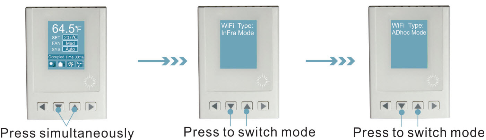
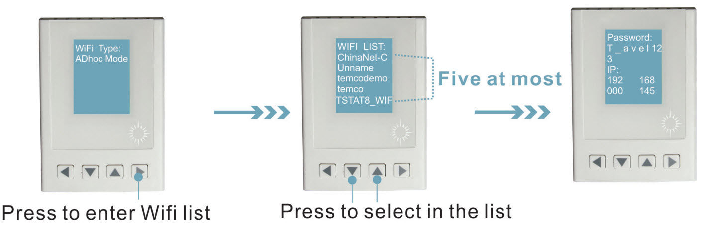
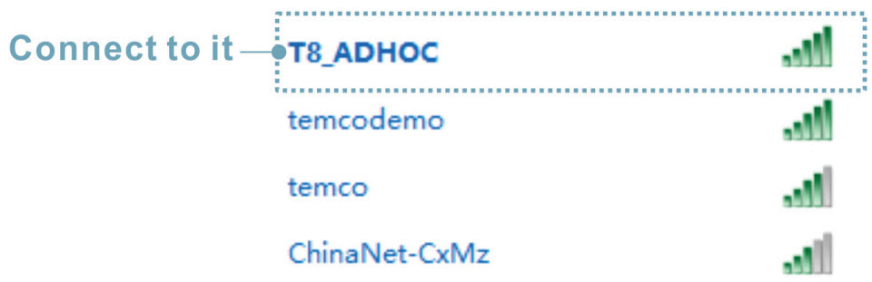
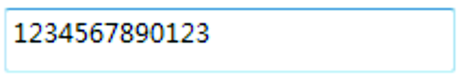
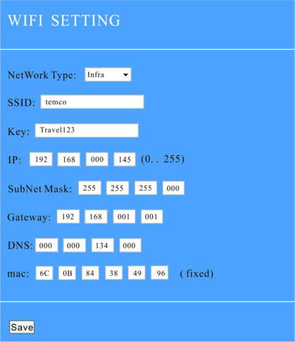
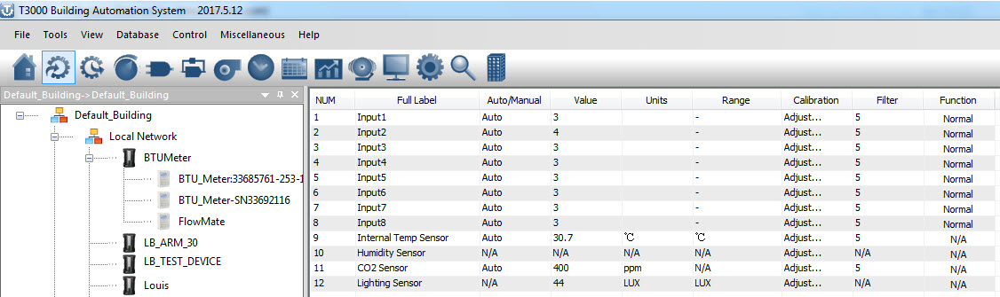

**1.Confiuration Settings**

To set the password and IP address of the Tstat8, two methods are available:Key setting and ADhoc setting, or using the T3000 software Key setting.

Sep1. Apply power to the Tstat8.Press simultaneously to enter mode selection.There are two modes:’Infra Mode’ and ‘ADhoc Mode’,press  or to switch mode.

** **

Sep2.Press to enter ‘WIFI LIST’ in mode selection.Press or to select WIFI in the list,press or to go up,and to go down.

Sep3.Press to enter Password and IP setting menu.There are letters and numbers in the setting ,with a space character between them.The numbers are from 0 to 9,the capital letters from A to Z,and the small letters from a to z. Press or to select character,press to go up,and go down.

*It will return to the main menu if there isn’t operation command in 3 seconds.

**ADhoc setting**

ADhoc is a singel hot model,which supports iphone,win7&8.The IP default address is 192.168.10.10.

Sep1.To set passwords and IP addresses in Adhoc mode, start the Tstat8 fist, then scan for a wifisignal named ‘T8_ADHOC’ from a computer with wifi connect to the wifi.

Step2.Enter the security key. The key of Tstat8 is always 1234567890123

Step3.Open your browser,enter IP 192.168.10.10,then you can set your password and IP as below:

**T3000 setting**

The T3000 software also has the ability to set the password and IP of the Tstat8.

Step1.Visit https://temcocontrols.com/ftp/software/9TstatSoftware.zip, download T3000 software and install it;

Step2. Apply power to the Tstat8, connect the Tstat8 to a PC via RS485 or Ethernet;

Step3.Start T3000 software,click to scan,then you can fid Tstat8 as below.

**2.Application Settings**

Infra mode is a typical mode in application settings. It works via a Ethernet router.

Step1.To set up in Infra mode, Apply Power to the Tstat8, connect your computer to the Ethernet router.

Step2.Open your browser, enter IP 192.168.0.145 and then you can set your password and IP Address.

