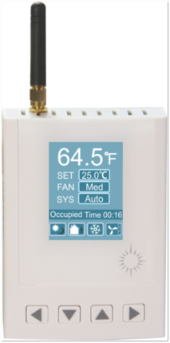

The system supports an optional zigbee add-on module which enables connecting to wireless thermostats and other zigbee devices. The zigbee devices form a mesh which makes the network more robust than a regular point to point type network. If a particular node experiences interference or goes offline the network will heal itself and work around the problem node.

### The contents of Wireless Connections
