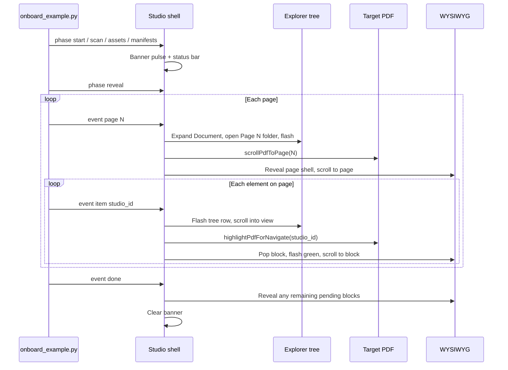

The tool that turns a PDF datasheet into an editable document: element detection, WYSIWYG rules, tables and linked graphics.

## Contents

- [What DataSheet Studio does](00-hub.md)
- [datasheet](README.md)
- [Read me first (agents)](READ_ME_FIRST.md)
- [Visual PDF onboarding (first pass)](ONBOARDING.md)
- [Datasheet Studio](STUDIO.md)
- [Studio navigation and highlighting](STUDIO_NAVIGATION.md)
- [Datasheet editing workflow](EDITING_WORKFLOW.md)
- [Data home policy](DATA_HOME.md)
- [Document layout model (all products)](DOCUMENT_LAYOUT.md)
- [Document-wide text column (paragraph width)](DOCUMENT_TEXT_COLUMN.md)
- [Group and ungroup elements](ELEMENT_GROUPING.md)
- [Manual resize mode (element windows)](ELEMENT_WINDOW_RESIZE.md)
- [Switching PDF examples in Studio](EXAMPLE_SWITCHING.md)
- [Linked Graphics (Typst ↔ Blender)](LINKED_GRAPHICS.md)
- [Onboarding iteration log](ONBOARDING_ITERATION.md)
- [Direct PDF editing](PDF_DIRECT_EDIT.md)
- [PDF element detection (deep dive)](PDF_ELEMENT_DETECTION.md)
- [Studio pane bounds — zero dead space (hard rule)](STUDIO_PANE_BOUNDS.md)
- [Studio persistent variables](STUDIO_VARS.md)
- [Table editing (Excel-style)](TABLE_EDITING.md)
- [Table geometry (enforced)](TABLE_GEOMETRY.md)
- [WYSIWYG match rules (hard requirements)](WYSIWYG_MATCH_RULES.md)
- [WYSIWYG onboard visual match](WYSIWYG_ONBOARD_MATCH.md)
  - [Linked graphics roundtrip test](results/roundtrip-test.md)


---

---
title: "What DataSheet Studio does"
order: 10
---

The tool that turns a PDF datasheet into an editable document: element detection, WYSIWYG rules, tables and linked graphics.

## Contents

1. [datasheet](README.md)
2. [Read me first (agents)](READ_ME_FIRST.md)
3. [Visual PDF onboarding (first pass)](ONBOARDING.md)
4. [Datasheet Studio](STUDIO.md)
5. [Studio navigation and highlighting](STUDIO_NAVIGATION.md)
6. [Datasheet editing workflow](EDITING_WORKFLOW.md)
7. [Data home policy](DATA_HOME.md)
8. [Document layout model (all products)](DOCUMENT_LAYOUT.md)
9. [Document-wide text column (paragraph width)](DOCUMENT_TEXT_COLUMN.md)
10. [Group and ungroup elements](ELEMENT_GROUPING.md)
11. [Manual resize mode (element windows)](ELEMENT_WINDOW_RESIZE.md)
12. [Switching PDF examples in Studio](EXAMPLE_SWITCHING.md)
13. [Linked Graphics (Typst ↔ Blender)](LINKED_GRAPHICS.md)
14. [Onboarding iteration log](ONBOARDING_ITERATION.md)
15. [Direct PDF editing](PDF_DIRECT_EDIT.md)
16. [PDF element detection (deep dive)](PDF_ELEMENT_DETECTION.md)
17. [Studio pane bounds — zero dead space (hard rule)](STUDIO_PANE_BOUNDS.md)
18. [Studio persistent variables](STUDIO_VARS.md)
19. [Table editing (Excel-style)](TABLE_EDITING.md)
20. [Table geometry (enforced)](TABLE_GEOMETRY.md)
21. [WYSIWYG match rules (hard requirements)](WYSIWYG_MATCH_RULES.md)
22. [WYSIWYG onboard visual match](WYSIWYG_ONBOARD_MATCH.md)
23. [Linked graphics roundtrip test](results/roundtrip-test.md)


---

---
title: "datasheet"
order: 20
---

Canonical repo for the **datasheet application**: Typst sources, templates,
build tooling, rendered assets, and product examples.

**AI agents:** start with **docs/READ_ME_FIRST.md** (especially when this folder lives inside WooIntegration2), then **AGENTS.md** for Studio depth.

Edit text and layout in Typst, edit 3D graphics in Blender, and rebuild with
one script. **All example and working files live in this repo** (`D:\XDrive\datasheet`).
Hardware projects may be used as a *read-only import* source via `sync-from-source.ps1`;
nothing is stored back in the hardware repo. See **`docs/DATA_HOME.md`**.

## Layout

```
datasheet/
  package/                        Typst package (template + helpers)
  tools/                          Build scripts, Blender export, asset sync
  examples/solar-lora-sensor/     Primary product (SSL-1)
    reference/SolarPoweredSensor.pdf   Target datasheet (from hardware repo)
    datasheet.typ                 Editable Typst layer (specs + links)
    datasheet.yaml                Manifest
    assets/                       Supporting graphics and BOM
    baseline/datasheet.pdf        Last accepted PDF (compare: original)
    out/datasheet.pdf             Working PDF (compare: proposed)
  examples/current-sensor-cs/     Temco current sensor brochure (reference PDF)
    reference/CS_single-phase.pdf
  examples/widget-x/              Minimal template example
```

## Datasheet Studio (InDesign-style UI)

Launch the app — one window with PDF preview, Links panel, and Tables panel:

```powershell
cd D:\XDrive\datasheet
.\tools\studio.ps1
```

See **`docs/STUDIO.md`** for the full InDesign-like workflow. **Direct PDF edits** (spelling, grammar, text-block position) write into the reference PDF — **`docs/PDF_DIRECT_EDIT.md`**. **Group/ungroup** elements with Ctrl+G / Ctrl+U — **`docs/ELEMENT_GROUPING.md`**. **Pane bounds (no dead space in PDF/WYSIWYG):** **`docs/STUDIO_PANE_BOUNDS.md`** — verify with `python tools/verify_pane_bounds.py`. Switch between product PDFs with **Example ▾** in Studio — **`docs/EXAMPLE_SWITCHING.md`**. New PDF-only examples auto-generate a first pass: the PDF is documented with element boxes, then a visual onboarding sequence plays (explorer flashes, WYSIWYG blocks pop in) — **`docs/ONBOARDING.md`**, **`docs/PDF_ELEMENT_DETECTION.md`**. WYSIWYG must match the target PDF per **`docs/WYSIWYG_MATCH_RULES.md`** (hard rules for titles, tables, typography, and layout). Document-wide margins and paragraph styles: **`docs/DOCUMENT_LAYOUT.md`**. Primary text column width: **`docs/DOCUMENT_TEXT_COLUMN.md`** (`studio/document-text-column.css`).

Early Studio layout step: generate **element windows** per explorer item (`python tools/extract_element_windows.py` → `element-windows.json`). The PDF pane shows light tinted outlines; tree dots use the same colors.

## Quick start (CLI)

1. Install [Typst](https://github.com/typst/typst) and add `blender` to your PATH.
2. (Optional) Import reference files from the hardware repo **into datasheet only**:

   ```powershell
   cd D:\XDrive\datasheet
   $env:DATASHEET_SYNC_SOURCE = "D:\XDrive\Solar-Powered-Lora-Sensor"  # read-only
   .\tools\sync-from-source.ps1
   ```

   Copies into `examples/solar-lora-sensor/reference/` and `assets/` — never writes to the source repo.

3. Open Studio (side-by-side compare) or the PDF directly:

   ```powershell
   .\tools\studio.ps1
## or
   start examples\solar-lora-sensor\reference\SolarPoweredSensor.pdf
   ```

4. (Optional) Rebuild the Typst overlay after editing `.typ` / tables / Blender links:

   ```powershell
   .\tools\build.ps1 -Example solar-lora-sensor -SkipBlender
   ```

## Repository roles

| Repo | Role |
|------|------|
| **datasheet** (this repo) | App home — Typst, assets, tools, PDF output |
| **Solar-Powered-Lora-Sensor** | Optional read-only import source (not a data home) |
| **typst** | Typst compiler (upstream) |
| **blender** | Blender (upstream) |

## Workflow

| Step | Tool | Location |
|------|------|----------|
| Edit specs & layout | Typst | `examples/*/datasheet.typ` |
| Edit spec tables (Excel) | CSV + Excel | `examples/*/tables/*.csv` — see `docs/TABLE_EDITING.md` |
| Edit linked 3D graphics | Blender | `graphics.links.yaml` — see `docs/LINKED_GRAPHICS.md` |
| Import hw reference files (into datasheet) | Script | `tools/sync-from-source.ps1` |
| Render + compile | Script | `tools/build.ps1` |

Full round-trip guide: **`docs/EDITING_WORKFLOW.md`**

## Manifest (`datasheet.yaml`)

Each example has a manifest. `data_home` is this repo; `source_project` is optional
read-only import only. All bundled assets live under `examples/<name>/`.

```yaml
source_project: "Solar-Powered-Lora-Sensor"

assets:
  block_diagram: "assets/block-diagram.jpg"
```

## Typst package

```typ
#import "../../package/lib.typ": datasheet, spec-table, datasheet-image
```

Build scripts use `--root` pointing at this repo root.

## Adding another product

1. Copy `examples/widget-x/` to `examples/your-product/`.
2. Edit `datasheet.typ`, `datasheet.yaml`, and add assets under `assets/`.
3. Optionally extend `tools/sync-from-source.ps1` or add a product-specific sync script.
4. Build with `.\tools\build.ps1 -Example your-product`.

## Requirements

- Typst 0.12+
- Blender 4.x (for rendering)
- PyYAML in Blender's Python (for `export_blender.py`)


---

---
title: "Read me first (agents)"
order: 30
---

This folder is **Datasheet Studio** — a PDF + WYSIWYG editor bundled inside the main **WooIntegration2** CRM project (or checked out as `datasheet/` under the repo root).

**If you were told to read the docs here, start with this page, then follow the reading order below.**

---

## What this folder is (30 seconds)

| Piece | What it does |
|-------|----------------|
| **Studio UI** (`studio/`) | Browser app: PDF on the left, editable HTML on the right, element explorer |
| **Python server** (`tools/studio_server.py`) | REST API, PDF edits (PyMuPDF), layout codegen |
| **Examples** (`examples/`) | Per-product data: reference PDF, box geometry, WYSIWYG HTML |
| **Typst + Blender** (optional) | Separate **compile** path for products built from source — **not required for most CRM work** |

The **reference PDF** is layout authority. WYSIWYG must match it visually.

**Not an MSI.** Runs as a local service (Python HTTP + browser), like the CRM static server and Order API.

**No runtime AI.** Detection and onboarding are rule-based Python scripts.

---

## Do you need Typst or Blender?

**For WooIntegration2 / Parts / Bravo catalog datasheet editing: NO.**

| Your task | Read | Typst | Blender |
|-----------|------|-------|---------|
| Fix Studio UI, PDF pane, WYSIWYG | **`AGENTS.md`**, **`docs/STUDIO.md`** | No | No |
| Edit `current-sensor-cs` or other PDF-only examples | **`AGENTS.md`** | No | No |
| Wire CRM “Edit datasheet”, Postgres, Parts tab | **`AGENTS.md`** § CRM + WooIntegration2 root **`AGENTS.md`** | No | No |
| Rebuild `solar-lora-sensor` from `datasheet.typ` | **`docs/EDITING_WORKFLOW.md`** | Yes | Often |
| Update 3D product-shot graphics | **`docs/LINKED_GRAPHICS.md`** | No | Yes |

Typst and Blender live in **sibling repos** (`D:\XDrive\typst`, `D:\XDrive\blender`). Do not assume they are installed unless the user asks for a Typst/Blender rebuild.

---

## Reading order

### 1 — Always (every agent)

1. **`../AGENTS.md`** — architecture, key files, hard rules, API cheat sheet, past bugs
2. **[`STUDIO.md`](STUDIO.md)** — panes, zoom, navigation, operator workflow

### 2 — When touching layout or WYSIWYG

3. **[`WYSIWYG_MATCH_RULES.md`](WYSIWYG_MATCH_RULES.md)** — mandatory visual match rules
4. **[`STUDIO_PANE_BOUNDS.md`](STUDIO_PANE_BOUNDS.md)** — no dead gray scroll space (hard rule)
5. **`AGENT_FIX_LOG.md`** — do not repeat known bugs

### 3 — When editing PDFs or moving boxes

6. **[`PDF_DIRECT_EDIT.md`](PDF_DIRECT_EDIT.md)** — F2 text edit, move writes to PDF
7. **[`ELEMENT_WINDOW_RESIZE.md`](ELEMENT_WINDOW_RESIZE.md)** — resize/move element windows

### 4 — CRM / master app context

8. **WooIntegration2 root `AGENTS.md`** — one level up from this folder (`../AGENTS.md` when you are in `datasheet/`; Order API, PostgreSQL, CRM startup)
9. **[`DATA_HOME.md`](DATA_HOME.md)** — all working files stay in this folder; never write to hardware repos

### 5 — Only if asked for Typst/Blender compile

10. **[`EDITING_WORKFLOW.md`](EDITING_WORKFLOW.md)**
11. **[`LINKED_GRAPHICS.md`](LINKED_GRAPHICS.md)**
12. **[`TABLE_EDITING.md`](TABLE_EDITING.md)**

---

## Quick start (standalone Studio)

From this folder (adjust path if nested under WooIntegration2):

```powershell
cd datasheet   # or D:\XDrive\datasheet
.\tools\studio.ps1 -Example current-sensor-cs
```

Opens **http://127.0.0.1:8792/**. Primary dev example: **`current-sensor-cs`** (Temco current-sensor brochure PDF).

After changing **`tools/studio_server.py`** or generated CSS: **restart the server** and **Reload UI**.

---

## Relationship to WooIntegration2

| WooIntegration2 | Datasheet folder |
|-----------------|------------------|
| CRM Explorer (`:5500`), Order API (`:3000`) | Studio UI + Python PDF engine |
| PostgreSQL `project` schema | JSON manifests today; Postgres merge planned |
| `assets/bravo-datasheets/` — mirrored catalog PDFs | Working editor for those PDFs (integration in progress) |
| Node / Express | Python / PyMuPDF for PDF mutations |

**Two AGENTS files:** read **WooIntegration2 root `AGENTS.md`** for CRM and database rules; read **`datasheet/AGENTS.md`** for Studio rules. CRM agents doing datasheet work still follow WooIntegration2 **PostgreSQL-only** and **no SQLite** policies.

---

## Primary example paths

| Example | Use | Reference PDF |
|---------|-----|---------------|
| **`current-sensor-cs`** | CRM / Bravo-style PDF editing | `examples/current-sensor-cs/reference/CS_single-phase.pdf` |
| **`solar-lora-sensor`** | Typst + Blender full pipeline | `examples/solar-lora-sensor/reference/SolarPoweredSensor.pdf` |

---

## Verify before claiming “done”

```powershell
python tools/verify_pane_bounds.py
python tools/verify_onboard_match.py --example current-sensor-cs   # when layout changed
```

Reload Studio in the browser. Confirm PDF, WYSIWYG, and explorer stay in sync for the blocks you changed.

Log non-obvious fixes in **`docs/AGENT_FIX_LOG.md`**.

---

## Full doc index

See **`../AGENTS.md`** → Documentation index, or browse **`docs/`** for topic-specific specs (onboarding, tables, grouping, studio vars, etc.).


---

---
title: "Visual PDF onboarding (first pass)"
order: 40
---

When Studio opens an example that has a **reference PDF only** (`status: reference_only`), it automatically **documents the PDF** (element boxes for every paragraph, image, table region, and page), writes manifests into the **same folder as the PDF**, and plays a **visual onboarding sequence** across all three panes.

**Deep dive on detection:** **`docs/PDF_ELEMENT_DETECTION.md`** — paragraphs, images, tables, titles, page numbers, box schema, and verification.

---

## Overview: two phases

| Phase | What happens | User sees |
|-------|--------------|-----------|
| **1. Document the PDF** | PyMuPDF scans the reference PDF; writes `element-windows.json` and related manifests | Status bar phases: “Reading PDF”, “Rendering guides”, “Writing manifests” |
| **2. Visual reveal** | Studio replays a timeline — one element at a time | Explorer tree expands and **flashes**; PDF tints **highlight**; WYSIWYG blocks **pop in** and **scroll** into view |

Phase 1 is mandatory. Phase 2 makes the first pass **interesting and inspectable** — you watch the datasheet assemble itself block by block.

---

## When it runs

| Trigger | Behavior |
|---------|----------|
| **Studio startup** | If the active example is `reference_only`, onboarding starts after panes load. |
| **Example switch** | Switching to a PDF-only example via **Example ▾** or right-click **Target** PDF triggers onboarding. |
| **API** | `POST /api/onboard/run` with `{ "example": "<slug>" }`. |
| **CLI** | `python tools/onboard_example.py <slug>` (files only; no animation). |

Examples with `document-outline.json` already present (`status: ready`) are **not** re-onboarded automatically.

---

## Step 1 — Document the PDF (boxes for all elements)

Before any WYSIWYG HTML is shown, `tools/onboard_example.py` measures the PDF and writes **`element-windows.json`** — one tinted rectangle per logical element.

### What gets detected (first pass)

| Element | Kind | Box color | Detection method |
|---------|------|-----------|------------------|
| **Page sheet** | `page` | Grey | Full 612×792 pt |
| **Paragraphs / bullets** | `text` | Blue | PyMuPDF text blocks (page numbers excluded) |
| **Section headings** | `text` | Blue | Same block; classified in WYSIWYG as `h2.section` |
| **Document title** | `text` | Blue | Page 1 largest heading block → `doc-title-block` |
| **Page numbers** | — | — | **Excluded** from explorer (footer band only) |
| **Product shot** | `link` | Purple | Page 1, first image ≥ 24×24 pt |
| **Figures / diagrams** | `asset` | Amber | Other embedded images |
| **Tables** | `table` | Green | **Planned** — grid line clustering; first pass may split table text into multiple blue blocks |

See **`docs/PDF_ELEMENT_DETECTION.md`** for algorithms, merge rules, and refinement path.

### Files written (same folder as `reference/*.pdf`)

All paths under `examples/<slug>/`:

| File | Purpose |
|------|---------|
| `assets/reference-pdf/page-{n}.png` | WYSIWYG alignment guide underlay (~28% opacity) |
| `assets/reference-pdf/page-{n}-img-{k}.*` | Embedded images extracted from PDF |
| `target-layout.json` | Index of page previews and extracted images |
| `element-windows.json` | **PDF tint boxes** — canonical bounds per element |
| `document-outline.json` | Explorer **Document** tree (from windows) |
| `spacing.json` | Block top/height from window bounds |
| `typography.json` | Font size histogram → Studio typography CSS |
| `colors.json` | Draft ink / band colors from PDF vector fills |
| `document-layout.json` | Copied from `examples/_template/` |
| `wysiwyg-body.html` | Editable scaffold; blocks start `onboard-pending` |
| `wysiwyg-overrides.json` | Empty overrides store (if missing) |
| `out/datasheet.pdf`, `baseline/datasheet.pdf` | Seeded from reference PDF |

After writing manifests:

- `python tools/generate_typography_css.py`
- `python tools/generate_document_column_css.py`
- `datasheet.yaml` → `studio.status: ready`

---

## Step 2 — Visual sequence (three panes in sync)

The Python onboarder returns an **`events[]`** timeline. `studio/app.js` → `playOnboardingSequence()` drives Explorer, PDF, and WYSIWYG together.

### Sequence diagram



### Phase events (banner + status bar)

| Event id | Label (typical) | Duration |
|----------|-----------------|----------|
| `start` | Reading target PDF | 550 ms |
| `scan` | Found N page(s) | 550 ms |
| `assets` | Rendering page guides and extracting images | 550 ms |
| `manifests` | Writing layout manifests | 550 ms |
| `css` | Regenerating Studio CSS | 550 ms |
| `reveal` | Building explorer tree | 550 ms |

Constant: `ONBOARD_PHASE_MS = 550` in `studio/app.js`.

### Page events

For each page:

1. **Explorer** — `Document` group expands; **Page N** folder opens with `onboard-expand-flash` + `onboard-flash` on the folder toggle.
2. **PDF** — scrolls to page N (`scrollPdfToPage`).
3. **WYSIWYG** — page `<article data-studio-id="page:N">` loses `onboard-pending`, gets `onboard-reveal`; pane scrolls to page.

Duration: `ONBOARD_PAGE_MS = 360` ms.

### Item events (one box at a time)

For each text block, image, or (future) table:

| Pane | Action |
|------|--------|
| **Explorer** | Matching tree row gets `onboard-flash` (blue pulse); row scrolls into view in the tree column |
| **PDF** | Active tint outline on the element window (`highlightPdfForNavigate`) |
| **WYSIWYG** | Block removes `onboard-pending` → `onboard-reveal` (pop-up) → `onboard-flash` (green pulse); pane scrolls to block |

Duration: `ONBOARD_ITEM_MS = 420` ms per item.

Tree selection updates (`selectedStudioId`) but the explorer does **not** auto-scroll on normal navigation rules — onboarding explicitly scrolls the tree row for each item.

### Done event

- All remaining `onboard-pending` WYSIWYG blocks are revealed.
- Banner shows “First pass complete” briefly, then hides.
- `body.onboarding-active` removed (sidebar inset border off).

---

## Explorer (left pane) behavior

During onboarding:

| Behavior | CSS / code |
|----------|------------|
| Target + Document groups forced open | `expandExplorerForPage()` |
| Page folder opens on first item of that page | `expandedGroups.add("page:N")` |
| Folder chevron flashes | `.onboard-expand-flash` |
| Active row flashes blue | `.tree-item.onboard-flash` → `@keyframes onboard-tree-flash` |
| Colored dots | Same hex as PDF tint (`kind_colors`) |
| Sidebar inset border | `body.onboarding-active .sidebar` |

Highlighting is forced **on** during onboarding (`paneHighlightsEnabled = true`).

---

## Target PDF (center pane) behavior

| Behavior | Implementation |
|----------|----------------|
| Scroll to page | `scrollPdfToPage` on `page` events |
| Tint on active element | `highlightPdfForNavigate(studio_id, page)` |
| Windows loaded before playback | `pushPdfElementWindows()` from fresh `element-windows.json` |

Passive tints visible throughout; active window gets stronger outline during each item event.

---

## WYSIWYG (right pane) behavior

| State | CSS | Visual |
|-------|-----|--------|
| Initial | `.onboard-pending` | Opacity 0, scale 0.96, translated down — **invisible** |
| Reveal | `.onboard-reveal` | `@keyframes onboard-block-pop` — scale up, green shadow ring |
| Flash | `.onboard-flash` | Green outline + background pulse |
| Page shell | `.pdf-page.onboard-reveal` | `@keyframes onboard-page-pop` |

After reload, `prepareWysiwygOnboardPending()` hides all blocks before playback.

Pane scroll: `scrollWysiwygPaneToElement(el, { syncPdf: false })` — PDF does not follow WYSIWYG scroll during onboarding (only explicit page/item events).

Chrome: `body.onboarding-active .wysiwyg-pane` — green inset border.

---

## Top banner

HTML: `#onboard-banner` / `#onboard-banner-text`

| State | Appearance |
|-------|--------------|
| Active | Pulsing gradient border (`@keyframes onboard-banner-pulse`) |
| Hidden | `.hidden` after completion or failure |

Shows current phase label during extraction; per-item labels during reveal.

---

## CLI (without Studio UI)

```powershell
cd D:\XDrive\datasheet
python tools/onboard_example.py current-sensor-cs
python tools/onboard_example.py current-sensor-cs --json
```

Requires `examples/<slug>/reference/*.pdf` on disk. Writes all manifests; prints event count. No animation.

---

## API

```http
POST /api/onboard/run
Content-Type: application/json

{ "example": "current-sensor-cs" }
```

Response:

```json
{
  "ok": true,
  "example": "current-sensor-cs",
  "files_written": ["element-windows.json", "document-outline.json", "wysiwyg-body.html"],
  "events": [
    { "type": "phase", "id": "scan", "label": "Found 3 page(s)", "page_count": 3 },
    { "type": "page", "page": 1, "label": "Page 1", "studio_id": "page:1" },
    {
      "type": "item",
      "studio_id": "text:p1-current-sensors",
      "label": "Current Sensors",
      "page": 1,
      "kind": "text",
      "color": "#4c8bf5"
    },
    { "type": "done", "label": "First pass complete", "item_count": 28 }
  ],
  "project": { "example_status": "ready", "needs_onboard": false }
}
```

---

## Timing and animation reference

| Constant | Default | Used for |
|----------|---------|----------|
| `ONBOARD_PHASE_MS` | 550 ms | Phase labels |
| `ONBOARD_PAGE_MS` | 360 ms | Page folder expand |
| `ONBOARD_ITEM_MS` | 420 ms | Per-element reveal |

| Stylesheet | Animations |
|------------|------------|
| `studio/styles.css` | `onboard-banner-pulse`, `onboard-tree-flash`, `onboard-expand-flash`, `onboarding-active` chrome |
| `studio/target-wysiwyg.css` | `onboard-block-pop`, `onboard-page-pop`, `onboard-block-flash`, `onboard-pending` |

Implementation: `playOnboardingSequence()`, `revealWysiwygBlock()`, `flashExplorerItem()`, `flashExplorerPageFolder()` in `studio/app.js`.

---

## After onboarding

The first pass is a **starting point**, not pixel-perfect:

1. **Review boxes on the PDF** — tints should wrap each paragraph and figure. Double-click to resize (`docs/ELEMENT_WINDOW_RESIZE.md`).
2. **Merge / split blocks** — run refined extractors or edit `element-windows.json`.
3. **Tables** — when generic table detection lands, re-run onboard or `generate_table_css.py`.
4. **Edit WYSIWYG** — text saves to `wysiwyg-overrides.json`.
5. **Production bar** — solar-lora-sensor + `docs/WYSIWYG_MATCH_RULES.md`.

Full manifest checklist: **`docs/DOCUMENT_LAYOUT.md`** §8.

---

## Related

| Doc | Topic |
|-----|-------|
| **`docs/PDF_ELEMENT_DETECTION.md`** | Deep dive: paragraphs, images, tables, titles, page numbers |
| **`docs/EXAMPLE_SWITCHING.md`** | `reference_only` vs `ready` |
| **`docs/STUDIO.md`** | Three-pane UI |
| **`docs/ELEMENT_WINDOW_RESIZE.md`** | Manual box editing |
| **`docs/DATA_HOME.md`** | Canonical paths |
| **`tools/onboard_example.py`** | Generator + event timeline |


---

---
title: "Datasheet Studio"
order: 50
---

**Datasheet Studio** is the app UI for editing datasheets alongside the authoritative target PDF.

**Hard rule:** The WYSIWYG must match the target PDF in all visual respects (titles, tables, typography, colors, geometry). See **[WYSIWYG_MATCH_RULES.md](WYSIWYG_MATCH_RULES.md)** — mandatory for every change to `studio/target-wysiwyg.css` or `wysiwyg-body.html`.

**Document-wide layout** (fixed page size, margins, typography on most pages): **[DOCUMENT_LAYOUT.md](DOCUMENT_LAYOUT.md)** and `examples/<name>/document-layout.json`.

## Launch

```powershell
cd D:\XDrive\datasheet
.\tools\studio.ps1
```

Opens **http://127.0.0.1:8792** (works in the Cursor in-app browser).

### Switch example (target PDF)

Use **Example ▾** in the toolbar, click the **project title**, or right-click the **Target** PDF row in the explorer. Pick any folder under `examples/` that has a reference PDF. Choice persists in `?example=`, session storage, and `data/studio-vars.json` (`studio.active_example`). Full details: **`docs/EXAMPLE_SWITCHING.md`**.

**PDF-only examples** auto-generate a first-pass WYSIWYG + manifests with a visual onboarding animation (explorer tree expands and flashes in sync with blocks popping into the WYSIWYG pane). Step 1 documents the PDF with tinted element boxes. See **`docs/ONBOARDING.md`** (visual sequence) and **`docs/PDF_ELEMENT_DETECTION.md`** (paragraphs, images, tables, titles, page numbers).

## Split view layout

| Pane | Content | Interaction |
|------|---------|-------------|
| **Left** | Target PDF (`SolarPoweredSensor.pdf`) | **Minor edits write back to the PDF** — text (F2 / right-click) and text-block position (resize mode). See **`docs/PDF_DIRECT_EDIT.md`**. **Hide** / **Show PDF** toggles pane. **Mouse wheel** → scroll; **Ctrl+wheel** → zoom (see below). |
| **Divider** | Draggable | Drag left/right to resize panes; hidden with PDF pane. **Esc** cancels drag. |
| **Right** | WYSIWYG working copy | **Editable** — click text and table cells. Same **wheel / Ctrl+wheel** model as PDF. |
| **Explorer** (narrow left) | Target, Document, Links, Tables | **Click** syncs PDF + WYSIWYG. **Ctrl+click** multi-select (join). **Drag** the explorer divider to change width (120–480 px, persisted in `localStorage`). **Wheel** scrolls the tree only. |

There is **no “proposed PDF”** pane. The right side is HTML WYSIWYG, not a second PDF.

### Target PDF (canonical path)

`examples/<example>/reference/SolarPoweredSensor.pdf` — always under this repo (`docs/DATA_HOME.md`).

Rendered with **PDF.js** in `/static/pdf-viewer.html` (fit-to-pane width, scroll inside the pane).

## Mouse wheel

The document panes use a fixed wheel model (also in `examples/solar-lora-sensor/datasheet.yaml` under `studio.zoom`):

| Wheel | PDF pane | WYSIWYG pane | Explorer tree |
|-------|----------|--------------|---------------|
| **Scroll** (no modifier) | Scroll up/down through pages | Scroll up/down through pages | Scroll the tree |
| **Ctrl + scroll** (Cmd on Mac) | Zoom in/out (50–300%) | Zoom in/out (50–300%) | No zoom (modifier ignored) |

- **Scroll** never changes zoom; **Ctrl+scroll** never scrolls (browser page zoom is suppressed over the canvas).
- PDF scroll happens inside the PDF.js viewer; WYSIWYG scroll moves the parent pane while the iframe forwards wheel events.
- **+ / −** in each pane header and **Ctrl + + / − / 0** are alternate zoom controls.

## Pane zoom

**Linked scroll:** When the PDF pane is visible, scrolling in either pane keeps the other on the **same page** with the same **within-page** offset (not a single global % — PDF pages are taller than WYSIWYG because of render scale). WYSIWYG pane zoom is included in scroll math.

**Workspace pan:** Each pane has **80px** horizontal (and **32px** vertical) gray margin around the page so you can scroll past the white sheet into the desk area. **Dead space beyond that margin is forbidden** — see **`docs/STUDIO_PANE_BOUNDS.md`** (hard rule). Run `python tools/verify_pane_bounds.py` after changing zoom, scroll, or pane layout code.

**Auto-fit split:** On zoom (Ctrl+wheel), the divider moves so each pane is only as wide as its scaled page content—no gray dead space between PDF and WYSIWYG. Drag the divider to set a custom width; the next zoom restores auto-fit.

### Scrollbars (hard rule)

**Target PDF** and **WYSIWYG** panes use **hover-only vertical scrollbars** — no always-visible gutter.

| Rule | Detail |
|------|--------|
| Default | Vertical scrollbar thumb **hidden** (no reserved gutter; do not use `scrollbar-gutter: stable`) |
| Reveal | Thumb visible while the pointer is over the pane **or** for ~1s after wheel/scroll |
| Horizontal | Same hover/scroll reveal when content overflows width (workspace pan) |
| Explorer | Unchanged — sidebar tree keeps its normal scrollbar |
| CSS | `studio/scrollbar-hover.css` on `.pane-scroll` (WYSIWYG) and `#viewport` (PDF iframe) |
| WYSIWYG iframe | Parent uses `mousemove` hit-test — hovering document content inside the iframe still reveals the shell scrollbar |

Do not add permanent scrollbars or gutter to document panes. See **`docs/STUDIO_NAVIGATION.md`** § Scrollbars.

| Input | Action |
|-------|--------|
| **Wheel** (PDF, WYSIWYG, Explorer) | Scroll vertically through content |
| **Ctrl + wheel** (PDF or WYSIWYG) | Zoom in / out (physical Ctrl held on Windows; Cmd or pinch on Mac) |

After changing Studio CSS or `app.js`, use **Reload UI** in the toolbar (or open `http://127.0.0.1:8792/?_=1`). Browser **Ctrl+F5** often reloads only the focused iframe (PDF/WYSIWYG) with an old cache key; the address-bar reload + **Reload UI** pick up new `asset_stamp` URLs.

Plain mouse-wheel scroll must not zoom. `studio/wheel-zoom.js` uses **physical** Control/Meta key tracking plus `getModifierState()` on each wheel event so **Ctrl+wheel zooms** even when the pointer is over an iframe (PDF/WYSIWYG). Windows/Chromium may set a fake `ctrlKey` on plain scroll without Control held — that case is ignored unless `getModifierState("Control")` is true.
| **+ / −** (pane header) | Zoom in / out |
| **Ctrl + + / − / 0** | Zoom in / out / reset (100%) |
| **Ctrl + G** | Join selected elements (group) |
| **Ctrl + U** | Ungroup selected grouped element |
| **F2** | Edit text on PDF (text window selected) |

- Range: **50%–300%** (step ~8%)
- Persisted in `localStorage`: `datasheet-studio-zoom-pdf`, `datasheet-studio-zoom-wysiwyg`
- WYSIWYG zoom is applied in the Studio shell (scales the iframe); PDF zoom is inside the PDF.js viewer.

## Resizable split (divider)

- Drag the **vertical divider** between PDF and WYSIWYG (or focus it and use **←** / **→**).
- While the divider moves, the **PDF pane zoom** adjusts automatically so the page fills the left pane width (no gray gap beside the pages). Updates every frame during drag; a short ease applies on release.
- Uses a full-window **drag shield** and document-level **pointerup/mouseup** so release always ends resize (including over iframes).
- **Click** in either pane (PDF or WYSIWYG) also ends an active drag.
- Press **Esc** to cancel an active drag.
- Ratio persisted as `datasheet-studio-split` in browser `localStorage` (survives reload; auto-fit does not override after you drag the divider or a saved ratio exists).
- **TODO:** Persist split ratio in the database as a **per-user** setting (replace or supplement `localStorage`).
- Minimum pane width: ~180px each.

### WYSIWYG working copy (match target PDF)

The right pane mirrors the **4-page** `SolarPoweredSensor.pdf` layout:

- US Letter pages (612×792 pt), Arial, Temco `#232020` ink — see **Typography** below
- Layout matched to PDF metrics — **non-overlapping vertical bands** per `spacing.json` (page 1: intro + product image, then Highlights, then Specifications; pages 2–4: absolute blocks per `studio_layout`)
- **Page guide** underlay at ~28% opacity for alignment — toggle **Guide** in the toolbar (on/off is **sticky** across sessions via `data/studio-vars.json`, key `wysiwyg.guide_visible` — see **`docs/STUDIO_VARS.md`**)
- Content in `examples/solar-lora-sensor/wysiwyg-body.html` (editable)
- Assets extracted to `assets/reference-pdf/` via `tools/extract_pdf_assets.py`

**Save paths**

- Text/sections → `wysiwyg-overrides.json` (`POST /api/save-text`) and/or **directly into the reference PDF** (`POST /api/pdf-edit-text`) — see **`docs/PDF_DIRECT_EDIT.md`**
- Manual text bounds / move on PDF → reference PDF + `element-windows.json` (`POST /api/element-window`) for `kind: text`
- 2-column CSV tables → `tables/*.csv` (`POST /api/save-table/{name}`)
- Complex tables (CO₂, RH/Temp) → overrides as HTML blocks
- Graphics: double-click product photo → Blender (`enclosure-view` link)

**Apply & Refresh** — export modified Blender links, rebuild, reload WYSIWYG.

## Titles (hard rule)

Section and document titles must match the PDF for **highlight band**, **alignment**, **font size** (16 pt document / 14 pt section), and **underline** (document title only — 1 px rule at x=36…576). Section headings use grey `#d4d6d7` bands with **no** underline.

Manifest: `examples/solar-lora-sensor/titles.json`
Full rules: [WYSIWYG_MATCH_RULES.md](WYSIWYG_MATCH_RULES.md) §1

## Document layout (margins + styles)

Target PDFs use **612×792 pt** pages with **document-wide** Arial 12/14/16 pt and a stable **primary text column** (528 px wide, left 42 px). Paragraph and bullet copy use **`studio/document-text-column.css`** (vars from `document-layout.json` via `generate_document_column_css.py`) — see **`docs/DOCUMENT_TEXT_COLUMN.md`**. Section grey bands use fixed width families (181 / 235 / 364 px). Vertical block positions vary per page — see `spacing.json`, not a single margin constant.

Full spec: **[DOCUMENT_LAYOUT.md](DOCUMENT_LAYOUT.md)**
Machine-readable: `examples/solar-lora-sensor/document-layout.json` (template: `examples/_template/document-layout.json`)

## Spacing (hard rule)

Paragraphs, section titles, bullets, tables, and figures **must not overlap** on a page. Each `data-studio-id` block has a fixed `top` and `height` from the PDF; relationships (gaps between intro, Highlights, Specifications, etc.) match `reference/SolarPoweredSensor.pdf`.

Manifest: `examples/solar-lora-sensor/spacing.json` (`studio_layout.blocks`, `regions`, `gaps`)
Full rules: [WYSIWYG_MATCH_RULES.md](WYSIWYG_MATCH_RULES.md) §7

```powershell
python tools/extract_spacing.py
python tools/verify_spacing.py
```

| Title | Size | Band | Underline |
|-------|------|------|-----------|
| Solar Powered Sensor | 16 pt bold | none | yes (full-width rule below) |
| Highlights, Specifications | 14 pt bold | 181 px linked | no |
| Other section headings | 14 pt bold | 235 or 365 px | no |

## Typography (match target PDF)

Font sizes are taken from `reference/SolarPoweredSensor.pdf` (PyMuPDF span histogram) and stored in `examples/solar-lora-sensor/typography.json`. The WYSIWYG canvas is **612×792 layout px = PDF pt**. Typography is emitted as **CSS `px`** with the same numeric values (12 px body = 12 PDF pt). **Do not use CSS `pt`** for page content — browser `pt` renders ~4/3× larger and text overflows fixed blocks from `spacing.json`.

| Role | PDF (measured) | WYSIWYG CSS | Leading |
|------|----------------|-------------|---------|
| Body, bullets, tables | 12 pt | **12px** | **14px** |
| Section headings (`h2.section`) | 14 pt bold | **14px** | **17px** |
| Document title (page 1) | 16 pt bold | **16px** | **19px** |
| Page numbers (`- n -`) | 9 pt | **9px** | **11px** |

Generated: `python tools/generate_typography_css.py` → `studio/generated-typography.css`; base rules in `studio/typography-wysiwyg.css`. Re-measure after a new target PDF:

```powershell
python D:\XDrive\datasheet\tools\analyze_pdf.py
python D:\XDrive\datasheet\tools\generate_typography_css.py
```

Round measurements to integer PDF points in `typography.json`, then regenerate CSS.

## Color and section bands (match target PDF)

Measured from vector fills in `reference/SolarPoweredSensor.pdf` and recorded in `examples/solar-lora-sensor/colors.json`. CSS variables live in `studio/target-wysiwyg.css`.

### Body text

| Role | Hex | Use |
|------|-----|-----|
| Ink | `#231f20` | All body copy, table cell text, grey-band headings |

### Linked grey bands (page 1)

**Highlights** and **Specifications** headings share one width — about **181 px** (~30% of the 612 pt page). Do not stretch grey behind bullet lists or the full table; only the heading strip uses the band.

| Variable | Value | PDF source |
|----------|-------|------------|
| `--band-grey-bg` | `#d4d6d7` | Fill on Highlights + Specifications bars |
| `--band-grey-w-linked` | `181px` | Same width for both bands (linked) |
| `--band-grey-l-highlights` | `41px` | Highlights bar left edge |
| `--band-grey-l-specs` | `36px` | Specifications bar left edge |

### Wider grey bands (pages 2–4)

Section titles use **`--band-grey-w-wide` (235 px)** except **Notes** on page 4 (**364 px**). Same grey fill `#d4d6d7`.

### RH / Temperature table (page 1)

| Element | Background | Text |
|---------|------------|------|
| Grid borders | — | `#231f20` (`--table-border`) |
| Empty corner header cell | White | `#231f20` |
| “Relative Humidity” / “Temperature” headers | `#1b4583` | `#ffffff` |
| Body cells | White | `#231f20` |

### Table geometry (columns, rows, page fill)

`examples/solar-lora-sensor/table-columns.json` records PDF grid lines (PyMuPDF). WYSIWYG uses `table-layout: fixed`, `<colgroup>`, and **fixed row heights** so text does not wrap and inflate table height.

**Enforced automatically:** `python tools/generate_table_css.py` writes `studio/generated-table-*.css` (column widths, row heights, layout, col rules), `examples/*/table-grids.json`, and syncs PDF table tint boxes to `grid_x_px` / `grid_y_px`. Toggle **Table grid** in the toolbar to show column/row lines on PDF + WYSIWYG. See **`docs/TABLE_GEOMETRY.md`**.

**Acceptance:** table bounding box should be within **5%** of the PDF’s share of the page (width × height / 612×792). Check with:

```powershell
python D:\XDrive\datasheet\tools\verify_table_layout.py --example solar-lora-sensor
```

#### RH / Temperature (page 1)

| | PDF | WYSIWYG |
|---|-----|---------|
| Position | left 41.3 pt | `--x-table` **41 px** |
| Size | 539 × 135 pt | **539 × 136 px** (`--table-w`, `--table-rh-h`) |
| Page area used | **~15.0%** | target 14.97% |
| Label / RH / Temp cols | 130.5 / 203.0 / 205.5 | **131 / 203 / 205 px** |
| Row height (8 rows) | 16.7–17.4 pt each | **17 px** each (`--table-rh-row-h`) |
| Cell text | single line | `white-space: nowrap`, `line-height: 16px`, pad **0 4px** |

`131 + 203 + 205 = 539`. Rows are fixed at 17 px so body line-height (14 pt) does not stretch the grid.

#### CO₂ specs (page 2)

| | PDF | WYSIWYG |
|---|-----|---------|
| Position | left 36.5 pt | `--x-table-co2` **37 px** |
| Size | 535 × 192 pt (grid after reconciliation) | **535 × 192 px** (`height_px` = sum of `row_heights_px`) |

Page 2 CO₂ table: the last row was often missing from `grid_y_px` (no bottom PDF stroke). `generate_table_css.py` reconciles grid lines with `row_heights_px` — see **`docs/TABLE_GEOMETRY.md`** → Row/grid reconciliation.
| Page area used | **~19%** | multi-line accuracy rows |
| Columns | 189 / 150 / 36 / 74 / 45 / 41 | same `--col-co2-*` |
| Row heights | 17 / 17 / 53 / 71 / 17 / 17 pt bands | `--co2-row-h-short`, `--co2-row-h-tall`, `--co2-row-h-xl` |

CO₂ cells may wrap inside tall rows; column widths are fixed so line breaks match the PDF bands.

Re-measure after a PDF change:

```powershell
python D:\XDrive\datasheet\tools\analyze_pdf.py
python D:\XDrive\datasheet\tools\verify_table_layout.py
```

Update `table-columns.json`, then run `python tools/generate_table_css.py` (do not edit `--col-*` / row heights in `target-wysiwyg.css` by hand).

Re-measure fills after a PDF change:

```powershell
python -c "import fitz; ..."  # or extend tools/analyze_pdf.py
```

## Element windows (PDF + explorer)

Each leaf in the **Document** tree has a **window** on the target PDF (612×792 pt bounds in `element-windows.json`). This is an early layout step: measure the PDF, generate windows, then align WYSIWYG and navigation.

| Kind | Tree dot / PDF tint | Notes |
|------|---------------------|--------|
| Text | Blue `#4c8bf5` | Section/body bands from `spacing.json` |
| Page title | Bronze `#c4922a` | Running header on each page (`text_role: heading` / `title`); explorer label shows ink rule below |
| Table | Green `#22a06b` | Table grid area |
| Asset (figure) | Amber `#e87b2a` | **Tight** to PyMuPDF image rect + 4 px padding |
| Link (product shot) | Purple `#9b5de5` | **Tight** to image only — not the whole intro column |
| Page | Grey `#6b7b8c` | Full page |

**PDF pane:** All windows show as a **very light tint**; the selected item uses a stronger outline in the same color. **Explorer:** Colored dot beside each label matches its PDF tint.

Regenerate after PDF or layout changes:

```powershell
python tools/extract_element_windows.py
python tools/verify_element_windows.py
```

Or regenerate spacing + windows together:

```powershell
.\tools\sync-layout-manifests.ps1
```

Manifest: `examples/solar-lora-sensor/element-windows.json`
API: `GET /api/element-windows`

The linked graphic on page 1 is a **product shot** (`link:enclosure-view`), not a “3D enclosure” section.

### Refine element windows (right-click PDF tint)

Right-click any passive **tint box** on the target PDF for sizing helpers:

| Menu option | Effect |
|-------------|--------|
| Fit to text inside box | Union of text blocks overlapping the window |
| Too tall / trim top / trim bottom | Shrink vertical extent to content |
| Too narrow / widen to column | Adjust horizontal bounds |
| Exclude title / heading | Drop short heading lines from the union |
| Exclude photo / figure overlap | Clip text column before images |
| Snap to image only | Use image bounds (links/assets) |
| AI auto-detect | Re-run `extract_element_windows.py` rules for that id |
| Show drag handles | Same as **double-click** the tint box (see below). |
| **Save manual size** | Commits drag-resized bounds while edit mode is active. |

**Manual resize mode** — full workflow: **`docs/ELEMENT_WINDOW_RESIZE.md`**.

| Gesture | Enters edit mode? |
|---------|-------------------|
| **Double-click** PDF tint box | Yes — 8 handles; drag handle or interior to move |
| **Double-click** explorer Document leaf (with a window) | Yes — focuses PDF and same handles |
| **Double-click** WYSIWYG block (`data-studio-id`) | Yes — except product-shot link images (Blender) |
| **Single click** any pane | No — select/sync only |
| **Click outside** editing box | Saves bounds to PDF (text) + `element-windows.json` and exits |

API: `POST /api/element-window/refine` `{ id, action }`, `POST /api/element-window` `{ id, left_px, top_px, width_px, height_px }`.

### Direct PDF text edit

Fix spelling and grammar **on the PDF canvas** (not only in WYSIWYG):

| Gesture | Action |
|---------|--------|
| **F2** on selected text tint | Open inline editor on PDF |
| **Right-click** text tint → **Edit text on PDF** | Same |
| **Ctrl+S** / click outside | Save to reference PDF + WYSIWYG override |

Full spec: **`docs/PDF_DIRECT_EDIT.md`**.

### Group / ungroup elements

| Shortcut | Action |
|----------|--------|
| **Ctrl+click** | Add/remove item from multi-selection (explorer, PDF, WYSIWYG) |
| **Ctrl+G** | Join selected elements into one window |
| **Ctrl+U** | Ungroup selected grouped element |
| **Right-click** (≥2 selected) | **Join into single element** |

Full spec: **`docs/ELEMENT_GROUPING.md`**.

## Document explorer & navigation

Vertical tree (**Target** → **Document** → **Links** → **Tables (Typst)**).

**Target** lists the example’s reference PDF filename (e.g. `SolarPoweredSensor.pdf`) — one leaf, no duplicate page entries. **Example ▾** (toolbar), **project title** click, or **right-click** that filename opens the example picker (`POST /api/switch-example`; see **`docs/EXAMPLE_SWITCHING.md`**). **Document** expands into **Page 1…4** subfolders; each page folder lists **every block on that page in print order** as **flat rows at the same indent** (subtitles, body blocks, tables, and figures are siblings — not nested under section folders in the explorer UI). Order comes from `document-outline.json` after flattening (`tools/studio_server.py` → `_explorer_page_leaves()`). There is **one** page-1 intro entry — **Solar Powered Sensor** (`text:intro`) — not a separate Typst “Overview” or “Introduction”. The Typst file `datasheet.typ` is only for the hybrid build (CSV tables, Blender links); the 4-page body is edited in `wysiwyg-body.html`.

**Page folders:** click the **▸/▾** chevron to expand or collapse; click the **Page N** label to jump to that page in the PDF and WYSIWYG.

### Subtitle sections (grey-band headings)

**Fundamental requirement:** On **every page**, Studio must **identify each section subtitle** from the reference PDF and render it in the WYSIWYG with **matching formatting** — grey band `#d4d6d7` on the **`h2.section.subtitle` only**, canonical heading size (typically 16 pt bold), and body content merged under the subtitle until the next band heading. Missing subtitles, plain `h2.section` without the band, or orphan body blocks are **layout defects**.

**Color roles (do not mix):**

| Color | Where | Purpose |
|-------|--------|---------|
| `#d4d6d7` grey | WYSIWYG `h2.section.subtitle` background only | Printed subtitle band in the PDF |
| `#4c8bf5` blue | PDF pane element-window tints, explorer text dots, edit focus on **body** | Studio UI — not the printed page |
| `#c4922a` amber | Title / running-header windows | Document title blocks |
| `#1b4583` blue | Table header cells | Spec tables only |

Never grey-tint whole blocks, PDF overlays, or body paragraphs. Grey is **only** the subtitle heading band.

Many datasheets use a **section subtitle** — a short heading on a **grey background band** (`#d4d6d7`) in the target PDF, or an **underlined style heading** in a second column. Page 1 of `current-sensor-cs` is a **two-column layout**: band subtitles on the left (*Descriptions*, *Features*, …) and style subtitles on the right (*Clamping Style*, *Non Clamping Style*). Page 3 uses the same left-column band style (*Specifications*, *Part Number Scheme*, *Ordering information*) even when the PDF has no vector grey-fill rects (font-based detection).

**Required rule (subtitle sections):** A band subtitle owns **all content until the next band subtitle** on that page. See **`docs/PDF_ELEMENT_DETECTION.md`** §5.5.

| Follower type | Linked how |
|---------------|------------|
| **Paragraphs, lists, spec lines** | Merged with the subtitle into **one text element** (one PDF tint, one WYSIWYG block, explorer folder row) |
| **Tables** (`table:*`) | Separate element — **child row** in the same section folder (green dot) |
| **Images** (`link:*` / `asset:*`) | Separate element — **child row** in the same section folder (purple / amber dot) |
| **Figure captions** (right column) | Separate text element — **child row** in the same section folder |

During auto-onboarding and in **`document-outline.json`**, subtitle **merge** rules still apply (subtitle + body → one window). In the **Studio explorer UI**, page folders show a **flat print-order list** — each subtitle and follower is its own row at the same left margin:

| Where | Behavior |
|-------|----------|
| **Explorer** | **Flat list** under each **Page N** folder (no nested section-folder indent). Each row = one element window. |
| **Row click** | Jumps to that block’s `navigate_id` / `data-studio-id`. |
| **WYSIWYG** | Merged text: `h2.section.subtitle` on grey band + one or more `<p class="body-text">` rows. Tables and figures stay separate blocks in print order. |
| **PDF tints** | One tint for subtitle+text when merged; separate tints per table, figure, caption. |

Detection uses **vector fill rectangles** behind the heading when present (`has_band: true`, `text_role: subtitle`), **or** the **left-column band-font fallback** — short heading, center x &lt; 305 pt, font ≥ 15 pt → `has_band: true` (required on pages like `current-sensor-cs` page 3 where bands are raster-only). Right-column style headings use `STYLE_HEADING_RE` (*Clamping Style*, *Non Clamping Style*).

**Regression:** `python tools/verify_subtitle_grouping.py`

**Subtitle font match rule:** All section subtitles in a document share one **canonical heading size** (the mode of left-column band subtitles ≥ 15 pt). A subtitle is **out of spec** when `|heading_font_pt − canonical| > 0.5 pt`. Merged subtitle+body blocks store **`heading_font_pt`** (on `h2.section`) separately from **`font_pt`** (body text in `<p class="body-text">`). Batch fix: `python tools/sync_subtitle_fonts.py <example>` or `POST /api/sync-subtitle-fonts`.

**Copy tagging (enforce one subtitle style):** Right-click a subtitle block in the **WYSIWYG** pane (a block with `h2.section`) → **Copy tagging to…** → click the orphan subtitle (e.g. right-column *Clamping Style*). Copies **heading** font size (not inherited body size), line height, grey band background, and `h2.section.subtitle` class; updates `element-windows.json`, `wysiwyg-overrides.json`, and `generated-onboard-layout.css`. **Esc** cancels pick mode. API: `POST /api/copy-subtitle-tagging` with `{ source_id, target_id, tag? }`.

**Links** lists Blender-linked graphics (e.g. enclosure render). **Tables (Typst)** lists CSV tables used only in the Typst build, not in the 4-page target PDF.

### Linked highlighting (three panes)

**Full click/scroll contract:** **`docs/STUDIO_NAVIGATION.md`** (required reading for agents changing navigation). **Persistent UI vars:** **`docs/STUDIO_VARS.md`**. **Regression log:** `docs/AGENT_FIX_LOG.md`.

A click in **any** pane updates the **other two**:

| You click in… | Explorer | Target PDF | WYSIWYG |
|---------------|----------|------------|---------|
| **Explorer** (leaf) | Selects tree item | Scrolls + highlights matching window | Scrolls + outlines block |
| **Target PDF** (tinted window) | Selects matching leaf | Active window outline | Scrolls + outlines block |
| **Target PDF** (page background) | Selects Page N | — | Scrolls to page |
| **WYSIWYG** (block/image) | Selects matching leaf | Highlights matching window | Outlines clicked block |

Passive PDF tints, WYSIWYG outline, and explorer selection use the same `data-studio-id` / `element-windows.json` bounds.

**Scroll isolation:** PDF and WYSIWYG share vertical scroll position with each other only. Wheel and drag scrolling stay inside those panes; the explorer column does not move when you read the right-hand panes. Cross-pane clicks update explorer selection but do not auto-scroll the tree (only clicking a row in the explorer scrolls the tree, and only when needed to reveal that row).

**Toggle all highlighting:** **Right-click** the **Target** or **Document** group title in the explorer (not Page 1…4). This hides passive PDF tints and colored tree dots; **single-click still selects** elements (invisible PDF hit targets remain). WYSIWYG passive overlays turn off; active selection on click still works. Right-click again to restore. Preference is stored in `localStorage` (`datasheet-studio-pane-highlights`).

| Action | Result |
|--------|--------|
| **Single click** explorer leaf | Syncs PDF + WYSIWYG + tree selection |
| **Single click** tinted PDF window | Syncs explorer + WYSIWYG (PDF stays put) |
| **Double-click** tinted PDF window | Manual resize mode (see `ELEMENT_WINDOW_RESIZE.md`) |
| **Double-click** explorer Document leaf | Same resize mode on PDF |
| **Double-click** WYSIWYG block | Same resize mode on PDF (not product-shot link) |
| **Click** WYSIWYG block | Syncs explorer + PDF |
| **Right-click** Target or Document title | Toggle all pane highlighting on/off |
| **Right-click** Target PDF filename | Open another example datasheet |
| **Double-click** link in tree | Blender |
| **Double-click** **Tables (Typst)** row | Excel (`TABLE_EDITING.md`) |
| **Double-click** **Document** table row (CO₂, RH/Temp) | PDF resize — not Excel |
| **Double-click** WYSIWYG PDF grid table | PDF resize — not Excel; see `TABLE_EDITING.md` |
| **F2** (PDF pane, text tint selected) | Edit text on PDF — saves to reference PDF |
| **Right-click** PDF text tint → **Edit text on PDF** | Same as F2 |
| **Right-click** PDF text tint → alignment | Left / center / right / justify (`POST /api/text-align`) |
| **Ctrl+click** explorer / PDF / WYSIWYG | Multi-select for join |
| **Ctrl+G** | Join selected elements |
| **Ctrl+U** | Ungroup selected grouped element |
| **Right-click** (≥2 selected) | **Join into single element** |

Stable IDs: `data-studio-id` on each `<section class="studio-block">`. Text headings may use `navigate_id` to map to a table/link block. API: `GET /api/outline`.

## Toolbar

| Control | Action |
|---------|--------|
| **Show PDF** | Restores the hidden target PDF pane (visible only while PDF is hidden) |
| **Apply & Refresh** | Pull Blender/Excel changes, refresh WYSIWYG |
| **Accept** | Snapshot working state as baseline |
| **Revert** | Restore baseline |

## Manifest (`datasheet.yaml`)

```yaml
studio:
  port: 8792
  layout: pdf-left-wysiwyg-right
  explorer:
    groups: [target, links, tables, text]
    width_px: 200
  split:
    draggable: true
    storage_key: datasheet-studio-split
    pdf_hidden_key: datasheet-studio-pdf-hidden
    default_ratio: 0.5
    min_pane_px: 180
    pointer_capture: true
    escape_cancels: true
    pdf_hide_button: true
  titles:
    manifest: titles.json
  table_columns:
    manifest: table-columns.json
  colors:
    manifest: colors.json
    band_grey_w_linked_px: 181
    table_header_blue: "#1b4583"
  typography:
    manifest: typography.json
    decimal_sizes: false
    sizes_pt: { body: 12, section: 14, title: 16, page_number: 9 }
    leading_pt: { body: 14, section: 17, title: 19, page_number: 11 }
  zoom:
    wheel_scroll: wheel
    wheel_zoom: true
    wheel_scroll_modifier: ctrl
    input: [wheel, buttons]
    keyboard: [ctrl-plus, ctrl-minus, ctrl-zero]
    min: 0.5
    max: 3.0
    step: 0.08
    per_pane: true
    wysiwyg_zoom_host: parent_shell
    storage_keys:
      pdf: datasheet-studio-zoom-pdf
      wysiwyg: datasheet-studio-zoom-wysiwyg
  panes:
    left:
      type: pdf
      source: reference_pdf
      viewer: pdfjs
      page_width_px: 612
      fit_to_pane: true
      zoom: true
      hideable: true
      scroll: pane
      thumbnails: false
    right:
      type: wysiwyg
      endpoint: /preview/wysiwyg
      editable: [text, tables]
      fit_to_pane: true
      zoom: true
  navigation:
    highlight_attr: data-studio-id
    focus_class: studio-focus
    scroll: smooth
    dual_pane: true
    bidirectional: true
    pdf_page_field: pdf_page
    focus_editable: true
    api_outline: /api/outline
```

## Files

| File | Role |
|------|------|
| `examples/.../reference/SolarPoweredSensor.pdf` | Target PDF (canonical; **editable in Studio** for text + text position) |
| `examples/.../reference/*.original.pdf` | Backup before first PDF direct edit |
| `tools/pdf_direct_edit.py` | Write text / relocate text blocks in PDF |
| `tools/join_elements.py` / `tools/ungroup_elements.py` | Group / ungroup element windows |
| `tables/*.csv` | Spec tables (edited from WYSIWYG) |
| `wysiwyg-overrides.json` | Saved WYSIWYG text blocks |
| `element-windows.json` | PDF tint bounds per `id` |
| `pdf-element-groups.json` | **Persistent user join/ungroup** (PostgreSQL planned — see **`docs/ELEMENT_GROUPING.md`**) |
| `graphics.links.json` | Blender links |
| `datasheet.typ` | Typst source (full layout; export via build) |


---

---
title: "Studio navigation and highlighting"
order: 60
---

How clicks, scroll sync, and highlights work across **Explorer**, **Target PDF**, and **WYSIWYG**. Read this before changing `studio/app.js` or `studio/pdf-viewer.html`.

## Golden rules

1. **Single click** in any pane → select the same `data-studio-id` / element window in all three panes (when highlighting is on).
2. **Double-click** → depends on target (see below). Product-shot link images → Blender.
3. **Scroll** in PDF or WYSIWYG is linked (same page + within-page anchor). Explorer scrolls to the selected row on any pane click.
4. **Ctrl+wheel** zooms the pane under the pointer; plain wheel scrolls.
5. **Workspace pan** — you can scroll **past the page edges** into the gray margin (trackpad shift+wheel, horizontal wheel, or scrollbar). This is intentional “desk space,” not a bug.
6. **Scroll bounds (hard rule)** — **dead space is strictly forbidden** in the Target PDF and WYSIWYG panes. You must **never** scroll past the **document** into empty gray with no page content. See **`docs/STUDIO_PANE_BOUNDS.md`** (canonical spec) and §Scroll bounds below.
7. **Scrollbars (hard rule)** — **vertical scrollbars are hover-only** in Target PDF and WYSIWYG. Hidden by default; visible while the pointer is over the pane or briefly after scroll. No `scrollbar-gutter: stable`. See §Scrollbars below.

## Double-click → what happens

| Target | Result |
|--------|--------|
| **PDF** tint box | Manual **resize** on PDF (`ELEMENT_WINDOW_RESIZE.md`) |
| **Explorer** — Document leaf (`text:*`, `table:rh-temp`, `table:co2-specs`, `asset:*`, …) | **Resize** on PDF (PDF grid tables are not Excel) |
| **Explorer** — **Tables (Typst)** leaf (`electrical-specs`, `radio-specs`) | **Excel** (`TABLE_EDITING.md`) |
| **Explorer** — **Links** leaf | Blender |
| **WYSIWYG** — block with `data-table-id` (PDF grid) | **Resize** on PDF only |
| **WYSIWYG** — block with `data-table-id` (Typst CSV, if present in HTML) | **Excel** only |
| **WYSIWYG** — other `data-studio-id` block | **Resize** on PDF |
| **WYSIWYG** — `data-link-slot` image | Blender |

**Single click** into a WYSIWYG table cell still allows **inline** HTML edit (`contenteditable`); that is separate from double-click.

## Click → what happens

| You click | Explorer | Target PDF | WYSIWYG |
|-----------|----------|------------|---------|
| Explorer leaf | Select row | Scroll + highlight window | Scroll to **content block** + outline |
| PDF tint box (`.pdf-element-window`) | Select row | Active outline on tint | Scroll to **content block** + outline |
| PDF page background | Page folder / page | Page highlight | Scroll to page |
| WYSIWYG text/table (`[data-studio-id]`) | Select row | Highlight window | Focus/outline on block |

Implementation: every path ends in `syncFromPaneClick()` → `navigateToStudioBlock()`.

- PDF iframe posts `{ type: "studio-navigate", navigateId, source: "pdf" }`.
- WYSIWYG iframe posts the same with `source: "wysiwyg"` (capture click on `[data-studio-id]`).
- Explorer calls `selectTreeItem()` → `syncFromPaneClick(..., "tree")`.

## Highlighting on vs off

**Right-click** the **Target** or **Document** group title in the explorer toggles highlighting (`localStorage`: `datasheet-studio-pane-highlights`).

| Mode | PDF passive tints | PDF click hit-test | Active outline on click | WYSIWYG overlay | Tree colored selection |
|------|-------------------|--------------------|-------------------------|-----------------|------------------------|
| **On** (default) | Visible | Yes | Yes (`.active` on tint) | Yes | Yes |
| **Off** | Hidden (`passive-hidden`) | **Still yes** | Yes (`.active` on invisible tint) | Off | Grey only |

PDF clicks must keep the **active tint** on the clicked window. Parent must not send `highlight-pdf-clear` before re-highlight (that wiped `.active`). Use `useElementWindow: true` on `highlight-pdf` when `element-windows.json` defines the box.

Navigation and scroll still run when highlighting is off; only passive tints and tree colors are suppressed.

Status bar appends `(highlighting off)` when toggled off.

## PDF pane requirements

Clicks on elements only work when:

1. **PDF pane is visible** (not hidden via **Hide**).
2. **`element-windows.json` is loaded** into the iframe (`set-pdf-windows` message from parent).
3. **PDF pages have finished rendering** (`pdf-viewer-ready` → parent re-sends windows).

If clicks do nothing on the PDF:

- Click **Reload UI**.
- Check status: should not say highlighting is off unless you turned it off.
- Right-click **Document** group → turn highlighting back on if needed.

## WYSIWYG scroll requirements

When PDF or explorer selects a block, WYSIWYG must scroll to the **HTML content** (`section[data-studio-id="table:co2-specs"]`, etc.), **not** the thin `.wysiwyg-element-window` overlay. Overlays are `pointer-events: none` and smaller than the block.

Before scrolling, parent calls `updateWysiwygSpacer()` so `.pane-scroll` has enough `scrollHeight` (tall iframe + zoom spacer).

## Workspace pan (beyond page width)

Users expect to pan into the **gray area** around the white page (like Figma/Illustrator), not be clamped to the page bounding box.

| Pane | Scroll container | Workspace margin |
|------|------------------|------------------|
| **Target PDF** | iframe `#viewport` (`pdf-viewer.html`) | `#scroll` padding: **80px** left/right, **32px** top/bottom |
| **WYSIWYG** | parent `.pane-scroll` | `body.datasheet-wysiwyg` padding: same values (`target-wysiwyg.css`) |

### Parent shell (WYSIWYG only)

- `.pane-scroll` must use **`overflow: auto`** on both panes (never `overflow-x: hidden` on PDF/WYSIWYG scroll areas).
- `.pane-zoom-root` must **not** use `max-width: 100%` — that clamps the zoom layer to the pane and kills horizontal `scrollWidth`.
- `updateWysiwygSpacer()` sets iframe width to **page width + 2× margin** (not `width: 100%`) and sizes `#wysiwyg-zoom-port` to `content × zoom`.

### PDF iframe

- Scrolling happens **inside** the iframe (`#viewport`), not the outer `.pane-scroll` (the iframe is `width: 100%`).
- `reportLayout()` must use **`scrollEl.scrollWidth`** (includes `#scroll` padding) when posting `pdf-layout` so fit-to-pane zoom and spacers stay correct.
- Constants in `app.js`: `WORKSPACE_MARGIN_X_PX` / `WORKSPACE_MARGIN_Y_PX` (keep in sync with CSS padding).

### Do not break

- Removing `#scroll` / body padding without shrinking fit-zoom math → page feels “stuck” to pane width again.
- Re-adding `overflow-x: hidden` on `.pane-scroll` → WYSIWYG cannot pan horizontally.
- Setting WYSIWYG iframe back to `width: 100%` only → spacer width equals pane, no horizontal slack.

## Scrollbars (hover-only vertical)

**Hard rule:** Target PDF (`#viewport`) and WYSIWYG (`.pane-scroll`) must **not** show a permanent vertical scrollbar track.

| Pane | Scroll container | Stylesheet |
|------|------------------|------------|
| **Target PDF** | iframe `#viewport` | `studio/scrollbar-hover.css` |
| **WYSIWYG** | `#wysiwyg-pane .pane-scroll` | same (via `index.html`) |

### Implementation

- Default thumb is **transparent** (`scrollbar-color: transparent transparent`; WebKit `::-webkit-scrollbar-thumb:vertical`).
- Class **`scrollbar-reveal`** (or `:hover` on `#viewport`) shows the thumb.
- **PDF:** `mouseenter` / `mouseleave` / `scroll` on `#viewport` in `pdf-viewer.html`.
- **WYSIWYG:** `wireWysiwygScrollbarReveal()` in `app.js` — `mouseenter` on pane, `mousemove` hit-test over pane bounds (iframe-safe), `scroll` on `.pane-scroll`.
- **Forbidden:** `scrollbar-gutter: stable` on document panes (reserves dead gutter).

### Do not break

- Removing `scrollbar-hover.css` from `index.html` or `pdf-viewer.html`.
- Always-visible scrollbars on `.pane-scroll` / `#viewport`.

## Scroll bounds (no dead space below the document)

**Canonical spec:** **`docs/STUDIO_PANE_BOUNDS.md`**. Regression check: `python tools/verify_pane_bounds.py`.

**Hard rule:** Scroll height must equal **scaled document size + workspace margin**, not document size **plus** a second scaled copy from a duplicate spacer.

| Pane | Scroll container | Sized by | Max scroll |
|------|------------------|----------|------------|
| **Target PDF** | iframe `#viewport` | `#zoom-port` = `#scroll` bounds × zoom | Bottom of last page + **32px** bottom margin visible at most |
| **WYSIWYG** | `.pane-scroll` | `#wysiwyg-zoom-port` = iframe content × zoom | Bottom of last `.pdf-page` + **32px** margin |

### Implementation

- Use a **`#zoom-port` / `#wysiwyg-zoom-port`** wrapper sized to `content × zoom`. Put `transform: scale(zoom)` on the inner root. **Do not** add a sibling spacer equal to the full scaled height (that doubles scroll range).
- **`clampViewportScroll()`** (PDF iframe) and **`clampWysiwygPaneScroll()`** (parent) delegate to **`studioPaneBounds.enforceScrollBounds()`** in `studio/pane-bounds.js`.
- If the user sees only gray `#3a3a3a` (PDF) or `#909090` (WYSIWYG) with no white page sheet, they have scrolled past the document — clamp or fix layout.

### Verification

1. Open a 3-page example (e.g. `current-sensor-cs`). Scroll to the bottom of page 3 in the PDF pane.
2. The last page footer should remain visible; you cannot wheel past it into a full viewport of empty gray.
3. Repeat in WYSIWYG — last page content visible, no blank gray beyond margin.
4. Horizontal pan still works into left/right **80px** margin beside the page.

## Startup order (do not break)

`refreshAll()` must be **sequential**:

1. `refreshProject()` — load PDF + WYSIWYG iframes.
2. `refreshOutline()` — load element windows, table grids, explorer tree.
3. `pushPdfElementWindows()` — after outline (and again on PDF `load` / `pdf-viewer-ready`).

**Do not** run `refreshProject` and `refreshOutline` in parallel; the PDF iframe often loads before windows are pushed, leaving no tint divs to click.

## Message contract (parent ↔ PDF iframe)

| Message | Direction | Purpose |
|---------|-----------|---------|
| `set-pdf-windows` | parent → PDF | `{ windows, passiveVisible }` |
| `pdf-viewer-ready` | PDF → parent | Pages rendered; re-push windows |
| `studio-navigate` | PDF/WYSIWYG → parent | Click selection |
| `highlight-pdf` | parent → PDF | Active window / rect from explorer or WYSIWYG (`useElementWindow` → `.active` tint) |
| `set-pdf-active-window` | parent → PDF | Set `.active` on a known `windowId` without region overlay |
| `highlight-pdf-clear` | parent → PDF | Clear selection overlays |
| `save-pdf-text` | PDF → parent | `{ id, text }` — write text to reference PDF |
| `load-pdf-text` | PDF → parent | Request editor text; parent replies `pdf-text-content` |
| `pdf-text-content` | parent → PDF | `{ id, text, font_pt }` for inline PDF editor |
| `enter-pdf-text-edit` | parent → PDF | Open text editor for window |
| `group-elements` / `ungroup-elements` | PDF/WYSIWYG → parent | Ctrl+G / Ctrl+U |
| `pane-scroll-sync` | PDF → parent | Linked scroll |

## Keyboard shortcuts (document panes)

Works in the **shell**, **PDF iframe**, and **WYSIWYG iframe** (when focus is not in a text field):

| Shortcut | Action |
|----------|--------|
| **Ctrl+G** | Join multi-selected elements |
| **Ctrl+U** | Ungroup selected grouped element |
| **F2** | Edit text on PDF (text tint selected, PDF pane) |
| **Ctrl+click** | Add/remove from multi-selection |

Multi-select: **Ctrl+click** in explorer, PDF tint, or WYSIWYG block. With ≥2 joinable items selected, **right-click** → **Join into single element**.

Text alignment: **right-click** a **text** tint → Left / Center / Right / Justify (`POST /api/text-align`).

See **`docs/PDF_DIRECT_EDIT.md`**, **`docs/ELEMENT_GROUPING.md`**.

## Related docs

- `docs/STUDIO.md` — UI overview
- `docs/PDF_DIRECT_EDIT.md` — edit text and move text blocks in the reference PDF
- `docs/ELEMENT_GROUPING.md` — join / ungroup (Ctrl+G / Ctrl+U)
- `docs/ELEMENT_WINDOW_RESIZE.md` — double-click resize
- `docs/AGENT_FIX_LOG.md` — regression notes for agents


---

---
title: "Datasheet editing workflow"
order: 70
---

Two external edit environments, one document — similar to high-end DTP packages.

## 1. Text & layout → Typst

Edit `examples/<product>/datasheet.typ` in Cursor. Compile with `build.ps1`.

## 2. Linked graphics → Blender

See [LINKED_GRAPHICS.md](LINKED_GRAPHICS.md).

```powershell
.\tools\edit-graphic.ps1 -Slot enclosure-view
## … edit in Blender, save, exit …
## pull-graphic runs automatically
```

Common format: **`graphics.links.json`**

## 3. Specification tables → Excel

See [TABLE_EDITING.md](TABLE_EDITING.md).

```powershell
.\tools\open-table.ps1 -Table electrical-specs
## … edit in Excel, Ctrl+S …
.\tools\build.ps1 -Example solar-lora-sensor -SkipBlender
```

Common format: **`tables/*.csv`**

## Repository layout

```
examples/solar-lora-sensor/
  datasheet.typ           # document (Typst)
  graphics.links.json     # Blender link database
  tables/*.csv            # Excel-editable tables
  assets/                 # blends, PNG renders, synced refs
  out/datasheet.pdf       # output
```

## Test results

Run the linked-graphics roundtrip test:

```powershell
.\tools\roundtrip-test.ps1
```

Report: `docs/results/roundtrip-test.md`


---

---
title: "Data home policy"
order: 80
---

**All example and working files live under `D:\XDrive\datasheet`.**

We do **not** store datasheet app outputs, edits, or working copies in the hardware repo (`Solar-Powered-Lora-Sensor`) or any other external project folder.

## Canonical paths (solar-lora-sensor)

| Purpose | Path |
|---------|------|
| Target PDF (authoritative layout) | `examples/solar-lora-sensor/reference/SolarPoweredSensor.pdf` |
| Typst source | `examples/solar-lora-sensor/datasheet.typ` |
| WYSIWYG body | `examples/solar-lora-sensor/wysiwyg-body.html` |
| WYSIWYG saves | `examples/solar-lora-sensor/wysiwyg-overrides.json` |
| Spec tables (CSV) | `examples/solar-lora-sensor/tables/*.csv` |
| Linked graphics | `examples/solar-lora-sensor/assets/` |
| Blender links DB | `examples/solar-lora-sensor/graphics.links.json` |
| PDF guide images | `examples/solar-lora-sensor/assets/reference-pdf/` |
| Accepted baseline | `examples/solar-lora-sensor/baseline/` |
| Working build output | `examples/solar-lora-sensor/out/` |

## Optional import (read-only)

`tools/sync-from-source.ps1` may **read** files from another repo (default: sibling `Solar-Powered-Lora-Sensor`) and **copy into** `datasheet` only. It never writes back to the source project.

Override the import location:

```powershell
$env:DATASHEET_SYNC_SOURCE = "D:\path\to\hardware\repo"
.\tools\sync-from-source.ps1
```

If the source repo is missing, Studio and builds use files already present under `examples/`.

## Studio

Datasheet Studio resolves all assets from `examples/<example>/` and serves them via `/asset/...`. No runtime dependency on external folders.


---

---
title: "Document layout model (all products)"
order: 90
---

Temco-style target PDFs (e.g. `SolarPoweredSensor.pdf`) share one **document-wide** design: US Letter canvas, Arial, fixed ink color, a small set of font sizes, and **stable horizontal margins** for body copy. Vertical placement varies by section, but **left/right text edges repeat** on almost every page.

Studio, WYSIWYG, and tint boxes should assume this model first, then measure only **exceptions**.

**Authority chain:** `reference/<Product>.pdf` → per-example JSON under `examples/<name>/` → `studio/target-wysiwyg.css` (+ generated typography, text column, and table CSS).

Related docs: [STUDIO.md](STUDIO.md), [WYSIWYG_MATCH_RULES.md](WYSIWYG_MATCH_RULES.md), [TABLE_GEOMETRY.md](TABLE_GEOMETRY.md).

---

## 1. Page canvas (fixed for every page)

| Property | Value | Notes |
|----------|-------|--------|
| Size | **612 × 792 pt** (US Letter) | All manifests use `page_size_px: [612, 792]` |
| WYSIWYG | `--page-w: 612px`, `--page-h: 792px` | 1 CSS px = 1 PDF pt in Studio |
| Page numbers | Bottom band ~**757–769** pt, **9 pt**, centered | `- n -` footer; not in body flow |
| Full-page tint | `page:1` … `page:4` windows | Explorer page folders only |

**Rule:** Do not mix A4 or custom page sizes in the WYSIWYG pane. If a new PDF differs, record it in `document-layout.json` → `page` before processing.

---

## 2. Document-wide typography (same on all pages)

Stored in `typography.json` per example. **Integer PDF points**; WYSIWYG renders them as **CSS `px`** (1 layout px = 1 PDF pt). Do not use CSS `pt` for font sizes — browser `pt` is larger and overflows fixed blocks.

| Role | Font | Size | Leading | Weight | Use |
|------|------|------|---------|--------|-----|
| **Body** | Arial | **12 pt** | **14 pt** | normal | Paragraphs, bullets, table cells |
| **Section heading** | Arial | **14 pt** | **17 pt** | bold (700) | `h2.section` on grey band |
| **Document title** | Arial | **16 pt** | **19 pt** | bold | Page 1 product name only |
| **Page number** | Arial | **9 pt** | **11 pt** | normal | Footer `- n -` |

Generated CSS (`python tools/generate_typography_css.py` → `studio/generated-typography.css`, rules in `studio/typography-wysiwyg.css`):

- `--font-family-page`, `--font-size-body`, `--font-size-section`, `--font-size-title`, `--font-size-page-num` (values in **px**)
- `--font-leading-body`, `--font-leading-section`, `--font-leading-title`, `--font-leading-page-num` (values in **px**)

**Paragraph / body style (document-wide):**

| Property | Value |
|----------|--------|
| Color | `#231f20` (`colors.json` → `text.ink`) |
| Alignment | Left for headings; body columns justified where PDF justifies |
| Decoration | **No** underline on section headings; document title has **1 px** rule below (x=36…576), not `text-decoration` |
| Bullets | Tab-indented list style per PDF; inside text blocks, not full-page width |

Re-measure after PDF change:

```powershell
python tools/analyze_pdf.py
```

---

## 3. Document-wide color (bands + tables)

`colors.json` per example.

| Role | Hex | Scope |
|------|-----|--------|
| Ink | `#231f20` | All body and table text |
| Section band fill | `#d4d6d7` | **Heading strip only** (not bullets/table body) |
| RH table header (data cols) | `#1b4583` / white text | Page 1 specs grid only |
| Table border | `#231f20` | 1 px grid lines |

---

## 4. Horizontal layout — margin families (stable across pages)

Most pages reuse the same **text column** and **heading band** widths. Measure once per product; only list deviations in `document-layout.json` → `exceptions`.

### 4.1 Primary text column (default for body + bullets)

Used on pages 2–4 and for Highlights bullets on page 1. **Enforced in Studio** by `studio/document-text-column.css` + `studio/generated-document-column.css` (from `document-layout.json`). See **[DOCUMENT_TEXT_COLUMN.md](DOCUMENT_TEXT_COLUMN.md)**.

| Edge | Typical (px) | CSS / manifest |
|------|----------------|----------------|
| Left | **42** | `--doc-text-col-left` |
| Right | **570** | `--doc-text-col-right` |
| **Content width** | **528** | `--doc-text-col-width` |

**Box-sizing rule:** All full-width text blocks share this width. Do not set per-section `width` on bullets or paragraphs in `target-wysiwyg.css`. Exceptions (page 1 intro) use `--doc-text-col-intro-width`.

### 4.2 Page 1 intro column (major exception)

Two-column layout: text left, product image right.

| Region | Left | Right / width |
|--------|------|----------------|
| Intro text | ~42 | ends ~**396** (`--x-intro-r`) |
| Intro column width | | **~346** (`--doc-text-col-intro-width`) |
| Product image | ~391 | width ~183 (`link:enclosure-view`) |

Tint box `text:intro` is **narrower** than the primary column by design.

### 4.3 Section heading grey bands (width families)

Grey fill applies only to the **heading line** (~20 px tall), not the content below.

| Family | Band left (px) | Band width (px) | Pages / sections |
|--------|----------------|-----------------|------------------|
| **Linked** | 36–41 | **181** | Page 1: Highlights, Specifications |
| **Wide** | 36–39 | **235** | Pages 2–4 most section titles; page 3 gateway |
| **Notes** | 39 | **364** | Page 4: Notes only |
| **Interface** | **46** | 235 | Page 3: Internal Interface Signals (left exception) |

Manifest: `titles.json` + `colors.json` (`bands.*_width_px`).

### 4.4 Tables (near full content width)

Tables align to the primary left margin (~36–41 pt) and span **~535–539 pt** width. Column splits are **per table** in `table-columns.json` (not page margins).

| Table | Left | Width |
|-------|------|-------|
| RH / Temp (p1) | 41 | 539 |
| CO₂ specs (p2) | 37 | 535 |

See [TABLE_GEOMETRY.md](TABLE_GEOMETRY.md).

---

## 5. Vertical layout — blocks, not uniform margins

**Top/bottom page margins are not one constant.** Each logical block has an absolute **`top_px`** and **`height_px`** on the 792 pt tall page.

- Manifest: `spacing.json` → `studio_layout.blocks` (`page_1` … `page_4`)
- WYSIWYG: `--p1-intro-top`, `--p1-highlights-top`, … in `target-wysiwyg.css`
- **Hard rule:** blocks must **not overlap**; `overflow: hidden` on absolute sections

Gaps between bands (e.g. intro → Highlights ~16 px) come from PDF text regions in `spacing.json` → `pages[].gaps`.

```powershell
python tools/extract_spacing.py
python tools/verify_spacing.py
```

**Do not** infer vertical box positions from a single “margin-top” constant. Use per-block metrics from the PDF.

---

## 6. Box sizes (element windows / PDF tints)

Explorer leaves map to rectangles on the PDF (`element-windows.json`).

| Kind | How size is set |
|------|-----------------|
| **text** | PyMuPDF text union; clip before images (≥6 px gap); default **~primary column** width |
| **table** | Grid bounds; width ≈ table `width_px` from `table-columns.json` |
| **asset / link** | Image rect + **4 px** padding (`image_padding_px`) |
| **page** | Full page 612×792 |

Coordinates are **absolute pt** on the page; Studio converts to **percent** of 612×792 for WYSIWYG overlays:

```
left%   = left_px / 612
top%    = top_px / 792
width%  = width_px / 612
height% = height_px / 792
```

When matching box sizes on a **new** document:

1. Assume **document-wide** typography and primary column margins (§2–4).
2. Run `python tools/extract_element_windows.py` — do not hand-draw tint widths.
3. For tables, use `table-columns.json` + `generate_table_css.py` — column widths are **not** the same as text margins.
4. Record any left/width that differs from §4 in `document-layout.json` → `exceptions`.

---

## 7. Manifest map (per example)

Copy this set for every product you process:

| File | Document-wide? | Contents |
|------|----------------|----------|
| **`document-layout.json`** | **Yes** | Page size, margin families, typography/color refs, known exceptions |
| `typography.json` | Yes | Font sizes / leading |
| `colors.json` | Yes | Ink, bands, table colors |
| `titles.json` | Mostly | Section heading positions + band widths |
| `spacing.json` | Per page | Block `top` / `height`, gaps |
| `table-columns.json` | Per table | Column widths, row heights |
| `element-windows.json` | Per block | Tint box px bounds |
| `document-outline.json` | Per product | Explorer tree order |

Reference instance: `examples/solar-lora-sensor/document-layout.json`.

---

## 8. Processing a new target PDF

**Fast path (PDF only):** Drop the PDF in `examples/<name>/reference/` with a minimal `datasheet.yaml`, open Studio — auto-onboarding documents the PDF (element boxes) and plays the visual reveal. See **`docs/ONBOARDING.md`** and **`docs/PDF_ELEMENT_DETECTION.md`**.

**Manual / production path:**

1. **Confirm** 612×792 and Arial 12/14/16 pt body (histogram in `analyze_pdf.py`).
2. **Create** `examples/<name>/document-layout.json` from the template (§7); fill margin families from pages 1–2.
3. **Extract** document-wide: `typography.json`, `colors.json`, `titles.json`.
4. **Extract** per-page vertical: `spacing.json` (`extract_spacing.py`).
5. **Extract** tables: `table-columns.json` (`analyze_pdf.py` + manual grid).
6. **Generate** table CSS: `python tools/generate_table_css.py`.
7. **Extract** windows: `extract_element_windows.py` → `element-windows.json`.
8. **Verify:** `verify_spacing.py`, `verify_table_layout.py`.
9. **Wire** WYSIWYG: `wysiwyg-body.html`, hard-refresh Studio.

---

## 9. What counts as an “exception”

Document explicitly when the PDF deviates from §4 defaults:

- Different left edge (e.g. Internal Interface Signals at **46** px).
- Narrow column (page 1 intro, TVOC width tweaks).
- Full-width figure (wiring diagram) — asset window, not text margins.
- Table with non-standard grid (CO₂ six-column layout).
- Extra Typst-only tables under **Tables** in explorer (CSV), not in target PDF.

Future automation can fail CI if a measured box violates `document-layout.json` margin families beyond listed exceptions.

---

## 10. Typst / build PDF (separate from target PDF)

`package/layout.typ` uses **A4** and generic margins for **compiled** `out/datasheet.pdf`. That is the editable Typst product, **not** the Studio WYSIWYG target.

**Studio authority** is always `reference/*.pdf` + JSON manifests above, not the Typst compile output.


---

---
title: "Document-wide text column (paragraph width)"
order: 100
---

All **full-width** body copy in the WYSIWYG pane uses one horizontal measure: the **primary text column** from `document-layout.json`. Paragraphs, bullet lists, and numbered steps in different sections share the same **left edge** and **width** so line breaks and tint boxes stay aligned with the target PDF.

**Not in scope:** section grey bands, tables, figures, and the page 1 intro column (narrower exception).

Related: [DOCUMENT_LAYOUT.md](DOCUMENT_LAYOUT.md), [STUDIO.md](STUDIO.md), [WYSIWYG_MATCH_RULES.md](WYSIWYG_MATCH_RULES.md).

---

## Authority

| Layer | File |
|-------|------|
| Manifest | `examples/<name>/document-layout.json` → `margin_families.primary_text_column` |
| Generated vars | `studio/generated-document-column.css` |
| Global rules | `studio/document-text-column.css` |
| Page chrome | `studio/target-wysiwyg.css` (bands, absolute blocks, tables) |

Rebuild after changing the manifest:

```powershell
python tools/generate_document_column_css.py
```

`tools/studio_server.py` and `tools/build.ps1` run this when `document-layout.json` exists.

---

## Primary column (default)

| Property | Typical value | CSS variable |
|----------|---------------|--------------|
| Left edge | 42 pt | `--doc-text-col-left` |
| Right edge | 570 pt | `--doc-text-col-right` |
| **Text width** | **528 pt** | `--doc-text-col-width` |

Validation: `width_px` must equal `right_px - left_px`.

Legacy aliases (same values): `--x-text-l`, `--x-text-r`, `--col-w-full`.

---

## Full-width text blocks

These `data-studio-id` values use the primary column for all copy inside the block:

- `text:highlights`
- `text:tvoc`
- `text:gateway`
- `text:operation`
- `text:installation`
- `text:notes`

Rules live in `document-text-column.css` (attribute selectors). New full-width sections should either match this list in the manifest `used_for` array or wrap content in `<div class="doc-text-column">`.

---

## Exceptions

| Block | Width | Variables |
|-------|-------|-----------|
| `text:intro` (page 1) | ~346 pt | `--doc-text-col-intro-left`, `--doc-text-col-intro-width` |
| Tables | per `table-columns.json` | generated table CSS |
| Figures / assets | image bounds | `element-windows.json` |

Record exceptions in `document-layout.json` → `exceptions`.

---

## HTML conventions

- **Full-width:** rely on `data-studio-id` selectors, or add `class="doc-text-column"` on a wrapper.
- **Narrow intro:** `class="doc-text-column-narrow"` on `.body-col` / `[data-studio-id="text:intro"]`.

Do **not** set per-section `width: 520px` or ad hoc `padding-right` on bullets — use the global sheet only.

---

## Onboarding a new product

1. Copy `examples/_template/document-layout.json` and measure primary column from pages 2–4 of the target PDF.
2. Set `primary_text_column.left_px`, `right_px`, `width_px`.
3. List full-width text ids under `used_for`; add `exceptions` for intro or other narrow columns.
4. Run `python tools/generate_document_column_css.py`.
5. Hard-refresh Studio; confirm bullets on pages 1–4 share the same text width in Guide mode.


---

---
title: "Group and ungroup elements"
order: 110
---

Studio can **merge multiple element windows into one** (group) or **split a grouped block back apart** (ungroup). Grouping unions PDF tint boxes, WYSIWYG HTML, and explorer leaves; ungroup reverses that when `join_history` or merge metadata is present.

Implementation: **`tools/join_elements.py`**, **`tools/ungroup_elements.py`**.

## Multi-select

**Ctrl+click** (Cmd on Mac) in any pane adds/removes items from the selection:

| Pane | Behavior |
|------|----------|
| Explorer | Document leaf rows |
| Target PDF | Tint boxes |
| WYSIWYG | Blocks with `data-studio-id` |

When **two or more** joinable items are selected, **right-click** shows **Join into single element**.

## Group (join)

| Input | Action |
|-------|--------|
| **Ctrl+G** | Join current selection (PDF, WYSIWYG, or shell when not in a text field) |
| Context menu | **Join into single element** |

Requirements:

- At least **two** windows on the **same page**.
- Kinds: `text`, `link`, `asset`, `table` (not full-page).
- At least one **`text`** or **`table`** anchor (subtitle/text block).

Result:

- One **target** window keeps its `id` (prefers subtitle/text anchor).
- Union bbox in `element-windows.json`.
- WYSIWYG inner HTML merged; absorbed blocks removed from `wysiwyg-body.html`.
- **`join_history`** stored on the target for reliable ungroup later.
- Image/table followers stored as **`merged_followers`** with relative geometry.

API: `POST /api/join-elements` `{ ids: ["text:…", "link:…"] }`.

## Ungroup

| Input | Action |
|-------|--------|
| **Ctrl+U** | Ungroup the selected grouped element |
| — | Select **one** grouped block first |

Requirements: selected window is grouped (`join_history`, `merged_followers`, or `merged_section_body`).

Ungroup modes:

1. **`join_history`** (preferred) — restores exact pre-join windows and HTML.
2. **`merged_followers` only** — splits embedded images back to separate link windows.
3. **Fallback** — splits at `<h2>` boundaries when no history (approximate layout).

API: `POST /api/ungroup-elements` `{ id: "<window_id>" }`.

## Persistent storage

User-defined **join/ungroup** state is stored separately from onboard subtitle+body merges.

| Now (filesystem) | Planned |
|------------------|---------|
| `examples/<slug>/pdf-element-groups.json` | **PostgreSQL** table(s) per example / tenant |

### Current file: `pdf-element-groups.json`

Written on every join/ungroup (`tools/pdf_element_groups.py` → `sync_groups_from_windows()`). One record per grouped target window:

| Field | Purpose |
|-------|---------|
| `target_id` | Surviving window id after join |
| `absorbed_ids` | Window ids removed from `element-windows.json` |
| `join_history` | Full snapshots for ungroup (preferred) |
| `merged_followers` | Relative geometry for folded-in images/tables |
| `merged_section_body` | Whether block includes body paragraphs |
| `created_at` / `updated_at` | UTC timestamps |

Studio loads this file when serving `GET /api/element-windows` and merges `join_history` / `merged_followers` onto windows that lack them (e.g. after manual edits to `element-windows.json` only).

API: `GET /api/pdf-element-groups` — returns the groups manifest.

Regenerate from windows:

```powershell
python -c "from pathlib import Path; import sys; sys.path.insert(0,'tools'); from pdf_element_groups import ensure_groups_file; print(ensure_groups_file(Path('examples/current-sensor-cs')))"
```

### TODO — PostgreSQL

- [ ] **Migrate `pdf-element-groups` to PostgreSQL** — canonical store for PDF element grouping; filesystem JSON is interim only.
- [ ] Schema: `example_slug`, `target_id`, `absorbed_ids` (jsonb), `join_history` (jsonb), `merged_followers` (jsonb), timestamps, optional user/session.
- [ ] Studio server: read/write through a small repository layer (`tools/pdf_element_groups.py` keeps the same public API; swap `save_groups` / `load_groups` backend).
- [ ] One-time import: load existing `pdf-element-groups.json` per example into the database.

Until then, **`pdf-element-groups.json` is the source of truth** for user join/ungroup metadata; `element-windows.json` remains the source of truth for live bounds and window list.

## After join/ungroup

Studio calls `refreshProject()`, `refreshOutline()`, and reloads PDF/WYSIWYG panes so all three views stay aligned.

See also: **`docs/STUDIO.md`**, **`docs/PDF_ELEMENT_DETECTION.md`** §5.5 (subtitle+body merge rules).


---

---
title: "Manual resize mode (element windows)"
order: 120
---

Each block in the **Document** explorer tree maps to a rectangular **element window** on the target PDF (612×792 pt), stored in `element-windows.json`. Studio uses these boxes for PDF tints, WYSIWYG outlines, and navigation.

**Manual resize mode** lets you drag the box on the PDF when automated extract/refine is not exact enough.

For **`kind: text`** windows, saving bounds also **relocates text in the reference PDF** (redact old rect, insert at new rect). See **`docs/PDF_DIRECT_EDIT.md`** § Position edits.

## Enter resize mode

| Where you double-click | Result |
|------------------------|--------|
| **Target PDF** — passive tint box | Edit mode on that window (primary surface) |
| **Explorer** — Document leaf (`text:*`, `table:*`, `asset:*`, `link:*` with a window) | PDF pane scrolls to the window and enters edit mode |
| **WYSIWYG** — section with `data-table-id` and **no** `tables/<id>.csv` | PDF resize only (e.g. `rh-temp`, `co2-specs`) |
| **WYSIWYG** — other block with `data-studio-id` (not product-shot link) | PDF resize |
| **Explorer** — Document `table:*` PDF grid rows | PDF resize (not Excel) |

**Single click** still only selects and syncs panes; it does not show resize handles.

**Not resize mode:** Explorer **Tables (Typst)** double-click → Excel (`docs/TABLE_EDITING.md`). WYSIWYG **product shot** (`data-link-slot`) → Blender.

**Inline edit:** Single click inside a WYSIWYG `<td contenteditable>` edits HTML in place; double-click on a PDF grid table does not open Excel.

If pane highlighting is off, Studio turns it back on so tint boxes are visible while you edit.

## While editing

- The active window shows a **dashed outline** and **eight handles** (corners and edges).
- **Drag a handle** to resize; **drag the interior** (inset from edges) to move.
- Status bar: `Resize <id> on PDF — drag to move; saved to PDF on exit`.
- **Right-click** the tint → **Save manual size** (same as clicking outside).
- Right-click also offers **Show drag handles** (same as double-click).

## Exit and save

- **Click outside** the editing box (PDF background or another window) → for **text** windows: bounds and content are written to the **reference PDF**; all kinds update `element-windows.json` via `POST /api/element-window`.
- **Right-click** → **Save manual size** while editing.
- Values saved: `left_px`, `top_px`, `width_px`, `height_px` for that `id`.

After save, the PDF viewer reloads; explorer, PDF tints, and WYSIWYG overlays refresh.

## Manifest and API

| File / endpoint | Role |
|-----------------|------|
| `examples/<example>/element-windows.json` | Canonical bounds per `id` |
| `GET /api/element-windows` | Studio loads windows |
| `POST /api/element-window` | Save bounds `{ id, left_px, top_px, width_px, height_px }`; **text** → also relocates content in reference PDF |
| `POST /api/element-window/refine` | Rule-based shrink/expand (right-click menu) |

Regenerate all windows from the PDF:

```powershell
python tools/extract_element_windows.py
python tools/verify_element_windows.py
```

Or sync spacing + windows:

```powershell
.\tools\sync-layout-manifests.ps1
```

## Implementation notes

- Resize UI runs in `studio/pdf-viewer.html` (PDF.js canvas + overlay divs).
- Parent shell (`studio/app.js`) routes `enter-window-edit` from explorer/WYSIWYG into the PDF iframe.
- WYSIWYG does not host handles (PDF coordinates are authoritative); overlays mirror state for feedback only.

See also: `docs/STUDIO.md` (Element windows, navigation table), **`docs/PDF_DIRECT_EDIT.md`** (text edit on PDF).


---

---
title: "Switching PDF examples in Studio"
order: 130
---

Studio edits one **example** at a time. An example is a folder under `examples/<slug>/` with a `datasheet.yaml` manifest and (for full Studio) a **reference PDF** in `examples/<slug>/reference/*.pdf`.

## Ways to switch

| Method | How |
|--------|-----|
| **Toolbar** | Click **Example ▾** in the top bar (or click the project title). |
| **Explorer** | Under **Target**, **right-click** the PDF filename (e.g. `SolarPoweredSensor.pdf`) → **Open example**. |
| **URL** | Open `http://127.0.0.1:8792/?example=current-sensor-cs` (shareable bookmark). |
| **CLI** | Start the server with a default: `python tools/studio_server.py --example widget-x` |

After switching, Studio reloads the target PDF, WYSIWYG, explorer outline, element windows, and table grids for that example **without restarting** the server.

## What counts as an example

`GET /api/examples` lists every `examples/<slug>/` that contains `datasheet.yaml`:

| `status` | Meaning |
|----------|---------|
| `ready` | Reference PDF + `document-outline.json` — full explorer + element windows |
| `reference_only` | Reference PDF only — PDF pane works; outline may be minimal |
| `incomplete` | No reference PDF — **disabled** in the picker |

Examples with only a reference PDF are still useful for layout QA against the target PDF. Studio **auto-generates a first pass** (PDF element boxes + manifests + WYSIWYG) with a visual onboarding animation — see **`docs/ONBOARDING.md`** and **`docs/PDF_ELEMENT_DETECTION.md`**.

## Persistence

| Store | Key | Purpose |
|-------|-----|---------|
| URL query | `?example=<slug>` | Bookmark / share |
| `sessionStorage` | `datasheet-studio-example` | Same browser tab session |
| `data/studio-vars.json` | `studio.active_example` | Last example (file today; per-user DB later) |

Priority on load: **URL** → **sessionStorage** → **studio-vars**.

## API (agents / automation)

```http
GET /api/examples
→ { "current": "solar-lora-sensor", "examples": [ { "slug", "title", "reference_pdf", "has_reference_pdf", "status" }, ... ] }

POST /api/switch-example
Content-Type: application/json
{ "example": "current-sensor-cs" }
→ project_info fields + "ok": true, "switched": true
```

Server replaces `StudioContext` for the new slug; no process restart.

## Adding a new example

1. Copy `examples/widget-x/` to `examples/your-product/`.
2. Add `datasheet.yaml` and put the target PDF in `examples/your-product/reference/`.
3. (Recommended) Run layout extractors for full Studio, or let Studio **auto-onboard** PDF-only examples — **`docs/ONBOARDING.md`**.
4. Restart is **not** required — use **Example ▾** in Studio.

See **`docs/DATA_HOME.md`** for canonical paths.

## Related

- **`docs/STUDIO.md`** — UI overview
- **`docs/STUDIO_VARS.md`** — `studio.active_example` and other persisted UI vars
- **`README.md`** — repo layout


---

---
title: "Linked Graphics (Typst ↔ Blender)"
order: 140
---

InDesign and Ventura Publisher keep **links** to external graphics files. This
repo uses the same pattern: Typst places the rendered PNG; Blender owns the
editable `.blend` source. A shared **`graphics.links.yaml`** file is the link
database.

## Link file format

`examples/<product>/graphics.links.json`:

```json
{
  "format_version": 1,
  "project": "solar-lora-sensor",
  "links": {
    "enclosure-view": {
      "label": "3D enclosure render",
      "blend": "assets/enclosure-view.blend",
      "output": "assets/enclosure-view.png",
      "camera": "Camera",
      "resolution": [1280, 720]
    }
  }
}
```

Typst references a slot:

```typ
#linked-graphic("enclosure-view")
```

The PDF shows the PNG plus a small link line: slot id, blend path, edit command.

## Round-trip workflow

| Step | Where | Action |
|------|-------|--------|
| 1 | Typst | Edit text in `datasheet.typ` |
| 2 | Tool | `.\tools\edit-graphic.ps1 -Slot enclosure-view` |
| 3 | Blender | Edit geometry/materials, **Save** (`Ctrl+S`), exit |
| 4 | Tool | `pull-graphic.ps1` exports PNG, verifies hash, rebuilds PDF |

`edit-graphic.ps1` automatically calls `pull-graphic.ps1` when Blender closes.

## Verification

After export, `verify_graphic.py` checks:

- blend and output files exist
- output mtime ≥ blend mtime (fresh render)
- SHA256 recorded in `graphics.links.yaml`

## Automated test

```powershell
.\tools\roundtrip-test.ps1
```

Creates a blue enclosure, compiles PDF, tints red in Blender headless, re-exports,
compiles again. Results: `docs/results/roundtrip-test.md` plus before/after PDFs.

## Files

| File | Role |
|------|------|
| `graphics.links.json` | Link database (common format) |
| `tools/blender_graphics.py` | Init / export / tint in Blender |
| `tools/edit-graphic.ps1` | Open Blender GUI for a slot |
| `tools/pull-graphic.ps1` | Export + verify + compile |
| `package/graphics.typ` | `#linked-graphic()` Typst helper |


---

---
title: "Onboarding iteration log"
order: 150
---

Automated tuning of `tools/pdf_layout_extract.py` vs PDF ground truth.

**Targets:** box size < 2%, text/coverage < 5%.

---

## Codified rules (apply to every new PDF)

These rules converged on **`current-sensor-cs`** (2026-05-31). Implement in `tools/pdf_layout_extract.py`; verify with `tools/verify_onboard_match.py`.

### Box geometry

| Rule | Constant | Why |
|------|----------|-----|
| Tight line bbox | non-whitespace span union | Line `bbox` includes trailing tabs; span union matches WYSIWYG text width |
| Image pad | `PAD = 4` px | Window = image rect ± 4 px on all sides |
| Page size | 612 × 792 pt | US Letter; PDF pt = layout px |
| Column overlap for merge | ≥ 35% horizontal overlap | Same-column paragraph merge |
| Paragraph merge gap | `MERGE_GAP_PT = 6` | Lines within 6 pt vertically merge into one window |

### Page 1 two-column layout

| Case | Action |
|------|--------|
| Text starts left of product image, extends into image column | Clip to left of `img_left - IMG_GAP` (6 pt) |
| Text starts at/after image column (`x0 ≥ img_left - 6`) | **Include** as its own window (do not skip) |
| Text center inside a large image rect (≥ 24×24 pt) | Skip (figure OCR noise) |

Previously skipped all right-column text when `x0 ≥ img_left`; that caused ~12% orphan spans.

### Typography

| Rule | Detail |
|------|--------|
| Histogram roles | `body` = most common size; `subhead` = intermediate (e.g. 12 pt); `section` / `title` from ranked peaks |
| Verify match | Compare each span to **nearest size in the PDF histogram** (10/12/14/16 pt), not a body-vs-section heuristic |
| Page numbers | Exclude spans with footer pattern (§4 in `PDF_ELEMENT_DETECTION.md`) |

### Span → window assignment (verify)

| Rule | Detail |
|------|--------|
| Overlap wins | Assign span to window with **largest bbox overlap** (fallback: center inside) |
| Tie-break | Prefer smaller window area (nested boxes) |

### WYSIWYG CSS

Absolute positions from `element-windows.json` → `studio/generated-onboard-layout.css`. CSS must match windows exactly (0% tolerance observed).

### Image classification (`link` vs `asset`)

| Rule | Detail |
|------|--------|
| Product (`link`) | Style captions, page-1 compact photos, mechanical product views |
| Figure (`asset`) | Wide images (≥ 360 pt), diagram/scheme captions |
| Primary hero | First page-1 `link` labeled “Product shot” gets `data-link-slot="product-shot"` |
| Dedupe | Merge image rects within 2 pt (repeated xref placements) |
| Caption search | ± 85 pt above/below image for label text |

Function: `classify_image()` in `tools/pdf_layout_extract.py`.

### Paragraph consolidation (fewer boxes)

| Constant | Value | Purpose |
|----------|-------|---------|
| `LEFT_COLUMN_MAX_CX` | 305 | Column split for merge |
| `MERGE_GAP_PT` | 6 | Min line gap |
| `BODY_BLOCK_MERGE_GAP_PT` | 22 | Body paragraph merge |
| `LIST_BLOCK_MERGE_GAP_PT` | 36 | Numbered list merge |
| `PAGE1_SIDE_CALLOUT_MIN_X` | 455 | Drop margin callouts |

Function: `_consolidate_text_blocks()` in `tools/pdf_layout_extract.py`.

**Pipeline:** line → paragraph (column + boundaries) → drop callouts/orphans → body block merge → **subtitle + body union** (§5.5 in `docs/PDF_ELEMENT_DETECTION.md`).

**Result (`current-sensor-cs`):** page 1 text windows **11** (was ~22); **38** total explorer events (was ~63).

### Commands

```powershell
python tools/onboard_example.py <slug>
python tools/verify_onboard_match.py --example <slug>
python tools/iterate_onboard.py --example <slug>   # loop + append log
```

**Full WYSIWYG visual match guide:** **`docs/WYSIWYG_ONBOARD_MATCH.md`**

---

## 2026-05-31 — Image classification fix (`current-sensor-cs`)

**Problem:** Page-1 product variant photos labeled “Figure 2/3” (`asset`) instead of product shots (`link`).

**Fix:** `classify_image()` in `pdf_layout_extract.py` — caption keywords, width heuristics, page-1 compact photos → `link`.

**Result after re-onboard:**

| Page | Labels |
|------|--------|
| 1 | Product shot ×2, Non-clamping style |
| 2 | Mechanical view (link), Figure 1 (asset) |
| 3 | Product shot (link), Part Number Scheme (asset) |

Verify still **PASS** (box 0.25%, text 1.12%).

---

## 2026-05-31 — WYSIWYG visual match pass

**Problem:** WYSIWYG looked jumbled vs PDF — wrong images on pages 2–3, body text rendered as oversized headings, figures not filling boxes.

**Fixes:**

1. `extract_assets(windows)` — overlap match `studio_id` → raster file
2. `infer_text_role()` — 10 pt body vs 12/16 pt section headings
3. `generated-onboard-layout.css` — per-block `font-size` + `object-fit: fill` on figures
4. `build_wysiwyg_body()` — sort by `(top, left)`, use `asset_file` + `text_role`

**Doc:** `docs/WYSIWYG_ONBOARD_MATCH.md`

**Verify:** PASS — box 0.25%, images 0.25%, text 1.12%.

---

## 2026-05-31 — Paragraph consolidation pass

**Problem:** Page 1 had 20+ tiny text windows (one per line, figure callouts, margin labels).

**Fix:** `_consolidate_text_blocks()` pipeline in `pdf_layout_extract.py` — column-aware paragraph merge, block boundaries, callout/orphan drops, body block merge, `_merge_band_subtitles_with_body()`.

**Result:** page 1 text windows **11**; **38** explorer events total. Verify still **PASS**.

**Doc:** `docs/WYSIWYG_ONBOARD_MATCH.md` §5, `docs/PDF_ELEMENT_DETECTION.md` §6.2.

---
## 2026-05-31 14:54 UTC

Round **1**: `PASS`

- box max/avg: 0.25% / 0.06%
- text max/avg: 1.12% / 0.06%
- wysiwyg css max: 0.00%
- orphan spans: 0.00%
- worst:
  - `text:p1-specifications`: box=0.04% text=1.12%
  - `text:p1-outputs-0-5v-directly-and-requir`: box=0.25% text=0.12%
  - `text:p1-non-clamping-style`: box=0.18% text=0.01%
  - `text:p1-clamping-style`: box=0.18% text=0.03%
  - `text:p1-the-cs-current-sensor-is-a-solid`: box=0.02% text=0.12%

## 2026-05-31 14:54 UTC

**Converged** on round 1 for `current-sensor-cs`.
Codified rules in `tools/pdf_layout_extract.py` and `docs/PDF_ELEMENT_DETECTION.md`.


---

---
title: "Direct PDF editing"
order: 160
---

Studio can apply **minor edits on the target PDF pane** — spelling, grammar, and **position of text blocks** — and write changes **into the reference PDF file** (`examples/<example>/reference/*.pdf`), not only into WYSIWYG overrides or `element-windows.json`.

Implementation: **`tools/pdf_direct_edit.py`** (PyMuPDF redact + `insert_textbox`).

## Text edits

| Step | Action |
|------|--------|
| 1 | **Single-click** a text tint on the PDF (or select the same leaf in the explorer). |
| 2 | **Right-click → Edit text on PDF**, or press **F2** (PDF pane focused). |
| 3 | Edit in the overlay textarea (browser spellcheck enabled). |
| 4 | **Ctrl+S**, **Esc**, or click outside to save. |

On save:

1. Text in the element window rect is **redacted** (white fill) in the PDF.
2. New text is **inserted** with font size/color sampled from the original PDF spans (Helvetica/Arial fallback when needed).
3. **`wysiwyg-overrides.json`** is updated to match (WYSIWYG pane refreshes).
4. The PDF viewer reloads so PDF.js shows the updated file.

### API

| Method | Path | Body / query |
|--------|------|----------------|
| GET | `/api/pdf-window-text?id=<window_id>` | Returns `{ text, font_pt }` for the editor. |
| POST | `/api/pdf-edit-text` | `{ id, text }` — writes PDF + WYSIWYG override. |

Text source priority for the editor: `wysiwyg-overrides.json` → `wysiwyg-body.html` block → PDF `get_textbox()` in the window rect.

## Position edits (text blocks)

**Manual resize mode** (`docs/ELEMENT_WINDOW_RESIZE.md`) now writes **text block moves** into the PDF as well as `element-windows.json`.

| Step | Action |
|------|--------|
| 1 | **Double-click** a text tint (PDF, explorer, or WYSIWYG). |
| 2 | Drag the **interior** to move or **handles** to resize. |
| 3 | Click outside the box or **Right-click → Save manual size**. |

For **`kind: text`** windows, save:

1. Redacts text at the **previous** bounds in the PDF.
2. Reinserts the same plain text at the **new** bounds.
3. Updates `element-windows.json` and WYSIWYG override HTML.
4. Reloads PDF + WYSIWYG panes.

API unchanged: `POST /api/element-window` `{ id, left_px, top_px, width_px, height_px }`.

## Backup

The **first** edit to a reference PDF creates:

`reference/<name>.original.pdf`

Subsequent edits are incremental saves on the working PDF. Restore manually from `.original.pdf` if needed.

## Limits (current)

| Supported | Not yet in PDF |
|-----------|----------------|
| Text windows — copy edits, move, resize | Image/link/asset reposition in PDF pixels |
| Single-block plain / multi-line text | Table cell edits on PDF (use WYSIWYG or Excel paths) |
| Font size from window manifest or PDF spans | Perfect font embedding match for every PDF face |

Image/link/table bounds changed in resize mode still update **`element-windows.json`** and Studio overlays; only **text** content is relocated inside the PDF file today.

## Files

| File | Role |
|------|------|
| `tools/pdf_direct_edit.py` | Redact, insert, relocate, HTML ↔ plain helpers |
| `tools/studio_server.py` | `get_pdf_window_text`, `patch_pdf_window_text`, PDF-aware `patch_element_window` |
| `studio/pdf-viewer.html` | Text overlay, F2, context menu **Edit text on PDF** |
| `studio/app.js` | `/api/pdf-edit-text`, reload PDF after save |

See also: **`docs/STUDIO.md`** (split view, keyboard shortcuts), **`docs/ELEMENT_WINDOW_RESIZE.md`**.


---

---
title: "PDF element detection (deep dive)"
order: 170
---

**Authority:** The reference PDF under `examples/<slug>/reference/*.pdf` is the single source of truth. Before any WYSIWYG HTML or Typst work, Studio **documents the PDF** by measuring every logical element and storing a bounding box in `element-windows.json`.

This document specifies **what** to detect, **how** to measure it with PyMuPDF, and **how** those boxes drive the explorer tree, PDF tint overlays, and the visual onboarding sequence.

Related: **`docs/ONBOARDING.md`** (visual playback), **`docs/ELEMENT_WINDOW_RESIZE.md`** (manual refinement), **`docs/DOCUMENT_LAYOUT.md`** (margin families and manifests).

---

## 1. Why boxes come first

Onboarding is intentionally ordered:

```
PDF on disk
    ↓
Measure every element → element-windows.json   ← STEP 1 (this doc)
    ↓
Derive explorer tree → document-outline.json
    ↓
Derive vertical layout → spacing.json
    ↓
Scaffold editable HTML → wysiwyg-body.html
    ↓
Visual playback (explorer flash + WYSIWYG pop + PDF tint)
```

**Hard rule:** A WYSIWYG block, explorer leaf, and PDF tint must share the same `data-studio-id` / `id` and the same bounds (within tolerance). If the box is wrong, navigation and the onboarding animation will look out of sync.

Coordinate space for all boxes:

| Property | Value |
|----------|-------|
| Page size | **612 × 792 pt** (US Letter) |
| Origin | Top-left of page |
| Units | PDF points = WYSIWYG layout px |
| Manifest | `element-windows.json` → `windows[]` |

Percent overlays in WYSIWYG:

```
left%   = left_px / 612
top%    = top_px / 792
width%  = width_px / 612
height% = height_px / 792
```

---

## 2. Element kinds

Every detected region gets a **kind** that controls explorer dot color and PDF tint color.

| Kind | Color | Hex | What it is | Explorer label source |
|------|-------|-----|------------|------------------------|
| **page** | Grey | `#6b7b8c` | Full 612×792 sheet | `Page N` |
| **text** | Blue | `#4c8bf5` | Paragraphs, bullets, section headings (text union) | First line of block, truncated |
| **title** | Bronze | `#c4922a` | Page / document title (`text_role: heading` or `title`); ink rule below in WYSIWYG + explorer | First line of block |
| **table** | Green | `#22a06b` | Grid area (rules + cell text union) | Section title or “Table” |
| **asset** | Amber | `#e87b2a` | Embedded figure, diagram, photo (not page-1 hero) | “Figure N” |
| **link** | Purple | `#9b5de5` | Primary product shot / Blender-linked graphic | “Product shot” |

Stored in `element-windows.json` → `kind_colors` and on each window as `color`.

---

## 3. Detection pipeline (per page)

For each page `p` in the PDF, run detectors **in this order**:

```
1. Page shell           → page:p          (always 612×792)
2. Page numbers         → exclude from text blocks (not in explorer)
3. Vector table grids   → table:*         (before paragraph merge)
4. Text blocks          → text:*          (PyMuPDF blocks, filtered)
5. Embedded images      → link:* / asset:*
6. Title classification → upgrade text kind / WYSIWYG role (title vs section)
7. Clip & merge         → column clip before images, union related lines
8. Assign stable ids    → text:p{n}-{slug}, table:p{n}-{slug}, …
```

Implementation today:

| Step | Auto (`tools/pdf_layout_extract.py` via `onboard_example.py`) | Manual / refined (`tools/extract_element_windows.py`) |
|------|----------------------------------------------------------------|--------------------------------------------------------|
| Page shell | Yes | Yes |
| Page numbers | Footer filter (`y > 740`, digit pattern) | Same |
| Tables | Vector grid heuristic (≥ 4 vertical rules) | Solar-specific matchers + grid from `table-columns.json` |
| Text blocks | Line → paragraph merge; tight span bbox | Semantic sections (intro, highlights, …) |
| Images | `classify_image()` — product vs diagram heuristics | Tight image rect + 4 px pad; intro column clip |
| Title classify | Histogram sizes in `typography.json` | `titles.json` + band widths |
| Page 1 columns | Clip left column; **include** right column text | Hand-tuned column bands |

**Target:** Generic table detection and paragraph merging (§7–§9) will move into `onboard_example.py`; solar-lora-sensor keeps hand-tuned manifests as the quality bar.

---

## 4. Page numbers

Page footers must **not** become explorer items or WYSIWYG blocks.

### Detection signals

| Signal | Rule |
|--------|------|
| Vertical position | `bbox[1] > 740` pt (bottom ~6% of page) |
| Text pattern | `^[-–—]?\s*\d+\s*[-–—]?$` e.g. `- 1 -`, `– 2 –`, `3` |
| Font size | Typically **9 pt** (see `typography.json` → `page_number`) |
| Short text | ≤ 3 characters when `bbox[1] > 750` |

### PyMuPDF access

```python
for block in page.get_text("dict")["blocks"]:
    if block["type"] != 0:
        continue
    text = "".join(span["text"] for line in block["lines"] for span in line["spans"])
    bbox = block["bbox"]  # (x0, y0, x1, y1)
```

Current implementation: `_is_page_number()` in `tools/onboard_example.py`.

### WYSIWYG

Page numbers render in a fixed footer band (`typography.json` → `page_number`, CSS `--font-size-page-num`). They are **not** given `data-studio-id` blocks in the explorer Document tree.

---

## 5. Titles and section headings

Titles are text, but they need **special geometry** (band width, underline, font size).

### 5.1 Document title (page 1 only)

| Property | Typical value | Detection |
|----------|---------------|-----------|
| Font size | **16 pt** bold | Largest span on page 1 above intro body, or histogram peak + 4 pt |
| Position | Top band ~43–70 pt | First large span after page margin |
| Underline | 1 px rule at y ≈ title bottom + gap | `page.get_drawings()` horizontal stroke, width > 30 pt, height < 2.5 pt |
| Band | None (no grey fill) | — |

Diagnostic tool: `python tools/extract_titles.py` (stdout JSON, solar path today).

### 5.2 Section headings (all pages)

| Property | Typical value | Detection |
|----------|---------------|-----------|
| Font size | **14 pt** bold | Span size ≥ section threshold from typography histogram |
| Grey band | `#d4d6d7` fill behind heading strip | `page.get_drawings()` fill rect: width 40–400 pt, height 8–24 pt |
| Band widths | 181 / 235 / 364 px families | Measure fill rect width; see `colors.json` → `bands` |
| Underline | **No** on section headings | — |

### 5.3 Classifying a text block as heading vs body

Use span-level features inside the PyMuPDF block:

```
is_section_heading(block):
  max_span_size >= section_pt_threshold     # e.g. 14
  AND len(first_line) < 80 chars
  AND NOT starts with "•"
  AND NOT mostly numeric (table cell)

is_document_title(block, page_num):
  page_num == 1
  AND max_span_size >= title_pt_threshold   # e.g. 16
  AND block is among top 3 blocks by y
```

First-pass onboarding uses block-level heuristics when building `wysiwyg-body.html` (`doc-title-block` vs `h2.section` vs `doc-text-column`). Refined products add `titles.json` with measured band left/width per heading string.

### 5.4 Subtitle sections (grey band → linked content)

A **subtitle** is a section heading whose text sits on a **grey vector fill band** in the PDF. It labels the content that immediately follows on the same page — body paragraphs, a **table**, or an **image** (figure / product shot).

**Detection** (`tools/pdf_layout_extract.py`):

| Step | Rule |
|------|------|
| Collect bands | `_collect_grey_band_rects()` — filled rects from `page.get_drawings()`, non-white/black, width ≥ 40 pt, height 6–30 pt |
| Match heading | `_para_overlaps_band()` — short text line (≤ 48 chars, height ≤ 32 pt) overlaps band by ≥ 20% width |
| Font fallback | No vector band but left column (center x &lt; 305 pt), heading ≥ 15 pt, short line → `has_band: true`, `text_role: subtitle` (e.g. page 3 of `current-sensor-cs`) |
| Upgrade role | If overlap or font fallback and role was `section` or `body` → `text_role: "subtitle"`, `has_band: true` on window |

**Explorer grouping** (`tools/onboard_example.py` → `build_outline()`, merge rules in **`docs/PDF_ELEMENT_DETECTION.md`** §5.5):

| Anchor? | Rule |
|---------|------|
| Yes | `text_role: subtitle`, `has_band: true`, or id listed in `titles.json` |
| Yes | **Left column** — `text_role: section`, center x &lt; 305 pt, font ≥ 15 pt (grey band) |
| Yes | **Right column** — `text_role: section`, center x ≥ 305 pt, heading matches `STYLE_HEADING_RE` (*Clamping Style*, *Non Clamping Style*) |
| No | Other right-column section labels without style heading pattern |

**Two-column pages** (e.g. `current-sensor-cs` page 1): left and right columns each have their own subtitle stack. Right-column style headings own **right-column images** in the vertical band until the next right-column style subtitle.

`document-outline.json` may store **`section_folder`** nodes for merge metadata. **Studio explorer display** flattens those to **print-order leaves** at serve time (`tools/studio_server.py` → `_explorer_page_leaves()`) — every subtitle, table, and figure is a **sibling row** under **Page N** with the same left indent (no nested section-folder tree in the UI).

```
▾ Page 1
    ● Current Sensors       (title)
    ● Descriptions          (subtitle — blue)
    ● Clamping Style        (subtitle — blue)
    ● Features              (subtitle — blue)
    ● Specifications        (subtitle — blue)
    ● Product shot          (link — purple)
    …
```

**WYSIWYG:** Subtitle+body = one block (`h2.section` + body paragraphs). Tables and figures remain separate blocks.

**Regression:** `python tools/verify_subtitle_grouping.py` — page folders, merge flags, orphan body windows.

**Limitation:** PDFs without **vector** grey fills (bands baked into a raster image) rely on the **left-column + band font** fallback (§5.4 font fallback row) — still must set `has_band: true` and render `h2.section.subtitle` in WYSIWYG. Do not leave page 3+ headings as plain `h2.section`.

User-facing summary: **`docs/STUDIO.md`** → Subtitle sections (grey-band headings).

**Subtitle font match (WYSIWYG):** One **canonical heading size** per document (mode of left-column band subtitles ≥ 15 pt). Any subtitle heading with `|heading_font_pt − canonical| > 0.5 pt` is out of spec. Merged subtitle+body blocks store **`heading_font_pt`** (for `h2.section`) separately from **`font_pt`** (body `<p>` rows). Batch sync: `python tools/sync_subtitle_fonts.py <example>`.

### 5.5 Subtitle section content (required)

A band subtitle introduces a **section** — not just one paragraph. Everything that belongs to that heading on the page (until the next left-band subtitle) is linked in the explorer and kept in print order.

#### Two layers

| Layer | What it is | Surfaces |
|-------|------------|----------|
| **1. Text union** | Subtitle + **all contiguous body text** after it | One `text:*` window, one WYSIWYG `studio-block`, explorer folder row |
| **2. Section folder** | Text union + **other followers** (captions, images, vector tables) | Explorer children; separate PDF/WYSIWYG blocks per kind |

#### Layer 1 — text union (merged into one element)

These are joined into **one** `text:*` window (`merged_section_body: true`) and **one** WYSIWYG block (`<h2>` + body rows):

| Content | Treatment |
|---------|-----------|
| **Multiple paragraphs** | All consecutive `body` blocks after the subtitle are joined (union bbox) |
| **Numbered lists** | Lines like `1.` / `2.` — merged into the same block (see `LIST_BLOCK_MERGE_GAP_PT`) |
| **Bulleted lines** | `•` / `-` body lines — merged when same column and `body` role |
| **Key-value spec lines** | Tab-aligned rows without vector table rules — merged as body (e.g. *Key Specifications*) |
| **Right-column figure captions** | **Not** merged — skipped during scan, kept as separate `text:*` windows |

**Algorithm** (`_merge_band_subtitles_with_body()`):

```
For each left-band subtitle (§5.4):
  acc = subtitle
  Scan following text blocks in print order:
    • next left-band subtitle or page heading → stop
    • right-column section label → skip (separate window), continue scan
    • body (any column) → join into acc
  Emit acc; then emit skipped right-column labels
```

#### Layer 2 — section folder (subtitle + followers)

After text extraction, **images** and **vector tables** are separate windows. The explorer groups them with the subtitle:

| Follower kind | Window | Explorer dot |
|---------------|--------|--------------|
| Merged text (layer 1) | `text:*` | Blue — folder row (`merged_anchor: true`) |
| Figure caption | `text:*` (right column) | Blue — child row |
| Product shot | `link:*` | Purple — child row |
| Diagram / figure | `asset:*` | Amber — child row |
| Vector table | `table:*` | Green — child row |

Grouping runs until the **next left-band subtitle** on the same page (`group_specs_into_section_folders()`). Right-column images may be **reclaimed** to the section that owns the nearest preceding figure caption (§5.4 image link rule).

#### Surface summary

| Surface | Text union | Tables / images |
|---------|------------|-----------------|
| **PDF tints** | One box for subtitle+text | Own tinted boxes |
| **WYSIWYG** | One `studio-block` (`h2` + `<p class="body-text">` per line/para) | Separate `studio-block` / `<figure>` |
| **Explorer** | Folder label = subtitle; click → text union | Child rows under same folder |

**Do not merge into the text window:** `table:*`, `link:*`, `asset:*`, next band subtitle, page title.

Example (`current-sensor-cs` page 1 — **two-column** layout):

```
Left column                          Right column
▾ Descriptions (h2 + paragraphs)     ▾ Clamping Style (h2)
                                         ● Product shot (top)
                                         ● Product shot (mid)
▾ Features (h2 + numbered list)
▾ Specifications (h2 + spec lines)   ▾ Non Clamping Style (h2)
                                         ● Non-clamping style (image)
▾ Key Specifications (h2 + table text)
```

Left band subtitles merge with body text; right **style** subtitles (`STYLE_HEADING_RE`) own right-column images in their vertical band.

Example with vector table (other datasheets):

```
▾ Specifications
    ● Specifications    ← folder row = merged heading + intro (if any)
    ● RH / Temp table   ← table:* follower (green)
    ● Product shot
```

**Regression:** `python tools/verify_subtitle_grouping.py`

**WYSIWYG overrides:** Re-onboard runs `reconcile_wysiwyg_overrides()` — drops override keys for merged-away windows and removes **heading-only** overrides on `merged_section_body` windows (they would strip the body list/paragraphs from the served page).

---

## 6. Paragraphs and body text

### 6.1 Raw source: PyMuPDF text blocks

```python
page.get_text("dict")["blocks"]  # type 0 = text
```

Each block has:

- `bbox` — union of all lines in the block
- `lines[]` → `spans[]` with `text`, `size`, `font`, `color`, `flags` (bold)

Blocks are **not** always one paragraph. PDF producers may merge columns or split mid-paragraph.

### 6.2 First-pass strategy (auto onboard)

Implemented in `tools/pdf_layout_extract.py`. See **`docs/ONBOARDING_ITERATION.md`** and **`docs/WYSIWYG_ONBOARD_MATCH.md`** §5.

| Step | Action |
|------|--------|
| Collect lines | Per-line tight bbox from non-whitespace spans (not full line bbox) |
| Merge lines | Same column (cx < 305 vs ≥ 305), gap ≤ max(6 pt, 1.35× line height) → paragraph |
| Boundaries | Stop merge at section headings, titles, numbered list starts (`_is_block_boundary`) |
| Consolidate | `_consolidate_text_blocks()`: drop figure callouts, merge body blocks (22 pt), section runs |
| Filter | Drop page numbers (§4), page-1 side callouts (x ≥ 455), orphan right-column fragments |
| Page 1 clip | Left column clipped before product image; right column kept unless center on figure |
| One window | One `text:*` window per consolidated block |
| Label | First line, max 48 chars + `…` |
| ID | `text:p{page}-{slug(first_line)}` |
| Roles | `infer_text_role()` from span size histogram → `font_pt`, `text_role` on window |
| Subtitle | Grey **vector fill band** under a short heading → upgrade to `text_role: subtitle`, `has_band: true` (§5.4) |

**Target density:** ~10–12 text windows on page 1 of a 3-page brochure (not one box per PDF line).

### 6.3 Target strategy (merge & classify)

| Step | Action |
|------|--------|
| Column split | If block center-x > page midline, tag as right column |
| Merge vertically | If gap between blocks < 4 pt and same column, union bbox |
| Bullet lists | Blocks starting with `•` merge into preceding section window |
| Clip before image | If text bbox extends past `image.x0 - 6`, clip right edge (see solar `clip_left_of_image`) |
| Exclude headings | Short bold lines become section windows, not body paragraphs |

Solar reference: `tools/extract_element_windows.py` → `build_windows()` — semantic names (`text:intro`, `text:highlights`) instead of per-block slugs.

### 6.4 Primary text column

Most body copy sits in a stable column:

| Edge | Typical px |
|------|------------|
| Left | 42 |
| Right | 570 |
| Width | 528 |

Blocks wider than the column may be tables or multi-column layout — prefer table detection (§7) before treating as one paragraph.

Manifest: `document-layout.json` → `margin_families.primary_text_column`.

---

## 7. Tables

Tables are the hardest element. They require **both** vector grid lines and cell text.

### 7.1 Vector grid detection

PyMuPDF path API:

```python
for path in page.get_drawings():
    rect = path.get("rect")
    color = path.get("color")   # stroke
    fill = path.get("fill")
```

| Stroke pattern | Meaning |
|----------------|---------|
| Vertical line: width < 2.5 pt, height > 10 pt | Column divider |
| Horizontal line: height < 2.5 pt, width > 30 pt | Row divider |
| Filled rect matching header band | Header cell background (e.g. `#1b4583`) |

Collect vertical x-positions in a **y-band** that overlaps the table body:

```python
def table_vertical_grid(page, y_min, y_max) -> list[float]:
    xs = set()
    for path in page.get_drawings():
        r = path["rect"]
        if r.y0 < y_min or r.y0 > y_max:
            continue
        w, h = r.x1 - r.x0, r.y1 - r.y0
        if w < 2.5 and h > 10:
            xs.add(round(r.x0, 1))
    return sorted(xs)
```

Column widths = consecutive x deltas. See `tools/analyze_pdf.py` → `columns_from_grid()`.

### 7.2 Table bounding box

```
table_bbox = union of:
  - all grid line rects in the table region
  - all text spans whose center lies inside the grid
  - optional section title line directly above (e.g. "Specifications")
```

Window kind: **`table`**, color green.

### 7.3 Row heights

Measure horizontal rules or infer from text line baselines. Store in `table-columns.json` → `row_heights_px`. Generate CSS via `python tools/generate_table_css.py`.

### 7.4 First-pass gap

`onboard_example.py` currently labels table **text** as separate blue `text:*` windows. **Roadmap:** cluster blocks inside a detected grid into one `table:*` window before writing `element-windows.json`.

Verification: `python tools/verify_table_layout.py --example <slug>`.

---

## 8. Images and figures

### 8.1 Detection

```python
for img in page.get_images(full=True):
    for rect in page.get_image_rects(img[0]):
## rect is (x0, y0, x1, y1) in page pt
```

Also extract raster bytes for WYSIWYG:

```python
base = doc.extract_image(xref)
## → assets/reference-pdf/page-{n}-img-{k}.{ext}
```

See `tools/onboard_example.py` → `extract_assets()`.

### 8.2 Size filter

Skip icons and specks:

```
width >= 24 pt AND height >= 24 pt
```

### 8.3 Kind assignment

Implemented in `tools/pdf_layout_extract.py` → `classify_image()`. See **`docs/ONBOARDING_ITERATION.md`**.

| Signal | Kind | Explorer label |
|--------|------|----------------|
| Caption matches diagram/scheme keywords **or** width ≥ 360 pt | **asset** | Caption text or “Figure N” |
| Caption matches product/style keywords **or** page 1 compact photo (≤ 320×, h ≥ 70 pt) | **link** | “Product shot”, “Clamping style”, … |
| Page 1 first product shot | **link** | “Product shot” + `data-link-slot="product-shot"` |
| Page 2+ compact photo with product/mechanical caption | **link** | Caption-derived label |
| Default compact without diagram signals | **link** on page 1, **asset** elsewhere |

**Diagram keywords:** wiring diagram, schematic, part number scheme, ordering information, dimension, installation, …

**Product keywords:** clamping style, non-clamping, sensor, enclosure, housing, product, …

**Not a figure:** Brochure product photos on page 1 (multiple variants) are all **`link`**, not “Figure 2/3”.

### 8.4 Box sizing

| Kind | Padding | Rule |
|------|---------|------|
| **link** / **asset** | **4 px** (`image_padding_px`) | Tight to PyMuPDF image rect |
| **text** near image | 0 | Clip text column at `image.x0 - 6` |

`image_tight: true` on the window record.

### 8.5 Wiring diagram pattern (multi-rect assets)

Some “figures” are an image **plus** a caption line. Union:

```
figure_bbox = union(image_rect, caption_text_rect)
```

Solar: `asset:wiring-diagram` = wiring image + “Wiring Diagram” heading.

---

## 9. Full-page and page-folder windows

Every page gets a **`page:N`** window:

```json
{
  "id": "page:1",
  "page": 1,
  "kind": "page",
  "full_page": true,
  "left_px": 0,
  "top_px": 0,
  "width_px": 612,
  "height_px": 792
}
```

Explorer: **Document → Page N** folder. Clicking page background (not a tint) selects this id and scrolls both panes to that page.

---

## 10. `element-windows.json` schema

```json
{
  "source": "reference/Product.pdf",
  "hard_rule": "…",
  "page_size_px": [612, 792],
  "image_padding_px": 4,
  "image_gap_px": 6,
  "kind_colors": { "text": "#4c8bf5", "table": "#22a06b", "…": "…" },
  "windows": [
    {
      "id": "text:p1-descriptions",
      "page": 1,
      "kind": "text",
      "color": "#4c8bf5",
      "image_tight": false,
      "left_px": 47.9,
      "top_px": 92.8,
      "width_px": 96.9,
      "height_px": 22.3
    }
  ]
}
```

| Field | Required | Meaning |
|-------|----------|---------|
| `id` | yes | Stable `data-studio-id` |
| `page` | yes | 1-based page number |
| `kind` | yes | `page` \| `text` \| `table` \| `asset` \| `link` |
| `color` | yes | Hex tint / explorer dot |
| `left_px`, `top_px`, `width_px`, `height_px` | yes | Box on page |
| `full_page` | page only | Hit-test entire sheet |
| `image_tight` | images | True when box is image bounds + pad |

API: `GET /api/element-windows` — Studio pushes to PDF iframe via `set-pdf-windows`.

---

## 11. Downstream manifests (from boxes)

| Manifest | Derived from |
|----------|--------------|
| `document-outline.json` | Per-page nodes (may include `section_folder` for merge metadata); **Studio explorer** shows **flat print-order leaves** under each page folder |
| `spacing.json` | `studio_layout.blocks` from each window’s top/height |
| `wysiwyg-body.html` | One `section`/`figure` per window; text from PDF block string |
| `target-layout.json` | Page PNG guides + extracted image paths |

---

## 12. Verification

After detection (auto or manual):

```powershell
python tools/verify_element_windows.py
python tools/verify_spacing.py
python tools/verify_table_layout.py --example <slug>
```

### Onboard quality gate (PDF vs WYSIWYG)

For PDF-only examples after `onboard_example.py`:

```powershell
python tools/verify_onboard_match.py --example <slug>
python tools/iterate_onboard.py --example <slug>   # re-run + log until targets met
```

| Metric | Target | Meaning |
|--------|--------|---------|
| Box size | < **2%** | `element-windows.json` width/height vs PDF content union |
| Text / coverage | < **5%** | Orphan spans + typography size mismatch + position offset |
| WYSIWYG CSS | < **2%** | `generated-onboard-layout.css` vs windows |

Iteration log and codified tuning rules: **`docs/ONBOARDING_ITERATION.md`**.

WYSIWYG visual match (absolute layout, images, typography): **`docs/WYSIWYG_ONBOARD_MATCH.md`**.

Manual refinement in Studio: double-click PDF tint → drag handles → saves to manifest (`docs/ELEMENT_WINDOW_RESIZE.md`).

---

## 13. Visual onboarding: one box at a time

When `element-windows.json` is written, `run_onboard()` emits a **playback timeline**. Studio replays it so each box **appears** in all three panes in sync.

| Event | PDF pane | Explorer | WYSIWYG |
|-------|----------|----------|---------|
| `phase: scan` | — | — | Banner only |
| `page: N` | Scroll to page N | **Page N** folder expands + flash | Page shell pops in |
| `item: text:…` | Tint highlight on box | Tree row **flashes** + scroll into view | Block **pops** + green flash + scroll |
| `item: link:…` | Purple tint | Same | Figure pops in |
| `done` | — | — | All pending blocks revealed |

Timing: `ONBOARD_PHASE_MS`, `ONBOARD_PAGE_MS`, `ONBOARD_ITEM_MS` in `studio/app.js`.

CSS classes:

| Class | Where | Effect |
|-------|-------|--------|
| `onboard-pending` | WYSIWYG blocks | Hidden, scaled down |
| `onboard-reveal` | WYSIWYG | Pop-in animation |
| `onboard-flash` | WYSIWYG + tree | Green / blue highlight pulse |
| `onboard-expand-flash` | Page folder | Chevron flash when page opens |
| `onboarding-active` | `body` | Sidebar + WYSIWYG inset border |

Full sequence diagram: **`docs/ONBOARDING.md`**.

---

## 14. Tool reference

| Tool | Role |
|------|------|
| `tools/onboard_example.py` | **First pass** — generic detection + all manifests + playback events |
| `tools/pdf_layout_extract.py` | Shared extraction: lines, paragraphs, tables, images, typography |
| `tools/verify_onboard_match.py` | PDF windows vs content + WYSIWYG CSS quality gate |
| `tools/iterate_onboard.py` | Loop onboard + verify; append `docs/ONBOARDING_ITERATION.md` |
| `tools/generate_onboard_layout_css.py` | Absolute WYSIWYG positions from `element-windows.json` |
| `tools/analyze_pdf.py` | Font histogram, fill colors, table grid hints (stdout) |
| `tools/extract_pdf_assets.py` | Page PNGs + embedded images |
| `tools/extract_element_windows.py` | Solar-tuned semantic windows |
| `tools/extract_spacing.py` | Vertical regions + solar block map |
| `tools/extract_titles.py` | Title/underline diagnostic |
| `tools/generate_table_css.py` | Table geometry → Studio CSS |
| `tools/verify_element_windows.py` | Bounds sanity checks |

---

## 15. Quality tiers

| Tier | Example | Detection | WYSIWYG match |
|------|---------|-----------|---------------|
| **PDF only** | Before onboard | — | — |
| **First pass** | After `onboard_example.py` | Paragraph merge + images; partial tables | **< 2% box, < 5% text** on `current-sensor-cs` |
| **Refined** | Manual resize + extractors | Semantic sections + table grids | Near PDF |
| **Production** | solar-lora-sensor | Hand-tuned manifests + CSS | Pixel rules in `WYSIWYG_MATCH_RULES.md` |

The first pass exists so you can **see** every detected element immediately — boxes flashing on the PDF, tree expanding, WYSIWYG blocks popping in — then refine toward production quality.


---

---
title: "Studio pane bounds — zero dead space (hard rule)"
order: 180
---

**Applies to:** **Target PDF** pane and **WYSIWYG** pane only (the two document panes right of the explorer). The explorer sidebar is excluded.

## Hard rule

**Dead space is strictly forbidden** in either document pane:

1. **No scroll past the document** — at maximum scroll (bottom / right), the user must still see page content or the intentional workspace margin (**80px** horizontal, **32px** vertical). A full viewport of empty gray (`#3a3a3a` PDF, `#909090` WYSIWYG) with no white page sheet is always a **bug**.
2. **No duplicate scroll range** — the scroll container’s `scrollHeight` / `scrollWidth` must match **`#zoom-port` / `#wysiwyg-zoom-port`** plus scroll padding within **3px**. Extra slack is dead space.
3. **Port size = content × zoom** — zoom-port dimensions are `ceil(contentSize × zoom)` only. No sibling spacers, no second scaled copy of the document in the layout tree.
4. **No collapsed WYSIWYG iframe** — WYSIWYG iframe height must stay explicit (content height in px). Never leave `height: auto` after layout settles.
5. **Workspace margin is the only “gray beyond page”** — panning into margin beside/below the last page is allowed; panning into void **past** margin is not.

Agents changing `studio/app.js`, `studio/pdf-viewer.html`, `studio/pane-bounds.js`, or WYSIWYG preview layout **must** run `python tools/verify_pane_bounds.py` before finishing.

## Architecture

| Pane | Scroll container | Port wrapper | Content size source |
|------|------------------|--------------|---------------------|
| **Target PDF** | iframe `#viewport` | `#zoom-port` | `#scroll` `scrollWidth` × `scrollHeight` (includes padding) |
| **WYSIWYG** | `#wysiwyg-pane .pane-scroll` | `#wysiwyg-zoom-port` | iframe `772×contentH` → scaled by outer `transform` |

Shared constants and clamp helpers: **`studio/pane-bounds.js`** (`studioPaneBounds`).

## Implementation checklist (required)

- [x] `#zoom-port` / `#wysiwyg-zoom-port` sized in `reportLayout()` / `updateWysiwygSpacer()`
- [x] `transform: scale(zoom)` on inner root only (`#zoom-root`, `#wysiwyg-zoom-root`)
- [x] **No** `#zoom-spacer`, `#wysiwyg-zoom-spacer`, or inner `wysiwyg-spacer` height doubling
- [x] `clampViewportScroll()` (PDF) and `clampWysiwygPaneScroll()` (parent) call `studioPaneBounds.enforceScrollBounds()`
- [x] `bindPaneScrollGuard()` on both panes — continuous scroll/resize audit + repair hook
- [x] WYSIWYG iframe width = `WYSIWYG_CANVAS_W` (612 + 2×80), not `width: 100%`
- [x] PDF iframe `#pdf-target` = `width:100%; height:100%` (HTML default 300px leaves shell dead space)
- [x] Auto-fit zoom uses **page width** (612pt WYSIWYG, 612×1.25 PDF bitmap), not canvas+margin — page fills pane; margin pan-only
- [x] PDF `#scroll` padding = WYSIWYG `body.datasheet-wysiwyg` padding = **32px 80px**
- [x] Inner WYSIWYG preview **must not** CSS-scale `.wysiwyg-scroll` (outer pane owns zoom)

## Regression guardrails

| Guard | Location |
|-------|----------|
| Runtime clamp + audit | `studio/pane-bounds.js` → `enforceScrollBounds()`, `auditPortSize()` |
| Continuous scroll guard | `studio/pane-bounds.js` → `bindPaneScrollGuard()` |
| WYSIWYG shell | `studio/app.js` → `auditWysiwygPaneBounds()`, `bindWysiwygPaneBoundsGuard()` |
| PDF iframe | `studio/pdf-viewer.html` → `clampViewportScroll()`, `bindPaneScrollGuard()` |
| Static source checks | `python tools/verify_pane_bounds.py` (runs on `studio.ps1` launch) |
| Agent notes | `docs/AGENT_FIX_LOG.md` |

Run before merge or after navigation/zoom changes:

```bash
python tools/verify_pane_bounds.py
```

## Verification (manual)

1. Open `current-sensor-cs` (3 pages). Reload UI.
2. **PDF:** scroll to bottom of page 3 — footer visible; wheel does not reveal a full screen of empty gray.
3. **WYSIWYG:** same — last `.pdf-page` visible at max scroll.
4. **Horizontal:** pan into left/right gray margin beside the page; stop at margin edge.
5. **Apply & Refresh** — bounds unchanged (no runaway zoom, no collapsed WYSIWYG).
6. Browser console must **not** show `[Studio pane bounds]` warnings during normal use.

## Related

- `docs/STUDIO_NAVIGATION.md` — click/sync/highlighting
- `docs/STUDIO.md` — auto-fit split (no dead space **between** panes)


---

---
title: "Studio persistent variables"
order: 190
---

UI preferences that must survive **Reload UI** and server restarts. Stored in a single key–value table until per-user DB settings exist.

## File (current)

| Path | Role |
|------|------|
| `data/studio-vars.json` | `vars` object: dotted keys → JSON values |
| `tools/studio_vars.py` | Read/merge defaults, patch, write |

## API

| Method | Path | Body | Response |
|--------|------|------|----------|
| GET | `/api/studio-vars` | — | `{ format_version, updated_at, path, vars }` |
| PATCH | `/api/studio-vars` | `{ "vars": { "key": value, ... } }` | Same shape after merge |

Unknown keys are allowed. Missing keys fall back to `DEFAULT_VARS` in `studio_vars.py`.

## Keys in use

| Key | Type | Default | UI |
|-----|------|---------|-----|
| `wysiwyg.guide_visible` | boolean | `true` | Toolbar **Guide** — faint PDF underlay in WYSIWYG |
| `studio.active_example` | string \| null | `null` | Last opened example slug (see **`docs/EXAMPLE_SWITCHING.md`**) |

## Client (`studio/app.js`)

- Load once at startup via `loadStudioVars()`.
- On toggle, PATCH immediately (do not rely on `localStorage` for Guide).
- Apply `body.hide-guide` in the WYSIWYG iframe when `wysiwyg.guide_visible` is false.
- **Guide** button uses `aria-pressed` and `.toggle-on` when the guide is visible.

## TODO (database)

Replace `data/studio-vars.json` with a per-user row store (same key names), e.g. `user_settings(key, value_json, user_id)`. Keep the REST shape so `app.js` does not change.

Other settings still in `localStorage` (split ratio, zoom, highlights) should migrate into this table over time — see `docs/STUDIO.md`.


---

---
title: "Table editing (Excel-style)"
order: 200
---

Specification tables are stored as **CSV spreadsheets**, not buried in Typst
code. Edit them in **Microsoft Excel** (or LibreOffice Calc) with normal
keyboard shortcuts, save, and rebuild the PDF.

## Table files

```
examples/solar-lora-sensor/tables/
  electrical-specs.csv
  radio-specs.csv
```

Format (header row required):

```csv
Parameter,Value
System rail,3.3 V DC
LoRa MCU,RAK3172
```

Typst loads them at compile time:

```typ
#spreadsheet-table("tables/electrical-specs.csv", table-name: "electrical-specs")
```

## Workflow

| Step | Action |
|------|--------|
| 1 | `.\tools\open-table.ps1 -Table electrical-specs` |
| 2 | Edit in Excel — Tab, Shift+Tab, Enter, arrow keys, Ctrl+C/V, fill handle |
| 3 | Save (`Ctrl+S`) in Excel |
| 4 | `.\tools\build.ps1 -Example solar-lora-sensor -SkipBlender` |

Optional one-shot rebuild: `.\tools\open-table.ps1 -Table electrical-specs -Rebuild`

## Excel shortcuts (common)

| Shortcut | Action |
|----------|--------|
| Tab | Next cell |
| Shift+Tab | Previous cell |
| Enter | Down |
| Ctrl+Arrow | Jump to edge of data |
| Ctrl+C / Ctrl+V | Copy / paste |
| Ctrl+Z | Undo |
| Ctrl+S | Save (then rebuild PDF) |

## Why CSV?

- Opens directly in Excel — no custom grid UI required for v1
- Diff-friendly in git
- Typst `#csv()` reads it natively
- Same “linked data file” idea as graphics links: **document points at external editable source**

## Inline tables

For small static tables still in Typst, use `#spec-table(...)` in `package/layout.typ`.
Product specs should prefer `tables/*.csv` for Excel editing.

## Two kinds of “table” in Studio

| Kind | Examples | Data | Double-click |
|------|----------|------|--------------|
| **PDF grid table** | `table:rh-temp`, `table:co2-specs` in **Document** tree and WYSIWYG pages 1–2 | `table-columns.json`, `element-windows.json` | **Resize** on target PDF (manual bounds) |
| **Typst CSV table** | **Tables (Typst)** explorer group only (`electrical-specs`, `radio-specs`) | `examples/*/tables/*.csv` | **Excel** (`open-table.ps1`) |

Do not confuse them: CO₂ / RH tables in the WYSIWYG are **PDF grid** tables. They are **not** opened in Excel on double-click.

## WYSIWYG double-click on a table

Sections with `data-table-id` (e.g. `co2-specs`, `rh-temp`) post `edit-table-wysiwyg` to the Studio shell:

1. If `tables/<id>.csv` exists (Typst CSV) → **Excel only** (same as explorer **Tables (Typst)**).
2. Otherwise (PDF grid) → **PDF resize mode only** — drag handles on the target PDF tint; does **not** launch Excel.

**Single click** on a WYSIWYG table still syncs panes. You can edit cell text **inline** (`contenteditable` on `<td>`) with a normal click into a cell; that is not Excel.

**Why it felt like “resize + Excel” before:** Explorer **Document** rows `table:co2-specs` / `table:rh-temp` use `kind: "table"` but are PDF grid tables. An older handler treated **all** `kind === "table"` explorer double-clicks as Typst CSV and called Excel. WYSIWYG double-click also entered resize mode, so both could appear. Explorer now opens Excel only for **Tables (Typst)** leaves (`isTypstCsvTableNode`).

See **`docs/STUDIO_NAVIGATION.md`** and **`docs/ELEMENT_WINDOW_RESIZE.md`**.

## PDF grid tables (WYSIWYG)

RH/Temp and CO₂ tables on pages 1–2 are **not** CSV files. Their column widths and row heights are locked to the target PDF via `table-columns.json` and generated CSS. See **`docs/TABLE_GEOMETRY.md`**.

```powershell
python tools/generate_table_css.py
python tools/verify_table_layout.py --example solar-lora-sensor
```


---

---
title: "Table geometry (enforced)"
order: 210
---

WYSIWYG spec tables must match the target PDF grid. **Do not hand-edit** column widths or row heights in `studio/target-wysiwyg.css` — they are generated from manifests.

## Authority

| Layer | File |
|-------|------|
| Measured grid | `examples/<example>/reference/*.pdf` |
| Manifest | `examples/<example>/table-columns.json` |
| Generated CSS | `studio/generated-table-vars.css`, `studio/generated-table-rules.css` |
| Studio shell | `studio/target-wysiwyg.css` (imports generated files) |

See also `docs/STUDIO.md` → Table geometry and **`docs/DOCUMENT_LAYOUT.md`** (page margins vs table width).

## Table grid overlay (PDF + WYSIWYG)

Toggle **Table grid** in the Studio toolbar to show a light green **column/row grid** on every PDF grid table. Use it to compare Studio’s idea of column widths against the target PDF.

| Artifact | Purpose |
|----------|---------|
| `examples/<name>/table-columns.json` → `grid_x_px`, `grid_y_px` | Measured PDF stroke positions |
| `examples/<name>/table-grids.json` | Auto-generated overlay manifest (`column_lines_px`, `column_widths_px`, box) |
| `studio/generated-table-layout.css` | WYSIWYG table `margin-left` / `margin-top` aligned to grid (not text-column padding) |
| `element-windows.json` (table rows) | Tint box synced to grid bounds on `generate_table_css.py` |

**Reading the overlay**

- Dashed green rectangle = table bounding box (`left_px`, `top_px`, `width_px`, `height_px` from grid lines).
- Vertical lines = column boundaries (`grid_x_px`). Label shows `columns_px` widths (e.g. `131 | 203 | 205`).
- Horizontal lines = row boundaries (`grid_y_px`).
- PDF table tint (green) uses the same box when grid data is loaded.

Rebuild after changing geometry:

```powershell
python tools/generate_table_css.py
```

Then **Reload UI** in Studio.

## Row/grid reconciliation (automatic)

`tools/table_geometry.py` → `reconcile_table_geometry()` runs on every **`generate_table_css.py`** and **`verify_table_layout.py`** pass. It double-checks **all** tables in `table-columns.json`.

| Check | Action |
|-------|--------|
| `len(grid_y_px) < len(row_heights_px) + 1` | Append missing bottom grid line(s) from `row_heights_px` |
| `height_px` | Set to `sum(row_heights_px)` (WYSIWYG authority) |
| `pdf_bbox_height_px` | Set to `grid_y_px[-1] - grid_y_px[0]` after fix |
| `measured_band_heights_px` | Refreshed from reconciled grid bands |

### Why Page 2 CO₂ missed the last row

The **standard sizer** uses two inputs:

1. **`row_heights_px`** — six bands `[17, 17, 53, 71, 17, 17]` (sum **192 px**), from text/row measurements (`measured_band_heights_px`).
2. **`grid_y_px`** — horizontal **PDF stroke** positions from PyMuPDF.

For `co2_specs`, extraction found **six** `grid_y_px` lines → only **five** bands (173.7 px tall). The **last row’s bottom border** is often missing in vector drawings (table edge open above the TVOC paragraph), so the final **17 px** row was in `row_heights_px` but not in `grid_y_px`.

Downstream, `pdf_grid_box()` and Studio table tints used `grid_y_px[-1] - grid_y_px[0]`, so the PDF green box and **Table grid** overlay stopped **one row short** while WYSIWYG CSS still used the full 192 px.

**Fix:** reconciliation appends `grid_y_px[-1] + row_heights_px[-1]` (or walks remaining rows) so `len(grid_y_px) == row_count + 1`. Re-run:

```powershell
python tools/generate_table_css.py
python tools/verify_table_layout.py --example solar-lora-sensor
```

RH/Temp (page 1) already had nine lines for eight rows (`grid_y_px` includes top + bottom table border).

## Rules (hard)

1. **`columns_px` must sum to `width_px`** (±1 px drift on last column).
2. **`row_heights_px` must sum to `height_px`** (±1 px on last row).
3. **`len(grid_y_px) == row_count + 1`** after reconciliation (enforced in `validate_table`).
3. **`table-layout: fixed`** + `<colgroup>` with profile classes (`col-label`, `c-param`, …).
4. **RH/Temp:** uniform row height, `white-space: nowrap` — no wrap-inflated height.
5. **CO₂:** per-row band heights from `row_heights_px` (short / tall / xl).
6. **Page fill:** table area within **5%** of PDF (`tools/verify_table_layout.py`).

## Commands

```powershell
## Re-measure PDF grid → update table-columns.json (manual copy from output)
python D:\XDrive\datasheet\tools\analyze_pdf.py

## Validate JSON + regenerate CSS (required before Studio / build)
python D:\XDrive\datasheet\tools\generate_table_css.py
python D:\XDrive\datasheet\tools\verify_table_layout.py --example solar-lora-sensor

## All examples that ship table-columns.json
python D:\XDrive\datasheet\tools\verify_table_layout.py --all
```

`tools/build.ps1` runs generate + verify automatically when `table-columns.json` exists.

## Adding tables to a new example

1. Add `examples/<name>/table-columns.json` with keys defined in `tools/table_geometry.py` → `PROFILES`.
2. Run `generate_table_css.py`.
3. Use `table.spec-rh` or `table.spec-co2` classes and matching `<colgroup>` in `wysiwyg-body.html`.
4. Studio re-applies classes/colgroup on every preview (`enforce_table_markup`).

## HTML profiles

| JSON key | Studio block id | CSS class |
|----------|-----------------|-----------|
| `rh_temp` | `table:rh-temp` | `spec spec-rh` |
| `co2_specs` | `table:co2-specs` | `spec spec-co2` |

CSV-backed Typst tables (`tables/*.csv`) use `package/tables.typ` and are separate from PDF grid tables.


---

---
title: "WYSIWYG match rules (hard requirements)"
order: 220
---

The right-hand **WYSIWYG** pane must match `examples/<example>/reference/SolarPoweredSensor.pdf` in layout and appearance. These rules apply to **all** aspects of the Studio application (typography, color, tables, titles, bands, scroll/zoom, page geometry).

**Authority:** `reference/SolarPoweredSensor.pdf` → manifests under `examples/solar-lora-sensor/` → CSS in `studio/target-wysiwyg.css`.

**Document-wide model** (page size, margin families, typography, box-sizing): **[DOCUMENT_LAYOUT.md](DOCUMENT_LAYOUT.md)** — apply to every product you process.

---

## 1. Titles and section headings (hard rule)

Every title must match the PDF in **all** of the following:

| Property | Rule |
|----------|------|
| **Highlight / band** | Grey fill `#d4d6d7` only on the heading strip (not bullets, table body, or full page width unless PDF does). Band **width** and **left** come from `titles.json` (linked widths where PDF links them, e.g. Highlights + Specifications = 181 px). |
| **Alignment** | `text-align: left`; horizontal position = PDF `left_px` for that heading. |
| **Font size** | Integer PDF points rendered as **CSS px** (title **16px**, sections **14px**). No CSS `pt` units. No decimal sizes. |
| **Font weight / face** | Bold (`700`), Arial / Helvetica stack. |
| **Color** | Ink `#231f20` on grey bands; no blue or default browser heading color. |
| **Underline** | **Only** where the PDF has an underline/rule. Document title has a **1 px** ink rule below (x=36…576). Section headings on grey bands have **no** underline. Never use default `text-decoration: underline` on `h1`/`h2`. |

Manifest: `examples/solar-lora-sensor/titles.json`
Re-measure: `python tools/extract_titles.py`

---

## 2. Body typography

- Integer PDF **point** sizes and leading per `typography.json`; WYSIWYG uses matching **CSS `px`** (`studio/generated-typography.css`). **Never CSS `pt`** on page content — it renders ~33% larger than the 612×792 layout and overflows fixed blocks.
- Ink `#231f20`, justified body columns where PDF justifies.
- Rebuild: `python tools/generate_typography_css.py`
- See `docs/STUDIO.md` → Typography.

---

## 3. Tables

- Column widths, row heights, borders, header colors per `table-columns.json` and `colors.json`.
- **Generated CSS** (`studio/generated-table-vars.css`, `generated-table-rules.css`) — rebuild with `python tools/generate_table_css.py`; never duplicate `--col-*` or row heights in `target-wysiwyg.css`.
- `sum(columns_px) == width_px` and `sum(row_heights_px) == height_px` enforced in Python (`tools/table_geometry.py`).
- Page area filled by table within **5%** of PDF (see `tools/verify_table_layout.py`).
- Full spec: **`docs/TABLE_GEOMETRY.md`**.

---

## 4. Color and bands

- Grey bands, table blues, borders per `colors.json`.
- See `docs/STUDIO.md` → Color and section bands.

---

## 5. Page geometry

- US Letter **612×792** pt pages on all sheets; 1 WYSIWYG px = 1 PDF pt.
- **Horizontal:** primary text column **528 px** wide at **42 px** left on all full-width text blocks (`document-text-column.css`); heading bands 181 / 235 / 364 px — see [DOCUMENT_TEXT_COLUMN.md](DOCUMENT_TEXT_COLUMN.md) and [DOCUMENT_LAYOUT.md](DOCUMENT_LAYOUT.md).
- **Vertical:** per-block `top` / `height` in `spacing.json`, not one global margin.
- Tint / element window sizes: `element-windows.json` (px on 612×792), percent overlays in Studio.
- Page guide overlay for visual QA (toggle **Guide** in Studio).

---

## 6. Interaction (Studio chrome)

- Wheel scrolls; Ctrl/Cmd+wheel zooms (`studio/wheel-zoom.js`).
- Full-width body copy uses one text width (`studio/document-text-column.css`); do not hand-tune per-section bullet widths.
- Linked PDF/WYSIWYG scroll when both panes visible.

---

## 7. Element windows (PDF outlines)

- One **window** per explorer leaf, stored in `element-windows.json` (from `tools/extract_element_windows.py`).
- **PDF view:** Passive light tints for every window; active selection uses a stronger outline in the same color.
- **Explorer:** Colored dot on each row matches the PDF tint (`kind_colors` in the manifest).
- **Images / product shot:** Bounds come from PyMuPDF `get_image_rects` plus `image_padding_px` (4 px). Highlights must not cover unrelated text (e.g. intro column when selecting the product shot).
- Re-run the extract script when the reference PDF or `spacing.json` blocks change.

---

## 8. Linked pane highlighting

- Clicking an element in **explorer**, **target PDF**, or **WYSIWYG** must highlight the same block in the **other two** panes (when highlighting is on).
- **PDF and WYSIWYG tint boxes** use the same `element-windows.json` coordinates (percent of 612×792 pt on each page). WYSIWYG overlays (`.wysiwyg-element-window`) must match the PDF passive tints in size and position; do not rely on DOM block outlines for tint geometry.
- **Double-click** a PDF tint box in Studio to enter resize edit mode (8 handles). Drag handles or the box interior to adjust; click outside to save. See `docs/STUDIO.md` (Refine element windows).
- **Right-click** the explorer group titles **Target** or **Document** toggles all highlighting (passive PDF tints + active selection + tree colors). Stored in browser `localStorage` key `datasheet-studio-pane-highlights`.
- See `docs/STUDIO.md` → Linked highlighting.

---

## 9. Explorer tree (document structure)

- Order and labels come from `document-outline.json` (reference PDF). Use a single intro block (**Solar Powered Sensor** / `text:intro`); do not add Overview, Introduction, or other duplicate labels for the same content.
- **Document** → **Page 1…4** (subfolders) → blocks in print order (same titles as `titles.json` / PDF where headings exist). Pages appear only under **Document**, not under **Target**.
- Do not add explorer sections that are not in the target PDF unless they are explicitly under **Links** or **Tables (Typst)** with a note.

---

## 10. Spacing and block relationships (hard rule)

**Paragraphs, titles, bullets, tables, and figures must not mingle or overlap.** Each logical block sits in its own vertical band on the page; gaps between bands match the reference PDF.

| Requirement | Rule |
|-------------|------|
| **No overlap** | A block’s box must not extend into the next block’s band (no `inset: 0` hero wrappers, no unbounded flow under absolute siblings). |
| **Position** | `top` / `height` per block come from `spacing.json` → `studio_layout.blocks` (PyMuPDF text regions). |
| **Gaps** | Space between bands matches PDF `gaps` in `spacing.json` (e.g. page 1: intro → Highlights ~16 px, bullets → Specifications ~12 px). |
| **Containment** | Blocks use `position: absolute`, explicit `height`, and `overflow: hidden` so extra edit text cannot push into neighbors. |
| **Stacking** | `z-index` orders title → intro → lower sections; lower on the page = higher index where bands meet. |

Manifest: `examples/solar-lora-sensor/spacing.json` (`studio_layout.blocks`, per-page `regions` / `gaps`)
CSS: `--p1-*`, `--p2-*`, … in `studio/target-wysiwyg.css`
Re-measure: `python tools/extract_spacing.py`
Verify non-overlap: `python tools/verify_spacing.py`

**Page 1 reference bands (612×792 pt):**

| Block | `data-studio-id` | Top (px) | Height (px) |
|-------|------------------|----------|-------------|
| Document title + rule | (header) | 43 | 27 |
| Intro + product photo | `text:intro` | 87 | 204 |
| Highlights | `text:highlights` | 298 | 164 |
| Specifications + RH table | `table:rh-temp` | 470 | 175 |

---

## Change process

1. Measure PDF (`tools/analyze_pdf.py`, `tools/extract_titles.py`, `tools/extract_spacing.py`, `tools/verify_table_layout.py`).
2. Update JSON manifests (`document-layout.json`, `titles.json`, `typography.json`, `table-columns.json`, `colors.json`, `spacing.json`).
3. Update `studio/target-wysiwyg.css` variables to match.
4. Update `document-outline.json` when PDF section order changes.
5. Run `python tools/extract_element_windows.py` and `python tools/verify_spacing.py`.
6. Hard-refresh Studio; compare with **Guide** on (PDF window tints + tree dots).

Do not ship WYSIWYG changes that violate these rules without updating the manifests and this document.


---

---
title: "WYSIWYG onboard visual match"
order: 230
---

How first-pass onboarding makes the WYSIWYG pane **substantially match** the target PDF.

**Authority:** `element-windows.json` boxes + `generated-onboard-layout.css` + `wysiwyg-body.html`.

**Quality gate:** `python tools/verify_onboard_match.py --example <slug>`

| Metric | Target |
|--------|--------|
| All window box size (incl. images) | < **2%** vs PDF content |
| Text typography / coverage | < **5%** |
| Generated CSS vs windows | < **2%** |

---

## Pipeline (do not skip steps)

```
PDF
  → extract_elements()        element-windows.json (boxes, font_pt, text_role)
  → extract_assets(windows)   assets by studio-id overlap match
  → build_wysiwyg_body()      absolute HTML + correct roles + asset paths
  → write_onboard_layout.css  top/left/width/height + font-size per block
  → verify_onboard_match.py   numeric gate before calling it “done”
```

---

## 1. Absolute layout (position + size)

- Class: `.page-content.onboard-absolute`
- Every non-page block gets `position: absolute` from `generated-onboard-layout.css`
- Coordinates = PDF points (612×792 page)
- **Images:** window = PyMuPDF image rect ± **4 px** pad (`PAD = 4`)

---

## 2. Images must fill their window

CSS (in `write_onboard_layout_css`):

```css
.onboard-absolute figure[data-studio-id] .onboard-figure {
  width: 100%;
  height: 100%;
  object-fit: fill;
}
```

Without this, images shrink inside the figure box and the layout looks nothing like the PDF.

---

## 3. Image asset matching (critical)

**Wrong:** enumerate `page.get_images()` in order → `page-2-img-1.png` (21 px banner) mapped to a product window.

**Right:** `extract_assets(..., windows)` matches each `link:*` / `asset:*` window to the embedded image whose **bbox overlap** with the window inner rect is largest.

Output files: `assets/reference-pdf/link-p1-img1.jpeg` (named by `studio_id`).

`target-layout.json` stores `{ studio_id, file, pdf_rect }` per image.

---

## 4. Text typography (not everything is a heading)

**Wrong:** single-line blocks → `<h2 class="section">` → 16 px bold overflows the box.

**Right:** `infer_text_role()` from PDF span sizes:

| PDF size | Pattern | WYSIWYG role | HTML |
|----------|---------|--------------|------|
| 16 pt | Descriptions, Features, … | `section` | `<h2 class="section">` |
| 12 pt | Clamping / Non-clamping Style | `section` | `<h2 class="section">` |
| 14 pt | “Current Sensors” page header | `heading` | `<h2 class="section">` |
| 10 pt | body, bullets, spec lines | `body` | `<p class="body-text">` |

Each text window gets `font_pt` + `leading_pt` in `element-windows.json` and matching `font-size` / `line-height` in generated CSS.

---

## 5. Paragraph consolidation (fewer, smarter boxes)

Implemented in `tools/pdf_layout_extract.py` → `_consolidate_text_blocks()`.

**Problem:** Page 1 had 20+ tiny text windows (one per PDF line / figure callout).

**Pipeline:**

| Step | Rule |
|------|------|
| 1. Column split | Merge lines within **left** (cx < 305) or **right** column separately |
| 2. Block boundaries | Never merge across section headings, titles, or numbered list starts |
| 3. Line gap | Merge if gap ≤ max(6 pt, 1.35× line height) |
| 4. Drop callouts | Short text on product figures (overlap image band) |
| 5. Drop page-1 orphans | Single-line right-column fragments beside photos |
| 6. Body block merge | Same-column body within 22 pt → one block; numbered lists within 36 pt |
| 7. Subtitle section | **Required (§5.5):** band subtitle + all following body (multi-para, lists, spec lines) → one text window; tables/images/captions → section-folder followers |
| 8. Subtitle WYSIWYG | **Every page:** each subtitle → `h2.section.subtitle`, grey band `#d4d6d7`, 16 pt bold (canonical); verify with Guide on — page 3 *Specifications*, *Part Number Scheme*, *Ordering information* included |

**Target:** ~10–12 text windows on a 3-page brochure (not 40+).

Re-run after changes:

```powershell
python tools/onboard_example.py <slug>
python tools/verify_onboard_match.py --example <slug>
```

---

## 6. WYSIWYG reveal

Blocks ship with `onboard-pending` (hidden). Studio `revealWysiwygIfNotOnboarding()` strips that on load when not animating.

---

## 7. Verification commands

```powershell
python tools/onboard_example.py current-sensor-cs
python tools/verify_onboard_match.py --example current-sensor-cs
python tools/verify_subtitle_grouping.py
python tools/iterate_onboard.py --example current-sensor-cs
```

Expected for `current-sensor-cs`:

```
PASS current-sensor-cs
  box: max=0.25% avg=0.06%
  text: max=1.12% orphans=0.00%
  images: max=0.25%
```

---

## 8. Studio check

1. **Reload UI**
2. Toggle **Guide** — WYSIWYG faint page PNG under blocks
3. Compare product shots (purple) and figures (amber) to PDF tints
4. Ctrl+wheel zoom both panes similarly (~50–55%)

---

## 9. When it still looks wrong

| Symptom | Fix |
|---------|-----|
| Blank WYSIWYG | `revealWysiwygIfNotOnboarding()` in `studio/app.js` |
| Wrong image in box | Re-run onboard (overlap asset match) |
| Text too large / bold | Check `text_role` + `font_pt` on window |
| Image smaller than box | Check `.onboard-figure { width/height: 100% }` in CSS chain |
| Box > 2% | Tune `pdf_layout_extract.py`, re-onboard, re-verify |

Related: **`docs/ONBOARDING_ITERATION.md`**, **`docs/PDF_ELEMENT_DETECTION.md`** §8.


---

---
title: "Linked graphics roundtrip test"
order: 240
---

Date: 2026-05-28 00:02:48
Example: `solar-lora-sensor`
Slot: `enclosure-view`

## Steps

1. Init blend + blue render
2. Compile baseline PDF → `docs/results/datasheet-blue.pdf`
3. Tint enclosure red, export, verify link state
4. Compile updated PDF → `docs/results/datasheet-red.pdf`

## Hashes

| Stage | PNG SHA256 |
|-------|------------|
| Blue (before) | `32BB9D9DB8AAF052BDCFDA920F4D79866B35FD991BD5D7427C2735273EE1EC80` |
| Red (after) | `196BD5BE8F522324560C0EB3A53DFEC6C8AB5BE570ECBA1989D8685D01E43FFF` |

## Result

PASS - PNG hash changed after Blender edit.

## Commands used

```powershell
.\tools\roundtrip-test.ps1 -Example solar-lora-sensor -Slot enclosure-view
```
