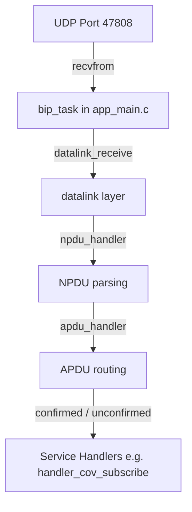

Replacing the firmware on a T3 controller: the update flow and its registers, resuming an interrupted transfer, image signing, and the protocol notes for the ESP32 controllers.

## Contents

- [T3 firmware and bootloader](00-hub.md)
- [How a firmware update runs](update-flow.md)
- [The update registers](update-registers.md)
- [Resuming an interrupted update](resuming-an-update.md)
- [Inside the bootloader](inside-the-bootloader.md)
- [Trying the commands](trying-the-commands.md)
- [Firmware signing guide](signing-firmware.md)
- [Skip firmware signature validation](skip-signature-validation.md)
- [BACnet change of value](bacnet-cov.md)
- [BACnet protocol stack and flow](bacnet-stack.md)
- [Wi-Fi station mode](wifi-station-mode.md)


---

---
title: "T3 firmware and bootloader"
order: 10
---

A T3 controller runs firmware that can be replaced over the wire. Three things make that safe enough to do on a site: the image is signed, the transfer can resume after a drop, and the controller reports where the update has got to rather than leaving you to guess.

This project is the engineering side of that: the bootloader's registers and state machine, the signing tool, the bypass that exists for recovery, and the protocol notes for the ESP32-based controllers.

## Read it in this order

1. **How a firmware update runs** — the flow, and the partition layout it writes into.
2. **The update registers** — the control, checksum and status registers.
3. **Resuming an interrupted update** — why a dropped transfer does not start over.
4. **Inside the bootloader** — the code path, the state machine, the errors.
5. **Trying the commands** — the sequence to send by hand.
6. **Signing firmware**, and the **signature bypass** kept for recovery only.
7. **BACnet COV**, **BACnet stack** and **Wi-Fi station mode** — the same controllers, from the protocol side.

## Related

- [Firmware update, on a single device](../t3000/1.0/firmware-update-single-device/firmware-update-single-device.md) — the same job from the T3000 screen.


---

---
title: "How a firmware update runs"
order: 20
---

An update is not a file transfer: the bootloader checks what it is about to write, keeps a position so an interrupted transfer can continue, and only then replaces the running image. This page follows the route from the partition layout to a completed update.

## 1. Overview

This document describes the complete firmware update flow with:
- **Modbus register mappings** for update control and status
- **Resumable firmware update** mechanism for reliability
- **OTA (Over-The-Air) partition switching**

---

## 2. Partition Layout

```
ESP32-S3 Flash Memory Layout
├─ Bootloader          0x00000   - 0x1EFFF (120 KB)
├─ NVS                 0x09000   - 0x18FFF (64 KB)
├─ OTA Data           0x19000   - 0x1AFFF (8 KB)   ← OTA select info
├─ PHY Init           0x1B000   - 0x1BFFF (4 KB)
├─ Factory App        0x20000   - 0x11FFFF (1 MB)  ← Primary app
├─ OTA_0 App          0x120000  - 0x71FFFF (6 MB)  ← OTA update slot
├─ Matter NVS         0x720000  - 0x75FFFF (256 KB)
└─ Storage           0x760000  - 0x77FFFF (128 KB)
```

**OTA Packet Size:** `128 bytes` (must match ISP.exe configuration)

---


---

---
title: "The update registers"
order: 30
---

The host drives the whole update through a handful of Modbus registers: the control registers that start and stop it, the checksum registers that decide whether the image is the intended one, and the status register that says where the update has got to.

## 3. Modbus Register Mapping for Firmware Update

### Update Control Registers

| Register | Address | Type | Purpose | Values |
|----------|---------|------|---------|--------|
| **UPDATE_STATUS** | 16 | W | Firmware update trigger | See below |
| **UPDATE_PTR_HI** | 17 | R/W | Resume position HIGH byte | 0x00-0xFF |
| **UPDATE_PTR_LO** | 18 | R/W | Resume position LOW byte | 0x00-0xFF |
| **UPDATE_FLAG** | 23 | R/W | Update completion status | 0x55 = success |
| **ISP_RESUME_COUNT** | 1991 | R/W | Packet count for resume | 0-65535 |

### MD5 Checksum Registers

| Register | Address | Type | Purpose | Size |
|----------|---------|------|---------|------|
| **MD5[0]** | 1995 | R/W | MD5 checksum word 0 | 16-bit |
| **MD5[1]** | 1996 | R/W | MD5 checksum word 1 | 16-bit |
| **MD5[2]** | 1997 | R/W | MD5 checksum word 2 | 16-bit |
| **MD5[3]** | 1998 | R/W | MD5 checksum word 3 | 16-bit |

### Test Buffer Registers (Diagnostic)

| Register | Address | Range | Purpose |
|----------|---------|-------|---------|
| **TEST_BUF** | 100-150 | 100-150 | Diagnostic counters |

---

## 4. UPDATE_STATUS Register (Address 16) - Command Values

```
UPDATE_STATUS write values trigger different firmware update modes:

┌─────────────────────────────────────────────────────────────┐
│ Write Value │ Command                  │ Action              │
├─────────────────────────────────────────────────────────────┤
│ 0x00        │ PROGRAM_FINISH           │ End OTA update      │
│ 0x01        │ PROGRAM_FINISH           │ End OTA update      │
│ 0x1F        │ PROGRAM_RESUME           │ Start/Resume update │
│ 0x3F        │ ERASE_ALL_FLASH          │ Erase OTA partition │
│ 0x7F        │ PROGRAM_START (unused)   │ Reserved            │
└─────────────────────────────────────────────────────────────┘

Detailed Command Descriptions:

1. Write 0x1F to UPDATE_STATUS (Address 16):
   ├─ Start new firmware update OR resume interrupted update
   ├─ Retrieves resume position from flash (FLASH_RS_RES_PACKAGE)
   ├─ Calls esp_ota_begin() to prepare OTA partition
   ├─ Expects subsequent firmware data on UPDATE_PTR registers
   └─ Updates com_flash_high/low for resume tracking

2. Write 0x01 to UPDATE_STATUS (Address 16):
   ├─ Complete firmware update process
   ├─ Call esp_ota_end() to finalize image
   ├─ Validate image checksum
   ├─ Call esp_ota_set_boot_partition() to mark active
   ├─ Set UPDATE_FLAG = 0x55 on success
   ├─ Clear resume counter
   └─ Device ready to restart

3. Write 0x3F to UPDATE_STATUS (Address 16):
   ├─ Full erase of OTA partition
   ├─ Reset all resume tracking data
   ├─ Clear flash resume counter
   ├─ Abort any in-progress update
   ├─ com_update_firmware = 0
   └─ Ready for new update from packet 0
```

---


---

---
title: "Resuming an interrupted update"
order: 40
---

A transfer over RS485 to a controller in a plant room will be interrupted. The bootloader records how far it got, so the next attempt continues from there instead of starting again — and there is an erase path when resuming is not what you want.

## 5. Resumable Firmware Update Mechanism

### Packet Structure

```
Each firmware packet is 128 bytes:

Packet Format:
┌────────────────────────────────────┐
│ Packet Header (varies by protocol) │ ← Protocol dependent
├────────────────────────────────────┤
│ Firmware Data (up to 128 bytes)    │ ← Actual firmware code/data
└────────────────────────────────────┘

OTA Packet Addressing:
- Packet 0-N numbered sequentially
- Each packet = 128 bytes
- Flash offset = Packet_Number × 128
- Example: Packet 5 starts at byte offset 640 (5 × 128)
```

### Resume State Tracking

```
Flash Storage (NVS):
┌─────────────────────────────────────────────────────────┐
│ Key: "RS_RES_PACKAGE"                                   │
│ Value: uint32_t rs485_resume_chunk (packet count)       │
│                                                         │
│ On boot, this value is loaded into:                     │
│   rs485_resume_chunk = load_uint32_from_flash(...)      │
│                                                         │
│ Example: rs485_resume_chunk = 100 means:                │
│   ├─ Update successfully wrote packets 0-99             │
│   ├─ Next update should start at packet 100             │
│   ├─ Flash byte offset = 100 × 128 = 12,800 bytes      │
│   └─ UPDATE_PTR_HI = 0x50, UPDATE_PTR_LO = 0x00        │
└─────────────────────────────────────────────────────────┘

Runtime Variables:
┌─────────────────────────────────────────────────────────┐
│ rs485_resume_chunk                                      │
│  └─ Packet count (0 to max packets)                     │
│                                                         │
│ com_flash_high / com_flash_low                          │
│  ├─ Derived from packet count                           │
│  └─ Used for protocol feedback to ISP tool              │
│                                                         │
│ s_rs485_ota_next_offset                                 │
│  ├─ Byte offset in flash = resume_chunk × 128          │
│  └─ esp_ota_write_with_offset() writes starting here   │
│                                                         │
│ s_rs485_ota_chunk_len / s_rs485_ota_chunk_buf[]        │
│  ├─ Buffering: accumulate received data                │
│  ├─ When buffer full (128 bytes), flush to flash       │
│  └─ Ensures atomic flash writes                        │
└─────────────────────────────────────────────────────────┘
```

---

## 6. Complete Firmware Update Flow - Normal Path

```
                        ┌─ User Initiates Update ─┐
                        │   (via ISP.exe or tool)  │
                        └──────────┬────────────────┘
                                   │
                                   ▼
                    ┌──────────────────────────┐
                    │ ISP Tool sends Modbus    │
                    │ Write to Reg 1995-1998   │
                    │ (Set expected MD5)       │
                    └───────────┬──────────────┘
                                │
                                ▼
                    ┌──────────────────────────┐
                    │ Write 0x1F to UPDATE_     │
                    │ STATUS (Reg 16) [START]  │
                    └───────────┬──────────────┘
                                │
                                ▼
                    ┌──────────────────────────┐
                    │ Device Actions:          │
                    │ • Get next OTA partition │
                    │ • Call esp_ota_begin()   │
                    │ • Set com_update_firmware│
                    │   = 1                    │
                    │ • Initialize buffering   │
                    └───────────┬──────────────┘
                                │
                        ┌───────┴───────┐
                        │               │
                        ▼               ▼
            ┌──────────────────┐  ┌─────────────────┐
            │ ISP sends packet │  │ ISP sends packet│
            │ 0 (128 bytes)    │  │ 1 (128 bytes)   │
            │ to UPDATE_PTR_   │  │ to UPDATE_PTR_  │
            │ HI/LO registers  │  │ HI/LO registers │
            └────────┬─────────┘  └────────┬────────┘
                     │                     │
                     └──────────┬──────────┘
                                │
                                ▼
                    ┌──────────────────────────┐
                    │ For Each Packet:         │
                    │ • Receive 128 bytes      │
                    │ • Buffer in RAM          │
                    │ • On full buffer:        │
                    │   - esp_ota_write_with_  │
                    │     offset(handle, data,│
                    │     offset)             │
                    │   - Update flash offset  │
                    │   - Save resume count    │
                    │     to NVS               │
                    └───────────┬──────────────┘
                                │
                        ┌───────┴────────┐
                        │ Repeat for all │
                        │ firmware packets│
                        │ (e.g. 1-1000)  │
                        └────────┬────────┘
                                 │
                                 ▼
                    ┌──────────────────────────┐
                    │ All packets received     │
                    │ Write 0x01 to UPDATE_    │
                    │ STATUS (Reg 16) [END]   │
                    └───────────┬──────────────┘
                                │
                                ▼
                    ┌──────────────────────────┐
                    │ Device Actions:          │
                    │ • esp_ota_end() called   │
                    │   Validates image       │
                    │ • esp_ota_set_boot_     │
                    │   partition() called     │
                    │   → Sets OTA select to   │
                    │     mark ota_0 active   │
                    │ • Update UPDATE_FLAG to  │
                    │   0x55 (success)        │
                    │ • Clear rs485_resume_   │
                    │   chunk = 0             │
                    │ • com_update_firmware=0 │
                    └───────────┬──────────────┘
                                │
                                ▼
                    ┌──────────────────────────┐
                    │ Device Ready:            │
                    │ Waiting for restart or  │
                    │ command                  │
                    │ (esp_restart() at app   │
                    │ discretion)              │
                    └──────────────────────────┘
```

---

## 7. Resumable Firmware Update Flow - Recovery Path

```
            ┌─ Power Loss During Update ─┐
            │ (e.g., after packet 250)   │
            └────────────┬────────────────┘
                         │
                         ▼
            ┌──────────────────────────┐
            │ Device Reboots           │
            │ Bootloader loads app     │
            │ (factory app, since OTA  │
            │  incomplete)             │
            └────────────┬─────────────┘
                         │
                         ▼
            ┌──────────────────────────┐
            │ Boot: Load resume state  │
            │ from NVS:                │
            │ rs485_resume_chunk=250   │
            │ (packet count at save)   │
            │                          │
            │ Calculate:               │
            │ • Byte offset = 250×128  │
            │ • com_flash_high = 1     │
            │ • com_flash_low  = 0x00  │
            └────────────┬─────────────┘
                         │
                         ▼
            ┌──────────────────────────┐
            │ ISP Tool detects failure │
            │ Queries UPDATE_PTR_HI/LO │
            │ Reads packet count: 250  │
            │ (from com_flash_high/low)│
            └────────────┬─────────────┘
                         │
                         ▼
            ┌──────────────────────────┐
            │ ISP Tool sends Modbus    │
            │ Write 0x1F to UPDATE_    │
            │ STATUS (Reg 16) [RESUME]│
            └────────────┬─────────────┘
                         │
                         ▼
            ┌──────────────────────────┐
            │ Device Actions:          │
            │ • Load rs485_resume_     │
            │   chunk from NVS         │
            │ • Set s_rs485_ota_next_  │
            │   offset = 250 × 128     │
            │   (byte 32,000)          │
            │ • Call esp_ota_begin()   │
            │ • Ready for packet 250   │
            └────────────┬─────────────┘
                         │
                         ▼
            ┌──────────────────────────┐
            │ ISP sends packet 250,    │
            │ packet 251, ... (all     │
            │ remaining packets)       │
            │ to UPDATE_PTR_HI/LO      │
            └────────────┬─────────────┘
                         │
                         ▼
            ┌──────────────────────────┐
            │ For each resume packet:  │
            │ • esp_ota_write_with_    │
            │   offset(handle, buf,    │
            │   offset) continues from │
            │   offset 32,000+         │
            │ • Update resume count    │
            └────────────┬─────────────┘
                         │
                         ▼
            ┌──────────────────────────┐
            │ All remaining packets    │
            │ Write 0x01 to UPDATE_    │
            │ STATUS [FINALIZE]       │
            └────────────┬─────────────┘
                         │
                         ▼
            ┌──────────────────────────┐
            │ • esp_ota_end()          │
            │ • esp_ota_set_boot_      │
            │   partition()            │
            │ • UPDATE_FLAG = 0x55     │
            │ • Ready to boot new app  │
            └──────────────────────────┘
```

---

## 8. Erase Operation (Full Reset)

```
            ┌─ ISP Tool Error Detection ─┐
            │ (e.g. wrong image)         │
            └────────────┬────────────────┘
                         │
                         ▼
            ┌──────────────────────────┐
            │ ISP sends Modbus command │
            │ Write 0x3F to UPDATE_    │
            │ STATUS (Reg 16) [ERASE]  │
            └────────────┬─────────────┘
                         │
                         ▼
            ┌──────────────────────────┐
            │ Device Actions:          │
            │ • Abort any in-progress  │
            │   esp_ota_abort()        │
            │ • esp_partition_erase_   │
            │   range() on full OTA    │
            │ • Clear NVS resume data: │
            │   rs485_resume_chunk=0   │
            │ • Reset all buffers:     │
            │   s_rs485_ota_chunk_len  │
            │   = 0                    │
            │ • com_update_firmware=0  │
            │ • Ready for fresh update │
            └──────────────────────────┘
```

---


---

---
title: "Inside the bootloader"
order: 50
---

The variables, the checksum verification and the handler that receives a write, plus the files worth reading and the errors the flow can end in.

## 9. Code Implementation Details

### Key Variables (app_main.c)

```c
// Firmware Update State
uint8_t com_update_firmware = 0;           // Update in progress flag
uint8_t com_update_firmware_timer = 0;     // Watchdog counter
uint8_t update_flag = 0;                   // 0x55 when successful
uint16_t rs485_resume_chunk = 0;           // Packet count for resume

// OTA Handle & Partition
esp_ota_handle_t update_com_handle = 0;
const esp_partition_t *update_com_partition = NULL;

// Buffering
#define OTA_PACKET_SIZE 128u
static uint8_t s_rs485_ota_chunk_buf[OTA_FLASH_CHUNK_SIZE];  // 4096 bytes
static size_t s_rs485_ota_chunk_len = 0;   // Current buffer fill
static uint32_t s_rs485_ota_next_offset = 0;  // Flash write offset

// Resume Tracking
uint8_t com_flash_high = 0;                // Packet count HIGH byte
uint8_t com_flash_low = 0;                 // Packet count LOW byte
uint32_t rs485_resume_bytes = 0;           // Backup variable
uint8_t rs485_run_begin_one_time = 0;      // One-time esp_ota_begin flag
```

### MD5 Verification

```c
// MD5 Registers (1995-1998) store expected firmware checksum
unsigned short firmware_md5[4];

// On completion, device can compare:
// - Hardware computed MD5 from esp_ota_end()
// - vs. ISP tool provided MD5 (in registers 1995-1998)
```

### Modbus Write Handler (Partial Code)

```c
if (address == UPDATE_STATUS) {
    if (*(bufadd+5) == 0x1F) {
        // START/RESUME Update
        com_update_firmware = 1;
        update_com_partition = esp_ota_get_next_update_partition(NULL);
        update_ota_address(rs485_resume_chunk);  // Derive resume offset
        esp_ota_begin(update_com_partition, OTA_SIZE_UNKNOWN, &update_com_handle);
        s_rs485_ota_next_offset = rs485_resume_chunk * OTA_PACKET_SIZE;
        rs485_run_begin_one_time = 1;
    }
    else if (*(bufadd+5) == 0x01) {
        // FINISH Update
        esp_ota_end(update_com_handle);
        esp_ota_set_boot_partition(update_com_partition);
        update_flag = 0x55;  // Success marker
        rs485_resume_chunk = 0;
        save_uint32_to_flash(FLASH_RS_RES_PACKAGE, 0);  // Clear resume
        com_update_firmware = 0;
    }
    else if (*(bufadd+5) == 0x3F) {
        // ERASE OTA Partition
        esp_partition_erase_range(update_com_partition, 0, update_com_partition->size);
        rs485_resume_chunk = 0;
        save_uint32_to_flash(FLASH_RS_RES_PACKAGE, 0);
    }
}
```

---

## 10. Flowchart - State Machine Overview

```
                        ┌─────────────────────┐
                        │   IDLE State        │
                        │ Waiting for command │
                        └──────────┬──────────┘
                                   │
                ┌──────────────────┼──────────────────┐
                │                  │                  │
                ▼                  ▼                  ▼
        ┌───────────────┐  ┌──────────────┐  ┌──────────────┐
        │ Write 0x1F    │  │ Write 0x01   │  │ Write 0x3F   │
        │ (START/RESUME)│  │ (FINALIZE)   │  │ (ERASE)      │
        └───────┬───────┘  └──────┬───────┘  └──────┬───────┘
                │                 │                 │
                ▼                 ▼                 ▼
        ┌───────────────┐  ┌──────────────┐  ┌──────────────┐
        │ PREPARE State │  │ FINISH State │  │ ERASE State  │
        │               │  │              │  │              │
        │ Load resume   │  │ End OTA      │  │ Erase OTA    │
        │ esp_ota_begin │  │ Set partition│  │ Clear resume │
        │ Ready for RX  │  │ Mark success │  │ Back to IDLE │
        └───────┬───────┘  └──────┬───────┘  └──────────────┘
                │                 │
                ▼                 ▼
        ┌───────────────┐  ┌──────────────┐
        │ RX State      │  │ IDLE State   │
        │               │  │ Ready for    │
        │ Receive FW    │  │ reboot/next  │
        │ Data packets  │  │ command      │
        │ Buffer & write│  └──────────────┘
        │ to OTA        │
        └───────┬───────┘
                │
                │ (All packets?)
                ├─ NO ─→ (Stay in RX, wait next packet)
                │
                └─ YES ─→ (Write 0x01 to finish)
                         │
                         ▼
                    (Goto FINISH State above)
```

---

## 11. Error Handling

```
Error Scenarios:

1. Invalid Partition:
   ├─ esp_ota_get_next_update_partition() returns NULL
   ├─ Log: "No OTA partition available"
   └─ Action: Return error, stay in IDLE

2. OTA Begin Failure:
   ├─ esp_ota_begin() returns error
   ├─ Log: "esp_ota_begin failed"
   └─ Action: esp_restart() to recover

3. Flash Write Error:
   ├─ esp_ota_write_with_offset() fails
   ├─ Log: "OTA flash write failed at offset X"
   └─ Action: Return error, but resume position saved

4. Image Validation Failure:
   ├─ esp_ota_end() returns ESP_ERR_OTA_VALIDATE_FAILED
   ├─ Log: "Image validation failed, image is corrupted"
   └─ Action: Do NOT call esp_ota_set_boot_partition()
   └─ Recovery: Write 0x3F to erase and retry

5. Boot Partition Switch Failure:
   ├─ esp_ota_set_boot_partition() returns error
   ├─ Log: "esp_ota_set_boot_partition failed"
   └─ Action: Log error but DO NOT restart (allows retry)
```

---

## 13. Key Files Reference

- **app_main.c** - Main update logic & Modbus handlers (lines 800-1000+)
- **temco_dfu.c** - DFU protocol implementation (if using TFTP)
- **flash.c** - NVS storage for resume state
- **modbus.h** - Register address definitions
- **temco_partitions.csv** - Partition layout definition
- **FIRMWARE_UPDATE_PROCESS.md** - Original detailed process docs

---

## 14. Summary

| Aspect | Details |
|--------|---------|
| **OTA Partition Address** | 0x120000 (6 MB) |
| **OTA Select Data** | 0x19000 (2 KB) |
| **Packet Size** | 128 bytes |
| **Resume Granularity** | 1 packet (128 bytes) |
| **Max Packets** | ~48,000 (6 MB ÷ 128 bytes) |
| **Update Commands** | 0x1F (start/resume), 0x01 (finish), 0x3F (erase) |
| **MD5 Registers** | 1995-1998 |
| **Success Flag** | UPDATE_FLAG = 0x55 |
| **Recovery Method** | Automatic resume on power loss |


---

---
title: "Trying the commands"
order: 60
---

The sequence to send by hand, in order, when you want to watch an update happen rather than trust it.

## 12. Testing Modbus Commands

### Modbus RTU (Serial) Example Commands

```
Python pseudo-code using Modbus:

# 1. Set expected MD5 checksum (registers 1995-1998)
write_registers(1995, [0xABCD, 0xEF12, 0x3456, 0x7890])

# 2. Initiate firmware update (START)
write_register(16, 0x1F)  # UPDATE_STATUS = 0x1F

# 3. Send firmware packets via protocol
# (In serial/TCP stream, not Modbus)

# 4. Check resume position if interrupted
result = read_registers(17, 2)  # READ UPDATE_PTR_HI/LO

# 5. Resume from last position (if needed)
write_register(16, 0x1F)  # UPDATE_STATUS = 0x1F (resume)

# 6. Complete update
write_register(16, 0x01)  # UPDATE_STATUS = 0x01

# 7. Read completion status
status = read_register(23)  # UPDATE_FLAG
if status == 0x55:
    print("Update successful!")
else:
    print("Update failed!")

# 8. Full erase if needed
write_register(16, 0x3F)  # UPDATE_STATUS = 0x3F (erase all)
```

---


---

---
title: "Firmware signing guide"
order: 70
---

## Requirements
- Python 3.6 or later
- `sign_firmware.py`

---

## Steps

### 1. Build firmware
Build your firmware in ESP-IDF as usual:
```bash
idf.py build
```
This produces `temco_app.bin` (unsigned raw binary).

---

### 2. Sign the firmware
```bash
python sign_firmware.py sign -i temco_app.bin -o temco_app_signed.bin
```

Expected output:
```
[INFO] Input file     : build/firmware.bin
[INFO] Firmware size  : 524288 bytes (512.0 KB)
[INFO] Footer size    : 40 bytes
[INFO] Total size     : 524328 bytes (512.0 KB)

[INFO] Computing HMAC-SHA256...
[INFO] HMAC           : a3f1c2d4e5b6a7...

[OK]  Signed firmware : build/firmware_signed.bin
[OK]  Output size     : 524328 bytes (512.0 KB)

      Ready to flash via ISP / RS485 OTA
```
---

### 3. Validate the firmware (optional)
```bash
python sign_firmware.py verify -i temco_app_signed.bin
```

Expected output:
```

[INFO] File           : temco_app_signed.bin
[INFO] Total size     : 273480 bytes
[INFO] Firmware size  : 273440 bytes
[INFO] Footer magic   : 0x0000 (Secure)
[INFO] Footer fw_size : 273440 bytes
[INFO] Stored HMAC    : 5fdd3bca0fe05ae2..
[INFO] Computed HMAC  : 5fdd3bca0fe05ae2..

[OK]  Firmware signature is VALID

```

### 4. Send via ISP / RS485 OTA tool
Use `firmware_signed.bin` — NOT `firmware.bin`.

```
firmware.bin        ← DO NOT USE THIS
firmware_signed.bin ← USE THIS
```

---

## Important
- Always sign after every new build before sending
- Never send unsigned `firmware.bin` to device — it will be rejected


---

---
title: "Skip firmware signature validation"
order: 80
---

## Skip Firmware Signature Validation via Modbus Register 1992

This firmware supports bypassing firmware HMAC validation when the Modbus secure key register is written with the special value `0x0BEE`.

## What happens
- Modbus register `1992` is mapped to `MODBUS_SECURE_KEY`.
- When the stored value equals `0x0BEE`, firmware validation is skipped during update.
- The firmware logs: `Skip firmware HMAC validation, secure key found in modbus register`.

## Register details
- Register address: `1992`
- Expected bypass value: `0x0BEE`
- Data type: 16-bit register

## How to write the bypass key
Use your Modbus master / RS485 tool to write register `1992` with value `0x0BEE`.

Example:
- Register: `1992`
- Value: `30574` decimal or `0x0BEE` hexadecimal
- Byte order in the register: the firmware reads the 16-bit value directly and stores it in flash

If your tool allows writing a register word, set it to `0x0BEE`.
If your tool writes high/low bytes separately, send `0x0B` as the high byte and `0xEE` as the low byte.

## How to verify
After writing the register:
1. Reboot or restart the update flow as needed.
2. Start firmware upload/update.
3. The device should skip HMAC validation and continue.

## Important notes
- This bypass is intended for testing, recovery, or controlled validation scenarios only.
- Do not leave the bypass key enabled in production.
- For normal signed firmware validation, clear the register value or restore it to `0`.

## Quick reference
```text
Register   : 1992
Bypass key : 0x0BEE
Result     : skip firmware HMAC validation
```


---

---
title: "BACnet change of value"
order: 90
---

## BACnet Change of Value (COV) Architectural Guide

This document details how the Change of Value (COV) service works in the T3 firmware, including subscription tracking, change detection, state machine execution, and MQTT publishing.

---

## 1. What is COV and why is it used?

**Change of Value (COV)** is a BACnet service designed to minimize network congestion and save processing cycles. Instead of a client constantly polling a device for point values (which consumes CPU and network bandwidth), the client subscribes to specific points of interest.

The controller then monitors these points locally and sends a notification to the subscriber **only when a change occurs** (or when the subscription is first registered).

---

## 2. Subscription Tracking (`COV_Subscriptions[]`)

Subscriptions are tracked in a static array defined in [h_cov.c](file://T3-programmable-controller-on-ESP32/temco_bacnet/src/h_cov.c):

```c
#define MAX_COV_SUBCRIPTIONS 20
static BACNET_COV_SUBSCRIPTION COV_Subscriptions[MAX_COV_SUBCRIPTIONS];
```

Each slot tracks:
- `monitoredObjectIdentifier`: The point type (AI, AO, AV, BI, BO, BV) and its 1-based instance.
- `subscriberProcessIdentifier`: Process ID of the client (usually `1` for MQTT, or client-defined for BACnet).
- `lifetime`: Time remaining in seconds before this subscription expires.
- `dest_index`: Reference to the client's destination address in `COV_Addresses[]`.
- `flag.send_requested`: Set to `true` to request an immediate update.
- `flag.issueConfirmedNotifications`: Indicates whether confirmed or unconfirmed notifications should be sent.

---

## 3. Subscription Lifetime & Expiration

Subscriptions can have a defined lifetime (in seconds):
- **Infinite Subscriptions**: Registered with `lifetime = 0`. These never expire and remain active until manually unsubscribed or the device reboots.
- **Definite Subscriptions**: Registered with `lifetime > 0`.
- **Expiration Process**:
  1. Every 1 second, the main task calls `handler_cov_timer_seconds(1)`.
  2. For each active subscription with a non-zero lifetime, it decrements the remaining time by `1`.
  3. Once `lifetime` reaches `0`, the subscription is expired (`flag.valid = false`).
  4. The address is cleaned up using `cov_address_remove_unused()`.

---

## 4. Change Detection & State Machine

COV changes are monitored and processed through two mechanisms:

### A. Second-by-Second Timer (`handler_cov_timer_seconds`)
Runs every 1 second inside `Bacnet_Control` and executes local change checks on the registered subscriptions:
- Checks value changes using type-specific functions:
  - `Analog_Value_Change_Of_Value(instance)`
  - `Analog_Input_Change_Of_Value(instance)`
  - `Analog_Output_Change_Of_Value(instance)`
  - `Binary_Value_Change_Of_Value(instance)`
  - `Binary_Input_Change_Of_Value(instance)`
  - `Binary_Output_Change_Of_Value(instance)`
- These compare the current hardware value against a stored backup buffer. If they differ, `cov_send_request` is triggered immediately.

### B. State Machine Task (`handler_cov_task`)
Runs every 10ms to manage queueing, clearing, and transmission. It cycles through 5 states:
1. **`COV_STATE_IDLE`**: Resets tracking pointers.
2. **`COV_STATE_MARK`**: Scans the subscriptions. Calls `Device_COV(type, instance)` to see if a point value changed. If yes, sets `flag.send_requested = true`.
3. **`COV_STATE_CLEAR`**: Clears the change flag on the device using `Device_COV_Clear()`.
4. **`COV_STATE_FREE`**: Clean up confirmed transactions that finished or failed.
5. **`COV_STATE_SEND`**: Encodes the property lists (`Device_Encode_Value_List()`) and invokes `cov_send_request()` to transmit the update.

---

## 5. MQTT and BACnet COV Integration Flow

When MQTT and BACnet are unified, the flow behaves as follows:

```mermaid
graph TD
    MQTT[MQTT Client JSON Subscribe] -->|Parse JSON| Mqtt_H[Mqtt_Handler.c]
    Mqtt_H -->|Encode Subscribe APDU| apdu[apdu buffer]
    apdu -->|handler_cov_subscribe| cov_list[Register in COV_Subscriptions with dest = {0}]

    subgraph Detection
        Timer[1s Timer / 10ms Task] -->|Check change| detect[Value changed]
        detect -->|cov_send_request| send[cov_send_request]
    end

    send -->|Update_Value_List| uvl[Update_Value_List in app_main.c]
    uvl -->|#if BACNET_SUB_COV| mqtt_pub[Mqtt_Handler_Send_COV]
    uvl -->|BACnet IP| bacnet_pub[Send unconfirmed broadcast notification]
```

### A. Subscribing via MQTT
1. The MQTT client publishes a JSON payload to `temco/cov/tstat11/sub`.
2. `Mqtt_Handler.c` parses the object type, instance, and lifetime.
3. It builds a standard BACnet APDU subscription packet using `cov_subscribe_encode_apdu()`.
4. It calls `handler_cov_subscribe()` directly with a dummy address `src = {0}` (acting as local broadcast).
5. This registers the subscription directly into BACnet's internal `COV_Subscriptions[]` table.

### B. Publishing Updates (Unification)
When a point changes (whether subscribed to by a BACnet client or an MQTT client):
1. The BACnet stack detects the change and triggers `cov_send_request()`.
2. `cov_send_request()` calls `Update_Value_List(type, instance)` in `app_main.c`.
3. `Update_Value_List()` reads the value, formats it as a BACnet tag, and:
   - Forwards it to MQTT: Calls `Mqtt_Handler_Send_COV()` (if `BACNET_SUB_COV` is `1`), which publishes the update to the MQTT broker.
   - Forwards it to BACnet: Sends the COV notification packet to the subscriber's address (since the MQTT subscriber used address `{0}`, it sends it as a local broadcast packet, updating all BACnet clients on the network).
4. This ensures that **any** subscription triggers updates to **both** MQTT and BACnet simultaneously.


---

---
title: "BACnet protocol stack and flow"
order: 100
---

## BACnet Protocol Stack & Flow Guide

This document explains the overall architecture and data flow of the BACnet protocol stack within the T3 controller firmware.

---

## 1. Initialization Flow

When the controller boots, the main task starts BACnet-related services. The initialization steps are:

### Device and Stack Startup
1. **Device Initialization**: In [device.c](T3-programmable-controller-on-ESP32/temco_bacnet/src/device.c), the function `Device_Init()` is called to set up the device object database, including device instance numbers, MAC address parameters, and object lists.
2. **COV Subscription Initialization**: In `Bacnet_Control` startup, `handler_cov_init()` (defined in [h_cov.c](T3-programmable-controller-on-ESP32/temco_bacnet/src/h_cov.c)) is called to clear the unified subscription tracking list `COV_Subscriptions[]` and the address routing list `COV_Addresses[]`.
3. **Handler Registration**: APDU service handlers are registered using functions like `apdu_set_confirmed_handler()` and `apdu_set_unconfirmed_handler()`. This maps service types to handler functions:
   - `SERVICE_CONFIRMED_READ_PROPERTY` $\rightarrow$ `handler_read_property()`
   - `SERVICE_CONFIRMED_WRITE_PROPERTY` $\rightarrow$ `handler_write_property()`
   - `SERVICE_CONFIRMED_SUBSCRIBE_COV` $\rightarrow$ `handler_cov_subscribe()`
   - `SERVICE_UNCONFIRMED_WHO_IS` $\rightarrow$ `handler_who_is()`

---

## 2. Packet Processing and Task Execution

The BACnet stack operates across three main ESP-IDF tasks created in [app_main.c](T3-programmable-controller-on-ESP32/main/app_main.c):



### A. Network Packet Reception (`bip_task`)
- **Execution**: Runs a UDP server bound to port `47808` (`0xBAC0`).
- **Packet Intake**: Blocks on `recvfrom` waiting for incoming BACnet/IP packets.
- **Datalink Processing**: Extracts BACnet Virtual Link Control (BVLC) headers and copies the payload via `datalink_receive()`.
- **NPDU Handler**: Invokes `npdu_handler()` (defined in [h_npdu.c](T3-programmable-controller-on-ESP32/temco_bacnet/src/h_npdu.c)) to extract BACnet source and destination network routing parameters.
- **APDU Router**: Passes the request payload to `apdu_handler()` to extract confirmed or unconfirmed requests, invoking the matching registered service handler.

### B. State Machine Task (`Bacnet_Control` task)
- **Execution**: Runs in a continuous loop every 10ms.
- **COV Handler Task**: Invokes `handler_cov_task(BAC_IP_CLIENT)` every 10ms. This processes the COV state machine (`COV_STATE_MARK`, `COV_STATE_CLEAR`, `COV_STATE_SEND`) to check for changes and dispatch unsent notifications.
- **COV Timer Task**: Every 1000ms (1 second), it invokes `handler_cov_timer_seconds(1)`. This updates active subscription lifetimes, expires dead entries, and does a backup check for changed local inputs, outputs, and variables.

---

## 3. Core API and Service Routing

### Reading Properties
- **API**: `handler_read_property()` in [h_rp.c](T3-programmable-controller-on-ESP32/temco_bacnet/src/h_rp.c)
- **Flow**:
  1. Decodes `monitoredObjectIdentifier` and `propertyIdentifier`.
  2. Invokes object-specific encoding callbacks (e.g. `Analog_Input_Encode_Property_APDU`).
  3. Sends back a Read Property Ack payload containing the requested value.

### Writing Properties
- **API**: `handler_write_property()` in [h_wp.c](T3-programmable-controller-on-ESP32/temco_bacnet/src/h_wp.c)
- **Flow**:
  1. Decodes write parameters (value, tag, priority, and object index).
  2. Updates local registers (`inputs[]`, `outputs[]`, or `vars[]`).
  3. Invokes Modbus or hardware updating commands.
  4. Returns a Simple Ack or Error APDU.


---

---
title: "Wi-Fi station mode"
order: 110
---

## Wi-Fi STA Configuration Manual

This manual explains how to configure the controller to connect in STA mode (Station mode) to your existing Wi-Fi network.

## 1. What is STA mode?

STA mode means the device acts as a client and connects to an existing Wi-Fi router or access point.

- The controller does not create its own network for normal operation in STA mode.
- It joins your home or office Wi-Fi network.
- After successful connection, you can access the device over the local network.

## 2. What you need before starting

Make sure you have:

- The controller powered on.
- A phone, laptop, or tablet with Wi-Fi.
- The Wi-Fi network name (SSID).
- The Wi-Fi password.
- A web browser such as Chrome, Edge, or Safari.

Important notes:

- Use a 2.4 GHz Wi-Fi network if possible.
- The password should be entered exactly as it is on the router.
- If your network uses WPA2/WPA3 security, the password is usually required.

## 3. How the device enters Wi-Fi setup mode

If the controller does not have valid Wi-Fi credentials saved, or if it cannot connect to the saved network, it automatically starts a temporary setup access point.

Default setup hotspot details:

- SSID: T3_Admin
- Password: T3_Admin

This hotspot is used only for configuration.

## 4. How to connect and configure Wi-Fi

### Step 1: Connect your phone or laptop to the controller setup hotspot

1. Open the Wi-Fi settings on your phone or laptop.
2. Search for the network named T3_Admin.
3. Connect to it using the password T3_Admin.

You should now be connected to the controller's temporary setup network.

### Step 2: Open the configuration page

Open a browser and visit one of the following:

- http://192.168.4.1
- http://tstat.local

If the page does not open immediately, wait a few seconds and try again.

### Step 3: Select your home Wi-Fi network

On the configuration page:

1. Click the Scan Wi-Fi button.
2. Wait for the list of nearby networks to appear.
3. Select your Wi-Fi network from the list.
4. Enter the Wi-Fi password in the password field.
5. Click Save & Connect.

### Step 4: Wait for the device to connect

After saving:

- The controller will reboot.
- It will try to connect to the Wi-Fi network you selected.
- Wait about 30 to 60 seconds.

### Step 5: Disconnect from the setup hotspot

Once the device connects successfully:

1. Disconnect your phone or laptop from T3_Admin.
2. Reconnect to your normal home or office Wi-Fi network.
3. Open the controller using its IP address or hostname if available.

## 5. Where to connect from

Use the following connection points depending on the situation:

- During initial setup: connect to the temporary hotspot T3_Admin.
- After successful STA connection: connect to your normal Wi-Fi network and access the controller from its local IP address.
- If your network supports mDNS, you may also try the hostname tstat.local.

## 6. Recommended Wi-Fi setup conditions

For best results:

- Place the controller near the router during initial setup.
- Make sure the Wi-Fi signal is strong.
- Avoid using a hidden SSID unless you know the exact name.
- Use a simple password that does not contain unsupported characters.

## 7. Troubleshooting

### Problem: I cannot see the T3_Admin network

Try the following:

- Make sure the controller is powered on.
- Wait a few seconds after startup.
- Restart the controller.
- Check whether the setup hotspot is active.

### Problem: The configuration page does not open

Try the following:

- Connect again to T3_Admin.
- Use http://192.168.4.1 directly.
- Ensure your device is connected to the controller hotspot and not your home Wi-Fi.

### Problem: The device cannot connect to the router

Try the following:

- Confirm the SSID name is correct.
- Confirm the password is correct.
- Use a 2.4 GHz Wi-Fi network.
- Move the controller closer to the router.
- Restart the controller and try again.

### Problem: The device connects but I cannot reach it later

Try the following:

- Check the router's DHCP client list.
- Confirm the device received an IP address.
- Try using the assigned IP address in the browser.

## 8. Summary

To configure Wi-Fi in STA mode:

1. Connect to the temporary hotspot T3_Admin.
2. Open http://192.168.4.1 or http://tstat.local.
3. Scan for your Wi-Fi network.
4. Enter your SSID and password.
5. Save and wait for the device to connect.

Once connected, the controller will operate as a client on your Wi-Fi network.
