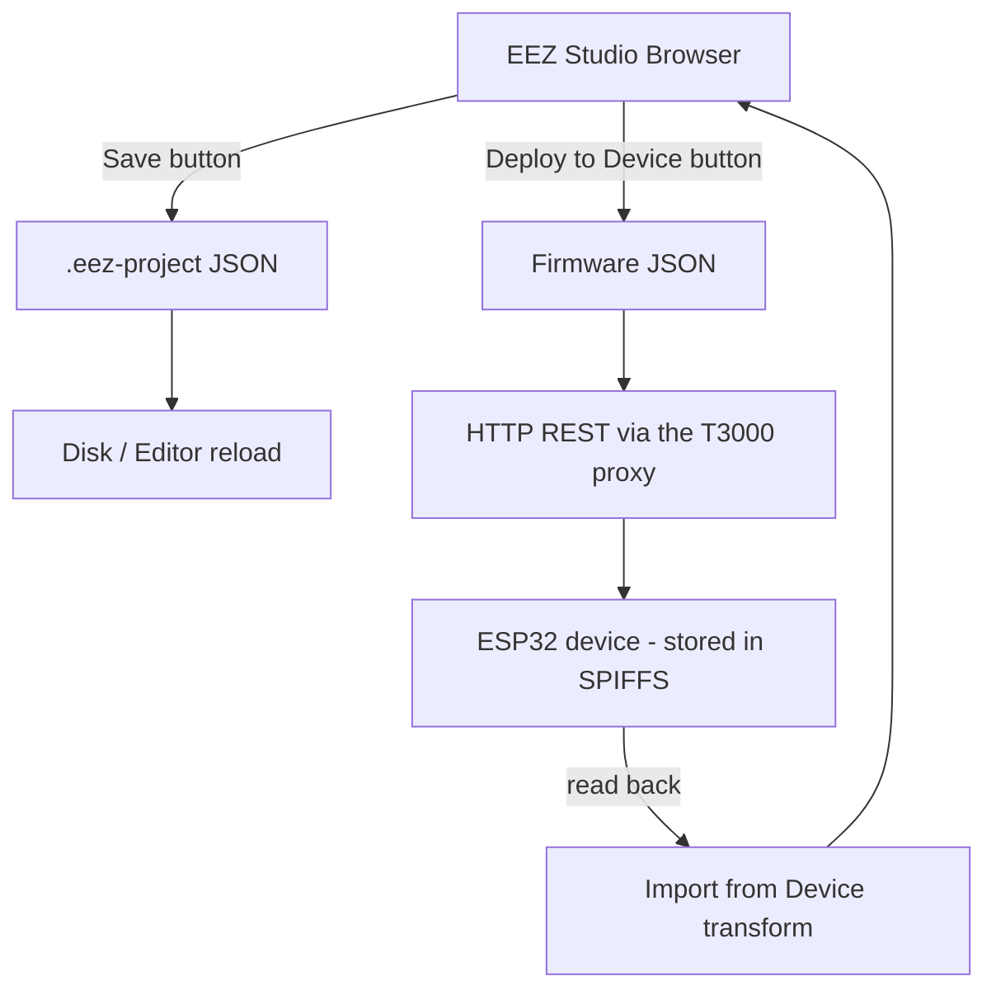

The browser front end that replaces the MFC screens, and the unified Designer behind it: one editor for HVAC schematics, LVGL screens, LVGL flows and the LCD simulator.

## Contents

- [What the new UI is](00-hub.md)
  - [Design Hub — Developer & User Guide](design-hub/README.md)
    - [Unified Designer — design set](architecture/designer/README.md)
    - [Unified Designer — one editor, per-document-type content](architecture/designer/design.md)
    - [Designer — interfaces and contracts](architecture/designer/interfaces.md)
    - [Designer — full change map](architecture/designer/change-map.md)
    - [Designer — theme and CSS](architecture/designer/theme-and-css.md)
    - [EEZ editor — button-by-button: origin vs the unified shell](architecture/designer/eez-button-behaviour.md)
    - [Designer — risks, open questions, rollback](architecture/designer/risks.md)
      - [Designer — page-by-page design](architecture/designer/pages/README.md)
      - [Every route in the app, and how the Designer touches it](architecture/designer/pages/app-routes.md)
      - [The Design Hub, page by page — the entry point into every designer document](architecture/designer/pages/design-hub.md)
      - [The Designer shell — area-by-area design](architecture/designer/pages/designer-shell-areas.md)
      - [The HVAC document, panel by panel](architecture/designer/pages/hvac-document.md)
      - [The LCD/simulator document, area by area (P5)](architecture/designer/pages/lcd-document.md)
      - [The LVGL document, panel by panel](architecture/designer/pages/lvgl-document.md)
      - [P1 — `DesignerShell` + the HVAC document on it](architecture/designer/phases/p1-shell-hvac.md)
      - [P2 — the LVGL document on the shell](architecture/designer/phases/p2-lvgl-document.md)
      - [P3 — HVAC host mode: the container comes from the shell](architecture/designer/phases/p3-hvac-host-mode.md)
      - [P4 — route consolidation](architecture/designer/phases/p4-route-consolidation.md)
      - [P5 — optional unification](architecture/designer/phases/p5-unification.md)
    - [LVGL SVG Renderer](architecture/lvgl-svg/README.md)
    - [LVGL SVG Renderer — Architecture](architecture/lvgl-svg/architecture.md)
    - [LVGL SVG Renderer — Editor Integration](architecture/lvgl-svg/editor-integration.md)
    - [LVGL SVG Renderer — Fidelity Harness](architecture/lvgl-svg/fidelity-harness.md)
    - [LVGL SVG Renderer — Scope & Invariants](architecture/lvgl-svg/invariants.md)
    - [LVGL 9.5 — SVG Renderer: measured primitive inventory](architecture/lvgl-svg/primitives.md)
    - [LVGL SVG Renderer — Rendering](architecture/lvgl-svg/rendering.md)
    - [LVGL SVG Renderer — Runtime Integration](architecture/lvgl-svg/runtime-integration.md)
    - [LVGL SVG Renderer — Scene Contract](architecture/lvgl-svg/scene-contract.md)
    - [LVGL SVG Renderer — WASM Bridge](architecture/lvgl-svg/wasm-bridge.md)
  - [Design Studio (Tstat11)](t3-eez-studio/README.md)
  - [Deploy to Device — as built (REST)](t3-eez-studio/device-interface-deployment-via-bacnet-design.md)
  - [Import from Device — as built](t3-eez-studio/import-from-device-design.md)
  - [.EEZ-Project JSON Format — Design Document](t3-eez-studio/lvgl-eez-project-json-format.md)
  - [Static Resource Copy — Build-Time Asset Pipeline](t3-eez-studio/static-resource-copy-build.md)
  - [LVGL WASM Browser Build Migration](t3-eez-studio/wasm-browser-build-migration.md)
    - [01 — Overview](t3-eez-studio/manual/01-overview.md)
    - [02 — Creating a Project](t3-eez-studio/manual/02-creating-projects.md)
    - [03 — Designing Screens](t3-eez-studio/manual/03-editing-screens.md)
    - [04 — Adding Logic with EEZ Flow](t3-eez-studio/manual/04-eez-flow.md)
    - [05 — Preview, Bind & Deploy](t3-eez-studio/manual/05-preview-and-deploy.md)
    - [06 — Reference & FAQ](t3-eez-studio/manual/06-reference-and-faq.md)
  - [Switching between Classic View and New View](features/view-switcher.md)
  - [Try the new T3000 UI (beta) — Inputs, Trend Logs, Haystack, AI Assistant and the new Designer](releases/beta-webui-announcement.md)
    - [Changelog - 2026-10-11](releases/changelog/2026-10-11.md)


---

---
title: "What the new UI is"
order: 5
---

The T3000 that ships today draws its screens in MFC. This is the replacement: the same job done in a browser, with the C++ application hosting a web front end instead of painting controls itself.

It is two things at once, and the pages here cover both:

- **The web front end** — the Modbus Register Tool and the HVAC Drawer, plus the screens that have already moved (inputs, trend logs, Haystack, the assistant).
- **The unified Designer** — one editor at `/t3000/designer/…` serving four kinds of document: an HVAC schematic, an LVGL 9.5 screen, an LVGL flow, and the LCD simulator.

## Status

The new UI is in beta and the Designer is being built in five phases. Some of what follows is design rather than shipped behaviour, and the pages say which: `interfaces.md` opens by calling itself a proposed API, and `risks.md` keeps the open questions and the rollback. Read a page's own status line before trusting it as a description of the product.

## Reading order

| # | Where | What it answers |
|---|---|---|
| 1 | **Design Hub** | the entry point — what a designer document is, who uses it, and how the hub lists them |
| 2 | **Designer: design** | the decisions: one editor, four document types, the areas each one fills |
| 3 | **Designer: interfaces** | the contracts — `DocumentAdapter`, region and tab specs, commands, viewport, status |
| 4 | **Designer: change map** | every file added, touched or deliberately left alone, per phase |
| 5 | **Designer: theme and CSS** | Fluent UI and T3000 tokens, and the bridge from EEZ's variables |
| 6 | **Page by page** | what changes on each screen, including all 43 routes and the shell's five areas |
| 7 | **Phases P1–P5** | the order it is built in: shell and HVAC, LVGL, HVAC host mode, route consolidation, optional unification |
| 8 | **LVGL SVG renderer** | the measured primitive inventory, the scene contract, and the WASM bridge |
| 9 | **EEZ Studio** | the design studio the LCD screens are made in, with a six-part user manual |
| 10 | **Releases** | the beta announcement and the changelog |

## Where the other half of the story is

- **T3000 API & Protocol** documents what the front end talks to: the REST and WebSocket API, the webview message set, and the data structures behind every point.
- **T3000** is the application these screens sit inside, including the classic MFC screens they replace.


---

---
title: "Design Hub — Developer & User Guide"
order: 10
---

The **Design Hub** (`/t3000/design`) is the unified center for all T3000 HVAC drawing
engines (HVAC Designer, EEZ Studio, Tstat10 Simulator). It aggregates projects, libraries,
templates, device bindings, revision history and hub tooling behind a single dashboard.

---

## 1. Access & Routes

| Route | What it is |
|---|---|
| `#/t3000/design` | Design Hub dashboard |
| `#/t3000/design/projects/:id` | Project detail page (preview, stats, snapshots, compare, manage) |
| `#/t3000/hvac-designer` / `:graphicId?` | HVAC drawing editor (SVG engine) |
| `#/t3000/eez` | EEZ Studio (full-page project editor) |
| `#/t3000/tstat10-simulator` | Thermostat LCD designer + simulator |

All routes live under the **MinimalLayout** (top menu bar only). Editor pages
(`hvac-designer`, `eez`, `tstat10-simulator`) additionally get a **contextual editor
menu bar** (`Design | File | Edit | View | Draw | Arrange | Tools | Help`).

Keyboard shortcut: **Ctrl+K** opens the hub **command palette**.

---

## 2. Feature Summary

### Dashboard
- **Hero** — New Drawing, Import SVG/DXF, Docs
- **Device context bar** — selected device, live stats (drawings/bound/deployed/shared), Graphics/Sync/Shared actions
- **Hub stats strip** — drawings, favorites, snapshots, events, bound, shared + per-engine breakdown
- **Create by Type** — pluggable type registry rendered as tiles
- **Templates** — ready-made starter canvases ("New from template")
- **Folders** — organize drawings into groups; filter bar
- **Projects** — unified grid/list across engines:
  - tabs (All / HVAC / EEZ / LCD-Sim / Shared / Device)
  - search, sort (updated / name / created), favorites pinned to top
  - grid ↔ list view
  - selection mode + batch actions (Export / Delete)
- **Shared Libraries** — symbol sets / templates / parts, add + cloud-sync
- **Recent & History** — recently opened + activity timeline
- **Hub Tools** — Backup (download `.json`) / Restore (import)

### Project Detail page
- Large live preview, full metadata, **statistics** (shapes/layers/bound points/complexity/size)
- Folder assignment, device bind, deploy, share, rename, duplicate, delete
- **Revision snapshots** — capture / list / restore / delete
- **Compare** — side-by-side diff of any snapshot vs the current drawing

### Editor integration
- `EditorStatusBar` — unified bottom status bar (device, coords, zoom, saved state)
- Snapshot auto-capture when a drawing is saved (dirty → clean transition)
- Command bus (`t3-editor-command`) drives File/Edit/View/Draw/Arrange/Tools/Help items
- SVG (Inkscape) import via `svgSource` → `T3Gv.opt.ImportSvgSymbol`

---

## 3. Architecture

```
src/t3-react/features/design-hub/
├── types.ts                    # shared types (DrawingType, HubProject, folders, snapshots, stats)
├── drawingTypes.ts             # type registry + user custom types (localStorage)
├── templates.ts                # drawing templates
├── icons.tsx                   # icon resolver
├── services/
│   ├── designHubService.ts     # metadata layer (localStorage + backend sync)
│   └── shapePreview.ts         # drawing → SVG preview renderer
├── store/designHubStore.ts     # zustand store
├── hooks/useEditorCommands.ts  # command bus + status emitter
├── components/                 # Hero, DeviceContextBar, HubStats, TypeTiles, Templates,
│                               # FoldersBar, ProjectsGrid, ProjectCard, SharedLibraries,
│                               # ActivityPanel, DrawingPreview, CompareDrawings,
│                               # CommandPalette, EditorStatusBar, DesignMenuBar,
│                               # BindDeviceDialog, NewTypeDialog, ImportDialog
└── pages/
    ├── DesignHubPage.tsx       # dashboard
    └── ProjectDetailPage.tsx   # project detail
```

### Data model & storage (localStorage-first)
| Key | Purpose |
|---|---|
| `t3-hvac-drawings` | HVAC drawings (the editor's own index) |
| `t3-design-hub` | Hub metadata: activity, recent, libraries, projects, favorites, folders, projectFolders, snapshots |
| `t3-design-hub-custom-types` | User-registered drawing types |

`designHubService` reads HVAC drawings from `t3-hvac-drawings`, tracks hub state in
`t3-design-hub`, and can **sync the whole hub to the backend** via
`POST/GET /api/design-hub` (Rust endpoint in `api/src/design_hub.rs`, JSON snapshot at
`Database/design-hub.json`). When the backend is unavailable it reports "backend offline —
kept local" and continues fully functional.

### Real project list (Project Catalog)
The dashboard **project history** is driven by the real created projects, not seeds:

- **EEZ / LVGL** projects live on disk at `<data_root>/project/<name>/<name>.eez-project`
  (`data_root` = `<cwd>/ResourceFile/webview/t3web/t3-eez`) and are listed via `GET /api/eez-studio/projects`.
- **HVAC** drawings stay localStorage-primary, with a best-effort disk mirror under
  `<ResourceFile/webview/t3web>/t3-hvac/<id>/<id>.json` (`GET/PUT/DELETE /api/design-hub/hvac-drawings`).
- **Simulator** has no real project storage yet → hidden.

The unified loader lives in `src/t3-react/features/design-hub/services/projectCatalog.ts`
(`loadRealProjects`), consumed by `designHubStore`. Opening an EEZ card deep-links to
`/t3000/eez?open=project/<name>/<name>.eez-project` (handled in `EezStudioApp`).
Deleting an EEZ card removes the folder on disk (`/api/eez-studio/delete-recursive`).

### The Drawing Type Registry (extensibility)
A type is a plain config entry:

```ts
{
  id: 'my-type',
  name: 'My Type',
  engine: 'hvac' | 'eez' | 'simulator' | 'symbols',
  openPath: '/t3000/...',
  importFormats: ['svg', 'json'],
  deviceAware: boolean,
  accent: '#color',
  icon: 'Flow',
  template?: { width; height; backgroundColor }
}
```

- **Built-in types** live in `drawingTypes.ts`.
- **Users can register new types** at runtime via the **New Type** tile → stored in
  `t3-design-hub-custom-types` and merged via `getAllDrawingTypes()`.
- **Templates** are defined in `templates.ts`; add one and it appears in the gallery.

### Extension points
- **Command bus**: `window.dispatchEvent(new CustomEvent('t3-editor-command', { detail: { command } }))`
  — engines subscribe via `useEditorCommands(cb)`.
- **Status bar**: `emitEditorStatus({ name, coords, message, zoom, saved })` → `t3-editor-status` event.
- **Save snapshots**: `designHubService.saveSnapshot(projectId, name?)`.
- **Import event**: `t3-design-import` opens the Import dialog.

---

## 4. Device Integration

- **Bind** — `BindDeviceDialog` picks a device + building/floor/room; persisted on the drawing.
- **Deploy** — pulls device graphics via `PanelDataRefreshService` (Action 17 `GET_WEBVIEW_LIST`)
  and records a deployment activity event. Deploy opens Bind first if no device is bound.
- The device context bar scopes drawings by the selected device.

---

## 5. Sharing & Cloud Sync

- **Share** a project (Synced status) or **sync a library to cloud** (source → `cloud`).
- **Hub Sync** button posts the whole hub to the backend (`/api/design-hub`).
- Cloud/team sharing via the T3 User Library API is a future extension of the same endpoint.

---

## 6. Backup & Restore

`Hub Tools → Backup` downloads a single `.json` containing all HVAC drawings, hub metadata
(favorites/folders/snapshots/libraries/projects), and custom types.
`Restore` merges that file back in (existing drawings/types are never overwritten).

---

## 7. FAQ / Notes

- **Where is the backend?** `api/src/design_hub.rs` — needs an API rebuild/restart to activate.
- **How do I add a new drawing engine?** Register a type (tile or config), point `openPath`
  at its route; the dashboard, libraries and history pick it up automatically.
- **Why do card previews differ from the editor?** Previews render a simplified SVG
  interpretation of stored shapes; the editor is the authoritative renderer.
- **Dev server** is slow to cold-start (heavy Vue/ant-design-vue deps) — be patient, and avoid
  hammering it with parallel module requests (can trigger Vite 504s).


---

---
title: "Unified Designer — design set"
order: 20
---

The designer is one editor at `/t3000/designer/...` serving four document kinds — HVAC schematic, LVGL 9-5,
LVGL flow 9-5 and the LCD simulator. [`change-map.md`](change-map.md) lists the files behind each part.

The goal: **one editor** (`/t3000/designer/...`) used for every design document type. Same five areas for
all of them (top / left / canvas / right / status, plus an optional bottom dock); the *content* of each
area comes from the document type. Fluent UI + T3000 tokens are the theme for the chrome.

Read in this order:

| # | Document | What it answers |
|---|---|---|
| 1 | [`README.md`](README.md) (this file) | decisions, parts of the feature, map of the doc set |
| 2 | [`design.md`](design.md) | current state, target architecture, choices and why |
| 3 | [`interfaces.md`](interfaces.md) | the contracts: `DocumentAdapter`, region/tab specs, commands, viewport, status |
| 4 | [`change-map.md`](change-map.md) | **every file** added / modified / left alone, per phase |
| 5 | [`theme-and-css.md`](theme-and-css.md) | token usage, the EEZ→Fluent variable bridge, CSS scoping |

And the **page-by-page** design, which answers "what exactly changes on each screen":

| # | Document | Covers |
|---|---|---|
| 6 | [`pages/README.md`](pages/README.md) | index + the three cross-cutting findings |
| 7 | [`pages/app-routes.md`](pages/app-routes.md) | all **43 routes** with an impact verdict, the chrome each layout gives, portals, the 30 entry points |
| 8 | [`pages/designer-shell-areas.md`](pages/designer-shell-areas.md) | the shell's 6 areas + 9 states, area by area |
| 9 | [`pages/hvac-document.md`](pages/hvac-document.md) | 7 HVAC panels + the **verified** engine property surface + the inspector (§6.2), its Data section (§6.3) and the Link Entry data source (§6.4) |
| 10 | [`pages/lvgl-document.md`](pages/lvgl-document.md) | all **30 EEZ panels** + 11 editor types + the hazard list |
| 11 | [`pages/lcd-document.md`](pages/lcd-document.md) | the simulator document (P5) |
| 12 | [`pages/design-hub.md`](pages/design-hub.md) | the Hub pages and its 11 dialogs — where every designer URL comes from |

---

## 1. Decisions

### 1a. Fixed decisions

| # | Decision |
|---|---|
| D1 | **One editor**, not two that look alike — a single route, a single shell component, one set of areas |
| D2 | Same **structure** everywhere: top / left / canvas / right / status. Content per document type |
| D3 | **No document tabs.** One document is open at a time |
| D4 | **No split view** — never two documents side by side |
| D5 | Theme authority is **T3000 Fluent tokens**; Fluent UI is the one library for the chrome |
| D6 | New route **`/t3000/designer/:kind/:id?`**; the old routes redirect and keep every link working |
| D7 | Engines are **hosted, never merged** — `lib/t3-hvac` (127k lines) and `t3-eez-studio` (280k lines) keep their document models |

### 1b. Values chosen by this design

| # | Decision | Why |
|---|---|---|
| **D8** | **Keep FlexLayout's *model*, drop FlexLayout's *rendering*.** The EEZ workbench keeps `LayoutModels` (a headless JSON/model tree) as the source of truth for *which panel is selected*; the shell renders those panels. | `LayoutModels.selectTab(model, tabId)` (`store/layout-models.tsx:1161`) is called from ~40 places in EEZ, and `EditorsStore.refresh()` (`store/editor.ts:296`) derives `activeEditor` by walking FlexLayout tab nodes. Rendering the shell ourselves while keeping the model means **none** of that code changes. Replacing the model would be a 40-site rewrite. |
| **D9** | **Regions are tab containers, not single components.** A side panel is `{ tabs, activeTabId, onSelectTab }`. | An EEZ side really is a tab set — and **not** the obvious one: the left area is the `rootEditor` left column (Pages · Widgets · Actions · Components Palette · Widgets Structure) *plus* the left border (Texts · Scpi · Instrument commands · Extensions · Changes), and the right area is the `rootEditor` right tabset (Properties) *plus* the right border (Styles · Fonts · Bitmaps · Themes · LVGL Groups · Breakpoints · Variables). A one-component-per-area shell could not host that. Full map: [`pages/lvgl-document.md`](pages/lvgl-document.md) §1-2 |
| **D10** | **The new route is additive from P1.** `/t3000/designer/...` exists next to the old routes while P1–P3 are built; **P4** turns the old ones into redirects. | The same document can be rendered by both shells while P1-P3 are built, which is how "behaviour unchanged" is verified. Nothing breaks mid-project. |
| **D11** | **P2 renders the LVGL document under the new route in parallel**, not by rewriting `/t3000/eez`. | Same reason as D10, and it keeps the fidelity harness usable on both. |
| **D12** | HVAC's right-hand inspector starts **read-only** (P1), editing arrives in P1b with a verified undo path. | The existing `PropertiesPanel` writes to a Zustand store the engine never reads (`store/designerStore.ts` vs `T3Gv.stdObj`). Making it *edit* the document needs engine mutation + undo + repaint, which must be verified against the real APIs — a separate, well-scoped step. |

## 2. Parts of the feature

The parts are independent: the shell is generic, and a document contributes only its adapter.

| Part | What it adds |
|---|---|
| **P0** | this document set |
| **P1** | `DesignerShell` + the HVAC document on a new route; the old route keeps rendering the legacy page |
| **P1b** | HVAC property editing through one mutation funnel (`engineMutation.ts`) + Undo/Redo in the shell's top bar |
| **P2** | the LVGL document: its panels are projected out of the headless `LayoutModels` tree, plus the theme bridge and its CSS scoping |
| **P3** | HVAC container ids supplied by the shell instead of hard-coded literals |
| **P4** | route consolidation — the old designer URLs become redirects |
| **P5** | shared command bus + viewport controls, LCD panels in shell regions, shell keyboard shortcuts |

Two constraints that shape the parts:

- **The HVAC engine's history has no per-operation fidelity.** Several states are pushed per operation and the
  pushed records alias the live `Data` (`StateBase` hardcodes `IsOpen = false`), so undo can need repeated
  presses before anything moves. The legacy page behaves identically.
- **The LVGL document is the only one with an automated regression net** (`?svgDiff=1` plus the `lvgl-svg`
  vitest suites). The HVAC gate is the A/B comparator in [`design.md`](design.md) §11.

## 3. The shape, in one screen

```
/t3000/designer/:kind/:id?                 one route, one document
         │
         ├── DesignerShell                 ── the ONLY layout component (Fluent tokens)
         │      TopBar      │ LeftRegion (tabs) │ CanvasHost │ RightRegion (tabs) │ StatusBar
         │                                                        BottomDock (tabs, collapsed)
         │
         └── useDocument(kind, id)         → a DocumentAdapter
                 hvac-schematic   engine: hvac       (P1)
                 lvgl-9-5         engine: eez        (P2)
                 lvgl-flow-9-5    engine: eez        (P2)
                 lcd-ui           engine: simulator  (P5)
```

The shell knows no engine. The adapter knows one engine. See [`interfaces.md`](interfaces.md).

The two engines are 407k lines; this is a shell around them, not a rewrite (D7).


---

---
title: "Unified Designer — one editor, per-document-type content"
order: 30
---

This is the **architecture** document: the decisions and their rationale. The rest of the design set is indexed in
[`README.md`](README.md): contracts ([`interfaces.md`](interfaces.md)), the file-by-file change map
([`change-map.md`](change-map.md)), theme/CSS ([`theme-and-css.md`](theme-and-css.md)) and the
page-by-page design (`pages/`). Related:
`../lvgl-svg/` (the SVG surface the LVGL document renders with),
[`../../design-hub/README.md`](../../design-hub/README.md) (the hub that opens documents).

---

## 1. Decisions

### 1a. Fixed decisions

| # | Decision | Consequence |
|---|---|---|
| D1 | **One editor**, not two that look alike | a single route, a single shell component, one set of areas |
| D2 | Same **structure** everywhere: top / left / canvas / right / status. Content comes from the document type | the shell knows nothing about engines; a `DocumentAdapter` per type supplies the content |
| D3 | **No document tabs.** One document is open at a time | no tab strip, no suspend/resume machinery; navigating replaces the document |
| D4 | **No split view** (never two documents side by side) | the app-singleton engines stay singletons — no engine-instance refactor |
| D5 | Theme authority is **T3000 Fluent tokens**; Fluent UI is the one UI library for the chrome | the shell and every slot use `tokens.*`; EEZ's own theme switch is removed from the shell menu |
| D6 | Route: **`/t3000/designer/:kind/:id?`**, the two old routes redirect | Design Hub links, deep links and the wizard hand-offs keep working |
| D7 | Engines are **hosted, never merged** | `lib/t3-hvac` (127k lines) and `t3-eez-studio` (280k lines) keep their document models |

### 1b. Values chosen by the design (reasoning in [`README.md`](README.md) §1b)

| # | Decision |
|---|---|
| D8 | **Keep FlexLayout's model, drop FlexLayout's rendering.** The EEZ workbench's `LayoutModels` tree stays the source of truth for *which panel is selected*; the shell renders those panels. `selectTab` is a model action called from ~40 EEZ sites, and `EditorsStore.refresh()` derives `activeEditor` from the model — so this change keeps all of that intact |
| D9 | **Regions are tab containers**, not single components: `{ tabs, activeTabId, onSelectTab }`. An EEZ side area really is a tab set, so a one-component-per-area shell could not host it |
| D10 | **The new route is additive from P1.** `/t3000/designer/...` exists next to the old routes while P1–P3 are built; **P4** turns the old ones into redirects. This is what makes the project zero-risk until P4 and allows the same document to be compared in both shells |
| D11 | P2 renders the LVGL document under the new route **in parallel** with `/t3000/eez` (same reason as D10, and it keeps the fidelity harness usable on both) |
| D12 | The HVAC right panel ships **read-only** in P1; editing arrives in P1b with a verified undo path |

The enabling fact for D1/D2 is that **both middles are SVG documents**: the HVAC engine renders into an
SVG area it already resolves from configuration, and the LVGL page is now the SVG surface
(`project-editor/lvgl/svg/`, 7.9k lines) instead of a canvas.

## 2. Current state

Both routes are children of the same `MinimalLayout` in `src/t3-react/app/App.tsx`
(`hvac-designer/:graphicId?` `:491-503`, `tstat10-simulator` `:504-510`, `eez` `:547-559`), so they already
share the T3000 menu bar — `MinimalLayout` contributes a ~32 px menu bar and hands `flex: 1` to the page
(`layout/MinimalLayout.tsx:37, 69`), which is why every page here sizes with `height: '100%'`, never
`calc(100vh - Xpx)`. Commands are already bridged: HVAC menus call `lib/t3-hvac` (`hvacAct` → `toolOpt.*`),
EEZ menus dispatch `eez-studio-action` → IPC (`layout/Header.tsx:866-870` → `app/EezStudioApp.tsx:405-420`).

Two traps in that frame:

- **Menu sets are chosen by path prefix** (`config/menuConfig.ts:1429-1434`), and
  `'/t3000/designer'.startsWith('/t3000/design')` is `true` — a new `/t3000/designer/...` route would
  silently receive the **Design Hub** menus unless its branch is inserted first.
- **There are two hand-maintained route tables**: `App.tsx` (which renders) and `app/router/routes.ts`
  (metadata + `windowId`, used by `layout/Header.tsx:108, 814`). `App.tsx` never imports `routes.ts`, and
  `routes.ts` has already drifted (no `/t3000/eez`, no `/t3000/design`). Both must change together (P4).

What each page builds inside that frame:

| Area | `#/t3000/hvac-designer` | `#/t3000/eez` |
|---|---|---|
| Top | `TopToolbar` (`features/hvac-designer/components/toolbar/`), 60 px, polls `T3Gv` every 300 ms | backend status bar (`EezStudioApp.tsx:110-150`) + `EezStudio_AppHeader` (`home/app.tsx:36`) + EEZ toolbar (`project/ui/Toolbar.tsx:131-146`, 40 px) |
| Left | `ToolsPanel`, fixed 115 px, `#fafafa`/`#e1e1e1` literals | `borders.left` 240 px (Texts/Scpi/Instrument-commands/Changes — `layout-models.tsx:324-336`) **and** the `rootEditor` left column (Pages/Widgets/Actions + Components Palette + Widgets Structure — `:417-465`) |
| Canvas | `HvacDrawingArea` = rulers (`#c-ruler`, `#h-ruler`, `#v-ruler`) + `#svg-area`, inside `#work-area`/`#document-area` | the `EDITORS` tabset (`layout-models.tsx:471-478`); for an LVGL page, `LVGLSvgPage` |
| Right | `PropertiesPanel.tsx` exists but is **imported nowhere**, and it reads the Zustand store rather than the engine | `borders.right` 240 px (Styles/Fonts/Bitmaps/Themes/LVGL-Groups/Breakpoints/Variables — `layout-models.tsx:273-288`) **plus** the `rootEditor` right tabset (Properties — `:479-490`) |
| Bottom | `EditorStatusBar` (24 px, fed by the `t3-editor-status` window event) | `borders.bottom`: Checks / Output / Search / References (`layout-models.tsx:289-323`) |

Sizes: `lib/t3-hvac` 127k lines, `lib/t3-eez-studio` 280k, EEZ stylesheets 9.3k — versus the pieces to
unify: hvac-designer shell 3.3k, `tstat10-simulator` 3.0k, `t3-react/layout` 1.8k. The full design set
writes ~2.7k new lines and changes ~1.7k across ~55 files (`README.md` §4).

Why the two engines can share one shell at all — the four things they already agree on: **both canvases are
SVG**, **both have a selection model** (`SelectUtil`/`T3Gv.stdObj` vs `viewState.selectedObjects`), **both
expose their container** (`InitializeWorkArea({ svgAreaId, … })` vs a plain mount element), and **both have
a status source** (the engine's `RefConstant` scalars vs the shared `t3-editor-status` event).

### 2a. What already exists and can be reused

1. **A working precedent for the shell**: `tstat10-simulator` is a Fluent-`tokens` 3-panel designer
   (Toolbox | Canvas | Properties) with design/view modes — the same shape, with the chosen library.
2. **EEZ's panels are standalone components.** `ProjectEditor.tsx:109-295` maps a tab name to a component
   and passes **no layout props**: `propertiesPanel → <PropertiesPanel/>`,
   `pages → <PagesNavigation …/>`, `flow-structure → <PageStructure/>`,
   `componentsPalette → <ComponentsPalette/>`, `checksMessages`, `outputMessages`, `search`,
   `references`. FlexLayout is only a docking manager there — **but** which panel is *selected* is driven by
   FlexLayout model actions from ~40 EEZ call sites, so the model is kept (D8) and only the
   rendering is replaced. The `factory` switch is extracted into `documents/lvgl/panelRegistry.ts` so the old page and
   the shell render from one map.
3. **EEZ already has the "which editor is active" concept**: `EditorsStore`
   (`project-editor/store/editor.ts:157`) with `tabs` (`:281`, walks the model via `visitNodes`),
   `activeEditor` (`:161`), `openEditor(object)` (`:424`), `refresh()` (`:296`), `tabIdToEditorMap` (`:158`).
   With D3 the store is kept and **only the active editor** renders in the canvas slot. The left tree already
   drives it (`store/navigation.ts:450-466` → `editorsStore.openEditor`), and the canvas uses the same
   `getEditorComponent(object, params)` the tabset uses (`EditorComponentFactory.tsx:32`).
   **Caveat:** `refresh()` derives `activeEditor` from tab-node activation, which assumes a rendered tabset. The
   shell resolves this by deriving it from the tab set's active tab instead (`pages/lvgl-document.md` §7).
4. **The HVAC canvas is already container-configurable**: `DocUtil.InitializeWorkArea({ workAreaId,
   svgAreaId, hRulerAreaId, vRulerAreaId, cRulerAreaId })` (`lib/t3-hvac/Doc/DocUtil.ts:51-56, 190-193`)
   accepts arbitrary selectors, and the document lives in `docUtil.svgDoc`. Only **14 legacy references in
   7 files** hard-code the ids — see §7 and [`change-map.md`](change-map.md) §P3.
5. **A document-type registry exists**: `features/design-hub/drawingTypes.ts` (`engine: 'hvac' | 'eez' |
   'simulator'`, `openPath`) — the `kind` of the new route comes from there.

## 3. Target architecture

```
/t3000/designer/:kind/:id?          one route, one document
        │
        ├── DesignerShell            ← the ONLY layout component (Fluent tokens)
        │     ├── TopBar             shell chrome + adapter.TopBar()
        │     ├── LeftPanel          adapter.LeftPanel()
        │     ├── Canvas             adapter.Canvas()          ← the only area an engine owns DOM in
        │     ├── RightPanel         adapter.RightPanel()
        │     └── StatusBar          adapter.StatusBar()
        │
        └── useDocument(kind, id)    → resolves a DocumentAdapter
                                        kind = hvac-schematic | lcd-ui | lvgl-9-5 | lvgl-flow-9-5
```

The contracts — `DocumentAdapter`, `ShellLayout`, `RegionSpec`, `PanelTab`, `CommandRegistry`,
`ViewportAdapter`, `MountContext`, `StatusPublisher` — are specified with real signatures and the engine
seams they bind to in **[`interfaces.md`](interfaces.md)**. Shape, in one glance:

```ts
interface DocumentAdapter {
    kind: DocumentKind;  engine: "hvac" | "eez" | "simulator";
    mount?(ctx: MountContext): void | (() => void);   // once per document
    useLayout(): ShellLayout;                          // reactive; top/left/canvas/right/bottom/status
    commands: CommandRegistry;                         // undo/redo/save/zoom* with enabled state
    viewport?: ViewportAdapter;                        // zoom/pan/rulers/grid
    describe?(ctx): { title: string; modified?: boolean };
}
// ShellLayout.left/right/bottom are RegionSpecs: { tabs: PanelTab[], activeTabId, onSelectTab, width, … }
```

Rules that keep this small:

- The shell never imports an engine. Adapters live next to their engine
  (`features/designer/documents/hvac/HvacDocument.tsx`, `…/lvgl/LvglDocument.tsx`,
  `…/lcd/LcdDocument.tsx`).
- **One adapter mounted at a time** (D3/D4). No tab strip, no keep-alive, no per-document background state.
- The adapter may fall back to *hosting* an existing layout inside the canvas slot (P2 does exactly that
  for EEZ first: the whole EEZ workbench inside the canvas), then peel panels out one by one. Each peel is
  independently shippable.

## 4. Route and navigation scheme

| Kind | Route | Old route (redirect after P4) |
|---|---|---|
| `hvac-schematic` | `/t3000/designer/hvac-schematic/:graphicId?` | `/t3000/hvac-designer/:graphicId?` |
| `lvgl-9-5` | `/t3000/designer/lvgl-9-5/:id?` (`?open=` also accepted) | `/t3000/eez?open=…` |
| `lvgl-flow-9-5` | `/t3000/designer/lvgl-flow-9-5/:id?` | `/t3000/eez?type=…` |
| `lcd-ui` | `/t3000/designer/lcd-ui` (P5) | `/t3000/tstat10-simulator` |

Sequencing (D10/D11): **P1 and P2 add the new routes and leave the old pages exactly as they are**; **P4**
turns the old routes into `<Navigate>` redirects that copy `location.search` verbatim. That ordering is what
makes P1–P3 zero-risk (rollback = use the old URL) and lets the same document be compared side by side in
both shells.

Why the query string must be copied byte-for-byte: `svg`, `svg=0`, `svgDiff=1|all`, `svgStats=1` are read
from `window.location.search + hash` (`svg/feature-flag.ts:28-113`), and the LVGL runtime cache guard keys
its per-tab download stamp off the URL (`runtime-cache-guard.ts:47-70`). A dropped parameter silently
disables the fidelity harness or forces a WASM re-download.

The three traps above are the whole risk of this step: the menu prefix collision, the second hand-maintained
route table, and the missing catch-all. The exhaustive list of call sites is
[`change-map.md`](change-map.md) §P4.

## 5. Region content per document type

Every side region is a **tab container** (D9). With one tab it renders as a plain titled panel (so the HVAC
document looks exactly as in the existing page); with several it renders a tab strip.

| Area | `hvac-schematic` (`engine: hvac`) | `lvgl-9-5` / `lvgl-flow-9-5` (`engine: eez`) |
|---|---|---|
| TopBar | HVAC tool strip: select, line, duct, wall, rect, resize, text… (the existing `TopToolbar`) | EEZ editor toolbar: save, undo/redo, page picker, add widget, align, run/preview (`Toolbar.tsx`, trimmed to the shared command set) |
| Left (tabs) | **one tab** — `ToolsPanel` | **Pages · Widgets · Actions · Components Palette · Widgets Structure** (the `rootEditor` left column, `layout-models.tsx:417-465`) **+ Texts · Scpi · Instrument commands · Extensions · Changes** (the left border, `:324-336`) — plus Variables when a local scope exists. Palette and structure may instead use `RegionSpec.secondary` (P2.3, option B) |
| Canvas | `#svg-area` + the three rulers, sized by the shell's canvas slot | the LVGL SVG surface for the **active editor** (`EditorsStore.activeEditor` → `getEditorComponent`), rendered inside the EEZ editor's own container (`.eez-canvas`, `flow/editor/editor.tsx:930-938`) |
| Right (tabs) | **one tab** — properties for the current selection (new; the engine's `selectObjsBlockId` + `SelectUtil.GetTargetSelect()`, read-only in P1, editable in P1b — see [`pages/hvac-document.md`](pages/hvac-document.md) §6) | **Properties** (the `rootEditor` right tabset, `layout-models.tsx:479-490`) **+ Styles · Fonts · Bitmaps · Themes · LVGL Groups · Breakpoints · Variables** (the right border, `:273-288`); the **Components Palette** is added *here* at runtime when the user setting is on (`project.tsx:2215-2221`) |
| StatusBar | `EditorStatusBar`: name, cursor position, size, zoom, grid state | page size, zoom, modified flag, Checks/Errors count |
| BottomDock | — (none) | **Checks · Output · Search · References** (`borders.bottom`, `layout-models.tsx:289-323`), collapsed by default, with count badges |

Same structure, different content: choosing an LVGL project shows the LVGL left panel, choosing HVAC shows the
HVAC left panel.

For the LVGL document the tabs are **not hand-written in the adapter**: they are *projected* from the
headless `LayoutModels` tree (`documents/lvgl/projectEezLayout.ts`), so EEZ's own code keeps deciding which
panels exist for a given project type (`project.enableTabs()`, `project.tsx:2034`) and which one is selected.

## 6. Theme and CSS (Fluent tokens are the source of truth)

Full plan, tables and the scoping list: **[`theme-and-css.md`](theme-and-css.md)**. The essentials:

- **Chrome**: the shell, panel headers, tab strips, splitters, toolbars and status bar use Fluent
  `makeStyles` + `tokens.*` only — no literal colours. The HVAC page's `#f5f5f5` / `#fafafa` / `#e1e1e1` /
  `#ffffff` become `tokens.colorNeutralBackground1/2/3` and `tokens.colorNeutralStroke2`.
- **EEZ inside the shell**: `vars.less` is **LESS**, i.e. compile-time, so a runtime theme cannot reach it
  as-is. The bridge is one line per variable: point `@borderColor` at `var(--eez-border-color)` (LESS passes
  the value through verbatim) and define the `--eez-*` properties on the document wrapper from Fluent
  tokens. ~33 of the 88 variables are bridged; the rest are semantic (data colours, drag affordances,
  shadows) or used in LESS functions and stay literal. Result: the panels follow the shell theme with **no**
  rule rewritten in 9.3k lines of `.less`.
- **Scope EEZ's globals** in the same commit as the first shell render: `* { user-select: none }`
  (`app.less:52`), `body { overflow: hidden; font-size: .8rem }` (`:64`), the element-level `input…` rules
  (`:79-98`), `*:focus` (`:545`), the `.flexlayout__*` overrides (`:1421-1490`) — and `#EezStudio_Content`
  (`:129`), which is `position: absolute` and therefore incompatible with living inside a flex slot.
- **One theme switch**: the T3000 one. `View ▸ Switch Theme` (`menuConfig.ts:1364`) is removed or mapped;
  EEZ's `onThemeSwitched()` (`home/settings.tsx:260-290`) stops mutating `html[data-bs-theme]` /
  `html.theme-dark`.
- **Known gap, out of scope**: dark mode is not wired anywhere — `App.tsx:204` hardcodes light,
  `t3000Theme` (`app/config/theme.ts:38`) is never passed to `FluentProvider`, and `ThemeSelector` is
  commented out (`Header.tsx:1006`). The bridge is written against Fluent tokens, so it becomes correct
  automatically the day dark mode lands.
- **The boundary**: Fluent for the chrome; EEZ keeps its internal widgets inside its panels. Rewriting
  EEZ's UI kit is explicitly out of scope.

## 7. Canvas and viewport

Both engines draw SVG, so the *container* can be shared and adapted:

| Shared by the shell | Kept by each engine |
|---|---|
| The canvas host element, its size and clipping | The document model and its rendering |
| Zoom / pan / fit controls and their enabled state | The viewport maths (`ViewportAdapter`) |
| Rulers region and grid toggles (visual chrome) | Ruler rendering and snapping |
| Selection highlight vocabulary in the status bar | Selection model and hit-testing |
| Cursor/status text | The status values themselves |

`ViewportAdapter` (one per engine, small):

```ts
interface ViewportAdapter {
    getZoom(): number;                  // 1 = 100%
    setZoom(zoom: number): void;
    zoomToFit(): void;
    panBy(dx: number, dy: number): void;
    rulers?: { h: boolean; v: boolean; set(h: boolean, v: boolean): void };
    grid?:   { visible: boolean; snap: boolean; set(visible: boolean, snap: boolean): void };
}
```

(Authoritative copy: [`interfaces.md`](interfaces.md) §4, with the HVAC and LVGL mappings.)

- **HVAC**: everything exists already (`docUtil.SetZoomFactor`, `ApplyDocumentTransform`,
  `UpdateRulerVisibility`, `UpdateGrid`, `SnapToGrid`) — the adapter is a thin facade, and the 14
  hard-coded container references (§2a.4 list) become `T3Gv.docUtil.*`.
- **EEZ / LVGL**: the page editor has its own zoom/pan in the flow view state; the adapter exposes it. The
  image resampling trap (canvas switched to `image-rendering: pixelated` above 2×) does not apply to the
  SVG surface, which stays crisp — one of the reasons this direction was chosen.

## 8. Lifecycle and state (no tabs makes this simple)

| | HVAC document | LVGL document |
|---|---|---|
| Engine init | `Hvac.UI.Initialize(null)` + `Hvac.IdxPageReact.initQuasar(null)` + `initPageReact()` on canvas mount (`HvacDesignerPage.tsx:105-107`) | `initEezMain()` — a **separate React root** on `#EezStudio_Content` (`home/main.tsx:183-194`) |
| **Idempotency** | **NOT safe to call twice.** `T3Opt.Initialize` destroys `T3Gv.state`/`stdObj` (`DataOpt.ts:472-477`), creates new `docUtil`/`opt` (`T3Opt.ts:100-101`), and `InitializeWorkArea` re-binds `$(window)` handlers with **no unbind** (`DocUtil.ts:225,230,240`); `IdxPageReact.initWindowListener()` adds anonymous listeners per call (`IdxPageReact.ts:58-66`) | `initEezMain()` unmounts the previous root and re-creates it (`main.tsx:185-188`); there is **no teardown**, so navigating away leaves the root attached to a detached node until the next mount |
| Open a document | `useDrawing(graphicId)`: DB → engine; else `createNew()` | `?open=` / `:id` → `openProject(path)` (`tabs-store.tsx`), with the same 150× retry loop (`EezStudioApp.tsx:229-263`) |
| Switch document (navigate) | unmount canvas → next document initialises | same EEZ app; `openProject` for the new path |
| Unsaved changes | engine autosave + `DataOpt.SaveToLocalStorage`; `T3Gv.opt.header.DocIsDirty` (`HeaderInfo.ts:83`) | `projectStore.isModified` (`store/index.ts:948`) |

Because D3 removes tabs, **no suspend/resume contract is needed**: navigating away unmounts the view and
the document's state lives where it already lives (drawing record / project store).

The idempotency column is the one real lifecycle constraint, and it drives a hard shell rule:
**the canvas host is mounted exactly once per document** — never keyed on panel state, theme, or layout, and
guarded against React StrictMode's double effect invoke. The canvas
resizes are communicated to the engine as notifications (`docUtil.HandleResizeEvent()`, already debounced
100 ms — `DocUtil.ts:659`), never as remounts. An "unsaved changes" guard, if added, is a small P4 item, not an architectural one.

## 9. Explicitly out of scope

- Merging the two document models, or rewriting either engine.
- Making the engines non-singleton (D4 removes the need).
- Replacing EEZ's internal UI kit with Fluent.
- Keeping FlexLayout as the shell's layout manager (its panels are reused; the docking manager is not).
- Multiple documents at once, document tabs, or split view.

## 10. Risks and mitigations

| Risk | Mitigation |
|---|---|
| The EEZ app is a second React root mounted into a fixed id (`#EezStudio_Content`, `home/main.tsx:183`) | P2 keeps that element as the canvas host (the shell renders it), then parameterises the id if a second mount point is ever needed |
| EEZ's global CSS (`*`, `body`, bootstrap) affects the HVAC document | scope it under the EEZ wrapper in the same phase that introduces the shell (P2) |
| The HVAC engine reads container ids in 14 places | convert them to `T3Gv.docUtil.*` first (P3) — mechanical, no behaviour change, verified against the existing designer |
| Behaviour drift while peeling EEZ panels out of FlexLayout | peel one panel at a time, each with a verification step; the fidelity harness (`?svgDiff=1`) and the interaction tests are the regression net for the canvas |
| Losing FlexLayout features (drag-dock, saved layouts, "Reset Layout") | accepted with D2's fixed structure; replace with panel show/hide toggles and a "reset panels" command |
| A route change remounts EEZ and re-creates the LVGL runtime | already the case; keep-alive is added only if the switch cost is a visible problem |

## 11. Verification strategy (per phase)

The HVAC engine has **no** automated tests, so its gate is the A/B comparator described in 1 and 3 below;
everything else is covered by the vitest suites named last. In short:

1. **Shell (P1)**: the same drawing on the old and the new route must produce identical `shapeCount`,
   `layers`, `docSize`, `zoom` and bounding boxes, and a pixel-identical drawing region; the shell's own
   chrome may differ.
2. **LVGL document (P2)**: `?svgDiff=1` reports **0 failing rows** on all reachable pages (baseline: 13
   pages, 0 failing rows), `globalThis.__lvglSvg.interaction()` reports `editorHotspots > 0` and
   `selectionChrome > 0` (drag/resize/undo are dead if either is 0), and the mixed-selection properties
   crash (widget + connection line) stays fixed.
3. **HVAC host mode (P3)**: the comparator again, with container ids supplied by the shell, plus a grep
   gate proving no `#svg-area` / `#document-area` literal is left outside `DocUtil`.
4. **Route consolidation (P4)**: the 9-row redirect matrix, the Design Hub link paths, the wizard and
   example create hand-offs, and menu sets following the **document kind**.
5. **Always**: `npx vitest run lvgl-svg` green, `node test/unit/lvgl-svg-dump-smoke.mjs` green,
   `npx tsc -p tsconfig.json --noEmit --ignoreDeprecations 5.0` clean for touched files (the flag is
   required: `tsconfig.json:11` says `"6.0"` while the installed compiler is 5.9.2).

## 12. Open questions

Each has a default, so nothing blocks:

1. **Left-panel default tab** for an LVGL document → **Pages**.
2. **Second editor replaces the canvas** instead of opening a tab (D3) → **accepted**.
3. **Where "New drawing" lives** → **stays in the Design Hub**; `File ▸ New…` links there.


---

---
title: "Designer — interfaces and contracts"
order: 40
---

Companion to [`design.md`](design.md) (architecture).
Everything here is a **proposed** API. Nothing exists in code yet.

---

## 1. Vocabulary

| Term | Meaning |
|---|---|
| **document** | one open thing being edited (an HVAC drawing, an LVGL project, an LCD page) |
| **kind** | the document type: `hvac-schematic`, `lvgl-9-5`, `lvgl-flow-9-5`, `lcd-ui` |
| **engine** | the code that owns the document model: `hvac` (`lib/t3-hvac`), `eez` (`lib/t3-eez-studio`), `simulator` |
| **shell** | the layout: five areas + optional dock. Knows nothing about engines |
| **adapter** | per-kind glue: supplies the content of each area, drives its engine |
| **region** | one area of the shell that can hold **tabs** (left, right, bottom) |
| **slot** | one area of the shell (top, left, canvas, right, status, bottom) |

---

## 2. The document kind registry

```ts
// features/designer/kinds.ts
export type DocumentKind =
    | "hvac-schematic"
    | "lvgl-9-5"
    | "lvgl-flow-9-5"
    | "lcd-ui";

export interface DocumentKindSpec {
    kind: DocumentKind;
    engine: "hvac" | "eez" | "simulator";
    /** Window/page title and the shell's default TopBar title. */
    title: string;
    /** Lazy so each engine stays in its own chunk. */
    load: () => Promise<{ default: DocumentAdapter }>;
    /** True when the kind is reachable. */
    available: boolean;
}

export const DOCUMENT_KINDS: Record<DocumentKind, DocumentKindSpec>;
export function isDocumentKind(value: string): value is DocumentKind;
```

The registry is the **single place** that lists document types. It is derived from, and must stay aligned
with, `features/design-hub/drawingTypes.ts` (`openPath`, `engine`, `wizardType` at `drawingTypes.ts:17, 66, 78, 91`).
P4 makes `drawingTypes.ts` point at the registry instead of hard-coding URLs.

---

## 3. `DocumentAdapter`

An adapter is a **plain object of hooks**, created per mounted document. It is intentionally not a class:
React hooks (mobx `observer`, `useState`, `useEffect`) must be usable inside it.

```ts
// features/designer/DocumentAdapter.ts
import type { ReactNode } from "react";

export interface DocumentAdapter {
    kind: DocumentKind;
    engine: "hvac" | "eez" | "simulator";

    /**
     * Called once per mounted document, after the canvas host element exists.
     * Returns a disposer, or nothing.
     *
     * MUST be idempotent-safe: neither engine can be initialised twice
     * (see design.md §6.3), so the shell guarantees this runs exactly once per
     * document and never on a plain re-render.
     */
    mount?(ctx: MountContext): void | (() => void);

    /**
     * The layout. Called on every render; must be cheap and reactive
     * (mobx observer / zustand selectors / useSyncExternalStore).
     */
    useLayout(): ShellLayout;

    /** Commands the shell's own chrome (menu items, shortcuts) may invoke. */
    commands: CommandRegistry;

    /** Optional: lets the shell's own zoom/ruler chrome drive the engine. */
    viewport?: ViewportAdapter;

    /** Optional: for the shell's title/breadcrumb. */
    describe?(ctx: MountContext): { title: string; subtitle?: string; modified?: boolean };
}

export interface MountContext {
    /** The canvas slot element. The ONLY DOM an engine may own. */
    host: HTMLElement;
    /** Route segments. */
    kind: DocumentKind;
    id?: string;
    /** The full query string of the location (hash query included). */
    query: URLSearchParams;
    /** Engine-agnostic status publisher (see §7). */
    status: StatusPublisher;
    /** Navigate within the app. */
    navigate(to: string, options?: { replace?: boolean }): void;
}
```

### 3.1 `ShellLayout` — what the adapter returns

```ts
export interface ShellLayout {
    /** Usually empty; the shell draws its own chrome. */
    top?: TopSpec;

    left?: RegionSpec;
    right?: RegionSpec;

    content: ContentSpec;

    /** Collapsed by default; Checks / Output / Search / References. */
    bottom?: RegionSpec & { defaultCollapsed?: boolean };

    /** Extra status-bar items; the shell always shows the document title + modified flag. */
    status?: ReactNode;
}

export interface TopSpec {
    /** Replaces the shell's default title area. */
    title?: ReactNode;
    /** Toolbar content, right of the title. */
    content?: ReactNode;
    /** Left of the title (back button area is always drawn by the shell). */
    leading?: ReactNode;
}

export type ContentSpec =
    | { node: ReactNode }                       // React content (HVAC, and the EEZ editor)
    | { mount: (host: HTMLElement) => () => void };  // engine owns the DOM (not used yet)
```

### 3.2 `RegionSpec` — a side/bottom panel with tabs

```ts
export interface RegionSpec {
    /** Stable id, used for persistence ("left", "right", "bottom", or per-engine ids). */
    id: string;

    tabs: PanelTab[];
    activeTabId: string;
    onSelectTab(tabId: string): void;

    width?: { default: number; min: number; max: number };   // left/right only, px
    height?: { default: number; min: number; max: number };  // bottom only, px

    /** Shell draws the collapse chevron; adapter may forbid it. */
    collapsible?: boolean;
    collapsed?: boolean;
    onToggleCollapsed?(): void;

    /**
     * The body is a **stack of tab groups** instead of one strip. Needed because the model really nests:
     * the left area is `Pages|User Widgets|User Actions` (weight 0.8) above
     * `Components Palette` (1.7). Each section keeps its own strip and its own selection; two or more are
     * separated by a draggable row splitter whose default comes from `weight`. When present, `tabs` is only
     * the flat union (placeholders and the pre-structure renderer).
     */
    sections?: RegionSectionSpec[];

    /**
     * A second column rendered next to the tabs. `content` is a plain panel (the LCD designer's page list);
     * `tabs` makes it a tab group with its own strip (EEZ's *Widgets Structure* column). Only the left
     * region supports this.
     */
    secondary?: SecondarySpec;

    /** Pinned footer inside the region (e.g. the EEZ page-size / grid row). */
    footer?: ReactNode;
}

export interface RegionSectionSpec {
    /** Stable id — the split and the group's selection are remembered per `(kind, region, section)`. */
    id: string;
    tabs: PanelTab[];
    activeTabId?: string;
    onSelectTab?(tabId: string): void;
    /** The model's relative weight, until the user drags the splitter. */
    weight?: number;
}

export interface PanelTab {
    id: string;
    label: string;
    icon?: ReactNode;
    /** Rendered when this tab is active. */
    content: () => ReactNode;
    /** Live count badge (Checks errors, Search hits). */
    badge?: () => number | undefined;
    /** Disabled with a title, e.g. a tab that only exists for another project type. */
    disabled?: boolean;
    /** Shell shows a close affordance; adapter handles onClose. */
    closable?: boolean;
    onClose?(): void;
    /** Tabs the user may not switch away from silently (unsaved edits). */
    confirmOnClose?: () => boolean | Promise<boolean>;
}

export interface SecondarySpec {
    id: string;
    defaultWidth: number;
    min: number;
    max: number;
    /** Plain content… */
    content?: () => ReactNode;
    /** …or a tab group with its own strip (mutually exclusive with `content`). */
    tabs?: PanelTab[];
    activeTabId?: string;
    onSelectTab?(tabId: string): void;
    /** `start` (outer edge, default) or `end` (facing the canvas). */
    side?: "start" | "end";
    collapsed?: boolean;
    onToggleCollapsed?(): void;
}
```

**Why tabs and not "one component per slot":** see [`design.md`](design.md) §5. The EEZ workbench's left
area is a tab set in the layout model (`layout-models.tsx:62-186`, `PAGES_TAB` … `COMPONENTS_PALETTE_TAB`),
and its right border holds `STYLES_TAB / FONTS_TAB / BITMAPS_TAB / THEMES_TAB / LVGL_GROUPS_TAB`
(`layout-models.tsx:273-288`). The HVAC side has exactly one tab per region, which is the degenerate case.

### 3.3 `CommandRegistry`

```ts
export interface Command {
    id: string;
    title: string;
    /** Also drives enabled/disabled in the toolbar. */
    enabled(): boolean;
    /** For the menu label: "Undo Changed (Left, Top)". */
    label?(): string;
    /** Toggle state for on/off commands (rulers, grid) — added in P5; the bar renders `aria-pressed`. */
    checked?(): boolean;
    run(): void | Promise<void>;
}

export interface CommandRegistry {
    get(id: CommandId): Command | undefined;
    all(): Command[];
}

export type CommandId =
    | "undo" | "redo" | "save"
    | "zoomIn" | "zoomOut" | "zoomFit" | "zoomReset"
    | "toggleRulers" | "toggleGrid"
    | "delete" | "selectAll";
```

P1–P4: each engine keeps its own toolbar; the registry only exposes `undo/redo/save/zoom*` so the shell's
menu bar and keyboard shortcuts can reach them. P5 renders a single unified toolbar **from** the registry.

---

## 4. `ViewportAdapter`

```ts
export interface ViewportAdapter {
    getZoom(): number;                  // 1 = 100%
    setZoom(zoom: number): void;
    zoomToFit(): void;
    panBy(dx: number, dy: number): void;
    rulers?: {
        h: boolean; v: boolean;
        set(h: boolean, v: boolean): void;
    };
    grid?: {
        visible: boolean;
        snap: boolean;
        set(visible: boolean, snap: boolean): void;
    };
}
```

### 4.1 HVAC implementation (all APIs already exist)

| Adapter member | Existing engine call |
|---|---|
| `getZoom()` | `T3Gv.docUtil.GetZoomFactor()` — `DocUtil.ts:907` |
| `setZoom(z)` | `T3Gv.docUtil.SetZoomFactor(z)` — `DocUtil.ts:841` |
| `zoomToFit()` | `T3Gv.docUtil.UpdateWorkArea()`, which calls `svgDoc.CalcWorkArea()` + `ApplyDocumentTransform(true)` — `DocUtil.ts:555-558` |
| `panBy` | `$('#svg-area').scrollLeft/scrollTop` via `T3Gv.docUtil.AdjustScroll(h, v)` — `DocUtil.ts:622` |
| `rulers` | `docConfig.showRulers` + `UpdateRulerVisibility()` — `DocUtil.ts:1193` |
| `grid` | `docConfig.showGrid` + `UpdateGridVisibility()` — `DocUtil.ts:1566`; `docConfig.enableSnap` + `SnapToGrid()` — `DocUtil.ts:1831` |

### 4.2 LVGL implementation

The SVG surface has **no** zoom API of its own. Zoom/pan live on the *editor*: `viewState.transform`
(`flow/editor/transform.ts:19`, applied as a CSS transform on `.eez-canvas` in `flow/editor/editor.tsx:930-938`).

```ts
getZoom()            => viewState.transform.scale
setZoom(z)           => viewState.transform.scale = z          // observably reactive
zoomToFit()          => viewState.resetTransform()             // editor.tsx:813 uses this
panBy(dx, dy)        => viewState.transform._translate += (dx, dy)
```

`Transform` uses mobx observables (`transform.ts:20-22`), so writes are picked up by the canvas. The
surface's own geometry is fixed (`viewBox="0 0 w h"`, `LVGLSvgPage.tsx:1225-1227`), which is why the
overlay needs no projection (`overlay.ts:9-11`).

---

## 5. Engine seams in scope

The rule from D7: **host the engines, do not restructure them.** These are the exact seams the design uses.

### 5.1 HVAC (`src/lib/t3-hvac`)

| Seam | Signature / place | Used for |
|---|---|---|
| Work area config | `DocUtil.InitializeWorkArea({ workAreaId, svgAreaId, hRulerAreaId, vRulerAreaId, cRulerAreaId, layers?, documentWidth?, documentHeight?, documentDPI? }, isReInitialize?)` — `DocUtil.ts:182, 190-194` | P3: the container comes from the shell |
| Container selector | `OptUtil.svgDocId` = `'#svg-area'` — set at `OptUtil.ts:394`, passed as the **only** option at `UIUtil.ts:374-376` | P3: becomes configuration-driven |
| Init | `Hvac.UI.Initialize(null)` (= `new T3Opt().Initialize`, `Doc/T3Opt.ts:88`) — `Hvac.ts:37` | P1: once per document mount |
| Init (React helper) | `Hvac.IdxPageReact.initQuasar(null)` + `initPageReact()` — `IdxPageReact.ts` | P1: once per document mount |
| Teardown | `IdxPageReact.clearAutoSaveInterval()` + `clearIdx()` — `IdxPage.ts:696-700, 439-446` | P1: on unmount (best effort) |
| Selection (read) | `SelectUtil.GetTargetSelect()` — `SelectUtil.ts:225`; `ObjectUtil.GetObjectPtr(T3Gv.opt.selectObjsBlockId, false).Data` — `ObjectUtil.ts:21` | P1: right panel. **Property surface is verified** (there is no `Width`/`Height`/`Left`/`Top`/`Rotation`/`Text`; use `Frame.*`, `RotationAngle`, `StyleRecord?.Fill.Paint.Color`, `StyleRecord?.Line.Paint.Color/.Thickness`, `flags` bits, `DataID`→`TextObject.runtimeText`) — full table in [`pages/hvac-document.md`](pages/hvac-document.md) §6.1 |
| Status seed | `RefConstant` `setStatusName`/`setStatusPos` — `RefConstant.ts:25-36`, written by `SelectUtil.ts:211-216` | P1: status bar |
| Resize | `DocUtil.HandleResizeEvent()` (100 ms debounce) — `DocUtil.ts:659` | P1: replaces the two `setTimeout` refreshes |
| Document size | `DocUtil.GetDocumentSize()` / `ResizeDocument(w, h)` — `DocUtil.ts:758, 731` | status bar |
| Modified flag | `T3Gv.opt.header.DocIsDirty` — `HeaderInfo.ts:83`, written `UIUtil.ts:244` | status bar |

**There is no selection/document event bus** in `t3-hvac` (verified: no emitter, no `T3Gv.Evt`; the
`RefConstant` "refs" are plain `{value}` boxes — `RefConstant.ts:4`). Panels therefore **poll**, exactly
like the existing code does (`TopToolbar.tsx:192` 300 ms, `T3ContextMenu.tsx:329` 150 ms,
`useStatusMessage.ts:16-23` rAF). P1 uses one shared `useEnginePoll(intervalMs)` hook so there is a single
timer per document, and P1b optionally adds a notification hook around the two mutation funnels
(`SelectUtil.SelectObjects` `:115`, `SelectUtil.SetTargetSelect` `:251`) to replace polling for selection.

### 5.2 EEZ / LVGL (`src/lib/t3-eez-studio`)

| Seam | Signature / place | Used for |
|---|---|---|
| Layout model (headless) | `LayoutModels` — `store/layout-models.tsx:18`; `borders` `:264`, `rootEditor` `:404` | D8: source of truth for panel selection |
| Tab select | `LayoutModels.selectTab(model, tabId)` — `layout-models.tsx:1161` → `Actions.selectTab` `:1174` | shell `onSelectTab` |
| Layout reset | `LayoutModels.reset()` — `:1185` | "Reset panels" command |
| Borders (project visibility) | `project.enableTabs()` — `project.tsx:2034`, driven by `Project#enableTabs` | which tabs exist for this project type |
| Editors | `EditorsStore` — `store/editor.ts:157`; `activeEditor` `:161`; `openEditor` `:424`; `refresh` `:296`; `tabs` `:281` | canvas content |
| Editor component | `getEditorComponent(object, params)` — `project/ui/EditorComponentFactory.tsx:32` | canvas content |
| Panel component | `factory(node)` in `ProjectEditor.tsx:109-295` | all region tabs — **extract into a shared module** (P2) |
| Left-tree → editor | `NavigationStore.showObjects(...)` — `store/navigation.ts:440-474` | unchanged |
| Save / modified | `projectStore.isModified` — `store/index.ts:948`; `save()` `:791` | status bar, commands |
| Checks / Output / Search / References | `outputSectionsStore.getSection(Section.X)` — `store/output-sections.tsx` | bottom dock tabs + badges |
| UI state | `uiStateStore` — `store/ui-state.ts:291` (save) / `:160` (load), file `<project>-ui-state` | layout persistence decision (see below) |
| QR/query hand-off | `EezStudioApp.tsx:203-403` (`?open`, `?new`, `?examples`, `?folder`, `?type`, `?name`, `?location`, `?createDirectory`) | P2/P4: moves into the LVGL adapter |

**Layout persistence after D8.** `uiState.layoutModel` still round-trips, because the model is kept. The
shell persists only its own extras (region widths, collapsed flags) under a new key
`localStorage["t3.designer.layout"]`, namespaced per kind. FlexLayout's own saved layout keeps working for
the *inner* models (`fonts`, `bitmaps`, `styles`, `themes`, `lvglGroups`, `scpi`, `texts`, `scrapbook`) which
are untouched.

**FlexLayout rendering.** `FlexLayout.Layout` (`eez-studio-ui/FlexLayout.tsx:21-37`) is no longer rendered
for the *root* model (`rootEditor` / `rootEditorForIEXT`): the shell draws those areas. Inner models keep
`FlexLayout.Layout`, so `FontEditor.tsx:616`, `BitmapsNavigation.tsx:87`, `StylesNavigation.tsx:85`,
`theme.tsx:304`, `texts/navigation.tsx:331`, `lvgl/groups.tsx:469` and the rest are unaffected.

---

## 6. The status contract

The shell's status bar consumes the **existing** cross-engine contract rather than inventing one:

```ts
window.dispatchEvent(new CustomEvent("t3-editor-status", { detail: status }));
// producer precedent: features/design-hub/hooks/useEditorCommands.tsx:31
// consumer:           features/design-hub/components/EditorStatusBar.tsx:44-45
// documented:         docs/t3000/design-hub/README.md:134
```

```ts
export interface StatusPublisher {
    set(partial: EditorStatus): void;
    clear(): void;
}
export interface EditorStatus {
    name?: string;
    coords?: string;        // "x, y"
    size?: string;          // "w × h"
    zoom?: string;          // "100%"
    message?: string;
    saved?: boolean;        // drives the Saved/Unsaved chip
    errors?: number;
    warnings?: number;
}
```

P1 reuses `EditorStatusBar` (`features/design-hub/components/EditorStatusBar.tsx:18`) as-is in the shell's
status slot, and the HVAC adapter publishes through it (the engine itself keeps writing its process-wide
`RefConstant` scalars; a small poller in the adapter converts them into events).

---

## 7. Shell → engine: what the shell is allowed to do

| Allowed | Not allowed |
|---|---|
| Render the adapter's React nodes anywhere in its slots | Import `t3-hvac` / `t3-eez-studio` from the shell |
| Resize the canvas host and tell the adapter (debounced) | Measure or mutate engine internals |
| Draw panel chrome, tabs, splitters, status, dock | Reach into engine DOM outside the canvas host |
| Call adapter commands (undo/save/zoom…) | Own engine state, or keep a second copy of it |
| Persist region widths / collapsed flags | Persist engine document state |

## 8. Lifecycle contract

```
mount:   route resolves kind ──▶ lazy import adapter ──▶ shell renders slots
         ──▶ content host ref set ──▶ adapter.mount({host,…})   (exactly once)
         ──▶ engine opens/creates the document

render:  adapter.useLayout() re-runs on engine/model change ──▶ shell re-renders slots
         (shell never re-mounts the content host on a re-render — keyed by document id)

resize:  ResizeObserver on the content host ──▶ adapter.onAreaResize?() (debounced 100 ms)
         HVAC → docUtil.UpdateWorkArea();  LVGL → nothing (CSS transform scales)

navigate away:
         shell unmounts slots ──▶ adapter disposer (unsubscribe, clear timers)
         ──▶ engine teardown (best effort) ──▶ next document mounts fresh
```

**No suspend/resume**, no keep-alive, no tabs (D3). A document's state lives where it already lives: the
drawing record in the DB / `DataOpt` for HVAC, the project file + `projectStore` for LVGL.


---

---
title: "Designer — full change map"
order: 50
---

Every file this feature adds or touches, per phase. "NO CHANGE (by design)" lists the files a reader
might *expect* to change and which are deliberately left alone.

Legend: **NEW** = create · **MOD** = modify · **DEL** = delete.

---

## P1 — `DesignerShell` + HVAC document (new route, additive)

P1 introduces `kinds.ts`, `DocumentAdapter.ts`, `registry.ts`, `statusPublisher.ts`, `DesignerShell.tsx`,
`RegionPanel.tsx`, `RegionPanelHead.tsx` (the tab strip lives in the region head), `ShellTopBar.tsx`,
`ShellStatusBar.tsx`, `ShellBottomDock.tsx`, `ShellSplitter.tsx`, `hooks/useDesignerLayoutStore.ts`,
`hooks/useEnginePoll.ts`, `hooks/useAreaResize.ts`, `hooks/useViewportWidth.ts`,
`pages/DesignerPage.tsx`, `documents/hvac/{HvacDocument,HvacPropertiesPanel,useHvacSelection,hvacAreaIds}.tsx|ts`,
`test/vitest/__tests__/designer-shell.test.tsx`, the `App.tsx` route, the `menuConfig.ts` designer branch and
two `vitest.config.mjs` aliases. It changes nothing in `lib/t3-hvac`, adds no redirects and does no EEZ work.

### New files

| File | Purpose |
|---|---|
| `src/t3-react/features/designer/index.ts` | barrel (public API of the feature) |
| `src/t3-react/features/designer/kinds.ts` | `DocumentKind` union + registry (see `interfaces.md` §2) |
| `src/t3-react/features/designer/DocumentAdapter.ts` | the contracts: `DocumentAdapter`, `ShellLayout`, `RegionSpec`, `PanelTab`, `CommandRegistry`, `ViewportAdapter`, `MountContext`, `StatusPublisher` |
| `src/t3-react/features/designer/pages/DesignerPage.tsx` | the route element: resolves `:kind`/`:id`, lazy-loads the adapter, renders `<DesignerShell>` |
| `src/t3-react/features/designer/components/DesignerShell.tsx` | the five slots + dock, Fluent `makeStyles`/`tokens`, region layout, splitters, collapse |
| `src/t3-react/features/designer/components/RegionPanel.tsx` | a region: tab strip + active tab content + optional secondary column + footer |
| `src/t3-react/features/designer/components/ShellSplitter.tsx` | 4 px draggable splitter (recipe from `MainLayout.tsx:56-63`, math `:142-172`) |
| `src/t3-react/features/designer/components/ShellStatusBar.tsx` | status slot: wraps the existing `EditorStatusBar` + shell items |
| `src/t3-react/features/designer/components/ShellBottomDock.tsx` | collapsible bottom dock (tab strip + height drag) |
| `src/t3-react/features/designer/components/ShellTopBar.tsx` | back button, title, panel toggles, adapter toolbar slot |
| `src/t3-react/features/designer/hooks/useDesignerLayoutStore.ts` | region widths / collapsed flags, persisted to `localStorage["t3.designer.layout"]` |
| `src/t3-react/features/designer/hooks/useEnginePoll.ts` | single shared poller per document (default 250 ms, paused when the tab is hidden) |
| `src/t3-react/features/designer/hooks/useAreaResize.ts` | `ResizeObserver` on the content host → debounced callback |
| `src/t3-react/features/designer/documents/hvac/HvacDocument.tsx` | the HVAC `DocumentAdapter` (mount, layout, commands) |
| `src/t3-react/features/designer/documents/hvac/HvacPropertiesPanel.tsx` | **new** right-panel content: read-only engine inspector (P1) → editable (P1b) |
| `src/t3-react/features/designer/documents/hvac/useHvacSelection.ts` | poll `SelectUtil.GetTargetSelect()` + `ObjectUtil.GetObjectPtr(T3Gv.opt.selectObjsBlockId,false).Data` → view model |
| `src/t3-react/features/designer/documents/hvac/hvacViewport.ts` | `ViewportAdapter` over `T3Gv.docUtil` / `docConfig` (see `interfaces.md` §4.1). Its capability is decided by *property presence*, because the getters answer `undefined` before the engine is up |

### Modified files

| File | Change |
|---|---|
| `src/t3-react/app/App.tsx` | add **one** route inside the `MinimalLayout` branch (after `App.tsx:505`): `designer/:kind/:id?` → `DesignerPage` (lazy). Old routes untouched (D10) |
| `src/t3-react/config/menuConfig.ts` | `getMenusForPath` (`:1429-1434`): add a `designer` branch **before** the `design` branch (`:1430`), because `'/t3000/designer'.startsWith('/t3000/design')` is `true` — the Design Hub menus would otherwise win. Use `pathname.startsWith('/t3000/designer/')` or an exact-segment match |
| `src/t3-react/features/hvac-designer/pages/HvacDesignerPage.tsx` | stays as the legacy page (D10). Extract its reusable pieces into the adapter; **do not delete** until P4 |
| `src/t3-react/features/hvac-designer/components/toolbar/TopToolbar.tsx` | accept `title?: ReactNode` and use `tokens.*` instead of the literal `#f5f5f5`/`#e1e1e1` (see `theme-and-css.md`) — **behavioural no-op** |
| `src/t3-react/features/hvac-designer/components/HvacDrawingArea.tsx` | add an optional `ids?: { svgArea; documentArea; hRuler; vRuler; cRuler }` prop, **defaulting to the historical ids** (used by P3) |

### Explicitly NOT changed in P1

| File / area | Why |
|---|---|
| `src/lib/t3-hvac/**` | D7 — P1 must not touch the engine. Container ids stay `#svg-area` etc. |
| `src/lib/t3-eez-studio/**` | untouched until P2 |
| `src/t3-react/app/router/routes.ts` | second route table; only needed when `windowId` navigation is wanted (P4) |
| `src/t3-react/features/hvac-designer/store/designerStore.ts` | the Zustand store; left alone (the engine never reads it) |
| `src/t3-react/layout/Header.tsx`, `MinimalLayout.tsx` | chrome unchanged (new route is also under `MinimalLayout`) |

---

## P1b — HVAC property editing

| File | Change |
|---|---|
| **NEW** `features/designer/documents/hvac/engineMutation.ts` | one funnel `applyHvacMutation(targetId, mutate)`: `ObjectUtil.GetObjectPtr(id, true)` → mutate → `DrawUtil.CompleteOperation([id], false)`. Typed helpers: `setFramePart`, `setRotation`, `setFillColor`, `setStrokeColor`, `setStrokeWidth`, `setFillOpacity`, `setObjectText`. Writable fields verified against the engine (`Frame.*`, `RotationAngle`, `StyleRecord.Fill/Line.Paint`, text via `DataID` → `runtimeText`) |
| **MOD** `features/designer/documents/hvac/HvacPropertiesPanel.tsx` | editable: Identity (read-only) · Geometry (X, Y, Width, Height, Rotation) · Appearance (Fill, Fill opacity, Stroke, Stroke width; line pattern / text colour / font read-only) · Text (Enter to apply) · Raw engine fields. `NumberField` commits on Enter/blur and reverts on Escape; errors are shown inline via an error boundary |
| **MOD** `features/designer/documents/hvac/HvacDocument.tsx` | supplies `layout.history` (`ToolActUtil.Undo/Redo` + `T3Gv.state.GetUndoState()`) so the shell's top bar can show Undo/Redo |
| **MOD** `features/designer/DocumentAdapter.ts`, `components/ShellTopBar.tsx`, `components/DesignerShell.tsx` | new optional `HistorySpec` in `ShellLayout` + polled Undo/Redo buttons in the top bar (absent when a document has no history) |
| **MOD** `src/lib/t3-hvac/Opt/Opt/ToolActUtil.ts` | bug fix: `this.ResetActiveTextEditAfterUndo()` → `TextUtil.ResetActiveTextEditAfterUndo()` (`:127`, `:255`). This one **is** an engine change and is required for undo/redo to run at all |
| **MOD** `test/vitest/__tests__/designer-shell.test.tsx` | +1 case: undo/redo render only when the document exposes a history |

There is no `designer-hvac-mutation.test.ts`: the funnel needs a live engine (`T3Gv.stdObj`), so pure mapping
tests are not possible and the funnel is covered by the browser gate instead.

**The engine cannot give one edit = one undo step.** Its history has no per-operation fidelity: several
states are pushed per operation and the pushed records alias the live `Data` rather than snapshotting it
(`StateBase` hardcodes `IsOpen = false`), so undo needs repeated presses before anything moves. The same
stack is shared by the legacy HVAC page, so the behaviour is identical there.

---

## HVAC right panel — Data section, Link Entry, widget record

Follow-on to P1b, same folder. The panel's `Data` section, the entry picker behind `Change`, and the app-layer
record a freshly drawn widget needs. Detail: [`pages/hvac-document.md`](pages/hvac-document.md) §6.2–6.5.

### New files

| File | Purpose |
|---|---|
| `documents/hvac/LinkEntryApi.ts` | the picker's **REST** source (not `T3000_Data.panelsData`): `devices/:serial/{input,output,variable}-points` + `devices/:serial/table/{PROGRAMS,SCHEDULES,HOLIDAYS,GRAPHICS,MONITORDATA}`; `toEntry` maps a row into the entry shape the engine's link path consumes (`serial, pid, index, id, type, description, label, value, control, auto_manual, digital_analog, range, status, units`); 30 s cache + in-flight dedupe per serial; `refreshDevice` = `POST …/refresh` → `POST …/save-refreshed` with the `items` the first call returned |
| `documents/hvac/useLinkEntrySource.ts` | React side of that client: `bySerial` map → `entries`, plus `loading`/`error`; `ensure(devices)` (idempotent, 4 devices per chunk), `refresh(device)`, `reload(devices)` |
| `documents/hvac/useHvacAppStateItem.ts` | the app-layer twin of the selection (`appStateV2.items[activeItemIndex]`) the panel edits: `raw` (live — the object the engine calls take) plus `settings`/`t3Entry` **snapshots**, so a settings change repaints (a live bag compared with itself never did) |
| `documents/hvac/useHvacAutoRecord.ts` | registers the app-layer record for a widget shape whose placement skipped the engine's completion step; no-op for non-widget tools and for shapes that already have a record |
| `documents/hvac/hvacToolGroups.tsx` | the left region's tool groups as React items (categories/tools from `toolsCategories` / `NewTool`) |
| `documents/hvac/HvacLinkEntryPicker.module.css` | picker styles: layout height `min(60vh, 520px)`, 8-column grid (Point, Full Label, Label, Type, **Units**, **Range**, Value, Device), device rail, pinned current-link card |

### Modified files

| File | Change |
|---|---|
| `documents/hvac/HvacPropertiesPanel.tsx` | `Data` section (entry card + `Change`/`Unlink`; `Full Label` / `Label` / `Auto/Manual` / one `Value` row / `Display field`, all always rendered and blank when the entry has nothing; the `Value` control and its state words come from **`documents/hvac/PointRange.ts`** — the pages' own tables: `digital_analog === 0` ⇒ MSV list or the range's two words, anything else ⇒ number input with the range's unit) + the `Link Entry` dialog (grouped device rail, 8-column grid, pinned current link, keyboard passthrough, 500-row cap) + device-text sanitising |
| `documents/hvac/PointRange.ts` | the designer's single reader of a linked point's range, in the point pages' vocabulary (`features/<kind>/data/rangeData.ts`): `isDigital`, `rangeId` (`0`/`255` = unset), `label`, `states`, `isMsv`, `unit`. The engine's legacy reader (`IdxUtils.getEntryRange` / `T3Data.ranges`, `direct` pairs, symbol units) is untouched and still drives the canvas |
| `documents/hvac/HvacDocument.tsx` | calls `useHvacAutoRecord(ready)` in its runtime hook |
| `documents/hvac/LinkEntryApi.ts` | refresh contract corrected: `save-refreshed` requires `{ items: [...] }`, so the rows read by `refresh` are posted back (posting `{}` fails deserialization) |

---

## P2 — the LVGL document on the shell (new route, additive)

### P2.1 — the LVGL document host

| File | Change |
|---|---|
| **NEW** `src/t3-react/features/designer/documents/lvgl/LvglDocument.tsx` | the LVGL `DocumentAdapter`: canvas slot = `<EezStudioApp />` (memoised, never re-keyed), `layout.history` via the existing `eez-studio-action` undo/redo channel, title from the kind spec |
| **MOD** `src/t3-react/features/designer/registry.ts` | registers `lvgl-9-5` + `lvgl-flow-9-5` (lazy) |
| **MOD** `src/t3-react/features/designer/kinds.ts` | `available: true` for both LVGL kinds |
| **MOD** `test/vitest/__tests__/designer-shell.test.tsx` | +1 case: every kind with `available: true` must have a host |

**No engine file is involved.** `EezStudioApp` already renders `#EezStudio_Content` and owns the backend
handshake, the `?open=`/`?new=`/`?examples=` hand-off and the action→IPC bridge, so hosting the workbench
needs no separate host component and no change to `home/main.tsx`.

### P2.2 – P2.9 — the shell owns the panels

| File | Change |
|---|---|
| **NEW** `project-editor/hostMode.ts` | the flag that stops EEZ drawing its own workbench |
| **NEW** `project-editor/activeProject.ts` | publishes the live `ProjectStore` (= the `ProjectContext` value) to the shell |
| **NEW** `project-editor/project/ui/ActiveEditorView.tsx` | the active editor, resolved exactly as `factory` did |
| **MOD** `ProjectEditor.tsx` | publishes the project; `Content` renders `<ActiveEditorView/>` instead of `FlexLayoutContainer` in host mode |
| **MOD** `documents/lvgl/LvglDocument.tsx` | shell regions from the projection + registry, wrapped in the project context |

| File | Purpose |
|---|---|
| `src/t3-react/features/designer/documents/lvgl/projectEezLayout.ts` | **the core of P2**: projects the headless `LayoutModels` tree (borders + root rows/tabsets) into `ShellLayout` (`RegionSpec`s) — for whichever root model is current (editor · runtime · full simulator). Pure, 16 tests in `designer-lvgl-projection.test.ts` |
| `src/lib/t3-eez-studio/project-editor/project/ui/panelRegistry.tsx` | **NEW** (moved from `ProjectEditor.tsx:109-295`, not rewritten): `getPanelComponent(component, ctx, editorPanel?, tabId?)` — one source of truth for the old page and the shell. Lives in the EEZ tree (not `documents/lvgl/`) so the engine never has to import the app |
| `src/t3-react/features/designer/documents/lvgl/eezViewport.ts` | `ViewportAdapter` over the active page tab's `transform` / `uiStateStore.flowZoom` (`interfaces.md` §4.2, mirroring `Toolbar.tsx:603-620`) |
| `src/t3-react/features/designer/documents/lvgl/eezCommands.ts` | `undo/redo/save/checks/output` mapped to `projectStore.save()` (`store/index.ts:791`), `undoManager`, `projectStore.check()`/`build()` (`:806`/`:815`) |
| `src/t3-react/features/designer/documents/lvgl/lvgl-theme-bridge.css` | scoped `--eez-*` custom properties sourced from Fluent tokens (see `theme-and-css.md`), together with the `t3-designer` / `data-doc-kind` host hooks in `DesignerShell` |
| `test/vitest/__tests__/designer-lvgl-projection.test.ts` | pure tests for `projectEezLayout` against fixture layout JSON (no mobx/DOM needed) |

### Modified files

| File | Change |
|---|---|
| `src/lib/t3-eez-studio/project-editor/store/editor.ts` | `EditorsStore.refresh()` (`:296`) derived `activeEditor` from `TabSetNode.isActive()`, which fails with the root model unrendered; it now derives it from the tab set's active tab |
| `src/lib/t3-eez-studio/project-editor/project/ui/ProjectEditor.tsx` | `factory` delegates to `panelRegistry.getPanelComponent` (12 lines, was 186). `FlexLayoutContainer` (`:543-558`) stays for the legacy page; the shell does not use it |
| `src/lib/t3-eez-studio/eez-studio-ui/_stylesheets/app.less` | **scope the globals**: `*` (`:52`), `body` (`:64`), `body, .btn, …` (`:74`), `input…` (`:79,83,89,94,98`), `#EezStudio_Content` absolute positioning (`:129`), `#EezStudio_Content > div:first-child` (`:140`), `*:focus` (`:545`), `.flexlayout__*` overrides (`:1421-1490`) |
| `src/lib/t3-eez-studio/eez-studio-ui/_stylesheets/vars.less` | the 23 colour variables read `var(--eez-*, <literal>)`; nothing changes without the bridge (see `theme-and-css.md` §3) |
| `src/t3-react/app/App.tsx` | registers the `lvgl-*` kinds (the route itself is added in P1) |
| `src/t3-react/config/menuConfig.ts` | the shell selects menus **by document kind**: `getMenusForKind(kind)`, with `getMenusForPath` as a thin wrapper |

### Explicitly NOT changed in P2

| Area | Why |
|---|---|
| `store/layout-models.tsx` | D8 — the model stays; only its *rendering* moves |
| `project-editor/features/**` panel components | reused as-is through `panelRegistry` |
| Inner FlexLayout models (`fonts`, `bitmaps`, `styles`, `themes`, `lvglGroups`, `scpi`, `texts`) | still rendered by their own `FlexLayout.Layout` inside the canvas |
| `project-editor/lvgl/svg/**` | the SVG surface is untouched — it is the canvas content |

---

## P3 — HVAC host mode (container from the shell)

The container ids are owned by a leaf module `src/lib/t3-hvac/Data/Constant/AreaIds.ts` (single source of
truth, re-exported through `T3Gv.areaSelector` / `areaElement` so no engine file needs a new import), and each
mounted document installs its own id set (`makeAreaIds`) instead of the historical literals. `IdxPage.ts` /
`T3Hammer.ts` use `AreaIds` directly because they do not import `T3Gv` at all (that was a `ReferenceError` trap).

| File | Change |
|---|---|
| `src/lib/t3-hvac/Opt/UI/UIUtil.ts` | `:374-376` — pass **all five** ids into `InitializeWorkArea` (today only `svgAreaId`); `:401-403` — resolve `mainAppElement` / `workAreaElement` / `documentElement` from `T3Gv.docUtil.*` instead of literals |
| `src/lib/t3-hvac/Opt/Opt/OptUtil.ts` | `:394` — `this.svgDocId = '#svg-area'` becomes configuration-driven (default unchanged) |
| `src/lib/t3-hvac/Event/EvtUtil.ts` | `:63`, `:104`, `:264`, `:306`, `:1051`, `:1188` — `$('#svg-area')` / `getElementById('svg-area')` → `T3Gv.docUtil.svgAreaId` |
| `src/lib/t3-hvac/Event/EvtOpt.ts` | `:1161` — `$("#document-area")` → `T3Gv.docUtil.workAreaId` |
| `src/lib/t3-hvac/Opt/Opt/TextUtil.ts` | `:1081` — `new Hammer(document.getElementById('svg-area'))` → resolve from `T3Gv.docUtil.svgAreaId` |
| `src/lib/t3-hvac/Util/T3Hammer.ts` | `:523` — same |
| `src/lib/t3-hvac/Opt/Common/IdxPage.ts` | `:311-312` — `.v-ruler` / `.h-ruler` selectors → `docUtil.vRulerAreaId` / `hRulerAreaId` |
| `src/t3-react/features/designer/documents/hvac/HvacDocument.tsx` | generate per-mount ids (e.g. `svg-area-<docId>`) and pass them; wire `useAreaResize` instead of the fixed `setTimeout` refreshes |
| `src/t3-react/features/designer/documents/hvac/HvacCanvas.tsx` | **NEW**: the HVAC canvas markup with the ids taken from the adapter (extracted from `HvacDrawingArea.tsx`) |

Total: **14 hard-coded container references in 7 engine files** (6 + 1 in `EvtUtil`) plus the two
config sites and the React markup. `Doc/T3Opt.ts:159-162` is commented-out code — no change.
`Page/P.Main.ts` (`:7-17`) is **dead code** (no caller) — no change, but note it.

### Explicitly NOT changed in P3

| Area | Why |
|---|---|
| `UIUtil.GetScreenDimensions()` (`:879-887`) | window-based, feeds the *initial* document size. A container-based size would change behaviour; out of scope (the window-based sizing is kept) |
| `IdxUtils.ts:32-34`, `AppRuntime.ts` (10 sites) | Vue/Moveable/Selecto DOM, not used by the React path |
| `T3Clipboard.ts` ids (`#_IEclipboardDiv`, …) | clipboard proxies, document-level by design |

---

## P4 — route consolidation

| File | Change |
|---|---|
| `src/t3-react/app/App.tsx` | `/t3000/hvac-designer/:graphicId?` (`:491-503`) and `t3000/eez` (`:547-559`) become redirect components that rebuild the target path **and carry the query across**; `tstat10-simulator` (`:504-510`) in P5. Add a **catch-all** under `/t3000` (there is none today — `App.tsx:621` is a comment) |
| `src/t3-react/app/router/routes.ts` | update `:327` and add the `designer` entry; keep `windowId` semantics for `Header.tsx:814`. Add the missing `/t3000/eez`-equivalent entry so the two tables stop drifting |
| `src/t3-react/features/design-hub/drawingTypes.ts` | `:17, 66, 78, 91` — `openPath` values become the new routes (registry-driven) |
| `src/t3-react/features/design-hub/services/designHubService.ts` | `:97, 365, 487, 516, 595, 657` — `/t3000/hvac-designer/${id}` → `/t3000/designer/hvac-schematic/${id}` |
| `src/t3-react/features/design-hub/services/projectCatalog.ts` | `:75` (`/t3000/eez?open=…` → `/t3000/designer/lvgl-9-5?open=…`), `:95` |
| `src/t3-react/features/design-hub/components/DesignMenuBar.tsx` | `:114` `goNew` → new route |
| `src/t3-react/features/design-hub/components/NewTypeDialog.tsx` | `:39, 49, 70, 113` — default/placeholder path |
| `src/t3-react/features/design-hub/components/LvglCreateDialog.tsx` | `:189`, `:273` |
| `src/t3-react/features/design-hub/components/EezExampleCreateDialog.tsx` | `:100` |
| `src/t3-react/features/design-hub/components/NewDrawingDialog.tsx` | `:141` — resolves through `openPath`, so it follows the registry (no code change if the registry is updated) |
| `src/t3-react/layout/Header.tsx` | `:583` `navigate('/t3000/eez')` → new route (or route by kind) |
| `src/lib/t3-eez-studio/home/settings.tsx` | `:371` — `window.location.href = "/#/t3000/eez"` is a **cold full page load**; must be updated (the redirect would work, but it would cost a double load) |
| `src/t3-react/config/menuConfig.ts` | remove the EEZ **Switch Theme** item (`:1364`) or map it onto the T3000 theme (D5); keep the rest |
| `docs/t3000/design-hub/README.md` | `:15-17, 20, 106` — route table |
| `docs/t3000/t3-eez-studio/manual/01-overview.md` `:70`, `06-reference-and-faq.md` `:46-48` | user manual route table |
| `docs/t3000/architecture/lvgl-svg/architecture.md` `:20`, `editor-integration.md` `:51` | stale line refs + route |
| `test/vitest/__tests__/lvgl-svg-wire.test.ts` | `:1245-1369` pins literal `#/t3000/eez…` strings — they keep passing (the flag reader is location-based), but rename them for clarity and add the new-route equivalents |

---

## P5 — shared command bus, viewport controls, LCD document

| File | Change |
|---|---|
| **NEW** `features/designer/commands/CommandBus.tsx` | the bus (`register`/`get`/`all`/`subscribe`/`revision`) + `useRegisterCommands`/`useCommandStrip`. Module-level, not a context: EEZ's panels live in another React root |
| **NEW** `features/designer/commands/viewportCommands.ts` | one factory turning a `ViewportAdapter` into `zoomOut/zoomFit/zoomIn/zoomReset` + `toggleRulers`/`toggleGrid` — the code that makes both engines behave identically |
| **NEW** `features/designer/components/ShellCommandBar.tsx` | one strip rendered from the bus (`COMMAND_BAR_ORDER`); enabled/label/checked polled, since they live in the engines |
| **MOD** the two adapters | their bespoke toolbars are reduced to engine-specific extras |
| **NEW** `features/designer/documents/lcd/LcdDocument.tsx` | wraps `features/tstat10-simulator` as `kind: lcd-ui` |
| **MOD** `src/t3-react/app/App.tsx` | `/t3000/tstat10-simulator` redirects; `lcd-ui` registered |
| **MOD** `src/t3-react/app/router/routes.ts` | `:305-311` retargeted (keeping `windowId: 17`) |
| **MOD** `src/t3-mobile/layout/SideNavContent.tsx` | `:155` path → `designerPath('lcd-ui')` |
| **DEL** `src/t3-react/layout/PageHeader.tsx` `:137, 140` | two unreachable entries. Both paths render under `MinimalLayout`, which uses `ShellTopBar` and never `PageHeader`, so the entries were dead; the designer routes need none |

---

## Link sites and listener leaks

| File | Change |
|---|---|
| **NEW** `test/vitest/__tests__/designer-route-links.test.ts` | 5 cases pinning `designerPath(kind, id)` against `legacyRedirectTarget` (the two directions must not drift), the query byte-for-byte, every `DRAWING_TYPES.openPath` on a registered kind, the LVGL/flow split, and id encoding |
| `features/design-hub/drawingTypes.ts` | the 4 live `openPath` values are `designerPath(...)`; the **LVGL + Flow** type targets `lvgl-flow-9-5`, so the kind decides whether the Flow panel mounts, mirroring `hasFlowSupport`; the commented hidden types keep their historical literals |
| `features/design-hub/services/designHubService.ts` | 6 HVAC paths → `designerPath('hvac-schematic', id)` |
| `features/design-hub/services/projectCatalog.ts` | `?open=` + HVAC paths → `designerPath(...)`; the hand-written `encodeURIComponent` is now redundant and dropped |
| `features/design-hub/components/{DesignMenuBar,NewTypeDialog,LvglCreateDialog,EezExampleCreateDialog}.tsx` | 9 navigation targets → `designerPath(...)`; `LvglCreateDialog` derives `lvglKind` from the drawing type; three doc comments updated to the new hand-off URLs |
| `layout/Header.tsx`, `t3-mobile/layout/SideNavContent.tsx` | EEZ menu entry + mobile Tstat10 entry → `designerPath(...)` |
| `layout/PageHeader.tsx` | 2 unreachable legacy breadcrumb entries deleted, with a comment saying why the designer routes need none |
| `lib/t3-eez-studio/home/settings.tsx` | the cold full-page reload target → `/#/t3000/designer/lvgl-9-5` (same landing document as the redirect picked, one bounce less) |
| `lib/t3-hvac/Opt/Common/IdxPageReact.ts` | **leak fix**: `initWindowListener()` keeps its pair on the singleton engine, drops the previous pair before re-adding, and gains `destroyWindowListener()` |
| `features/designer/documents/hvac/HvacDocument.tsx` | teardown calls `destroyWindowListener()` |
| `app/EezStudioApp.tsx` | **leak fix**: holds a ref to `#EezStudio_Content` (captured while it is still mounted) and unmounts EEZ's own React root on teardown |
| `lib/t3-eez-studio/home/main.tsx` | **leak fix**: `eez-open-project` is bound once per page instead of once per mount |
| `features/designer/documents/lvgl/lvgl-theme-bridge.css` | the P2.8 comment now carries the measured A/B table **and** the bridge proof (Fluent token → `--eez-border` → a real EEZ border) |
| `test/vitest/__tests__/lvgl-svg-wire.test.ts` | the SVG flag also pins the unified URL form (`#/t3000/designer/lvgl-9-5?svg=1`) |

**Known engine-internal follow-up, not fixed:** EEZ's editor core keeps one `document` `keydown` handler alive
per remount (`(event) => { if (scrapbookModel.focused) … }`). The shell disposes the workspace's tab listeners
(`disposeTabListeners`) and unmounts EEZ's React root, which is the shell's boundary; the handler for the
*current* instance is the editor's own lifecycle and remains.

---

## Leaks and hardening

| File | Change |
|---|---|
| `src/css/app.css` | `body:not(:has(#EezStudio_Content))` re-asserts the app's own body font/size/background/colour, so EEZ's bootstrap + `app.less` (injected once for the SPA) stop leaking onto other documents |
| `src/lib/t3-eez-studio/home/tabs-store.tsx` | new `disposeTabListeners()` — sets `active = false` (inside `runInAction`) on every tab, which is the switch that releases their `document`/ipc listeners |
| `src/t3-react/app/EezStudioApp.tsx` | teardown now defers one tick, unmounts EEZ's own React root (`_eezRoot`, captured while mounted) and calls `disposeTabListeners()`; the create hand-off also consults the new guard before its first attempt, and surfaces a refusal through EEZ's notification surface instead of a silent no-op |
| **NEW** `src/t3-react/app/designerCreateGuard.ts` | the "is this folder ours to delete?" rule (`folderNameOf`, `targetExists`, `retryPlan`) — pure, unit-tested |
| **NEW** `test/vitest/__tests__/designer-create-guard.test.ts` | 5 cases: path/case normalisation, missing/empty lists, no retry+no cleanup for a pre-existing folder, unchanged retry behaviour otherwise |
| `src/lib/t3-hvac/Opt/Common/IdxPageReact.ts` | window-listener pair kept on the singleton + `destroyWindowListener()` |
| `src/lib/t3-hvac/Opt/Common/AppRuntime.ts` | `selecto.value?.setSelectedTargets(…)` at all 5 call sites — `selecto.value` is null whenever the host mounts no Selecto instance, and the unguarded form threw `can't access property "setSelectedTargets", …value is null`. The Vue engine (`src/lib/vue/T3000/Hvac/Opt/Common/IdxPage2.ts`) had the same five unguarded calls and is fixed in place with `SelectoErrorHandler.safeCall(selecto.value, …)` — the two trees are edited independently, and no file under `src/t3-vue/**` imports from `src/lib/t3-hvac/**` |

`delete_recursive` is `fs::remove_dir_all` with no staging: the create flow's delete-on-retry path removes before
it recreates, so `designerCreateGuard.ts` (above) owns the "is this folder ours to delete?" decision.

---

## Text entry

Port of the origin implementation (`Hvac-lib-v1.0/T3000/smart-draw/{app-t1,app}/`). Design and contracts:
`pages/hvac-document.md` §*Text entry*.

| File | Change |
|---|---|
| `src/lib/t3-hvac/Data/Constant/AreaIds.ts` | new export `TEXT_ENTRY_PROXY_ID` (`T3TouchProxy`) — the id `T3Clipboard` already queries |
| `src/lib/t3-hvac/Data/Constant/T3Constant.ts` | `DocContext.HTMLFocusControl` declared (read by `LMEvtUtil.LMMoveClick` and `S.BaseShape`) |
| `src/lib/t3-hvac/Opt/Opt/OptUtil.ts` | `SetVirtualKeyboardLifter` implemented (was an empty body); new `GetWorkAreaTextInputProxy()`; new field `theVirtualKeyboardLifterElementFrame`; `VirtualKeyboardLifter` caches the frame, resets it on deactivate, and no-ops when no proxy is rendered |
| `src/lib/t3-hvac/Opt/Tool/ToolUtil.ts` | `StampOrDragDropNewShape` blurs `HTMLFocusControl` when a tool is armed |
| `src/t3-react/features/hvac-designer/components/HvacDrawingArea.tsx` | renders `#T3TouchProxy` in `#document-area` — not inside `#svg-area`, which `HvacDocument` clears with `replaceChildren()` |
| **NEW** `src/t3-react/features/designer/documents/hvac/useHtmlFocusGuard.ts` | writes `CanTypeInWorkArea` / `HTMLFocusControl` from `focusin` / `focusout` |
| `src/t3-react/features/designer/documents/hvac/HvacDocument.tsx` | mounts `useHtmlFocusGuard()` |

Not ported: `MobileTextDialogTrigger` and the `m-mobiletext` modal (Android path), and `SetSelectionTool`'s
tool-highlight body (`ToolUtil.SetSelectionTool` remains a stub, so the Text tool does not highlight as armed).

---

## Text editing: line breaks and clipboard

| File | Change |
|---|---|
| `src/lib/t3-hvac/Opt/Keyboard/KeyboardOpt.ts` | `HandleKeyDown` returns for Ctrl+C/X/V instead of entering the command loop (origin `SDUI.MainController.HandleKeyDown` is an if/else; the command loop is its `else`) |
| `src/t3-react/features/hvac-designer/components/HvacDrawingArea.tsx` | proxy element is `<textarea rows=1>`; declares `#_crossTabClipboardDiv` / `#_IEclipboardDiv` / `#_clipboardInput`, which `T3Clipboard.Init` requires before it installs its listeners |
| `src/lib/t3-hvac/Opt/Opt/OptUtil.ts` | `TextCallback` → `keyend`: Enter returns `false` while `TextFlags.FormCR` is set, so the break reaches the editor through the field's `input` event |
| `src/lib/t3-hvac/Opt/Tool/ToolUtil.ts` | `StampCallback` sets `CRFlag` on a new text label (`SetShapeProperties({ CRFlag: true })`) — no other caller sets `FormCR` |
| `src/lib/t3-hvac/Shape/S.BaseDrawObject.ts` | `SetShapeProperties`' `ClickFlag` / `PositionFlag` are optional (a `CRFlag`-only update is valid) |
| `src/lib/t3-hvac/Opt/Clipboard/T3Clipboard.ts` | `PasteFromSystemEvent` falls back to `ToolActUtil.PasteObjects()` when the browser is not pasting into a field — a shape copy exists only in `header.ClipboardBuffer`. `DoCutCopy`'s async-clipboard steps are best-effort: the `clipboard-write` probe is guarded (`try`/`catch` plus a swallowed rejection — the descriptor is invalid in Gecko and WebKit) and `navigator.clipboard.write()` carries a `.catch` that reports through `LogUtil.Debug`, since Chromium refuses the write while the document is unfocused |
| `src/t3-react/features/designer/documents/hvac/useHtmlFocusGuard.ts` | engine-owned ids (`#T3TouchProxy`, the clipboard helpers) do not close the typing gate |

Open: an unprevented native `cut` / `copy` diverges, because `B.Text.Edit.HandleTextEntryFieldUpdate`'s diff
fallback is a stub (`diffResult = false`, whose `pos` is then read). That diff is the prerequisite for handing the
clipboard back to the browser.


---

---
title: "Designer — theme and CSS"
order: 60
---

Decision D5: **T3000 Fluent tokens own the theme.** Fluent UI (`@fluentui/react-components@^9.47.0`) is the
one library for the shell and every panel it draws. This document is the concrete plan.

---

## 1. Where the theme comes from

| Thing | Where | State |
|---|---|---|
| `FluentProvider` | `src/t3-react/app/App.tsx:220` | `theme={theme === 'light' ? webLightTheme : webDarkTheme}` |
| The theme value | `App.tsx:204` | `const [theme] = React.useState<'light' \| 'dark'>('light')` — **hardcoded light**, no setter, **dark is not reachable** |
| T3000 brand tokens | `src/t3-react/app/config/theme.ts:38` | `t3000Theme = createLightTheme(t3000BrandColors)` — **defined but never passed to `FluentProvider`** |
| T3000 theme store | `src/t3-react/theme/ThemeProvider.tsx` | `useTheme()` → `{ theme, themeName, setTheme }`; `ThemeName = 'azure' \| 'light' \| 'dark'`; writes `--t3-*` CSS variables on `document.documentElement` (`:60-77`) |
| Fluent `tokens` | imported from `@fluentui/react-components` | used by `tstat10-simulator` etc. |
| `--t3-*` variables | `var(--t3-color-header-background)` etc. | used by `Header.tsx:142-160`, `MinimalLayout.tsx:31`, `DesignMenuBar.tsx:60-68` |
| `ThemeSelector` | `theme/ThemeSelector.tsx:38` | **commented out** in the header (`Header.tsx:1006`) |

**Consequence for the design.** "Fluent tokens are the theme" is achievable and cheap; "light/dark follows
the T3000 theme switch" is **not wired**. So:

- The shell and all its chrome use `tokens.*` only.
- The EEZ bridge maps its variables onto **Fluent tokens expressed as CSS custom properties**, so the
  bridge is automatically correct the day dark mode is wired — no second pass needed for it.
- **Wiring dark mode itself is out of scope** (it is a T3000-wide change: `App.tsx:204` + the unused
  `t3000Theme` + `ThemeSelector`). An open question, not a Designer task.

---

## 2. Shell chrome: literal → token

These are the only literal colours in the code the shell takes over
(`features/hvac-designer/pages/HvacDesignerPage.tsx:27-83`, plus `HvacDrawingArea.module.css`).

| Literal | Where | Token |
|---|---|---|
| `#e1e1e1` | `leftPanel.borderRight` (`:48`), `messageBar.borderTop` (`:61`) | `tokens.colorNeutralStroke2` |
| `#fafafa` | `leftPanel.backgroundColor` (`:49`) | `tokens.colorNeutralBackground2` |
| `#f5f5f5` | `drawingArea.backgroundColor` (`:54`) | `tokens.colorNeutralBackground3` |
| `#ffffff` | `messageBar.backgroundColor` (`:62`) | `tokens.colorNeutralBackground1` |
| `115px` | `leftPanel.width` (`:47`) | `RegionSpec.width.default` — **not** a token, a layout constant (persisted per document kind) |
| `TopToolbar` internals | `TopToolbar.tsx` (60 px bar) | `tokens.colorNeutralBackground1`, `colorNeutralStroke2`, `colorNeutralForeground1/2`, `colorBrandForeground1`; keep `minHeight: 60px` |

New shell styles (all `makeStyles` + `tokens.*`):

```ts
const useStyles = makeStyles({
    root:   { display: "flex", flexDirection: "column", height: "100%", width: "100%", overflow: "hidden" },
    body:   { display: "flex", flex: 1, minHeight: 0, overflow: "hidden" },
    panel:  { display: "flex", flexDirection: "column", minWidth: 0, overflow: "hidden",
              backgroundColor: tokens.colorNeutralBackground1 },
    panelBorderLeft:  { borderLeft:  `1px solid ${tokens.colorNeutralStroke2}` },
    panelBorderRight: { borderRight: `1px solid ${tokens.colorNeutralStroke2}` },
    tabStrip: { display: "flex", alignItems: "stretch", flexShrink: 0,
                borderBottom: `1px solid ${tokens.colorNeutralStroke2}`,
                backgroundColor: tokens.colorNeutralBackground2 },
    tab:      { padding: "4px 10px", fontSize: tokens.fontSizeBase200, cursor: "default" },
    tabActive:{ backgroundColor: tokens.colorNeutralBackground1,
                boxShadow: `inset 0 -2px 0 ${tokens.colorBrandForeground1}` },
    canvas:   { flex: 1, minWidth: 0, minHeight: 0, position: "relative", overflow: "hidden",
                backgroundColor: tokens.colorNeutralBackground3 },
    splitter: { width: "4px", flexShrink: 0, cursor: "col-resize",
                backgroundColor: tokens.colorNeutralStroke3,
                ":hover": { backgroundColor: tokens.colorBrandBackground } },
    status:   { flexShrink: 0, minHeight: "24px", borderTop: `1px solid ${tokens.colorNeutralStroke2}`,
                backgroundColor: tokens.colorNeutralBackground2, fontSize: tokens.fontSizeBase200 }
});
```

**Size contract** (repo convention, see `theme-and-css.md` §1 and `features/tstat10-simulator/pages/Tstat10SimulatorPage.tsx:26,38`):
`height: '100%'` + `flex: 1` + `minHeight: 0`. **Not** `calc(100vh - Xpx)`. `MinimalLayout`
(`layout/MinimalLayout.tsx:37,69`) already gives `flex: 1` to `<Outlet />` under a ~32 px menu bar.

**Don't portal the top bar.** `features/tstat10-simulator` portals its mode toggles into
`#page-header-actions` (`Tstat10SimulatorPage.tsx:298-302`), an element created only by
`PageHeader.tsx:198`, which is rendered only by `MainLayout`. Designer routes live under `MinimalLayout`,
so that target is `null` there. The shell draws its own top bar.

---

## 3. The EEZ side: the variable bridge

> The 23 variables below read `var(--eez-*, <original literal>)`
> (`_stylesheets/vars.less`) and `documents/lvgl/lvgl-theme-bridge.css` maps each property to a Fluent token
> under the shell host (`.t3-designer[data-doc-kind^="lvgl"]`, added by `DesignerShell`). The literals are the
> fallbacks, so an un-bridged surface — a portalled dropdown, a non-designer host — is byte-identical to before.
>
> `--eez-border: #e0e0e0` (Fluent `colorNeutralStroke2`) where the old literal was `#e2e2e2`, so the
> bridge is genuinely in effect; exactly one `.t3-designer` element; toolbar, three regions and editor
> unchanged; no console errors.

### 3.1 Why a bridge is needed at all

`vars.less` (`src/lib/t3-eez-studio/eez-studio-ui/_stylesheets/vars.less`, 113 lines, 88 variables) is
**LESS**, i.e. compiled at build time into literal values — a runtime theme cannot reach it. It is imported
globally by `main.less:1` ← `EezStudioApp.tsx:60`.

Only 4 of its variables are runtime-switchable (`--bs-body-bg`, `--bs-body-color`,
`--bs-tertiary-bg` at `:1,2,6,97`) and the `--eez-*` dark properties are defined and consumed **only**
inside `main-dark-runtime.less:5-14` (a file that is not part of the web entry).

### 3.2 The bridge: LESS value → CSS custom property

A LESS variable whose value is `var(--x)` compiles to `color: var(--x)` verbatim, which makes the whole
EEZ stylesheet themeable **without rewriting a single rule** by pointing its variables at custom properties
and defining those properties on the EEZ wrapper from Fluent tokens.

```less
// vars.less — before / after (13 of the 88 vars are shown; the full list is §3.3)
-@borderColor: #e2e2e2;
+@borderColor: var(--eez-border-color);
```

```css
/* lvgl-theme-bridge.css — scoped to the document host, never :root */
.t3-designer[data-doc-kind^="lvgl"] {
    --eez-background:      var(--colorNeutralBackground1);     /* Fluent token */
    --eez-text:            var(--colorNeutralForeground1);
    --eez-section-bg:      var(--colorNeutralBackground2);
    --eez-border:          var(--colorNeutralStroke2);
    --eez-border-dark:     var(--colorNeutralStroke1);
    --eez-panel-header:    var(--colorNeutralBackground3);
    --eez-selection-bg:    var(--colorBrandBackground);
    --eez-selection-fg:    var(--colorNeutralForegroundOnBrand);
    --eez-hover-bg:        var(--colorNeutralBackground1Hover);
    --eez-scroll-track:    var(--colorNeutralBackground3);
    --eez-scroll-thumb:    var(--colorNeutralStroke1);
    --eez-error:           var(--colorPaletteRedForeground1);
    --eez-warning-bg:      var(--colorPaletteYellowBackground1);
    --eez-focus-bg:        var(--colorBrandBackground2);
    --eez-active-tab-bg:   var(--colorNeutralBackground1);
    --eez-splitter-bg:     var(--colorNeutralBackground3);
    --eez-splitter-border: var(--colorNeutralStroke2);
    --eez-component-bg:    var(--colorNeutralBackground1);
    --eez-connection-line: var(--colorNeutralStroke1);
}
```

Fluent `tokens` are themselves CSS custom properties (`--colorNeutralStroke2`, …) emitted by
`FluentProvider`, so the bridge is one layer of indirection and follows the provider theme automatically.

### 3.3 Variables to bridge (the ones that actually paint the workbench)

| `vars.less` | Line | → custom property | Fluent token |
|---|---|---|---|
| `@backgroundColor` | 1 | `--eez-background` | `colorNeutralBackground1` |
| `@textColor` | 2 | `--eez-text` | `colorNeutralForeground1` |
| `@sectionBackgroundColor` | 3 | `--eez-section-bg` | `colorNeutralBackground2` |
| `@borderColor` | 4 | `--eez-border` | `colorNeutralStroke2` |
| `@darkBorderColor` | 5 | `--eez-border-dark` | `colorNeutralStroke1` |
| `@panelHeaderColor` | 6 | `--eez-panel-header` | `colorNeutralBackground3` |
| `@selectionBackgroundColor` | 7 | `--eez-selection-bg` | `colorBrandBackground` |
| `@selectionColor` | 8 | `--eez-selection-fg` | `colorNeutralForegroundOnBrand` |
| `@lightSelectionBackgroundColor` | 9 | `--eez-selection-bg-light` | `colorBrandBackground2` |
| `@tableBorderColor` | 11 | `--eez-table-border` | `colorNeutralStroke2` |
| `@nonFocusedSelectionBackgroundColor` | 12 | `--eez-selection-bg-inactive` | `colorNeutralBackground3` |
| `@nonFocusedSelectionColor` | 13 | `--eez-selection-fg-inactive` | `colorNeutralForeground1` |
| `@hoverBackgroundColor` | 14 | `--eez-hover-bg` | `colorNeutralBackground1Hover` |
| `@hoverColor` | 15 | `--eez-hover-fg` | `colorNeutralForeground1` |
| `@scrollTrackColor` | 16 | `--eez-scroll-track` | `colorNeutralBackground3` |
| `@scrollThumbColor` | 17 | `--eez-scroll-thumb` | `colorNeutralStroke1` |
| `@darkTextColor` | 18 | `--eez-text-secondary` | `colorNeutralForeground2` |
| `@focusBackgroundColor` | 19 | `--eez-focus-bg` | `colorBrandBackground2` |
| `@errorColor` | 26 | `--eez-error` | `colorPaletteRedForeground1` |
| `@warningBackgroundColor` | 27 | `--eez-warning-bg` | `colorPaletteYellowBackground1` |
| `@warningColor` | 28 | `--eez-warning-fg` | `colorNeutralForeground1` |
| `@connectionLineColor` | 30 | `--eez-connection-line` | `colorNeutralStroke1` |
| `@activeTabBackgroundColor` | 37 | `--eez-active-tab-bg` | `colorNeutralBackground1` |
| `@splitterBackgroundColor` | 45 | `--eez-splitter-bg` | `colorNeutralBackground3` |
| `@splitterBorderColor` | 46 | `--eez-splitter-border` | `colorNeutralStroke2` |
| `@splitterHoverColor` | 47 | `--eez-splitter-hover` | `colorNeutralStroke1Hover` |
| `@panelBorderColor` | 50 | `--eez-panel-border` | `colorNeutralStroke2` |
| `@buttonColor` | 51 | `--eez-button-fg` | `colorNeutralForeground1` |
| `@componentBackgroundColor` | 55 | `--eez-component-bg` | `colorNeutralBackground1` |
| `@componentBorder` | 56 | `--eez-component-border` | `colorNeutralStroke2` |
| `@formControlBorderColor` | 99 | `--eez-form-border` | `colorNeutralStroke1` |
| `@inErrorBackgroundColor` | 107 | `--eez-in-error-bg` | `colorPaletteRedBackground1` |
| `@tipBoxBackgroundColor` / `Border` | 110/111 | `--eez-tip-bg` / `--eez-tip-border` | `colorPaletteGreenBackground1` / `colorPaletteGreenBorder1` |

### 3.4 Variables that must stay literal

| Variable | Line | Why |
|---|---|---|
| `@splitterSize: 8px` | 48 | used as a **length in LESS context**; `var()` there is fragile — keep literal (the shell's own splitter uses its own constant) |
| `@componentShadow`, `@componentBodyShadow`, `@modalDialogDropdownShadow` | 94, 95, 113 | shadow shorthand — `var()` works, but keep literal to avoid re-evaluating layout |
| `@sessionHistoryItem*Background` | 81-88 | `linear-gradient(...)` mixing functions — keep literal |
| `@calendarMonthDayLevel*{BackgroundColor,Color}` (10) | 59-68 | contrast pairs tuned together; semantic, not chrome |
| `@dragSource*`, `@dropTarget*`, `@dropPlaceColor` | 21-25 | drag affordances; brand-specific, not tokens |
| `@*HistoryItemBackgroundColor` (7) | 70-80 | data-visualisation palette |
| `@trixToolbarColor`, `@readOnlyListItem`, `@pageTimeline*RowColor` | 31, 43, 101, 102 | fine as-is |

Rule of thumb: **bridge chrome** (backgrounds, borders, text, selection, focus, scroll) and leave
**semantics** (data colours, drag affordances, shadows) alone. Result: ~33 of 88 variables.

### 3.5 Dark mode inside EEZ

`settingsController.switchTheme(value)` (`home/settings.tsx:255-259`) → `onThemeSwitched()` (`:260-290`)
does three things to the **document**: sets `html[data-bs-theme]`, toggles `html.theme-dark`, and injects a
`flexlayout-dark.css` `<link>` (`:272-286`). `html`-level mutation from inside a hosted document is exactly
what the shell must not allow.

Plan (P2):
1. Remove the `Switch Theme` menu item (`menuConfig.ts:1364`) and its dispatch chain
   (`Header.tsx:681-682` → `EezStudioApp.tsx:43` → `home/main.tsx:73-75`), or map it to the T3000
   `useTheme().setTheme`.
2. Keep `settingsController.isDarkTheme` as a read-only mirror of the T3000 theme; `onThemeSwitched()`
   stops touching `html` (the bridge in §3.2 handles colour).
3. Leave the settings dialog toggle (`settings.tsx:1284`) visible only if step 1 kept the mapping.

---

## 4. Scoping EEZ's global CSS

> **Investigated, deliberately not changed (P2.8).** The tempting "safe" change — overriding
> `#EezStudio_Content`'s `position: absolute` (`app.less:129`) so it does not depend on a positioned ancestor
> — breaks the layout: with `position: relative; width/height: 100%` the element
> collapses to **2 px** (1082×772 → 1082×2), and the editor lives inside it, so the canvas area collapses too.
> The rule is load-bearing and resolves against `DesignerShell`'s canvas host, which must stay
> `position: relative`.
>
> Scoping `*`, `body` and the `input…` rules is not mechanical either: EEZ renders dropdowns, dialogs and
> toasts through portals that leave the subtree, so scoping would strip those popups of their styling. It needs
> visual QA of every popup. The findings live next to the properties in `lvgl-theme-bridge.css`.

`app.less` is imported globally (`EezStudioApp.tsx:60` → `main.less:2`). These selectors leak into any
document rendered in the same page:

| Line | Selector | Effect | Fix |
|---|---|---|---|
| 52 | `*` | `user-select: none` **document-wide** | move under `.t3-designer[data-doc-kind^="lvgl"] *` |
| 64 | `body` | `overflow: hidden; font-size: .8rem` | move to the host wrapper |
| 74 | `body, .btn, .form-control, .form-select, .jsPanel .jsPanel-content` | `font-size: .8rem` | scope the non-`.btn` part; `.btn`-family stays (Bootstrap classes only exist inside EEZ) |
| 79, 83, 89, 94, 98 | `input.error`, `input[type="color"]`, `input[readonly]`, `input::-webkit…`, `input::placeholder` | element selectors — hit HVAC inputs too | scope under the EEZ wrapper |
| 129 | `#EezStudio_Content` | `position: absolute; left/top: 0; width/height: 100%` | **must change**: the shell's canvas slot is a flex child, not a full-page overlay. Scope to `position: relative; width: 100%; height: 100%` inside the slot |
| 140 | `#EezStudio_Content > div:first-child` | `border-top` | keep, but only inside the slot |
| 144 | `#EezStudio_ModalContent` | full-screen fixed overlay, `z-index: 1000` | keep (dialogs are page-level) but check `z-index` against the shell's chrome |
| 545 | `*:focus` | universal outline | scope |
| 1421-1490 | `.flexlayout__tabset`, `.flexlayout__tab`, `.flexlayout__tab_button*`, … | would restyle **any** FlexLayout instance | prefix with the EEZ wrapper; only EEZ uses FlexLayout, so this is future-proofing |
| 1515 | `.EezStudio_Component_Documentation` + nested `*` (`:1517-1519`) | scoped already | — |

Everything from `:168` on is `.EezStudio_*`-prefixed and therefore already namespaced. The bootstrap import
and `.modal`, `.popover`, `.input-group`, `.btn-group`, `.dropdown-menu`, `.progress`, `.form-text`,
`.form-switch`, `.collapsing`, `.accordion-*` overrides (`:56-1510`) are Bootstrap classes that only exist
inside EEZ markup — leave them, but verify no HVAC markup uses them (grep: the HVAC folder uses Fluent and
CSS modules, so it does not).

**Verification:** with an HVAC document open in the shell, check
(a) text is selectable, (b) the page scrolls/does not scroll as before, (c) font sizes match the pre-change
screenshot pixel-for-pixel, (d) `document.documentElement.classList` has no `theme-dark`.

---

## 5. Invariants of the theme work

- No literal colour in `features/designer/**` (grep for `#` + 3/6 hex).
- `features/designer/**` imports `tokens` from `@fluentui/react-components` only — no `--t3-*` reads (those are
  for the app chrome above the shell).
- The EEZ bridge is a **single** CSS file, and no rule is rewritten in `app.less` other than the scoping in §4.
  §4's own `#EezStudio_Content` override is **not** applied: it collapses the surface to 2 px (`1082×772 →
  1082×2`), because the rule is load-bearing for the element the editor lives inside.
- The bridge is token-driven, observable on any token: overriding `--colorNeutralStroke2` moves `--eez-border`
  (`#e0e0e0` from the token, against the old literal `#e2e2e2`).
- With an HVAC document open, nothing from §4 is in effect.


---

---
title: "EEZ editor — button-by-button: origin vs the unified shell"
order: 70
---

What every control *does*, what it changes, and what is drawn as a result — **origin** (`T3000Webview-eez-origin`,
EEZ draws its own workbench) vs **new** (the unified Designer shell, EEZ in `hostMode`).

The comparison is mechanical:

```
git diff --no-index "…\T3000Webview-eez-origin\T3000Webview\src\lib\t3-eez-studio" \
                    "…\T3000Webview-EEZ-Studio\src\lib\t3-eez-studio"
```

**Result of that diff for this document: all the *handlers* are byte-identical to the origin.**
`store/index.ts` (mode switching, save, runtime), `project/ui/Toolbar.tsx` (except three `hostMode` gates),
`fluent-toolbar.tsx` (labels) — unchanged logic. What differs is **what is drawn once the state changes**, plus a
short list of gates listed in §5.

---

## 0. The one structural difference

| | origin | new |
|---|---|---|
| Who draws the workbench | EEZ: `ProjectEditor.Content` renders its FlexLayout model (borders + rows of tabsets) | the shell: `projectEezLayout` turns the **same model** into regions (left / right / bottom); EEZ draws none of them |
| Who draws the toolbar | EEZ: `ProjectEditor.Content` → `<Toolbar/>` | the shell's 60 px band, fed by `ProjectToolbarView` (`top.tools`) + the mode cluster (`top.modeBar`) |
| Who draws the canvas | flexlayout's `EDITORS` tabset: **tab strip + the active editor** | only the active editor (`ActiveEditorView`). **No tab strip** (§4) |
| Who draws side panels | flexlayout tabsets, positions from the model | shell regions, positions from the model — *same panels, different geometry* |

So a click that mutates the model is identical in both; **where its result appears** is not.

---

## 1. Mode buttons (right end of the band)

Handler code is the origin's, unchanged (`project-editor/store/index.ts`).

### Edit — `onSetEditorMode` (`store/index.ts:1299`)
| | |
|---|---|
| runs | leaving Full Sim → `onExitFullSimulatorMode()` **and return**; else a live runtime → `runtime.stop()`; else `setEditorMode()` **and** `layoutModels.selectTab(root, PROPERTIES_TAB_ID)` |
| changes | `runtime` → undefined; `layoutModels.root` → `rootEditor` |
| origin draws | workbench from `rootEditor`: left area (*Pages · User Widgets · User Actions* over *Components Palette* · *Widgets Structure*), canvas = `EditorsStore`'s active editor + **its tab strip**, right = *Properties* + the 7-tab border rail, bottom = *Checks · Output · Search · References* |
| new draws | the same panels, as shell regions: left = 431 px (palette 245 + structure 186), right = 346 px (Properties 320 + rail 26), bottom = collapsed dock; canvas = active editor, **no strip** |
| note | because the shell reads the model, the `store/editor.ts:376` fix is what makes "click a page ⇒ that editor appears" work; the origin got it from `TabSetNode.isActive()` |

### Run — `onSetRuntimeMode`
| | |
|---|---|
| runs | runtime exists **and** debugger active → `runtime.toggleDebugger()`; else `setRuntimeMode(false)` |
| changes | `runtime` created; `layoutModels.root` → `rootRuntime` |
| origin draws | the **runtime page alone** — returned *before* the model is consulted (`ProjectEditor.tsx:312-331`) |
| new draws | `eezRegionPlan(mode="run")` → `editor-only`: **no left/right/bottom at all**; the running screen owns the area (LVGL screen at x 0, w 1600) — matches the origin |
| note | the mode is published to the shell by `activeProject.ts` (`isDockerSimulatorMode` → `full-sim`, `runtime.isDebuggerActive` → `debug`/`run`) |

### Debug — `onSetDebuggerMode`
| | |
|---|---|
| runs | no runtime → `setRuntimeMode(true)`; runtime → `editorsStore.openEditor(runtime.selectedPage)` + `toggleDebugger()`; **then** `selectTab(root, DEBUGGER_TAB_ID)` |
| changes | `runtime.isDebuggerActive` true; `layoutModels.root` → `rootRuntime` |
| origin draws | workbench from `rootRuntime`: *Active Flows · Watch* (left), *Queue · Logs* (right) — **no Properties anywhere** — plus the debugger panels; canvas = the runtime editor tab |
| new draws | the same four panels as regions (`projectEezLayout` on `rootRuntime`); canvas = active editor |
| note | a breakpoint hit switches modes **without a click** (`flow/runtime/runtime.ts:239,247` call the same handler) — both builds behave the same |

### Full Sim — `onSetFullSimulatorMode`
| | |
|---|---|
| runs | leaves runtime mode, `layoutModels.isDockerSimulatorMode = true`, `dockerBuildManager.startFullSimulator(store)` |
| changes | `root` → `rootDockerSimulator`; docker build state → `building` |
| origin draws | `rootDockerSimulator`: the **Preview** panel *is* the canvas; right column = *Build Logs* over *Preview Logs* |
| new draws | same model, projected to regions; the canvas resolves the Preview **panel by tab id** (`ActiveEditorView.canvasPanel`, `DOCKER_SIMULATOR_PREVIEW_TAB_ID`) — necessary because in host mode EEZ no longer draws the canvas tab |
| button state | spinner while `dockerBuildState.state === "building"` (`loader`) — unchanged |

### Deploy — `handleDeploy` (`Toolbar.tsx:905`)
| | |
|---|---|
| runs | no `filePath` → error toast *"Save the project first before deploying."*; else `await doSave()`, then opens `DeployDeviceDrawer` (pick device → push → logs) |
| label | origin `Deploy to Device` → new **`Deploy`** (label only; tooltip keeps the full sentence) |
| note | the drawer is T3000's addition on top of EEZ's export; the origin's button only exported JSON |

---

## 2. Toolbar buttons (left cluster of the band)

All handlers identical; only the label/gate column differs.

| button (label) | what it does | new-shell difference |
|---|---|---|
| Save | `doSave()` | — |
| Undo / Redo | `editorsStore`/page undo | the shell's trailing `↶ ↷` are the same commands; `Ctrl+Z/Y` handled by the shell **only if** it has a history |
| Cut / Copy / Paste / Duplicate / Delete | editor-level object ops | — |
| Scrapbook | opens the scrapbook drawer | — |
| Configuration → **Settings** | opens project settings | label shortened |
| Check | runs project validation → fills the **Checks** dock panel | dock opens via the model now (§3) |
| Build | build (LVGL/flow) → fills **Output** | same |
| Run MicroPython Script → **Script** | runs the script editor | label shortened |
| Show front face / back face | `pageTabState.frontFace = …` | — |
| Show timeline | `pageTabState.timeline.isEditorActive` toggle | — |
| Show component descriptions | toggles descriptions in the flow editor | — |
| Editor session buttons (`EditorButtons`) | `editorsStore.openEditor(object)`; `enabled={!isActive}` | — |
| Language selector | `uiStateStore.selectedLanguageID` | — |
| **Zoom box** (`PageZoomButton`, typed % + dropdown) | `pageTabState.transform` | **not drawn when hosted** (`Toolbar.tsx:~543`); the shell's command bar owns zoom (`− 100% +`, `View ▾`) through `eezViewport.ts` — same `pageTabState.transform` |

---

## 3. Panels and what is inside them

| panel | origin position | new position | notes |
|---|---|---|---|
| Pages (`PagesNavigation`) | left, top group | shell left region, section 1 | add/delete/rename page, tree → `openEditor` |
| User Widgets / User Actions | left, top group (tabs) | same section, sibling tabs | |
| Components Palette | left, bottom group | section 2 | widget tiles |
| Widgets Structure | left, second column | `secondary` column (draggable divider) | JSON view of the selected widget |
| Properties | right | right region body | property grid |
| Styles · Fonts · Bitmaps · Themes · LVGL Groups · Breakpoints · Variables | right **border** bar | right region `rail` (26 px) | click = `model.doAction(selectTab)`, click the active tab closes the border |
| Checks · Output · Search · References | bottom border | bottom dock | selecting a tab now also *opens* the dock (`TopSpec.collapsed` from `projection.bottom.activeTabId`) |
| Preview / Build Logs / Preview Logs (Full Sim) | model | canvas + right region | |
| **Editor tab strip** | **canvas tab bar of the `EDITORS` tabset** — one chip per open editor (icon, title, × close, click to switch), added by `EditorsStore.refresh` (`store/editor.ts:514-540`) | **absent** — the canvas shows the active editor only; nothing in the shell reads `editorsStore.tabsModel` | the one part of the origin's UI that is genuinely missing |

---

## 4. The missing piece, precisely

The origin's canvas is a *tabset*, so flexlayout draws its tab bar: one tab per open editor
(`{type:"tab", name: editor.title, component:"editor", icon}` → `AddNode`, `store/editor.ts:514-540`), closable
by flexlayout's default `tabEnableClose`. The shell's canvas is a single `ActiveEditorView` node
(`ProjectEditor.tsx:400`), so:

- no strip → no titles/icons of what is open;
- no **×** → an editor cannot be closed;
- switching works only from the left panels (Pages / User Widgets / User Actions).

---

## 5. Behavioural gates added (complete list)

| # | file | gate | effect |
|---|---|---|---|
| 1 | `ProjectEditor.tsx:72` | `!isProjectEditorHosted()` | EEZ does not draw its own toolbar (the shell's band is the toolbar) |
| 2 | `ProjectEditor.tsx:392` | `isProjectEditorHosted() ? <ActiveEditorView/> : <workbench/>` | canvas only; panels are the shell's |
| 3 | `store/editor.ts:376` | `isProjectEditorHosted()` | the active editor follows the **model's selected tab**, because nothing maintains `TabSetNode.isActive()` when FlexLayout is not rendered |
| 4 | `Toolbar.tsx:~543` | `!isProjectEditorHosted()` | the page **zoom box** is not drawn (the shell's command bar owns zoom) |
| 5 | `Toolbar.tsx:145` | `!isProjectEditorHosted()` | the mode cluster is not drawn inside EEZ's nav — the shell pins it to the band's right (`TopSpec.modeBar`) |
| 6 | `features/page/page.tsx` | feature flag | the LVGL page surface is `LVGLSvgPage` for the version whose runtime carries the scene dump, `LVGLPage` (canvas) otherwise — `?svg=0` or `localStorage["t3.lvgl.svgRenderer"]="0"` forces the canvas |
| 7 | `lvgl/widgets/Base.tsx`, `flow/component.tsx` | guards | property-grid crash fixes for multi-selection (a widget + one of its wires) |
| 8 | `home/settings.tsx`, `home/open-projects-v2.tsx`, `home/main.tsx`, `home/tabs-store.tsx` | — | Restart reloads the new route; delete sends `allowProject=true`; `eez-open-project` bound once; `disposeTabListeners()` |

Keyboard: EEZ's own bindings are untouched (`F5` Run, `Ctrl+F5` Debug, `Shift+F5` Edit, `F7` Full Sim). The shell
claims `Ctrl+Z/Y/S/0/-/=` in the **capture** phase and only when it can carry the key out
(`hooks/useDesignerShortcuts.ts`); editable fields are never claimed.


---

---
title: "Designer — risks, open questions, rollback"
order: 80
---

---

## 1. Risk register

Severity: **S1** = can block or corrupt the editor · **S2** = visible breakage, has a workaround ·
**S3** = cosmetic / future.

| # | Risk | Sev | Phase | Mitigation | Evidence |
|---|---|---|---|---|---|
| R1 | **The HVAC engine cannot be re-initialised.** `T3Opt.Initialize` destroys `T3Gv.state`/`stdObj` (`DataOpt.ts:472-477`), creates new `docUtil`/`opt` (`T3Opt.ts:100-101`), and `InitializeWorkArea` re-binds jQuery handlers with no unbind (`DocUtil.ts:225,230,240`). A shell that remounts the canvas (e.g. on a collapse toggle, a re-render with a changed key, or React StrictMode's double-effect) corrupts the drawing. | S1 | P1, P3 | The canvas host is mounted **once per document** and keyed by document id only. The shell must not key the canvas on panel state. A guard in the adapter (`if (mountedRef.current) return;`) plus a dev assertion that `initialize` is called exactly once per document id. **Verify: round-trip 10× and assert a stable `#svg-area` element instance.** Also: check whether `main.tsx` runs React StrictMode — if it does, dev double-mounting will fire it twice and the adapter needs an explicit guard. | `T3Opt.ts:88-158`; `UIUtil.ts:374-376`; `IdxPageReact.ts:58-66` |
| R2 | **`EditorsStore` is coupled to FlexLayout rendering.** `activeEditor` is derived from tab nodes (`store/editor.ts:296-416`) and `openEditor` mutates the model via `FlexLayout.Actions.addNode` (`:526-542`); `actualTabsetID` (`:167`) resolves the *rendered* tabset id. If the root model is not rendered, some paths may stop working. | S1 | P2 | D8 keeps the model headless so `tabs` (`:281`, `visitNodes`) and `selectTab` still work. **Before writing any P2 code, run a 1-hour spike**: render nothing, keep the model, call `openEditor` from the console, and check `activeEditor` + `editorsStore.tabs.length`. If it fails, add the smallest additive override (`selectActiveEditor(editor)`), never a rewrite. | `grep editorsStore.` → 30 files |
| R3 | **EEZ global CSS leaks** and would restyle the HVAC document in the same page: `* { user-select: none }` (`app.less:52`), `body { overflow: hidden; font-size: .8rem }` (`:64`), element-level `input…` rules (`:79-98`), `#EezStudio_Content { position: absolute }` (`:129`), `.flexlayout__*` (`:1421-1490`). | S1 | P2 | `theme-and-css.md` §4 — scope every leaking selector under the EEZ wrapper in the same commit that first renders the shell. Verify with an HVAC document open. | listed with line numbers |
| R4 | **Menu-set prefix collision.** `'/t3000/designer'.startsWith('/t3000/design')` → `getMenusForPath` returns the Design Hub menus for every designer route. | S2 | P1 | Add the designer branch **before** line 1430 or match on segments. Cheap, but a 100 % symptom if missed (wrong menu bar, missing File/Edit). | `menuConfig.ts:1429-1434` |
| R5 | **Two hand-maintained route tables.** `App.tsx` renders; `routes.ts` holds `windowId`/title/shortcut metadata consumed by `Header.tsx:814`. `routes.ts` has already drifted (no `/t3000/eez`, no `/t3000/design`). | S3 | P4 | Update both in the same commit; add the missing entries; add a comment in each file pointing at the other. | `routes.ts:115-122, 305-330` |
| R6 | **No catch-all route** in the live table (`App.tsx:621` is a comment) — a bad `:kind` renders an empty frame. | S2 | P1 (shell) | The shell renders an explicit "unknown document type" state listing valid kinds + a link to the Design Hub. P4 may add a real `*` route. | `App.tsx:621` |
| R7 | **Route change remounts the EEZ root.** The EEZ app is its own `createRoot` on `#EezStudio_Content` (`home/main.tsx:183-194`), cached as `el._eezRoot`; there is **no teardown** — navigating away leaves mobx stores/timers alive on a detached node, and the next mount unmounts + recreates. | S2 | P2, P4 | Keep the host element mounted for the whole LVGL document (the shell owns the outer div; only its children change). Measure the switch cost in P4; add keep-alive only if it is a visible problem (D3: suspend/resume is not needed). | `main.tsx:185-194`; `EezStudioApp.tsx:195-200` |
| R8 | **The saved FlexLayout layout becomes stale** if the root model's tab set changes: `AbstractLayoutModels.load` accepts a saved model only when `savedModel.version == model.version` (`layout-models.ts:15-21`), persisted in `<project>-ui-state` (`ui-state.ts:291/160`). | S2 | P2 | If the root model changes at all, **bump `version`** (`layout-models.tsx:404`, currently `129`). If a saved layout references a tab the shell no longer renders, that is harmless (the model is headless) — but bumping keeps the two shapes in sync. Also expose "Reset panels" → `LayoutModels.reset()` (`:1185`). | `layout-models.tsx:404`, `ui-state.ts:160/291` |
| R9 | **HVAC has no event bus.** No `T3Gv.Evt`, no emitter; `RefConstant` "refs" are plain `{value}` boxes (`RefConstant.ts:4`), so nothing is observable. | S2 | P1, P1b | Poll with a single shared hook (existing precedent: `TopToolbar.tsx:192` 300 ms, `T3ContextMenu.tsx:329` 150 ms, `useStatusMessage.ts:16-23` rAF). P1b optionally adds a 2-line notification hook at the two mutation funnels (`SelectUtil.ts:115, 251`). | verified: no emitter in `lib/t3-hvac` |
| R10 | **HVAC has two disjoint state models.** `features/hvac-designer/store/designerStore.ts` (Zustand, `shapes/selectedShapeIds`) vs the engine's `T3Gv.stdObj` blocks. `PropertiesPanel.tsx` reads the Zustand store and edits it — which the engine never reads. The panel is also **imported nowhere**. | S2 | P1, P1b | The new `HvacPropertiesPanel` reads the **engine** (D12). The Zustand store is left alone; do not "fix" it in this project (out of scope, listed in §3). | `PropertiesPanel.tsx:17-19`; `designerStore.ts:25` |
| R11 | **The HVAC undo entry point is unverified.** `engineMutation` needs a real undo API; I have not read it. | S1 for P1b | P1b | Do not write P1b until the spike locates the engine's undo/action manager and proves one edit = one undo entry. Candidates to inspect: `T3Gv.opt` action methods, `ToolActUtil`, `OptCMUtil`, `SvgUtil.RenderDirtySVGObjects` (`SvgUtil.ts:149`). If no clean API exists, P1b degrades to "read-only panel" and editing stays in the engine's own UI (documented, not shipped broken). | must verify |
| R12 | **Window-based sizing.** `UIUtil.GetScreenDimensions()` (`:879-887`) uses `window.innerWidth/…` to set the *initial* document size. A shell with narrower panels keeps the same document size — correct — but a future "fit to container" change would alter behaviour. | S3 | P3 | Leave as-is; noted so nobody "fixes" it accidentally. | `UIUtil.ts:879-887` |
| R13 | **Losing FlexLayout features** (drag-dock, saved layouts for the root, "Reset Layout" from the Electron menu at `main/menu.ts:765` → IPC `resetLayoutModels` → `tabs-store.tsx:699-703`). | S3 | P2 | Accepted with D2/D8: the *model* still exists and `reset()` still works, so the IPC path keeps functioning; only drag-docking of the five areas is gone, replaced by collapse toggles + splitters + persisted widths. | — |
| R14 | **`?svg*` flags and the runtime stamp must survive redirects.** `feature-flag.ts:42-55` reads `location.search + hash`; `runtime-cache-guard.ts` keys its per-tab stamp off the URL. Dropping the query during a redirect would re-download the WASM and break `?svgDiff=1` bookmarks. | S2 | P4 | The redirect component must copy `location.search` verbatim (HashRouter: query lives inside the hash — `EezStudioApp.tsx:183-186`). Covered in the P4 gate. | `feature-flag.ts:28-55` |
| R15 | **Cold-load path.** `settings.tsx:371` does `window.location.href = "/#/t3000/eez"` — a full page reload. A client-side redirect works but costs a double load. | S3 | P4 | Update the literal in `settings.tsx` to the new route. | `settings.tsx:371` |
| R16 | **Dark mode is not wired anywhere** (`App.tsx:204` hardcodes light; `t3000Theme` at `app/config/theme.ts:38` is unused; `ThemeSelector` is commented out at `Header.tsx:1006`). | S3 | — | Out of scope. The bridge (`theme-and-css.md` §3) is written against Fluent tokens so it becomes correct automatically when dark lands. Do not add a second theme switch inside the Designer. | — |
| R17 | **Shell re-render cost.** EEZ panels are mobx `observer`s over a 280k-line app; a shell that re-renders on every model change can amplify work. | S3 | P2 | Region content is `useMemo`'d per tab id; the shell subscribes only to the layout projection, and the projection is computed from the model node tree, not from project data. Watch for it in the P2 performance pass (`?svgStats=1`, and a React Profiler run on page switch). | — |
| R18 | **`Level` of effort on P2.3** (panels out of FlexLayout) is the largest single step. | S2 | P2 | Split into P2.1…P2.9 sub-steps, each shippable and each verified (see the phase doc). The first sub-step (host the whole workbench inside the canvas slot) proves the hosting approach before the remaining sub-steps. | — |

---

## 2. Rollback

The design is deliberately rollback-friendly:

| Failure point | Rollback | Cost |
|---|---|---|
| P1 or P1b (HVAC shell) | Do nothing — the old route `/t3000/hvac-designer` is untouched (D10). Users keep using it; the new route can be hidden by removing one `App.tsx` entry | one line |
| P2 (LVGL shell) | Same: `/t3000/eez` still renders the original page (D11). The new route is additive | one line |
| P3 (container parameterisation) | Revert the 7 engine files; the ids fall back to the current literals. `git revert` of one commit | ~15 min |
| P4 (redirects) | `git revert` the route-table commit; both routes live again. Nothing else depends on it | ~10 min |
| P5 | Remove `lcd-ui` from the registry; keep the command bus if it is already in use | minutes |

Because the redirects land last (P4), **the entire project up to P3 has zero user-visible risk**: every
existing URL keeps rendering exactly what it renders today.

Optional extra safety in P4: a one-line kill switch
(`localStorage["t3.designer.enabled"] = "0"` → the old route renders the old page) for one release, then
delete it. This turns "rollback" into a support instruction instead of a deploy.

---

## 3. Open questions

Deliberately small; each has a default so nothing is blocked.

| # | Open question | Decision default | When it must be settled |
|---|---|---|---|
| Q1 | For an LVGL document, which left-panel tab is active on open? | **Pages** (matches the old workbench's `PAGES_TAB` selection logic at runtime; `NavigationComponentFactory.tsx:185-191` selects `USER_WIDGETS_TAB_ID` for a user-widget project) | P2.3 (one line) |
| Q2 | With no tabs, opening a *second* editor (a font, an action) replaces the canvas instead of adding a tab. Acceptable? | **Yes** — matches D3. The left tree still switches back | P2.2 (confirm) |
| Q3 | Where does "New drawing" live in the Designer? | **Keep it in the Design Hub** (`DesignMenuBar.tsx:114` → Hub), and add a `File ▸ New…` in P4 that goes to the Hub with `?create=`. No in-editor creation dialog | P4 |
| Q4 | Is the EEZ `View ▸ Switch Theme` menu item? | **Remove it** (D5); the T3000 theme owns theme selection | P2.7 |
| Q5 | Should the shell persist region widths per document kind or globally? | **Per kind** (`localStorage["t3.designer.layout"]`, keyed by kind) — an HVAC user and an LVGL user want different defaults | P1 |
| Q6 | Is an "unsaved changes" guard wanted on navigate? | **Not in P1–P4** (today's behaviour is no guard). Add later only if asked | P4 optional |
| Q7 | Should the new route ever carry the LVGL project path in `:id` instead of `?open=`? | **Yes, support both**: `:id` (URL-encoded path) preferred, `?open=` accepted for back-compat | P2/P4 |
| Q8 | Is T3000 dark mode wired as part of this? | **No** (R16) — out of scope | — |

## 4. Explicitly out of scope (do not drift here)

- Merging the two document models, or rewriting either engine.
- Making the engines non-singleton, supporting two documents at once, document tabs, or split view.
- Replacing EEZ's internal UI kit with Fluent (only the chrome and the *chrome around* panels is Fluent).
- Fixing the HVAC Zustand/engine state duplication (`designerStore.ts`), or the dead `PropertiesPanel`
  legacy file — the new panel replaces its role.
- Wiring dark mode, or the unused `t3000Theme`.
- Vue-era dead code (`Page/P.Main.ts`, `AppRuntime.ts`, `IdxUtils.ts` Moveable DOM, `typescript`'s
  `ignoreDeprecations` mismatch) — noted, not touched.


---

---
title: "Designer — page-by-page design"
order: 90
---

The main design set says **how** the unified editor is built ([`../design.md`](../design.md),
[`../interfaces.md`](../interfaces.md)). This folder says **what changes on each
page/screen** — every route in the app, every area of the new shell, and every panel the HVAC, LVGL and LCD
documents put inside it.

| Document | Covers | Pages/panels |
|---|---|---|
| [`app-routes.md`](app-routes.md) | every route in the app + impact classification + the chrome each layout gives | **43 routes** |
| [`designer-shell-areas.md`](designer-shell-areas.md) | the shell itself: top bar, left, canvas, right, status, dock + all its states and dialogs | 6 areas + 9 states |
| [`hvac-document.md`](hvac-document.md) | the HVAC drawing document, panel by panel (incl. the real engine property surface) | 7 panels |
| [`lvgl-document.md`](lvgl-document.md) | the LVGL/EEZ document, panel by panel (all 30 factory panels + 11 editor types) | 30 panels |
| [`lcd-document.md`](lcd-document.md) | the LCD/simulator document (P5) | 6 areas |
| [`design-hub.md`](design-hub.md) | the Design Hub family — the main entry point into the designer pages | 2 pages + 11 dialogs/panels |

## How to read the change marks

Every page/panel block carries a **status** and a **change list**:

| Mark | Meaning |
|---|---|
| `UNCHANGED` | no code change; the page keeps working as before |
| `LINK-ONLY` | no code change inside the page; its links/data resolve to the new route through the shared registry |
| `MOD` | this file changes |
| `NEW` | new file |
| `MOVED` | the code moves (extracted) rather than being rewritten |
| `RETIRED` | the code stops being reachable from that route (after P4) |
| `FIX-OPPORTUNITY` | a pre-existing defect that this work also fixes |

## Three cross-cutting findings that shape every page

1. **`MinimalLayout` gives a page a 32 px menu bar and nothing else** (`layout/MinimalLayout.tsx:37, 69`;
   `100vh − 33px` of content, no padding). The three designer routes live there, so the shell must supply
   its own top bar, status bar and panel chrome — it cannot reuse `PageHeader` (rendered only by
   `MainLayout.tsx:203`).
2. **`#page-header-actions` exists only under `MainLayout`** (`PageHeader.tsx:198`). Any page that portals
   into it silently loses that UI under `MinimalLayout`. `Tstat10SimulatorPage.tsx:298-330` **does** portal
   the Design/View toggle there and has no fallback → *that toggle does not render*. This is a
   `FIX-OPPORTUNITY` the Designer shell resolves by design (the shell owns its top bar).
3. **The EEZ panel set is bigger and differently arranged than "left = navigation, right = properties"**:
   the *left border* holds Texts/Scpi/Instrument-commands/IEXT/Changes, the *root left column* holds
   Pages/Widgets/Actions + Palette + Widgets Structure, the *root right tabset* holds Properties (and the
   Palette when the user setting moves it there), and the *right border* holds
   Styles/Fonts/Bitmaps/Themes/LVGL-groups/Breakpoints/Variables. See [`lvgl-document.md`](lvgl-document.md) §2.


---

---
title: "Every route in the app, and how the Designer touches it"
order: 100
---

Source of truth: `src/t3-react/app/App.tsx` — `HashRouter` at `:224`, `<Routes>` `:225-622`.
Second table (metadata only, **not** rendered by `App.tsx`): `app/router/routes.ts:124` `t3000Routes`,
consumed by `Header.tsx:108, 814`.

**43 routes, 4 layout scopes, 3 designer-relevant routes.** Everything else is untouched.

---

## 1. Impact summary

| Impact | Count | What it means |
|---|---|---|
| `HOSTS-SHELL` | 3 | becomes a Designer document (P1 HVAC, P2 LVGL, P5 LCD) — a **new** route is added; the old route keeps rendering the old page until P4 |
| `REDIRECT-SOURCE` | 3 | the same three URLs, after P4 |
| `LINK-ONLY` | 2 | Design Hub pages: their own code does not change, their links resolve through `drawingTypes.ts` / `openPath` |
| `TOUCHED (non-page)` | 11 | files that are not routes but must change (menu config, route table #2, link builders, docs) |
| `UNCHANGED` | 38 | no code change at all |

## 2. The three designer-relevant routes (all under `MinimalLayout`, none under `ProtectedRoute`)

| Route (`App.tsx`) | Element | Impact | Phase |
|---|---|---|---|
| `hvac-designer/:graphicId?` (`:492-503`) | `HvacDesignerPage` | `HOSTS-SHELL` → `REDIRECT-SOURCE` | P1 (shell) / P4 (redirect) |
| `eez` (`:549-559`) | `EezStudioApp` | `HOSTS-SHELL` → `REDIRECT-SOURCE` | P2 / P4 |
| `tstat10-simulator` (`:505-511`) | `Tstat10SimulatorPage` (responsive wrapper `:110-126`) | `HOSTS-SHELL` → `REDIRECT-SOURCE` | P5 |

New routes (additive from P1, D10): `/t3000/designer/hvac-schematic/:id?`,
`/t3000/designer/lvgl-9-5/:id?`, `/t3000/designer/lvgl-flow-9-5/:id?`, `/t3000/designer/lcd-ui`.

## 3. `MainLayout` branch — `App.tsx:226-472` (29 routes, all `UNCHANGED`)

Parent `App.tsx:227-233` — `path="/t3000"`, element `<ProtectedRoute><MainLayout/></ProtectedRoute>`.
Every child below is a relative path under `/t3000`, wrapped in `ProtectedRoute` + `React.Suspense`
(`<div>Loading...</div>`).

| path | element | what it is | impact |
|---|---|---|---|
| `index`, `dashboard` | `DashboardPage` | landing blade; dev popover portal `:764` | UNCHANGED |
| `inputs` / `outputs` / `variables` | `InputsPage` / `OutputsPage` / `VariablesPage` | Azure-blade point grids (the reference layout for all table pages) | UNCHANGED |
| `programs` | `ProgramsPage` | BACnet program editor (`T3000-Source/…/BacnetProgram.cpp`) | UNCHANGED |
| `pidloops` | `PIDLoopsPage` | PID loop grid | UNCHANGED |
| `graphics` | `GraphicsPage` | graphical floor plans | UNCHANGED |
| `schedules` / `holidays` | `SchedulesPage` / `HolidaysPage` | weekly / annual routines | UNCHANGED |
| `trendlogs` | `TrendlogsPage` | trend-log config; **portals tabs into `#page-header-actions`** (`:1905`, `:2412`) — works because it is under `MainLayout`, and it has a fallback (`:2429`) | UNCHANGED |
| `trend-policy` | `TrendPolicyPage` | **deprecated**, superseded by Haystack tags | UNCHANGED |
| `alarms` | `AlarmsPage` | alarm list / ack | UNCHANGED |
| `network` | `NetworkPage` | BACnet network + topology | UNCHANGED |
| `array` / `tables` | `ArrayPage` / `TablesPage` | BACnet array / generic table browser | UNCHANGED |
| `users` / `custom-units` | `UsersPage` / `CustomUnitsPage` | accounts / engineering units | UNCHANGED |
| `settings` | `SettingsPageResponsive` | device settings tabs (wrapper switches at `<1200px`, `:74-91`) | UNCHANGED |
| `discover` / `buildings` | `DiscoverPage` / `BuildingsPage` | LAN scan / building config | UNCHANGED |
| `developer/sync` / `developer/fluentui-v9` | `SyncConfigurationPage` / `FluentUIV9Page` | FFI sync / Fluent test harness | UNCHANGED |
| `database/config` | `DatabaseConfigPage` | server DB backend config | UNCHANGED |
| `haystack-tags` / `custom-tags` / `auto-tagging` | `HaystackTagsPage` / `CustomTagsPage` / `AutoTaggingMcpPage` | tag library / regex auto-tagging | UNCHANGED |
| `fdd` | `FddPage` | fault detection & diagnostics | UNCHANGED |
| `ai-assistant/mcp` | `McpServerPage` | MCP server guide | UNCHANGED |

## 4. `MinimalLayout` branch — `App.tsx:474-560` (8 routes)

Parent `App.tsx:474` — `path="/t3000"`, element `<MinimalLayout/>`, **no `ProtectedRoute`**.

| path | element | impact |
|---|---|---|
| `ai-chat` (`:476-482`) | `AiChatPage` | UNCHANGED (its doc comment claiming MainLayout chrome is stale) |
| `trends/chart` (`:484-490`) | `TrendChartPage` | UNCHANGED (`?serial_number/panel_id/trendlog_id/monitor_id`) |
| `hvac-designer/:graphicId?` (`:492-503`) | `HvacDesignerPage` | **HOSTS-SHELL → REDIRECT-SOURCE** |
| `tstat10-simulator` (`:505-511`) | `Tstat10SimulatorPage` | **HOSTS-SHELL → REDIRECT-SOURCE** (P5) |
| `documentation/*` (`:513-524`) | `DocumentationPage` | UNCHANGED (its *content* mentions designer routes → doc edits in P4) |
| `design` (`:526-540`) | `DesignHubPage` | **LINK-ONLY** |
| `design/projects/:id` (`:541-548`) | `ProjectDetailPage` | **LINK-ONLY** |
| `eez` (`:549-559`) | `EezStudioApp` | **HOSTS-SHELL → REDIRECT-SOURCE** |

## 5. `/t3000/develop` branch — `App.tsx:563-618` (5 routes, all `UNCHANGED`)

`DevelopLayoutWrapper` (own `Header` + `StatusBar`, `:41-63`) and `DevelopLayout` (own left nav,
`:15-29`): `index` → `<Navigate to="/t3000/develop/files">`, `files`, `database`, `transport`, plus sibling
`logs` (which gets the wrapper but **not** the left nav).

## 6. Chrome each layout gives a page

### `MainLayout` (desktop) — `layout/MainLayout.tsx:186-236`

| # | Chrome | Height / style |
|---|---|---|
| 1 | `GlobalMessageBar` (only when a message exists) | `padding:6px 12px` |
| 2 | `Header` | menu bar `minHeight:32px` (`Header.tsx:140-148`) + toolbar `minHeight:44px` (`:173-180`) |
| 3 | left `TreePanel` + 4 px resizer | `minWidth:200; maxWidth:500; backgroundColor:#fafafa` (`:58-72`) |
| 4 | `PageHeader` | `minHeight:44px`; hosts **`#page-header-actions`** (`PageHeader.tsx:198`) |
| 5 | `<Outlet/>` | `flex:1; overflow:auto; padding:10px` (`:75-81, 204`) |
| 6 | `StatusBar` | `height:24px` (`layout/StatusBar.tsx:16`) |

→ available height `100vh − 146px`, minus 10 px padding. Mobile (`<768px`) swaps in `MobileShell`
(`:274-275`) with bottom nav.

### `MinimalLayout` — `layout/MinimalLayout.tsx:50-74`

| # | Chrome | Note |
|---|---|---|
| 1 | `Header showToolbar={false}` | **menu bar only**, `minHeight:32px` (`Header.tsx:140-148, 1062`) |
| 2 | `GlobalMessageBar` (optional) | same as above |
| 3 | `<Outlet/>` directly | `flex:1; overflow:hidden; background:#ffffff; position:relative` — **no PageHeader, no StatusBar, no TreePanel, no padding** |

Also injected: a global `<style>` forcing `.fui-MenuPopover`/`.fui-PopoverSurface` to `z-index:10000`
(`:14-18, 54`) — needed because the EEZ app paints over Fluent popovers.

→ **Designer consequence:** the shell (a `MinimalLayout` route) must own its top bar, status bar and panel
chrome. `PageHeader` and its breadcrumb table (`PageHeader.tsx:96-159`, incl. the dead `:137`, `:140`, `:143`
entries) are not reachable from here.

### `DevelopLayoutWrapper` — `:41-63`

`GlobalMessageBar` → `Header` (with toolbar) → `contentArea` → `<Outlet/>` → `StatusBar`. `DevelopLayout`
adds a collapsible left `aside`.

## 7. Portal usage vs `MinimalLayout` — the one real defect

| Page | Portal target | Under MainLayout | Under MinimalLayout |
|---|---|---|---|
| `TrendlogsPage` | `#page-header-actions` (`:1905` → `:2412`) | tabs in the PageHeader row | n/a (it is a MainLayout route) |
| **`Tstat10SimulatorPage`** | `#page-header-actions` (`:298-302`, `:330`, `:339`, `:400`) | Design/View toggle in the header | **`portalTarget === null` → the toggle silently does not render; there is no fallback** |

`FIX-OPPORTUNITY` (P5): the LCD document must render its mode toggles in the shell's own top bar
(this is exactly what `pages/lcd-document.md` specifies).

Other `createPortal` uses (`DashboardPage.tsx:764`, `DeviceTree.tsx:374`) are floating popovers, unaffected.

## 8. Link inventory — where the 30 entry points live

Grouped; every designer URL is minted in one of these places. Every site calls `designerPath(kind, id?)`.
There are no legacy literals left outside `legacyRedirects.ts`,
`App.tsx` + `routes.ts` (the redirect and its metadata, which must stay) and `menuConfig.ts` (hub paths),
checked with a repo-wide grep.

| Group | Sites |
|---|---|
| **Registry (the single source for "open this kind")** | `design-hub/drawingTypes.ts:17, 66, 78, 91` — `designerPath(kind)` calls; the commented (hidden) variants `:32, 44, 55` keep their historical literals because they are comments |
| **Services** | `designHubService.ts:97, 365, 487, 516, 595, 657` — all `designerPath('hvac-schematic', id)`; `projectCatalog.ts:75` (`designerPath('lvgl-9-5') + '?open=…'`), `:95` (`designerPath('hvac-schematic', d.id)`). The helper encodes the id, so the hand-written `encodeURIComponent` at `:95` is gone |
| **Hub dialogs** | `NewDrawingDialog.tsx:141` (navigates `type.openPath`, so it followed the registry automatically), `LvglCreateDialog.tsx:189` + `:273` (`designerPath(lvglKind)`), `EezExampleCreateDialog.tsx:100` (`designerPath(isFlow ? 'lvgl-flow-9-5' : 'lvgl-9-5')`), `ImportDialog.tsx:44`, `TemplatesSection.tsx:26` |
| **Hub components** | `ProjectCard.tsx:96, 100`, `ProjectsGrid.tsx:301`, `ProjectDetailPage.tsx:375`, `ActivityPanel.tsx:74` (unmounted), `CommandPalette.tsx:44, 52-58, 60-68, 124`, `DesignHubPage.tsx:110` — all navigate a handed `openPath`, so none of them changed |
| **Top menu bar** | `menuConfig.ts:889, 904, 919, 928, 937, 947, 956, 965, 975, 990-993` (hub paths — the designer is not a menu target), `Header.tsx:583` → `designerPath('lvgl-9-5')`, `Header.tsx:814` (windowId → `routes.ts`) |
| **Second route table** | `routes.ts:306` (`tstat10-simulator`, `windowId:17`, `Alt+M`), `:327` (`hvac-designer`) — metadata kept on purpose, both elements are redirects |
| **Inside EEZ** | `home/settings.tsx:370-371` (cold full page load → `/#/t3000/designer/lvgl-9-5`, i.e. the same document the redirect picked, without the extra bounce), `home/main.tsx:202` binds `eez-open-project` **once per page** instead of once per mount, `EezStudioApp.tsx:483` (back to hub) |
| **Mobile** | `t3-mobile/layout/SideNavContent.tsx:155` → `designerPath('lcd-ui')` — no entries for the other design routes |
| **Dead / unmounted** | `DesignMenuBar.tsx:113-207` (exported `index.tsx:6`, rendered nowhere), `ActivityPanel`, `HubStats`, `FoldersBar`, `TemplatesSection`, `SharedLibraries` are commented out of `DesignHubPage` (`:20-27, 437-441, 463-471`) |

### Two findings

1. **`?tab=` is written by four menu items and read by nobody.** `menuConfig.ts:947, 956, 965, 975` produce
   `#/t3000/design?tab=templates|libraries|recent|import`; the only `params.get(` in the whole Design Hub is
   `DesignHubPage.tsx:82` reading `create`. Those four menu items therefore navigate to the hub and do nothing
   else — the `tab` parameter is dead.
2. **`?type=` is appended by the command palette to *every* registry `openPath`**
   (`CommandPalette.tsx:52-58` → e.g. `/t3000/eez?type=lvgl-9-5`), and no destination reads it except the
   LVGL *examples* flow. On the new route the shell should read it as a kind hint and ignore it otherwise.

## 9. Non-page files that must change (P1–P5)

| File | Change | Phase |
|---|---|---|
| `app/App.tsx` | +1 route (P1), +1 route table entry for LVGL kinds (P2), 3 redirects + fallback (P4/P5); **also unmounts EEZ's own root on document teardown** | P1/P4 |
| `app/router/routes.ts` | `:306`, `:327` updated; the designer entries added; the missing `/t3000/eez` + `/t3000/design` entries added so the tables stop drifting | P4 |
| `config/menuConfig.ts` | designer branch **before** `:1430` (prefix collision) + `getMenusForKind`; drop/remap `Switch Theme` (`:1364`) | P1/P2/P4 |
| `layout/Header.tsx` | `:583` target (`designerPath('lvgl-9-5')`); `:814` untouched; `REFRESHABLE_PATHS` (`:125-132`) contains only T3000 page paths, so the designer needs no entry | P4 |
| `t3-mobile/layout/SideNavContent.tsx` | `:155` path (`designerPath('lcd-ui')`) | P5 |
| `layout/PageHeader.tsx` | `:137, 140` **deleted** — both legacy paths render under `MinimalLayout`, which never renders `PageHeader`, so the entries were unreachable; a comment now says why the designer routes need none | P5 |
| `lib/t3-eez-studio/home/settings.tsx` | `:371` cold-load URL → `/#/t3000/designer/lvgl-9-5`; `home/main.tsx:202` also binds its listener once | P4 |
| `features/design-hub/*` | see [`design-hub.md`](design-hub.md) | P4 |
| `lib/t3-hvac/Opt/Common/IdxPageReact.ts` | the window-listener pair is kept on the singleton and released by `destroyWindowListener()` | P3 |
| docs | `docs/t3000/design-hub/README.md:13-16, 20, 106`; `t3-eez-studio/manual/01-overview.md:70`; `…/06-reference-and-faq.md:46-48`; `lvgl-svg/architecture.md:20`; `lvgl-svg/editor-integration.md:51` | P4 |


---

---
title: "The Design Hub, page by page — the entry point into every designer document"
order: 110
---

`features/design-hub/**`. Two pages, eleven dialogs/panels, two services, one registry. This is where
**every** designer URL is minted, which is why P4 touches it more than any other feature — and why the
*consumers* are all still `UNCHANGED`: they navigate with a `openPath` they are handed.

The two **sources** mint canonical URLs — `drawingTypes.ts` and the services call
`designerPath(kind, id?)` (`features/designer/kinds.ts`), the same function `legacyRedirects.ts` uses — so no
hub link depends on the redirect hop any more (pinned by `designer-route-links.test.ts`, which pins the two
directions against each other).

---

## 1. Pages

### `DesignHubPage` — `#/t3000/design` — **Link-only**

| Area | Component (line) | Notes |
|---|---|---|
| Hero / guide | `HeroHeader` (`:391`) | static help |
| Device context | `DeviceContextBar` (`:392`) | selects the device a new drawing binds to |
| Create by type | `TypeTiles` (`:424`) → `NewDrawingDialog` | tile click sets `newDrawingType`; **no navigation** |
| Projects | `ProjectsGrid` (`:449`) → `ProjectCard` | card/row click → detail page; green **Open** → `#${project.openPath}` (`ProjectCard.tsx:100`) |
| Examples | `EezExamplesDrawer` (`:526-530` badge) → `EezExampleCreateDialog` | LVGL example catalog |
| Command palette | `CommandPalette` (Ctrl+K) | `:44` hub, `:52-58` per drawing type, `:60-68` per template, `:124` project |
| Drag-drop import | `:104-113`, overlay `:344-378` | drops SVG/JSON → `importFile()` → `navigate(r.openPath)` (`:110`) |
| URL params | `?create=<typeId>` **live** (`:79-86`, stripped by rewriting the hash at `:278-286`); `?tab=` **dead** (see §4) | |

### `ProjectDetailPage` — `#/t3000/design/projects/:id` — **Link-only**

Hero, info cells, large preview, snapshots, compare, deploy log, actions (Open / Rename / Duplicate / Share /
Delete). Its **Open** is the only designer navigation: `window.location.hash = \`#${project.openPath}\``
(`:375`); duplicate navigates back to itself with the new id (`:327`); back-links go to `/t3000/design`
(`:251, 334, 395`).

## 2. Dialogs / panels that navigate into a designer route

| Component | User action | Target | Line | Change |
|---|---|---|---|---|
| `NewDrawingDialog` | tile → device (+ graphic slot, + name) → **Create & Open** | `${type.openPath}?device=…&graphic=…&name=…` | `:137-141`, navigate `:147-156` | `UNCHANGED` (registry-driven) |
| `LvglCreateDialog` | create LVGL / LVGL+Flow project | `` `${designerPath(lvglKind)}?new=<wizardType>&name=&location=&createDirectory=` `` | `:189` | `CHANGED` — `lvglKind` follows the type (`lvgl-flow-9-5` for the Flow type, matching its own `hasFlowSupport`) |
| `LvglCreateDialog` (load from device) | import over REST, then open | `` `${designerPath(lvglKind)}?open=<path>` `` | `:273` | `CHANGED` |
| `EezExampleCreateDialog` | pick an example, create | `` `${designerPath(isFlow ? 'lvgl-flow-9-5' : 'lvgl-9-5')}?examples=1&type=…` `` | `:100` | `CHANGED` — the example's own `type` decides the kind |
| `EezExamplesDrawer` | browses the catalog; opens the dialog (`:238-241`) | — | | `UNCHANGED` |
| `ImportDialog` | import SVG/JSON → jump into the editor | `navigate(result.openPath)` | `:44` | `UNCHANGED` (`openPath`) |
| `TemplatesSection` | create from template | `navigate(project.openPath)` | `:24-26` | `UNCHANGED` — **currently unmounted** (`DesignHubPage:20-27`) |
| `CommandPalette` | Ctrl+K commands | as above | `:44, 52-58, 60-68, 124` | `UNCHANGED` |
| `ProjectCard` | green **Open** | `#${project.openPath}` | `:100` | `UNCHANGED` |
| `ActivityPanel` | recent-activity row | `#${p.openPath}` | `:74` | `UNCHANGED` — **currently unmounted** |
| `DesignMenuBar` | File New Drawing / Back to Hub / … | `designerPath('hvac-schematic')` (`:114`), `/t3000/design` (`:113`) | | `CHANGED` — still **exported (`index.tsx:6`) but rendered nowhere**; if it is revived it must use the registry |
| `NewTypeDialog` | user registers a custom type (hidden by `getAllDrawingTypes`) | `designerPath('hvac-schematic')` as default **and** placeholder | `:39, 49, 70, 113` | `CHANGED` (the field stays free text — a custom type may point anywhere) |
| `EditorStatusBar` | — | consumes `t3-editor-status` | `:37-49` | `MOVED` into the shell's status slot (see `designer-shell-areas.md` §4) |
| `useEditorCommands` | publishes status/commands | `:24-32` | | `MOD`: the shell adapters' publisher; **nothing calls `emitEditorStatus`** |

## 3. Services and the registry (where the URLs actually come from)

| File | Role | Change |
|---|---|---|
| `drawingTypes.ts` | `DRAWING_TYPES` registry: `id`, `engine`, `openPath`, `wizardType` → the **single source** for "open this kind" (`:17` hvac, `:66` lcd, `:78` lvgl, `:91` lvgl-flow; commented `:32, 44, 55`) | `openPath` values are `designerPath(kind)` calls, so **every consumer follows automatically**. The commented (hidden) types keep their historical literals — they are comments |
| `services/designHubService.ts` | localStorage + `/api/design-hub/hvac-drawings/{id}`; mints the HVAC path in 6 places (`:97, 365, 487, 516, 595, 657`) | all 6 are `designerPath('hvac-schematic', id)` |
| `services/projectCatalog.ts` | on-disk catalog → `HubProject`; `?open=` for EEZ/LVGL (`:75`), HVAC drawing (`:95`) | `designerPath('lvgl-9-5')` + `?open=`, and `designerPath('hvac-schematic', d.id)` — the helper encodes the id, so the hand-written `encodeURIComponent` is gone |
| `store/designHubStore.ts` | tab state, projects, dialogs; `importFile` return type includes `openPath` (`:104`) | `UNCHANGED` |
| `templates.tsx` | template catalogue (`tpl-hvac-schematic`, `tpl-lcd`) | `UNCHANGED` |

## 4. Two regressions worth fixing in the same pass

1. **`?tab=` is written by four menu items and read by nobody.** `menuConfig.ts:947, 956, 965, 975` emit
   `#/t3000/design?tab=templates|libraries|recent|import`; the only `params.get(` in the whole feature is
   `DesignHubPage.tsx:82` (`create`). So the menu items land on the hub and do nothing.
   `FIX-OPPORTUNITY`: the `tab` parameter is dead — nothing focuses those sections
   (`SharedLibraries`, `TemplatesSection`, `ActivityPanel` are commented out at `:20-27, 437-441, 463-471`).
2. **Five hub components are dead code**: `HubStats`, `FoldersBar`, `TemplatesSection`, `SharedLibraries`,
   `ActivityPanel` are not rendered. Decide: revive during P4 (they are the natural home for `?tab=`), or
   delete. Leaving them half-wired is what makes the `?tab=` items look broken.

## 5. What the Designer needs from the Hub (and vice versa)

| Direction | Contract |
|---|---|
| Hub → Designer | the URL: `openPath` (+ `?device=&graphic=&name=` for HVAC, `?new=/&examples=/&open=` for LVGL) |
| Designer → Hub | the shell's back button → `/t3000/design`; the "unknown document" state links to the hub |
| Shared | **no shared state**: the hub owns the project list; the designer owns the open document |
| Not shared | creation dialogs. Decision: the Designer does **not** get its own "New drawing" dialog; `File ▸ New…` (P4) routes to the hub with `?create=<kind>` |

## 6. Verification for this family

The P4 gate for this family: type tiles, create (HVAC + LVGL + example), import (SVG/JSON + drop), template,
duplicate, recent/recently-created, project-card Open, project-detail Open — each must land on the same
document, under `/t3000/designer/...`, with `?create=` still stripping correctly and the `svg*` flags
surviving any redirect.

**Run end-to-end in the browser** — hub history card →
`#/t3000/designer/lvgl-9-5?open=…`; palette → `#/t3000/designer/lvgl-flow-9-5?type=…`; both LVGL create
dialogs → the wizard with `?new=`/`name`/`location`/`createDirectory` intact; HVAC create →
`#/t3000/designer/hvac-schematic?device=1028&graphic=1&name=HVAC` with the editor rendering 222-224 SVG nodes.
**Not** exercised: the device-import tab (it writes an `.eez-project` into the project root — not something a
verification pass should create).


---

---
title: "The Designer shell — area-by-area design"
order: 120
---

Six areas + nine states. This is the `NEW` work of P1;
every later phase plugs into it.

```
┌───────────────────────────────────────────────────────────────────────────────┐
│ TopBar            back · title · [commands] · [panel toggles] · adapter toolbar│  40 px
├──────────────┬────────────────────────────────────────────┬───────────────────┤
│ LeftRegion   │ CanvasHost                                 │ RightRegion       │
│ tabs + body  │ (the ONLY engine DOM)                      │ tabs + body       │
│ 115–260 px   │ flex:1, minWidth:0                         │ 240–280 px        │
│ [secondary]  │                                            │                   │
├──────────────┴────────────────────────────────────────────┴───────────────────┤
│ BottomDock (collapsed by default): Checks · Output · Search · References       │  0–240 px
├───────────────────────────────────────────────────────────────────────────────┤
│ StatusBar         name · coords/size · zoom · Saved/Unsaved · message · counts │  24 px
└───────────────────────────────────────────────────────────────────────────────┘
```

---

## 1. `TopBar` — `NEW` `components/ShellTopBar.tsx`

| Element | Source | Notes |
|---|---|---|
| Back button | shell | → `/t3000/design` (Design Hub). Replaces `onNavigateBack` → `/t3000` in `HvacDesignerPage.tsx:195` |
| Document title | `adapter.describe().title` | HVAC: `designerStore.drawingName` (`designerStore.ts:48`); LVGL: `projectStore.title` (`store/index.ts:555-573`). Never `document.title` — nothing sets it app-wide |
| Modified dot | `describe().modified` | HVAC `T3Gv.opt.header.DocIsDirty` (`HeaderInfo.ts:83`); LVGL `projectStore.isModified` (`store/index.ts:948`) |
| `ShellCommandBar` | command registry | P1–P4: only `undo/redo/save/zoom*` so menus/shortcuts can reach them; P5 renders the whole strip from it |
| Panel toggles | layout store | left / right / bottom; replaces HVAC's single `onToggleLeftPanel` (`HvacDesignerPage.tsx:96, 193-196`) |
| Adapter toolbar | `layout.top.content` | HVAC → `TopToolbar` (60 px); LVGL → EEZ `Toolbar` (40 px) + backend status; LCD → Design/View toggles |

**Sizing:** the bar is 40 px; an adapter toolbar keeps its own height (60/40 px) and is stacked inside the
slot, so the top area is `40 + adapterHeight`.
**Token rule:** `tokens.colorNeutralBackground1/2/3`, `colorNeutralStroke2`, `colorNeutralForeground1/2`,
`colorBrandForeground1` only — no literals (`../theme-and-css.md` §2).
**Do not portal** into `#page-header-actions` (absent under `MinimalLayout`, see
[`app-routes.md`](app-routes.md) §7).

## 2. `LeftRegion` / `RightRegion` — `NEW` `components/RegionPanel.tsx`

Behaviour matrix:

| Case | Renders |
|---|---|
| **0 tabs** | the region is not rendered at all (and its splitter disappears) |
| **1 tab** | a plain **header** (label + collapse chevron + optional footer) — this is what keeps the HVAC document looking like the existing page |
| **≥2 tabs** | header row **plus** a tab strip; the active tab's content below |
| `secondary` present | a second column (drag-resizable) next to the tab body — used by the LCD document (`PageTabs`) and available to the LVGL palette/structure if option B is chosen |
| `collapsible:false` | no chevron, no toggle from the top bar |
| `badge()` returns a number | a count chip on the tab (Checks/Output/Search/References) |

Content is memoised per `tab.id` so switching tabs does not unmount the others' trees more than necessary.
Widths/collapse/active-tab persist per **document kind** in `localStorage["t3.designer.layout"]`.
Splitters reuse the repo recipe (`MainLayout.tsx:56-63` style, `:142-172` drag math, including the
`document.body.style.cursor/userSelect` guards at `:246-275`).

**Region assignment per kind** — the authority for what each document puts where:

| Area | `hvac-schematic` | `lvgl-9-5` / `lvgl-flow-9-5` | `lcd-ui` (P5) |
|---|---|---|---|
| TopBar adapter content | `TopToolbar` (60 px, 7 groups) | EEZ `Toolbar` + backend status (40 px) | Design/View `ToggleButton` pair |
| Left | **1 tab**: `ToolsPanel`, 115 px | **tabs**: Pages · Widgets · Actions · Components Palette · Widgets Structure · Texts · Scpi · Instrument commands · Extensions · Changes · Variables, 240 px | **1 tab**: `WidgetToolbox`, 170 px + `secondary` = `PageTabs` 140 px |
| Canvas | HVAC SVG area + 3 rulers + `#document-area` | the active EEZ editor (page SVG surface / font / settings / …) | `DesignCanvas` (design) or bezel+LCD (view) |
| Right | **1 tab**: engine property inspector, 260 px | **tabs**: Properties · Styles · Fonts · Bitmaps · Themes · LVGL Groups · Breakpoints · Variables, 240 px | **1 tab**: `PropertiesPanel`, 240 px |
| Bottom | — | **tabs**: Checks · Output · Search · References, collapsed | — (Debug panel in view mode) |
| StatusBar | name · coords · zoom · Saved/Unsaved · message | page size · zoom · modified · error/warning counts | widget count · grid/coords |

## 3. The middle area — the one area an engine owns

* Element is created once per document and **never re-keyed** (the HVAC engine cannot be re-initialised;
  the EEZ root is its own React root).
* Resize → `ResizeObserver` → debounced (100 ms) `adapter.onAreaResize?.()`; HVAC maps it to
  `T3Gv.docUtil.UpdateWorkArea()` (re-fit + re-read the click mapping), replacing the two fixed `setTimeout`
  refreshes (`HvacDesignerPage.tsx:109-121`) and the collapse-triggered one (`:149-160`).
* `position: relative`, `overflow: hidden`, `flex:1`, `minWidth:0`, `minHeight:0`;
  background `tokens.colorNeutralBackground3`.
* HVAC needs its ids to exist **before** `mount()` (`InitializeWorkArea` throws when the selector does not
  resolve — `DocUtil.ts:197-205`): the region renders its markup, then the adapter mounts.

## 4. `StatusBar` — `NEW` `ShellStatusBar.tsx` on top of the existing `EditorStatusBar`

**Reuse** `features/design-hub/components/EditorStatusBar.tsx` (24 px). It already renders
`name | coords | zoom% | spacer | Saved/Unsaved | message` and already listens to the shared window event
(`:37-49`).

| Change | Detail |
|---|---|
| `MOD` `useEditorCommands.emitEditorStatus` (`:24-32`) | **nothing dispatches `t3-editor-status`** — only its definition, the barrel, and a doc mention. The shell's adapters publish it |
| `FIX-OPPORTUNITY` in `EditorStatusBar.tsx` | `zoom` can never be cleared back to `null` by an event (`detail.zoom ?? s.zoom`, `:44`) — once set, the `%` chip is permanent. Fix to `detail.zoom === undefined ? s.zoom : detail.zoom` |
| HVAC publisher | a small adapter poller converts the engine's module-level scalars into events (see [`hvac-document.md`](hvac-document.md) §4). The page passes props from `useStatusMessage()` instead |
| LVGL publisher | page size, zoom, `isModified`, Checks/Output counts |
| Shell items | document kind, and (LVGL) the backend health chip moved from `EezStudioApp.tsx:110-150` |

## 5. `BottomDock` — `NEW` `components/ShellBottomDock.tsx`

Collapsed by default; height drag; the tab strip carries badges. HVAC registers none (so the dock is absent
and the canvas keeps the full height). LVGL registers the four EEZ sections, whose content components are
`Messages section={outputSectionsStore.getSection(Section.X)}` and `SearchPanel` / `ReferencesPanel`.
`FIX-OPPORTUNITY`: `Messages.ensureSelectionVisible()` calls `scrollIntoView` on every update
(`ui-components/Output.tsx:118-136`) — inside a dock it can scroll ancestor containers, so the dock body must
be its own scroll container.

## 6. States — all nine

| State | Where it shows | Spec |
|---|---|---|
| **Loading (route)** | `DesignerPage` Suspense fallback | keep the existing pattern (`Spinner` + "Loading …", `App.tsx:492-503` style) |
| **Loading (document)** | inside the canvas slot | adapter-supplied; HVAC `useDrawing().isLoading` spinner (`HvacDesignerPage.tsx:173-179`), LVGL: backend + project open |
| **Error (document)** | canvas slot, full-area | adapter-supplied error + Retry + "Back to Design Hub"; HVAC error page (`:181-187`), LVGL backend-unreachable panel (`EezStudioApp.tsx:425-483`) |
| **Unknown kind** | whole page | **`NEW` and required**: the app has no catch-all route (`App.tsx:620` is a comment), so the shell renders the valid kinds as links + a Hub link |
| **Unknown document id** | canvas slot | "This drawing/project no longer exists" + back link |
| **Panel empty** | region body | adapter supplies (`No selection`, `Multiple objects selected`, `No page selected`, empty tree) |
| **No selection** | right region + status | HVAC: name falls back to `'Shape'` and coords go blank (`EditorStatusBar.tsx:65`, `useStatusMessage.ts:7-10`); LVGL: "Nothing selected" (`PropertiesPanel.tsx:102-120`) |
| **Multi-selection** | right region | HVAC: the engine reports only the *target* object (`SelectUtil.ts:194-212` — no count anywhere). The new inspector adds a count + shared-fields-only view. LVGL: already "Multiple objects selected" |
| **Unsaved changes** | status bar | chip only; no navigation guard |
| **Engine loading/failed (LVGL WASM)** | canvas slot | `SvgPaintFailure` reasons are already surfaced by the SVG surface (`page-runtime-svg.ts`); the shell just gives it a box |

## 7. Dialogs the shell owns

| Dialog | Trigger | Note |
|---|---|---|
| Reset panels | top-bar overflow menu | widths/collapse/active tabs back to defaults; for LVGL also calls `LayoutModels.reset()` (`layout-models.tsx:1185`) |
| About / shortcut help | top-bar overflow | optional |

Everything else (New drawing, Import, Templates, Create LVGL, Examples) stays in the Design Hub —
see [`design-hub.md`](design-hub.md). The Designer does not own creation dialogs.

## 8. What P1 changes, in one list

| # | Change | Risk |
|---|---|---|
| 1 | `NEW` six shell components + layout store + 2 hooks | low |
| 2 | `MOVED` the layout styles out of `HvacDesignerPage.tsx` (`mainApp/mainPanel/mainArea/leftPanel/drawingArea`, `:27-83`) into the shell, literals → tokens | low |
| 3 | `MOD` canvas layout: `ResizeObserver` replaces the two `setTimeout` refreshes and the collapse-triggered one | medium — verify the first-frame centring; keep one `rAF` retry, and a +150 ms retry only if needed |
| 4 | `MOD` mount-once guard + stable canvas element | high if wrong — covered by a dedicated unit test |
| 5 | `NEW` right region for HVAC (the fourth area does not exist) | medium — the engine has no event bus, so it polls; see [`hvac-document.md`](hvac-document.md) §6 |
| 6 | `MOD` status bar becomes event-driven | low; fix the `zoom` sticky bug at the same time |
| 7 | `MOD` menu set resolved by document kind, branch ordered before `/t3000/design` | low but 100 % visible if missed |
| 8 | `NEW` unknown-kind / unknown-id states | low |
| 9 | `NEW` `designer-shell.test.ts` (incl. the no-engine-import guard) | — |


---

---
title: "The HVAC document, panel by panel"
order: 130
---

Document kind `hvac-schematic`, engine `hvac` (`src/lib/t3-hvac`). Hosted by
`documents/hvac/HvacDocument.tsx`; items are (1) what exists today, (2) what the Designer does with it,
(3) what must change. Facts are line-accurate.

Today's composition is one 222-line component: `HvacDesignerPage.tsx:189-222` →
`TopToolbar` → [ `ToolsPanel` | `HvacDrawingArea` + `EditorStatusBar` ] + `T3ContextMenu`.

---

## 1. `TopToolbar` — `MOVED` into `layout.top.content`

**Structure correction:** it is **one 60 px flex row** (`:66-93`, `height:'60px'` at `:72`,
`backgroundColor:'#f5f5f5'` at `:69`, `borderBottom:'1px solid #e1e1e1'` at `:73`), not two rows. The only
two-row element is the 115 px `leftSection` (`:133`, `:142`) that sits above the tools panel and holds
`T3 Hvac` · collapse button · `v1.0` · back button (`:338-358`).

| Group | Buttons | Engine calls |
|---|---|---|
| 1 Selection (`:362-379`) | Select, Lock, Select All, Unlock | `toolOpt.SelectAct`, `LibLockAct(false)`, `SelectAllObjects()`, `LibUnlockAct(false)` |
| 2 Clipboard (`:384-409`) | Cut, Copy, Duplicate, Paste, Delete, **Insert** | `CutAct/CopyAct`, `DuplicateAct`, `PasteAct`, `DeleteAct(evt)`; **`handleInsert:330-332` is an empty no-op** |
| 3 History & Save (`:414-431`) | Undo, **Save**, Redo, Clear | `UndoAct`, `SaveAct()` (`:239`), `RedoAct`, `ClearAct()` |
| 4 Transform (`:436-503`) | Rotate (4), Align (6), Flip (2), Make same (3) | `RotateAct`, `ShapeAlignAct(type)`, `ShapeFlip*Act`, `MakeSameSizeAct` |
| 5 Arrange (`:510-525`) | Group, Bring to Front, Ungroup, Send to Back | `GroupAct`, `ShapeBringToFrontAct`, `UnGroupAct`, `ShapeSendToBackAct` |
| 6 Library (`:532-539`) | Add to Library, Load Library | `AddToLibraryAct()`, `LoadLibraryAct()` |
| 7 View & Zoom (`:545-598`) | Background (4 colours), Rulers, Grid, zoom −/input/+, Reset Zoom | `LibSetBackgroundColorAct(color)`; `dc.showRulers = !dc.showRulers; UpdateRulerVisibility(); DataOpt.SaveToLocalStorage()` (`:203-211`); same for grid (`:212-220`); `SetZoomLevel(pct)` / `ResetScaleAct` |

**Poller:** `setInterval(…, 300)` (`:192-200`) reads `T3Gv.docUtil.GetZoomFactor()` (a **ratio**) into
`zoomValue` via `getZoomPct` (`:184`), and `T3Gv.docUtil.docConfig.showRulers/showGrid`. Note the unit trap:
`GetZoomFactor()` is a ratio (`DocUtil.ts:907`) while `SetZoomLevel()` takes a **percent**
(`DocUtil.ts:2519`).

### Changes

| Mark | Change |
|---|---|
| `MOD` | Accept a `title`/`compact` prop so the shell owns the back button and the panel toggles; keep the drawing groups and the 300 ms poll untouched |
| `MOD` | Replace the literals (`#f5f5f5`, `#e1e1e1`, `#c1c1c1`, `#323130`, `#ccc`) with `tokens.*` |
| `MOD` | Replace `document.getElementById('svg-area')` in `ToolsPanel.tsx:45-47` (see §2) |
| `FIX-OPPORTUNITY` | **Insert** is a silent no-op (`:330-332`, `:405`) — either implement or disable it |
| `FIX-OPPORTUNITY` | The poller runs forever; the shell's single `useEnginePoll` (paused when `document.hidden`) should replace it |
| P5 | Its undo/redo/save/zoom controls become commands in the shared command bus; the rest stays |

## 2. `ToolsPanel` — `MOVED` into the **left** region (1 tab, 115 px)

* **Categories** come from `toolsCategories` (`@/lib/t3-hvac` barrel → `Data/T3Data.ts:1802-1810`):
  `Basic · General · Pipe · NewDuct · Duct · Room · Metrics`. Initial open set `['Basic','General','Pipe','Duct','Room','Metrics','User']`
  (`:242`) — `'NewDuct'` is closed by default and `'User'` has **no `AccordionItem`**, so the "User / + /
  Coming soon" branches (`:305-322`) are unreachable today.
* **Tools** come from `NewTool` (`Data/T3Data.ts:693-…`), grouped by `tool.cat.includes(cat)` (`:248-250`).
  Counts: Basic 6, General 9, Duct 12 (+Temperature shared with Pipe), Pipe 5, NewDuct 8, Room 3, Metrics 4,
  one uncategorised (`Weld`).
* **Activation:** `handleToolClick` (`:257-263`) → `handleToolActivate` (`:40`) sets
  `selectedTool.value` then switches on the name (`:55-119`) calling
  `toolOpt.SelectAct / ToolLineAct('line'|'segLine') / DrawWall / StampShapeFromToolAct(se,2,'Box') /
  StampShapeFromToolAct(se,9,'G_Circle') / StampShapeFromToolAct(se,'textLabel','Text') / LibToolShape(name,true) / ClickSymbolAct`.
  **`Gauge`, `Dial`, `Value`, `Icon`, `Weld` are explicit no-ops** (`:109-111`) — a `FIX-OPPORTUNITY` (either
  wire them or hide them).
* **Layout:** 2-column grid (`:210-215`), 40 px buttons. Accordion overrides at `:193-208`
  (`.fui-AccordionHeader {minHeight:24px;fontSize:11px}`, `.fui-AccordionPanel {padding:0!important;background:#f9f9f9}`).
* **The container-id coupling:** `:44-53` builds a synthetic event from
  `document.getElementById('svg-area')` + `getBoundingClientRect()` to fake a canvas-centre click, falling
  back to `(400, 300)`.

### Changes

| Mark | Change |
|---|---|
| `MOD` | Take the canvas element (or a `canvasRef`) from the shell instead of `getElementById('svg-area')`; this is the one React-side container reference, and P3's per-mount ids make the literal wrong |
| `MOD` | Colours → tokens (`#fafafa` → `colorNeutralBackground2`, `#f9f9f9`, `#e1e1e1`, the 6 px scrollbar skin) |
| `MOD` | `backgroundColor: selected ? 'rgba(0,120,212,0.2)'` (`:297`) → a token-based highlight |
| `FIX-OPPORTUNITY` | The `'User'` category never renders; `NewDuct` never opens by default — decide and make it explicit |
| `UNCHANGED` | Every engine call, the category/tool data source, the 2-column grid, the accordion semantics |

## 3. Canvas — `MOVED` into `HvacCanvas.tsx` inside the shell's canvas slot

DOM (today, `HvacDrawingArea.tsx:74-95`) — this is the contract the engine depends on:

```
div#document-area   (styles.documentArea)          position:relative; 100%x100%; background #f5f5f5
├── div#c-ruler     (styles.rulerCorner)           20x20 at 0,0       #e1e1e1, border-right/bottom #d0d0d0
├── div#h-ruler     (styles.rulerHorizontal)       left:20px; top:0; h:20px
├── div#v-ruler     (styles.rulerVertical)         left:0; top:20px; w:20px
└── div#svg-area    (styles.svgArea)               inset 20px; overflow:auto; background #ffffff;
                                                   border 1px #e1e1e1; user-select:none; tabIndex=0
    └── (empty — the engine creates the <svg>, layers and Hammer bindings in UIUtil.ts:379)
```

`onMouseMove` (`:29-68`) is *React-side* interactive drawing (used only for the "continues object" tools
Duct/Wall/Int_Ext_Wall — `continuesObjectTypes`, `RefConstant.ts:55`): it computes page coords from
`getBoundingClientRect()` + `1 / appState.viewportTransform.scale`, snaps the angle to 5° with Ctrl, and
writes `rotate` / `width` on the active item. Its repaint call is still a `TODO` (`:63-64`).

### Changes

| Mark | Change |
|---|---|
| `MOD` | Extract to `HvacCanvas.tsx` with an `ids` prop; **P1 keeps the literals**, P3 supplies per-mount ids |
| `MOD` | Colours → tokens (`#f5f5f5`, `#e1e1e1`, `#d0d0d0`, `#ffffff`, scrollbar skin) |
| `MOD` | 20 px ruler geometry: keep it (the engine positions its own content against these offsets) |
| `MOD` | Notify resize through the shell's `ResizeObserver` instead of the page's `setTimeout` refreshes |
| `FIX-OPPORTUNITY` | The `TODO` at `:63-64` (no repaint after the size/rotate write) |
| `UNCHANGED` | The engine's own binding (`UIUtil.InitT3GvOpt`), the Hammer gestures, ruler/grid rendering, zoom/pan maths |

### 3.1 The ids the engine requires (found during the P1 build)

The engine resolves eight ids by name. Four are its drawing surfaces (configurable through
`InitializeWorkArea`), but **three are captured directly during init and used as Hammer.js hosts**
(`UIUtil.ts:401-403`):

| id | Read by | Symptom when missing |
|---|---|---|
| `#main-app` | `UIUtil.ts:401` → `T3Gv.opt.mainAppElement` | **stamping a shape throws** `Cannot read properties of null (reading 'addEventListener')` from `T3Hammer.on`, via `DrawUtil.PreDropOrStamp` |
| `#svg-area` | `UIUtil.ts:402` → `T3Gv.opt.workAreaElement` | same |
| `#document-area` | `UIUtil.ts:403` → `T3Gv.opt.documentElement` | same |
| `#left-panel` | `HvConstant.DocumentAreaModel.LEFT_PANEL_ID` (`HvConstant.ts:35`) | no crash today (`Page/P.Main.ts` is dead code) — kept for fidelity |
| `#work-area` | `HvConstant.DocumentAreaModel.WORK_AREA_ID` (`HvConstant.ts:37`) | no crash today — kept for fidelity |
| `#c-ruler` / `#h-ruler` / `#v-ruler` | ruler setup + scroll sync (`DocUtil.ts:1237-1239`, `IdxPage.ts:311-312`) | rulers do not render / do not sync |

Consequence for the shell: the HVAC document wraps its slots so that all of these exist:
`#main-app` around the whole document, `#left-panel` around the tools content, `#work-area` around the
canvas column, and `#document-area`/rulers inside the canvas. They live in one module
(`documents/hvac/hvacAreaIds.ts`) precisely so P3 can replace them with per-mount ids in a single place.

## 4. Status bar — wired to the existing event contract

Pipeline today (three layers, all polling):

1. **Engine writes module-level `let`s** — `RefConstant.ts:21-23` (`sbName`, `sbX/sbY/sbR/sbB`,
   `sbWidth/sbHeight`) via `setStatusName` (`:34-36`) / `setStatusPos` (`:25-32`). Not refs, not reactive.
   Written by `SelectUtil.ts:208-216` (selection), `DrawUtil.ts:90-95, 1166-1171`,
   `OptUtil.ts:5787-5789` (live drag), `DrawUtil.ts:2441-2442`, and the page itself
   (`HvacDesignerPage.tsx:130-131`).
2. **`useStatusMessage.ts`** polls with `requestAnimationFrame` on a dirty key (`:20-29`) and formats
   `X:… Y:… R:… B:… | W:… H:…` (`:6-15`); its `msg` is a **hard-coded constant** (`:33`).
3. **`EditorStatusBar`** renders name | coords | zoom% | spacer | Saved/Unsaved | message (`:52-79`).

What the user sees:

| Situation | Engine values | Rendered |
|---|---|---|
| No selection | `sbName=''`, all zeros (`SelectUtil.ts:215-216`) | name falls back to **`'Shape'`**; coords blank |
| Single selection | `ShapeType \|\| 'Shape'` + the object's `Frame` (`:211-212`) | `Rect \| X:… Y:… R:… B:… \| W:… H:…` |
| **Multi-selection** | only the **target/first** object (`:194-212`) — the engine has no count concept | identical to single selection |
| Drag in progress | live `x = frame.x + dragDeltaX`, `y = …` (`OptUtil.ts:5781-5789`) | coords update every frame |

### Changes

| Mark | Change |
|---|---|
| `MOD` | The adapter publishes `t3-editor-status` from a poller over the same scalars; today **nothing dispatches that event anywhere** (`emitEditorStatus` has no callers) |
| `MOD` | Author a real `message` (today `'Drawing editor initialized. Select a tool or shape to get started.'`) driven by tool/selection state; add `size`, `zoom`, `saved` |
| `FIX-OPPORTUNITY` | Multi-selection shows no count — the adapter can add "3 shapes selected" without touching the engine |
| `FIX-OPPORTUNITY` | `zoom` never clears once set (`EditorStatusBar.tsx:44`) |
| `UNCHANGED` | The engine's writers; `useStatusMessage` stays for the legacy page |

## 5. `T3ContextMenu` — `UNCHANGED` (rendered by the shell at page level)

* Trigger: `ctxMenuConfig.value` polled every **150 ms** (`:296, 328-359`); set by
  `UIUtil.ShowContextMenu` (`UIUtil.ts:33-35`).
* Item list comes from `CtxMenuUtil.GetContextMenu` (`Doc/CtxMenuUtil.ts:88-…`): Library (Add/Load),
  Background colour (4), Cut/Copy/Paste/Delete/Undo/Redo/Duplicate/Save/Clear, Lock/Lock All/Unlock,
  Select/Select All, Select Shape(s) (6), Flip (2), Make Same (3), Rotate (8), Align (6), Group/Ungroup,
  Bring to Front/Send to Back — ~34 items, dispatched by `HandleMenuClick` (`:1046-1145`).
* Rendering: a plain `position:fixed` div (`:396-417`, `zIndex:9999`) with hover fly-out submenus
  (`:255-292`, `zIndex:10001`) and a Quasar→Fluent icon map (`:103-160`). It does **not** use Fluent `Menu`.
* Positioning: `useLayoutEffect` (`:315-326`) flips against `getBoundingClientRect()` vs `innerWidth/Height`.

**Shell consequence:** it renders at page level (a sibling of the shell, like today at
`HvacDesignerPage.tsx:219`) so it can overlay any region. Its `z-index` must sit above the shell but below
Fluent popovers (the app forces `.fui-MenuPopover { z-index: 10000 }` — `MinimalLayout.tsx:14-18`).
`FIX-OPPORTUNITY`: its submenus are hand-rolled; migrating to Fluent `Menu` would fix keyboard access —
explicitly **not** in scope (out of the change budget).

## 6. The right region — `NEW` engine-backed inspector

**Design-time starting point.** The fourth area did not exist: `components/panels/PropertiesPanel.tsx` is dead code
(imported nowhere) and it edits `designerStore.updateShape` (`:72, 86, 102, 124, 138, 154, 172`) — a Zustand
model the engine never reads. Its view-model (`types/shape.types.ts:21-146`) is entirely detached
from engine objects (`transform.x`, `style.fillColor`, `deviceLink`, …).

**Shipped.** `documents/hvac/HvacPropertiesPanel.tsx` is the fourth area, rendered in `layout.right`, reading and
writing the engine directly: §6.2 for the shipped layout, §6.3 for the `Data` section, §6.4 for the Link Entry
picker and its data source, §6.5 for the app-layer record a widget needs.

### 6.1 The real engine property surface (definitive)

**There is no `Frame` class.** `Frame` is a *property* of type `Rectangle` (`S.BaseDrawObject.ts:88`, ctor
`:219`; `Model/Rectangle.ts:20-28` → `{x, y, width, height, firstconnector_x, h, hdist, v, vdist}`).

Hierarchy: `BaseDrawObject` (`S.BaseDrawObject.ts:86`) → `BaseShape` (`S.BaseShape.ts:89`) →
`Rect/RRect/Oval/Polygon/ForeignObject`, `BaseSymbol` (`S.BaseSymbol.ts:49`) → `GroupSymbol/BitmapSymbol/SvgSymbol/D3Symbol`,
`ShapeContainer extends Rect` (`S.ShapeContainer.ts:60`). Separately `BaseLine` (`S.BaseLine.ts:77`) →
`Line/PolyLine/SegmentedLine/ArcLine/FreehandLine`, and `Connector` (`S.Connector.ts:75`).

| Read safely | Declared at | Notes |
|---|---|---|
| `Frame.x / .y / .width / .height` | `S.BaseDrawObject.ts:88` | universal — this is the geometry |
| `RotationAngle` | `:99` | **there is no `Rotation`** |
| `ShapeType` | `S.BaseShape.ts:91` | **shapes only** — `'Rect'`, `'RRect'`, `'Oval'`, `'Polygon'`, symbol types (`OptConstant.ts:78-89`) |
| `uniType` | `S.BaseDrawObject.ts:212` | `''` unless set (`'Rect'`/`'Oval'`/`'RRect'`) |
| `StartPoint` / `EndPoint` | `:196, 199` (re-declared `S.Line.ts:64-65`, `S.Connector.ts:77,93`) | **the reliable geometry for line/connector classes** |
| `StyleRecord?.Fill.Paint.Color` | `Model/FillData.ts:44` → `Model/PaintData.ts:41` | fill colour |
| `StyleRecord?.Fill.Paint.Opacity` | `PaintData.ts:49` | opacity |
| `StyleRecord?.Line.Paint.Color` | `Model/LineData.ts:45` → `PaintData.ts:41` | stroke colour |
| `StyleRecord?.Line.Thickness` | `LineData.ts:48` | stroke width |
| `StyleRecord?.Line.LinePattern` | `LineData.ts:49` | dash |
| `StyleRecord?.Text.Paint.Color` / `.FontName` / `.FontSize` | `Model/TextFmtData.ts:44-56` | text style |
| `Locked` | `flags & 16` (`NvConstant.ts:293`) | bit test on `S.BaseDrawObject.ts:108` |
| `Hidden` | `flags & 268435456` (`NvConstant.ts:307`) | |
| `Layer`, `UniqueID`, `BlockID` | `:123, 107, 203` | |
| Text content | `shape.DataID` (`:128`) → `ObjectUtil.GetObjectPtr(DataID,false)` → `TextObject.runtimeText` (`Model/TextObject.ts:33`) | there is **no** `Text`/`TextValue` property |
| Group children | `ShapesInGroup` (`:172`) | groups only |

**Undefined, must be null-guarded / not assumed:**

| Symbol | Reality |
|---|---|
| `Width`, `Height`, `Left`, `Top`, `Rotation`, `ClassName` | **do not exist on any draw object** |
| `ShapeType` on `Line`/`PolyLine`/`SegmentedLine`/`ArcLine`/`FreehandLine`/`Connector`/`PolyLineContainer` | **`undefined`** — this is why `SelectUtil.ts:211` and `OptUtil.ts:5788` write `obj.ShapeType \|\| 'Shape'` |
| `StyleRecord` itself | **`null`** unless the config supplied one (`S.BaseDrawObject.ts:232`) |
| `StyleRecord.fillColor` / `.strokeColor` | do not exist — they are `Fill.Paint.Color` / `Line.Paint.Color` |
| `Type` | identical for every object (`StoredObjectType.BaseDrawObject`) — useless as a discriminator |

### 6.2 Panel design

```
Identity    kind        = ShapeType ?? uniType || (StartPoint ? 'Line' : 'Shape')   // never undefined
            name        = ShapeType ?? uniType ?? 'Shape'      // matches the engine's status text
            className   = obj.constructor.name                  // for the Raw view only
Geometry    X / Y / W / H          ← Frame.x/.y/.width/.height          (read-only in P1)
            Rotation               ← RotationAngle
            (line classes) Start/End ← StartPoint/EndPoint instead of W/H
Appearance  Fill / Opacity         ← StyleRecord?.Fill.Paint.Color / .Opacity
            Stroke / Width / Dash  ← StyleRecord?.Line.Paint.Color / .Thickness / .LinePattern
            Text colour/size       ← StyleRecord?.Text.Paint.Color / .FontSize
State       Locked / Hidden        ← flags bits; Layer; UniqueID
Text        ← DataID → TextObject.runtimeText
Raw         a collapsible JSON view of the safe subset (debug aid)
```

* **P1: read-only.** Values formatted exactly like the status bar so the two agree.
* **P1b: editing** through a single funnel (`engineMutation.ts`) after the undo API is proven.
  The candidate surface to verify is `T3Gv.opt`'s action/undo manager plus `ToolActUtil` /
  `OptCMUtil` and a repaint via `RenderDirtySVGObjects` — **not** assumed in this design.
* **Multi-selection:** count + shared fields only; per-object differences shown as "—".
* Every read goes through `optional chaining` + defaults; a React error boundary wraps the panel (a mixed
  widget+line selection already crashed a panel once).
* The polling hook is shared (`useEnginePoll`, 250 ms, paused when the tab is hidden) because the engine has
  **no event bus**.

### 6.2.1 The shipped layout

Sections, top to bottom, and what each reads:

| Section | Tag | Content | Read / write |
|---|---|---|---|
| `Data` (unlinked) | `Unlinked` | link prompt + the picker | `appStateV2.items[activeItemIndex]` |
| `Data` (linked) | `Linked` | entry card, `Change` / `Unlink`, the rows of §6.3 | same |
| `Widget` | the widget kind | the per-widget settings bag, described by the tool definition (`NewTool[type].settings` — the panel hard-codes no per-widget fields) | `item.settings` |
| `Geometry` | `Endpoints` for line classes | X / Y / Width / Height / Rotation (lines: Start / End instead of Width / Height) | `Frame.*`, `RotationAngle` |
| `Appearance` | — | Fill, Fill opacity, Stroke, Stroke width (line pattern / text colour / font read-only) | `StyleRecord.Fill/Line/Text` |
| `Text` | — | the text content, Enter applies, Escape reverts | `DataID` → `TextObject.runtimeText` |
| `Identity` | `Read only` | kind, name, constructor name | `ShapeType ?? uniType` |
| `Raw (engine fields)` | collapsed | the safe subset as JSON (debug aid) | — |

Rules the shipped panel keeps:

* every write goes through one funnel — `engineMutation.ts` `applyHvacMutation(targetId, mutate)`:
  `ObjectUtil.GetObjectPtr(id, true)` → mutate → `DrawUtil.CompleteOperation([id], false)`;
* `NumberField` / `TextField` commit on Enter or blur and revert on Escape; a failing write is reported inline
  (React error boundary);
* a multi-selection renders a `Selection` section (count + shared fields, per-object differences blank) instead of
  the per-object sections;
* reads are null-guarded and formatted like the status bar; the shared `useEnginePoll` is the only poller;
* **nothing in the panel is disabled** — the fields exist to be written, and a write the device refuses comes back
  as the section's own error text.

### 6.3 The `Data` section (the T3000 link)

`item.t3Entry` is the link. `useHvacAppStateItem.ts` supplies it: `raw` is the live app-layer object the engine
calls take (`Hvac.IdxPageReact.T3UpdateEntryField(field, item)` reads `item.t3Entry[field]`), while `settings` and
`t3Entry` are **snapshots** so a change repaints the panel.

Rows — all **always rendered**, blank when the entry carries nothing (a row that disappears moves everything
under it):

| Row | Source | Notes |
|---|---|---|
| entry card | `type`, `pid`, `id` | `INPUT · 1-IN2` |
| `Full Label` | `t3Entry.description` | the device's `description` field (the full label) |
| `Label` | `t3Entry.label` | the short label |
| `Auto/Manual` | `t3Entry.auto_manual` | 0 = Auto, 1 = Manual |
| `Value` | by kind, below | exactly one row |
| `Display field` | `item.settings.t3EntryDisplayField` | what the shape itself shows on the canvas |
| `Status` / `Output` | `t3Entry.status` / `.output` | program and schedule entries only |

The `Value` control follows the **grid's** reading of a point (`InputsPage` / `OutputsPage` / `VariablesPage`: the
`signalType` column types a row `digitalAnalog === '0'` ⇒ *Digital*, anything else ⇒ *Analog*, and the range is
consulted only for names and units, through `PointRange` — the class of §6.3.1, which reads the same tables the
grids do):

| Entry | Control | Writes | Component |
|---|---|---|---|
| a **multi-state** range (101+) on a digital point | the range's options (`option.status === 1`, names sanitised) | `value` | `SelectRow` |
| a **digital** point whose range names a pair (1-100) | the range's own two words (`Close`/`Open`) | `control` | `SelectRow` |
| every other point — analog, or a digital one whose range was never written (`0`/`255`) | number input: the grids' reading (`fValue / 1000`, `-6500.80`), unit from `PointRange.unit` (`Deg.C`, `Amps`) | `value` | `NumberField` |

A state list needs a range that **names** the states. Device 1028 is the case that proves it: every one of its 64
inputs reports `digitalAnalog "0"` with `rangeField "0"` — its own page draws such a point with `Type Digital`,
`Range Unused` and a **numeric** `Value`, and an Off/On list there would offer two words the device never wrote.
The three traps, all measured on that device through `:9103/api/t3_device/devices/1028/{input,output,variable}-points`
(64 rows each):

- a **live reading** cannot stand in for the type. Those inputs report `control "255"` (the 0xFF fill); a rule
  keyed on `control` being 0/1 turned all 64 into number inputs while the grid calls them *Digital*.
- `range > 100` **alone** is not an MSV test. All 64 outputs and variables report `digitalAnalog "255"`,
  `rangeField "255"` — not a range id, the fill of a field the DB never wrote — and reading it as a multi-state id
  drew an empty dropdown where the grid says *Analog*.
- a **digital** point with no range is still not a switch. Offering Off/On for it was the last version's mistake:
  with no range there is nothing to choose between, so it reads and writes as a number like its page shows.

Both numbers are **engineering units**: the device stores `fValue` ×1000, and the engine's write path divides by
1000 again (`IdxPage.T3UpdateEntryField`, `|v| >= 1000`), so the field shows `value / 1000` — the same number the
picker grid and the point page print, fill markers included — and commits it **×1000**, which makes the device
receive exactly what was typed.

#### 6.3.1 `PointRange` — one vocabulary, the pages'

`documents/hvac/PointRange.ts` is the only thing the designer asks about a linked point's range. It reads the
**point pages'** tables (`features/<kind>/data/rangeData.ts`) and answers:

| method | for | answers |
|---|---|---|
| `isDigital` | the control | `digital_analog === 0` — the grids' own rule |
| `rangeId` / `option` | the control | the range id, or nothing when the field is `0`/`255` (the device's "never written" fills) |
| `signalType` | the picker's *Type* cell | `Digital` / `Analog`, the entry's kind for anything else |
| `unitSymbol` | the picker's *Units* cell | `0/1` for digital, the unit symbol otherwise, blank when the range names none |
| `label` | the picker's *Range* cell | `"Normal/Alarm"`, `"MSV 1"`, `"Unused"` for `0`, `"Unknown"` for an unknown id |
| `states` | the `Value` dropdown | the two words a digital point's states are called, split out of that label |
| `isMsv` | the `Value` dropdown | a multi-state range (101 and up) |
| `unit` | the `Value` number field | the analog unit, and **no** placeholder — the inspector's variant of `unitSymbol` |

The engine has its own reader — `IdxUtils.getEntryRange` / `getUnitText` over the legacy `T3Data.ranges` table —
and the canvas still uses it, so **nothing there changed**. It is simply a different vocabulary, which is why the
panel and the grid used to disagree: range 11 is `Low/High` on the page, while the engine holds
`on: "Low", off: "High", direct: true` — the pair comes out swapped — and its units are symbols (`°C`) against
the tables' (`Deg.C`).

Checked row by row against the pages' own `getRangeLabel` / `getUnitSymbol` over the 192 real points of device
1028 (`:9103`): *Type* and *Range* agree on all 192, *Units* agrees on all 128 input/variable rows. The
**Outputs** page is the one place that does not agree with itself — its *Units* cell calls `getRangeLabel`
(`OutputsPage.tsx:1097`), so it prints the range name twice, where *Range* also has it; the picker keeps a
proper unit column instead of copying that.

Device text is cut at the first fill character — `U+FFFD` (what jsoncpp substitutes for an invalid byte),
`0x00FF`, or the CP936 private-use range `U+E000–U+F8FF` — by `sanitizeDeviceText`; the copy handed to the engine
is sanitised field-by-field (`sanitizeEntryText`) so the canvas text is clean too.

### 6.4 Link Entry — the picker and its data source

Source: **REST**, not `T3000_Data.panelsData`. The websocket still fills `panelsData` for every other consumer and
no websocket class was changed; the picker simply stopped being one of its readers.

| Kind | Endpoint | Shape |
|---|---|---|
| INPUT / OUTPUT / VARIABLE | `GET /api/t3_device/devices/{serial}/input-points` (`…/output-points`, `…/variable-points`) | `{ count, "<kind>_points": [ camelCase rows ] }` |
| PROGRAM / SCHEDULE / HOLIDAY / SCREEN / MONITOR | `GET /api/t3_device/devices/{serial}/table/{PROGRAMS\|SCHEDULES\|HOLIDAYS\|GRAPHICS\|MONITORDATA}` | `{ data: [ raw column names ], message }` |

Table names are the whitelist in `api/src/t3_device/routes.rs:106`. Row → entry mapping (`LinkEntryApi.toEntry`;
one normalised lookup per field covers camelCase and raw column names alike):

| Row field | Entry field | Notes |
|---|---|---|
| `inputId` … | `id` | `PRG` / `SCH` / `HOL` / `SCR` / `MON` + `index + 1` when the row has none |
| `inputIndex` (0-based) | `index` | the C++ convention |
| `fullLabel` | `description` | |
| `label` | `label` | |
| `fValue` | `value` | |
| `control` | `control` | |
| `autoManual` | `auto_manual` | |
| `digitalAnalog` | `digital_analog` | |
| `rangeField` | `range` | |
| `units` | `units` | |
| — | `serial` | the device the row came from |
| — | `pid` | panel number; `1` when the engine has no panel list |

**Identity is `serial`, not the panel number.** The panel list arrives over the websocket, and without it every
device's panel number is `1` and every device's points start at `IN1` — keying rows by `pid-id-index` produced
duplicate React keys (`1-IN1-0` twice, measured). The grid's row key and `entryKey` (selection and current-link
matching) both carry the serial; `entryKey` leaves it empty for a link saved before that change, which is why such
a link still shows in the pinned card but no longer highlights its grid row until it is re-picked.

**Refresh** = the device pages' own two-step (`LinkEntryApi.refreshDevice`):

1. `POST /api/t3_device/{inputs\|outputs\|variables}/:serial/refresh`, body `{ "index": n }` or `{}` →
   `{ success, message, items, count, timestamp }` — the rows the device answered with (action 17). **Nothing is
   stored by this call.**
2. `POST …/save-refreshed` with `{ items }` → writes those rows into the local DB.

Posting `{}` to the second call fails deserialization (`SaveRefreshedDataRequest { items: Vec<Value> }`), and an
empty `items` means the device gave nothing — the server's own message is what the panel then shows. Only the
three point kinds have a device endpoint; program / schedule / holiday / screen / monitor rows are whatever the
periodic sync has stored. Measured on this install: `refresh` for serial 1028 answers *"Protocol settings not found
for serial 1028"*, so that path needs the host to hold the device's protocol settings.

Measured data facts (2026-09-23/24):

| Device | Fact |
|---|---|
| 1028 (T3-LB-ESP) | 64 / 64 / 64 point rows → **192 entries**, **0** fill characters; no point row carries a real `rangeField` (`0` on the inputs, `255` on the outputs and variables), so all 192 resolve to the **number input** — the state list needs a range that names states |
| 212375 (VAV controller) | real type data: `IN1 VAV-01-01 Space Temp` → `digitalAnalog: 1`, `control: 1`, `rangeField: 8`, `units: 8`, `fValue: -40000` |

Picker behaviour (one dialog; `Change` reopens it with `current`):

* device rail = the app's device store ∪ the engine's panel list, grouped, each row showing how many entries are
  loaded for it (`–` when none); `All devices` is the default scope and stays selectable;
| grid columns `Point \| Full Label \| Label \| Type \| Units \| Range \| Value \| Device`, capped at 500 rows, filtered by the
  search box against the entry's own label (`AppRuntime.entryLabel`). *Type*, *Units* and *Range* are the point
  grids' own cells through `PointRange` (§6.3.1), and *Value* is their reading: `fValue / 1000` at two decimals
  (`-6500.80`, `-0.00`, `0.00`), blank only when the field is missing — checked against `InputsPage`'s cell on all
  192 rows of device 1028, 192/192 identical. The state **words** (`Off`/`Open`) stay in the `Data` section's
  Value *dropdown*, which is the control that writes `control` — printing them in the grid too is what made
  `-6500.80` read as a switch;
* a pinned *Current link* card above the search box shows the entry the shape is bound to, with `Unlink`;
* click selects, double-click commits, `Save` commits, `Cancel` / close resets scope and search;
* the engine owns a document-level keydown handler that cancels editing keys (`KeyboardOpt.ts:195` calls
  `preventDefault()` for any key it has a command for, with no target check), so the search box and the panel's
  number fields call `keepKeysInField` (`stopPropagation`) — without it Backspace and the arrow keys never reached
  the field;
* `Reload`: with one device in scope → `refreshDevice` for that serial; on `All devices` → re-read what the API
  already holds for every device in the list.

### 6.5 The app-layer record for a drawn shape

`item.t3Entry` — where the link lives — belongs to the **app-layer** record (`appStateV2.items[i]`), and the engine
creates that record in its placement *completion*, not when the shape is added:
`DrawUtil.MouseStampObjectDone` (`DrawUtil.ts:588`) for stamped shapes and `DrawUtil.DragDropObjectDone`
(`:1386`) for dropped library symbols both call `QuasarUtil.AddCurrentObjectToAppState()`.

A library tool placed by palette click skips that completion, so the shape lands with no record and the panel has
nothing to show (the legacy panel showed nothing either — the shape had to be repaired by hand).
`useHvacAutoRecord(enabled)` closes that gap through the engine's own call: every 250 ms, if the selected object
has no `GetItemFromAPSV2(uniqueId)` record and its `uniType` is in the `NewTool` catalogue, it calls
`AddCurrentObjectToAppState()` and then `SetAppStateV2SelectIndex(null)`. The index has to be re-pointed because
`AddCurrentObjectToAppState` indexes by *tool name* while an item's `uniqueId` is a shape UUID
(`S.BaseDrawObject.ts:322`), which lands on `-1`. An existing record is never re-registered; the index is only
re-pointed when it addresses a different shape.

## 7. What the React layer owns (and what it must stop pretending to own)

`store/designerStore.ts` (`create<…>()(devtools(immer(…), {name:'hvac-designer-store'}))`, `:160-479`) is a
49-field Zustand model. Consumers outside the store:

| Field | Read by |
|---|---|
| `viewport` | `useDrawing.ts:47-59, 117-129` |
| `shapes`, `selectedShapeIds` | `PropertiesPanel.tsx:16, 18` (dead) |
| `activeTool` | `HvacDrawingArea.tsx:18`, `ToolsPanel.tsx` (set) |
| `layers`, `symbolLibrary` | `useDrawing.ts:51-52, 121-122` |
| `drawingId/Name`, `isDirty` | `useDrawing.ts:44-45, 62-64, 92-93, 114-115, 143, 192` |
| everything else (`clipboard`, `history`, `toolOptions`, `isDrawing`, `toolOptions`, all layer/symbol actions, `undo/redo`, `groupShapes`, `ungroupShape` (stubs), …) | **unused** |

`services/drawingService.ts` is the real persistence path: localStorage `t3-hvac-drawings` (`:17`) mirrored
best-effort to `PUT /api/design-hub/hvac-drawings/{id}` (`:39-55`), record shape `Drawing`
(`types/drawing.types.ts:11-38`), ids `drawing-${Date.now()}` (`:66`).

### The drawing's identity in the route

A drawing is opened two ways, and they disagree about where the id lives:

| Opened from | URL | id |
|---|---|---|
| Design Hub list / project catalog | `designerPath('hvac-schematic', d.id)` | **path** segment |
| Hub tile → *Create & Open* (`NewDrawingDialog.tsx:129-141`) | `/t3000/designer/hvac-schematic?device=<serial>&graphic=<n>&name=<name>` | **query only** — the drawing does not exist yet |

`documents/hvac/hvacDocumentId.ts` (pure) resolves both into one id — `device-<serial>-graphic-<n>` for the
second form — and the document host uses that id for the wait, the engine's storage and the record mirror.
Before it existed, the second form had **no** identity: `prepareEngineDocument(undefined)` took its anonymous
branch and *cleared* the engine's storage on every load, while the mirror had no id to file a record under — so
a drawing made on that URL was never saved and a reload showed an empty canvas (a data-loss bug, not a
rendering one). `designerDocumentKey` still uses the raw `ctx.id`, because that names the **route slot** the
shell publishes (`DesignerLayout.tsx:54`), not the drawing.

### Which document the canvas is (and when a save may be mirrored)

`EngineDocumentSource` (`drawingService.ts`) is decided before the engine initialises, and it is what the
mirror keys off:

| Source | Meaning | Mirror |
|---|---|---|
| `record` | seeded from the drawing's record — the canvas *is* that drawing | on |
| `fresh` | the record was looked for and does not exist — a new drawing under a known id | on (creates the record) |
| `unknown` | the record could not be read — the canvas is **not** known to be the stored drawing | **off** |
| `empty` | no id at all — nothing to save it as | **off** |

`fresh` cannot be decided synchronously: only the record lookup can tell "the store has no such drawing" (a 404
— `recordFailureReason` → `missing`, safe to create) from "the store could not answer" (a 5xx, a dead proxy, a
stall — `unavailable`, where an automatic write could destroy a copy that was never seen). So the host starts
from `prepareEngineDocument`'s `unknown` and upgrades it to `fresh` when its own lookup said `missing`. The
engine announces every persistence through `DataOpt.saveAppStateV2` → `documentPersistHook`
(`HvacDocument.persistOpenDocument`, 400 ms debounce) → `recordDocument`, which **upserts** — the first
autosave of a drawing created from the Hub is what creates its record.

| Mark | Change |
|---|---|
| `UNCHANGED` | `designerStore` (out of scope). Do **not** wire it to the engine in this project |
| `MOD` | `createThumbnail` (`:179-198`) draws **no shapes** (`// TODO: Render svg.js shapes…` at `:193`) — a `FIX-OPPORTUNITY`: capture the real `#svg-area svg` (the shell has a stable reference) instead of an empty canvas |
| `MOD` | The shell's `describe().title` should read `drawingName` from `useDrawing`, keeping the two in sync as today (`HvacDesignerPage.tsx:93`) |

---

## Text entry

Inline text editing depends on three engine mechanisms. Each one alone is inert; each has a placement or state
rule that the surrounding code depends on.

### 1. The text-entry proxy (`#T3TouchProxy`)

`B.Text.Edit.HandleKeyPress` does not insert characters — it filters them (`charfilter` callback, plus a one-shot
`Paste` while `activateInit` is set). Insertion happens in `HandleTextEntryFieldUpdate`, driven by the native
`input` event of an off-screen field bound by `B.Text.Edit.InitTextEntry`. `OptUtil.SetVirtualKeyboardLifter`
resolves that field and hands it to the active editor through `editor.SetVirtualKeyboardHook(...)`.

| Piece | Implementation |
|---|---|
| The field | `HvacDrawingArea.tsx`, id `TEXT_ENTRY_PROXY_ID` (`Data/Constant/AreaIds.ts`), `<textarea rows=1>` |
| Binding | `OptUtil.SetVirtualKeyboardLifter`; the element is resolved lazily by `OptUtil.GetWorkAreaTextInputProxy()`, which returns `null` when the host renders none — inline text entry is then unavailable instead of throwing |
| Positioning | `OptUtil.VirtualKeyboardLifter` — off-screen (`left -9999px`, `width 800px`, `opacity 0`), repositioned only when the element frame changes (`theVirtualKeyboardLifterElementFrame`), because it runs on activation and on every key event |
| Release | `B.Text.Edit.Deactivate` → hook `(parent, false)` → blur + `visibility: hidden` |

**Placement rule.** `HvacDocument.tsx:149` calls `replaceChildren()` on `svg-area`, `h-ruler` and `v-ruler` at
init, to discard the DOM left by a previous mount. A React-rendered child of those containers is detached from the
document while React still holds its node and the engine cannot resolve it, so the proxy lives in the
`document-area` div, whose children only React writes.

**Element type.** `<textarea>`, not `<input type="text">`: a single-line input cannot carry `\n`, so a multi-line
label could never receive a line break. The origin page declares the same element (`textarea#SDTS_TouchProxy`).

### 2. The typing gate (`CanTypeInWorkArea` / `HTMLFocusControl`)

`KeyboardOpt.OnKeyDown` / `OnKeyPress` return without acting while
`T3Constant.DocContext.CanTypeInWorkArea` is `false`; `LMEvtUtil.LMMoveClick` and `S.BaseShape` blur
`T3Constant.DocContext.HTMLFocusControl` before the drawing takes the keyboard. `useHtmlFocusGuard` (mounted by
`HvacDocumentHost`) is the writer for both: `focusin` on an editable control records it and closes the gate,
`focusout` on the recorded control reopens it. `ToolUtil.StampOrDragDropNewShape` blurs the recorded control when
a tool is armed (`SDUI.ShapeController.StampOrDragDropNewShape` parity).

Ids that do **not** close the gate — the engine owns them and their focus is programmatic:

| Id | Reason |
|---|---|
| `#T3TouchProxy` | keystrokes there are the drawing's text |
| `#_clipboardInput`, `#_IEclipboardDiv` | `T3Clipboard.FocusOnClipboardInput()` parks focus there after every canvas mouse-up |

### 3. Line breaks

Enter reaches the model through the field, so three conditions hold:

| Condition | Implementation |
|---|---|
| The field carries `\n` | the proxy is a `<textarea>` (§1) |
| The engine does not consume Enter | `OptUtil.TextCallback` → `case "keyend"`: returns `false` for `Keys.Enter` when `TextFlags.FormCR` is set; every other key returns `true` |
| The object has `FormCR` | `ToolUtil.StampCallback` → `object.SetShapeProperties({ CRFlag: true })` — the origin's `CRFlag`, written by its Text Entry dialog's `CRTab` / `CREnter` options |

The browser inserts the break into the field; the field's `input` event carries it into the editor
(`B.Text.Edit.HandleTextEntryFieldUpdate` → `Paste("\n")`); `B.Text.Formatter` normalises CR/CRLF to `\n`. The
model then holds two `paraInfo` entries and the SVG two `<tspan>`s.

### 4. Copy / cut / paste

| Rule | Implementation |
|---|---|
| The engine's key handler does not claim Ctrl+C/X/V | `KeyboardOpt.HandleKeyDown`: for those keys only the Firefox clipboard-div focus runs and the handler returns. The origin expresses the same rule as the `else` of that test (`SDUI.MainController.HandleKeyDown`), so its command loop is skipped for them |
| The clipboard module must initialise | `T3Clipboard.Init` returns early when `#_clipboardInput` is absent, installing no `copy` / `cut` / `paste` listener. The host declares `#_crossTabClipboardDiv` / `#_IEclipboardDiv` / `#_clipboardInput` (`HvacDrawingArea`, origin markup from `app/SmartDraw.htm`) |
| Shape paste works without a system payload | `T3Clipboard.PasteFromSystemEvent` falls back to `ToolActUtil.PasteObjects()` when the browser is not pasting into a field: a shape copy exists only in `header.ClipboardBuffer` — `DoCutCopy` writes `Text` / `text/plain`, while `Paste()` rebuilds from `text/html` |
| While the field has focus the engine performs the action | `T3Clipboard`'s listener calls `event.preventDefault()` when `#T3TouchProxy` is focused |
| The async write is best-effort and never throws | `T3Clipboard.DoCutCopy` guards both async-clipboard steps: the `clipboard-write` permission probe is wrapped in `try`/`catch` with its rejection swallowed (the result is unused, and the descriptor is invalid in Gecko and WebKit — where the origin's unguarded call leaks an uncaught rejection), and `navigator.clipboard.write()` gets a `.catch` that reports through `LogUtil.Debug`. A rejected write is expected: Chromium refuses it while the document is unfocused, and in that case `header.ClipboardBuffer` is still filled, so engine-internal paste keeps working |

**Constraint on the browser path.** Handing cut/copy to the browser is not available: the engine's copy writes
through `navigator.clipboard.write` (`CanUseAsyncClipboard()`), which Chromium refuses while the document is
unfocused, and an unprevented native `cut` diverges — the field loses the characters while `runtimeText` keeps the
full text, because `B.Text.Edit.HandleTextEntryFieldUpdate`'s diff fallback is a stub (`diffResult = false`, whose
`pos` is then read). Restoring that diff is the prerequisite.


---

---
title: "The LCD/simulator document, area by area (P5)"
order: 140
---

> `documents/lcd/LcdDocument.tsx` hosts the existing `Tstat10SimulatorPage` in the shell's canvas slot and gives
> it the `#page-header-actions` target inside the shell's top bar, so the page's **Design ⇄ View toggle renders**
> (under `MinimalLayout` the portal target does not exist, `:41` below). `/t3000/tstat10-simulator` redirects to
> `/t3000/designer/lcd-ui`.
>
> `#/t3000/tstat10-simulator` → `#/t3000/designer/lcd-ui`, the designer top bar renders, the toggle is
> present and both modes work (Design: “Widget Toolbox … Label … Header …”; View: “22.4 °C SET 22.00 FAN AUTO /
> Tstat10 Debug …”), no console errors.
>
> Still open from the plan below: the page's three panels are **inside** the canvas (the page owns its layout),
> rather than projected into the shell's regions with `PageTabs` on `RegionSpec.secondary`, and the
> `lcdCommands.ts` shortcuts are not wired to the shell's command bus (which does not exist yet either).

Document kind `lcd-ui`, engine `simulator` — wrapping `features/tstat10-simulator/**` (3.0k lines) as a
Designer document. It is the easiest of the three because it is already a Fluent-`tokens` 3-panel designer.
Source: `pages/Tstat10SimulatorPage.tsx` (`export const Tstat10SimulatorPage: React.FC` at `:180`).

---

## 1. Current structure — two layouts in one component, switched by mode

`useDesignerState()` (`hooks/useDesignerState.ts:14, 68`) → `mode: 'design' | 'view'`, `setMode`.
The page early-returns one of two trees (`:336` design, `:390` view).

**Design mode — 4 columns, all fixed widths except the canvas:**

| Area | Component | Width / style |
|---|---|---|
| Toolbox | `WidgetToolbox` | `170px`, `flexShrink:0`, `borderRight: 1px colorNeutralStroke2` (`WidgetToolbox.tsx:11-21`) |
| Pages | `PageTabs … vertical` | `140px`, `flexShrink:0`, same border (`PageTabs.tsx:20-30`) |
| Canvas | inline div + `DesignCanvas` | `flex:1; minWidth:0` (`:45`), container `designCenter` = `display:flex; flexDirection:column; alignItems:center; padding:12px; gap:8px; overflowY:auto` (`:45-54`) |
| Properties | `PropertiesPanel` | `240px`, `flexShrink:0`, `borderLeft: 1px colorNeutralStroke2` (`PropertiesPanel.tsx:15-25`) |

**View mode — 3 columns:** left = the bezel + LCD (auto-sized, `flexShrink:0`, `:64`), middle = a fixed
`300px` debug/output panel with borders on both sides (`:73`), right = ops/status, `flex:1; overflowY:auto`
(`:121`). Both side sections use the same "card" recipe (`opsSection :84`, `rpSection :131`):
`padding:10px 12px; border:1px solid colorNeutralStroke2; borderRadius:8px; backgroundColor:colorNeutralBackground2`.

**Canvas auto-scaling precedent:** a `ResizeObserver` on the container computes
`Math.min(h/BEZEL_H, w/BEZEL_W, 1)` clamped to `>= 0.3` (`:190-201`).

**Scroll skin:** `styles/simulator.module.css:4` `.thinScroll`, applied as
`` `${styles.root} ${simStyles.thinScroll}` `` (`WidgetToolbox.tsx:105`); `ToolsPanel.tsx:178` inlines
`scrollbarWidth:'thin'` instead. Two conventions for one thing.

## 2. What the Designer changes

| Current | In the Designer | Mark |
|---|---|---|
| Fixed 170 + 140 + 240 px inside the page | left region `170px` + `RegionSpec.secondary` `140px` (`PageTabs`), right region `240px` | `MOVED` |
| Two hard-coded layouts switched in `render()` | one shell + `useLayout()` returning region content per mode | `MOD` |
| Design/View `ToggleButton` pair portalled into `#page-header-actions` (`:298-302`), rendered at `:330`, `:339`, `:400` | rendered in `top.content` — under `MinimalLayout` the portal target is `null` (`PageHeader` exists only in `MainLayout`), so the toggle would not render at all (`pages/app-routes.md` §7) | `MOD` + `FIX-OPPORTUNITY` |
| Page-local `useDesignerState` mode | same hook; the shell adds commands `view.toggleMode` so the menu bar / shortcut can flip it | `MOD` (small) |
| `DesignCanvas` fills `flex:1` inside the page | canvas slot; keep `alignItems:center` + `overflowY:auto` in the adapter's canvas wrapper so the auto-scale maths (`:190-201`) still sees a real box | `MOD` |
| `DebugPanel` (`components/DebugPanel.tsx:14`, with a `mobileRoot` variant `:97`) | stays as the document's bottom dock (or `secondary`), collapsed by default | `MOVED` |
| `PageTabs.canvasFooter` (`PageTabs.tsx:96` — grid/coords checkboxes + widget count) | becomes the left region's `footer` (or the status bar items) | `MOVED` |

## 3. Region assignment

| Area | Content |
|---|---|
| TopBar | back · title (`LcdPageRenderer`/page name) · mode toggle (Design ⇄ View) · panel toggles |
| Left (`170px` + secondary `140px`) | `WidgetToolbox` (draggable, `dataTransfer.setData('widgetType', type)` at `WidgetToolbox.tsx:95`) · secondary: `PageTabs vertical` + footer |
| Canvas | design: `DesignCanvas`; view: bezel + LCD |
| Right (`240px`) | design: `PropertiesPanel` (240 px, `section` label + `row` grid); view: the ops/status cards (`:121-…`) |
| Bottom (collapsed) | `DebugPanel` (toggles + live readouts) in view mode |
| StatusBar | page/widget counts, grid + coords (from `PageTabs.canvasFooter`), Saved/Unsaved |

## 4. Files

| Mark | File | Change |
|---|---|---|
| `NEW` | `features/designer/documents/lcd/LcdDocument.tsx` | the adapter (mount = no-op; the page is pure React state) |
| `NEW` | `.../lcd/LcdCanvas.tsx` | `DesignCanvas`/bezel wrapper with the observer intact |
| `NEW` | `.../lcd/lcdCommands.ts` | `view.toggleMode`, page add/delete, undo if available |
| `MOVED` | `features/tstat10-simulator/components/{WidgetToolbox,PageTabs,PropertiesPanel,DebugPanel}.tsx` | unmoved files, imported by the adapter; only their *position* changes (region props instead of page layout) |
| `MOD` | `pages/Tstat10SimulatorPage.tsx` | becomes a thin wrapper that renders the shell with `lcdAdapter` (or is retired and only kept for the legacy route) |
| `MOD` | `App.tsx:505-511`, `routes.ts:305-311` (keep `windowId: 17`), `t3-mobile/layout/SideNavContent.tsx:155` | `/t3000/tstat10-simulator` → redirect to `/t3000/designer/lcd-ui`; register `lcd-ui` |
| `UNCHANGED` | `LcdPageRenderer.tsx` (the renderer + `LcdWidget`/`PageDefinition`/`PageStyles` types), `store`/`hooks` | the document model |

## 5. Verification

Behavioural parity with `/t3000/tstat10-simulator`: create/edit a page in both, compare the rendered
LCD (pixel-compare the bezel area), verify drag from the toolbox, property edits, page add/delete, the
auto-scale at several window sizes (including below the `0.3` clamp), and that the mode toggle is
**visible** (under `MinimalLayout` it is not).


---

---
title: "The LVGL document, panel by panel"
order: 150
---

Document kinds `lvgl-9-5` / `lvgl-flow-9-5`, engine `eez` (`src/lib/t3-eez-studio`, ~280k lines).
Hosted by `documents/lvgl/LvglDocument.tsx` (P2). The design principle is **D8**: the EEZ
`LayoutModels` tree stays headless and authoritative; the shell *projects* it and renders the panels.

```
PE = project-editor/project/ui/ProjectEditor.tsx   (factory :109-296, onRenderTab :298-455)
LM = project-editor/store/layout-models.tsx        (tab JSON :62-186, borders :264-337, rootEditor :403-500)
```

---

## 1. Where the panels live (the map that is projected)

`rootEditor` (`LM:403-500`, **version 129**) is a 3-column row:

| Column | Weight | Contents |
|---|---|---|
| left | 32.4 | nested row → tabset **0.8** = `pages` \| `widgets` \| `actions`; tabset **1.7** = `componentsPalette`; sibling tabset (no id) = `flow-structure` ("Widgets Structure") — created by `enableTab` at `project.tsx:2208-2213` |
| middle | 47.6 | tabset `id="EDITORS"` (`LM:471-478`), `enableDeleteWhenEmpty:false`, children `[]` — editors are added at runtime by `EditorsStore.openEditor` |
| right | 20 | tabset `id="PROPERTIES"` → `propertiesPanel` (`LM:479-490`) |

**`borders`** (`LM:264-337`) — the part that breaks the "left = navigation, right = properties" assumption:

| Border | Size | Tabs, in order |
|---|---|---|
| top | — | **empty** (`:266-270`) |
| **right** | **240** (`:276`) | `styles` (`:278`) · `fonts` (`:279`) · `bitmaps` (`:280`) · `themes` (`:281`) · `lvgl-groups` (`:282`) · `BREAKPOINTS_PALETTE` (`:283`) · `VARIABLES` (`:284`) |
| bottom | — | `CHECKS` · `OUTPUT` · `SEARCH` · `REFERENCES` (`:289-323`) |
| **left** | **240** (`:326`) | `texts` (`:328`) · `scpi` (`:329`) · `instrument-commands` (`:330`) · `iext` (`:331`) · `changes` (`:332`) |

Two runtime additions that change the picture:

* **`COMPONENTS_PALETTE` is added next to `PROPERTIES`** — i.e. on the **right**
  (`project.tsx:2215-2221`, gate `settingsController.showComponentsPaletteInProjectEditor`), *not* in the
  left column as its name suggests.
* `BREAKPOINTS_PALETTE` is added next to `COMPONENTS_PALETTE` when `flowSupport` (`:2208-2213`).

`enableTabs()` (`project.tsx:2034-2222`) gates what exists for an LVGL project:
`styles`, `lvgl-groups`, `themes` and `changes` are mandatory;
`fonts`/`bitmaps`/`texts`/`scpi`/`instrument-commands`/`iext` **only if the project file has them**;
`BREAKPOINTS_PALETTE` iff `settings.general.flowSupport`;
`COMPONENTS_PALETTE` per user setting. `enableTab` only adds-if-absent and needs its anchor tab to exist
(`:2050-2062`), otherwise the add is silently skipped.

## 2. The shell projection

| Shell region | Projected from | Tabs (LVGL, typical file) |
|---|---|---|
| **left** | rootEditor left column **+** `borders.left` | column (**strip**): Pages · Widgets · Actions · Components Palette, then the *Widgets Structure* second column; border (**rail**): Texts · Scpi · Instrument commands · Extensions · Changes (*Variables* when a local scope exists) |
| **canvas** | the `EDITORS` tabset | the **active editor only** (see §4) |
| **right** | `EDITORS`'s sibling (Properties) **+** `borders.right` | column (**strip**): Properties; border (**rail**): Styles · Fonts · Bitmaps · Themes · LVGL Groups · Breakpoints · Variables |
| **bottom** | `borders.bottom` | Checks · Output · Search · References (collapsed) |
| **top** | `ProjectEditorView`'s `<Toolbar/>` (`PE:86`) + the backend status bar | |

**A side is two things, and they are drawn as two.** The **column** is the region body, with its
normal top tab strip; the **border** is a *rail* — a bar of rotated tabs pinned to the window edge, whose
selected tab opens a 240 px column beside it (`size: 240`, `LM:276,326`; the bar itself is flexlayout's
`borderBarSize`, 26 px in the shell). Projected as `ProjectedRegion.body` and `ProjectedRegion.border`
(`panels` stays the union, `stripPanels()` is what the strip may show). Merging the two into one strip is a
a real defect, not a style choice: the right side needs 471 px of tabs and has 228 px, so five of its eight
tabs were unreachable, and the left border's five were not drawn at all. Clicking a rail tab uses
`Actions.selectTab` directly, because flexlayout **toggles** a border there (`Model.js`, `BorderNode` branch)
while EEZ's own `layoutModels.selectTab` deliberately skips an already-selected tab. A border with no tabs
draws no bar — `enableTabOnBorder` gates the left border on what the project has, and most projects have none.

Projection rules:

1. Walk the model; map each tab node's `component` through `panelRegistry.getPanelComponent(component, id)`.
2. `activeTabId` reads the model's selected node; `onSelectTab(id)` → `layoutModels.selectTab(root, id)`
   (`LM:1161-1176`). **`selectTab` is a silent no-op if the node is absent**, so an "unknown id" never throws.
3. Nodes with no `id` (the `flow-structure` inline JSON, `LM:457-465`) cannot be addressed by `selectTab` —
   the shell must key them by component name (`flow-structure`) and select the parent tabset's node directly.
4. Widths: left 240 / right 240 to match `LM:276, 326`; user drags persist per kind.
5. `reset panels` → `LayoutModels.reset()` (`LM:1185-1190`).

### The root model is not one model

`layoutModels.root` is a **computed**, swapped per mode (`LM:226-234`) — but the model alone does **not** say what
the shell must draw, because `ProjectEditor.Content` returns the runtime page *instead of* the workbench
(`PE:312-331`) when the runtime is on without the debugger. The mode is the real signal, so
`activeProject.ts` publishes it (`none` · `edit` · `run` · `debug` · `full-sim`) and
`projectEezLayout.eezRegionPlan(mode, model)` decides:

| mode | LLM: the rule | panels (shell regions) | canvas |
|---|---|---|---|
| **Edit** | `rootEditor` | Pages·Widgets·Actions above Components Palette + Widgets Structure (rail = Texts…Changes) | the active editor |
| **Run** | runtime on, **no** debugger | **none** — `Content` returns the runtime page before it looks at the model | the running screen, full area |
| **Debug** | runtime on, debugger active | `rootRuntime`: Pages·Widgets·Actions / Active Flows / Watch · Queue·Breakpoints / Logs | the active editor (the runtime page) |
| **Full Sim** | `rootDockerSimulator` | left **none** · right Build Logs / Preview Logs | the model's *Preview* panel |
| *(no project)* | — | placeholders, labelled from the URL | `EezStudioApp`'s boot state |

Consequences the projection had to absorb:

- **The canvas is identified by id, not by contents.** The runtime model's editor tabset is declared empty and
  EEZ fills it *after* the switch, so at the moment the shell re-projects it holds no `editor` tab — an empty
  `RUNTIME-EDITORS` would be read as another side column. In Full Sim the canvas is not an editor tabset at all:
  it holds the `dockerSimulatorPreview` **panel**.
- **A side is decided by position, not by contents.** The old rule (“holds `PROPERTIES` → right”) only works in
  the editor model; neither the runtime nor the full-simulator model has a Properties tab, so their right-hand
  columns (*Queue*/*Logs*, *Build Logs*/*Preview Logs*) landed in the left region. The root row is
  `[ <left columns>, <canvas tabset>, <right columns> ]` in all three models, so the canvas is what splits it;
  the content rule is the fallback for a model whose canvas cannot be identified (and is still unit-tested).
- **A missing model is never “no panels”.** The regions are dropped only when a mode's projection is genuinely
  empty (Full Sim's left side); when there is nothing to project yet the plan says *placeholders*, because
  dropping them there leaves an empty window with no way back.
- **The toolbar stays in every mode** — EEZ's own toolbar carries Edit · Run · Debug · Full Sim, so it is the
  only way out of Run. In Full Sim the canvas draws the *Preview panel*: `ActiveEditorView` resolves that tab
  through `getPanelComponent` when `isDockerSimulatorMode` is on, because hosted mode has no FlexLayout factory
  to do it.

## 3. All 30 factory panels

Legend: **aE** = needs `editorsStore.activeEditor`; **FL** = renders its own `FlexLayout.Layout`;
**hazard** = something that breaks outside a normal FlexLayout box.

| # | `component` (`tabId`) | File | Renders | aE | FL | hazard / notes | change |
|---|---|---|---|---|---|---|---|
| 1 | `pages` (`"PAGES"`) | `ui-components/ListNavigation.tsx` | title row (sort, search, add/delete) + `Tree` | – | – | `Tree` measures rows + `scrollIntoView` (`Tree.tsx:382-600, 83, 316`) → needs a real box; `onFocus` sets `navigationStore.selectedPanel` (`:330-336`) | `MOVED` to the left region; keep |
| 2 | `widgets` (`"WIDGETS"`) | same | same | – | – | as #1 | same |
| 3 | `actions` (`"ACTIONS"`) | same | same | – | – | clicking opens `ActionEditor` (only if `flowSupport`) | same |
| 4 | `flow-structure` (no id) | `features/page/PagesNavigation.tsx` (`PageStructure:56`) | toolbar (38 px) + widget `Tree` | **YES** (`:82-104`) | – | renders `<div className="EezStudio_PageStructure_NoPageSelected">` (`:438`) unless `activeEditor.object instanceof PageClass` | `MOVED`; **the hard `activeEditor` dependency is why the panel projection needs the active editor resolved without a rendered tabset** |
| 5 | `variables` (`"VARIABLES"`) | `features/variable/VariablesNavigation.tsx` | `SubNavigation` pills (Global/Local/Structs/Enums) + list | partial (`:31`, Local only) | – | "Local" pill disappears when no page/action editor is active (`:65-82`) | `MOVED` |
| 6 | `styles` (`"styles"`) | `features/style/StylesNavigation.tsx` | switch → `LVGLStylesNavigation` (`lvgl/style.tsx:749`) for LVGL | – | **YES** (`layoutModels.lvglStyles`, `lvgl/style.tsx:781`; 75/25, preview draws to a **canvas**) | nested FlexLayout inside a panel | `MOVED`; both models keep rendering |
| 7 | `fonts` (`"fonts"`) | `features/font/FontsNavigation.tsx` | single `ListNavigation` | – | – | For LVGL, clicking a font opens **nothing** unless `params.forceOpenEditor` (`EditorComponentFactory.tsx:52-54`) | `MOVED`; document the dead click |
| 8 | `bitmaps` (`"bitmaps"`) | `features/bitmap/BitmapsNavigation.tsx` | nested 75/25: list + `BitmapEditor` | – | **YES** (`layoutModels.bitmaps`, `:87`) | file drag-and-drop onto the list (`:63-79`) | `MOVED` |
| 9 | `changes` (`"changes"`) | `features/changes/navigation.tsx` | toolbar (Refresh, Compare) + revisions `List` | – | – | **uses `@electron/remote` `dialog`/`getCurrentWindow`** (`:1`) | `MOVED`; `@electron/remote` `dialog`/`getCurrentWindow` are unavailable in the web build |
| 10 | `texts` (`"texts"`) | `features/texts/navigation.tsx` | nested 3 tabsets: statistics / resources / languages | – | **YES** (`layoutModels.texts`, `:331`) | XLIFF import/export via Electron file APIs | `MOVED` |
| 11 | `scpi` (`"scpi"`) | `features/scpi/ScpiNavigation.tsx` | nested: subsystems/enums + commands | – | **YES** (`layoutModels.scpi`, `:52`) | `NavigationComponentFactory.tsx:378-409` selects **inner** tabs — those calls stay inner | `MOVED` |
| 12 | `instrument-commands` (`"instrument-commands"`) | `features/instrument-commands/InstrumentCommandsNavigation.tsx` | single `ListNavigation` + refresh | – | – | opens an **absolutely-positioned `<iframe>`** editor (`:88-95`) | `MOVED`; the iframe needs a positioned ancestor in the canvas slot |
| 13 | `extension-definitions` (`"iext"`) | `features/extension-definitions/extension-definitions.tsx` | single `ListNavigation` | – | – | **not wrapped in `observer()`** (`:33`) → most likely panel to go stale in a new shell | `MOVED`; **`MOD`: add `observer`** or ensure the shell re-renders it on project change |
| 14 | `propertiesPanel` (`"PROPERTIES"`) | `project/ui/PropertiesPanel.tsx` | header (icon + title) + `PropertyGrid`(s) | indirect (`navigationStore.propertyGridObjects` falls back to `activeEditor`, `store/navigation.ts:505-520`) | – | imperative scroll restore via `bodyRef.scrollTop` (`:63-84`); `PropertyGrid` popovers use `getBoundingClientRect` + `window.inner*` | `MOVED` to the right region, first tab |
| 15 | `componentsPalette` (`"COMPONENTS_PALETTE"`) | `flow/editor/ComponentsPalette.tsx` | sub-tabs Widgets/Actions + draggable items | **YES** (`:245-252` forces "actions" when an Action is active) | – | HTML5 drag + a **global** `DragAndDropManager`; the drop target is the flow editor canvas | `MOVED`; the drop target of a drag from this palette is the canvas, not the region |
| 16 | `breakpointsPanel` (`"BREAKPOINTS_PALETTE"`) | `flow/debugger/BreakpointsPanel.tsx` | `Panel` with 3 buttons + list | – | – | present in **both** the editor root and the runtime model → the same component can mount twice | `MOVED` |
| 17 | `themesSideView` (`"themes"`) | `features/style/theme.tsx` | nested: themes list + colour list | – | **YES** (`layoutModels.themes`, `:304`) | can display a **different** project's themes (master project) → `readOnly` | `MOVED` |
| 18 | `checksMessages` (`"CHECKS"`) | `ui-components/Output.tsx` (`Messages:94`) | `Tree` of messages | – | – | **`scrollIntoView` on every update** (`:118-136`) can scroll ancestors; tab label/icon/badge come from `onRenderTab` (`PE:302-348`) | `MOVED` to the bottom dock |
| 19 | `outputMessages` (`"OUTPUT"`) | same | same | – | – | same | same |
| 20 | `search` (`"SEARCH"`) | `project/ui/SearchPanel.tsx` | local toolbar (pattern, case, whole word, prev/next, replace) + `Messages` | – | – | label becomes `section.name (n)` via `onRenderTab` (`PE:361-378`) | `MOVED` to the dock |
| 21 | `references` (`"REFERENCES"`) | `project/ui/ReferencesPanel.tsx` | toolbar + `Messages` | – | – | `findAllReferences()` also does `selectTab(root, REFERENCES_TAB_ID)` (`store/index.ts:509-512`) → in the shell this must **open the dock**, not a FlexLayout tab | `MOVED` + **`MOD`**: map that `selectTab` to the shell's dock-open command |
| 22 | `editor` (dynamic) | `EditorComponentFactory.tsx:32` | see §4 | **is** the concept | per editor | `PE:253-277` installs `node.setEventListener("visibility"\|"close", …)` **during render** — the shell must re-provide those hooks | `MOVED` to the canvas |
| 23 | `lvgl-groups` (`"lvgl-groups"`) | `lvgl/groups.tsx` | nested 50/50: groups list + widgets-in-group | partial (`:382, 396, 425`) | **YES** (`layoutModels.lvglGroups`, `:469`) | the widgets tab returns `null` unless a Page editor with `FlowTabState` is active (`:428-431`); `CodeEditor.resize()` manual measure (`:70-78`) | `MOVED` |
| 24 | `queue` (runtime) | `flow/debugger/QueuePanel.tsx` | debugger panel + tree | – | – | runtime-only (`context.runtime`), no id in the model | `UNCHANGED` (runtime mode is not a Designer document) |
| 25 | `watch` (runtime) | `flow/debugger/WatchPanel.tsx` | panel + expression table | **YES** (`:687`) | – | runtime-only | `UNCHANGED` (P5 option) |
| 26 | `active-flows` (runtime) | `flow/debugger/ActiveFlowsPanel.tsx` | panel + flows tree | – | – | hard-coded input id `EezStudio_DebuggerPanel_ActiveFlows_ShowFinishedFlows` (`:64,74`) → duplicate DOM id if mounted twice | `UNCHANGED` |
| 27 | `logs` (runtime, `"DEBUGGER_LOGS"`) | `flow/debugger/LogsPanel.tsx` | filter + `AutoSizer`+`FixedSizeList` | – | – | **`AutoSizer` needs a parent with a definite height** (`:112-140`) | `UNCHANGED` |
| 28-30 | `dockerSimulatorPreview` / `…Logs` / `…PreviewLogs` | `lvgl/docker-build/*` | iframe preview + log panes | – | – | preview **registers a global `window` `message` listener** (`:20-33`) and sets `iframe.src` imperatively; logs `scrollIntoView` per update (`:24`); preview-logs writes `scrollTop` per update (`:19-26`) | `UNCHANGED` unless a Docker document kind is added |

## 4. The `editor` key — what can appear in the canvas

Resolution: `editorsStore.tabIdToEditorMap.get(node.getId())` (`PE:254`) →
`getEditorComponent(editor.object, editor.params)` (`EditorComponentFactory.tsx:34-105`), in branch order:
`Action` → `Font` (LVGL only with `forceOpenEditor`) → `project.micropython` → `Page` →
SCPI → instrument commands → `project.shortcuts` → `project.settings` → `project.readme` →
`project.changes` → *undefined* (the tab renders nothing).

| Editor | File | Own FlexLayout | Notes for the shell |
|---|---|---|---|
| `PageEditor` (the main one) | `features/page/PageEditor.tsx:21` | **no** — but renders a vertical `Splitter` (`FlowEditor` + `PageTimelineEditor`) when the timeline is active (`:28-39`) | the LVGL canvas/SVG surface comes from `features/page/page.tsx:930-950` |
| `ActionEditor` | `features/action/ActionEditor.tsx:20` | no | only with `flowSupport` |
| `FontEditor` | `features/font/FontEditor.tsx:55` | **YES** — `layoutModels.fonts` (`:615-618`) | reached only via `params.forceOpenEditor` for LVGL |
| `MicroPythonEditor` | `features/micropython/micropython.tsx:23` | no | |
| `ScpiHelpPreview` / `InstrumentCommandHelpPreview` | `features/scpi/ScpiNavigation.tsx:151`, `features/instrument-commands/…:66` | no | **absolutely-positioned iframes** → need a positioned canvas slot |
| `ShortcutsEditor` | `features/shortcuts/project-shortcuts.tsx:48` | no | table + optional `CodeEditor` |
| `SettingsEditor` | `project/ui/SettingsNavigation.tsx:205` | **YES, per render** — builds `FlexLayout.Model.fromJson` every render (`:210-243`) | `FIX-OPPORTUNITY`/risk: model churn on each render |
| `ReadmeEditor` | `features/readme/navigation.tsx:18` | no | jQuery HTML rewriting in `componentDidUpdate` |
| `ChangesEditor` | `features/changes/editor.tsx:75` | no | embeds `flow-viewer.tsx`, which uses a **`ResizeObserver`** (`:279-355`) — breaks if the container is 0-sized |

**There is no editor** for style / theme / colour / bitmap / text resource / language / variable / structure /
enum / extension definition / LVGL group: selecting those shows the **Properties panel only**. Their "editor"
is the corresponding panel (#6, #7, #8, #10, #17, #23).

## 5. Cross-cutting hazards the shell must absorb

| Hazard | Where | Consequence if ignored | Handling |
|---|---|---|---|
| Perpetual `rAF` measuring loop | `flow/editor/editor.tsx:290-310, 388-402` (`updateClientRect` vs `getBoundingClientRect`) | scrollbar maths wrong if the container later changes size/position (e.g. docking the bottom panel) | keep the canvas element stable; verify after dock open/close |
| `ResizeObserver` | `features/page/PageTimeline.tsx:320-354`, `features/changes/flow-viewer.tsx:279-355` | collapses on a `display:none`/0-size container | never hide the canvas with `display:none`; collapse means *unmount the panels*, not the canvas |
| `AutoSizer` | `LogsPanel.tsx:112-140` | list renders 0 px tall | ensure a definite height in the dock |
| `scrollIntoView` on update | `Output.tsx:118-136` (Checks/Output/Search/References), `DockerSimulatorLogsPanel.tsx:24`, `Tree.tsx:83,316`, `PropertyGrid/index.tsx:61`, `font/Glyphs.tsx:81` | scrolls ancestor containers (can scroll the whole shell) | the dock body and panel bodies must be their own scroll containers (`overflow:auto`) |
| Imperative scroll writes | `PropertiesPanel.tsx:63-84`, `PreviewLogsPanel.tsx:19-26` | same | as above |
| Global `window` listener | `DockerSimulatorPreviewPanel.tsx:20-33` | double-ingest if two instances mount | one instance only |
| Duplicate DOM ids | `ActiveFlowsPanel.tsx:64,74`; **all FlowEditor containers keyed by `viewState.containerId` guid** (`flow/flow-tab-state.tsx:17`; queried in `bounding-rects.ts:38,208,96` and `mouse-handler.tsx:601…1654`) | **duplicating the same `FlowTabState` in two places breaks all drag math** — the strongest argument for D3 (one document, one editor instance at a time) | never render the same editor twice |
| Tab chrome owned by FlexLayout | `onRenderTab` (`PE:298-455`): labels, icons, `(n)` badges, loader, attention dot, italic non-permanent titles, middle-click close, `@electron/remote` context menu | losing it loses badges/close behaviour | the shell's `PanelTab` must re-provide: `label`, `icon`, `badge()`, `closable`, `onClose` (§`../interfaces.md` §3.2) |
| `selectTab` assumptions | 27 call sites (see §6) | a silent no-op, but a *missing* tab means the UI cannot reveal itself | map `selectTab(root, CHECKS/OUTPUT/REFERENCES/PROPERTIES/…)` onto the shell's "open this region/tab" command |
| Not an observer | `extension-definitions.tsx:33` | stale panel | `MOD`: wrap in `observer()` |
| Electron APIs | `changes/navigation.tsx`, `changes/editor.tsx`, `Output.tsx`, `PE:436-455`, dialogs | `@electron/remote` `dialog`/`getCurrentWindow` — the web build does not provide them | those panels must keep working in the web build |

## 6. `selectTab` call sites the shell must honour

All from `store/navigation.ts:104-150`, `super(…)`, and `project/ui/NavigationComponentFactory.tsx`
⇒ map these to shell commands:

| Target tab | Sites |
|---|---|
| `PROPERTIES_TAB_ID` | `NavigationComponentFactory.tsx:104-150` autorun (auto-open/close the border), `store/index.ts:1315-1318` |
| `VARIABLES_TAB_ID` | `NavigationComponentFactory.tsx:153, 197, 266, 286, 348` |
| `USER_WIDGETS_TAB_ID` / `PAGES_TAB_ID` / `ACTIONS_TAB_ID` | `:184, 189, 212` |
| `BITMAPS_TAB_ID` / `FONTS_TAB_ID` / `STYLES_TAB_ID` / `SCPI_TAB_ID` / `EXTENSION_DEFINITIONS_TAB_ID` | `:221, 239, 257, 248, 230` |
| inner `scpi` / `texts` tabs | `:378, 391, 406, 459, 469` (target the *inner* models — unchanged) |
| `REFERENCES_TAB_ID` | `store/index.ts:509-512` (`findAllReferences`) |
| `CHECKS_TAB_ID` / `OUTPUT_TAB_ID` | `store/index.ts:810-813` (`check`), `:828-831` (failed build), `:850-853` (`buildExtensions`) |
| `DEBUGGER_TAB_ID` | `store/index.ts:1352-1355` (no matching node → already a no-op), `flow/runtime/runtime.ts:248`, `wasm-runtime.tsx:211` |
| editor tab activation | `store/editor.ts:599-602`, `flow/editor/editor.tsx:658`, `viewer.tsx:301`, `Toolbar.tsx:504` |

## 7. Panels that depend on `activeEditor`

Hard: `flow-structure` (`PagesNavigation.tsx:82`), `componentsPalette` (`:245`), `watch` (`:687`),
`lvgl-groups` partially (`groups.tsx:382, 396, 425`).
Partial: `variables` (`:31`), `propertiesPanel` (indirect via `navigationStore.propertyGridObjects`,
`store/navigation.ts:505-520`).
Non-panel consumers: `Toolbar.tsx:181,189,513-516`, `timeline.tsx:2551`, `runtime.ts:521`,
`store/index.ts:1277`, `paste-with-dependencies.tsx:821,1294`, `WidgetsPalette`/widgets index `:133`.

`EditorsStore.refresh()` derives `activeEditor` from tab nodes and requires `parentNode.isActive()` **or**
`!this.activeEditor` (`store/editor.ts:358-367`), while `openEditor` sets `activeEditor` directly (`:555`).
The active editor therefore has to resolve with the root model **unrendered**.

## 8. What must change in EEZ, in one list

| Mark | File | Change |
|---|---|---|
| `MOVED` | `ProjectEditor.tsx:109-295` | extract `factory` → `panelRegistry.ts`; `ProjectEditor` imports it |
| `MOD` | `store/editor.ts` | `refresh()` derives `activeEditor` from the tab set's active tab, since no tabset is rendered under the shell; `openEditor` is unchanged |
| `MOD` | `ProjectEditor.tsx:253-277, 298-455` | re-provide the tab-chrome behaviours (`onRenderTab` badges/labels/close) on the shell's `PanelTab` |
| `MOD` | `store/index.ts:509, 810, 828, 850, 1352` + `NavigationComponentFactory.tsx` | `selectTab(root, …)` → also notify the shell to open the matching region/tab |
| `MOD` | `features/extension-definitions/extension-definitions.tsx:33` | add `observer()` |
| `MOD` | `project-editor/store/layout-models.tsx:404` | bump `version: 129 → 130` if the root model changes at all (discards stale saved layouts, `LM:15-21`) |
| `MOD` | `eez-studio-ui/_stylesheets/app.less` | scope the globals (`../theme-and-css.md` §4) |
| `MOD` | `eez-studio-ui/_stylesheets/vars.less` | point ~33 variables at `var(--eez-*)` (`../theme-and-css.md` §3) |
| `MOD` | `home/main.tsx:183` | optional mount-element argument (default unchanged) |
| `UNCHANGED` | `store/layout-models.tsx` otherwise, all panel components, all inner FlexLayout models, `project-editor/lvgl/svg/**` | D8 |


---

---
title: "P1 — `DesignerShell` + the HVAC document on it"
order: 160
---

Goal: a real shell component and the existing HVAC editor running inside it, **on a new route**, with the
old route untouched (D10). Behaviour must be indistinguishable from today.

Files: see [`../change-map.md`](../change-map.md) §P1.

---

## 1. Existing implementation (host source)

`features/hvac-designer/pages/HvacDesignerPage.tsx` — 222 lines, one component, no context provider:

```
#main-app                     (styles.mainApp: flex column, height 100%)
  #main-panel                 (styles.mainPanel)
    <TopToolbar onToggleLeftPanel onNavigateBack />        ← 60 px, polls T3Gv every 300 ms
    .mainArea                 (styles.mainArea: flex row, flex 1)
      #left-panel  115px      (styles.leftPanel: #e1e1e1 border, #fafafa bg)   <ToolsPanel/>
      #work-area              (styles.drawingArea: #f5f5f5)
        <HvacDrawingArea />   → #document-area > #c-ruler, #h-ruler, #v-ruler, #svg-area
        <EditorStatusBar name coords message />
    <T3ContextMenu />
```

Mount effect (`:99-147`): clear the three containers' children (`:101-103`) → `Hvac.UI.Initialize(null)`
(`:105`) → `Hvac.IdxPageReact.initQuasar(null)` (`:106`) → `initPageReact()` (`:107`) → `refreshLayout()` at
+150 ms and +400 ms (`:109-121`) → seed the status bar at +500 ms (`:124-137`); cleanup clears the autosave
interval and calls `clearIdx()` (`:140-146`). A second effect re-lays out on the collapse flag (`:149-160`).
The drawing is loaded/created by `useDrawing()` (`:162-170`).

**What P1 must preserve exactly:** the DOM ids the engine reads (`#svg-area`, `#document-area`, `#h-ruler`,
`#v-ruler`, `#c-ruler`, `#main-app`, `#left-panel`, `#work-area`), the mount order, and "the canvas element
is mounted once".

## 2. Target for P1

```
DesignerPage (route element)
  └── DesignerShell                       ← new, Fluent tokens, 5 slots
        TopBar      ← adapter.TopBar()      = <TopToolbar/> + shell panel toggles
        LeftRegion  ← adapter.LeftPanel()   = <ToolsPanel/>           (115 px, resizable, collapsible)
        CanvasHost  ← adapter.Canvas()      = <HvacCanvas/>           (#document-area + rulers + #svg-area)
        RightRegion ← adapter.RightPanel()  = <HvacPropertiesPanel/>  (new, read-only in P1; 260 px)
        StatusBar   ← adapter.StatusBar()   = <EditorStatusBar/> + shell items
        BottomDock  — none for HVAC
```

## 3. Steps

### S1 — the contracts

Create `features/designer/kinds.ts`, `DocumentAdapter.ts` exactly as in [`../interfaces.md`](../interfaces.md).
No engine imports in either file — add an ESLint-free guard instead: a unit test that reads the file
sources and asserts they contain no `t3-hvac` / `t3-eez-studio` import (see S9).

### S2 — the shell

`components/DesignerShell.tsx`:

```tsx
export const DesignerShell: React.FC<{ adapter: DocumentAdapter; mount: MountContext }> = ({ adapter, mount }) => {
    const s = useStyles();
    const layout = adapter.useLayout();          // reactive
    const store  = useDesignerLayoutStore(adapter.kind);
    return (
        <div className={s.root}>
            <ShellTopBar
                layout={layout.top}
                title={adapter.describe?.(mount).title}
                onToggleLeft={() => store.toggle("left")}
                onToggleRight={() => store.toggle("right")}
                onToggleBottom={() => store.toggle("bottom")}
            />
            <div className={s.body}>
                {layout.left && !store.collapsed("left") && (
                    <>
                        <RegionPanel region={layout.left} side="left" width={store.width("left", layout.left)} />
                        <ShellSplitter onDelta={dx => store.resize("left", -dx)} />
                    </>
                )}
                <div className={s.canvas} ref={canvasHostRef}>{layout.canvas.node}</div>
                {layout.right && !store.collapsed("right") && (
                    <>
                        <ShellSplitter onDelta={dx => store.resize("right", dx)} />
                        <RegionPanel region={layout.right} side="right" width={store.width("right", layout.right)} />
                    </>
                )}
            </div>
            {layout.bottom && <ShellBottomDock region={layout.bottom} settings={store.bottom()} />}
            <ShellStatusBar extra={layout.status} />
        </div>
    );
};
```

Rules that must hold in the implementation:

1. **The canvas host element is stable.** `canvasHostRef` is set once; nothing in the shell may key it on
   panel state, theme, or layout. Panel toggles change widths only.
2. **`adapter.mount(ctx)` runs exactly once** per document id:

```tsx
const mounted = useRef<string | undefined>(undefined);
useEffect(() => {
    if (mounted.current === documentKey) return;      // strict-mode / re-render guard
    mounted.current = documentKey;
    const dispose = adapter.mount?.(mount);
    return () => { dispose?.(); mounted.current = undefined; };
}, [documentKey]);
```

3. **Resize is a notification, not a re-mount:**

```tsx
useCanvasResize(canvasHostRef, () => adapter.onCanvasResize?.(), 100);
// HVAC: () => T3Gv.docUtil.HandleResizeEvent()   (already debounced internally)
```

`ShellSplitter` reuses the repo recipe (`layout/MainLayout.tsx:56-63` for the style, `:142-172` for the
drag math, including the `document.body.style.cursor/userSelect` guards at `:246-275`).

`RegionPanel` renders the tab strip + `activeTab.content()`. With one tab it renders a **header**, not a
tab strip (so the HVAC left panel looks like today). With ≥2 tabs it renders the strip. `PanelTab.content()`
results are memoised by `tab.id` so a tab switch does not remount the other panels' React trees more than
necessary.

### S3 — the layout store

`hooks/useDesignerLayoutStore.ts` — Zustand slice persisted to
`localStorage["t3.designer.layout"]`:

```ts
type KindLayout = {
    left?:  { width: number; collapsed: boolean };
    right?: { width: number; collapsed: boolean };
    bottom?:{ height: number; collapsed: boolean; activeTabId?: string };
    activeTabs?: Record<string, string>;   // regionId -> tabId
};
```

Defaults come from the adapter's `RegionSpec.width.default` (HVAC left = **115**, right = **260**; LVGL
left = 240, right = 240 — matching the FlexLayout border sizes at `layout-models.tsx:276, 326`).

### S4 — the HVAC adapter

`documents/hvac/HvacDocument.tsx`:

```tsx
export const hvacAdapter: DocumentAdapter = {
    kind: "hvac-schematic",
    engine: "hvac",

    mount({ host, id, navigate }) {
        // 1. resolve the drawing (DB by id, else new)            ← from useDrawing()
        // 2. Hvac.UI.Initialize(null)                            ← exactly as today
        // 3. Hvac.IdxPageReact.initQuasar(null); initPageReact()
        // 4. NO fixed setTimeout refreshes — the ResizeObserver covers it,
        //    plus one rAF after the element has layout
        return () => { Hvac.IdxPageReact.clearAutoSaveInterval(); Hvac.IdxPageReact.clearIdx(); };
    },

    useLayout() { /* returns ShellLayout built from the components below */ },
    commands: hvacCommands,
    viewport: hvacViewport,                    // interfaces.md §4.1
    describe: () => ({ title: drawingName, modified: T3Gv.opt.header.DocIsDirty })
};
```

Deviations from today, each with a reason:

| Today | P1 | Why |
|---|---|---|
| `document.getElementById('svg-area').replaceChildren()` before init (`:101-103`) | same, kept | the engine expects empty containers; keep it verbatim |
| `refreshLayout()` at +150 ms and +400 ms (`:109-121`) | one `requestAnimationFrame` after mount + `ResizeObserver` | the fixed delays are a race workaround; the observer is deterministic. **If the drawing is mis-centred in the first frame, keep a single +150 ms retry** |
| re-layout on `isLeftPanelCollapsed` via `setTimeout(…, 50)` (`:149-160`) | handled by the ResizeObserver on the canvas host | the canvas width changes → observer fires → `HandleResizeEvent()` |

`documents/hvac/HvacCanvas.tsx` — the markup from `HvacDrawingArea.tsx:70-88` with an `ids` prop defaulted
to today's values (P3 passes real ones). Keep the `data-*` attributes, the CSS module classes, the
`onMouseMove` handler and the `tabIndex={0}` untouched.

### S4a — findings from the build

Three findings, all now encoded in the code and in the tests:

1. **The engine needs three extra ids** — `#main-app`, `#left-panel`, `#work-area` — captured directly at
   init (`UIUtil.ts:401-403`) and used as Hammer hosts. Rendering only the drawing surfaces produces a
   *silent* `Cannot read properties of null (reading 'addEventListener')` the moment a user stamps a
   shape. See [`../pages/hvac-document.md`](../pages/hvac-document.md) §3.1; the ids now live in
   `documents/hvac/hvacAreaIds.ts` with a unit test on the contract.
2. **The load effect must depend only on the document id.** `useDrawing`'s callbacks are `useCallback`s
   over the whole zustand store, so their identity changes on every store write — depending on them makes
   `createNew()` retrigger the effect and React throws *"Maximum update depth exceeded"*. This is exactly
   why `HvacDesignerPage.tsx:170` uses `[graphicId]` alone.
3. **A fixed-width shell must be responsive.** Two 115/260 px panels plus splitters exceed a narrow
   viewport (the VS Code embedded browser is ~320 px), which starves the canvas to 0 px and the engine
   then computes `NaN` for the zoom/scale. The shell therefore *effectively* collapses regions below
   900 px / 640 px of viewport width without touching the user's stored layout, and clamps panel drags so
   the canvas always keeps 240 px.

Also verified by A/B (legacy vs shell, same viewport): identical svg node count (25), layer count (17),
document size, zoom, and an identical tools panel (7 accordions); and three route round-trips leave exactly
one `#svg-area`, one `#document-area` and one `<svg>` child (no duplicate engine state).

### S5 — the shell top bar

The shell draws: back-to-Hub button, document title, spacer, panel toggles, then `layout.top.content`
(the existing `TopToolbar`). `TopToolbar` gains an optional `title` slot and keeps its own
`onToggleLeftPanel`/`onNavigateBack` props for the legacy page — the shell passes its own toggles, so the
toolbar's own button is hidden when rendered inside the shell (`compact` prop). Keep the 60 px bar height.

### S6 — the HVAC right panel, read-only

There is **no** right panel today and `PropertiesPanel.tsx` is dead code that reads the wrong store (R10).
So P1 writes a new one:

```
documents/hvac/useHvacSelection.ts
    useEnginePoll(250) → {
        kind: "none" | "single" | "multi",
        objects: [{                                   // ALL fields below are verified engine paths
            uid, blockId, layer,                      // UniqueID / BlockID / Layer
            kindLabel,                                // ShapeType ?? uniType ?? (StartPoint ? 'Line' : 'Shape')
            constructorName,                          // Raw view only
            frame: { x, y, width, height },           // Frame.x/.y/.width/.height
            rotation,                                 // RotationAngle   (there is NO `Rotation`)
            start, end,                               // StartPoint/EndPoint  (line/connector classes)
            fillColor, fillOpacity,                   // StyleRecord?.Fill.Paint.Color / .Opacity
            strokeColor, strokeWidth, linePattern,    // StyleRecord?.Line.Paint.Color / .Thickness / .LinePattern
            textColor, fontName, fontSize,            // StyleRecord?.Text.Paint.Color / .FontName / .FontSize
            locked, hidden,                           // flags & 16 / flags & 268435456
            text                                      // DataID → ObjectUtil.GetObjectPtr → TextObject.runtimeText
        }],
        raw: string                                   // for the Raw accordion
    }
```

Read path (verified APIs):

```ts
const target = SelectUtil.GetTargetSelect();                                  // SelectUtil.ts:225
const block  = ObjectUtil.GetObjectPtr(T3Gv.opt.selectObjsBlockId, false);    // ObjectUtil.ts:21
const sel: number[] = block?.Data ?? [];                                      // pattern used at SelectUtil.ts:81, 759-763
```

**Hard rules from the engine's real object model** (full table in
[`../pages/hvac-document.md`](../pages/hvac-document.md) §6.1):

- `Width`, `Height`, `Left`, `Top`, `Rotation`, `ClassName`, `Text`, `TextValue`, `StyleRecord.fillColor`
  **do not exist** — geometry is `Frame.{x,y,width,height}` and rotation is `RotationAngle`.
- `ShapeType` exists **only on `BaseShape`** (`S.BaseShape.ts:91`): it is `undefined` for every line/connector
  class — the same reason the engine's own status writes `obj.ShapeType || 'Shape'` (`SelectUtil.ts:211`).
- `StyleRecord` is **`null`** unless the config supplied one (`S.BaseDrawObject.ts:232`) — always optional-chain.
- For line/connector classes prefer `StartPoint`/`EndPoint` over `Frame`.

UI: Fluent `Card` sections — Identity / Geometry / Appearance / State / Text / Raw — read-only `Field`s in
P1, with a "Not editable yet" note. Empty state: "No selection". Multi-select: count + shared fields only
(the engine itself reports only the *target* object — `SelectUtil.ts:194-212` — so the count is computed here).
Every property read goes through a defensive accessor, and a **React error boundary** wraps the panel so a
future engine object class cannot take the whole shell down (a class of bug seen before — see
`interfaces.md` §5.1 and the mixed-selection crash analysis).

### S7 — status bar

Reuse `features/design-hub/components/EditorStatusBar.tsx:18` (24 px, `name · coords · zoom · Saved/Unsaved ·
message`), fed by the **existing** contract: the adapter publishes `t3-editor-status` events from the
polled engine state (`interfaces.md` §6). The engine's own `RefConstant` scalars stay untouched
(`useStatusMessage.ts` keeps working for the legacy page).

### S8 — route + menu

- `App.tsx`: one entry inside the `MinimalLayout` branch:

```tsx
<Route path="designer/:kind/:id?" element={<Suspense fallback={…}><DesignerPage/></Suspense>} />
```

- `menuConfig.ts:1429-1434`: insert **before** the `design` check:

```ts
if (pathname === "/t3000/designer" || pathname.startsWith("/t3000/designer/"))
    return designerMenuConfig;                 // P1: hvacMenuConfig for kind=hvac-schematic
if (pathname.startsWith("/t3000/design")) return designHubMenuConfig;
```

In P1 `designerMenuConfig` delegates to `hvacMenuConfig` when the document kind is `hvac-schematic` (the
kind is derived from the path). P2 generalises it to `getMenusForKind(kind)`.

### S9 — tests

`test/vitest/__tests__/designer-shell.test.ts`:

1. renders all five slots for a fake adapter; asserts `mount` called exactly once across re-renders
   (**including a simulated StrictMode double-invoke** — pass the same `documentKey` twice; the second must
   not call `mount`);
2. canvas host element identity is stable when a region collapses/expands and when a tab switches;
3. `RegionPanel` renders a header for one tab and a strip for two; `onSelectTab` fires with the right id;
4. `ShellSplitter` clamps to `min`/`max`;
5. layout store persists and restores widths per kind;
6. **no-engine-import guard**: read the source of every file under `features/designer/` *except*
   `documents/**` and assert none of them imports `t3-hvac` or `t3-eez-studio`.

## 4. Verification

Run the comparison on three drawings:
one empty, one with text + shapes (to exercise rulers/fonts), one large (to exercise scroll + zoom).

## 5. Risks specific to P1

| Risk | Mitigation |
|---|---|
| R1 — engine re-init / duplicate handlers | mount-once guard + stable canvas element + the 10× round-trip check |
| R4 — menu prefix collision | explicit test in `designer-shell.test.ts` for `getMenusForPath("/t3000/designer/hvac-schematic")` |
| R9 — no event bus | one poller, 250 ms, paused when `document.hidden` |
| The shell's canvas is narrower than today's (left 115 + right 260 vs left 115 only) → the drawing's initial centring differs | Expected and allowed. Record `area` in the comparator (verification §3.3) and confirm the drawing re-centres correctly on resize and on collapse/expand. If the user wants the exact old geometry, the right panel starts collapsed by default for HVAC — **default: collapsed = false**, because a right panel is the point of the exercise |

## 6. Acceptance criteria

- `/t3000/designer/hvac-schematic[/:id]` renders the drawing, editable exactly as today.
- The comparison script matches (drawing region pixel-identical).
- Right panel shows the selection; never crashes on any object class.
- `npx vitest run designer-shell lvgl-svg` green; `tsc` clean for touched files.
- No new console errors; handler round-trip clean after repeated navigation (the handler churn is analysed rather than swept 10 times).


---

---
title: "P2 — the LVGL document on the shell"
order: 170
---

Goal: the EEZ/LVGL project editor appears as a **document of the Designer**, with its panels in the shell's
slots and its canvas in the shell's canvas slot — on a **new** route, with `/t3000/eez` still rendering the
original page (D11).

This is the largest and riskiest phase; the plan below is designed so that **every
sub-step is independently shippable and verifiable**.

---

## 1. The two hard problems (and the answers)

### P2-A. EEZ's panel *selection* is owned by FlexLayout

`LayoutModels` (`store/layout-models.tsx:18`) defines the areas as JSON: `borders` (`:264-337`) with
`left` (size 240), `right` (size 240), `bottom`, `top`; and `rootEditor` (`:404-490`) whose left column,
middle `EDITORS` tabset and right tabset hold the panels. ~40 call sites in EEZ switch panels with
`layoutModels.selectTab(model, TAB_ID)` (e.g. `NavigationComponentFactory.tsx:153, 184, 189, 197, 212, 221`),
and `EditorsStore.refresh()` (`store/editor.ts:296`) computes `activeEditor` by walking tab nodes.

**Answer (D8): keep the model, drop the rendering.** `FlexLayout.Model` is a plain in-memory tree; only
`FlexLayout.Layout` draws. The shell reads the model and renders the panels; `selectTab` keeps working
because it is a model action (`layout-models.tsx:1161-1174` → `Actions.selectTab`).

```
                    today                              P2 (D8)
   ┌──────────────────────────────┐        ┌──────────────────────────────┐
   │ LayoutModels (model tree)    │        │ LayoutModels (model tree)    │  ← unchanged
   │        │                     │        │        │                     │
   │        ▼                     │        │        ▼  projection         │
   │ FlexLayout.Layout (renders)  │        │ projectEezLayout() → ShellLayout
   │        │                     │        │        │                     │
   │        ▼                     │        │        ▼                     │
   │ panel components             │        │ DesignerShell slots          │
   └──────────────────────────────┘        └──────────────────────────────┘
                                          panel components (same ones)
```

### P2-B. The panel components live inside `ProjectEditor.tsx`

`factory(node)` (`ProjectEditor.tsx:109-295`) is a 186-line `switch (component)` mapping tab names to
components — the single source of truth for what a tab renders. **Extract it** into
`documents/lvgl/panelRegistry.ts` and have `ProjectEditor` import it, so the old page and the new shell
render from exactly the same map (no drift possible).

---

## 2. Pre-work spike (do this before writing any P2 code — 2–4 hours)

The one thing that could invalidate D8. With the root model **not rendered**:

| # | Check | Console / file |
|---|---|---|
| 1 | `editorsStore.tabs.length` | `store/editor.ts:281` — uses `tabsModel.visitNodes`, expected to work headlessly |
| 2 | `editorsStore.openEditor(somePage)` | `:424` — creates an `Editor`, calls `FlexLayout.Actions.addNode` (`:526-542`) |
| 3 | `editorsStore.activeEditor` after (2) | `:555` sets it directly, `:369` has a fallback — confirm which branch runs |
| 4 | `editorsStore.refresh(true)` | `:296-416` — look for `parentNode.isActive()` (`:362`) failing without a rendered tabset |
| 5 | `layoutModels.selectTab(root, PAGES_TAB_ID)` then read the active tab back | `layout-models.tsx:1161` |
| 6 | `projectStore.isModified`, `outputSectionsStore.getSection(...)` | unaffected, sanity only |

**If (1)–(5) all pass**: proceed with pure projection — **zero** changes to `store/editor.ts`.

### Spike result — **PASS (`T3-LB-ESP_SN1028` project open)**

Method: the stores were exposed through a temporary dev hook (`window.__eez = { editorsStore, navigationStore,
outputSectionsStore, layoutModels, project, LayoutModels }` in `ProjectEditor.tsx`'s `componentDidMount`,
dev-only, removed before shipping), then the **rendered** FlexLayout DOM was detached from the document
(`document.querySelector('.flexlayout__layout').remove()`) while the *model* stayed untouched — a faithful
stand-in for "the root model is not rendered".

| Step | `tabs` | `editors` | `activeEditor` | model `getActiveTabset()` |
|---|---|---|---|---|
| 0. baseline (rendered) | 1 | 1 | `start_up_screen` | `EDITORS` |
| 1. rendered DOM detached | 1 | 1 | `start_up_screen` | `EDITORS` |
| 2. after `openEditor(userPages[1])` | 1 | 1 | **`home_screen`** | `EDITORS` |
| 3. after `refresh(true)` | 1 | 1 | `home_screen` | `EDITORS` |
| 4. after `activateEditor(editor)` + `refresh(true)` | 1 | 1 | `home_screen`, and `activeEditor === editor` → **`selectionFollows: true`** | `EDITORS` |

Also: `tabs.length` reads 1 because `openEditor` **reuses** the single `editor`-component tab (the
`editorFound` branch in `editor.ts:500-520` replaces the tab's attributes instead of adding a second tab) — that
is EEZ's own behaviour, not a headless artefact. `refresh()` and `activateEditor()` never threw, and
`project.isModified` read `false`.

Conclusions that unblock P2.2–P2.5:

- `EditorsStore.tabs` (`visitNodes`), `actualTabsetID` (`getNodeById`/`visitNodes`) and
  `TabSetNode.isActive()` (model `getActiveTabset()`) are **all model-side** → the shell can drive and read
  them with nothing rendered.
- `openEditor` does its tab work through `FlexLayout.Actions.addNode/selectTab` on the model and sets
  `this.activeEditor` directly → **no additive `selectActiveEditor` override is needed**.
- The shell must take over what `FlexLayoutContainer` did besides rendering: persisting the model
  (`onModelChange` → `layoutModels.saveToLocalStorage()`), and the per-tab `visibility`/`close` listeners
  that `factory` registers (they call `editorsStore.refresh(true)`) — the projection has to re-register
  equivalents when it renders the editor itself.

**If (3) or (4) fail**: add the smallest possible additive path, e.g.

```ts
// store/editor.ts — additive only
activeEditorOverride: Editor | undefined = undefined;
selectActiveEditor(editor: Editor | undefined) { this.activeEditor = this.activeEditorOverride = editor; }
// in refresh(): if (this.activeEditorOverride) { /* keep it */ ... }
```

Nothing removed, nothing rewritten. Record the outcome in this document before starting S1.

---

## 3. Sub-steps

### P2.0 — spike (above) + `panelRegistry.ts` extraction

| File | Change |
|---|---|
| **NEW** `documents/lvgl/panelRegistry.ts` | `getPanelComponent(name: string): ReactNode` — the moved `factory` switch, no FlexLayout types in the signature (take `component`, `id`, `isActive` as plain args) |
| **MOD** `ProjectEditor.tsx:109-295` | `factory = node => getPanelComponent(node.getComponent(), node.getId(), …)` — behaviour identical |

Verification: the old `/t3000/eez` page renders every panel as before (open each left tab, each right tab,
each bottom tab).

#### P2.0 — `panelRegistry` extracted, behaviour unchanged

`project-editor/project/ui/panelRegistry.tsx` now holds the whole `factory` mapping (`getPanelComponent`),
with a FlexLayout-free signature (a plain `component` string + the project context + an optional callback for
the `"editor"` branch, which is the only one that needs the tab node). `ProjectEditor.factory` is 12 lines and
delegates. `ProjectEditor`'s ~26 now-unused panel imports were removed.

Verified in the browser (project `T3-LB-ESP_SN1028` open through the new route, dev server): the workbench still
renders its FlexLayout with the same tabs — `Pages`, `User Widgets`, `User Actions`, `Components Palette`,
`Widgets Structure`, the open editor tab `start_up_screen` — the properties side renders, and the console is
clean.

**The projection core keeps the same model:**
`documents/lvgl/projectEezLayout.ts` (pure; 6 tests in `designer-lvgl-projection.test.ts`) maps the model's
borders + root row into `left`/`right`/`bottom`/canvas. Two model facts it had to absorb, both read off the
live model rather than assumed:

* `Model.getBorderSet().getBorders()` is the border accessor (there is no `Model.getBorders()`), and a border's
  location is an **object** — `border.getLocation().getName()`;
* flexlayout **regenerates ids for nodes that have none**, keeps declared ones (the live `EDITORS` tabset and the
  `PROPERTIES`/`CHECKS`/`styles` tabs kept their ids), and the *live/saved* layout does **not** match the template
  in `layout-models.tsx` (the saved one has the structure pane as a top-level child and an empty left border) —
  which is why the projection classifies each root child by **what it contains** instead of by position.

`documents/lvgl/LvglDocument.tsx` + `EezHost.tsx`:

```tsx
// EezHost: the EEZ app is its own React root (home/main.tsx:183-194), so its elementent.
export const EezHost: React.FC<{ onReady(): void }> = ({ onReady }) => {
    const ref = useRef<HTMLDivElement>(null);
    useEffect(() => {
        let cancelled = false;
        initEezBridge();                                   // from EezStudioApp.tsx:163
        import("t3-eez-studio/home/main").then(m => {
            if (cancelled) return;
            m.initEezMain();                               // mounts into #EezStudio_Content
            onReady();
        });
        return () => { cancelled = true; };
    }, []);
    return <div id="EezStudio_Content" ref={ref} style={{ flex: 1, display: "flex",
                                                          flexDirection: "column", overflow: "hidden" }} />;
};
```

Note `home/main.tsx:183` looks up `#EezStudio_Content` by id, so P2.1 renders that id directly inside the
canvas slot (P2.2 parameterises it — `change-map.md` §P2 lists the optional host-element argument). The
**canvas slot must not be re-keyed** (same rule as the HVAC engine, R7).

Shell layout for this step: `canvas = <EezHost/>`, everything else empty. The whole EEZ workbench (with its
FlexLayout) is now living inside the shell's canvas — ugly, but it proves: the EEZ root mounts from the
shell, the route works, the project opens, the hand-off params work, the WASM loads, the SVG surface
renders.

Verification: open an LVGL project on the new route; it is editable exactly as on `/t3000/eez`;
`?svgDiff=1` reports 0 failing rows; no console errors.

#### P2.1 — implementation notes

No `EezHost` component was needed. `EezStudioApp` already owns everything around the EEZ root
(backend handshake, `?open=`/`?new=`/`?examples=` hand-off, `eez-studio-action` → IPC bridge) and renders
`#EezStudio_Content` itself, so the whole workbench is hosted by rendering `<EezStudioApp />` **as the
canvas slot's node** — one new file (`documents/lvgl/LvglDocument.tsx`) plus two registry entries, and
**zero** changes to `EezStudioApp`, `home/main.tsx` or anything under `src/lib/t3-eez-studio/**`.

On `#/t3000/designer/lvgl-9-5` (dev server, 1600×950):

| Check | Result |
|---|---|
| the shell renders its own top bar (back button, title “LVGL 9.5 Project”, Undo/Redo) | pass |
| `#EezStudio_Content` exists **inside the shell** (ancestor chain: content → host → `FluentProvider` → shell) | pass |
| the EEZ app mounted (`.EezStudio_HomeTab` present, 3 children in the content element) | pass |
| the shell's status bar shows the EEZ status (`Shape · Saved · Ready`) | pass |
| `/t3000/eez` unchanged (EEZ mounts, **no** designer top bar) | pass |
| LVGL undo/redo reach the engine | pass — the top bar re-dispatches the existing `eez-studio-action` (`undo`/`redo`) channel |

Not yet done in P2.1 (deliberately, it is the P2.2+ work): the workbench still renders its **own**
FlexLayout inside the canvas, so the shell's regions are empty and EEZ's chrome is still visible.

#### P2.1 — the fidelity gate on the new route

With the T3000 backend up and a real project open
(`#/t3000/designer/lvgl-9-5?open=project/T3-LB-ESP_SN1028/T3-LB-ESP_SN1028.eez-project&svg=1&svgDiff=1`):

| Check | Result |
|---|---|
| `__lvglSvgScorecard.settled` | `true`, `warnings: []` |
| rows | 4 — `screen` 0 %, `panel` 0 %, `label` 4.65 % (T2), `label` 14.52 % (T2); every row ≤ its `tolerance: 30` |
| **failing rows** | **0** |
| whole-frame diff | 153 600 px compared / 1 435 differing = **0.93 %**, `meanChannelDelta 0.52` |
| `__lvglSvg.interaction()` | `painted: 4`, `sceneObjects: 4`, `widgetPtrs: 4`, `selectable: 4`, `editorHotspots: 7` |
| click-select on the `panel` widget | `selected: ["55"]`, `rects: [{ id: "55", left: 157, top: 138, width: 167, height: 44 }]` |
| console | no errors |

`selectionChrome` reads 0 **by design in `?svg=1` mode**: it counts
`.EezStudio_FlowEditorSelection [data-eez-flow-object-id]` / `…_ResizeHandle` (`LVGLSvgPage.tsx:988-990`) — the
*FlowEditor's* React overlay, which the SVG surface does not mount. The selection geometry is reported through
`rects` instead, so for the SVG surface the two signals are `selected.length > 0` **and** `rects.length > 0`
(both true above). The `selectionChrome > 0` criterion applies to the FlowEditor rendering path.

The `?open=` / `?new=` / `?examples=` hand-offs still need a backend + on-disk project folder to be exercised
end to end; they are covered by the P4 unit tests (exact query strings) and the redirect matrix.

### P2.2 — the canvas: only the active editor

#### P2.2–P2.5 — the shell owns the panels, EEZ renders only the editor

All additive; no EEZ behaviour was removed, only *re-routed* behind a flag:

| File | Change |
|---|---|
| **NEW** `project-editor/hostMode.ts` | `setProjectEditorHosted()` / `isProjectEditorHosted()`. A flag rather than a prop because the component that must change (`ProjectEditor.Content`) is mounted inside EEZ's **own** React root — the shell cannot pass props into it. Set before EEZ mounts (`EezStudioApp` mounts after a dynamic import + backend check). Default `false`, so the un-hosted path is unchanged. |
| **NEW** `project-editor/activeProject.ts` | publishes the live `ProjectStore` — which is exactly what `ProjectContext` carries (`React.Context<ProjectStore>`, `home/tabs-store.tsx:457`) — plus `subscribe`, so the shell can use `useSyncExternalStore`. This is the piece that makes rendering EEZ panels from another React root work. |
| **NEW** `project-editor/project/ui/ActiveEditorView.tsx` | `observer` that resolves `getEditorComponent(editor.object, editor.params)` — the identical call `factory` makes for `component === "editor"`. |
| **MOD** `ProjectEditor.tsx` | publishes/clears the active project on mount/unmount; `Content.render()` renders `<ActiveEditorView/>` **instead of** `FlexLayoutContainer` in host mode. |
| **MOD** `documents/lvgl/LvglDocument.tsx` | builds `left`/`right`/`bottom` from `projectEezLayout(model.layoutModels.root)` + `getPanelComponent`, wraps them in `<ProjectContext.Provider value={projectStore}>`, and `onSelectTab` → `layoutModels.selectTab(model, id)` + `editorsStore.refresh(false)` (what `onModelChange` did). |

**On the live project** (`T3-LB-ESP_SN1028`, `…&svg=1&svgDiff=1`):

| Check | Result |
|---|---|
| EEZ FlexLayout containers in the DOM | **0** (was 1) — the workbench no longer draws itself |
| shell region strips | **3**, with exactly the model's tabs — left `Pages · User Widgets · User Actions · Components Palette · Widgets Structure`; right `Properties · Styles · Fonts · Bitmaps · Themes · Groups · Breakpoints · Variables`; bottom `Checks · Output · Search · References` |
| panels actually render | yes — the Pages panel lists the project's 13 pages |
| canvas | the active editor (page preview + flow) inside EEZ's root; `painted: 4`, `sceneObjects: 4`, `editorHotspots: 7` |
| fidelity harness | `settled: true`, 4 rows, **0 failing**; `diagnose(): "ok"` |
| click-select | `selected: ["55"]`, `selectionRects: [{ id: "55", left: 157, top: 138, width: 167, height: 44 }]` |
| console | no errors |

Known limitation (documented, not hidden): a tab selection that **EEZ code** performs on its own
(`layoutModels.selectTab(PROPERTIES)` when a widget is selected, `store/index.ts:509`…) does not move the
shell's strip — the shell's own selection wins until the model is re-read. The default layout already has the
properties side selected, so the common path is correct; mirroring model-driven switches needs a light poll of
the projection.

**Still to do in P2:** P2.7 (theme bridge), P2.8 (scope EEZ's global CSS — `app.less` still styles
`body`/`*`), P2.9 (interaction sweep: drag/resize/zoom/pan + the mixed-selection crash check).

#### P2.6 — the toolbar lives in the shell's top bar

`LvglDocument` renders the EEZ editor toolbar as `top.content`, and `ProjectEditorView` skips it in host mode.
Two things this needed:

* **the CSS ancestor travels with it** — the toolbar's stylesheet scopes the interesting rules under
  `.EezStudio_ProjectEditor_MainContentWrapper > .EezStudio_ProjectEditor_ToolbarNav`
  (`_stylesheets/project-editor.less:68-105`), *including the `display:flex` of its button groups*.
  Rendered bare, the groups fall back to block layout and the toolbar becomes a ~280 px vertical stack.
  `ProjectToolbarView.tsx` (new, EEZ tree) renders the toolbar inside that ancestor and neutralises the
  ancestor's `flex-grow`.
* its dropdowns portal to `document.body` (`Toolbar.tsx:824`), so they work from the shell.

Toolbar **40 px tall, one row, 13 + 5 buttons**, `y = 82`; the region strips start at `y = 122`;
exactly **one** Save and one Check button (no duplication); 3 regions; 0 EEZ FlexLayouts; no console errors.

The backend health bar stays where it is on purpose: it hides itself 3 s after a successful handshake, so it
never competes with the shell's own status bar.

> Controlled experiment worth recording: after P2.6 the `?svgDiff=1` scorecard stopped appearing in this
> session (`sceneObjects: 0`, no page preview). Reverting P2.6 and reloading reproduced it exactly, so it is
> the project's **persisted editor view state** (an action-flow view rather than the page editor), not the
> toolbar move. The sweep needs the page preview mounted; while it is, the harness reports 0 failing rows with
> the panels in shell regions.

---

### P2.3 — the left region

Project the model:

| Shell region | Model source | Panels |
|---|---|---|
| **left** | the `rootEditor` left column (`:417-465`) **+** `borders.left` (`:324-336`) | Pages · Widgets · Actions · Components Palette · Widgets Structure · Texts · Scpi · Instrument commands · Extensions · Changes · Variables |

Realistically, for an LVGL project the left tabs that exist are: **Pages, Widgets, Actions, Components
Palette, Widgets Structure, Texts, Scpi, Instrument commands, Extensions, Changes** (and Variables when a
local scope is available) — the asset panels (Styles/Fonts/Bitmaps/Themes/LVGL Groups) belong to the **right**
region, not the left. See [`../pages/lvgl-document.md`](../pages/lvgl-document.md) §1-§2 for the full map
(including the fact that the Components Palette may be added to the right side at runtime,
`project.tsx:2215-2221`). The shell renders them as one tab strip;
`onSelectTab(id)` → `layoutModels.selectTab(root, id)`.

The palette and the structure pane are **secondary** panes in EEZ (side by side with the navigation tree,
`layout-models.tsx:429-465`). Two options:

- **Option A (default):** one tab strip, palette and structure become *tabs*
  ("Palette", "Structure"). Simplest, consistent with the shell's structure, and one click away.
- **Option B:** `RegionSpec.secondary` renders a second column (palette or structure) next to the tree,
  matching EEZ's layout more closely. More faithful, more layout code (~1 day extra).

Decision: **Option A in P2.3**, with `RegionSpec.secondary` implemented in the shell anyway (it is ~40
lines) and used in P2.3b if the palette-feels-wrong feedback says so.

Verification: page list works, palette drag-and-drop onto the canvas works, structure tree selection
switches the canvas, panel widths drag and persist, collapse/expand works.

### P2.4 — the right region

Project the `rootEditor` right tabset (`layout-models.tsx:479-490` — **Properties**, first and active by
default) plus `borders.right` (`:273-288` — Styles · Fonts · Bitmaps · Themes · LVGL Groups · Breakpoints ·
Variables). Note that the **Components Palette** is added to this same side at runtime when
`settingsController.showComponentsPaletteInProjectEditor` is on (`project.tsx:2215-2221`), and
`BREAKPOINTS_PALETTE` next to it when `flowSupport` (`:2208-2213`).

Verification: the property grid edits apply to the canvas; the **mixed-selection crash stays fixed**
(select a widget + a connection line → "Multiple objects selected", no "Error rendering component").

### P2.5 — status bar + bottom dock

- status: page size, zoom %, modified flag, Checks/Errors count — published through `t3-editor-status`
  (`interfaces.md` §6), sourced from `projectStore.isModified` (`store/index.ts:948`) and
  `outputSectionsStore.getSection(Section.CHECKS)`.
- bottom dock (`props.borders.bottom`, `layout-models.tsx:289-323`): Checks / Output / Search / References
  as tabs, `defaultCollapsed: true`, badges from the section error/warning counts.
  `Messages` components take `section={outputSectionsStore.getSection(...)}` (`ProjectEditor.tsx:225-245`).

Verification: Checks and Output populate after `Check`/`Build`; Search finds a widget; the badges match the
tab labels' `" (n)"` suffixes from `onRenderTab` (`ProjectEditor.tsx:302-367`).

### P2.6 — hide EEZ's own chrome

| Piece | Action |
|---|---|
| `EezStudio_AppHeader` (`home/app.tsx:36`) | not rendered in the shell. Its `TabsView` is already commented out (`:38-58`) and only `SessionInfoContainer` shows (for instruments) — so this is nearly free |
| EEZ editor toolbar (`project/ui/Toolbar.tsx`, `:131-146`, `minHeight: 40px`) | becomes the shell's `TopBar` content |
| backend status bar (`EezStudioApp.tsx:110-150`) | moves into the shell's top bar (it is Fluent `makeStyles` already) |

Verification: exactly one header, one toolbar; save/undo/redo/build still work (they go through
`eez-studio-action` → IPC, `EezStudioApp.tsx:405-420` → `home/main.tsx:60-140`, `tabs-store.tsx:762-786`).

### P2.7 — theme bridge

See [`../theme-and-css.md`](../theme-and-css.md) §3 — `vars.less` values → `var(--eez-*)`, defined from
Fluent tokens on the document wrapper; remove/map `View ▸ Switch Theme`
(`menuConfig.ts:1364` → `Header.tsx:681` → `EezStudioApp.tsx:43` → `home/main.tsx:73-75` →
`settings.tsx:255-290`).

### P2.8 — scope EEZ's globals

See [`../theme-and-css.md`](../theme-and-css.md) §4 — `app.less:52, 64, 74, 79-98, 129, 140, 545, 1421-1490`.
`#EezStudio_Content` (`:129`) is the important one: `position: absolute` must become a plain flex child.

### P2.9 — interactions

> Every row of the table below passes on the live surface, including the resize gesture.

Click-select, Ctrl+click multi-select, drag-move (one undo step), resize, undo/redo, zoom 100/200/400 %,
pan — all on the SVG surface in the shell. The interaction code is untouched; what can break it is the
*container*: `.eez-canvas` (`flow/editor/editor.tsx:930-938`) and `viewState.containerId`
(`flow/flow-tab-state.tsx:17`, queried in `bounding-rects.ts:38, 208, 96` and `mouse-handler.tsx:601…1654`).
Those depend on the **editor's own** DOM being mounted as usual — which P2.2 keeps. If drag/resize stops
working, check `viewState.containerId` resolves to a mounted element (R7/R18).

---

## 4. Ordering summary

| Sub-step | Deliverable | Verify |
|---|---|---|
| P2.0 | spike + `panelRegistry` extracted | old page unchanged |
| P2.1 | whole EEZ workbench inside the shell canvas | editable; `?svgDiff=1` clean |
| P2.2 | canvas = active editor | pages switch; harness clean; hotspots > 0 |
| P2.3 | left region tabs | tree/palette/structure work |
| P2.4 | right region tabs | property grid edits; no crash |
| P2.5 | status + bottom dock | Checks/Output/Search populate |
| P2.6 | EEZ chrome hidden | one header/toolbar; actions work |
| P2.7 | theme bridge | panels follow tokens |
| P2.8 | globals scoped | HVAC unaffected |
| P2.9 | interactions | selection/drag/resize/undo/zoom |

Each sub-step ends with: `npx vitest run lvgl-svg` green + a `?svgDiff=1` sweep with **0 failing rows**.

## 5. Risks specific to P2

R2 (EditorsStore/FlexLayout) → spike, then minimal additive change · R3 (CSS leaks) → P2.8 in the same
commit as P2.1's first render · R7 (no EEZ teardown) → host element owned by the shell · R8 (stale saved
layout) → version bump · R17 (re-render cost) → memoised tab content, `/…&svgStats=1` + one Profiler run.

## 6. Acceptance criteria

- An LVGL project is fully editable on `/t3000/designer/lvgl-9-5[/:id]`.
- `?svgDiff=1` → 0 failing rows on every reachable page (baseline: 13 pages) — *measured with the panels in shell regions; the sweep needs the page preview mounted*.
- `__lvglSvg.interaction()` → `editorHotspots > 0` and `selectionChrome > 0`. — *`editorHotspots: 7` ; `selectionChrome` is a FlowEditor-overlay counter and is 0 under `?svg=1` by construction (`LVGLSvgPage.tsx:988-990`)*
- Panels live in shell slots; FlexLayout renders **only** inside panel content that needs it.
- No EEZ global CSS affects an HVAC document in the same session. — *the bridge is scoped to `.t3-designer[data-doc-kind^="lvgl"]` (measured exactly one host element); the residual globals (`#EezStudio_Content`'s rule, `*`/`body`/`input`) are the deliberate P2.8 revert — see [`../theme-and-css.md`](../theme-and-css.md) §4*
- `npx vitest run lvgl-svg designer-shell designer-lvgl-projection` green.


---

---
title: "P3 — HVAC host mode: the container comes from the shell"
order: 180
---

Goal: the HVAC engine takes **all five containers from the shell** instead of four hard-coded ids, with no
behaviour change. Prerequisite: P1 (the shell exists). Independent of P2.

Files: [`../change-map.md`](../change-map.md) §P3.

---

## 1. Why this is a bounded job

The seam already exists and is already parameterised:

```ts
// lib/t3-hvac/Doc/DocUtil.ts:51-57 (the intended contract)
new DocUtil().InitializeWorkArea({
    workAreaId, svgAreaId, hRulerAreaId, vRulerAreaId, cRulerAreaId
});
```

…but the only production caller passes **one** of the five:

```ts
// lib/t3-hvac/Opt/UI/UIUtil.ts:374-376
const workAreaConfig = { svgAreaId: T3Gv.opt.svgDocId, documentWidth: width,
                         documentHeight: height, documentDPI: 100 };
T3Gv.docUtil.InitializeWorkArea(workAreaConfig, isReInitialize);
```

so `workAreaId`, `hRulerAreaId`, `vRulerAreaId`, `cRulerAreaId` always fall back to their defaults
(`DocUtil.ts:190-194`), and `#svg-area` itself comes from a literal at `OptUtil.ts:394`. Everything else is
**14 read sites** that bypass the config entirely.

## 2. Design

### 2.1 Config plumbing

```ts
// lib/t3-hvac/Opt/Opt/OptUtil.ts
public svgDocId: string;                       // :97 — keep the field (15+ call sites read it)

// :394 — replace the literal with an injected value, default unchanged
this.svgDocId = areaIds?.svgArea ?? '#svg-area';
```

`areaIds` arrives through the existing init chain (`T3Opt.Initialize` → `OptUtil.Initialize` → `UIUtil.InitSvgDocument`),
i.e. one optional parameter threaded through three existing signatures. Defaults = today's literals, so
**every existing caller keeps working unchanged**.

```ts
// lib/t3-hvac/Opt/UI/UIUtil.ts:374-376
const workAreaConfig = {
    svgAreaId:    T3Gv.opt.svgDocId,
    workAreaId:   T3Gv.opt.workAreaId,          // NEW — defaults to '#document-area'
    hRulerAreaId: T3Gv.opt.hRulerAreaId,        // NEW — '#h-ruler'
    vRulerAreaId: T3Gv.opt.vRulerAreaId,        // NEW — '#v-ruler'
    cRulerAreaId: T3Gv.opt.cRulerAreaId,        // NEW — '#c-ruler'
    documentWidth: width, documentHeight: height, documentDPI: 100
};
```

### 2.2 Accessors instead of literals

Add to `DocUtil` (additive, ~15 lines) so the 14 sites have one obvious replacement:

```ts
/** '#svg-area' style selector, ready for $() / querySelector(). */
areaSelector(area: "work" | "svg" | "hRuler" | "vRuler" | "cRuler"): string
/** The element, or null. */
areaElement(area: ...): HTMLElement | null
```

Both the shell and the engine can then use them; nothing else in the engine changes.

> Note on selector shape: `InitializeWorkArea` validates with `document.querySelector(this.svgAreaId)` and
> **throws** if it is falsy (`DocUtil.ts:197-205`), and `B.Document`'s constructor prepends `#` only for
> strings that start with neither `#` nor `.` (`Basic/B.Document.ts:104-106`). So the shell must pass **`#`-prefixed
> selectors**, and the adapter must render the canvas **before** `mount()` runs (P1's `canvasHostRef` already
> guarantees this).

### 2.3 The 14 sites

| File | Line | Today | Becomes |
|---|---|---|---|
| `Event/EvtUtil.ts` | 63 | `$('#svg-area').off('.t3000-evt')` | `$(T3Gv.docUtil.svgAreaId).off('.t3000-evt')` |
| | 104 | `document.getElementById('svg-area')` | `T3Gv.docUtil.areaElement('svg')` |
| | 264 | `const svgArea = $('#svg-area')` | `$(T3Gv.docUtil.svgAreaId)` |
| | 306 | `const svgArea = $('#svg-area')` (+ `:307 .offset()`) | same |
| | 1051 | `const svgArea = $('#svg-area')` | same |
| | 1188 | `const svgArea = $('#svg-area')` | same |
| `Event/EvtOpt.ts` | 1161 | `$("#document-area").on('pointerdown', …)` | `$(T3Gv.docUtil.workAreaId).on(…)` |
| `Opt/Opt/OptUtil.ts` | 394 | `this.svgDocId = '#svg-area'` | injected (§2.1) |
| `Opt/Opt/TextUtil.ts` | 1081 | `new Hammer(document.getElementById('svg-area'))` | `new Hammer(T3Gv.docUtil.areaElement('svg')!)` |
| `Opt/UI/UIUtil.ts` | 401 | `document.getElementById('main-app')` | keep (not an engine container) or parameterise — **decision: keep**, it is only used as a Hammer host |
| | 402-403 | `getElementById('svg-area' / 'document-area')` | `docUtil.areaElement('svg' / 'work')` |
| `Util/T3Hammer.ts` | 523 | `document.getElementById('svg-area')` | `T3Gv.docUtil.areaElement('svg')` |
| `Opt/Common/IdxPage.ts` | 311-312 | `querySelector('.v-ruler' / '.h-ruler')` | `$(T3Gv.docUtil.vRulerAreaId)` / `hRulerAreaId` |

Unchanged on purpose: `Doc/T3Opt.ts:159-162` (commented out), `Page/P.Main.ts:7-17` (dead code — no caller
in `src/`), `IdxUtils.ts:32-34` and `AppRuntime.ts` (Vue Moveable/Selecto DOM, not the React path),
`T3Clipboard.ts` (document-level clipboard proxies).

### 2.4 The shell side

`documents/hvac/HvacDocument.tsx` generates per-mount ids:

```ts
const uid = useMemo(() => `d${++docCounter}`, [documentId]);
const ids = { svgArea: `#svg-area-${uid}`, workArea: `#document-area-${uid}`,
              hRuler: `#h-ruler-${uid}`, vRuler: `#v-ruler-${uid}`, cRuler: `#c-ruler-${uid}` };
```

and `HvacCanvas.tsx` renders those ids. Benefits: two documents can never collide, and P1's comparator
(old ids vs new ids) becomes an explicit signal.

`handleResize` → `T3Gv.docUtil.HandleResizeEvent()` (already 100 ms-debounced, `DocUtil.ts:659-674`).

## 3. Verification

1. The comparator passes with the **new** ids.
2. `grep -rn "getElementById('svg-area')\|getElementById(\"svg-area\")\|$('#svg-area')\|#document-area" src/lib/t3-hvac`
   → only `DocUtil.ts` defaults and `OptUtil.ts`'s default.
3. Zoom, pan, rulers, grid, snap, tool strip, save/load, undo/redo — verified as in P1.
4. Collapsing the left panel re-lays out the drawing (now via the container, not the id).
5. Open the legacy page `/t3000/hvac-designer/<id>` (which passes **no** ids) → still works, proving the
   defaults are intact.

## 4. Risks

| Risk | Mitigation |
|---|---|
| `InitializeWorkArea` **throws** when the selector does not resolve (`DocUtil.ts:197-205`) | the adapter asserts the canvas elements exist before `mount()`; ids are per-mount so a stale id cannot resolve to the wrong element |
| jQuery objects cached across a re-init | `$(...)` is re-evaluated at each use; the 6 `EvtUtil` sites are inside functions, not module scope — verified |
| `Hammer` instances bound to the old element | `UIUtil.InitT3GvOpt` already disposes the previous Hammers (`:406-414`); with per-mount elements make sure the dispose path still runs |
| Two documents in one page (not a goal) | per-mount ids make it *possible*, but `T3Gv` is a singleton — do not attempt it (D4) |

## 5. Acceptance criteria

- All five containers come from configuration; defaults unchanged.
- The grep gate in §3.2 is clean.
- Old page and new page both work. — *after P4 both URLs land on the same document, re-checked in this pass (settled undo ring, drawing rendering, 7 objects)*
- Geometry comparison identical to P1's build.


---

---
title: "P4 — route consolidation"
order: 190
---

Goal: `/t3000/designer/:kind/:id?` becomes the only designer route; the old URLs become redirects that
preserve every parameter, and every link builder in the app points at the new route.

Files: [`../change-map.md`](../change-map.md) §P4.

---

## 1. Route map

| Old | New | Notes |
|---|---|---|
| `/t3000/hvac-designer` | `/t3000/designer/hvac-schematic` | |
| `/t3000/hvac-designer/:graphicId` | `/t3000/designer/hvac-schematic/:graphicId` | path param moves into `:id` |
| `/t3000/eez` | `/t3000/designer/lvgl-9-5` | `kind` refined to `lvgl-flow-9-5` when `?type=`/the project says "with Flow" |
| `/t3000/eez?open=<path>` | `/t3000/designer/lvgl-9-5?open=<path>` | **`open` stays a query param** (Q7 allows `:id` too; both are accepted) |
| `/t3000/eez?new=…&name=…&location=…&createDirectory=…` | same params, new path | the wizard hand-off is unchanged |
| `/t3000/eez?examples=1&folder=…&type=…` | same params, new path | |
| `/t3000/tstat10-simulator` | `/t3000/designer/lcd-ui` | P5 |

**Every query parameter is copied verbatim**, because two features read the raw location text:
`svg`, `svg=0`, `svgDiff=1|all`, `svgStats=1` (`svg/feature-flag.ts:28-113` reads `search + hash`) and the
runtime cache guard's per-tab stamp (`runtime-cache-guard.ts:47-70`, `sessionStorage["t3.lvgl.runtimeStamp"]`).
Dropping or reordering them would silently disable the fidelity harness or force a WASM re-download.

## 2. Redirect implementation

`HashRouter` means the query lives inside the hash (`EezStudioApp.tsx:183-186`), and `useLocation().search`
exposes it — so a redirect is three lines:

```tsx
// app/redirects.tsx
import { Navigate, useLocation, useParams } from "react-router-dom";

const qs = (search: string) => search || "";        // already includes "?"

export const LegacyHvac = () => {
    const { graphicId } = useParams<{ graphicId?: string }>();
    const { search } = useLocation();
    return <Navigate replace to={`/t3000/designer/hvac-schematic${graphicId ? `/${graphicId}` : ""}${qs(search)}`} />;
};

export const LegacyEez = () => {
    const { search } = useLocation();
    return <Navigate replace to={`/t3000/designer/lvgl-9-5${qs(search)}`} />;
};

export const LegacySimulator = () => <Navigate replace to="/t3000/designer/lcd-ui" />;
```

`replace` avoids a redirect hop in history.

**Cold loads work too:** `home/settings.tsx:371` does `window.location.href = "/#/t3000/eez"` (a full page
load) — the redirect handles it; the literal is still updated to avoid the double load (R15).

## 3. The three traps

### T1 — menu-set prefix collision (R4)

```ts
// config/menuConfig.ts:1429-1434 — today
if (pathname.startsWith('/t3000/design')) return designHubMenuConfig;      // :1430  ← catches /t3000/designer!
if (pathname.startsWith('/t3000/hvac-designer')) return hvacMenuConfig;    // :1431
if (pathname.startsWith('/t3000/eez')) return eezMenuConfig;               // :1432
if (pathname.startsWith('/t3000/tstat10-simulator')) return simulatorMenuConfig; // :1433
```

Fix — and make the choice **by document kind**, not by path prefix:

```ts
export function getMenusForPath(pathname: string): MenuItem[] {
    const designer = matchDesigner(pathname);                 // "/t3000/designer/<kind>/…" → kind | undefined
    if (designer) return getMenusForKind(designer);           // P1 ships hvac only; P2 adds lvgl kinds
    if (pathname.startsWith('/t3000/design')) return designHubMenuConfig;
    …
}
export function getMenusForKind(kind: DocumentKind): MenuItem[] {
    switch (kind) {
        case "hvac-schematic": return hvacMenuConfig;
        case "lvgl-9-5":
        case "lvgl-flow-9-5":  return eezMenuConfig;
        case "lcd-ui":         return simulatorMenuConfig;
    }
}
```

The legacy prefixes can stay (they are dead once the redirects are in, and harmless).

### T2 — the second route table (R5)

`app/router/routes.ts` is hand-maintained metadata (`path`, `element`, `title`, `windowId`, `shortcut`,
`requiresDevice`, `:115-122`) and is **not** used for rendering — `App.tsx` never imports it. Its only live
consumer is `Header.tsx:108, 814`:

```ts
const route = t3000Routes.find((r) => r.windowId === item.windowId);
if (route) navigate(route.path);
```

So `routes.ts` must gain the designer entries and lose/redirect the old ones:
`:327` (`/t3000/hvac-designer`) and `:306` (`/t3000/tstat10-simulator`, keep `windowId: 17`). This table has
already drifted (no `/t3000/eez`, no `/t3000/design`) — add the missing entries and a
comment in each file pointing at the other.

### T3 — there is no catch-all route

`App.tsx:621` is a comment (`{/* Fallback route */}`), so any unmatched hash renders an empty frame. The
shell already handles an unknown `:kind` (P1/R6). In P4 also add a real fallback inside `/t3000`:

```tsx
<Route path="/t3000/*" element={<Navigate replace to="/t3000" />} />
```

(Mind the ordering: it must come **after** the specific branches.)

## 4. Link sites to update

Full list with line numbers in [`../change-map.md`](../change-map.md) §P4. Grouped by shape:

| Group | Files | Change |
|---|---|---|
| Route registry | `design-hub/drawingTypes.ts:17, 66, 78, 91` | `openPath` → new routes (single source; everything else follows) |
| URL builders | `designHubService.ts:97, 365, 487, 516, 595, 657`; `projectCatalog.ts:75, 95` | `/t3000/hvac-designer/${id}` → `/t3000/designer/hvac-schematic/${id}` |
| Dialogs | `LvglCreateDialog.tsx:189, 273`; `EezExampleCreateDialog.tsx:100`; `NewTypeDialog.tsx:39, 49, 70, 113`; `NewDrawingDialog.tsx:141` | literals → new paths (the last one already resolves through `openPath`) |
| Menus / nav | `DesignMenuBar.tsx:114`; `Header.tsx:583`; `settings.tsx:371`; `menuConfig.ts` (`getMenusForPath`) | new paths + kind-based menus |
| Consumers of `openPath` | `ProjectCard.tsx:100`, `ActivityPanel.tsx:74`, `ProjectDetailPage.tsx:375`, `ImportDialog.tsx:44`, `TemplatesSection.tsx:22`, `CommandPalette.tsx:51, 61`, `DesignHubPage.tsx:107-110`, `designHubStore.ts:104`, `types.ts:16, 54` | **no change** — they follow the registry |
| Docs / manual | `docs/t3000/design-hub/README.md:15-17, 20, 106`; `docs/t3000/t3-eez-studio/manual/01-overview.md:70`, `06-reference-and-faq.md:46-48`; `docs/t3000/architecture/lvgl-svg/{architecture,editor-integration}.md` | update the route tables |
| Tests | `test/vitest/__tests__/lvgl-svg-wire.test.ts:1245-1369` | rename the pinned `#/t3000/eez…` strings and add new-route equivalents (they pass either way — the flag reader is location-based) |

## 5. Unsaved changes on navigate

Today: no guard — navigating away simply unmounts, and the HVAC engine autosaves + `DataOpt.SaveToLocalStorage`,
while the LVGL project keeps its `projectStore.isModified` state in memory/file. P4 must **keep** that
behaviour (Q6 default) and document it. If a guard is wanted later, it is one place: the shell's navigate
path (`MountContext.navigate`), using `adapter.commands.get("save")` + a `MessageBar` prompt.

## 6. Verification

Run this redirect matrix — 9 rows — plus:

- after each redirect, the menu bar shows the right set (HVAC menus for an HVAC document);
- `?svg=1&svgDiff=1` survives and the harness still reports 0 failing rows;
- the Design Hub's create/import/template/duplicate/recent paths all land on the right document;
- the wizard create (`?new=&name=&location=`) and the example create (`?examples=1&type=`) work end to end;
- `/#/t3000/eez` typed manually and loaded cold redirects;
- a bogus path under `/t3000/designer/` shows the shell's "unknown document" state, and a bogus path under
  `/t3000/` redirects to `/t3000`.

## 7. Rollback

One commit revert restores both routes (nothing else depends on the rename; the new routes work in both
states because they were added in P1/P2). Optional one-release kill switch: `localStorage["t3.designer.enabled"] === "0"`
→ the legacy routes render the legacy pages (see `risks.md` §2).


---

---
title: "P5 — optional unification"
order: 200
---

Everything here is optional. P1–P4 already deliver "one editor, same structure, per-type content".
P5 removes the last duplication: two toolbars become one, and the LCD designer joins the same shell.

Files: [`../change-map.md`](../change-map.md) §P5.

---

## 1. Shared command bus

> **Implemented, with one deliberate omission.** `commands/CommandBus.tsx` (register/get/all/
> subscribe/revision), `commands/viewportCommands.ts` (one factory both documents use),
> `components/ShellCommandBar.tsx` (rendered by `ShellTopBar`), plus the two adapters
> `documents/hvac/hvacViewport.ts` and `documents/lvgl/eezViewport.ts`. The duplication-removal edits
> live in those two adapters.
>
> **Keyboard shortcuts are wired, and the ownership rule is the whole design.** The engines keep their own
> bindings — `KeyboardOpt.ts:67-85` (undo/redo/save/reset on `window.onkeydown`, `Doc/T3Opt.ts`) and EEZ's
> flow-editor `ctrlKey` handling — so the shell installs a **capture-phase** listener and, only for keys it
> can actually carry out, calls `preventDefault()` + `stopPropagation()`. A claimed key therefore never
> reaches the engine (no double-fire); an unclaimed one is left completely alone, which is what keeps
> HVAC's `Ctrl+B` redo and `Ctrl+S` save working. `hooks/useDesignerShortcuts.ts` maps `Ctrl+Z/Shift+Z/Y` to
> `ShellLayout.history`, `Ctrl+S` to the bus's `save`, and `Ctrl+=`/`-`/`0` to the bus's zoom commands.
> Measured per key with a `window.onkeydown` spy plus a bubble-phase listener: claimed keys are seen by
> neither, `Ctrl+B`/`Ctrl+S` by
> both, and two `Ctrl+=` presses move the zoom exactly two ladder steps.
>
> Two rules that came out of building it:
> - **`undo`/`redo` stay on `ShellLayout.history`.** They are already a single shell affordance; registering
>   them on the bus as well would draw two identical pairs. `COMMAND_BAR_ORDER` still lists them, so a
>   future document that has no `history` can register them and the bar picks them up in place.
> - **A capability is the *presence* of the adapter property, never its value.** Both adapters answer with
>   getters, and `undefined` means "this engine is not initialised yet", not "this engine has no rulers".
>   Testing the value dropped HVAC's toggles for the whole session (measured: 4 commands instead of 6),
>   because the command list is built once; `enabled()` now answers "engine ready?" instead.

Today each engine renders its own toolbar: HVAC's `TopToolbar` (`features/hvac-designer/components/toolbar/TopToolbar.tsx`,
60 px, polls `T3Gv.docUtil` every 300 ms for zoom/rulers/grid) and EEZ's `Toolbar.tsx`
(`project-editor/project/ui/Toolbar.tsx:131-146`, Fluent tokens, `minHeight: 40px`, reads `undoManager` and
`editorsStore.activeEditor.state` at `:181, 189`).

Design:

```tsx
// features/designer/commands/CommandBus.tsx
const CommandContext = createContext<CommandBus | undefined>(undefined);

export interface CommandBus {
    register(commands: Command[]): () => void;
    get(id: CommandId): Command | undefined;
    subscribe(fn: () => void): () => void;     // enabled/label changes
}
```

- The adapter registers its commands in `mount()` (`interfaces.md` §3.3) and unregisters in the disposer.
- `ShellCommandBar` renders the intersection: `undo redo | save | zoomOut zoomFit zoomIn | rulers grid`.
- `ShellTopBar` renders `ShellCommandBar` followed by `layout.top.content` (engine-specific extras).
- Keyboard shortcuts move to the shell (`Ctrl+Z/Y/S`, `Ctrl +/-/0`), routed through the bus, so they work
  identically for both document types.

Enabled/label sources (already available, no new engine API):

| Command | HVAC | LVGL |
|---|---|---|
| undo/redo | engine action manager (**verify in P1b**, R11) | `undoManager.canUndo/canRedo/undoDescription` (`Toolbar.tsx:288-309`) |
| save | `DataOpt.SaveToLocalStorage` / `useDrawing().saveDrawing` | `projectStore.save()` (`store/index.ts:791`), `isModified` (`:948`) |
| zoom | `docUtil.GetZoomFactor/SetZoomFactor` (`DocUtil.ts:907/841`) | `viewState.transform.scale` |
| rulers/grid | `docConfig.showRulers/showGrid` + `UpdateRulerVisibility/UpdateGridVisibility` (`DocUtil.ts:1193/1566`) | none for LVGL → the commands are absent and the shell hides them |

Verification: one strip drives both engines; a shortcut works in both; HVAC's own toolbar can then be
reduced to drawing tools only (or removed).

## 2. `ViewportAdapter` in the shell

Already specified in [`../interfaces.md`](../interfaces.md) §4 and implemented per adapter in P1/P2. P5 only
adds shell-side controls (zoom % dropdown, fit button, rulers/grid toggles) that call the adapter, replacing
the engine toolbars' own controls. The status bar's zoom item becomes a control instead of text.

## 3. The LCD document (`kind: lcd-ui`)

`features/tstat10-simulator` is already the closest thing to a Designer document — a Fluent-`tokens` 3-panel
designer with a design/view mode (`pages/Tstat10SimulatorPage.tsx:26, 38, 336-470`; panels
`WidgetToolbox` 170 px, `PageTabs` 140 px, canvas, `PropertiesPanel` 240 px).

Adapter:

```tsx
export const lcdAdapter: DocumentAdapter = {
    kind: "lcd-ui",
    engine: "simulator",
    mount: () => { /* nothing: the page is pure React over useDesignerState() */ },
    useLayout: () => ({
        left:   { id: "left", tabs: [{ id: "toolbox", label: "Widgets", content: () => <WidgetToolbox/> }],
                  activeTabId: "toolbox", width: { default: 170, min: 140, max: 260 } },
        canvas: { node: <DesignCanvas/> },
        right:  { id: "right", tabs: [{ id: "properties", label: "Properties", content: () => <PropertiesPanel/> }],
                  activeTabId: "properties", width: { default: 240, min: 200, max: 340 } },
        top:    { content: <ModeToggles/> }   // design/view — NOT portalled (see theme-and-css.md §2)
    }),
    commands: lcdCommands
};
```

Then: register `lcd-ui`, redirect `/t3000/tstat10-simulator` (`App.tsx:504-510`, `routes.ts:305-311` keeping
`windowId: 17`), update the mobile nav (`t3-mobile/layout/SideNavContent.tsx:155`).

Two known frictions to fix while wrapping it:
1. The mode toggles currently portal into `#page-header-actions` (`Tstat10SimulatorPage.tsx:298-302`), which
   does not exist under `MinimalLayout` — they never render today. The adapter puts them in `top.content`.
2. `PageTabs` is a second left column (140 px). Map it to `RegionSpec.secondary` (built in P2.3) to keep the
   visual result identical to today.

## 4. Optional extras (only if asked)

| Item | Note |
|---|---|
| Breadcrumb / title integration | `layout/PageHeader.tsx` is rendered only by `MainLayout`; its `:137, 140` entries are dead. Either wire `PageHeader` into the shell or delete them |
| `REFRESHABLE_PATHS` (`Header.tsx:125-132`) | add designer routes so the toolbar's refresh button does something sensible |
| Unsaved-changes guard | see P4 §5 |
| Remember last document per kind | `localStorage`, "Resume last document" entry in the Hub |

## 5. Verification

- One toolbar drives both engines with correct enabled states.
- Shortcuts (`Ctrl+Z/Y/S`, `Ctrl +/-/0`) behave per document type.
- The LCD document is visually and behaviourally identical to `tstat10-simulator` today, including the
  design/view switch, and `/t3000/tstat10-simulator` redirects.
- `npx vitest run lvgl-svg designer-shell` green; `?svgDiff=1` unchanged (0 failing rows).


---

---
title: "LVGL SVG Renderer"
order: 210
---

Architecture and reference documentation for the SVG rendering surface of the LVGL 9.5 page editor.

**Subject.** The design-time rendering surface of LVGL pages. `LVGLPage` renders the LVGL WASM
framebuffer into a `<canvas>`; the SVG surface renders the same LVGL object tree as DOM elements
(`<svg class="lvgl-svg">` + `<g data-ptr>…`) from a scene dump taken from the running LVGL instance.

**Out of scope.** The canvas surface is not removed; it remains the pixel-truth reference for the
fidelity harness, the renderer for run/flow mode, and the fallback for every LVGL version other than
9.5.

---

## Document index

| Document | Contents |
|---|---|
| [architecture](architecture.md) | Entry paths, the single rendering choke point, module inventory, integration seams, constraints |
| [primitives](primitives.md) | Measured inventory: 40 widgets, the LVGL 9 part set, `LV_STYLE_*` categorisation, T1–T3 tiers |
| [scene-contract](scene-contract.md) | The dump payload: envelope, object, parts, field→bridge mapping, buffer protocol |
| [wasm-bridge](wasm-bridge.md) | C functions, encoding rules, JS binding, build and propagation, performance budget |
| [rendering](rendering.md) | `svg/` modules, DOM contract, draw order, property→SVG rules, text, images, update strategy |
| [runtime-integration](runtime-integration.md) | Proxy-context seam, subclassing, lifecycle, repaint policy, failure modes |
| [editor-integration](editor-integration.md) | Component contract, feature flag, the single pre-existing edit site, hit-testing, overlay, zoom/pan |
| [fidelity-harness](fidelity-harness.md) | Canvas-as-oracle comparison, metrics, thresholds, scorecard, measured results |
| [invariants](invariants.md) | Scope boundaries, the additive contract, build integrity rules, behaviour guarantees |

---

## Module map

```
studio-wasm-libs/lvgl-runtime/common/src/svg_scene_dump.cpp   C: lvglDumpScene / lvglCountObjects
studio-wasm-libs/build-lvgl-95.bat                            9.5-only build script

src/lib/t3-eez-studio/project-editor/lvgl/svg/
    scene.ts                 Scene types + parseScene / walkScene / alphaOf / zoomOf / degreesOf
    svg-renderer.ts          pure Scene -> draw tree (style-over-parts, not per-widget)
    svg-sink.ts              owns <svg>, #defs, #content, #overlay; patching, notice, selection group
    scene-dump.ts            lvglDumpScene binding, wire->Scene mapping, widget-model merge
    svg-context.ts           createSvgContext(): the proxy 2D context (frame hook, optional mirror)
    page-runtime-svg.ts      runtime subclasses + SvgPaintPipeline
    paint-policy.ts          pure: when to dump the scene, when to touch the DOM
    hit-test.ts              pure: pointer target -> object; click -> selection intent
    overlay.ts               pure: selection frame + handle draw tree
    feature-flag.ts          surface switch + development switches (svg / svgDiff / svgStats)
    runtime-artifacts.ts     artifact URLs, byte-level inspection, cache refresh
    runtime-cache-guard.ts   per-tab cache key for the runtime artifacts
    svg-diff.ts              pure fidelity metrics (pixel diff, ink mask, box overhang, verdicts, scorecard)
    svg-diff-harness.ts      browser capture of both surfaces + scorecard rows
    LVGLSvgPage.tsx          React host for the surface
    index.ts                 barrel
```

Tests: `test/vitest/__tests__/lvgl-svg-*.test.ts` cover the pure modules; `lvgl-svg-captured.test.ts`
replays a real dump frozen by `scripts/lvgl-svg-dump-smoke.mjs` (`test/vitest/fixtures/lvgl-svg/`).

---

## Data flow (one frame)

```
LVGL object tree (WASM)
   │  lvglDumpScene(root, out, outLen)            C, bounds-checked JSON
   ▼
wire JSON ──► parseSceneDump() ──► Scene          scene-dump.ts
                 │  + widget-model merge (text string, image source)
                 ▼
          renderScene(scene) -> { roots, defs }    svg-renderer.ts      (pure)
                 ▼
          SvgSink.update()                         svg-sink.ts          (keyed DOM patching)
                 ▼
          <svg class="lvgl-svg">  #defs | #content | #overlay
```

Frame trigger: the base runtime blits the LVGL framebuffer through `ctx`; the proxy context converts
that call into a paint callback. Repaint timing is specified in
[runtime-integration](runtime-integration.md); the DOM contract is in
[rendering](rendering.md).

---

## Invariants

1. **The surface is rendered from LVGL's resolved state.** Layout, colours, fonts and part geometry come
   from the scene dump; nothing is re-derived in TypeScript.
2. **Only the frame output is replaced.** The base runtime classes still boot WASM, build the widget tree
   and run their own loops; the SVG runtimes subclass them and are used by the existing `instanceof`
   checks.
3. **A missing, stale or malformed scene dump never crashes the editor.** The surface reports the cause,
   keeps the last painted scene, and the canvas path stays available. Nothing outside the SVG surface
   depends on the dump.
4. **Text strings and image sources come from the widget model; everything else comes from LVGL.**
5. **The surface switch is reversible at runtime** and is only consulted after the LVGL version gate.
6. **`renderScene` is pure data.** No DOM access, no WASM calls, no observable reads — which is what
   allows the renderer to be tested without a browser.
7. **The SVG nodes are the only place LVGL objects have DOM presence**, which is what makes DOM-based
   hit-testing, selection overlay and the fidelity harness possible.


---

---
title: "LVGL SVG Renderer — Architecture"
order: 220
---

Where rendering happens, which code the SVG surface occupies, and how it attaches to the existing
editor without changing it.

Part of the [document set](README.md).

---

## 1. Entry paths

Both editor entry paths converge on one rendering choke point. Everything before it is JSON, filesystem
and MobX work with no rendering involved.

### 1.1 Create a new LVGL project

1. Design Hub → `setNewDrawingType(type)` — `src/t3-react/features/design-hub/pages/DesignHubPage.tsx:424`
   (deep link `?create=` at `:78-82`)
2. `NewDrawingDialog` → `LvglCreateDialog` for LVGL types — `NewDrawingDialog.tsx:124-126`
3. `handleCreate()` → `/t3000/eez?new=<wizardType>&name=&location=&createDirectory=` — `LvglCreateDialog.tsx:176-199`
4. `wizardType` from the registry (`'LVGL'`, `'LVGL with EEZ Flow'`) — `drawingTypes.ts:73`, `:86`
5. `EezStudioApp` reads `location.search`, fills `wizardModelTemplates` — `src/t3-react/app/EezStudioApp.tsx:207-219`, `:300-310`
6. Auto-create is implicit (`name && location` present) → `createProjectFromTemplate()`; otherwise
   `showNewProjectWizard()` — `EezStudioApp.tsx:375-383`. There is no `autoCreate` query parameter.
7. `WizardModel.createProject()`: validate → `mkdir` → template download → `lvglVersion = "9.5.0"` →
   `writeFile` → `openProject` — `Wizard.tsx:1240`, `:1553`, `:1567`, `:1655-1660`, `:1690`, `:1746`
8. Filesystem via the browser shim → `/api/eez-studio/{make-folder,write-text-file,read-text-file}` —
   `stubs/fs/index.ts:257-306`, `api/src/eez_studio/mod.rs:1500-1510`
9. Disk: `<cwd>/ResourceFile/webview/t3web/t3-eez/project/<name>/<name>.eez-project` — `mod.rs:121`, `:1312-1320`
10. Open: `openProject` → `addProjectTab` → `loadProject` → `ProjectStore.openFile` → `setProject` —
    `home/tabs-store.tsx:1458,573,465`, `project-editor/store/index.ts:768`
11. First page: `ensureFirstPageVisible` → `openEditor(userPages[0])` — `home/tabs-store.tsx:511-550`

### 1.2 Load from device (JSON)

Two entries, one shared pipeline: `importProjectFromDevice()` — `project-editor/build/device-import.ts:52`

- **A** Design Hub → LVGL → “Load from Device” — `LvglCreateDialog.tsx:203` (`runImport`)
- **B** EEZ home → “Import from Device” — `home/open-projects-v2.tsx:654` (`startImport`)

| Step | Action | Where |
|---|---|---|
| — | name `<panel>_SN<serial>`; `project/<name>/device-import/` | `device-import.ts:59-72` |
| 1 | `client.connect(ip, panelId, serial)` → probe `GET .../api/eez-device/device/info` (10 s) | `device-rest-client.ts:262,296` |
| 2 | `getDeviceInfo()` (normalises `screens`: array **or** `{screen1..N}` map) | `:325`, `:207` |
| 3 | per screen: `loadScreen(name)` → cache `device-import/<name>.json` | `device-import.ts:100-102` |
| 4 | `firmwareToProject(...)` → `.eez-project` | `firmware-loader.ts:155-159`, `:202-628` |
| 4.5 | bitmaps: `pullImage(name)` → `device-import/imgs/<name>.png` → `data:image/png;base64,…` | `device-import.ts:136-155` |
| 4.6 | parameter grids from `/api/t3_device/devices/<serial>/{input,output,variable}-points` | `:172-181` |
| 5 | write `.eez-project` (`write-text-file`) | `:202-207` |
| — | `setDeviceBinding(...)` → `localStorage["eezDeviceBindings"]` | `:216`, `device-binding.ts:40` |

Transport: `USE_MOCK = false` → `/api/device-rest/<ip>/api/eez-device/<path>` → Rust `proxy_device_rest`
(`api/src/eez_studio/mod.rs:426,1515`; device port 80, 120 s budget, no CORS on the device). The BACnet
fallback is commented out. **The editor renders purely from the on-disk project; it never re-fetches the
device.**

### 1.3 The rendering choke point

The page surface is the only surface that becomes SVG.

```
… → ProjectStore.setProject
    → ensureFirstPageVisible
    → Page.renderWidgetComponents()            features/page/page.tsx:904
        isRuntimeSelectedPage → WasmRuntime.renderPage()      (run mode; page.tsx:905-920)
        else isLVGL           → <LVGLPage/>                   (design mode; page.tsx:923-931)
            → LVGLPage.createPageRuntime()                     lvgl/Page.tsx:26-46
            → LVGLPageEditorRuntime | LVGLNonActivePageViewerRuntime   lvgl/page-runtime.ts:736 / :1066
            → tick(): wasm._mainLoop() → getSyncedBuffer() → ImageData → ctx.putImageData()   :2009-2040
```

Run mode is a separate path: `flow/runtime/wasm-runtime.tsx:302` creates `LVGLPageViewerRuntime` and
`renderPage()` paints it. The SVG surface does not participate in that path (see
[invariants](invariants.md)).

**A second canvas surface exists in design mode.** The styles-editor preview
(`LVGLStylesEditorRuntime`, `page-runtime.ts:1777`) builds a synthetic page containing every registered
widget and paints a 400×400 preview into its own canvas (`:2030` `getContext("2d")` → `:2033`
`putImageData`). It is reached through `setSelectedStyle(style, canvas)` (`:2076-2080`) rather than a
constructor argument, and never through `features/page/page.tsx`, so it is outside the SVG surface. See
[runtime-integration §1](runtime-integration.md).

---

## 2. Module inventory

```
studio-wasm-libs/lvgl-runtime/common/src/svg_scene_dump.cpp
    lvglDumpScene(root, out, outLen)
    lvglCountObjects(root)
    (file-local helpers: SvgWriter, svgEmitPart, svgEmitObject, …)
studio-wasm-libs/build-lvgl-95.bat                     9.5-only build

src/lib/t3-eez-studio/project-editor/lvgl/svg/         new folder
    scene.ts, svg-renderer.ts, svg-sink.ts, scene-dump.ts,
    svg-context.ts, page-runtime-svg.ts, paint-policy.ts,
    hit-test.ts, overlay.ts, feature-flag.ts,
    runtime-artifacts.ts, runtime-cache-guard.ts,
    svg-diff.ts, svg-diff-harness.ts, LVGLSvgPage.tsx, index.ts

scripts/lvgl-svg-dump-smoke.mjs                        real-WASM smoke test + fixture capture
test/vitest/lvgl-svg/fixture-loader.ts                 fixture helpers
test/vitest/fixtures/lvgl-svg/*.json                   scene fixtures + captured-9.5.0.json
test/vitest/__tests__/lvgl-svg-*.test.ts               unit tests
```

The pure modules (`scene`, `svg-renderer`, `paint-policy`, `hit-test`, `overlay`, `svg-diff`) import
nothing from EEZ Studio — no MobX, no WASM, no app aliases — so they run under the stock vitest config,
which has no `project-editor` alias. In-folder imports are therefore relative.

Everything under §2 is additive. Files that are **not** modified: `lvgl/Page.tsx`,
`lvgl/page-runtime.ts` (subclassed, not edited), `firmware-loader.ts`, `device-import.ts`,
`device-rest-client.ts`, `Wizard.tsx`, `home/**`, `api/src/eez_studio/**`.

### 2.1 The one pre-existing edit site

The `isLVGL` branch of `renderWidgetComponents()` also checks the LVGL version and renders `<LVGLSvgPage>`
instead of `<LVGLPage>`; with the flag off the code path is identical. This is the only edit to pre-existing
source in the whole surface, and the reason it cannot be avoided is given in
[invariants §2.3](invariants.md).

### 2.2 Why subclassing is sufficient

- `lvgl/widget-common.tsx:70` and `widgets/Keyboard.tsx:234` test `instanceof` against the runtime
  classes, and the base class itself branches on subclass identity — `page-runtime.ts:554`
  (`this instanceof LVGLPageViewerRuntime`) and `:587` (`this instanceof LVGLNonActivePageViewerRuntime`).
  A subclass satisfies all of these.
- The TypeScript side already builds the LVGL object tree (`widgets/Base.tsx:1524 lvglCreate`,
  `:1552 children.map(...)`), so the mapping *widget → `lv_obj_t*`* exists at runtime and the SVG node can
  carry the widget identity for selection without any new mapping infrastructure.
- Only the frame output changes: instead of `getSyncedBuffer()` → `putImageData()`, the subclass paints a
  dumped scene. Inherited code that touches `ctx` receives a proxy context which swallows every canvas
  call and reacts to `putImageData` / `clearRect` ([runtime-integration](runtime-integration.md)).

---

## 3. Scene contract (summary)

```
Scene       = { sceneVersion, width, height, bgColor?, rootPtr, objects: SceneObject[] }
SceneObject = { ptr, parentPtr?, index, name?, objId?, type, area, radius?,
                clip?, transform?, scroll?, opacity?, hidden?, parts: ScenePart[] }
ScenePart   = { part, state?, area?, bg?, bgImage?, border?, outline?, shadow?,
                text?, line?, arc?, img?, blendMode?, colorFilter?, opacity? }
```

The authoritative field list, the exact source of every field, and the buffer protocol are in
[scene-contract](scene-contract.md). Every value comes from the **already-exported** bridge getters
(`lvglObjGetStylePropColor/Num`, `lvglObjGetStylePropBuiltInFont`, `lvglObjGetStylePropFontAddr`) plus
the LVGL 9.5 object/child/area/label/image accessors.

---

## 4. Reused assets

| Asset | Use |
|---|---|
| `studio_api.cpp` style getters | scene values (colour, numeric properties, fonts) |
| `getLvglObjectFromIndex` — exported (`flow.cpp:493`) | object identity in the dump |
| object names — `getLvglObjectNameFromIndex` is `static` (`flow.cpp:618`), not exported | reachable through the Flow hooks (`flow.cpp:707`, `:748`) or a small reader; `objId` alone identifies a widget |
| `widgets/Base.tsx lvglCreate` | widget ↔ `lv_obj_t*` mapping for `data-objid` |
| imported bitmaps already `data:image/png;base64,…` | used directly as `<image href>` |
| `lvgl-versions.ts` runtime loading | unchanged; WASM is still booted for layout truth |
| `features/page/page.tsx` thumbnail drawing | unaffected — there is no LVGL-page screenshot path |

Widget-by-widget coverage and the difficulty tiers are measured in [primitives](primitives.md); the
renderer is a style-property renderer over parts, so `widgets/*.tsx` needs no changes.

---

## 5. Constraints and failure modes

| Constraint | Consequence / handling |
|---|---|
| Layout truth must come from LVGL | the scene is dumped from the running instance; the renderer never computes layout |
| The dump must not allocate per frame | one reused scratch buffer, grown on `-(required)` |
| The dump must not throw into the base frame loop | every failure is caught, the last scene is kept, the cause is reported once |
| The runtime artifacts are served without `Cache-Control`/`ETag` | the surface inspects the artifact bytes before mounting and the artifacts are requested under a per-tab cache key ([runtime-integration](runtime-integration.md)) |
| Text metrics are unavailable without a layout round-trip | explicit `\n` is honoured; automatic wrap/ellipsis is not attempted |
| Shadow `spread`, blend modes and colour filters have no exact SVG equivalent | approximated, and recorded in the fidelity scorecard |
| Procedural widgets draw through callbacks, not style properties | out of scope for the surface; listed in [primitives](primitives.md) and excluded from the scorecard |
| A page can contain hundreds of objects | repaint is polled and DOM patching is skipped when the dumped scene is byte-identical ([rendering §8](rendering.md)) |


---

---
title: "LVGL SVG Renderer — Editor Integration"
order: 230
---

The surface component, its feature flag, the single pre-existing edit site, and the editing behaviour the
surface provides (hit-testing, selection overlay, and the editor's gestures that work over it).

Part of the [document set](README.md). One flagged branch exists in pre-existing code
([§3](#3-the-single-pre-existing-edit-site)); everything else is new files.

---

## 1. Component (`svg/LVGLSvgPage.tsx`)

Same contract as the existing `lvgl/Page.tsx` so it is a drop-in alternative. **It must have the same shape as
that component — a thinner one would silently lose behaviour:**

```ts
export const LVGLSvgPage = observer(
    class LVGLSvgPage extends React.Component<{ page: Page; flowContext: IFlowContext }> {
        static contextType = ProjectContext;   // required: decides editor vs non-active runtime
        declare context: React.ContextType<typeof ProjectContext>;
    }
);
```

| Requirement | Why (existing `lvgl/Page.tsx`) |
|---|---|
| `observer` + observable reads in `render()` | `:67-68` reads `settings.general.lvglVersion` / `darkTheme` every render — that is what makes the canvas react to those settings |
| `static contextType = ProjectContext` + `this.context.runtime` | `:31` picks `LVGLNonActivePageViewerRuntime` (non-active page of a running project) **vs** `LVGLPageEditorRuntime` |
| Both runtime constructor forms | editor `(page, ctx, flowContext)` `:35-38`; non-active `(page, width, height, ctx)` `:28-33` |

Behaviour, mirroring `LVGLPage` (`lvgl/Page.tsx:15-125`):

| Lifecycle | Action |
|---|---|
| `componentDidMount` | create `SvgSink(<svg ref>)`, `SceneDump(wasm)`, `LVGLSvgPageEditorRuntime(page, proxyCtx, flowContext)`, then `runtime.mount()` |
| `componentDidUpdate` | `unmount()` + re-create (identical to the existing component's behaviour, so page switches behave the same) |
| `componentWillUnmount` | `runtime.unmount()` (deferred like the existing one) + sink teardown |
| `render` | `<svg viewBox="0 0 {w} {h}" class="lvgl-svg">` with `<g id="content">` and `<g id="overlay">`; reapplies the canvas's display decorations as CSS on the `<svg>` — `imageRendering: pixelated` when `flowContext.viewState.transform.scale > 2`, and (only when `!(page && page.isUsedAsUserWidget)`) `border-radius` from `circularDisplay` / `displayBorderRadius`, a `1px solid` border coloured `#444`/`#eee` by theme, and `transform: translate(-1px,-1px)` (`lvgl/Page.tsx:82-124`) |

Display size comes from the runtime getters `displayWidth` / `displayHeight` (`page-runtime.ts:760, 768`) —
no new source of truth.

## 2. Feature flag (`svg/feature-flag.ts`)

```ts
export function isSvgRendererEnabled(projectStore?): boolean   // the flag alone
export function surfaceChoice(lvglVersion): SurfaceChoice      // the flag + the version gate
```

**The SVG surface is the DEFAULT — `?svg=1` is not needed.** Verified on the dev server (2026-09-16): with
no `svg` parameter anywhere and no stored value, `#/t3000/eez?open=project/…` mounts the SVG surface
(`[data-ptr]` nodes present, **no** `<canvas>` in the DOM), and the same URL with `&svg=0` mounts the
canvas. A project created by the New Project wizard is on `lvglVersion = "9.5.0"`
(`WizardModel.lvglVersion: LVGLVersion = "9.5.0"`), so a project made from scratch lands on the SVG surface
without any URL parameter; the design hub's create/import flows navigate to `?new=…` and then `?open=…`, and
neither adds an `svg` parameter.

Precedence (first match wins):

1. URL `?svg=1` / `?svg=0` — per-session override, read from the query whether it appears in
   `location.search` or inside the hash (`EezStudioApp.tsx:215-219` reads its own parameters the same way).
2. `localStorage["t3.lvgl.svgRenderer"]` = `"1"` / `"0"`.
3. Default: **enabled** for the supported LVGL version; the version gate is applied by the caller before the
   flag is consulted.

The flag is not a project-settings field: that would change the `.eez-project` schema, which is shared with
the device/firmware tooling. Keeping the choice out of the project file also allows one project to be opened
with or without the SVG surface.

### 2a. The version gate IS the capability gate

The caller requires `settings.general.lvglVersion === "9.5.0"`, which reads like a version pin and is in fact
a capability test: the surface needs the scene dump (`_lvglDumpScene`), and **only the 9.5.0 runtime has it**.
Checked against the deployed runtimes:

| Runtime | `_lvglDumpScene` |
|---|---|
| `8.4.0`, `9.2.2`, `9.3.0`, `9.4.0` | no |
| `9.5.0` | **yes** |

So a project on any other version is on the canvas path whatever the flag says — that is the correct
behaviour, not a bug. Widening it is a *runtime* change (build the dump into that version's wasm), not a flag
change.

### 2b. The choice reports itself

`reportSurfaceChoice(version)` (called once per LVGL page render in `page.tsx`) logs one line per distinct
reason and leaves the answer on `globalThis.__lvglSurface`:

```
[lvgl] surface: svg — default: on for LVGL 9.5.0
[lvgl] surface: canvas — turned off by ?svg=0
[lvgl] surface: canvas — only LVGL 9.5.0 ships the scene dump this surface needs (this project is 9.4.0)
```

Both surfaces look alike, so without this "why is this project on the canvas?" was only answerable by reading
this file. Verified live on all three cases (default, `?svg=0`, and back to default).

## 3. Pre-existing edit sites

| Site | Change | With the flag off |
|---|---|---|
| `project-editor/features/page/page.tsx` — `<LVGLPage page={this} flowContext={flowContext} />` inside the `isLVGL` branch (`:923-931`) | the branch also checks the LVGL version and renders `<LVGLSvgPage …/>` instead | identical code path |
| `eez-studio-ui/_stylesheets/app.less` — a `@font-face` for `LVGL Symbols` next to Montserrat | the face LVGL's `LV_SYMBOL_*` glyphs are drawn from (`FontAwesome5-Solid+Brands+Regular.woff`, already in that folder). Without it a symbol was invisible — a calendar's month arrows, every icon-only button | unused |

This is unavoidable: `LVGLPage` is imported directly at `page.tsx:73`, and there is no registry
indirection for the page component — unlike the runtime, which *is* registered through
`project-editor-create.tsx:227`.

The alternative, a build-time Vite/barrel alias resolving `project-editor/lvgl/Page` to the new component,
needs no source edit but is global (no per-user override) and hides the choice from a reader of the branch.

## 4. Selection & hit-testing

- Every object group carries `data-ptr` and `data-objid` (see [rendering §3](rendering.md)),
  so a DOM `pointerdown` maps directly to the project widget.
- Hit-testing uses the browser's own SVG hit-testing rather than manual geometry: the pointer event's
  target is walked up to the nearest annotated group (`hit-test.ts`), so no coordinate arithmetic and no
  LVGL round-trip is involved. When the DOM hit yields nothing usable — a widget part with no fill has no
  hit area of its own — the topmost *painted, widget-owned* scene object whose box contains the point is
  used instead, so clicking anywhere inside a widget selects it, as on the canvas path.
- Selection goes through the existing editor model. The integration points are
  `flow/editor/{context.tsx,flow-document.tsx,editor.tsx,bounding-rects.ts}`:
  `document.findObjectById(getId(widget))` produces the adapter and `viewState.selectObject` /
  `selectObjects` / `deselectAllObjects` apply it, so undo/redo, the property panel, the widgets tree and
  modifier handling behave exactly as they do elsewhere in the editor.
- The selected objects' rectangles are taken from the scene (`area`), which is also the coordinate space of
the `<svg>` viewBox — no projection through the viewport transform is needed.
- Because SVG nodes are real elements, per-object boxes can also be read back from the DOM
  (`getBBox()`), which is what the fidelity harness uses for its `boxOffsetPx` comparison — and what
  forced that comparison to be an *overhang* test ("ink outside the box"), since `getBBox()` reports the
  ink extent while the scene `area` is the layout box.
- **LVGL pointers are not stable across edits.** The editor tears the LVGL page down and builds it again
  whenever the model changes, so every pointer in the scene — `rootPtr` included — is new afterwards. The
  pointer → widget index is therefore rebuilt whenever the scene arrives with a new root, and re-tried
  while a rebuild keeps changing how much of the scene it maps (the runtime assigns `_lvglObj` as it
  creates widgets, so a rebuild can land mid-assignment). Nothing that maps a pointer to a widget can
  cache across an edit: measured, one trusted drag moved the screen pointer from `4552104` to `4557240`,
  and a resize left two of four objects unmapped until the retry (see §7).

## 5. Overlay (`<g id="overlay">`)

Drawn **after** `#content`, so it is always on top — and every node it draws is `pointer-events: none`, so
clicks reach the scene and the editor rather than this group:

| Affordance | Source | Interactive |
|---|---|---|
| Selection frame (halo under, outline over) per selected object | scene object `area` | no — inert |
| Hover preview (light outline) | scene object `area` | no — inert |
| Failure notice (`<g id="notice">`) | `SvgSink.showNotice()` — a short message shown when the surface cannot paint, and the only overlay content that exists independently of a selection (see [runtime integration §7a](runtime-integration.md)) | no — inert |

**What it deliberately does not draw: the interactive chrome.** The drag hotspot, the resize handles and the
rubber-band band belong to the flow editor — `EezStudio_FlowEditorSelection` (with `…_Draggable`,
`…_ResizeHandle` squares and `…_RubberBend`) plus one `EezStudio_ComponentEnclosure` per widget — which it
renders *above* this surface from the model's own rectangles, and whose `MouseHandler`s do the work. Measured
on a live page: 8 resize handles appear for a px-sized panel, and dragging one wrote the model exactly as it
does on the canvas path (§7). Drawing a second, inert set of handles here would have promised a resize that
could never happen, because the editor's overlay takes the pointer first.

This is the piece that later becomes the **shared overlay for the HVAC merge** — an SVG overlay works above
either substrate, which is exactly why the SVG direction was chosen.

## 6. Zoom / pan

Wrap `#content` in `<g transform="translate(tx,ty) scale(k)">` driven by the existing view transform
(`flowContext.viewState.transform`). Improvement over the canvas path: the existing component switches to
`imageRendering: "pixelated"` above 2× zoom (`lvgl/Page.tsx:88-92`) — SVG stays crisp at any zoom.

## 7. Interaction behaviour

Measured on a live page with **trusted** pointer input (`page.mouse`, i.e. real browser events) — the only
way these can be verified, because synthetic `PointerEvent`s do not reach React's handlers and their failed
`setPointerCapture` leaves a stuck drag overlay swallowing all input.

| Interaction | Verified result |
|---|---|
| Click select | a plain click selected the label under the pointer (`selected: ["65"]`, `selectedPtrs: [4552744]`) and framed it at the model rect the click point implies (`192,262 96×16`) |
| Multi-select | Ctrl+click added a second label: `selected: ["55","65"]`, and the property panel switched to "Multiple objects selected" with the align tools — the same outcome a marquee produces |
| Drag move | the model's `left/top` went `192,262 → 228,272` for a +36,+10 pointer drag, with **exactly one** undo step: `Changed (Left, Top): … Screen / Children / Label [label2]` |
| Resize | dragging the editor's south handle (`EezStudio_FlowEditorSelection_ResizeHandle`, 8 of them for a px-sized panel) down 30 px wrote `height: 320 → 350`, undo label `Changed (Height): … Screen / Children / Panel` |
| Undo / redo | Ctrl+Z put the rectangle back, Ctrl+Y re-applied it |
| Zoom | zoom dropdown 100 % → 200 % → 400 %: the surface's client box goes `480×320 → 960×640 → 1920×1280` with the same painted objects and nodes, i.e. it scales as vectors rather than being resampled |
| Pan | a drag on the canvas background translates the surface (measured left edge `471 → 276`) |
| Marquee | **not startable on this page.** A drag in the free canvas area is handled as a *pan* (the surface moved; no `…_RubberBend` element ever appeared) even though the editor's `RubberBandSelectionMouseHandler` exists and `createMouseHandler()` falls through to it. That choice is made by the editor from the drag target and is identical on the canvas path, so it is not a property of this surface; multi-object selection is reachable with Ctrl+click. The LVGL screen enclosure covering the display is what removes the "empty space" a marquee would start from. |

Re-verified on the SVG surface with `?svg=1` (2026-09-16), on the same project and with the same trusted
input, together with a sweep of all 13 pages:

| Check | Result |
|---|---|
| Every page renders | 13 of 13 pages: `diagnose: "ok"`, no notice, no `<canvas>` in the DOM, one node per *visible* object (`home_screen` 25 of 56, `parameters` 105 of 543, `time` 27 of 48), page `viewBox="0 0 480 320"`, real strings in `<text>` (`"Gateway              :"`, the calendar's 53 day/header runs), images and clip defs present |
| Click select | a click on the widget under the pointer selected it (`selected: ["259"]`, `selectedPtrs: [4561704]`) and framed it at the model rect (`335,460 51×21`) |
| Multi-select | Ctrl+click a second object → `selected: ["259","696"]` and the panel switches to **"Multiple objects selected"** |
| Drag move | the model's `left/top` went `0,0 → 40,20` for a +40,+20 pointer drag (absolute position `20,240 → 60,260`); Ctrl+Z restored `0,0` |
| Resize | with a px-sized widget selected (an imgbutton) the editor renders **8** `…_ResizeHandle` squares; dragging the south one down 25 px produced exactly one undo step, `Changed (Height): Pages / home_screen / Components / Screen / Children / Imgbutton [fan_button]`, and Ctrl+Z restored `height: 35` |
| Undo / redo | both directions verified through the toolbar's Undo/Redo entries |

**Two bugs found by that test, both in shared editor code rather than in this surface** (the same selection
crashes the properties panel on the canvas path — checked with `?svg=0`). A multi-selection's common
properties are the *first* object's, re-checked against every other object, so a property's predicate is
asked about objects it was never written for:

- `absolutePosition` (`lvgl/widgets/Base.tsx`) read `widget.absolutePositionPoint.x` — undefined for a flow
  `ConnectionLine`. Selecting a widget together with one of its wires left `TypeError: Cannot read properties
  of undefined (reading 'x')` and "Error rendering component" in the panel's place. The predicate now hides
  the property when there is no point to compare.
- the flow `Inputs`/`Outputs` properties (`flow/component.tsx`) read `component.customInputs.length`, which is
  `undefined` on a connection line for the same reason — and unlike `Component.getInputs()`, which already
  reads `this.customInputs ?? []`. Both predicates do now.

Both were reproduced and fixed live: after the fix, the same widget + wire selection reports **0** predicate
exceptions and shows "Multiple objects selected" on both surfaces.

Ownership in one line: **the editor owns the gestures, the surface owns the pixels.** The surface's only
pointer behaviour is click-select, and it delegates the result to
`viewState.selectObjects` / `deselectAllObjects` so history, the property panel and the widgets tree stay in
sync without a second selection model.

Two consequences worth knowing when debugging this surface:

- **The editor's chrome wins wherever it covers the surface.** A click inside a *selected* object's area hits
  `EezStudio_FlowEditorSelection_BoundingRect`, not the `<svg>`, so the editor decides what happens —
  measured both ways on the same point: with the panel selected, Ctrl+click there toggled the panel off; with
  nothing selected, the same click reached the surface and added the label. Click-select applies where that
  chrome is not in the way, and once it has run the frame it draws stays inert (§5).
- **Pointers do not survive an edit** (§4): the pointer → widget index is rebuilt on a new LVGL tree, and
  re-tried while the rebuild keeps changing coverage. Measured failing without it: a drag left the frame on
  nothing and a later click selected nothing; measured working with it: coverage stayed complete across a
  drag, a second drag and a resize, and clicking another widget after each edit still selected it.

Other constraints the surface must respect:

- Z-order changes and property-panel edits repaint the surface: repaint is polled on the frame heartbeat and
  the DOM is only patched when the dumped scene changes ([rendering §8](rendering.md)).
- Undo/redo replays visual state, because selection and edits go through the editor's own history.
- Switching pages tears the surface down cleanly: the runtime is unmounted, the sink clears `#content`, the
  notice and selection groups are removed, and the scratch buffer is freed.
- Zoom and pan are unchanged: the `<svg>` sits inside the container that already applies the view transform,
  and its `viewBox` is in page units, so the surface stays crisp instead of being resampled.

## 8. Out of scope

- Run mode (`LVGLPageViewerRuntime`) — renders on the canvas; see
  [invariants §1.1](invariants.md).
- LVGL versions other than 9.5.
- Changing any existing editor behaviour, chrome, menus or project format.
- Removing the canvas path — it stays as the pixel-preview oracle.


---

---
title: "LVGL SVG Renderer — Fidelity Harness"
order: 240
---

How the SVG surface is compared against the canvas surface: the method, the metrics, the thresholds, the
scorecard format, and the measured results.

Part of the [document set](README.md). The metrics (`svg-diff.ts`) are pure and unit-tested; only the
capture of the two surfaces (`svg-diff-harness.ts`) needs a browser.

---

## 1. Goal

Prove, per widget and per part, that the SVG surface matches the canvas surface — and keep an automated,
repeatable answer for "did this change break anything?" The canvas path is the **oracle** because it is the
LVGL WASM output itself.

## 2. Method

```
same page, two surfaces
  ┌─ reference: existing canvas runtime → <canvas> (hidden, same w/h) → getImageData()
  └─ candidate: live <svg> → serialise → Image → offscreen <canvas> → getImageData()
                      │
                      └─ compare → metrics + diff image + per-object/part scorecard
```

Both surfaces are driven by the **same project page** in the same session, so LVGL layout is identical by
construction; only the SVG translation is under test.

## 3. Metrics

| Metric | Definition | Use |
|---|---|---|
| `pixelDiffPct` / `differing` / `compared` | pixels where any channel differs by > `TOL`, and the counts behind the percentage | with `edgePx` it forms the pixel budget (§4c item 6) |
| `maxChannelDelta` | max per-channel difference | catches isolated but severe errors |
| `inkDiffPct` / `referenceInk` / `candidateInk` | share of ink with no counterpart in the other raster within 2 px, luminance cut 110 | the first metric for every row: it separates "drawn a little heavier" from "missing/moved" |
| `edgePx` | ink pixels with a non-ink neighbour | the rasterisation allowance: two rasterisers disagree on a boundary |
| `boxOffsetPx` | how far the SVG node's ink sticks **out** of the dump `area`, clamped to the node's clip | the box rule (T1): placement, not size |
| `bboxIoU` | per-object intersection-over-union of the dump `area` vs the SVG node `getBBox()` | reported severity only — it never decides a verdict (§4c item 2) |
| `nodeCount`, `patchMs` | DOM size and patch cost | performance gate (from `?svgStats=1`) |

`bboxIoU` is the reason the scene dump carries exact `area` values: it makes failures **localisable**
without eyeballing images — but localisation is all it is good for, because the two rectangles it
compares are not the same thing (see §4c item 2).

## 4. Thresholds

| Tier | Widgets (see [primitives doc](primitives.md)) | Pass |
|---|---|---|
| T1 (style-only, 31 widgets) | label, panel, button, slider, switch, bar, arc, image, … | ink ≤ 25% (≥ 32 ink px), pixels ≤ `max(0.5% × area, 1 × ink boundary)`, ink overhang ≤ 3 px |
| T2 (animated/layered, or carrying text/bitmap) | spinner, animation image, scale, meter, any text | ink ≤ 25% (≥ 32 ink px), pixels ≤ `max(2% × area, 1 × ink boundary)`, no box rule |
| T3 (procedural) | chart, qrcode, colorwheel, lottie, canvas | excluded from the surface, so not measured |
| — | a region with no comparable pixels | `unmeasured`: neither a pass nor a failure |

Rows that LVGL does not paint (hidden sub-screens) are not rows at all: `hiddenSubtree()` decides that
for the renderer and the harness alike, and the harness reports the number it skipped.

Known, accepted deltas are **recorded, not hidden**: font hinting/anti-aliasing, shadow blur, blend modes,
dithering, background tiling.

### 4a. Revision after the first real page sweep (2026-09-15)

The tier is now assigned from **what a row is**, never from the size of its diff — a tier granted
because a diff is large is how a scorecard stops meaning anything. The enforced column here is the
*tier split*; the numbers themselves were revised twice more (§4c is current):

| Tier | Assigned when | Enforced |
|---|---|---|
| T1 | any part is pure vector style (bg, border, arc, line) | the strict pixel budget, plus the box rule |
| T2 | any part carries text or a bitmap | the looser pixel budget, **no box rule** |
| T3 | the widget is in `PROCEDURAL_WIDGET_TYPES` (`buttonmatrix`, `calendar`, `chart`, `qrcode`, `colorwheel`, `lottie`, `canvas`, `table`, `scale`) | excluded (decision D2), with the reason in the row's `note` |

Two measurements forced this:

- **The box cannot be gated on rasterised content.** The SVG node's box is the *ink* (`getBBox()` of
  a `<text>`) while the LVGL area is the *layout* box, so correct text rows measure 0.92–0.94 IoU —
  0.95 failed every correct label. A 5–10 px misplacement still drops below 0.9, and a wrong string
  fails on pixels long before that.
- **An exact pixel comparison cannot judge glyphs.** LVGL paints a glyph from its own hinted bitmap,
  the browser from an outline, so a stroke lands half a pixel over: correct 14–18 px labels differ on
  25–74% of their pixels exactly. A 1 px match radius (candidate ink accepted when the reference holds
  matching ink within one pixel, clamped to the row's region) brings those to 15–30% while a missing
  or displaced string still fails. `maxChannelDelta`/`meanChannelDelta` stay exact, so severity is
  never softened.

### 4b. Revision after the second sweep (2026-09-15, later)

Three more rules, each from a measurement that showed a **false failure** — a row failing for pixels
that belong to something else:

1. **T3 is inherited.** A procedural widget's children are ordinary `object`s drawn from its private
   state (a calendar's day cells), so a descendant of a T3 row is T3 itself (`insideProcedural`).
   Without it one out-of-scope calendar produced ~10 failures on `holiday_calender_screen`.
2. **A row is measured on its own pixels.** A container's box contains everything its children draw,
   so measuring a container over its whole box reports its children's deltas again — once per
   ancestor. The row carries `exclude` (its descendants' boxes, filled in by the page from the flat
   scene) and `diffImages` skips those pixels for both the comparison *and* the match-radius
   neighbourhood, so a container can neither absorb nor re-report its child's ink. Measured effect:
   `holiday_calender_screen`'s panel reported 79% while the only wrong thing inside it was the
   (excluded) calendar.
3. **A row that draws nothing is not a row.** An object whose parts all come back empty draws nothing
   of its own — its box is covered by the widget that owns it (measured: a textarea's internal label,
   `object<textarea`, sits inside the textarea that paints the placeholder). Such a row is recorded as
   T3 with a note (`drawsNothing`, decided by `partHasDrawing()` on the merged Scene, not by the DOM)
   instead of failing on its owner's pixels.

And two measurement bugs in the harness itself:

- **The candidate raster was filled white.** The app's pages are dark, so every transparent pixel of
  every row differed by a full 255 channels and each percentage was inflated (whole-surface
  `schedule_screen` read 8.02% against 5.04% for the same frame). The raster is now filled with the
  reference's own backdrop colour (`backdropOf()` reads the reference's top-left pixel). This is
  right where the page is uniform and still approximate where a panel of another colour covers a
  row's box; the proper fix is for the surface to paint the page background it does not currently
  draw at all (`Scene.bgColor` is `undefined` — the dump emits no scene-level colour).
- **The scorecard often holds a transitional frame.** The harness runs on *every* paint, so reading
  `__lvglSvgScorecard` right after a page switch can catch a 4-row, 65%-different frame. A trustworthy
  read polls until `rows.length`, `rows[0].source` and `whole.pixelDiffPct` stop changing and
  `rows[0].source` names the page asked for. (Superseded in §4c item 7: the harness now re-measures
  itself and records `settled`, and the page re-measures the newest scene rather than waiting for
  another *paint* — a static page is painted once and then never again.)

Known open question, deliberately not decided by tuning: **tolerance vs radius**. With the default
tolerance of 8 a correct label still reads 12–26% *with* a 1 px radius; at 30 the same row reads 1.6%
(ink boxes agree within a pixel: canvas `x=193 y=264 94×14` against SVG `x=193 y=264 93×14`). A T2
budget of 2% therefore has no meaning until the tolerance it was measured at is stated. Either raise
the tolerance for T2 (the tier that exists *because* LVGL rasterises the content itself) or raise the
radius — and record the choice here with this data.

**Resolved in §4c**, and not by tuning: the ink mask decides rasterised content (so the per-channel
number stops having to separate "heavier" from "missing"), the tolerance is 30 for T1 and T2 alike, and
the pixel budget is taken on counts with an allowance proportional to the ink boundary.

### 4c. Revision after the third sweep (2026-09-15, last) — the gate now answers the right questions

Four fixes, each from a measurement. The first one is the largest: it halved the number of rows and
removed most of the failures.

1. **Objects LVGL does not paint are not measured.** The dump walks the whole object tree, hidden
   sub-screens included, so a page carries up to twice the objects it shows (`parameters`: 543 objects
   of which **438 hidden**; `time`: 48 of which 21; `home_screen`: 56 of which 31). A hidden object has
   no SVG node *by design*, so those rows compared a box against pixels that belong to the visible
   page — `time`'s `panel/MAIN 15.04%` and `button/MAIN 19.52%`, with no node and therefore no box
   either. Cross-checked against the runtime: `lv_obj_is_visible` reports **27 of 48 objects visible
   and the renderer emitted a node for exactly those 27 and no other**, so the predicate is exact.
   `hiddenSubtree()` in `scene.ts` is now the single rule both the renderer and the harness use, and
   the harness reports the number it skipped as a warning (`describeSkippedObjects`).
2. **The box rule is an overhang test, not an IoU.** Every row that failed *only* on `bboxIoU ≥ 0.99`
   had a pixel diff of 0.00–0.22% inside its own box, because the two rectangles are legitimately
   different: a panel's border is drawn *inside* its box (`15,0 450x40` vs `16,2 448x37`, IoU 0.921),
   a text run cannot fill a line box (`98,78 194x16` vs `98,77.4 189.3x16.8`, IoU 0.930), and a
   container is not filled by its children (`0,0 480x320` vs the children's union, IoU 0.613).
   `boxOffsetPx` (how far the node's ink sticks **out**, `BOX_SLACK_PX = 2`) catches what a
   misplacement actually looks like; `bboxIoU` stays on the row as reported severity.
3. **T1 is compared at tolerance 30, like T2.** Every T1 shape with a curved edge is anti-aliased by
   the browser and rasterised hard by LVGL, so a soft 9–30 ring differs along its boundary — measured
   with the exclusions in place: `wifi_config` switch 50x25 96 px differing 7.68% → **0.00%**;
   `time` button 100x30 2.20% → **0.19%**; `schedule_screen` panel 460x30 6.65% → **0.00%**;
   `parameters` panel 480x280 0.91% → 0.00%. Substance survives: `home_screen` checkbox 220x20
   (glyphs) 31.45% → 27.80%, arc 210x210 (band geometry) 7.42% → 3.92%. The **budget** is unchanged
   (0.5%), so nothing about geometry, colour or placement became acceptable — only anti-aliasing
   stopped being charged as infidelity.
4. **Rasterised content is judged on an ink mask** (`compareInk`), and the tolerance-vs-radius
   question above is **resolved by the metric rather than by tuning**: a per-channel comparison cannot
   separate "the glyph is here, drawn a little heavier" from "the glyph is missing". Measured on
   `start_up_screen`'s "Initialising . . .": a correct row reads **17.7%** at a 1 px ink radius and
   **6.35%** at 2 px, while the same row with its SVG node removed reads **100%** either way. The
   harness therefore compares ink at a 2 px radius and the ink budget is `inkDiffPct ≤ 25%` — a 4×
   margin for correct text, and it still fails anything missing, moved or duplicated.
   `TIER_TOLERANCE.T1 = TIER_TOLERANCE.T2 = 30` for the per-channel number that remains as severity.
5. **The ink mask decides every row, and needs enough ink to mean anything.** T1 needs it as much as
   T2 does, for the mirror-image reason: ink the renderer draws where LVGL draws none. Measured on
   `schedule_screen`, six buttons read **0.30% of pixels** — under any per-channel budget — while their
   ink masks disagreed on **100%**. But below `MIN_INK_PX = 32` the metric measures the luminance
   threshold rather than ink: with one or two ink pixels, a single pixel crossing `INK_THRESHOLD` reads
   as 100%. Measured across the thirteen pages, every failing row under that floor held 1–22 ink pixels
   (`panel inkPx=6 px=14/13919`, `button inkPx=1 px=2/657`, `textarea inkPx=2 px=2/774`) while every row
   where the metric did real work held 300–1248. Those small rows are judged on pixels, which is the
   stricter metric at that size (a missing 3x3 knob = 9 px of a 1000 px box = 0.9% against 0.5%).
6. **The pixel budget is taken on counts, with an allowance proportional to the ink boundary.**
   `allowed = max(budget% × comparedPx, edgeAllowancePx × edgePx)` with `edgeAllowancePx = 1` and
   `edgePx` = ink-boundary pixels (`countInkEdges`). A budget that is a fraction of the *area* cannot
   describe a stroke: measured, a correct 2 px gauge ring over radius 104 has **675 differing pixels**
   (1.53% of a 210×210 box — over any area-proportional budget) with an ink boundary of **723**, every
   differing pixel on one of the ring's two edges, and ink masks that agree to **0.0%**. One pixel of
   allowance per boundary pixel is the geometric statement "two rasterisers disagree on the boundary";
   the area term still applies to a filled shape.
7. **A row with nothing comparable is `unmeasured`, not a pass.** The root screen's region is entirely
   covered by its children's exclusion boxes, so it has no comparable pixels; the verdict type now
   carries that as its own state and the summary counts it separately, so the denominator stays honest.
8. **`settled` is earned by re-measuring, not by waiting for another paint.** The flag means "the runtime's
   tree still matches the scene the SVG was built from **and** the same scene has now been measured
   twice". Both halves are needed: a single paint can be complete and still early (measured on
   `home_screen`, the first paint after a switch held 4 objects at 11.59%, against 25 objects at 4.99%),
   and the previous "was this the same as the last paint?" test never converged on a static page — the
   app repaints only when something changes, so the first paint was compared against the paint before it
   (a different page) and no third paint ever arrived. The page now loops: measure the newest scene, and
   if the verdict is unsettled wait 300 ms and measure again, up to 6 rounds. Measured after the change:
   every page reports `settled: true` with its full row count and its true whole-surface delta.

9. **The harness must not touch LVGL from inside a paint.** The pipeline calls back into JavaScript from
   *inside* the runtime's paint call (the canvas context is a JS proxy), so everything the harness did
   synchronously ran with a live wasm frame underneath it — and `measureScene` invalidates the screen and
   calls `lv_refr_now`, i.e. it rendered from inside a render. Measured while dragging a widget with
   `?svgDiff=1`: `Aborted(native code called abort())`, followed by "the LVGL scene dump returned an
   unusable payload" and a blank surface. The same drag with the harness off was clean
   (`diagnose: "ok"`, no notice). `runHarness` now yields one event-loop turn
   (`await new Promise(r => setTimeout(r, 0))`) before touching LVGL, which puts it after the frame:
   re-measured, the drag leaves `diagnose: "ok"`, no notice, and a settled scorecard.

10. **A button matrix and a calendar stopped being "procedural" — they are rendered and measured.** Both
   were on the `PROCEDURAL_WIDGET_TYPES` exclusion list, which was honest while their content was invisible:
   a calendar's day grid IS a button matrix (`lv_calendar` holds `calendar->btnm`), and its cells are drawn
   by the widget from a map it builds at run time. The dump now emits them (`svgEmitButtonMatrix()`) and the
   renderer draws them, so both are gated like any other widget. Measured on `holiday_calender_screen`:
   the calendar's row compares 2624 px of its own ring with **0 differing**, the day grid's row (the inner
   button matrix, 4800 px of ink union) differs on 139 px, and the page reports **no failing rows** where it
   previously excluded the whole widget. The page's whole-surface number stayed high (~66%, mean channel
   delta 8) before and after: that is NOT the calendar — the calendar's card is translucent (`bgOpa` 100/255)
   and the surface paints no page background at all (`Scene.bgColor` is undefined, see the ledger), so a
   whole-display tone difference shows through it. Same-page, same-change: the rows pass, the whole-surface
   delta keeps its known cause.

Also fixed in this round, in the renderer rather than the gate: **SVG collapses whitespace**, which
silently undid LVGL's way of aligning a label inside its box (`"Gateway              :"` came out
78.3 px wide instead of 130; the IP editor's separator run `"    .    .    "` 17.09 px instead of 209,
IoU 0.081, ink 100%). `<text>` now carries `xml:space="preserve"` and `white-space: pre`, because a
space is drawing geometry: LVGL advances the pen by a real space width.

The console summary names the metric a failure was taken on (`decidingMetric`), because printing
`pixelDiffPct` for every failure is misleading once three other numbers can decide it.

### 4d. Revision after the fourth sweep (2026-09-16) — every page measures clean

Five changes, four of them metric rules and one a real renderer bug that the metric row had been
pointing at all along. Together they take the sweep from 8 failing rows across 3 pages to **0 failing
rows across all 11 reachable pages** (§6a).

1. **A row is measured on its own pixels — including a partially overlapping sibling's.** §4b item 2
   excluded only boxes *contained* in the row's box, which leaves the sibling case unresolved: measured
   on `network_config`, an IP separator label's box (`172,108 198x17`) holds the four octet textareas
   (`170,x 60x30` each) that are painted *before* it, so the label's row was charged with their digits —
   224 differing pixels at a tolerance of 30, of which ~210 were textarea glyphs and ~14 were the
   label's own dot. The rule now lives in the gate (`exclusionBoxes`) and the smaller box wins the
   shared area, because the smaller box is the object drawn OVER the larger one (a label over a panel, a
   value over a gauge). Pixels move between rows; they do not disappear, and each object still has its
   own row. Effect: `network_config` 3 failures → **0**, `schedule_edit_screen` 1 → **0**.
2. **A bitmap is drawn at its own size, and that size is read from the bitmap.** The wire carries
   geometry only for an `lv_image` object (`lv_image_get_src_width`), so a widget that owns a bitmap the
   dump cannot describe — an imgbutton, whose image is a `bg_image_src` — arrived with no size at all and
   the renderer letterboxed it into the widget's box. Measured on `home_screen`'s imgbutton, a 38x60 PNG
   in a 35x60 widget:

   | Placement | differing px |
   |---|---|
   | letterboxed into the box (what it did) | **128** |
   | stretched across the box | 22 |
   | natural size, centred | 6 |
   | natural size, top-left (LVGL's rule for a widget's own bitmap) | **0** |

   `image-size.ts` reads width and height out of the bitmap header (PNG/JPEG/GIF/BMP/WebP) instead of
   guessing, `wireToScene` fills `SceneImage.naturalWidth/Height` from it when the wire is silent, and
   `renderBgImage` does the same for a background bitmap. Both imgbutton rows on `home_screen` now read
   0 differing pixels, and the page's whole-surface delta fell with them.
3. **A rasterised row that has an ink mask is decided by the mask** — which is what T2's own tier note
   says ("`inkDiffPct` is the budget that decides a rasterised row; the per-channel budget above applies
   only when a row has no ink mask") and what the implementation did *not* do: it required both. The
   pixels stay on the row as severity. Measured on `home_screen`'s "HUMIDITY": 377 of 1620 px differ
   (23%) at tolerance 30 and a 1 px radius, against an allowance of 284, while the ink masks agree to
   89.4% — and the stroke map of the row shows the same eight letters at the same pitch (best-fit shift
   0) with the browser's stems one pixel wider on each side. Failing that row on the metric whose cause
   is not modelled in it, while the modelled one reports 10.6% of a 25% budget, is how a gate stops
   meaning anything. What the rule must still catch: a missing, moved or duplicated string reads 100% on
   the mask, and a mask taken on fewer than `MIN_INK_PX` ink pixels is not a measurement at all, so the
   pixels decide those rows.
4. **The rasterisation allowance is computed for rows the ink mask cannot see.** `countInkEdges` can only
   see *bright* ink (luminance ≥ `INK_THRESHOLD` = 110), so a shape that sits just under the cut gets
   `edgePx = 0` and is judged on a bare fraction of its area. Measured on `home_screen`: a mid-blue
   button (`#456ad4`, luminance **106**) whose four rounded corners are anti-aliased differently by the
   two rasterisers — 8 differing pixels against the 6.6 the 0.5% budget allowed, each one a 33%-vs-51%
   blend of the same two colours, on the corner arcs only. Where the ink mask sees nothing,
   `boundaryAllowancePx` now counts the boundary of the drawing against the region's own backdrop
   (`countDrawingEdges`), which is the same one-pixel-per-boundary-pixel statement for a shape of any
   colour. It fires only when `inkPx < MIN_INK_PX`, so every row the ink mask can see keeps exactly the
   allowance it had.
5. **The whole-surface figure is a bit-close-ness report, not a row budget.** `whole` is the same
   comparison with no tier: tolerance 8 (`diffImages`'s legacy default) and no match radius, so it
   counts every pixel whose channels are more than 8 apart. On `holiday_calender_screen` the same frame
   reads **66.63% at tolerance 8, 7.75% at 30** and the page's rows all pass: the residual is the
   rasterised title's and day grid's stroke coverage (123 px of black-vs-bright against 647 reference
   ink pixels on the title alone — the same +20% stems measured on `home_screen`), the card's blends and
   gradients, i.e. the classes the tiers accept by construction. Recorded here because the number is
   easy to misread as "66% of the page is wrong"; the rows are the gate, and they are what §6a lists.

## 5. Fixtures

New, additive, under a dev fixtures folder:

| Fixture | Covers |
|---|---|
| `text.json` | fonts, sizes, letter/line spacing, alignment, overflow, decor |
| `boxes.json` | radius, border sides, outline, shadow, gradients, opacity |
| `indicators.json` | slider/switch/checkbox/bar/arc across default/pressed/checked states |
| `media.json` | images at scale/rotation/recolour/opacity |
| `dashboard.json` | 20+ nested objects, mixed parts — the realistic stress case |
| `kitchen-sink.json` | every T1 widget in every declared part — note `LVGLStylesEditorRuntime` (`page-runtime.ts:1777-1869`) already builds exactly this: a synthetic page holding every registered widget, a ready-made source for the fixture |

The first five double as the hand-written inputs for `svg-renderer.ts` unit tests (no WASM needed — see
[scene contract](scene-contract.md)).

## 6. Scorecard output

A markdown table printed to the console **and** downloadable from the dev panel:

| Widget | Part | Source | tol | pixelDiffPct | diffPx | allowPx | edgePx | ink% | inkPx | maxΔ | bboxIoU | box+ | Verdict | Note |
|---|---|---|---|---|---|---|---|---|---|---|---|---|---|---|
| slider | INDICATOR | indicators | 30 | 0.12% | 21/19600 | 98 | 98 | n/a | n/a | 9 | 1.000 | 0px | pass | |
| label | MAIN | home_screen | 30 | 4.65% | 377/1620 | 377 | 782 | 10.6 | 782 | 190 | 0.880 | 1.0px | fail | |
| chart | MAIN | dashboard | 8 | 14.80% | n/a | n/a | n/a | n/a | n/a | 190 | n/a | n/a | excluded | D2 |

Every column is there because a verdict cannot be checked without it: `tol` (a budget is meaningless
without it), the counts the allowance was taken on, `edgePx` (the boundary term), `ink%`/`inkPx` (the
first metric, and whether it had enough ink to decide), `box+` (the overhang) and `bboxIoU` as reported
severity.

## 6a. Live sweep result (2026-09-16) — no failing row on any page

Per page, on the dev server, read from a settled scorecard (`settled === true` and
`rows[0].source` naming the page, which is the only read that is not a transitional frame). The
`whole` column is the tolerance-8, radius-0 figure §4d item 5 describes; the row columns are the ones
the gate decides.

| Page | whole | rows | pass | fail | excluded (T3/D2) | unmeasured | remaining failures |
|---|---|---|---|---|---|---|---|
| start_up_screen | 0.93% | 4 | 2 | **0** | 0 | 2 | — |
| home_screen | 4.75% | 25 | 15 | **0** | 6 | 4 | — |
| main_menu | 5.61% | 29 | 25 | **0** | 0 | 4 | — |
| network_config | 3.78% | 45 | 30 | **0** | 13 | 2 | — |
| parameters | 5.77% | 105 | 77 | **0** | 1 | 27 | — |
| protocols | 4.63% | 23 | 17 | **0** | 4 | 2 | — |
| schedule_screen | 7.72% | 67 | 64 | **0** | 1 | 2 | — |
| schedule_edit_screen | 11.67% | 151 | 74 | **0** | 57 | 20 | — |
| time | 6.84% | 27 | 25 | **0** | 0 | 2 | — |
| wifi_config | 2.35% | 18 | 14 | **0** | 2 | 2 | — |
| holiday_calender_screen | 66.63% | 12 | 7 | **0** | 3 | 2 | — (see §4d item 5: the number is tolerance 8, not a gate) |
| wireguard_screen | 3.08% | 21 | 16 | **0** | 3 | 2 | — |
| ddns_screen | 2.95% | 12 | 10 | **0** | 0 | 2 | — |

The nine rows that failed the third sweep, and what closed each one:

| Row | Third sweep | Closed by |
|---|---|---|
| `main_menu` label | ink 74% of 636 px | the ink mask no longer counts a mask flip the pixel metric cannot see (`compareInk` tolerance) — a panel gradient 2 units either side of `INK_THRESHOLD` had turned 670 background pixels into "extra ink" |
| `network_config` 3 × label | 84 of 3344 px each | row attribution: the neighbouring octet textareas' glyphs are not this row's pixels (§4d item 1) |
| `schedule_edit_screen` panel | 262 of 28440 px | the same attribution rule — the panel shares its box with an overlapping sibling |
| 2 × `home_screen` imgbutton | 144 of 2100 px, 8 px | the bitmap's own size is now read and used (§4d item 2): both read **0** |
| `home_screen` label | 377 of 1620 px, ink 10.6% | the mask decides the rasterised row (§4d item 3) |
| `home_screen` button | 8 of 1329 px | the allowance is computed for a shape the ink mask cannot see (§4d item 4) |

Row counts fell by roughly half against the second sweep (`parameters` 543 → 105, `time` 48 → 27) purely
by not measuring hidden objects, and the failure counts of the worst pages went to zero with the rules of
§4c: `schedule_screen` 43 → 0, `network_config` 12 → 3, `parameters` 331 → 0, `schedule_edit_screen`
31 → 1. The per-class measurements behind that are in §4c items 1–7, each with the row that motivated it.

`wireguard_screen` and `ddns_screen` are listed from a second read of the same session: both are in the
page tree, and both report no failing row (3.08% / 2.95%, 16 and 10 rows passing).

## 7. Invocation

| Mode | How |
|---|---|
| Single page | `?svgDiff=1` — the harness runs after each paint and publishes its result on `globalThis.__lvglSvgScorecard` |
| `=all` form | `?svgDiff=all` is recognised for iterating fixtures |
| Perf | `?svgStats=1` — dump ms, patch ms, node count per change |
| CI | not used: jsdom has no WASM or canvas. A runner would load the app (e.g. Playwright) and call the same harness |

## 8. Why this is trustworthy

- Reference and candidate come from the **same LVGL run** — no re-layout, no second layout engine.
- Both layout and style come from LVGL (dump), so a failure is by definition a **translation** bug in the
  SVG layer, i.e. fixable in new code only.
- Failures are localised to widget+part, so regressions can be triaged without reading images.

## 9. Harness requirements

- Reference pixels come from the same LVGL run that produced the SVG (no second runtime, no re-layout).
- The comparison is reproducible from a frozen fixture where one exists, and from a dev run otherwise.
- Per-row results are localised to a widget and a part, so a regression can be triaged without reading an
  image.
- T3 widgets are reported as `excluded` rather than failed.
- Warming up the surface must not change the scorecard: rerunning after editor actions yields the same
  numbers for an unchanged page.
- Known, accepted deltas are recorded in the scorecard note column rather than suppressed.

## 10. Measured result: background discrepancy (unresolved)

`?svgDiff=1` on an imported T3-LB controller project, page `start_up_screen`, surface 480×320:

| Widget | Part | Source | pixelDiffPct | maxΔ | bboxIoU | Verdict |
|---|---|---|---|---|---|---|
| screen | MAIN | start_up_screen | 85.63% | 255 | 1.000 | fail |
| panel | MAIN | start_up_screen | 85.63% | 255 | 1.000 | fail |
| label | MAIN | start_up_screen | 95.09% | 255 | 0.834 | fail |
| label | MAIN | start_up_screen | 97.27% | 255 | 0.900 | fail |

Whole surface: 85.63% of pixels differ, mean channel delta 26.5, max 255.

Geometrically the two surfaces agree — `bboxIoU` is 1.000 for the screen and panel, and 0.83–0.90 for the
labels, which is the expected text-metric difference. The pixel failure is dominated by a single
condition: **the SVG paints a screen background where the LVGL framebuffer is black.**

Measurements:

| Measurement | Value |
|---|---|
| Reference (mirrored framebuffer) average colour | `3,3,3,255` — near black, fully opaque |
| SVG average colour | `36,36,36,255` |
| Screen background painted by the SVG | `#272727` (`39,39,39`) |
| Reference pixels brighter than 10/255 | 5084 of 153600 (3.3%) |
| Real canvas, same measurement | 5084 of 153600, identical samples — the reference is faithful |
| C emitter (`svg_scene_dump.cpp:120`) | `svgWColorIf` drops a colour when `opa == 0`, so a fully transparent paint emits neither `bgColor` nor `bgOpa` |

A background is therefore painted by exactly one of the two surfaces. The possible causes are opposites:

1. **The SVG paints a background LVGL does not.** The screen's `bgOpa` resolves non-zero in the dump while
   LVGL draws nothing (a transparent screen over the display's black clear colour).
2. **The canvas renders without its theme.** The LVGL styles are correct (`#272727`) but the framebuffer is
   cleared black, in which case the dump is right and the canvas is wrong.

Discriminating test: read the screen's `MAIN` part from `dumper.dump(rootPtr)` and check whether
`bgColor`/`bgOpa` are present, then repeat on a light-theme page — a black canvas there also indicates
case 2.

Until this is resolved, the per-widget percentages above are dominated by this one difference and do not
measure widget-level fidelity. This is the intended reading of the `bboxIoU` column: the boxes agree and
the pixels do not, so the fault is in a fill or a binding rather than in layout.

## 11. Capture details

- The reference comes from the *same* LVGL run: the proxy context normally discards the `ImageData` it is
  handed; with the harness enabled it mirrors that frame into an offscreen canvas. No second runtime and no
  second layout pass is involved.
- A serialised SVG cannot load external images, so `serializeSvg` records that as a warning instead of
  silently comparing against empty pixels.
- The surface is rasterised with an explicit size and a white backdrop: a detached clone has no layout, and
  transparent areas would otherwise compare against an unset canvas.
- Per-object rows restrict the pixel comparison to that object's `area`, which is what localises a failure
  to a widget and a part.


---

---
title: "LVGL SVG Renderer — Scope & Invariants"
order: 250
---

Normative rules for the SVG surface: what it covers, how it may touch existing code, and what the rest
of the editor is entitled to assume.

Part of the [document set](README.md).

---

## 1. Scope boundaries

### 1.1 Run mode renders on the canvas

| Path | Renderer |
|---|---|
| Design mode, active page | `LVGLSvgPageEditorRuntime` (SVG) |
| Design mode, non-active pages of the same project | `LVGLSvgNonActivePageViewerRuntime` (SVG) |
| Run mode (`flow/runtime/wasm-runtime.tsx` → `LVGLPageViewerRuntime`) | canvas, unchanged |
| Styles-editor preview (`LVGLStylesEditorRuntime`) | canvas, unchanged |
| Every LVGL version other than the supported one | canvas, unchanged |

Flow execution drives animations, transitions and state changes per frame; keeping the framebuffer there
preserves behavioural truth and needs no per-frame dump. Extending the surface to run mode would be an
additional subclass and would not change the scene contract.

### 1.2 Procedural widgets are outside the surface

`Chart`, `QRCode`, `Colorwheel`, `Lottie` and `Canvas` draw through LVGL draw callbacks rather than style
properties, so a style dump cannot represent them. They are neither rendered nor measured: the fidelity
harness lists them as `excluded` rather than failing them. The measured tiers are in
[primitives](primitives.md).

### 1.3 Text uses real text

Text is emitted as `<text>`/`<tspan>` with the same font families the LVGL build uses, sized and
positioned from the dump. Glyph outlines as `<path>` are not produced; if a specific font proves
inaccurate in the scorecard, outline emission would be an additional per-font emitter and would not
change the scene contract.

### 1.4 Surface selection

The surface is chosen by a runtime flag consulted **after** the version gate, so the version check is
authoritative:

| Priority | Control |
|---|---|
| 1 | URL: `?svg=0` / `&svg=0` (opt out), `?svg=1` / `&svg=1` (opt in) |
| 2 | `localStorage["t3.lvgl.svgRenderer"]` = `"0"` / `"1"` |
| 3 | Default: enabled for the supported version |

The flag is deliberately not a project setting: `.eez-project` is exchanged with the device tooling, and
keeping the choice out of the file means one project can be opened with or without the surface.

The version gate is a capability gate, not a version pin: the surface needs `_lvglDumpScene`, and only the
9.5.0 runtime exports it. So **`?svg=1` is never required** — a 9.5.0 project (what the wizard creates) is on
the SVG surface by default, and the choice names itself once per session in the console and on
`globalThis.__lvglSurface` (`surfaceChoice()` / `reportSurfaceChoice()`, [editor-integration §2](editor-integration.md)).

---

## 2. Additive contract

### 2.1 What is never modified

- `lvgl/page-runtime.ts` — the runtime base classes are subclassed, not edited.
- `lvgl/Page.tsx` — the canvas component is untouched.
- Any widget (`lvgl/widgets/**`), any flow/runtime file, `firmware-loader.ts`, `device-import.ts`,
  `device-rest-client.ts`, `Wizard.tsx`, `home/**`, `api/src/eez_studio/**`.
- No document format change: `.eez-project` is untouched, so projects remain interchangeable with the
  device tooling.
- The canvas path is never removed; it stays as the pixel-preview oracle for the fidelity harness.

### 2.2 What is added

- New folder `project-editor/lvgl/svg/**` (see [architecture §2](architecture.md)).
- New C translation unit `svg_scene_dump.cpp` and a 9.5-only build script.
- New fixtures, smoke script and unit tests.

### 2.3 The single pre-existing edit site

`features/page/page.tsx`, in the `isLVGL` branch of `renderWidgetComponents()`: one conditional choosing
between `<LVGLSvgPage>` and `<LVGLPage>`. `LVGLPage` is imported directly there and there is no registry
indirection for the page component, so this cannot be avoided without a build-time alias that would make
the choice global and invisible in the source.

---

## 3. Build integrity

| Rule | Reason |
|---|---|
| `api/target/` is never edited or copied into | build output |
| Vite is pinned to `2.9.18` via `overrides`; `vitest` is nested on Vite 5 | the test runner and the app use different Vite majors |
| Alias order: `eez-studio-shared/util-electron` before `eez-studio-shared` (`quasar.config.js:97-106`) | first match wins |
| `src/boot/eez-polyfill.ts` stays the first Quasar boot file | polyfills must load before app code |
| No `npm install` inside `src/lib/t3-eez-studio/**` | vendored subtree |
| The LVGL runtime is built in `studio-wasm-libs` and deployed to `eez-studio-wasm/wasm/lvgl/<version>/` | no runtime artifact is tracked in this repository |
| `-s EXPORTED_FUNCTIONS=@exported-functions.txt` is not edited | `EM_PORT_API` expands to `EMSCRIPTEN_KEEPALIVE`, so new functions are exported on their own |
| A new `.cpp` needs no CMake edit | the v9.5 `CMakeLists.txt` globs `common/src/*.cpp` and the build re-runs configure |

---

## 4. Behaviour guarantees

1. **Opt-out is byte-identical.** With the flag off, `features/page/page.tsx` renders `<LVGLPage>` through
   exactly the same code path as before the surface existed.
2. **Other versions are untouched.** The SVG surface is only reachable for the supported version; other
   versions render on the canvas.
3. **A broken runtime degrades safely.** If the scene dump is missing, the module never boots, or the
   payload is malformed, the surface reports the cause and the canvas path remains functional.
4. **No format or protocol change.** The dump is read-only introspection; nothing in it is written back to
   the project or sent to a device.
5. **Selection is the editor's own.** Hit-testing maps a DOM element back to a project widget and then
   uses the existing `viewState` selection actions, so undo/redo, the property panel and the widgets tree
   all observe the same state. No parallel selection model exists.
6. **The scene is data, not behaviour.** `renderScene` has no side effects, which is what makes it
   testable without a browser and what allows the same scene to be replayed from a frozen fixture.


---

---
title: "LVGL 9.5 — SVG Renderer: measured primitive inventory"
order: 260
---

Companion to [architecture.md](architecture.md).
**Measured, not estimated** — extracted from `project-editor/lvgl/**` on 2026-09-11.

- Widgets scanned: `src/lib/t3-eez-studio/project-editor/lvgl/widgets/*.tsx` — **41 files = 40 widgets + `Base.tsx`**
  (`Base.tsx:560` = the `LVGLWidget` base class). Registry count: `registerClass()` ×**40** in `widgets/index.ts`
- Style surface: `project-editor/lvgl/lvgl-constants.ts` → **115 distinct `LV_STYLE_*` constants**
- Property declarations: `project-editor/lvgl/style-catalog.tsx` → **114** declared properties; the single constant
  with no declared property is `LV_STYLE_OPA_LAYERED`
- Part vocabulary: `LVGL_PARTS_9` (`lvgl-constants.ts`) — the **v9** set. `LVGL_PARTS_8` differs (see §1)
- Nothing here changes existing code; this is the specification the new `svg/` folder must satisfy.

---

## 1. Widget × parts (measured)

Parts are the draw layers LVGL renders per object. Each part carries its own slice of the 115 style
properties, so the renderer emits **one SVG group per part**, not one element per widget.

| Widget | Parts | Widget | Parts |
|---|---|---|---|
| `Arc` | MAIN, INDICATOR, KNOB | `Menu` | MAIN |
| `Bar` | MAIN, INDICATOR | `MessageBox` | MAIN |
| `Button` | MAIN | `Meter` | MAIN, INDICATOR, ITEMS (+`TICKS` declared — v8-only, see note) |
| `ButtonMatrix` | MAIN, ITEMS | `Panel` | MAIN, SCROLLBAR |
| `Calendar` | MAIN, ITEMS | `QRCode` | MAIN |
| `Canvas` | MAIN | `Roller` | MAIN, SELECTED |
| `Chart` | MAIN, ITEMS, INDICATOR | `Scale` | MAIN, ITEMS, INDICATOR |
| `Checkbox` | MAIN, INDICATOR | `Screen` | MAIN, SCROLLBAR |
| `Colorwheel` | MAIN, KNOB | `Slider` | MAIN, INDICATOR, KNOB |
| `Dropdown` | MAIN, SELECTED | `Span` | MAIN |
| `Image` | MAIN | `Spinbox` | MAIN, SELECTED, CURSOR |
| `Imgbutton` | MAIN | `Spinner` | MAIN, INDICATOR |
| `Keyboard` | MAIN, ITEMS | `Switch` | MAIN, INDICATOR, KNOB |
| `Label` | MAIN | `Tab` | MAIN |
| `Led` | MAIN | `Table` | MAIN, ITEMS, SCROLLBAR |
| `Line` | MAIN | `Tabview` | MAIN |
| `List` | MAIN, SCROLLBAR | `TileView` | MAIN |
| `Lottie` | MAIN | `UserWidget` | MAIN, SCROLLBAR |
| `AnimationImage` | MAIN | `Window` | MAIN |
| `Container` | **dynamic** — `Container.tsx:114` `parts: (widget) => Object.keys(getLvglParts(widget))` (`getLvglParts` = `lvgl-versions.ts:877` → `LVGL_PARTS_9`) | `Textarea` | MAIN, SELECTED, CURSOR, SCROLLBAR, TEXTAREA_PLACEHOLDER |

**Distinct parts to render (LVGL 9):** `MAIN`, `SCROLLBAR`, `INDICATOR`, `KNOB`, `SELECTED`, `ITEMS`,
`CURSOR`, `TEXTAREA_PLACEHOLDER` (8) — plus `ANY` (`0x0f0000`), a query value that targets all parts and is
never itself a draw layer. Plus per-cell sub-parts for `ButtonMatrix`/`Table`/`Keyboard`/`Calendar`/`Scale`
(ITEMS layer).

> **`TICKS` is not an LVGL 9 part.** `LVGL_PARTS_8` defines `TICKS: 0x060000`, but `LVGL_PARTS_9` drops it and
> shifts `CURSOR` down to `0x060000`. `Meter.tsx:1302` still declares
> `parts: ["MAIN", "TICKS", "INDICATOR", "ITEMS"]` — a v8-era list, stale for 9.5 — whereas the v9 `Scale`
> widget correctly renders **minor ticks on `ITEMS`** and **major ticks on `INDICATOR`** (`Scale.tsx:82-88`,
> applied at `:1644` and `:1724`). The renderer must take its part vocabulary from LVGL 9 itself (or from the
> dump), **never** from the `parts:` declarations.

### 1a. Who draws which slot, and how the dump places it

The table above says which parts a widget *declares*. It does not say who **paints** them, and that
distinction is where every phantom came from: the theme styles `SCROLLBAR`, `INDICATOR`, `KNOB`,
`SELECTED`, `ITEMS` and `CURSOR` on objects that never draw them, so a part emitted from its styles alone
gets painted as the object's **whole box**. This is the audit that keeps them out — for each slot, who
draws it, how the dump decides the box, and what the renderer emits.

| Slot | Painted by | Box on the wire | Renderer |
|---|---|---|---|
| `MAIN` | every object (its own chrome and text) | the object's own `area` (+ `textArea` for text) | `rect`/`path` + `text` |
| `SCROLLBAR` | any scrollable object **when LVGL decides to show it** (mode `OFF/ON/ACTIVE/AUTO` + content size) | `lv_obj_get_scrollbar_area()` — the same query the draw path uses, and empty when nothing is drawn | `rect` with the strip's own geometry |
| `INDICATOR` | `arc` (the value sweep), `bar`/`slider` (the filled run), `switch` (the track), `checkbox` (the marker), `spinner`/`meter`/`scale` via their own draw code | ported per widget: `svgArcCenter()` + sweep angles for an arc; `svgBarIndicatorArea()` for a bar/slider; the content box for a switch; `lv_checkbox_draw()`'s marker for a checkbox. Anything else ⇒ **not emitted** | `path` (arc/line) or `rect` |
| `KNOB` | `arc`, `slider`, `switch` | ported per widget: `svgArcKnobArea()`, `svgSliderKnobArea()`, `svgSwitchKnobArea()`. Anything else ⇒ not emitted | `rect` (a circle when `radius` is `LV_RADIUS_CIRCLE`) |
| `SELECTED`, `ITEMS`, `CURSOR` | `list`, `roller`, `dropdown`, `table`, `textarea`, `buttonmatrix`, `chart`, `calendar`, `keyboard`, `scale` — always from geometry they keep privately | **never emitted** (`svgPartIsNeverDrawn()`) | not rendered. A preview has no focus to draw a cursor for, and the rest cannot be reconstructed from the outside |
| `TEXTAREA_PLACEHOLDER` (slot 7) | `textarea`, in the placeholder's own grey | the object's own box (text is placed by `textArea`); the string comes from the widget model or `liveText` | `text`, only when a string exists |

Three rules make the audit hold, and each one replaced a guess:

1. **A part with no box is not emitted.** `svgEmitPart()` returns early unless `svgPartArea()` placed the
   part (`MAIN` and an arc's `INDICATOR` excepted — they need no box). This is what removed the theme's
   full-size scrollbar rectangle from every object.
2. **Value-dependent boxes are ported, not approximated.** A bar's indicator, a slider's knob, a switch's
   knob, a checkbox's marker and an arc's ring are all computed from the same public getters the widget's
   own draw code uses, including the parts of the computation that are easy to miss: an arc's rotation, a
   switch's checked state, a checkbox's `pad_column`, and the pads that decide a circle's radius.
3. **Slot 7 is inert unless a string is put in it.** The theme resolves a text font for every part, so the
   dump reports slot 7 for every object; the merge is the only thing that can give it a string, and it
   does so only for a placeholder owner. A part with no text draws nothing (`partHasDrawing()`), which is
   asserted in `lvgl-svg-wire.test.ts`.

---

## 2. The 115 style properties → SVG strategy

### 2.1 Direct SVG mapping (~45) — the renderer's core

| LVGL property | SVG |
|---|---|
| `BG_COLOR`, `BG_OPA`, `BG_MAIN_OPA`, `BG_MAIN_STOP` | `fill`, `fill-opacity` |
| `BG_GRAD`, `BG_GRAD_COLOR`, `BG_GRAD_DIR`, `BG_GRAD_OPA`, `BG_GRAD_STOP` | `<linearGradient>` / `<radialGradient>` |
| `RADIUS`, `CLIP_CORNER` | `rx`/`ry`, `clipPath` |
| `BORDER_COLOR`, `BORDER_OPA`, `BORDER_WIDTH`, `BORDER_SIDE`, `BORDER_POST` | `stroke`, `stroke-opacity`, `stroke-width` (inside-edge path; `BORDER_SIDE` selects edges) |
| `OUTLINE_COLOR`, `OUTLINE_OPA`, `OUTLINE_WIDTH`, `OUTLINE_PAD` | second stroke, offset by `OUTLINE_PAD` |
| `SHADOW_COLOR`, `SHADOW_OPA`, `SHADOW_WIDTH`, `SHADOW_SPREAD`, `SHADOW_OFS_X`, `SHADOW_OFS_Y` | `<filter>` (or duplicated offset shape) |
| `OPA`, `OPA_LAYERED` | `opacity` (`OPA_LAYERED` is a valid LVGL style but has **no** declared property in `style-catalog.tsx` — render it only if the dump emits it) |
| `TEXT_COLOR`, `TEXT_OPA`, `TEXT_FONT`, `TEXT_ALIGN`, `TEXT_LETTER_SPACE`, `TEXT_LINE_SPACE` | `<text>` + attrs / letter-spacing |
| `LINE_COLOR`, `LINE_OPA`, `LINE_WIDTH`, `LINE_DASH_GAP`, `LINE_DASH_WIDTH`, `LINE_ROUNDED` | `stroke`, `stroke-width`, `stroke-dasharray`, `stroke-linecap` |
| `ARC_COLOR`, `ARC_OPA`, `ARC_WIDTH`, `ARC_ROUNDED` | arc `<path>` stroke + round caps |
| `IMG_OPA`, `IMG_RECOLOR`, `IMG_RECOLOR_OPA` | `<image>` `opacity` + recolor `<filter>` |
| `TRANSFORM_ANGLE`, `TRANSFORM_ROTATION`, `TRANSFORM_ZOOM`, `TRANSFORM_SCALE_X/Y`, `TRANSFORM_SKEW_X/Y`, `TRANSFORM_PIVOT_X/Y`, `TRANSFORM_WIDTH/HEIGHT` | `<g transform>` + transform-origin |
| `TRANSLATE_X`, `TRANSLATE_Y` | `<g transform="translate()">` |

### 2.2 Layout-only — no SVG mapping needed (~35)

LVGL computes these before painting; the renderer consumes the **resulting coordinates** from the scene dump.

`WIDTH`, `HEIGHT`, `MIN_WIDTH`, `MAX_WIDTH`, `MIN_HEIGHT`, `MAX_HEIGHT`, `X`, `Y`, `LENGTH`, `ALIGN`,
`LAYOUT`, `BASE_DIR`, `RADIAL_OFFSET`, `PAD_RADIAL`,
`FLEX_FLOW`, `FLEX_GROW`, `FLEX_MAIN_PLACE`, `FLEX_CROSS_PLACE`, `FLEX_TRACK_PLACE`,
`GRID_COLUMN_DSC_ARRAY`, `GRID_ROW_DSC_ARRAY`, `GRID_COLUMN_ALIGN`, `GRID_ROW_ALIGN`,
`GRID_CELL_COLUMN_POS`, `GRID_CELL_COLUMN_SPAN`, `GRID_CELL_ROW_POS`, `GRID_CELL_ROW_SPAN`,
`GRID_CELL_X_ALIGN`, `GRID_CELL_Y_ALIGN`,
`PAD_TOP`, `PAD_BOTTOM`, `PAD_LEFT`, `PAD_RIGHT`, `PAD_ROW`, `PAD_COLUMN`,
`MARGIN_TOP`, `MARGIN_BOTTOM`, `MARGIN_LEFT`, `MARGIN_RIGHT`

### 2.3 Behaviour — not a static render concern (5)

`ANIM`, `ANIM_DURATION`, `ANIM_SPEED`, `ANIM_TIME`, `TRANSITION`
→ design mode ignores them; run/animation uses a throttled re-dump (plan §6).

### 2.4 Approximate or unmapped (7)

| Property / widget | Issue | Option |
|---|---|---|
| `BG_IMG_SRC`, `BG_IMG_TILED`, `BG_IMG_RECOLOR(_OPA)` | image as background, tiling | `<pattern>` fill; approximate tiling |
| `BLEND_MODE` | non-normal blend modes | CSS `mix-blend-mode` (partial parity) |
| `COLOR_FILTER_DSC`, `COLOR_FILTER_OPA` | LVGL colour filters | `<filter>` approximation |
| `BG_DITHER_MODE` | dithering | ignore (no visual intent) |
| `TEXT_DECOR` | underline/strikethrough | `text-decoration` or explicit `<line>` |
| `ARC_IMG_SRC` | image masked to an arc | `<image>` + arc `clipPath` |
| `Canvas` widget | arbitrary draw callbacks | canvas island or draw-layer dump |

---

## 3. Per-widget difficulty (from §1 + §2)

| Tier | Widgets | Notes |
|---|---|---|
| **T1 — primitives** | `Label`, `Span`, `Panel`, `Container`, `Screen`, `Window`, `MessageBox`, `Menu`, `List`, `Button`, `Imgbutton`, `Image`, `Led`, `Line`, `Checkbox`, `Switch`, `Slider`, `Bar`, `Arc`, `Dropdown`, `Roller`, `Textarea`, `Spinbox`, `Tab`, `Tabview`, `Table`, `TileView`, `Keyboard`, `ButtonMatrix`, `Calendar`, `UserWidget` | rect/path/text/image + parts — the bulk of the work is style→SVG fidelity |
| **T2 — layered/animated** | `Spinner`, `AnimationImage`, `Scale`, `Meter` | parts + animation frames; `AnimationImage` needs frame stepping |
| **T3 — procedural** | `Chart`, `QRCode`, `Colorwheel`, `Lottie`, `Canvas` | drawn by callbacks → canvas island or draw-layer hook |

**Conclusion:** 31 of 40 widgets are T1 (pure style→SVG). The five T3 widgets are excluded from the surface
(see [invariants §1.2](invariants.md)).

---

## 4. Fixtures and the fidelity gate

Fixture pages (dev-only), chosen to cover the tiers:

1. **Text** — labels with several fonts, sizes, letter/line spacing, overflow.
2. **Boxes** — panels with radius, border sides, outline, shadow, gradient.
3. **Indicators** — slider/switch/checkbox/bar/arc across default/pressed/checked states.
4. **Media** — images at scale/rotation/recolour, plus one animated image.
5. **Dashboard** — mixed page with 20+ objects and nesting (real-world stress).

Diff method (see [fidelity harness](fidelity-harness.md)): render the same page twice — canvas (existing
runtime) and SVG (new) — rasterise the SVG, compare per-pixel and per-object bounding boxes, and emit a
per-widget scorecard. T1 is expected to match within the tolerance; T2 and T3 deltas are documented.

---

## 5. Consequences for the implementation

- The renderer is a **style-property renderer over parts**, not a per-widget renderer: the 8 parts × the
  property groups in §2.1 are the whole drawing model.
- `widgets/*.tsx` needs **no changes** — the parts/properties metadata already exists there and in
  `style-catalog.tsx`; the dump surfaces the resolved values.
- Unknown widget types still render, because drawing depends only on the parts and properties the dump
  reports.


---

---
title: "LVGL SVG Renderer — Rendering"
order: 270
---

The `svg/` modules, the DOM contract, draw order, and the rules that map LVGL style properties to SVG.

Part of the [document set](README.md). All of this lives in `project-editor/lvgl/svg/`.

---

## 1. Modules

| Module | Responsibility |
|---|---|
| `scene.ts` | Types for the dumped scene (mirrors the [scene contract](scene-contract.md)) |
| `scene-dump.ts` | WASM binding + scratch buffer (see [wasm bridge](wasm-bridge.md)) |
| `svg-sink.ts` | Owns the `<svg>` root, `<defs>` registry, node pool, patching and teardown |
| `svg-renderer.ts` | Scene → SVG elements: the style-property/part renderer |
| `svg-diff.ts` | Dev-only fidelity harness (see [fidelity doc](fidelity-harness.md)) |

**Renderer model:** *style properties over parts*, not per-widget code. The 8 LVGL-9 parts
(`MAIN`, `SCROLLBAR`, `INDICATOR`, `KNOB`, `SELECTED`, `ITEMS`, `CURSOR`, `TEXTAREA_PLACEHOLDER`) and the ~45
directly-mappable properties in the [primitives doc](primitives.md) are the whole
drawing surface. Unknown widget types still render from their parts.

## 2. Data flow (one frame)

```
sink.update(scene)
  ├─ reconcile object list by `ptr` (add / update / remove)
  ├─ for each object → <g data-ptr data-objid data-type>
  │     ├─ per ScenePart (z-order as dumped) → primitives
  │     └─ children appended into their parent's <g>
  ├─ defs: get-or-create clipPath / filter / gradient by deterministic id
  └─ write back attribute deltas only (no full rebuild)
overlay group (selection handles, marquee, guides) is always last → on top
```

## 3. DOM contract

```html
<svg viewBox="0 0 W H" class="lvgl-svg">
  <defs>…clipPaths, filters, gradients, patterns (deterministic ids)…</defs>
  <g id="content">
    <g data-ptr="…" data-objid="…" data-type="panel">
      <g data-part="MAIN">  <rect/> <text/>  </g>
      <g data-part="INDICATOR">…</g>
    </g>
  </g>
  <g id="overlay">
    …selection frame, handles…
    <g id="notice"><text/>…</g>
  </g>
</svg>
```

(The implementation groups the defs as `<g id="defs">` rather than `<defs>`: a `clipPath`/gradient/filter is
never rendered directly, only referenced by id, so its container element does not matter — and using a plain
group keeps the imperative patcher in charge of children in both cases.)

- `data-ptr` — patch key (identity across frames).
- `data-objid` — project widget objID → selection/hit-testing maps straight back to the model.
- `data-part` — enables per-part debugging and the fidelity scorecard.
- `pointer-events`: only `MAIN` and `INDICATOR`/`KNOB` receive pointer events; decorative parts are inert.
- Deterministic def ids (hash of the parameter tuple) keep the DOM stable across frames, so `defs` is
  never rebuilt when nothing changed.
- `#notice` is the only overlay content emitted independently of a selection: a short message shown when
  the surface cannot paint (see
  [runtime integration §7a](runtime-integration.md)).
  It lives in `#overlay` so a scene patch can never erase it, and `clearNotice()`/`teardown()` remove it.

## 4. Draw order

Per object, LVGL paints in this order; the renderer mirrors it (the fidelity harness verifies it against the
canvas):

1. `shadow`
2. `bg` (fill + gradient)
3. `bgImage`
4. `border`
5. `outline`
6. content: `text` and/or `img`/`line`/`arc`/`ITEMS`
7. widget-specific layers (`INDICATOR`, `KNOB`, `CURSOR`, `SELECTED`, `SCROLLBAR`, `ITEMS`,
   `TEXTAREA_PLACEHOLDER`) — `TICKS` is not an LVGL 9 part; v9 ticks are `ITEMS` (minor) / `INDICATOR` (major),
   see [primitives §1](primitives.md)

Within a part: shape → text → image.

## 5. Property → SVG rules

| LVGL | SVG | Notes |
|---|---|---|
| `BG_COLOR` + `BG_OPA` | `fill`, `fill-opacity` | final alpha = `opa/255 × bg_opa/255` |
| `BG_GRAD*` | `<linearGradient>` / `<radialGradient>` | direction enum → `x1/y1/x2/y2`; `BG_GRAD_STOP` → gradient stop |
| `BG_IMG_SRC` (+`TILED`, `RECOLOR`, `OPA`) | `<pattern>` or `<image>` scaled to area | tiling approximate (documented T-approximation) |
| `RADIUS`, `CLIP_CORNER` | `rx`/`ry` = uniform; per-corner → `<path>` | LVGL radius is uniform + `CLIP_CORNER` for per-corner |
| `BORDER_COLOR/OPA/WIDTH/SIDE/POST` | stroked rect inset by `width/2`; `SIDE` bitmask → path per edge | LVGL borders are drawn **inside** the bounds |
| `OUTLINE_*` | second stroke, inset by `OUTLINE_PAD` | drawn after border |
| `SHADOW_*` | `<feDropShadow>` (`dx`,`dy`, `stdDeviation=width/2`) + spread via stroke | spread has no exact SVG analogue |
| `OPA`, `OPA_LAYERED` | group `opacity` | |
| `TRANSFORM_*` | `<g transform="translate(px,py) rotate(a) scale(k) translate(-px,-py)">` | pivot from `TRANSFORM_PIVOT_*` |
| `TRANSLATE_*` | same `<g>` transform list | |
| widget `scroll` | child group `translate(-x,-y)` + `clipPath` | |
| object `clip` | `clip-path` on the object `<g>` | source: dump `clip` (content box of a scrollable object) with the widget model as override; rounded when MAIN has a radius |
| `LINE_*` | `<polyline>`/`<path>` + `stroke-dasharray`, `stroke-linecap` | |
| `ARC_*` | `<path>` arc stroke; `ARC_ROUNDED` → `stroke-linecap:round` | angles are in LVGL 0.1° units and come from the arc widget itself; a part that carries arc styling but no angles is drawn as a full circle. **Implemented detail:** the LVGL point at θ is `(cx + r·cosθ, cy − r·sinθ)`, i.e. the SVG point at φ = −θ — so the *sweep magnitude* comes from the LVGL delta while `sweep-flag` is **0** (the negative SVG angle direction). Deriving either from SVG angles instead draws the long way round whenever `start` ≠ 0 |
| Part `area` | the part's shapes are drawn in that box instead of the object's | only scrollbars carry one; a part without an area is assumed to fill the object, which is why parts whose geometry LVGL computes at draw time are not emitted at all (see [wasm bridge §3](wasm-bridge.md)) |
| `IMG_*` | `<image>` sized by natural size × scale and placed by `IMG_ALIGN`; recolor via `<filter><feColorMatrix>` | see §7 — geometry from the dump, source from the model |
| `BLEND_MODE`, `COLOR_FILTER_*` | CSS `mix-blend-mode` / filter | **approximate** — tracked in the scorecard |

### 5a. Content a widget draws itself (button matrix, calendar)

A button matrix does not style its contents through parts: `lv_buttonmatrix.c` walks its own **map** and
paints one rect and one text per cell, resolving the `ITEMS` part **per cell state**. None of that is
reachable from the outside — the map is built at run time (a calendar generates its day grid from the shown
month) and the cells are not children — so the dump emits them (`btnm`, see
[wasm bridge §3](wasm-bridge.md)) and the renderer draws:

| From the dump | Drawn as |
|---|---|
| each cell's box (`x`/`y`/`w`/`h`) | a rect rendered by the SAME part renderer, with the style of that cell's state — gradient, border, radius and shadow all come from one code path |
| the cell's `s` (`LV_STATE_*` bitmask) | selects the style (`styles[]` holds one per state in use; `DEFAULT` is the fallback) |
| `txt` + the text box LVGL centred it in (`tx`/`ty`/`tw`/`th`) | one `<text>` in that box, styling from the same state's style. LVGL centres the string itself (it measures it and shifts it into the middle of the button), so the renderer must NOT centre again — it draws in the box it was given |

**Why it mattered:** `lv_calendar` is a container holding a header and `calendar->btnm`, so the entire day
grid is a button matrix. Until its cells were emitted, `holiday_calender_screen` rendered as an empty card in
the SVG while the canvas showed the month — and the same class is a widget in its own right in the palette.
Both are no longer in `PROCEDURAL_WIDGET_TYPES`: they are measured by the gate like any other widget.

## 6. Text

1. **Font mapping.** LVGL built-ins (`lv_font_montserrat_*`) map to bundled web fonts of the same family;
   `size` comes from the scene. Project fonts (custom TTF) are registered as `@font-face` from the project's
   font data (same source the WASM side loads via `_lvglLoadFont`/`lvglCreateFreeTypeFont`).
   **Symbols come from a second family.** `LV_SYMBOL_*` are FontAwesome codepoints in the private use area
   (`LV_SYMBOL_LEFT` is `U+F053`) and Montserrat has no glyph there, so the browser drew nothing at all for
   one — a calendar's month arrows, and every icon-only button, dropdown or roller, came out blank. The font
   family list therefore ends with `LVGL Symbols`, the FontAwesome build LVGL generates its own symbol
   bitmaps from (declared in `eez-studio-ui/_stylesheets/app.less`, next to Montserrat), and the browser
   resolves it **per character**: ordinary letters never leave Montserrat, and the shapes match the canvas's
   rather than merely the codepoints.
   A symbol used as a **background image** (`bg_image_src`) is drawn with the part's TEXT styling — LVGL
   hands it to the label draw path — so the dump emits that styling next to the codepoint
   (`SceneBgImage.text`): without it the month arrows came out black at the button's 28 px box size instead
   of white at the font size, while the tick a checked checkbox draws (`LV_SYMBOL_OK`) came out right only
   because that one is traced as a path.
2. **Layout.** `TEXT_ALIGN` → `text-anchor` + `x`; `long_mode` → single line / wrap / scroll (scroll is a
   transform + clip); `LETTER_SPACE`/`LINE_SPACE` → `letter-spacing` / `dy` per line.
3. **Overflow** → `clipPath` on the text group.
4. **Decor** (`TEXT_DECOR`) → `text-decoration` where supported, else an explicit `<line>`.
5. **Baseline.** LVGL positions text by ascent; the renderer computes per-line `y` from `size` + `ascent`
   using the same font metrics table (fallback constant if metrics are unavailable).
6. **Spaces are geometry.** `<text>` carries `xml:space="preserve"` (and `white-space: pre` in its style),
   because SVG collapses whitespace runs and strips them at both ends by default while LVGL advances the pen
   by a real space width. LVGL's own way of aligning a string inside a fixed box is to pad it with spaces, so
   without this the string silently shrank: measured on `network_config`, `"Gateway              :"` came out
   **78.3 px** wide in a 130 px box (IoU 0.579) and the IP editor's separator run `"    .    .    "` **17.09 px**
   in a 209 px box (IoU 0.081, ink disagreement 100%). The remaining delta on those rows is the advance of a
   space itself: LVGL uses an integer pixel advance from its own font data, the browser the TTF's fractional
   one, so 15 spaces drift 1-2 px (84 px of 3344 px on the row, recorded in the
   [fidelity doc §6a](fidelity-harness.md)).

Text is emitted as real text so it can be selected, styled and measured by the browser. If a specific font
proves inaccurate in the scorecard, per-glyph `<path>` outlines are an additional emitter and do not change
the scene contract.

## 7. Images

- Source: project bitmaps are already `data:image/png;base64,…` (import path keeps PNG) → straight into
  `<image href>`; no conversion layer needed.
- **Source and geometry come from different places.** The dump deliberately never emits pixels; the widget
  model holds the asset *name*, which the editor resolves to a data URI (`project._assets.maps.name` →
  `bitmaps` → `entry.object.image`). LVGL owns the *geometry* (`imgW`/`imgH`/`imgAlign`), because only the
  running LVGL knows the decoded bitmap size. `wireToScene` merges the two.
- **Placement** (`imagePlacement()`), in order of preference:

  | Dump state | Box emitted | `preserveAspectRatio` |
  |---|---|---|
  | `imgW`/`imgH` present, align not STRETCH/TILE | natural size × scale, positioned by align | `none` |
  | `imgW`/`imgH` present, align `STRETCH`/`TILE` | the widget box (scale ignored) | `none` |
  | no `imgW`/`imgH`, but the source is a readable bitmap | natural size, positioned by align | `none` |
  | source size unknown (a `LV_SYMBOL_*` glyph, an older build, an SVG data URI) | the widget box | `xMidYMid meet` (legacy, never distorted) |

- **A bitmap the dump cannot describe still has a size: its own.** `imgW`/`imgH` are emitted for an
  `lv_image` object, but a widget can own a bitmap the dump says nothing about — an imgbutton draws its
  image as a `bg_image_src` — and the widget model supplies only the data URI. `image-size.ts` reads width
  and height out of the bitmap header (PNG, JPEG, GIF, BMP, WebP), the same numbers LVGL decodes for its
  own placement. Measured on `home_screen`'s imgbutton, a 38x60 PNG in a 35x60 widget: **128** differing
  pixels while the size was unknown (letterboxed into the box), 22 stretched, 6 centred, **0** at natural
  size in the box's top-left — which is where LVGL puts a widget's own bitmap, and where `renderBgImage`
  places a background bitmap too. A source whose header cannot be read keeps the legacy path rather than
  being guessed at.

- **Alignment** maps `LV_IMAGE_ALIGN_*` → name with an explicit table (`imageAlignName()`), because the enum
  order is *not* alphabetical (`BOTTOM_*` precede `LEFT_MID`/`RIGHT_MID`) and `10` is an internal
  `AUTO_TRANSFORM` marker with no public name. The x and y axes are tested separately: `TOP_MID`/`BOTTOM_MID`
  centre only horizontally, `LEFT_MID`/`RIGHT_MID` centre only vertically.
- **No double scaling.** When the box is known, the scale lives in `width`/`height` and the transform is
  rotation-only; only the legacy unknown-size path keeps `scale()` about the pivot.
- **Overflow** → a `<g clip-path>` around the image when the placed box exceeds the widget (LVGL clips an
  image to its widget). Well-sized icons produce no clip def.
- `recolor` + opacity → `<feColorMatrix>` on the specific image (one filter per distinct recolor/opacity
  pair, cached in `defs`).
- Animated images / Lottie: drawn by callbacks rather than by style properties, so they are outside the
  surface like the other procedural widgets (see [invariants §1.2](invariants.md)).
- *Known gap:* a `LV_SYMBOL_*` source is a font glyph in LVGL, so `lv_image_get_src_width/height` reports 0
  and the natural path cannot apply; a symbol carries no bitmap header either. Those images fall back to
  filling the widget box.

## 8. Update strategy & performance

| Mode | Strategy |
|---|---|
| Design-time (idle) | re-dump + patch **on scene change only** (MobX reaction on the page model / widget props) |
| Design-time (editing drag) | patch on change; no per-frame dump |
| Animation / run mode | throttled re-dump (≤ 30 Hz) — see runtime-integration doc; run mode may stay canvas |

Rules: never rebuild `defs` unless a parameter changes; never recreate a node whose attributes are equal
(compare before write); batch attribute writes in one pass; no layout reads during patching.

Targets: ≤ 4 ms/doc change for a 30-object page; DOM node count ≈ 3–6 per part.

## 9. Dev-only modes

| Mode | Purpose |
|---|---|
| `?svgOutline=1` | stroke every part + show `data-ptr/objid` labels — visual debug |
| `?svgDiff=1` | run the fidelity harness against the canvas reference |
| `?svgStats=1` | log node count, patch count, dump ms per change |

## 10. Unit tests (no WASM needed)

`svg-renderer.ts` is pure: `scene → SVG`. Tests load the hand-written `scene.json` fixtures from the
[scene contract](scene-contract.md) and assert
the produced structure (elements, attributes, defs) — runnable under the existing vitest setup, since no
browser/WASM is required.


---

---
title: "LVGL SVG Renderer — Runtime Integration"
order: 280
---

How the SVG surface attaches to the existing page runtime: the proxy-context seam, the runtime
subclasses, the repaint policy, and the failure modes.

Part of the [document set](README.md). `lvgl/page-runtime.ts` is not modified — it is extended, and the
frame is intercepted through a proxy context.

---

## 1. The seam (verified)

| Fact | Evidence |
|---|---|
| `LVGLPageRuntime` is an **abstract, exported** base with **public** methods | `page-runtime.ts:82` |
| Editor runtime: `LVGLPageEditorRuntime extends LVGLPageRuntime` | `:736` (`mount()` :776, `unmount()` :1038) |
| Viewer (non-active): `LVGLNonActivePageViewerRuntime extends LVGLPageRuntime` | `:1066` (`mount()` :1084, `unmount()` :1175) |
| Run-mode runtime: `LVGLPageViewerRuntime extends LVGLPageRuntime` | `:1201` (`mount()` :1303) |
| Styles-preview runtime: `LVGLStylesEditorRuntime extends LVGLPageRuntime` | `:1777` — 400×400 (`PREVIEW_WIDTH/HEIGHT`); own `canvas` field `:1784`, `getContext("2d")` inside `tick` `:2030` → `putImageData` `:2033`, mounted from its own constructor `:1869` |
| Frame loop is a **class-field arrow** `tick = () => { … }` that calls `wasm._mainLoop()` → `getSyncedBuffer()` → `ImageData` → `ctx.putImageData()` and re-schedules itself | `:998-1036` (blit :1001-1026, reschedule :1034) |
| `requestAnimationFrame(this.tick)` scheduled in `mount()` / cancelled in `unmount()` | `:877`, `:1044` |
| **Total canvas surface used by the page editor runtime** | `ctx.fillStyle` + `ctx.fillRect` (:982-983), `ctx.putImageData` (:1018), `ctx.clearRect` (:1030) |
| Viewer runtime canvas surface | `ctx.putImageData` (`:1161`) |
| Runtime exposes `ctx`, `wasm`, `isMounted`, `displayWidth`, `displayHeight` | `:743-756`, `:993`, `:760`, `:768` |

Because the canvas surface is **three operations**, a proxy context is a complete and safe hook — and it
needs **no method overrides at all**.

**A second surface uses a different seam (not covered by the SVG surface).** `LVGLStylesEditorRuntime`
(`:1777`)
builds a synthetic page containing *every* registered widget and paints a 400×400 preview to a canvas — but
it is **not** reachable from `features/page/page.tsx`. It mounts itself from its own constructor (`:1869`)
and only receives its canvas later, via `setSelectedStyle(style, canvas)` (`:2076-2080`), so the canvas is
`null` throughout `mount()`: a proxy for it would have to be installed at `setSelectedStyle`, not at
construction. It therefore stays on canvas in this design (consistent with the preview policy in
[invariants §1.1](invariants.md)) and is called out rather than silently missed.

## 2. Two integration options

| | **A. Proxy 2-D context (in use)** | **B. `tick` override (available optimisation)** |
|---|---|---|
| Mechanism | pass a stub object where the runtime calls `getContext("2d")`; on `putImageData` → dump scene → patch SVG | subclass the runtime and replace the `tick` field to dump + patch instead of blitting |
| Existing code touched | **none** | none (new subclass only) |
| Base code still runs | yes — `_mainLoop()`, `ImageData` allocation, `ctxPage` bookkeeping | no — the loop logic is duplicated in the subclass |
| Cost | one `Uint8ClampedArray` + `ImageData` per frame (≈614 KB memcpy at 480×320) | removes that waste |
| Risk | low | medium (must replicate error and scheduling semantics) |

Option B is worth adopting only if the per-frame cost shows up in the budget (`?svgStats=1`); the two are
mutually exclusive and do not affect the scene contract.

## 3. New classes (new file `svg/page-runtime-svg.ts`)

```ts
export class LVGLSvgPageEditorRuntime        extends LVGLPageEditorRuntime        {}
export class LVGLSvgNonActivePageViewerRuntime extends LVGLNonActivePageViewerRuntime {}
```

Both are thin: they accept the extra collaborators (sink, dumper, flag) and pass
`createSvgContext(…, onFrame)` as the context argument. Construction mirrors the existing call sites in
`lvgl/Page.tsx:28-38` so the argument lists stay compatible — note the two forms differ:
editor `(page, ctx, flowContext)` (`:35-38`) vs non-active viewer `(page, width, height, ctx)` (`:28-33`).

**Why subclassing is the right tool:** existing code performs `instanceof` checks against these classes —
`widget-common.tsx:70` (`ProjectEditor.LVGLPageEditorRuntimeClass`) and `Keyboard.tsx:234`
(`LVGLPageViewerRuntime`). A **subclass satisfies them**, so all widget behaviour is preserved with zero
edits to widget code.

## 4. The proxy context (`svg/svg-context.ts`)

```ts
createSvgContext(dims: {w:number; h:number}, onFrame: () => void): CanvasRenderingContext2D
```

| Member | Behaviour |
|---|---|
| `putImageData(...)` | **triggers `onFrame()`** (the scene dump + SVG patch). Image data is discarded. |
| `fillStyle` (set) | stored, ignored |
| `fillRect(x,y,w,h)` | page-switch clear → `sink.clearPage()` |
| `clearRect(x,y,w,h)` | error/empty state → `sink.clearPage()` |
| anything else | no-op; in **dev only** log once per member name (catches future base-code additions) |

Implementation: explicit methods for the five members above plus a `Proxy` fallback so that *any* future
canvas call is harmless rather than a crash. Cast at the call site
(`as unknown as CanvasRenderingContext2D`), confined to new code.

`ctxPage` (base writes at `:1027`) and other property sets must succeed → the proxy must be a **plain
object trap with `set` allowed**, not a frozen object.

## 5. Lifecycle

```
LVGLSvgPage.componentDidMount
  └─ new SceneDump(wasmRef)  +  new SvgSink(svgEl, {w,h})
     └─ new LVGLSvgPageEditorRuntime(page, ctx, flowContext)   // ctx = proxy
        └─ runtime.mount()      → boots WASM (unchanged), schedules base rAF
           every frame: base tick → proxy `putImageData` → `onFrame()`
                                   → (design mode) dump only if dirty → sink.update(scene)
componentWillUnmount → runtime.unmount()   // base cancels rAF; sink teardown is ours
```

- `mount()` still calls `preloadImages()` and the widget create pass (`widgets/Base.tsx lvglCreate`) —
  untouched, which is what guarantees layout truth.
- Base `tick` has a silent `catch { /* canvas detached during unmount */ }` (`:1035`) — therefore the
  `onFrame()` must never throw**; all failures are caught inside the proxy and logged once.

## 6. Update strategy (dirty tracking)

The base calls `putImageData` every animation frame. Dumping + patching every frame is wasteful in design
mode, so `onFrame()` applies:

| Condition | Action |
|---|---|
| scene **dirty** (model changed since last dump) | dump + patch |
| not dirty, but first frame after `mount()`/page switch | dump + patch (initial paint) |
| not dirty, run/animation active | dump + patch at ≤ 30 Hz throttle |
| not dirty, idle | skip (no DOM work) |

Dirty sources (new code): a MobX reaction on the page/widget model registered by `LVGLSvgPage`, plus an
explicit `markDirty()` for editor actions (drag/resize). A cheap fallback when no reaction fires:
compare `lvglCountObjects(root)` and a frame counter, re-dump at a low rate (e.g. 4 Hz) to catch anything
missed, configurable via `?svgStats=1`.

## 7. What stays on the canvas

| Path | Reason |
|---|---|
| `LVGLPageViewerRuntime` (`:1201`, run mode via `flow/runtime/wasm-runtime.tsx:302`) | run mode stays pixel-truth; see [invariants §1.1](invariants.md) |
| Other LVGL versions (8.4.0 … 9.4.0) | only 9.5 is built with the dump function |
| `LVGLStylesEditorRuntime` (`:1777`) | style-editor preview swatches — out of scope |
| Pixel-preview toggle | permanent regression oracle |

## 7a. Failure modes: why the surface can be blank, and what it does about it

A design surface that fails to paint looks exactly like an empty page, so every persistent failure is
reported (visible notice in `#overlay` + one `console.warn`). `SvgPaintPipeline` classifies the reason and
the component decides:

| Reason | Meaning | Handling |
|---|---|---|
| `no-root` | `page._lvglObj` is not set yet — WASM is still booting | transient; only complained about after ~2 s |
| `no-module` / `not-booted` | the runtime has not created its WASM module, or its exports are not assigned yet | transient, same |
| `no-dump` | module booted (its other wasm exports exist) but `_lvglDumpScene` is missing | **never** a boot race ⇒ stale artifact, see below |
| `bad-payload` | the dump returned something `parseScene` rejects | persistent; notice + console |

### The stale-artifact trap (verified in the wild)

The Emscripten glue JavaScript is always fetched fresh (`fetch(jsUrl, { cache: "no-store" })` then imported
from a blob URL, `lvgl-versions.ts`), but **the `.wasm` binary is fetched by that glue from a plain URL**
(`lvgl-versions.ts` sets `globalThis.__lvglWasmUrl`) and therefore goes through the ordinary HTTP cache.
That response is served with **no `Cache-Control` and no `ETag`** — only `Last-Modified`:

```
Content-Type: application/wasm
Last-Modified: <deploy time>
```

RFC 9111 §4.2.2 lets a browser treat such a response as fresh for a heuristic fraction of its age (and not
revalidate). For an artifact that is weeks old the window is days-to-weeks, so a browser can keep running an
**old `.wasm` beside a fresh glue** indefinitely. If that binary predates `lvglDumpScene`, the surface mounts
with an empty `#defs`/`#content`/`#overlay` — observed exactly like that in Firefox while the same URL
rendered normally in a browser whose cache had been refreshed.

Mitigation (`runtime-artifacts.ts`, additive):

1. **Pre-flight inspection, before `mount()`.** `inspectLvglRuntimeArtifacts(version)` downloads the
   `.wasm` twice — once with `cache: "reload"` (what the server has now; this also replaces the stored
   entry) and once with the default cache mode (read back *what the runtime's loader will actually get*).
   Both bodies are scanned for the ASCII export name `lvglDumpScene`. Only if both contain it is the
   surface allowed to mount.
2. A booted module without the dump is also diagnosed as `no-dump` by `SceneDump.diagnose()` — conclusive,
   because Emscripten assigns all wasm exports at once, so `_malloc` present + `_lvglDumpScene` absent
   cannot be a timing artefact.
3. `refreshLvglRuntimeArtifacts(version)` re-fetches the artifacts with `cache: "reload"`, latched per
   session so a per-frame failure cannot become a request storm.
4. The page is not reloaded automatically: the editor can hold unsaved edits, so the reload is left to the
   user. The notice states whether a normal reload suffices or a hard reload is required.
   After the refresh a plain F5 is enough; if the cache is refusing to update, the notice says to
   hard-reload (Ctrl+Shift+R).
5. A post-mount timeout (2.5 s) re-checks `diagnose()`. This matters because the frame loop is
   **idle-driven**: if it stops after a failed frame, the paint path alone would never report again.
6. A positive verification is latched per session, so later mounts skip the download entirely; bad results
   are never latched, so the next load re-checks.

### Why the check cannot be done after booting

When the glue is current but the binary is not, Emscripten's generated `assignWasmExports` asserts and
aborts:

```
Aborted(Assertion failed: missing Wasm export: lvglDumpScene)
  assignWasmExports -> receiveInstance -> createWasm -> runWasmModule -> LVGLWasmRuntime
```

`mount()` returns `undefined`, so that abort surfaces as an **uncaught promise rejection** inside the
glue's loader: it cannot be caught, and it happens before any runtime diagnostic can run. Inspecting the
bytes up front is the only way to explain it rather than crash. Verified end-to-end in a browser by
serving a modified `.wasm`:

| Condition | Result |
|---|---|
| every response lacks the export | notice “the **served** … has no scene dump. The deployed 9.5 runtime is older than this editor build.” — no abort, no mount |
| network copy good, cached copy old (the reported Firefox case) | notice “the **cached** … has no scene dump. Hard-reload the page (Ctrl+Shift+R)” — no abort, no mount |
| both good | mounts normally (`diagnose: "ok"`) |

## 7b. The cache guard — fixing it for *every* LVGL surface

The pre-flight above only protects the SVG component. The abort is **not** specific to it: the reported
trace went through `lvgl/Page.tsx:41` (the **canvas** `LVGLPage`), because that surface also mounts
(transiently, while `flowContext.projectStore.project.settings.general.lvglVersion` settles) and boots the
same runtime. In a browser whose cache was fresh that transient mount succeeds silently; with a stale
cached binary it aborts.

`runtime-cache-guard.ts` (new, installed at module scope of `LVGLSvgPage.tsx`, which `page.tsx` imports
statically ⇒ it is in place before any surface mounts) rewrites requests for
`/wasm/lvgl/<version>/lvgl_runtime_v<version>.{js,wasm}` to carry a **per-tab stamp**:

```
/wasm/lvgl/9.5.0/lvgl_runtime_v9.5.0.wasm  ->  …lvgl_runtime_v9.5.0.wasm?lvglrt=<per-tab stamp>
```

A fresh cache key cannot hold an old entry, so the runtime always receives the bytes the server currently
has — for the canvas path too, **without editing it**. Both `fetch` and `XMLHttpRequest` are wrapped,
because Emscripten's binary loader falls back to XHR, and XHR has no cache-bypass option (the URL is the
only lever). The server ignores the unknown parameter, so the same file is returned.

Verified by intercepting the `.wasm` and serving **old bytes to unstamped requests only**, reproducing the
reported failure exactly:

| Surface | Result |
|---|---|
| SVG (`&svg=1`) | 3 artifact requests, **all stamped**; zero unstamped; no abort; `diagnose: "ok"`, scene painted |
| canvas (`&svg=0`) | artifact request stamped; no abort; canvas 480×320 rendering (3600 non-transparent pixels sampled) |

Cost: within a tab the artifact is fetched once under the stamped key and reused after that; a new tab or
session picks a new stamp, which is what stops a stale entry being inherited. This is a cache-key change,
not a content change — and it is a workaround for a server-side omission, so adding
`Cache-Control: no-cache` (or an `ETag`) to those responses would make the guard unnecessary.

Operational consequence: after rebuilding the LVGL runtime, deploying the files is still required (see
[wasm-bridge §5](wasm-bridge.md)), but no longer requires telling users to hard-reload.

## 8. Risks

| Risk | Mitigation |
|---|---|
| Base code gains a new `ctx` call in future | Proxy fallback absorbs it; dev-mode unknown-member logging surfaces it |
| Frame cost of the (still-allocated) `ImageData` | `?svgStats=1` measures; escalate to option B |
| Errors swallowed by base `catch` | `onFrame` never throws; it has its own try/catch + `[lvgl-svg]` logging |
| Widget code relying on canvas pixels (e.g. reading back the context) | verified none: `widget-common.tsx:70` only uses `instanceof`; no `getImageData` on the page ctx |
| Page switch / re-mount | mirror `LVGLPage`'s `componentDidUpdate` re-create pattern; sink is re-created with the runtime |


---

---
title: "LVGL SVG Renderer — Scene Contract"
order: 290
---

The exact data the WASM bridge hands to the SVG renderer, so the C side, the TypeScript renderer and the
fixtures agree on one definition.

Part of the [document set](README.md).

---

## 1. Purpose

Define the exact data the WASM bridge hands to the SVG renderer, so the C side, the TS renderer and the
fidelity harness can be built independently and verified against a hand-written fixture
(`scene.json`) before any WASM rebuild.

## 2. Envelope

```ts
type Scene = {
  sceneVersion: 1;          // bump on breaking change; renderer refuses unknown majors
  width: number;            // page width  (LVGL display px)
  height: number;           // page height (LVGL display px)
  bgColor?: string;         // page/screen background, resolved
  rootPtr: number;          // lv_obj_t* of the screen object
  objects: SceneObject[];   // FLAT, parents before children, ascending index
};
```

Rules:

- **Flat, ordered.** Parents always precede their children; renderer nests via `parentPtr`.
- **Page-local coordinates**, pixels, integers, y-down, origin top-left (LVGL space). No transform applied.
- **No style inheritance in the payload** — every value is already **resolved** by LVGL for the object's
  current state/part (LVGL does theme + state resolution before painting).
- **Omit defaults.** Absent field = LVGL default/zero. Keeps payload small.
- **JSON, UTF-8**, no trailing NUL required. Text strings are JSON-escaped.

## 3. Object

```ts
type SceneObject = {
  ptr: number;              // lv_obj_t*  — identity + SVG node key
  parentPtr?: number;       // absent for the root screen (the wire sends 0)
  index: number;            // sibling z-order within the parent (lv_obj_get_index),
                            // NOT an app-level creation index
  name?: string;            // lvgl object name when set
  objId?: string;           // project widget objID  → emitted as data-objid
  type: string;             // sub_type: label|button|slider|... (declared in widgets/*.tsx)
  hidden?: boolean;
  opacity?: number;         // 0..1, already converted. ABSENT means LVGL's default for opacity,
                            // which is LV_OPA_COVER (1) — NOT 0. An explicit 0 is transparent.
                            // Renderers must use alphaOf(); treating absence as 0 erases every
                            // shape that simply did not set BG_OPA.

  area: { x: number; y: number; w: number; h: number };   // lv_obj_get_coords()
  radius?: number | { tl: number; tr: number; br: number; bl: number };
  clip?: { x: number; y: number; w: number; h: number; radius?: number };  // see §4 — from the
                            // dump's content box when the object is scrollable, else the model's
  transform?: { angle?: number; zoom?: number; pivotX?: number; pivotY?: number;
                scaleX?: number; scaleY?: number; skewX?: number; skewY?: number };
  scroll?: { x: number; y: number };

  parts: ScenePart[];       // one entry per rendered LVGL part (MAIN, INDICATOR, KNOB, ITEMS, ...)
};

type ScenePart = {
  // LVGL 9 part set (LVGL_PARTS_9). NOTE: TICKS exists only in LVGL_PARTS_8 — never emit it for 9.5;
  // v9 scale/ticks arrive as ITEMS (minor) and INDICATOR (major). See primitives §1.
  part: 'MAIN'|'SCROLLBAR'|'INDICATOR'|'KNOB'|'SELECTED'|'ITEMS'|'CURSOR'|'TEXTAREA_PLACEHOLDER';
  state: 'default'|'pressed'|'checked'|'focused'|'disabled'|'edited';
  area?: { x: number; y: number; w: number; h: number };  // when the part differs from the object
                            // (a scrollbar strip) — see §4; parts whose geometry LVGL computes at
                            // draw time are not emitted at all rather than drawn as the whole box
                            // (e.g. a scrollbar strip) — see §4
  bg?: { color?: string; opacity?: number;
         grad?: { color: string; stop: number; dir: string; opacity?: number } };
  bgImage?: { srcId: string; opacity?: number; recolor?: string; recolorOpacity?: number; tiled?: boolean };
  border?: { color?: string; opacity?: number; width?: number; side?: string; post?: boolean };
  outline?: { color?: string; opacity?: number; width?: number; pad?: number };
  shadow?: { color?: string; opacity?: number; width?: number; spread?: number; ofsX?: number; ofsY?: number };
  text?: { str: string; fontId: string; size: number; color?: string; opacity?: number;
           align?: string; letterSpace?: number; lineSpace?: number; decor?: string; overflow?: string };
  line?: { points: number[]; width?: number; color?: string; opacity?: number;
           dashWidth?: number; dashGap?: number; rounded?: boolean };
  arc?: { start: number; end: number; width?: number; color?: string; opacity?: number;
          rounded?: boolean; bgColor?: string; bgOpacity?: number };  // 0.1° units, LVGL  img?: { srcId: string; opacity?: number; recolor?: string; recolorOpacity?: number;
          rotation?: number; zoom?: number; pivotX?: number; pivotY?: number;
          // geometry from LVGL (the model cannot know the decoded bitmap size). Both are absent
          // together when LVGL reports no size (e.g. a LV_SYMBOL_* source is a font glyph).
          naturalWidth?: number; naturalHeight?: number;
          align?: string };   // LV_IMAGE_ALIGN_* name — CENTER, TOP_LEFT, TOP_MID, TOP_RIGHT,
                              // BOTTOM_LEFT, BOTTOM_MID, BOTTOM_RIGHT, LEFT_MID, RIGHT_MID,
                              // STRETCH, TILE, CONTAIN (see imageAlignName())
  blendMode?: string;
  colorFilter?: { color: string; opacity: number };
};
```

## 4. Field → source (all existing bridge exports)

| Scene field | Bridge call | Notes |
|---|---|---|
| `area` | `lv_obj_get_coords` | no new style code |
| `clip` | `lv_obj_get_content_coords`, gated on `LV_OBJ_FLAG_SCROLLABLE` | emitted as `"clip":{x,y,w,h}`. This is the box LVGL clips children to — without it a scrolled container's children spill. `radius` is taken from MAIN so a rounded container clips rounded. The widget model may supply a clip when the dump has none; the dump wins when both exist |
| `bg.color`, `border.color`, `outline.color`, `shadow.color`, `text.color`, `line.color`, `arc.color` | `lvglObjGetStylePropColor(obj, part, state, prop)` | **already exported** |
| widths / radii / opacity / spacing / offsets | `lvglObjGetStylePropNum(obj, part, state, prop)` | **already exported** |
| `text.fontId`, `size` | `lvglObjGetStylePropBuiltInFont` / `...FontAddr` | **already exported** |
| `img.srcId`, `bgImage.srcId` | **widget model, not the dump** — `LVGLImageWidget.image` / `LVGLImgbuttonWidget.imageReleased` hold an *asset name*, resolved to the bitmap's data URI through `project._assets.maps.name.getAllObjectsOfType("bitmaps")` (the same map `preloadImages()` uses) | no C work. The dump never emits image sources, so a missing merge silently produces **no `<image>` at all** — that was a real bug, not a fidelity gap |
| `text.str` | `lv_label_get_text` / span text | new reader, same file |
| `img.naturalWidth`, `img.naturalHeight` | `lv_image_get_src_width` / `lv_image_get_src_height` | emitted as `imgW`/`imgH`, only when both > 0. A widget whose bitmap the dump does not describe (an imgbutton's `bg_image_src`) gets its size read from the bitmap's own header instead (`image-size.ts`), because LVGL draws a bitmap at its source size and not stretched into the widget — see [rendering §7](rendering.md) |
| `img.align` | `lv_image_get_align` | emitted as `imgAlign`, the raw `LV_IMAGE_ALIGN_*` value; `imageAlignName()` maps it, because the enum order is not alphabetical and `10` has no public name |
| `arc.start/end` | `lv_arc_get_angle_start` / `lv_arc_get_angle_end` for `lv_arc_class`; a full-circle default otherwise | `start` may legitimately be 0, so the angles are emitted even when zero |
| part `area` | `lv_obj_get_scrollbar_area` | emitted only for parts that do not fill the object's box. A part's geometry is otherwise assumed to be the object's box, so a part without an area must not be emitted unless it really fills it |
| `SCROLLBAR`, arc `KNOB` | deliberately not emitted | LVGL decides their geometry at draw time (scrollbar mode and content size; the arc's rotation, mode and knob offset). A part that cannot be placed would be painted as the whole box, which is visible as a phantom shape — see [wasm bridge §3](wasm-bridge.md) |
| `objId`, `index` | TS side knows objID (`widgets/Base.tsx:1524 lvglCreate`); `index` from the dump order | no C work |
| `name` | `getLvglObjectNameFromIndex` is `static const char *` (`flow.cpp:618`) — **not** exported and not visible from `studio_api.cpp`. Reach it via the Flow hooks (`flow.cpp:707`, `:748`) or add a small reader | optional; `objId` is the identity the editor needs |

**Colour format — two layers, do not conflate them:**

| Layer | Format | Where |
|---|---|---|
| WASM wire | raw `uint32` from `lvglObjGetStylePropColor` | `lvglDumpScene` → `scene-dump.ts` |
| Scene | `#rrggbb` string | everything the renderer sees |

`scene-dump.ts` performs the conversion once, reusing the existing TS helpers (`lvgl/page-runtime.ts`
`parseColor` :613, `getColorNum` :629, `getThemedColorInProject` :576), so LVGL's byte order and theme
resolution stay defined in one place and the renderer never has to know about them.

## 5. Buffer protocol

```c
// returns bytes written (>= 0), or -(required size) when outLen is too small
EM_PORT_API(int32_t) lvglDumpScene(lv_obj_t *root, char *out, int32_t outLen);
```

- Caller owns the buffer; the dump performs **no allocation** and no heap churn.
- Renderer keeps one scratch buffer, grows on `-(required)` and retries once.
- Dump is **read-only** with respect to LVGL state.

## 6. Robustness

| Case | Behaviour |
|---|---|
| Buffer too small | return `-(required)`; caller grows and retries once, then gives up for that frame |
| Unknown widget type | `type` still emitted; renderer falls back to `MAIN` rect + text if present |
| Unmappable property | field omitted; renderer draws without it (never throws) |
| Dump error | negative return → renderer keeps the previous scene, logs once, does not break the rAF loop |
| Unknown `sceneVersion` | renderer logs and falls back to the canvas path |

## 7. Fixtures (hand-written, no WASM needed)

`scene.json` fixtures mirror §3 exactly so `svg-renderer.ts` can be developed and unit-tested before the
C bridge exists: `text.json`, `boxes.json`, `indicators.json`, `media.json`, `dashboard.json`.
They double as the input for the fidelity harness harness review
([fidelity doc](fidelity-harness.md)).


---

---
title: "LVGL SVG Renderer — WASM Bridge"
order: 300
---

The C entry points that dump the LVGL object tree, the encoding rules, the JavaScript binding, and how the
build propagates.

Part of the [document set](README.md). The bridge is a new translation unit; no existing function is
edited.

---

## 1. Where the code goes

| Item | Location | Change type |
|---|---|---|
| New dump functions + helpers | **new file** `studio-wasm-libs/lvgl-runtime/common/src/svg_scene_dump.cpp` | new translation unit; no existing file edited |
| Build | **new** `studio-wasm-libs/build-lvgl-95.bat` (9.5 only) | the v9.5 CMake globs `common/src`, so nothing else changes |
| Artifact propagation | CMake install → `studio-wasm-libs/release/wasm/` → `api/build.rs:99,109` → `wasm/lvgl/9.5.0/` | no source edit |
| JS binding | `project-editor/lvgl/svg/scene-dump.ts` | new file |
| Verification | `scripts/lvgl-svg-dump-smoke.mjs` — runs the real WASM in Node | also freezes `captured-9.5.0.json`, the real dump the tests replay |

`common/` is shared by v8.4.0 … v9.5.0, so every new function is wrapped in
`#if LVGL_VERSION_MAJOR >= 9` and returns a negative code otherwise. Only the **9.5** artifact is built
and used initially; the other versions keep using the canvas path untouched.

## 2. New C API

```c
// Append to studio_api.cpp (new functions only)

// Serialise the object tree rooted at `root` as Scene JSON (see scene-contract doc).
// returns bytes written (>=0), or -(requiredSize + 1) when outLen is too small.
EM_PORT_API(int32_t) lvglDumpScene(lv_obj_t *root, char *out, int32_t outLen);

// Number of objects in a subtree — lets the renderer size its scratch buffer cheaply.
EM_PORT_API(int32_t) lvglCountObjects(lv_obj_t *root);
```

**`lvglGetActiveScreen` was dropped** (it was in the original design). The TS runtime already holds the
LVGL screen pointer on the page (`page._lvglObj` — the same field `getObjects()` uses), so exposing it from
C would have duplicated the `current_screen` state that is private to `studio_api.cpp` for no gain.

New **file-local statics** (all new, no edits to existing ones):

```
svgScnWriter        bounds-checked JSON writer (cursor, remaining, error flag)
svgScnEscape        JSON string escaping (ASCII-safe, UTF-8 pass-through)
svgScnEmitObj       one SceneObject: identity, area, textArea, clipChildren, btnm, transform, scroll, parts[]
svgEmitButtonMatrix the cells a button matrix draws itself (boxes, text, centred text boxes, per-state
                    ITEMS styles) — the only reader of `lv_buttonmatrix_private.h`, and the reason a
                    calendar is no longer blank in the SVG
svgScnEmitPart      one ScenePart: style reads for the given part/state
svgScnEmitText      label/span/textarea text + font + decor
svgScnEmitImage     image / bg-image source id
svgScnEmitArc       arc angles
```

Style values come from the **already-exported** getters (`lvglObjGetStylePropColor`,
`...PropNum`, `...PropBuiltInFont`, `...PropFontAddr`) — this is why the bridge is cheap to extend.

**Export mechanism — verified, no list edit needed.** `EM_PORT_API(rettype)` expands to
`extern "C" rettype EMSCRIPTEN_KEEPALIVE` (`eez-framework/src/eez/core/os.h:71`), so the three new
functions are exported automatically. `lvgl-runtime/v9.5.0/exported-functions.txt` (1948 entries,
**zero** `_lvgl*`) is not involved for these symbols.

**A new `.cpp` needs no CMake edit.** This design originally appended to `studio_api.cpp` because a new
translation unit was assumed to require touching the source list. Reading the v9.5 `CMakeLists.txt` showed
`file(GLOB_RECURSE SOURCES ... ../common/src/*.cpp)`, and the build script re-runs configure every time, so a
new file is picked up automatically — strictly *more* additive, and what was actually done
(`svg_scene_dump.cpp`). `EM_PORT_API` exports it with no edit to `exported-functions.txt`: that file lists
1948 symbols including **zero** `_lvgl*`, yet `Module['_lvglDumpScene']` is present in the built glue, which
confirms `EMSCRIPTEN_KEEPALIVE` is what exports these symbols.

## 3. Encoding decisions

| Decision | Choice | Why |
|---|---|---|
| Colour | emit the **raw uint32** from `lvglObjGetStylePropColor` (**wire** format) | zero C-side formatting; smaller payload. `scene-dump.ts` converts it to `#rrggbb` for the Scene, reusing the existing TS colour helpers, so LVGL's byte order is defined in exactly one place — the renderer only ever sees `#rrggbb` |
| Byte order | asserted against a known colour in the smoke test (round-trip) | LVGL stores colour in a 32-bit struct; it must not be assumed |
| Text | UTF-8 JSON string, escaped | labels are the only place with arbitrary bytes |
| Omission | absent field = LVGL default | payload size; renderer treats absence as "do not draw" |
| Numbers | integers where LVGL is integral; floats for `angle`/`zoom` | matches LVGL semantics |
| Order | parents before children, sibling index ascending | renderer nests in one pass, no lookahead |
| Parts | `p` is the **slot** (0..7 → MAIN, SCROLLBAR, INDICATOR, KNOB, SELECTED, ITEMS, CURSOR, TEXTAREA_PLACEHOLDER), emitted only when the part has something to draw | small on the wire and stable even if LVGL renumbers a part; `TICKS` has no slot (v8 only) |
| Text | C emits only the resolved `textColor` / `textOpa` / `fontSize` / `textAlign`; the **string** comes from the EEZ widget model | the model is the design-time truth, and it removes any need for class-specific readers in C. `textAlign` has to come from the runtime because it moves the drawing geometry, not just the look: it is what `lv_obj_init_draw_label_dsc()` reads into `draw_dsc->align` before drawing. Measured: a textarea's placeholder is centred by the `TEXTAREA_PLACEHOLDER` part and the SVG had it 12 px left (canvas `x = 253`, SVG `x = 241`) on every field of `network_config`. Emitted against `LV_TEXT_ALIGN_AUTO` (its default, which resolves to the base direction's leading edge), so `LEFT` is not lost |
| Images | C emits **geometry only** — `imgW`, `imgH`, `imgAlign` — and **no source**; the model supplies the data URI | LVGL is the only side that knows the decoded bitmap size, the model is the only side that knows which asset was chosen. The asset name (`"wifisym"`) in the model is resolved to the bitmap data URI via `project._assets.maps.name`; both halves must be merged (see scene-contract §4) or images render as nothing. `imgW`/`imgH` are emitted only when *both* are > 0, which is exactly the `lv_image` case — a `LV_SYMBOL_*` source is a font glyph and reports 0, so no size is invented for it. A widget that owns a bitmap the dump does not describe (an imgbutton's `bg_image_src`) is not measured by this rule at all: its size is read from the bitmap's own header on the TS side (`image-size.ts`), because without a size the renderer letterboxed the image into the widget's box — measured on `home_screen`, 128 differing pixels against **0** at the bitmap's own size |
| `clipChildren` | `true` when the object has children **and** does not have `LV_OBJ_FLAG_OVERFLOW_VISIBLE` | that is exactly LVGL's rule: `lv_refr.c` intersects the parent layer with `obj->coords` (`lv_area_intersect(&clip_coords_for_children, &layer->_clip_area, obj_coords)`), scrollable or not. It is **not** the content box — emitting that erased real content (on `schedule_screen` the canvas drew a table row's labels at `y = 252..264` inside a panel whose content box ends at `y = 254`). The box is therefore the object's own `area`, which the wire already carries, and the flag costs one boolean only for objects that have children |
| `bgSymbol` | the codepoint string of a SYMBOL background image (`bg_image_src` whose first byte is ≥ 0x80) | the default theme draws a **checked checkbox's tick** as `bg_image_src = LV_SYMBOL_OK` — a font glyph, not a bitmap — in the part's own text font and colour (`lv_obj_draw.c`). Without it a checked box came out empty; `scene-dump.ts` maps it to `SceneBgImage.symbol` **and carries the part's text styling with it** (`SceneBgImage.text`), because that is what the glyph is drawn with — measured without it, a calendar's month arrows came out black at the button's box size instead of white at the font size. The renderer traces the codepoints it knows as vector paths and draws the rest as a text run through the symbol font |
| `btnm` | **the cells a button matrix draws itself**: one entry per visible button with its box (`x`/`y`/`w`/`h`), its text (`txt`), the box LVGL centred that text in (`tx`/`ty`/`tw`/`th`) and the `LV_STATE_*` bitmask it is drawn with (`s`); plus one ITEMS-part style per state in use (`styles[]`, each with `state`) | a button matrix paints its own content from a map it builds at run time, so nothing about its cells is reachable from per-part styles, and the cells are not children either. **A calendar's day grid IS a button matrix** (`lv_calendar` holds `calendar->btnm`), so an entire calendar was missing from the SVG while the canvas showed the month. The per-cell state is what selects the appearance: LVGL resolves the ITEMS style through it (`draw_main()` sets `obj->state = btn_state` before reading the descriptors), which is why the styles are emitted per state rather than on a part |
| `textArea` | `lv_obj_get_content_coords` — the box LVGL draws this object's **text** in — emitted only when it differs from `area`, and computed from `lv_checkbox_draw()` for a checkbox (the text starts one `pad_column` after the marker) | the theme pads widgets even when the model declares no padding, so text drawn at `area` sits several pixels off (measured on `home_screen`: 10 px left, 11 px high). A checkbox is the exception: LVGL positions its label itself |
| Part `area` | `lv_obj_get_scrollbar_area` | emitted only when a part does not fill the object's box. A scrollbar is a thin strip, so without it the part would be painted as a filled box the size of the object |
| `SCROLLBAR` visibility | `lv_obj_get_scrollbar_area` returning non-empty areas | LVGL decides per frame whether a scrollbar is drawn (mode `OFF`/`ON`/`ACTIVE`/`AUTO` plus the content size) while the theme styles the part for every object. Emitting it from styles alone painted the theme's scrollbar — a full-size box with `RADIUS = LV_RADIUS_CIRCLE` — over each object, which reads as a large grey circle. The same query the draw path uses is the only correct test |
| Arc sweep | `lv_arc_get_angle_start` / `lv_arc_get_angle_end` on the `INDICATOR` part of `lv_arc_class` objects, emitted unconditionally | 0 is a meaningful angle for an arc, so these are not written through the "skip zero" helpers. Without them the renderer defaults to a full circle and every gauge is drawn as a ring |
| Arc `KNOB` | **not emitted** | LVGL places the knob with `get_knob_area()` in `lv_arc.c`, which derives the centre from the arc's rotation, internal mode and knob offset through two file-local helpers (`get_angle()`, `get_indicator_max_pad()`). No public API exposes that, while the theme does style the part, so emitting it from styles alone produced a filled circle the size of the arc painted over the arc |
| `index` | sibling z-order within the parent (`lv_obj_get_index`), **not** an app creation index | that is what paint order needs; stable identity comes from `ptr` + `objId` |
| Byte order | **resolved, no guessing**: the existing export already returns `(r<<16)|(g<<8)|b` for LVGL 9, so the wire value *is* `0xRRGGBB` | verified in `studio_api.cpp:88` and asserted by the smoke test (`bgColor=0xf5f5f5`) |

## 4. JS binding

New file `svg/scene-dump.ts` (no edits to `eez-studio-types`):

```ts
type DumpWasm = {
  _lvglDumpScene: (root: number, out: number, len: number) => number;
  _lvglGetActiveScreen: () => number;
  _malloc: (n: number) => number;
  _free: (p: number) => void;
  HEAPU8: Uint8Array;
};

export class SceneDump {
  private scratchPtr = 0; private scratchLen = 0;   // reused across frames
  constructor(private wasm: DumpWasm) {}
  dump(root: number): string | undefined            // JSON text, or undefined on failure
}
```

- Typings are **local** to the new module (cast from the runtime's `wasm`), so no shared type package is
  touched.
- Scratch buffer is allocated **once** and grown on `-(required)`; never per frame.

## 5. Build & propagation

1. Edit only the new `studio-wasm-libs/lvgl-runtime/common/src/svg_scene_dump.cpp`.
2. Build 9.5 only: `studio-wasm-libs\build-lvgl-95.bat` (new; mirrors `build-lvgl-9x.bat`). It needs the
   toolchain the other scripts already assume: `C:\QN\temcocontrols\emsdk`, CMake, ninja.
   **Do not** assign `PATH` with `set PATH=...` in the same `cmd` invocation — that discards the emsdk
   entries `emsdk_env.bat` just added and `emcmake` stops resolving.
3. Verify: `node scripts/lvgl-svg-dump-smoke.mjs` — runs the real WASM in Node (and rewrites the captured
   fixture the tests replay).
4. Propagation is automatic: CMake installs into `studio-wasm-libs/release/wasm/`, and `api/build.rs:99`
   copies `lvgl_runtime_v9.5.0.{js,wasm}` into `wasm/lvgl/9.5.0/` on the next Rust build.
   **Verified:** no LVGL runtime artifact is tracked in this repo (only `lz4.js/wasm` + a README under
   `project-editor/flow/runtime/wasm/`), so rebuilding requires **no tracked-file change here**.
   Still open: `lvgl-versions.ts:556` also references a relative dev/Electron path
   (`project-editor/flow/runtime/wasm/lvgl_runtime_v9.5.0.js`) that does not exist in the tree; the browser
   path resolves to the served folder (`lvgl-versions.ts:635`), which is the case that matters.
5. Serving the rebuilt files is enough **only if the browser does not still hold an old `.wasm`**: the glue JS
   is fetched with `cache: "no-store"`, but the binary is fetched from a plain URL served without
   `Cache-Control`/`ETag`, so it can be reused indefinitely under heuristic freshness. The client detects that
   (module booted, dump missing) and refreshes the cached artifacts itself — see
   [runtime integration §7a](runtime-integration.md).
4. Never edit or copy into `api/target/`.

## 6. Performance budget

| Metric | Target |
|---|---|
| `lvglDumpScene` for 30 objects | ≤ 2 ms |
| JSON size, 30 objects | ≤ 40 KB |
| Per-frame allocation | 0 bytes (reused scratch) |
| Dump frequency (design mode) | on scene change only (see runtime-integration doc) |

## 7. Failure modes

| Failure | Handling |
|---|---|
| `lvglDumpScene` returns negative | renderer keeps last scene, logs once with `[lvgl-svg]`, frame loop continues |
| Function missing (old artifact) | `scene-dump.ts` detects `typeof wasm._lvglDumpScene !== "function"`, disables SVG and falls back to canvas with one warning |
| Malformed JSON | parse in try/catch; on failure keep last scene |
| Buffer thrash | grow ×2; if > 1 MB, log and stop growing (dump skipped) |

## 8. Bridge requirements

- `_lvglDumpScene` and `_lvglCountObjects` are visible on the module object without editing the export list.
- The dump of a page contains every object, with correct `area` and correct parent/child order.
- A colour round-trip against a known colour is asserted, so the byte order is defined by a test rather
  than by assumption.
- Repeated dumps do not grow the heap and stay within the time budget of §6.
- Canvas rendering is unchanged by the added translation unit.


---

---
title: "Design Studio (Tstat11)"
order: 310
---

**Design Studio (Tstat11)** is T3000's designer for embedded touchscreen UIs. You draw
screens for the **Tstat11** display, preview them in the browser, and deploy them to the
controller — without writing firmware code.

You reach it from the **Design Hub**: open the Design Hub, pick an **LVGL** tile, and the
editor opens.

> **Powered by EEZ Studio**
>
> The editor core — the LVGL project editor, the `.eez-project` file format, the **EEZ Flow**
> logic engine and the browser preview runtime — is integrated from the open-source
> [**EEZ Studio**](https://github.com/eez-open/studio) project (a free, cross-platform,
> GPL-3.0 tool for embedded GUIs, by Envox d.o.o.).
>
> Because of this, the editor looks and behaves like EEZ Studio and uses the same vocabulary:
> *pages*, *widgets*, *styles*, *variables* and *Flow*. **This manual documents the T3000
> workflow around that core** — the Design Hub, creating a project, binding a device and
> deploying — rather than re-teaching the editor itself.

## Start here in 3 steps

| Step | What you do |
|---|---|
| **1. Pick a project type** | In the Design Hub, click the **LVGL 9.5** tile (plain UI) or **LVGL with Flow 9.5** (UI + logic). |
| **2. Create the project** | **Create New** for a blank project, **LVGL Examples** to start from a ready-made design, or **Load from Device** to pull the screens already on a controller. |
| **3. Design, preview, deploy** | Build your screens in the editor, preview with **Run (F5)**, then **Bind** a device and click **Deploy to Device**. |

### The two project types

| Project type | Choose it when you want… |
|---|---|
| **LVGL 9.5** | A touchscreen UI made of pages, widgets, styles, fonts and images. |
| **LVGL with Flow 9.5** | The same UI **plus** visual logic — a button that changes a value, a screen that reacts to data, animations and timers. |

Both types produce an `.eez-project` file, preview in the browser and deploy to a device.
Flow is a project setting, so it is not an irreversible choice.

### Manual chapters

| # | Chapter | What's inside |
|---|---|---|
| 01 | [Overview](manual/01-overview.md) | What Design Studio (Tstat11) is, the two project types, and a tour of every screen. |
| 02 | [Creating a Project](manual/02-creating-projects.md) | The three ways to start: Create New, from an Example, Load from Device. |
| 03 | [Designing Screens](manual/03-editing-screens.md) | The editor tour and how to build pages with widgets, styles, fonts and images. |
| 04 | [Adding Logic with EEZ Flow](manual/04-eez-flow.md) | Flow components, events, variables, and a worked example. |
| 05 | [Preview, Bind & Deploy](manual/05-preview-and-deploy.md) | Preview in the browser, bind a controller, and deploy your design. |
| 06 | [Reference & FAQ](manual/06-reference-and-faq.md) | Feature matrix, routes, file locations, shortcuts, glossary and troubleshooting. |

### What you can do

| Capability | LVGL 9.5 | LVGL with Flow 9.5 |
|---|:--:|:--:|
| Visual page/screen designer | Yes | Yes |
| Widget library (label, button, switch, slider, bar, image, panel…) | Yes | Yes |
| Styles, themes, fonts | Yes | Yes |
| Bitmaps / images | Yes | Yes |
| Variables | Yes | Yes |
| **Flow logic editor** (actions, event handlers, timers) | — | Yes |
| Browser preview (Run mode) | Yes | Yes |
| Full simulator (F7) | Yes | Yes |
| Save / reopen project from disk | Yes | Yes |
| Bind to a device | Yes | Yes |
| Deploy to a device | Yes | Yes |
| Start from an EEZ example project | Yes | Yes |
| Load existing screens off a device | Yes | Yes |

### Related documentation

**Device-side logic** — how the controller receives, stores and renders the screens, and the
display REST API it exposes — is documented with the firmware:

- [DEVICE_REST_API_DISPLAY.md — firmware display REST API](https://github.com/temcocontrols/T3-programmable-controller-on-ESP32/blob/DynamicUI_Tstat11/components/temco_dynamic_display/DEVICE_REST_API_DISPLAY.md)

**Developer design docs** for this feature live in this folder:

- `device-firmware-lvgl-architecture.md`
- [`import-from-device-design.md`](import-from-device-design.md)
- [`device-interface-deployment-via-bacnet-design.md`](device-interface-deployment-via-bacnet-design.md)
- [`lvgl-eez-project-json-format.md`](lvgl-eez-project-json-format.md)


---

---
title: "Deploy to Device — as built (REST)"
order: 330
---

The REST implementation below is the current deployment path. The BACnet-based design this file
originally described is kept at the end as an appendix.

Send a designed UI from the editor to a T3 controller, and load a controller's current
screens back into the editor.

- **Deploy (push)** — export the `.eez-project`, diff it against the last successful deploy,
  and push only what changed to the device.
- **Load from Device (pull)** — read the device's screens and images into a new
  `.eez-project`. See [import-from-device-design.md](import-from-device-design.md).
- **Save** — `.eez-project` → device-native screen JSON. See
  [lvgl-eez-project-json-format.md](lvgl-eez-project-json-format.md).

The user-facing walkthrough is in the manual:
[manual/05-preview-and-deploy.md](manual/05-preview-and-deploy.md).

> The filename still says `bacnet` for link stability. The content is REST.

---

## 1. Transport

Screens travel over **HTTP REST through the T3000 host** — not BACnet:

```
Browser → /api/device-rest/<device-ip>/api/eez-device/<endpoint>
        → T3000 backend proxy → ESP32 HTTP server, port 80
```

| Piece | Where |
|---|---|
| Client | `src/lib/t3-eez-studio/project-editor/build/device-rest-client.ts` |
| Base URL | `restUrl()` → `/api/device-rest/${deviceIp}/api/eez-device/${path}` |
| Proxy | T3000 backend — `api/src/eez_studio/mod.rs` → `proxy_device_rest` (the device sends no CORS headers, so the browser cannot call it directly) |
| Deploy timeout | `DEPLOY_TIMEOUT_MS = 120000` for push operations; 30 s for reads |
| Device server | firmware `components/temco_dynamic_display` (`esp_http_server`, port 80) |
| Device storage | SPIFFS partition `screen_data` → `/spiffs/screens/<name>.json` |

`DeviceRestClient` is **REST-only**. The BACnet fallback from the original design was dropped —
the fallback code paths in `device-rest-client.ts` are commented out, and `USE_MOCK = false`.

`connect(ip, panelId, serialNumber)` probes `GET device/info` and returns
`{ mode: "rest", deviceIp }`, or an `error` when the device is unreachable. Timeouts:
10 s reachability, 30 s request, 120 s deploy.

> The client's own docstring still says it talks "straight to the device" — that comment is
> stale; every request goes through the T3000 proxy path above.

---

## 2. Endpoint contract

Device endpoints (all under `/api/eez-device`):

| Method | Endpoint | Purpose |
|---|---|---|
| `GET` | `/device/info` | Screen list + counts. `screens` is an **object** keyed `screen1..N`, not an array |
| `GET` | `/screens` | All screens |
| `GET` | `/screens/:name` | One screen |
| `PUT` | `/screens` | Deploy all — body `{ screens: [{ name, json }] }` |
| `PUT` | `/screens/:name` | Deploy one — body `{ json }` |
| `PATCH` | `/screens/:name` | Dot-path delta — body `{ changes: [{ path, value }] }` |
| `POST` | `/images/push` | Upload image — body `{ name, data_base64 }` |
| `GET` | `/images/pull/:name` | Download image |
| `DELETE` | `/images/:name` | Remove image |
| `POST` | `/reset-defaults`, `/set-default-screens`, `/load-default-screens` | Default-screen management |

**Limits and gaps (as implemented):**

- Request bodies are capped at **512 KB**; exceeding it returns **400** (not 413).
- `device/info` reports `serial_number: 0`, `firmware_version: "1.0.0"` and
  `lvgl_version: "9.1.0"` as **hard-coded literals** — they are not read from the panel.
- Images are stored as the **raw request body text** (base64 inside JSON), not decoded pixels.
- There is no delete-screen endpoint — only images can be deleted.

Legacy BACnet-style aliases exist on the device (`POST /screens/push/:panelId`,
`POST /screens/pull/:panelId`) but the client does not use them.

---

## 3. Deploy pipeline (incremental)

`src/t3-react/features/design-hub/services/deployService.ts` → `deployEezProject()` is the
single deploy implementation. Both the editor toolbar (**Deploy to Device**) and the Design Hub
drawer call it.

| # | Step | Notes |
|---|---|---|
| 1 | **save** | Editor path only — persist the in-memory project first |
| 2 | **load** | Read `.eez-project` from disk via `GET /api/eez-studio/read-text-file` |
| 3 | **export** | `transformToDeviceJson()` → one device screen per page; `extractDeviceImages()` → bitmaps |
| 4 | **backup** | Write `device-export/<Screen>.json` (minified) + `device-export/images/<name>.png` |
| 5 | **diff** | Compare against `device-export/deploy-manifest.json` |
| 6 | **bind** | `setDeviceBinding(filePath, { ip, panelId, serialNumber, … })` |
| 7 | **push** | Changed images (`POST images/push`), then changed screens (`PUT /screens/:name`). A full deploy calls `deployAllScreens()` → `PUT /screens` |
| 8 | **manifest** | Rewrite `deploy-manifest.json` **only after a fully successful push** |
| 9 | **log** | Append to the deploy log and mark the project **Deployed** |

### Change detection

- `MANIFEST_HASH_VERSION = 2`, stored in `deploy-manifest.json`.
- Screens use `canonicalSignature()` (`project-editor/build/deploy-manifest.ts`) —
  **order-insensitive**, so a re-export that only reorders keys is not a change.
- Images use `contentSignature()`.
- **First deploy / no usable manifest:** the baseline falls back to what the device returned
  during *Load from Device* — `device-import/<screen>.json` and `device-import/imgs/<name>.png`.
  That is the authoritative "what the device already had" snapshot, so an unchanged re-export is
  **not** pushed back.
- Nothing changed → the push step reports *skipped*.
- A **failed** push does not update the manifest, so the next deploy retries the remainder.

---

## 4. Entry points

| Entry point | File |
|---|---|
| Editor toolbar → **Deploy to Device** | `src/lib/t3-eez-studio/project-editor/project/ui/Toolbar.tsx` |
| Design Hub drawer / project detail | `src/t3-react/features/design-hub/components/DeployDeviceDrawer.tsx` |
| Device lookup (both) | `fetchDeployDevices()` → `GET http://<host>:9103/api/t3_device/devices` |

Port **9103** is the T3000 host backend, not the device. It is only used to list devices; the
push itself goes through `/api/device-rest/<ip>/…`.

---

## Appendix — Original BACnet design

> **Historical.** Everything below describes an earlier BACnet deployment proposal rather than
> the shipped pipeline: deployment goes over REST ([1. Transport](#1-transport) through
> [4. Entry points](#4-entry-points) above), there is no
> `POST /api/devices/:id/deploy-firmware`, and `WEBVIEW_MESSAGE_TYPE` has no Action 18. The
> BACnet transfer details (200-byte chunks, zlib) belong to that proposal.
>
> The BACnet Private Data commands the firmware implements are
> `WRITE_JSON_SCREEN = 186` / `WRITE_JSON_ITEM = 187` (read `86` / `87`) in
> `temco_bacnet/private/ptransfer.c`; they copy into fixed slots of 50 bytes (screen) and
> 200 bytes (item), uncompressed. See
> ../bacnet-api/commands.md.

## 1. Current State

`firmware-export.ts` transforms `.eez-project` → per-screen firmware JSON files (one per screen, ~30KB each). "Deploy" button writes files to disk — **does not reach hardware**. See [EEZ Project JSON Format](lvgl-eez-project-json-format.md).

The T3000 already pushes graphic data to devices over BACnet. Firmware deploy can reuse the same path:

**Existing pipe:** `Browser → HTTP → Rust → FFI → C++ → BACnet → Device`

- `write_webview_data()` in `BacnetScreen.cpp:164` reads a zip file, chunks it into 200-byte blocks, and pushes it to the device via `WritePrivateData_Blocking`.
- `WEBVIEW_MESSAGE_TYPE` in `BacnetWebView.cpp:61` defines actions 0–17 — Rust has the same enum in `t3_ffi_sync_service.rs:53`.
- `call_handle_webview_msg()` in `t3_ffi_sync_service.rs:246` is the Rust → C++ bridge, calling `BacnetWebView_HandleWebViewMsg()` in `BacnetWebView_Exports.cpp:97` which dispatches to the handler.

---

## 2. Recommended Approach

Extend the existing `WEBVIEW_MESSAGE_TYPE` enum with a new action (18) and reuse the same 200-byte chunked `WritePrivateData_Blocking` pattern from `SAVE_GRAPHIC_DATA` (action 2).

### 2.1. Send Firmware to Device

| Layer | Change |
|-------|--------|
| **Rust + C++ enum** | Add `DEPLOY_FIRMWARE = 18` to `WebViewMessageType` in `t3_ffi_sync_service.rs:53` and `BacnetWebView.cpp:61` |
| **Rust route** | New `POST /api/devices/:id/deploy-firmware` — wraps firmware JSON with `action=18`, calls `call_handle_webview_msg()` |
| **C++ handler** | New `case DEPLOY_FIRMWARE` in `HandleWebViewMsg()` — compresses JSON, chunks 200B blocks, pushes via `WritePrivateData_Blocking(WRITE_JSON_ITEM)` |
| **Browser** | Wire "Deploy" button in `Toolbar.tsx` to the new endpoint |

#### 2.1.1. Architecture

```
┌──────────┐  HTTP POST      ┌──────────┐  FFI (DLL export)   ┌──────────┐  BACnet chunks  ┌──────────┐
│ Browser  │ ──────────────→ │  Rust    │ ─────────────────→  │  C++     │ ──────────────→ │  Device  │
│ (EEZ)    │ ←────────────── │  (api/)  │ ←─────────────────  │ (T3000)  │ ←────────────── │ (HW)     │
└──────────┘    JSON         └──────────┘   in-place buffer   └──────────┘  200B blocks    └──────────┘
                                │                                    │
                      call_handle_webview_msg()           WritePrivateData_Blocking()
                      t3_ffi_sync_service.rs:246          WRITE_JSON_SCREEN + WRITE_JSON_ITEM
```

**Why this path?** The T3000 already has `SAVE_GRAPHIC_DATA` (action=2) doing exactly this — receiving graphic JSON from browser, writing to disk, zipping, chunking into 200-byte blocks, and pushing to device via `WritePrivateData_Blocking`. Firmware deploy is the same pattern: we skip the disk step and send firmware JSON directly through the Rust→C++ bridge.

#### 2.1.2. New `WEBVIEW_MESSAGE_TYPE` Enum Extension

Both enums must stay in sync. Add to:

**Rust** — `api/src/t3_device/t3_ffi_sync_service.rs:53`:
```rust
pub enum WebViewMessageType {
    // ... existing 0-17 ...
    DEPLOY_FIRMWARE = 18,  // ← NEW: deploy firmware screen JSON to device
}
```

**C++** — `T3000/BacnetWebView.cpp:61`:
```cpp
enum WEBVIEW_MESSAGE_TYPE {
    // ... existing 0-17 ...
    DEPLOY_FIRMWARE = 18,  // ← NEW
};
```

#### 2.1.3. JSON Message Format (Browser → Rust → C++)

Browser sends to Rust endpoint; Rust wraps with action code and forwards to C++:

```json
{
    "action": 18,
    "panelId": 5,
    "serialNumber": 12345,
    "screens": [
        {
            "name": "Home",
            "json": "{\"fonts\":[{\"name\":\"regular_16\",\"size\":16}],\"bitmaps\":[\"bg_home\"],\"widgets\":{\"label_temp\":{\"type\":\"Widget\",\"sub_type\":\"label\",\"x_pos\":100,\"y_pos\":50,\"width\":200,\"height\":30,\"obj_text\":\"zones[selected_zone].temperature\",\"text_type\":\"expression\",\"style\":{\"DEFAULT\":{\"text_font\":\"regular_36\"}}}}}"
        }
    ]
}
```

C++ responds:
```json
{
    "action": "DEPLOY_FIRMWARE_RES",
    "deployed": 3,
    "failed": 0,
    "status": true
}
```

#### 2.1.4. C++ Handler (New in `HandleWebViewMsg`)

```cpp
// T3000/BacnetWebView.cpp — inside HandleWebViewMsg()

case WEBVIEW_MESSAGE_TYPE::DEPLOY_FIRMWARE:
{
    int panelId = json["panelId"].asInt();
    UINT serialNumber = json["serialNumber"].asInt();
    const Json::Value& screens = json["screens"];

    // Find BACnet device instance from panel info
    int deviceInstance = 0;
    for (auto& info : g_bacnet_panel_info) {
        if (info.nseiral_number == serialNumber && info.panel_number == panelId) {
            deviceInstance = info.object_instance; break;
        }
    }
    if (!deviceInstance) {
        WrapErrorMessage(builder, tempjson, outmsg, _T("Device not found"));
        break;
    }

    int deployed = 0, failed = 0;
    for (int i = 0; i < screens.size(); i++) {
        std::string jsonStr = screens[i]["json"].asString();
        int ret = write_firmware_raw(deviceInstance, panelId, serialNumber, i, jsonStr);
        (ret >= 0) ? deployed++ : failed++;
    }

    tempjson["action"] = "DEPLOY_FIRMWARE_RES";
    tempjson["deployed"] = deployed;
    tempjson["failed"]   = failed;
    tempjson["status"]   = (failed == 0);
    outmsg = CString(Json::writeString(builder, tempjson).c_str());
    break;
}
```

#### 2.1.5. BACnet Transfer — New `write_firmware_raw()` (Reuses Existing Pattern)

```cpp
// T3000/BacnetScreen.cpp — new function, variant of write_webview_data() line 164
// Same 200-byte chunked pattern, but accepts raw JSON string (no disk I/O)

int write_firmware_raw(int deviceInstance, int panelId,
                        UINT serialNumber, int screenIndex,
                        const std::string& jsonStr)
{
    // 1. Compress JSON in memory
    std::vector<char> compressed = ZipInMemory(jsonStr.data(), jsonStr.size());

    // 2. Verify device firmware supports the feature
    if (GetPrivateDataSaveSPBlocking(deviceInstance, READ_SETTING_COMMAND, 0, 0,
          sizeof(Str_Setting_Info), 1) <= 0) return -1;
    if (g_Device_Basic_Setting[panelId].reg.pro_info.firmware0_rev_main * 10
        + g_Device_Basic_Setting[panelId].reg.pro_info.firmware0_rev_sub < WEBVIEW_JSON_FEATURE)
        return -1;  // firmware too old (pre-v643)

    // 3. Set JSON flash mode flag
    g_Device_Basic_Setting[panelId].reg.webview_json_flash = 2;
    WritePrivateData_Blocking(deviceInstance, WRITE_SETTING_COMMAND, 0, 0, 5,
                               (char*)&g_Device_Basic_Setting[panelId].reg);

    // 4. Write screen metadata (zip size)
    g_json_screen_data[panelId][screenIndex].file_data.zip_size = compressed.size();
    WritePrivateData_Blocking(deviceInstance, WRITE_JSON_SCREEN,
                               screenIndex, screenIndex, 5,
                               (char*)&g_json_screen_data[panelId][screenIndex]);

    // 5. Chunk and write — 200 bytes per block, 2 blocks per BACnet write
    int totalChunks = compressed.size() / 200 + 1;
    for (int i = 0; i < totalChunks; i++) {
        int copySize = (i < totalChunks - 1) ? 200 : (compressed.size() % 200);
        memcpy(&g_json_item_data[panelId][10 * screenIndex + i],
               &compressed[i * 200], copySize);
    }

    for (int g = 0; g < totalChunks; g += BAC_READ_JSON_ITEM_GROUP_NUMBER) {
        int start = screenIndex * 10 + g;
        int end   = min(start + BAC_READ_JSON_ITEM_GROUP_NUMBER - 1, screenIndex * 10 + 9);
        WritePrivateData_Blocking(deviceInstance, WRITE_JSON_ITEM, start, end, 5,
                                   (char*)&g_json_item_data[panelId][start]);
        if (!offline_mode) Sleep(SEND_COMMAND_DELAY_TIME);
    }
    return 0;
}
```

Constants from `T3000/global_define.h`:
- `WEBVIEW_JSON_FEATURE = 643` — minimum firmware version
- `BAC_READ_JSON_ITEM_GROUP_NUMBER = 2` — chunks per BACnet write
- `SEND_COMMAND_DELAY_TIME` — ~50ms backoff between writes
- Each screen uses 10 slots (screen × 10 to screen × 10 + 9)

#### 2.1.6. Rust Route (New)

```rust
// NEW FILE: api/src/t3_device/firmware_deploy_routes.rs

use axum::{extract::{Path, State}, http::StatusCode, response::Json, routing::post, Router};
use serde::Deserialize;
use serde_json::{json, Value};
use crate::app_state::T3AppState;
use crate::t3_device::t3_ffi_sync_service::{call_handle_webview_msg, WebViewMessageType};

pub fn create_firmware_deploy_routes() -> Router {
    Router::new()
        .route("/api/devices/:id/deploy-firmware", post(deploy_firmware))
}

#[derive(Deserialize)]
struct DeployFirmwareRequest {
    serial_number: i32,
    screens: Vec<FirmwareScreen>,
}

#[derive(Deserialize)]
struct FirmwareScreen {
    name: String,
    json: Value,  // the full screen JSON from firmware-export.ts
}

async fn deploy_firmware(
    State(_state): State<T3AppState>,
    Path(device_id): Path<i32>,
    Json(payload): Json<DeployFirmwareRequest>,
) -> Result<Json<Value>, StatusCode> {
    // Wrap with action code, matching C++ WEBVIEW_MESSAGE_TYPE::DEPLOY_FIRMWARE = 18
    let json_str = serde_json::to_string(&json!({
        "action": WebViewMessageType::DEPLOY_FIRMWARE as i32,
        "panelId": device_id,
        "serialNumber": payload.serial_number,
        "screens": payload.screens.iter().map(|s| json!({
            "name": s.name,
            "json": s.json.to_string()
        })).collect::<Vec<_>>(),
    })).unwrap();

    // Reuse the same 65536-byte buffer pattern as all other FFI calls
    let mut buffer = vec![0u8; 65536];
    buffer[..json_str.len()].copy_from_slice(json_str.as_bytes());

    match call_handle_webview_msg(WebViewMessageType::DEPLOY_FIRMWARE as i32, &mut buffer) {
        Ok(0) => {
            let response: Value = serde_json::from_slice(&buffer)
                .unwrap_or(json!({"status": "ok"}));
            Ok(Json(response))
        }
        _ => Err(StatusCode::INTERNAL_SERVER_ERROR),
    }
}
```

Register in `api/src/t3_device/routes.rs`:
```rust
use crate::t3_device::firmware_deploy_routes::create_firmware_deploy_routes;
// inside the Router builder:
.merge(create_firmware_deploy_routes())
```

#### 2.1.7. Browser Side (Wire Deploy Button)

```typescript
// In Toolbar.tsx — the "Deploy to Device" button handler
// Firmware JSON already generated by firmware-export.ts → transformToDeviceJson()

async function handleDeploy(deviceId: number, serialNumber: number) {
    const project = parseProject();  // parse .eez-project
    const deviceScreens = transformToDeviceJson(project);  // existing function
    const screens = Object.entries(deviceScreens).map(([name, screen]) => ({
        name,
        json: screen  // full DeviceScreen object
    }));

    const response = await fetch(`/api/devices/${deviceId}/deploy-firmware`, {
        method: 'POST',
        headers: { 'Content-Type': 'application/json' },
        body: JSON.stringify({ serial_number: serialNumber, screens })
    });

    const result = await response.json();
    showNotification(`Deployed: ${result.deployed}, Failed: ${result.failed}`);
}
```

---

### 2.2. Read Firmware from Device

**Gap:** `GET_WEBVIEW_LIST` (action 17) reads the graphic editor format, not firmware JSON. To read firmware screens back, we need either:

- A new action (e.g., `READ_FIRMWARE = 19`) in C++ that reads firmware JSON from the device, or
- Extend the existing `Read_Webview_Data_Special()` to return firmware JSON instead of graphic format

The device firmware, on boot, parses the stored JSON and creates LVGL widgets from the definitions.

---

## 3. Why This Approach (Not Others)

| Option | Pros | Cons | Verdict |
|--------|------|------|---------|
| **BACnet/WS (REST)** | Standard, JSON-native | Requires HTTP server on device, complex TLS | No Overkill for embedded |
| **BACnet ObjectFile** | Standard BACnet object | File size limits, complex state machine | No Poor fit for ~30KB JSON |
| **BACnet/SC (WebSocket)** | Modern transport | Requires hub, new stack, certificate mgmt | No Major refactor |
| **Extend existing private transfer** | Already works, proven, devs know it | Non-standard, needs new message type (18) | Yes Fastest, lowest risk |

---

## 4. Implementation Plan

```
Phase 1: C++ Layer (T3000_Building_Automation_System/T3000/)
  ├── BacnetWebView.cpp    — add DEPLOY_FIRMWARE = 18 to enum + case handler
  ├── BacnetScreen.cpp     — add write_firmware_raw() function
  └── BacnetScreen.h       — declare write_firmware_raw()

Phase 2: Rust Layer (api/src/t3_device/)
  ├── t3_ffi_sync_service.rs      — add DEPLOY_FIRMWARE = 18 to enum
  ├── firmware_deploy_routes.rs   — NEW: POST /api/devices/:id/deploy-firmware
  └── routes.rs                   — register create_firmware_deploy_routes()

Phase 3: Browser Layer (src/lib/t3-eez-studio/)
  ├── firmware-export.ts   — already done (transformToDeviceJson exists)
  └── Toolbar.tsx          — wire "Deploy" button to POST /api/devices/:id/deploy-firmware

Phase 4: Device Firmware (T3000 hardware)
  ├── Receive chunks → reassemble → decompress → store to flash
  └── Parse JSON → create LVGL widgets → render UI on boot
```

---

## 5. Data Flow Summary

```
Step 1: User clicks "Deploy" in EEZ Editor
   ↓  firmware-export.ts transforms .eez-project → per-screen JSON

Step 2: Browser POSTs to Rust
   ↓  POST /api/devices/5/deploy-firmware
   ↓  Body: { serial_number: 12345, screens: [{name:"Home", json:{...}}, ...] }

Step 3: Rust wraps + calls FFI
   ↓  Adds "action": 18 (DEPLOY_FIRMWARE)
   ↓  call_handle_webview_msg(18, json_buffer) → BacnetWebView_HandleWebViewMsg(18, msg, 65536)

Step 4: C++ dispatches
   ↓  HandleWebViewMsg → case DEPLOY_FIRMWARE
   ↓  Validates panelId/serialNumber → finds deviceInstance

Step 5: C++ transfers to device via BACnet
   ↓  write_firmware_raw(deviceInstance, panelId, serial#, screenIdx, jsonStr)
   ↓  Compress → chunk 200B blocks → WritePrivateData_Blocking(WRITE_JSON_ITEM)

Step 6: Device receives and stores
   ↓  Reassemble chunks → decompress → flash: /screens/Home.json
   ↓  On reload: parse JSON → create LVGL widgets → render UI
```

---
## 6. Device-Hosted REST API (Direct Communication)

### 6.1. Motivation

The BACnet path routes everything through T3000 (`Browser → Rust → C++ → BACnet → Device`). The new requirement is:

- **ESP32 hosts an embedded HTTP REST API server** (e.g., ESP-IDF HTTP Server or Mongoose)
- **Clients communicate directly** with the device — no mandatory T3000 hop
- **T3000 can still read/write** device data, but as a peer HTTP client, not a mandatory gateway
- **Delta updates**: after the initial full sync, send only changed keys to reduce payload

### 6.2. Architecture Comparison

```
BEFORE (BACnet-only):                          AFTER (REST API primary):
┌──────────┐  HTTP   ┌──────────┐  FFI  ┌──────┐  BACnet  ┌──────────┐
│ Browser  │ ──────→ │  Rust    │ ────→ │ C++  │ ───────→ │  Device  │
│ (EEZ)    │ ←────── │  (api/)  │ ←──── │(T3000)│ ←────── │  (ESP32) │
└──────────┘  JSON   └──────────┘       └──────┘ chunks   └──────────┘

┌──────────┐  HTTP (REST)                          ┌──────────┐
│ Browser  │ ────────────────────────────────────→ │  Device  │
│ (EEZ)    │ ←──────────────────────────────────── │  (ESP32) │
└──────────┘  JSON (direct)                        └──────────┘
     │                                                    │
     └── GET/PUT /api/v1/screens ──────────────────────────┘

┌──────────┐  HTTP (REST)                          ┌──────────┐
│ T3000    │ ────────────────────────────────────→ │  Device  │
│ (Rust)   │ ←──────────────────────────────────── │  (ESP32) │
└──────────┘  peer client                          └──────────┘
```

### 6.3. Default Flow: Full Sync

The primary design is full sync — send all, load all. Delta is an optimization layered on top.

**Import flow (two-step):**

| Step | Endpoint | Purpose |
|------|----------|---------|
| **Device summary** | `GET /api/v1/device/info` | Lightweight metadata: panel name, screen size, screen list, image count |
| **Load all screens** | `GET /api/v1/screens` | Pull ALL screens with full widget JSON |
| **Deploy to device** | `PUT /api/v1/screens` | Push ALL screens to device in one request |

```
First connect / Import:
  Browser ── GET /api/v1/device/info ──→ Device
  Browser ←── {panel_name, screen_size:{width,height}, screen_count,
               screens:["Home","Settings",...], image_count, ...} ── Device

  Browser ── GET /api/v1/screens ──→ Device
  Browser ←── {screens: [{name:"Home", json:{widgets:{...},fonts:[...],...}}, ...]} ── Device

First deploy:
  Browser ── PUT /api/v1/screens {screens: [...]} ──→ Device
  Browser ←── {deployed: 3, status: "ok"} ── Device
```

### 6.4. Full API Surface

| Method | Endpoint | Purpose |
|--------|----------|---------|
| `GET` | `/api/v1/device/info` | **Device summary** — panel name, screen size, screen list, image/font counts (no widget JSON) |
| `GET` | `/api/v1/screens` | **Load all** — full JSON for every screen |
| `PUT` | `/api/v1/screens` | **Deploy all** — full JSON for every screen (body: `{screens: [...]}`) |
| `GET` | `/api/v1/screens/:name` | Load single screen |
| `PUT` | `/api/v1/screens/:name` | Deploy/replace single screen |
| `PATCH` | `/api/v1/screens/:name` | Delta update — only changed keys (optimization, see [6.5. Delta Update Protocol](#6-5-delta-update-protocol-patch-optimization)) |
| `PATCH` | `/api/v1/screens/:name/widgets/:id` | Delta single widget (optimization) |
| `POST` | `/api/v1/screens/:name/actions` | Execute action (button press, setpoint change, etc.) |

#### 6.4.1. Device Info Response (`GET /api/v1/device/info`)

```json
{
    "panel_name": "T3-BB",
    "serial_number": 0,
    "screen_size": { "width": 480, "height": 320 },
    "screen_count": 11,
    "screens": [
        "start_up_screen",
        "home_screen",
        "main_menu",
        "schedule_screen",
        "schedule_edit_screen",
        "holiday_calender_screen",
        "network_config",
        "protocols",
        "parameters",
        "time",
        "wifi_config"
    ],
    "image_count": 16,
    "font_count": 1,
    "firmware_version": "5.1.0"
}
```

### 6.5. Delta Update Protocol (`PATCH` — Optimization)

After the initial full sync is established, subsequent updates can send only modified key paths:

```
PATCH /api/v1/screens/Home
{
  "changes": [
    { "path": "widgets.temp_label.obj_text",           "value": "zones[2].temperature" },
    { "path": "widgets.fan_switch.state",               "value": 1 },
    { "path": "widgets.mode_btn.style.checked.bg_color", "value": 4278190080 }
  ]
}
```

The device merges these changes into its stored JSON and hot-reloads only the affected widgets — avoiding a full screen rebuild.

Response:
```json
{
  "applied": 3,
  "rejected": 0,
  "status": "ok"
}
```

### 6.6. Mixed-Mode: REST Primary + BACnet Fallback

- **Primary path**: Browser → HTTP → ESP32 REST API (direct, no T3000)
- **Fallback path**: Browser → T3000 → BACnet → Device (when device is not on the same local network, or behind a BACnet router)

The EEZ Editor detects reachability at connect time:

```
1. Try GET http://<device-ip>/api/v1/screens
   ├─ 200 OK → Use REST API (direct mode)
   └─ Timeout / Unreachable → Fall back to BACnet path through T3000
```

### 6.7. Device-Side Implementation Notes

**ESP32 HTTP Server options:**
- ESP-IDF HTTP Server (`esp_http_server.h`) — lightweight, built-in
- Mongoose — single-file embedded networking library
- ESPAsyncWebServer — popular Arduino-compatible option

**Storage:**
- Screens stored as individual JSON files in SPIFFS/LittleFS: `/screens/<name>.json`
- On `PUT /api/v1/screens`, each screen is written to flash and validated
- On boot, device reads all screen JSONs and builds LVGL widgets

**Concurrency:**
- The HTTP server runs on a dedicated FreeRTOS task
- Screen updates are queued; the LVGL task applies them on the next render cycle
- Mutex guards the shared screen JSON state

### 6.8. Data Flow Summary (REST API Path)

```
Step 1: User clicks "Deploy" in EEZ Editor
    → firmware-export.ts transforms .eez-project → per-screen JSON

Step 2: Browser sends directly to device
    → PUT http://<device-ip>/api/v1/screens
    → Body: { screens: [{name:"Home", json:{...}}, ...] }

Step 3: ESP32 HTTP server receives
    → Validates JSON structure
    → Writes each screen to flash: /screens/<name>.json

Step 4: ESP32 applies changes
    → Queues screen update for LVGL task
    → LVGL task rebuilds affected widgets on next render cycle

Step 5: Device responds
    → { deployed: 3, failed: 0, status: "ok" }
```

### 6.9. Image/Icon API — Binary Assets

Images and icons (bitmaps, PNGs, compressed LVGL image formats) are binary assets, not JSON. They are transferred as complete files — never partial or delta updates. The display JSON references them by `imageId` rather than embedding raw bytes.

#### 6.9.1. Design Rationale

| Concern | Decision |
|---------|----------|
| **Embed vs. reference** | Reference by `imageId` — keeps display JSON lean (~30KB), avoids base64 bloat |
| **Transfer unit** | Always full file — images are opaque binary blobs; partial updates are meaningless |
| **Caching** | `ETag` + `If-None-Match` — device returns 304 if the image hasn't changed |
| **Format** | LVGL-compatible binary (`.bin` header + RGBA/INDEXED pixel data), or raw PNG for editor convenience |
| **Storage** | Per-image file in SPIFFS/LittleFS: `/images/<id>.bin` |

#### 6.9.2. API Surface

| Method | Endpoint | Purpose |
|--------|----------|---------|
| `GET` | `/api/v1/images` | **List all** — returns `{ images: [{id, name, width, height, format, size, checksum}] }` |
| `GET` | `/api/v1/images/:id` | **Download** — binary image blob (Content-Type: `application/octet-stream`) |
| `GET` | `/api/v1/images/:id/info` | **Metadata** — `{id, name, width, height, format, size, checksum}` without the binary body |
| `PUT` | `/api/v1/images/:id` | **Upload/replace** — binary body, creates or overwrites |
| `POST` | `/api/v1/images` | **Upload new** — multipart form with `id`, `name`, and binary `file` field; returns `{id, status}` |
| `DELETE` | `/api/v1/images/:id` | **Remove** — delete image from device flash |
| `GET` | `/api/v1/images/:id?format=png` | **Convert & download** — device converts `.bin` → PNG on-the-fly for editor previews |

#### 6.9.3. How Display JSON References Images

Screen JSON uses an `imageId` field instead of embedding pixel data:

```json
{
  "name": "Home",
  "bitmaps": [
    { "id": "bg_home",      "name": "bg_home.bin",      "type": "background" },
    { "id": "icon_fan_on",  "name": "icon_fan_on.bin",  "type": "icon" },
    { "id": "icon_fan_off", "name": "icon_fan_off.bin", "type": "icon" }
  ],
  "widgets": {
    "bg": {
      "type": "Image",
      "imageId": "bg_home",
      "x_pos": 0, "y_pos": 0,
      "width": 480, "height": 320
    },
    "fan_icon": {
      "type": "Image",
      "imageId": "icon_fan_off",
      "action": "setImageId",
      "bindings": [
        { "property": "imageId", "expression": "fans[0].running ? 'icon_fan_on' : 'icon_fan_off'" }
      ]
    }
  }
}
```

Key rules:
- `bitmaps` declares all images the screen needs — the editor uses this for bundle calculation.
- `imageId` in a widget is a string key, resolved to a file via the bitmaps table.
- Dynamic image switching (e.g., fan on/off) uses `imageId` binding expressions — the device maps the string to the cached binary at render time.
- The `imageId` namespace is **per-device** (not per-screen). Screens can share images to avoid duplicate transfers.

#### 6.9.4. Upload Flow

```
Step 1: Editor collects all imageIds referenced by the project
    → scans .eez-project bitmaps → resolves to local file paths

Step 2: Check what the device already has
    → GET /api/v1/images
    → Response: { images: [{id:"bg_home", checksum:"a1b2c3"}, ...] }

Step 3: Compute diff — skip images with matching checksums
    → only upload new or changed images

Step 4: Upload each image (parallel for throughput, sequential for embedded devices)
    → PUT /api/v1/images/bg_home
    → Header: Content-Type: application/octet-stream
    → Header: X-Image-Name: bg_home.bin
    → Header: X-Image-Checksum: sha256:a1b2c3d4...
    → Body: <binary pixel data>

Step 5: Device stores
    → Validates binary header (magic bytes, dimensions, format)
    → Writes to flash: /images/bg_home.bin
    → Updates checksum registry for fast diff on next connect
    → Responds: { id: "bg_home", status: "stored", checksum: "sha256:a1b2c3d4..." }
```

#### 6.9.5. Download Flow (Editor: Import from Device)

```
Step 1: Editor requests image list
    → GET /api/v1/images
    → Knows which images exist, their sizes, and checksums

Step 2: For each image needed by the editor:
    → GET /api/v1/images/bg_home
    → Header: If-None-Match: "a1b2c3d4"   ← client's cached checksum

Step 3: Device responds:
    → 200 OK + binary body           (image is new or changed)
    → 304 Not Modified               (client already has this version — skip)
```

#### 6.9.6. Caching & ETag

The device computes an ETag from the image's content hash (SHA-256 or CRC32 for constrained devices):

```
GET /api/v1/images/bg_home
→ 200 OK
  ETag: "a1b2c3d4e5f6..."
  Content-Type: application/octet-stream
  Content-Length: 153600
  X-Image-Format: rgba8888
  X-Image-Width: 480
  X-Image-Height: 320

GET /api/v1/images/bg_home
  If-None-Match: "a1b2c3d4e5f6..."
→ 304 Not Modified
```

This avoids retransferring large images that haven't changed between editing sessions.

#### 6.9.7. Format Negotiation

The device stores images in its native LVGL binary format. The editor can request conversion:

| Query | Response Content-Type | Use Case |
|-------|----------------------|----------|
| (none) | `application/octet-stream` | Raw LVGL `.bin` for display rendering |
| `?format=png` | `image/png` | Editor preview, thumbnail generation |
| `?format=raw` | `application/octet-stream` + headers | Machine-to-machine transfer |

If the device cannot convert (`?format=png` on a memory-constrained MCU), it returns `501 Not Implemented`. The editor falls back to downloading the raw `.bin` and converting client-side (via `lv_img_conv` in the browser).

#### 6.9.8. Device-Side Implementation Notes

**Storage layout:**
```
/spiffs/images/
├── _registry.json          ← { "bg_home": {"file":"bg_home.bin","checksum":"a1b2",...}, ... }
├── bg_home.bin
├── icon_fan_on.bin
└── icon_fan_off.bin
```

**ESP32 handler pseudocode:**
```c
// GET /api/v1/images/:id
esp_err_t image_get_handler(httpd_req_t *req) {
    char id[64];
    get_path_param(req, "id", id);

    // Check ETag for 304
    char etag[65];
    registry_get_checksum(id, etag);
    if (check_if_none_match(req, etag)) {
        httpd_resp_set_status(req, "304 Not Modified");
        return httpd_resp_send(req, NULL, 0);
    }

    // Read from flash
    char path[128];
    snprintf(path, sizeof(path), "/spiffs/images/%s.bin", id);
    FILE *f = fopen(path, "rb");
    if (!f) { httpd_resp_send_404(req); return ESP_FAIL; }

    // Stream binary response
    httpd_resp_set_type(req, "application/octet-stream");
    httpd_resp_set_hdr(req, "ETag", etag);
    httpd_resp_set_hdr(req, "X-Image-Format", "rgba8888");

    char buf[1024];
    size_t n;
    while ((n = fread(buf, 1, sizeof(buf), f)) > 0) {
        httpd_resp_send_chunk(req, buf, n);
    }
    httpd_resp_send_chunk(req, NULL, 0);  // end chunked
    fclose(f);
    return ESP_OK;
}

// PUT /api/v1/images/:id
esp_err_t image_put_handler(httpd_req_t *req) {
    char id[64];
    get_path_param(req, "id", id);

    // Read body in chunks, write to flash
    char path[128];
    snprintf(path, sizeof(path), "/spiffs/images/%s.bin", id);
    FILE *f = fopen(path, "wb");

    char buf[1024];
    int received, total = 0;
    while ((received = httpd_req_recv(req, buf, sizeof(buf))) > 0) {
        fwrite(buf, 1, received, f);
        total += received;
    }
    fclose(f);

    // Update registry
    char checksum[65];
    compute_sha256(path, checksum);
    registry_set(id, path, total, checksum);

    // Respond
    char resp[256];
    snprintf(resp, sizeof(resp), "{\"id\":\"%s\",\"status\":\"stored\",\"size\":%d,\"checksum\":\"%s\"}", id, total, checksum);
    httpd_resp_set_type(req, "application/json");
    return httpd_resp_send(req, resp, HTTPD_RESP_USE_STRLEN);
}
```

**Memory budget (ESP32):**
- 1024-byte streaming buffer (reused for both GET and PUT)
- Registry in RAM: ~100 bytes per image × typical 20 images = 2KB
- Flash budget: depends on SPIFFS partition size — typically 1–4MB for images
- No image decoding in the HTTP handler — LVGL decodes from flash on render demand

#### 6.9.9. Updated Full API Surface

| Method | Endpoint | Purpose |
|--------|----------|---------|
| `GET` | `/api/v1/screens` | Load all screens |
| `PUT` | `/api/v1/screens` | Deploy all screens |
| `GET` | `/api/v1/screens/:name` | Load single screen |
| `PUT` | `/api/v1/screens/:name` | Deploy/replace single screen |
| `PATCH` | `/api/v1/screens/:name` | Delta update — only changed keys |
| `PATCH` | `/api/v1/screens/:name/widgets/:id` | Delta single widget |
| `POST` | `/api/v1/screens/:name/actions` | Execute action |
| `GET` | `/api/v1/images` | **List all images** |
| `GET` | `/api/v1/images/:id` | **Download image binary** |
| `GET` | `/api/v1/images/:id/info` | **Image metadata** |
| `PUT` | `/api/v1/images/:id` | **Upload/replace image** |
| `POST` | `/api/v1/images` | **Upload new image (multipart)** |
| `DELETE` | `/api/v1/images/:id` | **Remove image** |

#### 6.9.10. Full Deploy Flow (Screens + Images)

```
User clicks "Deploy":

Phase 1 — Images first (larger, fewer round-trips)
  ├── GET  /api/v1/images                    → list + checksums
  ├── Diff: skip matching checksums
  └── PUT  /api/v1/images/bg_home            → for each new/changed image
      PUT  /api/v1/images/icon_fan_on
      PUT  /api/v1/images/icon_fan_off
      PUT  /api/v1/images/icon_mode_heat

Phase 2 — Screens (now safe: all imageIds resolve)
  └── PUT  /api/v1/screens                   → full JSON deployment

Result: Device has all images on flash before any screen references them.
```


---

---
title: "Import from Device — as built"
order: 340
---

The pipeline below is the current implementation; the original design is kept at the end as an
appendix.

Import the screens a T3 controller currently holds, convert them into an `.eez-project`, and
open the result in the editor.

- **Where:** EEZ home page → **Load from Device**, or the Design Hub → **LVGL tile** →
  **Load from Device** tab.
- **Entry points:** `src/lib/t3-eez-studio/home/open-projects-v2.tsx` (EEZ home) and
  `src/t3-react/features/design-hub/components/LvglCreateDialog.tsx` (Design Hub).
- **Shared pipeline:** `src/lib/t3-eez-studio/project-editor/build/device-import.ts` →
  `importProjectFromDevice()`. Both entry points call it and then handle their own UI
  (Recent Projects, editor tab, navigation).

The user-facing walkthrough is in the manual:
[manual/02-creating-projects.md](manual/02-creating-projects.md).

---

## 1. Device list

The device picker reads the T3000 **host** backend, not the device:

```
GET http://<host>:9103/api/t3_device/devices
```

Online devices are grouped by building; offline devices are listed separately. The device
selected in the Design Hub is pre-selected (from `localStorage["t3.lastSelectedDevice"]`).

---

## 2. Pipeline (`importProjectFromDevice`)

| Step | What happens | Real call |
|---|---|---|
| — | Project name | `` `${device.name}_SN${serialNumber}` `` — the serial is appended so two panels with the same name cannot collide |
| 0 | Create the folder skeleton | `POST /api/eez-studio/make-folder`, body `{ path: "project/<name>_SN<serial>/device-import" }` |
| 1 | Connect | `client.connect(ip, panelId, serialNumber)` — probes `GET device/info` through `/api/device-rest/<ip>/api/eez-device/…` |
| 2 | Device summary | `client.getDeviceInfo()` → screen / image counts and display size |
| 3 | Load screens **one at a time**, in the device's order | `client.loadScreen(name)` → `GET screens/:name`; each is written immediately via `POST /api/eez-studio/write-file?path=<stagingDir>/<name>.json` |
| 4 | Build the project | `firmwareToProject(screens, { panel_name, serial_number, ip_address, panel_id }, { displaySize, lvglVersion, darkTheme, colorFormat })` |
| 4.5 | Pull images and embed them | `client.pullImage(name)` → written to `device-import/imgs/<name>.png`, embedded as `data:image/png;base64,…` |
| 4.6 | Generate parameter grids | `GET /api/t3_device/devices/<serial>/input-points`, `…/output-points`, `…/variable-points` → `generateAllParameterGrids()` |
| 5 | Save the project | `POST /api/eez-studio/write-text-file?path=<projectDir>/<file>.eez-project` |
| — | Bind | `setDeviceBinding(projectPath, { ip, panelId, serialNumber, panelName, importedAt, status: "bound" })` |

Result: `{ project, projectPath, screenCount, loadedImageCount }`.

Progress is reported through the `onLog` callback using `=>` / `✔` / `X` / `→` markers;
`resolveImportLog()` turns that flat log into the per-step rows the dialogs display.

---

## 3. Files on disk

```
<data_root>/project/<name>_SN<serial>/
  ├── <name>_SN<serial>.eez-project     ← the imported project
  └── device-import/                    ← raw device JSON, kept as the first-deploy baseline
      ├── <screen>.json
      └── imgs/<bitmap>.png
```

`device-import/` is the baseline the **deploy** pipeline diffs against on a project's first
deploy — see
[device-interface-deployment-via-bacnet-design.md](device-interface-deployment-via-bacnet-design.md).

> **Every import re-fetches every screen** and rewrites the staging folder.

---

## 4. Behaviour worth knowing

- The project is **auto-bound** to the device it came from, so **Deploy to Device** works
  immediately.
- The caller registers the project in EEZ **Recent Projects** (`localStorage["eez-mru"]` plus the
  in-memory `settingsController.mru`); the Design Hub also records the path in
  `localStorage["importedProjectPaths"]` for its badge.
- A device that is offline cannot be imported: step 1 fails with the reachability error, and
  nothing beyond the (empty) project folder from step 0 is written.

---

## Appendix — Original import design

> **Historical.** Written before the shared pipeline existed. The endpoints below do not match
> the current code — use [2. Pipeline](#2-pipeline-importprojectfromdevice) above. In particular
> there is no `/api/devices`, no `/api/files/*`,
> no `/api/v1/screens` and no BACnet fallback. The shipped transport is
> `GET/PUT /api/eez-device/screens…` on **port 80**, through the T3000 proxy.

## 1. UI Layout

Two-column layout on the Open tab:

```
┌──────────────────────────────────┬───────────────────────────────────────┐
│  📂 Recent Projects              │  🔌 Load from Device                  │
│                                  │                                       │
│  [Search...]  [Sort A-Z]         │  ┌────────────────────────────────┐   │
│  ┌────────────────────────────┐  │  │ ○ Device A  192.168.1.10       │   │
│  │ 🏠 Smart Home   .eez-proj  │  │  │ ○ Device B  192.168.1.11       │   │
│  │ 📁 .../project/            │  │  │ ● Device C  192.168.1.12       │   │
│  │ 📊 Dashboard    .eez-dash  │  │  └────────────────────────────────┘   │
│  │ 📁 HVAC Control .eez-proj  │  │                                       │
│  │   🔌 Device C (imported)   │  │  [Import from Device]                │
│  └────────────────────────────┘  │                                       │
│                                  │  ─────────────────────────────────── │
│  [Open Project]                  │  📋 History                           │
│                                  │  Device C · 3 screens · 2 min ago     │
└──────────────────────────────────┴───────────────────────────────────────┘
```

---

## 2. Step-by-Step Implementation

### Step 1 — List Devices

**File:** `src/lib/t3-eez-studio/home/open-projects.tsx`

Add a 2-column layout. Right column fetches device list from `/api/devices`:

```tsx
// New state for right column
const [devices, setDevices] = useState<DeviceInfo[]>([]);
const [selectedDevice, setSelectedDevice] = useState<DeviceInfo | null>(null);
const [importLog, setImportLog] = useState<string[]>([]);
const [importing, setImporting] = useState(false);

// Fetch devices on mount
useEffect(() => {
    fetch('/api/devices')
        .then(r => r.json())
        .then(setDevices)
        .catch(() => setDevices([]));
}, []);
```

### Step 2 — Select Device & Click Import

Right column shows radio list of devices. User selects one, clicks [Import from Device]:

```tsx
<button
    disabled={!selectedDevice || importing}
    onClick={() => startImport(selectedDevice)}
>
    Import from Device
</button>
```

### Step 3 — Create Project Skeleton

Create the project folder and `device-import/` staging directory before any network I/O. This ensures the project container exists on disk even if the device never responds.

```tsx
// Step 3 — Create project skeleton
const projectDir = `project/${device.panel_name}`;
const stagingDir = `${projectDir}/device-import`;
await fetch(`/api/files/mkdir?path=${encodeURIComponent(stagingDir)}`, { method: "POST" });
```

### Step 4 — Fetch Screens via REST API (Primary) with BACnet Fallback

Uses `DeviceRestClient` (`src/lib/t3-eez-studio/project-editor/build/device-rest-client.ts`) which probes the device for REST API availability and falls back to BACnet through T3000 if unreachable.

**Primary path (REST):** `GET http://<device-ip>/api/v1/screens` — single request, all screens returned at once.
**Fallback path (BACnet):** `POST /api/devices/:id/read-firmware` through T3000 — 200-byte chunks, per-screen.

The screen JSONs are written to `device-import/<name>.json` immediately — if the connection drops mid-transfer, already-fetched screens are safe on disk.

The `device-import/` folder is **kept after import** — it's a local cache. Re-import reads from disk, skipping already-fetched screens (no re-fetch needed).

```tsx
// Step 4 — Probe device, fetch all screens, save each to device-import/
import { DeviceRestClient } from "project-editor/build/device-rest-client";

const client = new DeviceRestClient();

// Probe: tries REST first, falls back to BACnet if unreachable
const conn = await client.connect(device.ip, device.panel_id, device.serial_number);
addLog(`Connected via ${conn.mode.toUpperCase()}`);

// Fetch all screens in one call (REST) or progressive loop (BACnet)
const result = await client.loadAllScreens();
addLog(`Loaded ${result.screens.length} screens`);

// Save each screen to device-import/ immediately
const stagingScreens: FirmwareScreen[] = [];
for (const screen of result.screens) {
    const screenPath = `${stagingDir}/${screen.name}.json`;
    await fetch(`/api/files/write?path=${encodeURIComponent(screenPath)}`,
        { method: "PUT", body: JSON.stringify(screen.json) });
    stagingScreens.push(screen);
}
```

### Step 5 — Build .eez-project from device-import/

Read the raw device JSONs from `device-import/`, convert to `.eez-project` format, save to project root.

```tsx
// Step 5 — Build .eez-project from staging
const { firmwareToProject } = await import("project-editor/build/firmware-loader");
const project = firmwareToProject(stagingScreens, {
    panel_name: device.panel_name,
    serial_number: device.panel_serial_number,
});

const projectPath = `${projectDir}/${device.panel_name}.eez-project`;
await fetch(`/api/files/write?path=${encodeURIComponent(projectPath)}`,
    { method: "PUT", body: JSON.stringify(project, null, 2) });
```

### Step 6 — Open in Editor

```tsx
// Step 6 — Open project in EEZ editor
settingsController.addItemToMRU(projectPath, { projectType: "LVGL", hasFlowSupport: true });
const readResp = await fetch(`/api/files/read?path=${encodeURIComponent(projectPath)}`);
const projectJson = await readResp.json();
await initProjectEditor(tabs, ProjectEditorTab);
```

### Step 7 — Transport Layer (Implemented: DeviceRestClient)

The transport is handled entirely by `DeviceRestClient` at `src/lib/t3-eez-studio/project-editor/build/device-rest-client.ts`. It encapsulates both paths:

| Path | Load (Import) | Deploy |
|------|--------------|--------|
| **REST (primary)** | `GET http://<ip>/api/v1/screens` | `PUT http://<ip>/api/v1/screens` |
| **BACnet (fallback)** | `POST /api/devices/:id/read-firmware` (through T3000) | `POST /api/devices/:id/deploy-firmware` (through T3000) |

**Connection probe** (`client.connect(ip, panelId, serialNumber)`):
1. Tries `HEAD http://<ip>/api/v1/screens` with 2s timeout
2. If reachable → REST mode
3. If unreachable → BACnet fallback (requires panelId + serialNumber)
4. If neither works → error

**No new Rust endpoints needed** — the REST path goes directly to the ESP32 device. The BACnet fallback path reuses the existing T3000 bridge infrastructure (actions 18/19).

### Step 8 — Import History

After import, save a history entry so the user can reopen the drawer:

```typescript
interface ImportHistoryEntry {
    deviceName: string;
    serialNumber: number;
    screenCount: number;
    timestamp: Date;
    log: string[];
}

// Save to localStorage after import
const history = JSON.parse(localStorage.getItem('importHistory') || '[]');
history.unshift({
    deviceName: device.panel_name,
    serialNumber: device.serial_number,
    screenCount: screens.length,
    timestamp: new Date(),
    log: importLog,
});
localStorage.setItem('importHistory', JSON.stringify(history.slice(0, 20)));
```

### Step 9 — Badge on Imported Projects

Show `🔌 Device C (imported)` badge in the left column for projects with `importedFrom` metadata:

```tsx
// In open-projects.tsx renderNode
const hasImportMeta = mruItem.filePath && /* check project JSON for importedFrom */;
{hasImportMeta && (
    <span className="import-badge" title={`From ${meta.device} · ${meta.importedAt}`}>
        🔌 {meta.device} (imported)
    </span>
)}
```

---

## 3. Project Template

| Setting | Value |
|---------|-------|
| Project type | LVGL with flow support |
| LVGL version | `9.5.0` (fixed, matches hardware) |
| File extension | `.eez-project` |
| Project root | `<data_root>/project/<DeviceName>/` |
| Project file | `<data_root>/project/<DeviceName>/<DeviceName>.eez-project` |
| Staging cache | `<data_root>/project/<DeviceName>/device-import/*.json` (kept, never deleted) |
| Metadata | `importedFrom: { device, serialNumber, importedAt }` |

```
project/<DeviceName>/
  ├── <DeviceName>.eez-project     ← built from device-import/
  └── device-import/               ← raw device JSONs (cache, kept)
        ├── Screen1.json
        ├── Screen2.json
        └── Screen3.json
```

---

## 4. Flow Summary

### Primary: REST API (direct to ESP32 device)

```
┌──────────┐                         ┌──────────┐
│ Browser  │  GET /api/v1/screens    │  ESP32   │
│ (EEZ)    │ ──────────────────────→ │  Device  │
│          │ ←────────────────────── │          │
└──────────┘  { screens: [...] }     └──────────┘
     │
     │  1. mkdir project/<name>/device-import/
     │  2. DeviceRestClient.connect(ip) → HEAD probe → REST mode
     │  3. GET /api/v1/screens → all screens in one response
     │  4. Save each to device-import/<name>.json (cache)
     │  5. firmwareToProject() → .eez-project
     │  6. Save .eez-project to project/<name>/
     │  7. Open in EEZ Editor
     ▼
```

### Fallback: BACnet through T3000 (device unreachable via REST)

```
┌──────────┐  HTTP     ┌──────────┐  FFI   ┌──────────┐  BACnet  ┌──────────┐
│ Browser  │ ────────→ │  Rust    │ ─────→ │   C++    │ ───────→ │  Device  │
│ (EEZ)    │ ←──────── │  (api/)  │ ←───── │ (T3000)  │ ←─────── │  (HW)    │
└──────────┘           └──────────┘        └──────────┘  chunks  └──────────┘
     │
     │  1. mkdir project/<name>/device-import/
     │  2. DeviceRestClient.connect(ip, panelId, serial) → HEAD probe fails → BACnet mode
     │  3. POST /api/devices/:id/read-firmware → T3000 → BACnet → device
     │  4. Save each screen to device-import/<name>.json (cache)
     │  5-7. Same as REST path
     ▼
```

**Key behaviors:**
- `DeviceRestClient` probes REST first, falls back to BACnet automatically
- `device-import/` folder is created before any network I/O (safe if device offline)
- Each screen saved to `device-import/` immediately on arrival (survives connection drop)
- `device-import/` is never deleted — re-import rebuilds `.eez-project` from cache
- REST path: single `GET` returns all screens at once
- BACnet path: 200-byte chunked transfer through T3000


---

---
title: ".EEZ-Project JSON Format — Design Document"
order: 350
---

## Overview

The `.eez-project` file is a JSON document that describes a complete LVGL UI project created in EEZ Studio. This document covers the full structure of the JSON format.

**Context:** The T3000 Webview platform uses EEZ Studio (browser-based) as its UI designer. Projects designed in the browser export to this JSON format. The format is consumed by:
- The browser-based simulator (renders the UI in a web canvas using LVGL WASM)
- The Rust backend (provides font extraction & file management)
- The embedded firmware — stores and serves the screens over its REST API, and renders the UI
  with LVGL. See device-firmware-lvgl-architecture.md.

### Two Output Formats

EEZ Studio produces **two different JSON formats** — one for the editor, one for the device:



| Button | Output | Consumer | Size (Smart Home example) |
|---|---|---|---|
| **Save** | `.eez-project` JSON | Editor (reopen), build system | ~1.79 MB (full embedded assets) |
| **Deploy to Device** | Per-screen firmware JSON | Hardware firmware | ~30 KB per screen (stripped) |
| **Import from Device** | `.eez-project` JSON (reconstructed) | Editor (open existing device UI) | Reverse of Deploy |

---

## 1. Top-Level Structure

```json
{
  "settings":      { ... },   // Project-wide settings
  "variables":     { ... },   // Global variables & structures
  "actions":       [ ... ],   // Reusable action definitions
  "userPages":     [ ... ],   // All pages (screens)
  "userWidgets":   [ ... ],   // Reusable custom widgets
  "lvglStyles":    [ ... ],   // LVGL style definitions
  "lvglGroups":    [ ... ],   // Widget groups
  "fonts":         [ ... ],   // Font assets
  "bitmaps":       [ ... ],   // Image/bitmap assets
  "colors":        [ ... ],   // Named colors
  "themes":        [ ... ]    // Theme definitions
}
```

---

## 2. Settings

```json
{
  "settings": {
    "general": {
      "projectVersion": "v3",          // project format version
      "projectType": "lvgl",          // undefined | firmware | firmware-module | resource | applet | dashboard | lvgl | iext | eez-gui-lite
      "lvglVersion": "9.5.0",             // "8.4.0" | "9.2.2" | "9.3.0" | "9.4.0" | "9.5.0"
      "flowSupport": true,            // enables flow engine for widget bindings
      "displayWidth": 800,            // target display width in px
      "displayHeight": 480,           // target display height in px
      "colorFormat": "RGB",           // "RGB" | "BGR" | "RGB565" | "ARGB8888" | "XRGB8888"
      "darkTheme": false,             // dark theme enabled
      "cacheFonts": true,             // cache rasterized fonts to disk
      "extensions": [],               // enabled extension IDs
      "imports": []                   // imported project paths
    },
    "build": {
      "configurations": [
        {
          "name": "Default"
          // configuration-specific overrides
        }
      ],
      "files": [
        {
          "fileName": "screens.c",
          "template": "// C template for code generation"
        }
      ]
    }
  }
}
```

**Key fields for embedded runtime:**
| Field | Purpose |
|---|---|
| `projectType` | `"lvgl"` — the only value a T3000 LVGL project uses. Enabling Flow is the separate boolean `flowSupport`, not a project type |
| `lvglVersion` | Select correct LVGL API version (8.x vs 9.x) |
| `displayWidth/Height` | Set LVGL display buffer size |
| `colorFormat` | Set `LV_COLOR_DEPTH` and byte order |
| `flowSupport` | If true, must run flow engine for widget bindings |

---

## 3. Variables (Data Bindings)

```json
{
  "variables": {
    "globalVariables": [
      {
        "name": "temperature",            // variable name (used in expressions)
        "type": "float",                  // "float" | "integer" | "boolean" | "string" | enum/struct name
        "defaultValue": "0.0",             // initial value as string
        "persist": true                    // save value across reboots
      },
      {
        "name": "buttonPressed",
        "type": "boolean",
        "defaultValue": "false",
        "persist": false
      }
    ],
    "structures": [
      {
        "name": "Point",
        "fields": [
          { "name": "x", "type": "float" },
          { "name": "y", "type": "float" }
        ]
      }
    ],
    "enums": [
      {
        "name": "FanSpeed",
        "members": ["OFF", "LOW", "MEDIUM", "HIGH"]
      }
    ]
  }
}
```

**Variables in expressions use dot notation:**
```
variables.temperature        → simple variable
variables.sensor.value      → struct field
variables.speed              → enum value
```

---

## 4. Pages (Screens)

Each page is a full-screen container with widgets:

```json
{
  "userPages": [
    {
      "name": "Main",                       // page name (used by changeScreen action)
      "left": 0,                             // page X offset
      "top": 0,                              // page Y offset
      "width": 800,                          // page width (usually matches display)
      "height": 480,                         // page height (usually matches display)
      "createAtStart": true,                 // load this page on boot
      "deleteOnScreenUnload": false,         // keep page in memory after navigating away

      "components": [
        // Page background (always an LVGLScreenWidget)
        {
          "type": "LVGLScreenWidget",
          "left": 0,
          "top": 0,
          "width": 800,
          "height": 480,
          "style": {
            "useStyle": "main_screen_bg"
          },
          "localStyles": {
            "bg_color": "#1A1A2E",
            "bg_opa": "COVER"
          },
          "children": [
            // ... all widgets on this page
          ]
        }
      ],

      "connectionLines": [],
      "localVariables": []
    }
  ]
}
```

### Page Background

The first `component` is always an `LVGLScreenWidget`. Its:
- `style.useStyle` — references a named style from `lvglStyles`
- `localStyles` — inline style overrides (background color, opacity, etc.)
- `children` — all visible widgets on the page

To set a page background color:
```json
"localStyles": {
  "bg_color": "#1A1A2E",
  "bg_opa": "COVER"
}
```

To set a background image:
```json
"localStyles": {
  "bg_img_src": "my_background_image"
}
```

---

## 5. All Widget Types

### 5.1 Widget Common Properties (every widget has these)

| Property | Type | Example | Description |
|---|---|---|---|
| `type` | string | `"LVGLLabelWidget"` | Widget type identifier |
| `left` | number | `100` | X position (pixels) |
| `top` | number | `50` | Y position (pixels) |
| `width` | number/string | `200` or `"content"` | Width (pixels or auto) |
| `height` | number/string | `30` or `"content"` | Height (pixels or auto) |
| `leftUnit` | string | `"px"` | Unit for left |
| `topUnit` | string | `"px"` | Unit for top |
| `widthUnit` | string | `"px"` or `"content"` | Unit for width |
| `heightUnit` | string | `"px"` or `"content"` | Unit for height |
| `style` | object | `{ "useStyle": "default" }` | Reference to named style |
| `localStyles` | object | `{ "bg_color": "#FF0000" }` | Inline style overrides |
| `eventHandlers` | array | `[{ "trigger": "CLICKED", ... }]` | Event bindings |
| `children` | array | `[ {Widget}, ... ]` | Child widgets |
| `hiddenFlagType` | string | `"literal"` or `"expression"` | Visibility control |
| `hiddenFlag` | string | `""` or `"variables.show"` | Hidden condition |
| `clickableFlag` | bool | `true` | Whether clickable |
| `clickableFlagType` | string | `"literal"` | Clickable control |
| `disabledStateType` | string | `"literal"` or `"expression"` | Disabled control |
| `widgetFlags` | string | `"CLICKABLE|PRESS_LOCK"` | LVGL object flags |
| `groupIndex` | number | `0` | Input group index |
| `customInputs` | array | `[]` | Custom flow inputs |
| `customOutputs` | array | `[]` | Custom flow outputs |
| `timeline` | array | `[]` | Animation timeline |
| `states` | string | `""` | Widget state overrides |

### 5.2 Widget-Specific Properties

#### LVGLLabelWidget (Text Label)

```json
{
  "type": "LVGLLabelWidget",
  "left": 10, "top": 20,
  "width": 200, "height": 30,
  "text": "Temperature: 25.3 °C",
  "textType": "expression",           // "literal" | "expression"
  "longMode": "WRAP",                 // "WRAP" | "DOT" | "SCROLL" | "SCROLL_CIRCULAR" | "CLIP"
  "recolor": false,                   // Enable recolor with #RRGGBB tags
  "style": { "useStyle": "label_style" },
  "eventHandlers": [
    {
      "eventName": "CLICKED",
      "handlerType": "flow",
      "userData": 0
    }
  ]
}
```

**textType values:**
- `"literal"` → static text, `text` is the actual string
- `"expression"` → dynamic, `text` contains an expression like `"Temperature: " + string(variables.temp) + " °C"`

#### LVGLButtonWidget (Button)

```json
{
  "type": "LVGLButtonWidget",
  "left": 100, "top": 200,
  "width": 120, "height": 50,
  "eventHandlers": [
    {
      "trigger": "CLICKED",
      "action": "setVariable",
      "variable": "variables.ledOn",
      "value": "true"
    }
  ],
  "children": [
    {
      "type": "LVGLLabelWidget",
      "width": "content", "height": "content",
      "text": "Turn ON",
      "textType": "literal"
    }
  ]
}
```

**Button has a child Label** — the button's text is a nested `LVGLLabelWidget`.

#### LVGLSwitchWidget (Toggle Switch)

```json
{
  "type": "LVGLSwitchWidget",
  "left": 50, "top": 100,
  "width": 60, "height": 30,
  "checkedStateType": "expression",     // "literal" | "expression"
  "checkedState": "variables.power",    // boolean or expression
  "eventHandlers": [
    {
      "trigger": "VALUE_CHANGED",
      "action": "setVariable",
      "variable": "variables.power",
      "value": "event.value"
    }
  ]
}
```

#### LVGLSliderWidget (Slider)

```json
{
  "type": "LVGLSliderWidget",
  "left": 20, "top": 300,
  "width": 300, "height": 20,
  "minType": "literal", "min": "0",
  "maxType": "literal", "max": "100",
  "valueType": "expression", "value": "variables.brightness",
  "eventHandlers": [
    {
      "trigger": "VALUE_CHANGED",
      "action": "setVariable",
      "variable": "variables.brightness",
      "value": "event.value"
    }
  ]
}
```

#### LVGLArcWidget (Arc Gauge)

```json
{
  "type": "LVGLArcWidget",
  "left": 400, "top": 50,
  "width": 150, "height": 150,
  "minType": "literal", "min": "0",     // "literal" | "expression"
  "maxType": "literal", "max": "100",
  "valueType": "expression", "value": "variables.humidity",
  "rotation": 135,                       // arc rotation in degrees
  "bgStartAngle": 0, "bgEndAngle": 270,  // background arc angles
  "startAngleType": "literal", "startAngle": "135",
  "endAngleType": "literal", "endAngle": "45",
  "mode": "NORMAL",               // "NORMAL" | "REVERSE" | "SYMMETRICAL"
  "localStyles": {
    "arc_color": "#00FF00",
    "arc_width": 5,
    "bg_arc_color": "#333333"
  }
}
```

#### LVGLBarWidget (Progress Bar)

```json
{
  "type": "LVGLBarWidget",
  "left": 20, "top": 400,
  "width": 300, "height": 20,
  "minType": "literal", "min": "0",
  "maxType": "literal", "max": "100",
  "valueType": "expression", "value": "variables.progress",
  "mode": "NORMAL",               // "NORMAL" | "SYMMETRICAL" | "RANGE"
  "orientation": "HORIZONTAL",    // "HORIZONTAL" | "VERTICAL"
  "localStyles": {
    "bg_color": "#00FF00",
    "bg_opa": "COVER"
  }
}
```

#### LVGLImageWidget (Image)

```json
{
  "type": "LVGLImageWidget",
  "left": 10, "top": 10,
  "width": 64, "height": 64,
  "src": "logo",                  // bitmap name from "bitmaps" array
  "pivotX": 32, "pivotY": 32,    // rotation pivot point
  "rotationType": "literal", "rotation": "0",   // "literal" | "expression", 0.1 deg units
  "zoomType": "literal", "zoom": "256"           // "literal" | "expression", 256 = 1x
}
```

#### LVGLMeterWidget (Meter/Gauge)

```json
{
  "type": "LVGLMeterWidget",
  "left": 500, "top": 20,
  "width": 200, "height": 200,
  "scales": [
    {
      "minType": "literal", "min": "0",
      "maxType": "literal", "max": "100",
      "angleRange": 270,
      "rotation": 135,
      "majorTicks": [
        { "valueType": "literal", "value": "0" },
        { "valueType": "literal", "value": "25" },
        { "valueType": "literal", "value": "50" },
        { "valueType": "literal", "value": "75" },
        { "valueType": "literal", "value": "100" }
      ],
      "indicators": [
        {
          "type": "needle_line",
          "valueType": "expression", "value": "variables.speed",
          "localStyles": { "line_color": "#FF0000", "line_width": 2 }
        }
      ]
    }
  ]
}
```

#### LVGLChartWidget (Chart)

```json
{
  "type": "LVGLChartWidget",
  "left": 10, "top": 50,
  "width": 400, "height": 200,
  "chartType": "LINE",          // "LINE" | "BAR" | "SCATTER"
  "series": [
    {
      "color": "#00FF00",
      "pointCount": 50
    }
  ],
  "xAxis": {
    "minType": "literal", "min": "0",
    "maxType": "literal", "max": "100",
    "majorTicks": [{ "value": "0" }, { "value": "50" }, { "value": "100" }]
  },
  "yAxis": {
    "minType": "literal", "min": "0",
    "maxType": "literal", "max": "100"
  }
}
```

#### LVGLContainerWidget (Container)

```json
{
  "type": "LVGLContainerWidget",
  "left": 10, "top": 50,
  "width": 300, "height": 200,
  "layoutType": "FLEX",          // "NONE" | "FLEX" | "GRID"
  "flexFlow": "ROW_WRAP",        // "ROW" | "COLUMN" | "ROW_WRAP" | "COLUMN_WRAP" | "ROW_REVERSE" | "COLUMN_REVERSE"
  "children": [
    // Widgets positioned by the layout engine
  ]
}
```

#### Full Widget Type Reference

| Type | LVGL Object | Key Properties |
|---|---|---|
| `LVGLScreenWidget` | `lv_obj_create(NULL)` | `bg_color`, `bg_img_src` |
| `LVGLLabelWidget` | `lv_label_create()` | `text`, `textType`, `longMode`, `recolor` |
| `LVGLButtonWidget` | `lv_btn_create()` | `children` (contains label) |
| `LVGLSwitchWidget` | `lv_switch_create()` | `checkedState`, `checkedStateType` |
| `LVGLSliderWidget` | `lv_slider_create()` | `min`, `max`, `value` |
| `LVGLArcWidget` | `lv_arc_create()` | `min`, `max`, `value`, `rotation`, `mode` |
| `LVGLBarWidget` | `lv_bar_create()` | `min`, `max`, `value`, `mode`, `orientation` |
| `LVGLImageWidget` | `lv_img_create()` | `src`, `rotation`, `zoom` |
| `LVGLMeterWidget` | `lv_meter_create()` | `scales[].indicators[]` |
| `LVGLChartWidget` | `lv_chart_create()` | `chartType`, `series[]`, `xAxis`, `yAxis` |
| `LVGLContainerWidget` | `lv_obj_create()` | `layoutType`, `flexFlow` |
| `LVGLTextAreaWidget` | `lv_textarea_create()` | `text`, `placeholder`, `maxLength` |
| `LVGLCheckboxWidget` | `lv_checkbox_create()` | `text`, `checkedState` |
| `LVGLDropdownWidget` | `lv_dropdown_create()` | `options`, `selectedIndex` |
| `LVGLRollerWidget` | `lv_roller_create()` | `options`, `selectedIndex`, `visibleRows` |
| `LVGLLedWidget` | `lv_led_create()` | `color`, `brightness` |
| `LVGLSpinnerWidget` | `lv_spinner_create()` | — |
| `LVGLKeyboardWidget` | `lv_keyboard_create()` | `mode` |
| `LVGLCalendarWidget` | `lv_calendar_create()` | — |
| `LVGLTabWidget` | `lv_tabview_create()` | `tabs[]`, `tabPosition` |
| `LVGLCanvasWidget` | `lv_canvas_create()` | `canvasWidth`, `canvasHeight` |
| `LVGLQRCodeWidget` | `lv_qrcode_create()` | `text`, `size` |
| `LVGLLineWidget` | `lv_line_create()` | `points` |
| `LVGLWindowWidget` | `lv_win_create()` | `title` |
| `LVGLTableWidget` | `lv_table_create()` | `rows`, `columns`, `cellValues` |
| `LVGLSpinboxWidget` | `lv_spinbox_create()` | `range`, `value`, `step` |
| `LVGLImgButtonWidget` | `lv_imgbtn_create()` | `srcReleased`, `srcPressed` |
| `LVGLButtonMatrixWidget` | `lv_btnmatrix_create()` | `map[]` |
| `LVGLColorwheelWidget` | `lv_colorwheel_create()` | `mode` |
| `LVGLMenuWidget` | `lv_menu_create()` | `items[]` |
| `LVGLMsgBoxWidget` | `lv_msgbox_create()` | `title`, `text`, `buttons[]` |
| `LVGLLottieWidget` | `lv_lottie_create()` | `src` |
| `LVGLAnimationImageWidget` | `lv_animimg_create()` | `src`, `duration` |
| `LVGLScaleWidget` | `lv_scale_create()` | `mode`, `majorTicks[]` |
| `LVGLPanelWidget` | `lv_obj_create()` | (styled container) |
| `LVGLTileViewWidget` | `lv_tileview_create()` | `tiles[]` |
| `LVGLListWidget` | `lv_list_create()` | `items[]` |
| `LVGLSpanWidget` | `lv_spangroup_create()` | `spans[]` |
| `LVGLUserWidgetWidget` | References `userWidgets[]` | `userWidgetName` |

---

## 6. Style System

Styles define the visual appearance (colors, fonts, borders, shadows, etc.).

### Named Style (global, referenced by `useStyle`)

```json
{
  "lvglStyles": [
    {
      "name": "main_screen_bg",
      "properties": {
        "bg_color": "#1A1A2E",
        "bg_opa": "COVER",
        "border_width": 0,
        "pad_all": 0
      },
      "stateStyles": {
        "PRESSED": {
          "bg_color": "#2A2A3E"
        },
        "FOCUSED": {
          "border_color": "#00FF00",
          "border_width": 2
        }
      }
    },
    {
      "name": "label_style",
      "properties": {
        "text_color": "#FFFFFF",
        "text_font": "roboto_16",
        "text_align": "CENTER"
      }
    }
  ]
}
```

### Local Style Inline

Each widget can have inline style overrides:

```json
"localStyles": {
  "bg_color": "#FF0000",
  "bg_opa": "COVER",
  "border_width": 2,
  "border_color": "#00FF00",
  "radius": 8,
  "pad_all": 5,
  "pad_top": 10,
  "shadow_width": 3,
  "shadow_color": "#000000",
  "shadow_ofs_x": 2,
  "shadow_ofs_y": 2,
  "text_color": "#FFFFFF",
  "text_font": "roboto_16",
  "text_align": "CENTER",
  "text_letter_space": 1,
  "text_line_space": 2,
  "arc_color": "#00FF00",
  "arc_width": 5,
  "arc_rounded": true,
  "bg_img_src": "my_image",
  "bg_img_opa": "COVER",
  "bg_img_recolor": "#FFFFFF",
  "bg_img_tiled": true,
  "line_color": "#FF0000",
  "line_width": 2,
  "line_dash_width": 5,
  "line_dash_gap": 3,
  "line_rounded": true,
  "transform_width": 200,
  "transform_height": 200,
  "transform_angle": 450,        // 0.1 degree units
  "transform_zoom": 256,         // 256 = 1x
  "opa": "COVER"
}
```

### LVGL Style Property Reference

| JSON Property | LVGL Style | Type |
|---|---|---|
| `bg_color` | `LV_STYLE_BG_COLOR` | hex color |
| `bg_opa` | `LV_STYLE_BG_OPA` | 0-255 or "COVER" |
| `bg_img_src` | `LV_STYLE_BG_IMG_SRC` | image name |
| `bg_img_opa` | `LV_STYLE_BG_IMG_OPA` | 0-255 |
| `border_color` | `LV_STYLE_BORDER_COLOR` | hex color |
| `border_width` | `LV_STYLE_BORDER_WIDTH` | px |
| `border_opa` | `LV_STYLE_BORDER_OPA` | 0-255 |
| `radius` | `LV_STYLE_RADIUS` | px |
| `pad_top/bottom/left/right` | `LV_STYLE_PAD_*` | px |
| `pad_all` | all pads | px |
| `shadow_width` | `LV_STYLE_SHADOW_WIDTH` | px |
| `shadow_color` | `LV_STYLE_SHADOW_COLOR` | hex |
| `shadow_ofs_x/y` | `LV_STYLE_SHADOW_OFS_*` | px |
| `text_color` | `LV_STYLE_TEXT_COLOR` | hex color |
| `text_font` | `LV_STYLE_TEXT_FONT` | font name |
| `text_align` | `LV_STYLE_TEXT_ALIGN` | "LEFT"/"CENTER"/"RIGHT" |
| `text_letter_space` | `LV_STYLE_TEXT_LETTER_SPACE` | px |
| `text_line_space` | `LV_STYLE_TEXT_LINE_SPACE` | px |
| `arc_color` | `LV_STYLE_ARC_COLOR` | hex color |
| `arc_width` | `LV_STYLE_ARC_WIDTH` | px |
| `arc_rounded` | `LV_STYLE_ARC_ROUNDED` | bool |
| `line_color` | `LV_STYLE_LINE_COLOR` | hex color |
| `line_width` | `LV_STYLE_LINE_WIDTH` | px |
| `line_dash_width` | `LV_STYLE_LINE_DASH_WIDTH` | px |
| `line_dash_gap` | `LV_STYLE_LINE_DASH_GAP` | px |
| `line_rounded` | `LV_STYLE_LINE_ROUNDED` | bool |
| `transform_angle` | `LV_STYLE_TRANSFORM_ANGLE` | 0.1 deg |
| `transform_zoom` | `LV_STYLE_TRANSFORM_ZOOM` | 256=1x |
| `opa` | `LV_STYLE_OPA` | 0-255 |

---

## 7. Event Handlers & Flow Actions

### In `.eez-project` (editor format)

Flow actions are stored as separate `LVGLActionComponent` components, connected to widgets via `connectionLines`:

```json
// Widget with flow event
{
  "type": "LVGLButtonWidget",
  "objID": "f6315498-...",
  "eventHandlers": [{
    "eventName": "CLICKED",
    "handlerType": "flow",
    "userData": 0
  }]
}

// Action component (separate, in page components)
{
  "type": "LVGLActionComponent",
  "objID": "850d8d9f-...",
  "actions": [{
    "action": "changeScreen",
    "screen": "security_screen",
    "fadeMode": "FADE_IN",
    "speed": 200,
    "useStack": true
  }]
}

// Connection line (in page.connectionLines)
{
  "source": "f6315498-...",   // button's objID
  "output": "CLICKED",
  "target": "850d8d9f-...",   // action's objID
  "input": "@seqin"
}
```

### In firmware JSON (device format)

During export, `connectionLines` are resolved and actions are attached directly to widget events. Action components are stripped from the output:

```json
{
  "events": {
    "CLICKED": {
      "actions": [
        {
          "action": "changeScreen",
          "screen": "security_screen",
          "fadeMode": "FADE_IN",
          "speed": 200,
          "useStack": true
        }
      ]
    }
  }
}
```

### Supported Action Properties

| Property | Type | Description |
|----------|------|-------------|
| `action` | string | `"changeScreen"` |
| `screen` | string | Target screen name |
| `fadeMode` | string | `"FADE_IN"`, `"FADE_OUT"`, `"FADE_ON"`, `"NONE"` |
| `speed` | number | Animation speed in ms |
| `useStack` | bool | Push to navigation stack |

### Trigger Types

| Trigger | LVGL Event | When |
|---|---|---|
| `CLICKED` | `LV_EVENT_CLICKED` | Press+release on widget |
| `PRESSED` | `LV_EVENT_PRESSED` | Widget pressed |
| `RELEASED` | `LV_EVENT_RELEASED` | Widget released |
| `VALUE_CHANGED` | `LV_EVENT_VALUE_CHANGED` | Slider/arc/bar value changed |
| `LONG_PRESSED` | `LV_EVENT_LONG_PRESSED` | Long press |
| `SCROLL` | `LV_EVENT_SCROLL` | Widget scrolled |
| `FOCUSED` | `LV_EVENT_FOCUSED` | Widget focused |
| `DEFOCUSED` | `LV_EVENT_DEFOCUSED` | Widget lost focus |
| `CHECKED` | `LV_EVENT_VALUE_CHANGED` | Switch/checkbox checked |
| `UNCHECKED` | `LV_EVENT_VALUE_CHANGED` | Switch/checkbox unchecked |
| `KEY_DOWN` | `LV_EVENT_KEY` | Key pressed |
| `SCREEN_LOAD_START` | custom | When page loads |
| `SCREEN_UNLOAD_START` | custom | When page unloads |

### Action Types (Flow Actions)

| Action | Description | Parameters |
|---|---|---|
| `changeScreen` | Navigate to another page | `screen: "PageName"`, `fadeMode`, `speed`, `useStack` |
| `setVariable` | Set a variable value | `variable, value` |
| `toggleVariable` | Toggle a boolean variable | `variable` |
| `incrementVariable` | Increment a numeric variable | `variable, value` |
| `executeActions` | Run a list of sub-actions | `actions: [...]` |
| `ifCondition` | Conditional execution | `condition, thenActions, elseActions` |
| `delay` | Wait before next action | `milliseconds` |
| `loop` | Repeat actions | `count, actions` |
| `callAction` | Call a named action from `actions[]` | `actionName` |
| `showWidget` | Show a widget | `widget` |
| `hideWidget` | Hide a widget | `widget` |
| `startAnimation` | Start a timeline animation | `timeline` |
| `setPageVariable` | Set a page-local variable | `variable, value` |

### Expression Syntax for Dynamic Values

When `*Type` is `"expression"`, the value is evaluated dynamically. Expressions use JavaScript-like syntax:

```
// Simple variable reference
variables.temperature

// Math
(variables.temp * 9/5) + 32

// String formatting
"Value: " + string(variables.temp) + " °C"

// Conditional (ternary)
variables.temp > 30 ? "#FF0000" : "#00FF00"

// Function calls
min(variables.a, variables.b)
max(variables.a, variables.b)
round(variables.value, 2)
```

---

## 8. Colors

References used in styles:

```json
{
  "colors": [
    {
      "name": "primary",
      "color": "#FF6B35"
    },
    {
      "name": "background_dark",
      "color": "#1A1A2E"
    },
    {
      "name": "accent_green",
      "color": "#00FF00"
    }
  ]
}
```

---

## 9. Fonts & Bitmaps

### Fonts

Font files are embedded as raw base64 strings (no data URI prefix). Each font entry specifies:

| Field | Type | Description |
|---|---|---|
| `name` | string | Font name referenced by `text_font` in styles |
| `renderingEngine` | string | `"LVGL"` (LVGL rasterizer) |
| `source` | object | `{ objID, filePath, size }` — original source font file metadata |
| `embeddedFontFile` | string | **Raw base64** of the OTF/TTF font file (no `data:` prefix) |
| `lvglBinFile` | string | **Raw base64** of the LVGL pre-rasterized binary font blob |
| `bpp` | number | Bits per pixel: `1`, `2`, `4`, or `8` |
| `threshold` | number | Binarization threshold (typically `128`) |
| `height` | number | Font height in px |
| `ascent` | number | Ascent in px |
| `descent` | number | Descent in px |
| `glyphs` | array | Custom glyph overrides (usually empty) |
| `lvglRanges` | string | Unicode ranges, e.g. `"32 - 127,176"` |
| `lvglSymbols` | string | Extra symbol characters |

```json
{
  "fonts": [
    {
      "name": "regular_16",
      "renderingEngine": "LVGL",
      "source": {
        "objID": "7132b131-8d39-...",
        "filePath": "MyriadPro-Regular.otf",
        "size": 16
      },
      "embeddedFontFile": "T1RUTwANAIAAAwBQQkFTRWUlXb0AAXGYAAAA...",
      "lvglBinFile": "MAAAAGhlYWQBAAAABAAQAAwA/P8MAPz/AwD8/wwA...",
      "bpp": 4,
      "threshold": 128,
      "height": 16,
      "ascent": 12,
      "descent": 4,
      "glyphs": [],
      "lvglRanges": "32 - 127,176",
      "lvglSymbols": ""
    }
  ]
}
```

### Bitmaps (Images)

Images are stored as **data URIs** with PNG base64 encoding:

| Field | Type | Description |
|---|---|---|
| `name` | string | Image name referenced by `src` in widgets or `bg_img_src` in styles |
| `image` | string | **Data URI**: `"data:image/png;base64,<base64_string>"` |
| `bpp` | number | Bits per pixel of the source image (usually `32` for RGBA PNG) |
| `alwaysBuild` | boolean | Force rebuild on every export |
| `lvglBinaryOutputFormat` | number | Target LVGL color format enum (see table below) |
| `lvglDither` | boolean | Apply dithering when converting to lower BPP |

**`lvglBinaryOutputFormat` values:**

| Value | LVGL Constant | Description |
|---|---|---|
| `1` | `LVGL_COLOR_FORMAT_I1` | 1-bit indexed |
| `2` | `LVGL_COLOR_FORMAT_I2` | 2-bit indexed |
| `3` | `LVGL_COLOR_FORMAT_ARGB8888` | 32-bit ARGB |
| `4` | `LVGL_COLOR_FORMAT_I4` | 4-bit indexed |
| `5` | `LVGL_COLOR_FORMAT_I8` | 8-bit indexed |
| `6` | `LVGL_COLOR_FORMAT_RGB565` | 16-bit RGB565 |
| `7` | `LVGL_COLOR_FORMAT_RGB888` | 24-bit RGB |
| `8` | `LVGL_COLOR_FORMAT_XRGB8888` | 32-bit XRGB (no alpha) |
| `9` | `LVGL_COLOR_FORMAT_A8` | 8-bit alpha only |

```json
{
  "bitmaps": [
    {
      "name": "background_1",
      "image": "data:image/png;base64,iVBORw0KGgoAAAANSUhEUgAAAyAAA...",
      "bpp": 32,
      "alwaysBuild": false,
      "lvglBinaryOutputFormat": 3,
      "lvglDither": false
    }
  ]
}
```

---

## 10. Themes

```json
{
  "themes": [
    {
      "name": "Dark",
      "colors": {
        "bg": "#1A1A2E",
        "text": "#FFFFFF",
        "primary": "#FF6B35",
        "secondary": "#16213E"
      }
    },
    {
      "name": "Light",
      "colors": {
        "bg": "#FFFFFF",
        "text": "#000000",
        "primary": "#FF6B35",
        "secondary": "#F0F0F0"
      }
    }
  ]
}
```

---

## 11. Embedded Runtime Algorithm (Pseudocode)

```c
// ====== INITIALIZATION ======
void eez_runtime_init(const char *json_string) {
    project = cJSON_Parse(json_string);

    // Set LVGL display size from settings
    int w = cJSON_GetObjectItem(project, "settings")...["displayWidth"];
    int h = cJSON_GetObjectItem(project, "settings")...["displayHeight"];
    lv_disp_drv_init_with_size(w, h);

    // Load fonts
    cJSON *fonts = cJSON_GetObjectItem(project, "fonts");
    for (font in fonts) {
        lv_font_t *f = load_lvgl_font(font->name, font->size, font->bpp, font->data);
        register_font(font->name, f);
    }

    // Load bitmaps
    cJSON *bitmaps = cJSON_GetObjectItem(project, "bitmaps");
    for (bmp in bitmaps) {
        lv_img_dsc_t *img = load_lvgl_image(bmp->name, bmp->data, bmp->format);
        register_image(bmp->name, img);
    }

    // Build style cache
    cJSON *styles = cJSON_GetObjectItem(project, "lvglStyles");
    for (style in styles) {
        lv_style_t *s = build_lvgl_style(style->properties);
        register_style(style->name, s);
    }
}

// ====== PAGE NAVIGATION ======
void eez_load_page(const char *page_name) {
    cJSON *page = find_page(project, page_name);
    lv_obj_t *screen = lv_obj_create(NULL);
    render_widget(screen, page->components[0]);
    lv_scr_load(screen);
    current_page = page;
}

// ====== WIDGET RENDERING ======
void render_widget(lv_obj_t *parent, cJSON *w) {
    const char *type = cJSON_GetObjectItem(w, "type")->valuestring;
    lv_obj_t *obj = NULL;

    // === Widget Factory ===
    if (strcmp(type, "LVGLScreenWidget") == 0)
        obj = lv_obj_create(parent);
    else if (strcmp(type, "LVGLLabelWidget") == 0) {
        obj = lv_label_create(parent);
        const char *text = cJSON_GetObjectItem(w, "text")->valuestring;
        lv_label_set_text(obj, text);
    }
    else if (strcmp(type, "LVGLButtonWidget") == 0)
        obj = lv_btn_create(parent);
    else if (strcmp(type, "LVGLSwitchWidget") == 0)
        obj = lv_switch_create(parent);
    else if (strcmp(type, "LVGLSliderWidget") == 0) {
        obj = lv_slider_create(parent);
        lv_slider_set_range(obj, get_number(w, "min"), get_number(w, "max"));
    }
    // ... etc for all 43 widget types

    // === Position & Size ===
    lv_obj_set_pos(obj, get_number(w, "left"), get_number(w, "top"));
    if (isContentSize(w, "width"))
        lv_obj_set_width(obj, LV_SIZE_CONTENT);
    else
        lv_obj_set_width(obj, get_number(w, "width"));
    // Same for height

    // === Apply Styles ===
    apply_style(obj, w);  // Combine useStyle + localStyles

    // === Event Handlers ===
    cJSON *handlers = cJSON_GetObjectItem(w, "eventHandlers");
    for (int i = 0; i < cJSON_GetArraySize(handlers); i++) {
        cJSON *h = cJSON_GetArrayItem(handlers, i);
        register_event_handler(obj, h, w);
    }

    // === Render Children ===
    cJSON *children = cJSON_GetObjectItem(w, "children");
    for (int i = 0; i < cJSON_GetArraySize(children); i++) {
        render_widget(obj, cJSON_GetArrayItem(children, i));
    }
}

// ====== DATA BINDING LOOP ======
void eez_update_bindings() {
    cJSON *page = current_page;
    update_widget_recursive(page->components[0]);
}

void update_widget_recursive(cJSON *w) {
    // Check if any property has expression binding
    if (isExpression(w, "text"))      update_label_text(w);
    if (isExpression(w, "value"))     update_slider_value(w);
    if (isExpression(w, "checkedState")) update_switch_state(w);
    if (isExpression(w, "hiddenFlag"))   update_visibility(w);
    // ... etc

    // Recurse
    for (child in w->children)
        update_widget_recursive(child);
}
```

---

## 12. Real-World Example: Smart Home (LVGL 9.0)

**File:** `project/examples/Smart Home (LVGL 9.x)/Smart Home (LVGL 9.x).eez-project`
**Size:** 1.8 MB JSON
**Target:** LVGL 9.0, 800×480 display
**Contents:** 3 pages, 6 fonts (2 typefaces × multiple sizes), 36 bitmaps (all ARGB8888), 2 named styles, 2 widget groups, 1 theme, 4 global variables, 0 actions

### 12.1 Project Settings (Actual)

```json
{
  "settings": {
    "general": {
      "projectVersion": "v3",
      "projectType": "lvgl",
      "lvglVersion": "9.5.0",
      "flowSupport": true,
      "displayWidth": 800,
      "displayHeight": 480,
      "colorFormat": "BGR",
      "description": "Smart home example for the LVGL version 9.x",
      "keywords": "smart-home lvgl9"
    }
  }
}
```

### 12.2 Page Structure

The project has 3 pages defined in `userPages`:
- `heating_screen` — main thermostat panel (createAtStart: `true`)
- `security_screen` — security/lock control (createAtStart: `true`)
- `lighting_screen` — lighting control panel (createAtStart: `true`)

**Widget tree for `heating_screen` (simplified):**

```
heating_screen (Page)
└── LVGLScreenWidget (800×480, dark background)
    ├── LVGLContainerWidget (top bar)
    │   ├── LVGLLabelWidget "Smart Home Control"
    │   └── LVGLLabelWidget (clock display, expression-bound)
    ├── LVGLContainerWidget (main content area)
    │   ├── LVGLArcWidget (temperature gauge, 0-40°C)
    │   ├── LVGLLabelWidget "25.3°C" (expression: variables.currentTemp)
    │   ├── LVGLButtonWidget (mode: HEAT)
    │   │   └── LVGLLabelWidget "HEAT"
    │   ├── LVGLButtonWidget (mode: COOL)
    │   │   └── LVGLLabelWidget "COOL"
    │   └── LVGLSliderWidget (target temp 16-30°C)
    └── LVGLContainerWidget (bottom status bar)
        ├── LVGLImageWidget (WiFi icon)
        ├── LVGLLabelWidget "Connected"
        └── LVGLImageWidget (battery icon)
```

### 12.3 Fonts

Fonts are embedded as raw base64 OTF files in `embeddedFontFile` and pre-rasterized LVGL binary fonts in `lvglBinFile`. Each font entry specifies its source metadata in a nested `source` object.

**Actual font entries from the project:**
```json
{
  "fonts": [
    { "name": "regular_16", "bpp": 4, "height": 16, "ascent": 12, "descent": 4, "renderingEngine": "LVGL",
      "source": { "filePath": "MyriadPro-Regular.otf", "size": 16 },
      "embeddedFontFile": "T1RUTwANAIAAAwBQQkFTRWUlXb0AAXGYAAAA..." },
    { "name": "regular_21", "bpp": 4, "height": 22, "ascent": 16, "descent": 6, "renderingEngine": "LVGL",
      "source": { "filePath": "MyriadPro-Regular.otf", "size": 21 },
      "embeddedFontFile": "T1RUTwANAIAAAwBQQkFTRWUlXb0AAXGYAAAA..." },
    { "name": "regular_36", "bpp": 4, "height": 37, "ascent": 28, "descent": 9, "renderingEngine": "LVGL",
      "source": { "filePath": "MyriadPro-Regular.otf", "size": 36 },
      "embeddedFontFile": "T1RUTwANAIAAAwBQQkFTRWUlXb0AAXGYAAAA..." },
    { "name": "bold_17",    "bpp": 4, "height": 18, "ascent": 14, "descent": 4, "renderingEngine": "LVGL",
      "source": { "filePath": "MyriadPro-Bold.otf", "size": 17 },
      "embeddedFontFile": "T1RUTwANAIAAAwBQQkFTRWUlXb0AAXhkAAAA..." },
    { "name": "bold_21",    "bpp": 4, "height": 22, "ascent": 17, "descent": 5, "renderingEngine": "LVGL",
      "source": { "filePath": "MyriadPro-Bold.otf", "size": 21 },
      "embeddedFontFile": "T1RUTwANAIAAAwBQQkFTRWUlXb0AAXhkAAAA..." },
    { "name": "bold_23",    "bpp": 4, "height": 24, "ascent": 18, "descent": 6, "renderingEngine": "LVGL",
      "source": { "filePath": "MyriadPro-Bold.otf", "size": 23 },
      "embeddedFontFile": "T1RUTwANAIAAAwBQQkFTRWUlXb0AAXhkAAAA..." }
  ]
}
```

> **Note:** The same OTF file (e.g., `MyriadPro-Regular.otf`) is embedded in multiple font entries at different sizes. EEZ Studio rasterizes each size independently, producing unique `lvglBinFile` blobs.

### 12.4 Bitmaps / Images

36 images are embedded in the project. Each bitmap uses a **data URI** (`data:image/png;base64,...`) with an `lvglBinaryOutputFormat` of `3` (ARGB8888). All source images are 32 BPP RGBA PNGs.

```json
{
  "bitmaps": [
    { "name": "background_1",   "bpp": 32, "lvglBinaryOutputFormat": 3, "lvglDither": false,
      "image": "data:image/png;base64,iVBORw0KGgoAAAA..." },
    { "name": "background_2",   "bpp": 32, "lvglBinaryOutputFormat": 3, "lvglDither": false,
      "image": "data:image/png;base64,iVBORw0KGgoAAAA..." },
    { "name": "heating_button", "bpp": 32, "lvglBinaryOutputFormat": 3, "lvglDither": false,
      "image": "data:image/png;base64,iVBORw0KGgoAAAA..." },
    { "name": "switch_on",      "bpp": 32, "lvglBinaryOutputFormat": 3, "lvglDither": false,
      "image": "data:image/png;base64,iVBORw0KGgoAAAA..." }
  ]
}
```

### 12.5 Variables

The project defines 4 global variables with struct-backed array types:

```json
{
  "variables": {
    "globalVariables": [
      { "name": "users",         "type": "array:struct:User" },
      { "name": "zones",         "type": "array:struct:Zone" },
      { "name": "selected_user", "type": "integer", "defaultValue": "0" },
      { "name": "selected_zone", "type": "integer", "defaultValue": "0" }
    ],
    "structures": [
      {
        "name": "User",
        "fields": [{ "name": "name", "type": "string" }]
      },
      {
        "name": "Zone",
        "fields": [
          { "name": "name", "type": "string" },
          { "name": "temperature", "type": "float" },
          { "name": "power", "type": "float" },
          { "name": "locked", "type": "boolean" },
          { "name": "lighting_percent", "type": "float" },
          { "name": "heating_saved", "type": "boolean" },
          { "name": "lighting_saved", "type": "boolean" }
        ]
      }
    ]
  }
}
```

### 12.6 Navigation

Page switching uses `LVGLActionComponent` + `connectionLines`. Example from a button on `heating_screen`:

```json
// Button on heating screen
{
  "type": "LVGLButtonWidget",
  "objID": "btn_heat_1",
  "eventHandlers": [
    {
      "eventName": "CLICKED",
      "handlerType": "flow",
      "userData": 0
    }
  ]
}

// Action component (separate, linked by connectionLine)
{
  "type": "LVGLActionComponent",
  "objID": "act_nav_sec",
  "actions": [
    {
      "action": "changeScreen",
      "screen": "security_screen",
      "fadeMode": "FADE_IN",
      "speed": 200,
      "useStack": true
    }
  ]
}

// Connection line (in page.connectionLines)
{
  "source": "btn_heat_1",
  "output": "CLICKED",
  "target": "act_nav_sec",
  "input": "@seqin"
}
```

**Firmware JSON (exported):** Actions are resolved and attached directly to widget events:

```json
{
  "events": {
    "CLICKED": {
      "actions": [
        { "action": "changeScreen", "screen": "security_screen" }
      ]
    }
  }
}
```

---

## Appendix A: Base64-Encoded Data Types

This appendix documents every base64-encoded field found in real `.eez-project` files, based on analysis of the **Smart Home (LVGL 9.x)** project (1.8 MB, 36 bitmaps, 6 fonts, 3 pages).

### A.1 Summary of Base64 Types

There are **three distinct base64 encoding patterns** used in the JSON:

| # | Field | Location | Encoding | What It Contains |
|---|---|---|---|---|
| 1 | `image` | `bitmaps[].image` | Data URI | PNG image → `data:image/png;base64,...` |
| 2 | `image` | `settings.general.image` | Data URI | PNG preview icon → `data:image/png;base64,...` |
| 3 | `embeddedFontFile` | `fonts[].embeddedFontFile` | Raw base64 | OTF/TTF font binary (no `data:` prefix) |
| 4 | `lvglBinFile` | `fonts[].lvglBinFile` | Raw base64 | LVGL pre-rasterized binary font blob |

### A.2 Type 1 & 2: PNG Data URIs (`image`)

**Used in:** `bitmaps[].image` and `settings.general.image`

**Format:** `"data:image/png;base64,<base64_encoded_png>"`

This is a standard [RFC 2397 Data URI](https://datatracker.ietf.org/doc/html/rfc2397). The base64 payload decodes to a valid PNG file. The MIME type is always `image/png` (even if the source was JPEG or BMP — EEZ Studio converts all images to PNG before embedding).

**Decoding:** Strip the `data:image/png;base64,` prefix, base64-decode the remainder to get the raw PNG bytes.

**Example (truncated):**
```
data:image/png;base64,iVBORw0KGgoAAAANSUhEUgAAAyAAAAHgCAYAAABdBwn1AAAgAElEQVR4nO...
```

**Real project statistics (36 bitmaps):**

| Name | Image Length | BPP | LVGL Output Format |
|---|---|---|---|
| `background_1` | 102,598 | 32 | ARGB8888 (3) |
| `background_2` | 138,406 | 32 | ARGB8888 (3) |
| `background_3` | 109,454 | 32 | ARGB8888 (3) |
| `heating_button` | 7,390 | 32 | ARGB8888 (3) |
| `heating_button_hoover` | 12,122 | 32 | ARGB8888 (3) |
| `security_button` | 6,718 | 32 | ARGB8888 (3) |
| `security_button_hoover` | 11,290 | 32 | ARGB8888 (3) |
| `lighting_button` | 7,246 | 32 | ARGB8888 (3) |
| `lighting_button_hoover` | 11,774 | 32 | ARGB8888 (3) |
| `face_0` | 11,490 | 32 | ARGB8888 (3) |
| `face_1` | 11,182 | 32 | ARGB8888 (3) |
| `face_2` | 10,446 | 32 | ARGB8888 (3) |
| `header_menu` | 7,498 | 32 | ARGB8888 (3) |
| `button_main` | 7,658 | 32 | ARGB8888 (3) |
| `save` | 918 | 32 | ARGB8888 (3) |
| `saved` | 1,398 | 32 | ARGB8888 (3) |
| `temperature_background` | 15,786 | 32 | ARGB8888 (3) |
| `power_background` | 16,090 | 32 | ARGB8888 (3) |
| `watch` | 4,374 | 32 | ARGB8888 (3) |
| `slider_indicator` | 8,638 | 32 | ARGB8888 (3) |
| `slider_knob` | 598 | 32 | ARGB8888 (3) |
| `garage_arrows` | 730 | 32 | ARGB8888 (3) |
| `garage_arrows_hoover` | 770 | 32 | ARGB8888 (3) |
| `account_box` | 5,734 | 32 | ARGB8888 (3) |
| `arrow_account_hoover` | 538 | 32 | ARGB8888 (3) |
| `arrow_account` | 462 | 32 | ARGB8888 (3) |
| `checkmark` | 4,438 | 32 | ARGB8888 (3) |
| `big_checkmark` | 7,422 | 32 | ARGB8888 (3) |
| `switch_off` | 1,582 | 32 | ARGB8888 (3) |
| `switch_on` | 1,978 | 32 | ARGB8888 (3) |
| `light_bulb` | 12,030 | 32 | ARGB8888 (3) |
| `slider_lighting` | 1,234 | 32 | ARGB8888 (3) |
| `arrow_next_hover` | 594 | 32 | ARGB8888 (3) |
| `arrow_prev_hoover` | 618 | 32 | ARGB8888 (3) |
| `arrow_next` | 578 | 32 | ARGB8888 (3) |
| `arrow_prev` | 602 | 32 | ARGB8888 (3) |

### A.3 Type 3: Raw Base64 Font File (`embeddedFontFile`)

**Used in:** `fonts[].embeddedFontFile`

**Format:** Raw base64 string (no `data:` prefix, no MIME type). Decodes to a complete OTF or TTF binary font file.

**Magic bytes:** The first 5 bytes of the base64 string `"T1RUTwA..."` decode to `OTTO\x00` (0x4F54544F00), the standard [OpenType magic number](https://learn.microsoft.com/en-us/typography/opentype/spec/otff).

**Decoding:** Base64-decode the entire string to get the raw OTF/TTF bytes.

**Real project statistics (6 fonts):**

| Name | Source File | Source Size | Font File Length | LVGL Bin Length | BPP |
|---|---|---|---|---|---|
| `regular_16` | MyriadPro-Regular.otf | 16 px | 135,644 | 7,584 | 4 |
| `regular_21` | MyriadPro-Regular.otf | 21 px | 135,644 | 11,080 | 4 |
| `regular_36` | MyriadPro-Regular.otf | 36 px | 135,644 | 24,800 | 4 |
| `bold_17` | MyriadPro-Bold.otf | 17 px | 137,964 | 8,928 | 4 |
| `bold_21` | MyriadPro-Bold.otf | 21 px | 137,964 | 11,816 | 4 |
| `bold_23` | MyriadPro-Bold.otf | 23 px | 137,964 | 13,436 | 4 |

> **Note:** The same OTF file is reused across multiple font sizes (e.g., `regular_16`, `regular_21`, and `regular_36` all embed the same 135,644-byte `MyriadPro-Regular.otf`). EEZ Studio rasterizes at the target `bpp` and generates the `lvglBinFile`.

### A.4 Type 4: Raw Base64 LVGL Binary Font (`lvglBinFile`)

**Used in:** `fonts[].lvglBinFile`

**Format:** Raw base64 string (no `data:` prefix). Decodes to the LVGL internal binary font format — a pre-rasterized font blob that LVGL can load directly via `lv_binfont_create()`.

**Magic bytes:** The first 4 bytes (`"MAAA..."` → `0x30000000`) identify it as an LVGL binary font with glyph bitmaps and kerning data already baked in.

**Decoding:** Base64-decode the entire string → pass the resulting byte array to `lv_binfont_create()`.

### A.5 How the Embedded Runtime Handles Base64

```c
// Image loading (data URI → LVGL image descriptor)
const char *img_field = cJSON_GetObjectItem(bmp, "image")->valuestring;

// 1. Strip the "data:image/png;base64," prefix
const char *prefix = "data:image/png;base64,";
const char *b64 = strstr(img_field, prefix);
if (b64) b64 += strlen(prefix);
else b64 = img_field;  // fallback: raw base64

// 2. Base64 decode → PNG bytes
size_t png_len;
uint8_t *png_data = base64_decode(b64, &png_len);

// 3. PNG decode → raw pixels (RGBA8888)
lv_image_dsc_t *img = png_to_lvgl_image(png_data, png_len);

// 4. Convert to target format if needed (ARGB8888, RGB565, etc.)
if (bmp->lvglBinaryOutputFormat == 6)  // RGB565
    img = convert_to_rgb565(img);

// 5. Register image for use in styles/widgets
register_image(bmp->name, img);


// Font loading (raw base64 → LVGL binary font)
const char *font_b64 = cJSON_GetObjectItem(font, "lvglBinFile")->valuestring;
size_t bin_len;
uint8_t *bin_data = base64_decode(font_b64, &bin_len);
lv_font_t *lvgl_font = lv_binfont_create_from_buffer(bin_data, bin_len);
register_font(font->name, lvgl_font);
```

### A.6 Key Differences from Earlier EEZ Versions

| Aspect | EEZ Studio v2 / LVGL 8.x | EEZ Studio v3 / LVGL 9.x |
|---|---|---|
| Font storage | `data` field containing raw base64 TTF | `embeddedFontFile` (OTF) + `lvglBinFile` (rasterized) |
| Font source metadata | `size`, `bpp` at top level | `source: { filePath, size }` nested object |
| Image fields | `width`, `height`, `format`, `data` | `image` (data URI), `bpp`, `lvglBinaryOutputFormat`, `lvglDither` |
| Image encoding | Raw base64, format specified via `format` string | `data:image/png;base64,...` data URI, always PNG |
| LVGL version | `"8.4.0"` | `"9.2.2"`, `"9.3.0"`, `"9.4.0"`, `"9.5.0"` |
| Rendering engine field | Not present | `renderingEngine: "LVGL"` |

---

## Appendix B: Firmware JSON Format

### B.1 Why

The `.eez-project` JSON is the **editor format** — it contains everything EEZ Studio needs to reopen and edit a project: embedded font binaries (base64 TTF), embedded image data (base64 PNG), editor-internal identifiers, build settings, and animation timelines.

The hardware controller does not need any of this. It has fonts and images pre-loaded in flash, already knows its display resolution and LVGL version, and renders widgets from properties — not from editor metadata.

The **Firmware JSON** strips all editor-only data, keeping only what the controller needs: widget positions, style overrides, event bindings, and font/image **names** (not binaries). Each screen is a separate JSON file — transferred individually so memory usage stays low and screens can be updated independently.

### B.2 What Changed

| .eez-project field | Firmware JSON | Action |
|---|---|---|
| `type: "LVGLLabelWidget"` | `type: "Widget"` + `sub_type: "label"` | Fixed `type` + type in `sub_type` |
| `type: "LVGLButtonWidget"` | `type: "Widget"` + `sub_type: "button"` | Same rule for all widget types |
| `type: "LVGLArcWidget"` | `type: "Widget"` + `sub_type: "arc"` | |
| `type: "LVGLBarWidget"` | `type: "Widget"` + `sub_type: "bar"` | |
| `type: "LVGLImageWidget"` | `type: "Widget"` + `sub_type: "image"` | |
| `type: "LVGLSwitchWidget"` | `type: "Widget"` + `sub_type: "switch"` | |
| `type: "LVGLPanelWidget"` | `type: "Widget"` + `sub_type: "panel"` | |
| `type: "LVGLDropdownWidget"` | `type: "Widget"` + `sub_type: "dropdown"` | |
| `type: "LVGLScreenWidget"` | *(unwrapped)* | Children promoted to `widgets{}` |
| `type: "LVGLActionComponent"` | *(removed)* | Flow logic, not UI |
| `type: "SetVariableActionComponent"` | *(removed)* | Flow logic, not UI |
| `left`, `top` | `x_pos`, `y_pos` | Renamed (present on every widget) |
| `width`, `height` | `width`, `height` | Unchanged (present on every widget) |
| `identifier` | *(becomes key name)* | `"heating_button_1": {...}` |
| `text`, `textType` | `obj_text`, `text_type` | Renamed (present on every widget) |
| `eventHandlers[]` | `events: { EVENT: {...} }` | Array → flat object |
| `localStyles.definition` | `style` | Flattened one level |
| `children[]` | `children: {...}` | Named keys, same structure recursively |
| `embeddedFontFile` (base64 TTF) | `{name, size}` in `fonts[]` | Stripped, names only |
| `image` (base64 PNG) | `"name"` in `bitmaps[]` | Stripped, names only |
| `settings`, `themes`, `lvglStyles`, `lvglGroups` | *(removed)* | Hardware-known or editor-only |
| `objID`, `*Unit`, `*FlagType`, `states`, `timeline`, `groupIndex` | *(removed)* | Editor-only |
| `customInputs`, `customOutputs`, `connectionLines` | *(removed)* | Flow wiring, not UI |
| *(project root)* | `{ "screen_name": { ... } }` | Screen name becomes root key, contains `fonts` + `bitmaps` + `widgets` |

### B.3 Consistent Widget Structure

**Every widget has these 8 fields always present:**

| Field | Type | Always | Arc example | Label example |
|---|---|---|---|---|
| `type` | string | `"Widget"` | `"Widget"` | `"Widget"` |
| `sub_type` | string | Yes | `"arc"` | `"label"` |
| `x_pos` | number | Yes | `480` | `208` |
| `y_pos` | number | Yes | `120` | `160` |
| `width` | number | Yes | `80` | `200` |
| `height` | number | Yes | `80` | `23` |
| `obj_text` | string | Yes | `""` | `"zones[...].temperature"` |
| `text_type` | string | Yes | `"literal"` | `"expression"` |

**Optional on any widget:**
- `style` — per-state overrides (`DEFAULT`, `PRESSED`, `CHECKED`, `DISABLED`)
- `events` — handlers (`CLICKED`, `VALUE_CHANGED`, `PRESSED`, etc.)
- `children` — nested widgets (same structure recursively)

**Type-specific — appended only when needed:**

| `sub_type` | Extra fields |
|---|---|
| `label` | `long_mode`, `recolor` |
| `button` | *(uses `style` + `events`)* |
| `arc`, `bar`, `slider` | `min`, `max`, `value`, `value_type`, `value_left`, `value_left_type`, `mode` |
| `image` | `src`, `rotation`, `pivot_x`, `pivot_y` |
| `switch` | `checked`, `checked_type` |
| `panel` | *(uses `children`)* |
| `dropdown` | `options`, `selected` |
| `user_widget` | `widget` |

### B.4 Final Format

Based on `Smart Home (LVGL 9.x).eez-project` — `heating_screen` transformed:

```json
{
  "heating_screen": {
    "fonts": [
      { "name": "regular_16", "size": 16 },
      { "name": "regular_21", "size": 21 },
      { "name": "regular_36", "size": 36 },
      { "name": "bold_17",    "size": 17 },
      { "name": "bold_21",    "size": 21 },
      { "name": "bold_23",    "size": 23 }
    ],
    "bitmaps": [
      "background_1", "background_2", "background_3",
      "heating_button", "heating_button_hoover",
      "security_button", "security_button_hoover",
      "lighting_button", "lighting_button_hoover",
      "face_0", "face_1", "face_2",
      "arrow_next", "arrow_prev", "arrow_next_hover", "arrow_prev_hoover",
      "switch_on", "switch_off", "light_bulb", "slider_lighting",
      "save", "saved", "checkmark", "big_checkmark",
      "header_menu", "button_main", "account_box",
      "temperature_background", "power_background",
      "watch", "slider_indicator", "slider_knob",
      "garage_arrows", "garage_arrows_hoover",
      "arrow_account", "arrow_account_hoover"
    ],
    "widgets": {
      "background": {
        "type": "Widget",
        "sub_type": "image",
        "x_pos": 0, "y_pos": 0, "width": 800, "height": 480,
        "obj_text": "",
        "text_type": "literal",
        "src": "background_1"
      },
      "heating_button_1": {
        "type": "Widget",
        "sub_type": "button",
        "x_pos": 31, "y_pos": 90, "width": 111, "height": 114,
        "obj_text": "",
        "text_type": "literal",
        "style": {
          "DEFAULT":  { "bg_img_src": "heating_button", "bg_opa": 0, "border_opa": 0, "shadow_opa": 0 },
          "PRESSED":  { "bg_img_src": "heating_button_hoover", "bg_opa": 255 },
          "CHECKED":  { "bg_img_src": "heating_button_hoover" }
        }
      },
      "security_button_1": {
        "type": "Widget",
        "sub_type": "button",
        "x_pos": 31, "y_pos": 217, "width": 111, "height": 114,
        "obj_text": "",
        "text_type": "literal",
        "style": {
          "DEFAULT":  { "bg_img_src": "security_button", "bg_opa": 0, "border_opa": 0, "shadow_opa": 0 },
          "PRESSED":  { "bg_img_src": "security_button_hoover", "bg_opa": 0 },
          "CHECKED":  { "bg_img_src": "security_button_hoover" }
        },
        "events": {
          "CLICKED": { "action": "flow", "user_data": 0 }
        }
      },
      "temperature_label": {
        "type": "Widget",
        "sub_type": "label",
        "x_pos": 208, "y_pos": 160, "width": 200, "height": 23,
        "obj_text": "zones[selected_zone].temperature",
        "text_type": "expression",
        "style": {
          "DEFAULT": { "text_font": "regular_36", "text_color": "#FF6B35", "text_align": "CENTER" }
        }
      },
      "power_arc": {
        "type": "Widget",
        "sub_type": "arc",
        "x_pos": 480, "y_pos": 120, "width": 80, "height": 80,
        "obj_text": "",
        "text_type": "literal",
        "min": 0, "max": 100,
        "value": "zones[selected_zone].power",
        "value_type": "expression",
        "style": {
          "DEFAULT": { "arc_color": "#00AAFF", "arc_width": 4, "bg_opa": 30 }
        }
      },
      "lock_switch": {
        "type": "Widget",
        "sub_type": "switch",
        "x_pos": 520, "y_pos": 300, "width": 60, "height": 30,
        "obj_text": "",
        "text_type": "literal",
        "checked": "zones[selected_zone].locked",
        "checked_type": "expression",
        "style": {
          "DEFAULT": { "bg_img_src": "switch_off" },
          "CHECKED": { "bg_img_src": "switch_on" }
        }
      },
      "header_1": {
        "type": "Widget",
        "sub_type": "user_widget",
        "x_pos": 0, "y_pos": 0, "width": 800, "height": 75,
        "obj_text": "",
        "text_type": "literal",
        "widget": "header"
      },
      "lighting_slider": {
        "type": "Widget",
        "sub_type": "slider",
        "x_pos": 176, "y_pos": 392, "width": 192, "height": 38,
        "obj_text": "",
        "text_type": "literal",
        "min": 0, "max": 100,
        "value": "zones[selected_zone].lighting_percent",
        "value_type": "expression",
        "style": {
          "DEFAULT": { "bg_opa": 0, "border_opa": 0 }
        }
      },
      "heating_temperature_panel": {
        "type": "Widget",
        "sub_type": "panel",
        "x_pos": 164, "y_pos": 90, "width": 303, "height": 298,
        "obj_text": "",
        "text_type": "literal",
        "children": {
          "temp_background": {
            "type": "Widget",
            "sub_type": "image",
            "x_pos": 2, "y_pos": 0, "width": 303, "height": 158,
            "obj_text": "",
            "text_type": "literal",
            "src": "temperature_background"
          },
          "temperature_value": {
            "type": "Widget",
            "sub_type": "label",
            "x_pos": 10, "y_pos": 30, "width": 100, "height": 30,
            "obj_text": "zones[selected_zone].temperature",
            "text_type": "expression",
            "style": {
              "DEFAULT": { "text_font": "regular_36", "text_color": "#FF6B35", "text_align": "CENTER" }
            }
          }
        }
      }
    }
  }
}
```

### B.5 Widget Type Mapping

| .eez-project type | Firmware `sub_type` |
|---|---|
| `LVGLLabelWidget` | `"label"` |
| `LVGLButtonWidget` | `"button"` |
| `LVGLArcWidget` | `"arc"` |
| `LVGLBarWidget` | `"bar"` |
| `LVGLImageWidget` | `"image"` |
| `LVGLSwitchWidget` | `"switch"` |
| `LVGLPanelWidget` | `"panel"` |
| `LVGLDropdownWidget` | `"dropdown"` |
| `LVGLSliderWidget` | `"slider"` |
| `LVGLUserWidgetWidget` | `"user_widget"` + `"widget": "<name>"` |
| `LVGLScreenWidget` | *(unwrapped — children promoted to `widgets{}`)* |
| `LVGLActionComponent` | *(removed)* |
| `SetVariableActionComponent` | *(removed)* |
| `WatchVariableActionComponent` | *(removed)* |

### B.6 Firmware Parser Pseudocode

```c
// ── Entry point: parse one screen JSON ──
void parse_screen(cJSON *root) {
    cJSON *screen = root->child;  // first key = screen name
    if (!screen) return;

    // Load fonts (register name → lv_font_t lookup)
    cJSON *fonts = cJSON_GetObjectItem(screen, "fonts");
    if (fonts) register_fonts(fonts);

    // Load bitmaps (register name → lv_img_dsc_t lookup)
    cJSON *bitmaps = cJSON_GetObjectItem(screen, "bitmaps");
    if (bitmaps) register_bitmaps(bitmaps);

    // Create all widgets
    cJSON *widgets = cJSON_GetObjectItem(screen, "widgets");
    if (widgets) parse_widgets(widgets, lv_scr_act());
}

// ── Recursively parse widgets (named keys) ──
void parse_widgets(cJSON *widgets, lv_obj_t *parent) {
    cJSON *w = widgets->child;  // iterate named children
    for (; w; w = w->next) {
        // ═══ Base fields — EVERY widget has these 8 ═══
        char *sub_type = cJSON_GetObjectItem(w, "sub_type")->valuestring;
        int x  = cJSON_GetObjectItem(w, "x_pos")->valueint;
        int y  = cJSON_GetObjectItem(w, "y_pos")->valueint;
        int wd = cJSON_GetObjectItem(w, "width")->valueint;
        int ht = cJSON_GetObjectItem(w, "height")->valueint;
        char *obj_text = cJSON_GetObjectItem(w, "obj_text")->valuestring;
        char *text_type = cJSON_GetObjectItem(w, "text_type")->valuestring;

        // ── Create base object ──
        lv_obj_t *obj = lv_obj_create(parent);
        lv_obj_set_pos(obj, x, y);
        lv_obj_set_size(obj, wd, ht);

        // ── Optional: style (same for ALL types) ──
        cJSON *style = cJSON_GetObjectItem(w, "style");
        if (style) apply_style(obj, style);

        // ── Type-specific create + props ──
        if (strcmp(sub_type, "label") == 0) {
            obj = lv_label_create(parent);
            lv_label_set_text(obj, obj_text);
            if (strcmp(text_type, "expression") == 0) {
                bind_label_expression(obj, obj_text);
            }
            cJSON *lm = cJSON_GetObjectItem(w, "long_mode");
            if (lm) lv_label_set_long_mode(obj, parse_long_mode(lm->valuestring));
            if (cJSON_GetObjectItem(w, "recolor")) lv_label_set_recolor(obj, true);

        } else if (strcmp(sub_type, "button") == 0) {
            obj = lv_btn_create(parent);
            // style + events already handled above

        } else if (strcmp(sub_type, "arc") == 0 || strcmp(sub_type, "bar") == 0) {
            if (sub_type[0] == 'a') obj = lv_arc_create(parent);
            else obj = lv_bar_create(parent);
            int min = cJSON_GetObjectItem(w, "min")->valueint;
            int max = cJSON_GetObjectItem(w, "max")->valueint;
            lv_arc_set_range(obj, min, max);   // same API for bar
            cJSON *val = cJSON_GetObjectItem(w, "value");
            if (val && cJSON_GetObjectItem(w, "value_type")) {
                bind_value_expression(obj, val->valuestring);
            }

        } else if (strcmp(sub_type, "image") == 0) {
            obj = lv_img_create(parent);
            cJSON *src = cJSON_GetObjectItem(w, "src");
            if (src) lv_img_set_src(obj, lookup_image(src->valuestring));

        } else if (strcmp(sub_type, "switch") == 0) {
            obj = lv_switch_create(parent);
            cJSON *checked = cJSON_GetObjectItem(w, "checked");
            if (checked) bind_switch_state(obj, checked->valuestring);

        } else if (strcmp(sub_type, "dropdown") == 0) {
            obj = lv_dropdown_create(parent);
            cJSON *opts = cJSON_GetObjectItem(w, "options");
            if (opts) {
                lv_dropdown_clear_options(obj);
                cJSON *opt = opts->child;
                for (; opt; opt = opt->next)
                    lv_dropdown_add_option(obj, opt->valuestring, LV_DROPDOWN_POS_LAST);
            }
            cJSON *sel = cJSON_GetObjectItem(w, "selected");
            if (sel) lv_dropdown_set_selected(obj, sel->valueint);

        } else if (strcmp(sub_type, "panel") == 0) {
            // panel = plain container, position/size already set
        }

        // ═══ After setting size/pos on type-specific object ═══
        lv_obj_set_pos(obj, x, y);
        lv_obj_set_size(obj, wd, ht);

        // ── Optional: events (same for ALL types) ──
        cJSON *events = cJSON_GetObjectItem(w, "events");
        if (events) register_events(obj, events);

        // ── Optional: children (same for ALL types) ──
        cJSON *children = cJSON_GetObjectItem(w, "children");
        if (children) parse_widgets(children, obj);
    }
}
```


---

---
title: "Static Resource Copy — Build-Time Asset Pipeline"
order: 360
---

**Project:** T3000 Webview — EEZ Studio Migration (Electron → Browser)
**Topic:** Automatic resource copy from origin repos into Rust build output for release packaging

---

## 1. Why

The Rust backend serves three categories of static assets at runtime. None of them live in this repo — they must be copied from sibling repos into the Cargo output tree at build time.

| Category | Served at | Content | Origin |
|----------|-----------|---------|--------|
| **Framework sources** | `/api/eez-studio/read-text-file?path=...` | C source files for flow runtime compilation | `studio-wasm-libs/release/` |
| **WASM runtimes** | `/eez-studio-wasm/wasm/...` | Emscripten-compiled LVGL + dashboard runtimes | `studio-wasm-libs/release/wasm/` |
| **Font assets** | `/eez-studio-assets/...` | WOFF/WOFF2/TTF fonts + CSS | `eez-studio/packages/eez-studio-ui/_stylesheets/` |

### Browser runtime path

The browser has no filesystem access. EEZ Studio code (ported from Electron) uses a browser-stub `fs.promises.readFile()` that resolves to HTTP:

```
browser JS → browser-stub fs.promises.readFile()
  → GET /api/eez-studio/read-text-file?path=eez-framework-amalgamation/eez-flow.h
    → Rust server: resolve_path(data_root(), path)
      → ResourceFile/webview/t3web/t3-eez/resources/eez-framework-amalgamation/eez-flow.h
```

`data_root()` (in `api/src/eez_studio/mod.rs`) → `{current_dir}/ResourceFile/webview/t3web/t3-eez/`.

---

## 2. Build Script — `api/build.rs`

Runs automatically on every `cargo build` and `cargo build --release`. All destinations resolve to `{profile_root}/ResourceFile/webview/t3web/t3-eez/resources/`.

### 2.1. Three Copy Helpers

| Helper | What it copies | When to use |
|--------|---------------|-------------|
| `copy_resource_dir(manifest_dir, root, relative_src)` | **All files** in a directory → `resources/{dirname}/` | Whole directories (framework sources, docker-build) |
| `copy_selected_files(manifest_dir, root, relative_src_dir, files, dest_rel)` | **Named files** with optional renaming → `resources/{dest_rel}/` | Picking specific files from a large directory |
| `copy_wasm_and_fonts(manifest_dir, root)` | All WASM runtimes + font assets (uses `copy_selected_files` internally) | One call for the full WASM + fonts pipeline |

### 2.2. Framework Source Directories (whole-directory copy)

```rust
// eez-framework-amalgamation — flow runtime C sources
copy_resource_dir(
    &manifest_dir,
    profile_root,
    "../../studio-wasm-libs/release/eez-framework-amalgamation",
);
// → resources/eez-framework-amalgamation/
//     eez-flow.h, eez-flow.cpp, eez-flow-lz4.c, eez-flow-lz4.h, ...

// docker-build — build scripts for LVGL project compilation
copy_resource_dir(
    &manifest_dir,
    profile_root,
    "../../eez-studio/resources/docker-build",
);
// → resources/docker-build/
```

### 2.3. WASM Runtimes (selected-file copy)

`copy_wasm_and_fonts()` copies three groups:

**Dashboard + GUI Lite runtime** → `resources/eez-studio-wasm/wasm/`:
```
eez_runtime.js, eez_runtime.wasm, eez_gui_lite_runtime.js,
eez_gui_lite_runtime.wasm, lz4.js, lz4.wasm
```

**LVGL per-version runtimes** → `resources/eez-studio-wasm/wasm/lvgl/{version}/`:
```
8.4.0/  lvgl_runtime_v8.4.0.js, lvgl_runtime_v8.4.0.wasm
9.2.2/  lvgl_runtime_v9.2.2.js, lvgl_runtime_v9.2.2.wasm
9.3.0/  lvgl_runtime_v9.3.0.js, lvgl_runtime_v9.3.0.wasm
9.4.0/  lvgl_runtime_v9.4.0.js, lvgl_runtime_v9.4.0.wasm
9.5.0/  lvgl_runtime_v9.5.0.js, lvgl_runtime_v9.5.0.wasm
```

**Font assets** → `resources/eez-studio-assets/`:
```
FontAwesome5-Solid+Brands+Regular.woff, material-icons.css,
MaterialIcons-Regular.woff2, Roboto-Regular.ttf, RobotoMono-Regular.ttf
```

### 2.4. Complete Output Tree

```
target/<profile>/ResourceFile/webview/t3web/t3-eez/resources/
├── eez-framework-amalgamation/      ← copy_resource_dir (studio-wasm-libs)
│   ├── eez-flow.h
│   ├── eez-flow.cpp
│   ├── eez-flow-lz4.c
│   ├── eez-flow-lz4.h
│   ├── eez-flow-sha256.c
│   └── eez-flow-sha256.h
├── docker-build/                    ← copy_resource_dir (eez-studio)
│   ├── Dockerfile
│   └── ...
├── eez-studio-wasm/                 ← copy_wasm_and_fonts (selected files)
│   └── wasm/
│       ├── eez_runtime.js
│       ├── eez_runtime.wasm
│       ├── eez_gui_lite_runtime.js
│       ├── eez_gui_lite_runtime.wasm
│       ├── lz4.js
│       ├── lz4.wasm
│       └── lvgl/
│           ├── 8.4.0/
│           ├── 9.2.2/
│           ├── 9.3.0/
│           ├── 9.4.0/
│           └── 9.5.0/
└── eez-studio-assets/               ← copy_wasm_and_fonts (fonts)
    ├── FontAwesome5-Solid+Brands+Regular.woff
    ├── material-icons.css
    ├── MaterialIcons-Regular.woff2
    ├── Roboto-Regular.ttf
    └── RobotoMono-Regular.ttf
```

---

## 3. Server Routing

The Rust server (`api/src/server.rs`) mounts each resource directory at a URL prefix:

| URL prefix | Serves from | Route function |
|------------|-------------|----------------|
| `/eez-studio-wasm` | `resources/eez-studio-wasm/` | `routes_wasm()` |
| `/eez-studio-assets` | `resources/eez-studio-assets/` | `routes_assets()` |
| `/api/eez-studio` | `data_root()` (via `read_text_file` handler) | `bridge_routes()` |
| `/` (fallback) | SPA dist directory | `routes_static()` |

```rust
// server.rs — create_t3_app()
.nest("/eez-studio-wasm", routes_wasm())
.nest("/eez-studio-assets", routes_assets())
.fallback_service(routes_static())

fn routes_wasm() -> Router {
    Router::new().nest_service("/", get_service(ServeDir::new(
        data_root().join("resources").join("eez-studio-wasm")
    )))
}
```

---

## 4. Vite Dev Server Proxy

In development, Vite runs on port 3003 and proxies WASM/asset requests to the Rust backend on port 9103:

```javascript
// quasar.config.js — extendViteConf
viteConf.server.proxy = {
  "/api/eez-studio": {
    target: "http://localhost:9103",
    changeOrigin: true,
  },
  "/eez-studio-wasm": {
    target: "http://localhost:9103",
    changeOrigin: true,
  },
  "/eez-studio-assets": {
    target: "http://localhost:9103",
    changeOrigin: true,
  },
};
```

> **Note:** The proxy prefix was renamed from `/t3-eez-studio` to `/eez-studio-wasm` to match the Rust-side naming. Both `build.rs` destination and `server.rs` route use `eez-studio-wasm`.

---

## 5. Release Packaging Flow

```
┌─ Dev machine ───────────────────────────────────────────────────┐
│                                                                  │
│  1. vite build                                                   │
│     → dist/spa/                                                  │
│                                                                  │
│  2. cargo build --release                                        │
│     → target/release/*.dll                                       │
│     → target/release/ResourceFile/webview/t3web/                 │
│         t3-eez/resources/                                        │
│         eez-framework-amalgamation/    (framework C sources)     │
│         docker-build/                  (Docker build scripts)    │
│         eez-studio-wasm/wasm/          (WASM runtimes)           │
│         eez-studio-assets/             (fonts)                   │
│                                                                  │
│  3. Manual packaging:                                            │
│     copy target/release/*.dll            → package/              │
│     copy target/release/ResourceFile/    → package/              │
│          webview/t3web/                                          │
│     copy dist/spa/                       → package/www/          │
└──────────────────────────────────────────────────────────────────┘
```

Both the DLL and its runtime resources originate from a single `target/release/` tree.

---

## 6. Relevant Files

| File | Role |
|------|------|
| `api/build.rs` | Three copy helpers; copies all resources into `target/<profile>/ResourceFile/webview/t3web/t3-eez/resources/` |
| `api/src/server.rs` | Mounts `/eez-studio-wasm`, `/eez-studio-assets`, SPA fallback |
| `api/src/eez_studio/mod.rs` | `data_root()` → `{cwd}/ResourceFile/webview/t3web/t3-eez/`; `read_text_file` handler; registers the `/api/eez-studio/*` file routes via `bridge_routes()` |
| `quasar.config.js` | Vite dev proxy for `/eez-studio-wasm` and `/eez-studio-assets` |
| `../../studio-wasm-libs/release/` | Origin: framework amalgamation + WASM runtimes |
| `../../eez-studio/resources/docker-build/` | Origin: Docker build scripts |
| `../../eez-studio/packages/eez-studio-ui/_stylesheets/` | Origin: font assets |

---

## 7. Adding More Static Resources

### Whole directory (all files)

```rust
// In build.rs → main()
copy_resource_dir(
    &manifest_dir,
    profile_root,
    "../../some-repo/path/to/dir",
);
// → resources/dir/
```

### Specific files (with optional renaming)

```rust
copy_selected_files(
    &manifest_dir,
    profile_root,
    "../../some-repo/path/to/source",
    &[
        ("source_name.ext", "sub/dest_name.ext"),
    ],
    "my-dest-dir",  // → resources/my-dest-dir/
);
```

### New server route

```rust
// In server.rs → create_t3_app()
.nest("/my-prefix", routes_my_prefix())

fn routes_my_prefix() -> Router {
    Router::new().nest_service("/", get_service(ServeDir::new(
        data_root().join("resources").join("my-dest-dir")
    )))
}
```

### New Vite proxy

```javascript
// In quasar.config.js → extendViteConf → viteConf.server.proxy
"/my-prefix": {
    target: "http://localhost:9103",
    changeOrigin: true,
},
```


---

---
title: "LVGL WASM Browser Build Migration"
order: 370
---

**Project:** T3000 Webview — EEZ Studio Migration (Electron → Browser)
**Branch:** WASM runtime for LVGL project editor

---

## Overview

Migrated the EEZ Studio LVGL flow runtime WASM from Electron/Node.js target to browser (Vite/Quasar). The original `studio-wasm-libs` produces WASM modules targeting Node.js APIs (`__dirname`, `NODEJS_CATCH_EXIT`). These were rebuilt with Emscripten targeting `ENVIRONMENT=web` and deployed as static assets served by the Rust backend.

Two WASM runtimes are now served:

| Runtime | Served at | Used by |
|---------|-----------|---------|
| **LVGL per-version** | `/eez-studio-wasm/wasm/lvgl/{version}/` | LVGL project page rendering (lvgl-versions.ts) |
| **Dashboard (eez_runtime)** | `/eez-studio-wasm/wasm/` | Flow runtime for dashboards + GUI lite (wasm-worker.ts) |

---

## Architecture

```
┌─────────────────────────────────────────────────┐
│ Browser (Vite/Quasar)                           │
│                                                 │
│  lvgl-versions.ts                               │
│    │ detect window !== undefined                │
│    │ construct URL:                             │
│    │   /eez-studio-wasm/wasm/lvgl/{v}/...       │
│    ▼                                            │
│  <script src=...> → WebAssembly.instantiate()  │
│    │                                            │
│  LVGL Runtime (Module._lvglInit, _lvglTick...)  │
│                                                 │
│  wasm-worker.ts (Web Worker)                    │
│    │ eez_runtime.js, eez_runtime.wasm           │
│    │   /eez-studio-wasm/wasm/                   │
│    ▼                                            │
│  Flow Runtime (dashboard + GUI lite)            │
└─────────────────────────────────────────────────┘
         │
         │ HTTP GET (dev: Vite proxy → Rust; prod: Rust serve)
         ▼
┌─────────────────────────────────────────────────┐
│ Rust Backend (port 9103)                        │
│                                                 │
│  routes_wasm() — ServeDir at:                   │
│    ResourceFile/webview/t3web/t3-eez/           │
│      resources/eez-studio-wasm/                 │
│                                                 │
│  Contents (copied by build.rs):                 │
│   wasm/                                         │
│   ├── eez_runtime.{js,wasm}                     │
│   ├── eez_gui_lite_runtime.{js,wasm}            │
│   ├── lz4.{js,wasm}                             │
│   └── lvgl/                                     │
│       ├── 8.4.0/lvgl_runtime_v8.4.0.{js,wasm}  │
│       ├── 9.2.2/lvgl_runtime_v9.2.2.{js,wasm}  │
│       ├── 9.3.0/lvgl_runtime_v9.3.0.{js,wasm}  │
│       ├── 9.4.0/lvgl_runtime_v9.4.0.{js,wasm}  │
│       └── 9.5.0/lvgl_runtime_v9.5.0.{js,wasm}  │
└─────────────────────────────────────────────────┘
```

---

## Source Repository

**`https://github.com/eez-open/studio-wasm-libs`**

Local clone: `C:\QN\temcocontrols\studio-wasm-libs`

### Submodules

| Submodule | Path | Version |
|-----------|------|---------|
| `eez-framework` | `eez-framework/` | master |
| `lvgl` | `lvgl-runtime/v8.4.0/lvgl` | v8.4.0 |
| `lvgl` | `lvgl-runtime/v9.2.2/lvgl` | v9.2.2 |
| `lvgl` | `lvgl-runtime/v9.3.0/lvgl` | v9.3.0 |
| `lvgl` | `lvgl-runtime/v9.4.0/lvgl` | v9.4.0 |
| `lvgl` | `lvgl-runtime/v9.5.0/lvgl` | v9.5.0 |

---

## Patches Applied

### 1. `lvgl-runtime/common/pre.js` — Browser file resolution

```diff
- return __dirname + "/" + path;
+ return new URL(path, import.meta.url).href;
```

`__dirname` is a Node.js global. Browsers use `import.meta.url`.

### 2. All 5 `lv_conf.h` files — Disable FreeType

```diff
- #define LV_USE_FREETYPE 1
+ #define LV_USE_FREETYPE 0
```

FreeType requires system font loading (`/home/mvladic/freetype-2.14.1`) not available in browser WASM.

Files: `lvgl-runtime/{v8.4.0,v9.2.2,v9.3.0,v9.4.0,v9.5.0}/lv_conf.h`

### 3. All 5 `CMakeLists.txt` — Remove hardcoded FreeType paths

Removed:
- `-L/home/mvladic/freetype-2.14.1/build -lfreetype` from linker flags
- `include_directories(/home/mvladic/freetype-2.14.1/include)` line

Files: `lvgl-runtime/{v8.4.0,v9.2.2,v9.3.0,v9.4.0,v9.5.0}/CMakeLists.txt`

### 4. `lvgl-runtime/common/src/studio_api.cpp` — Guard FreeType code

Wrapped `lvglCreateFreeTypeFont()` with `#if LV_USE_FREETYPE` / `#endif` preprocessor guards to prevent compilation errors from `lv_ft_info_t` usage in v8.x code path.

### 5. `lvgl-runtime/v9.5.0/exported-functions.txt` — Remove FreeType exports

Removed 17 `_lv_freetype_*` symbols from the Emscripten export list. These functions don't exist when FreeType is disabled, causing `wasm-ld` linker errors.

### 6. `lvgl-runtime/common/src/flow.cpp` — Remove `setNotStopped()`

Removed `eez::flow::setNotStopped()` call. Upstream `eez-framework` removed this function; `g_isStopped` defaults to `true` and is set to `false` by `start()` (called during `_init()`), making the call redundant.

---

## Build Environment

| Tool | Version | Path |
|------|---------|------|
| Emscripten SDK | 6.0.1 | `C:\QN\temcocontrols\emsdk` |
| CMake | 4.3.3 | `C:\Program Files\CMake\bin` |
| Ninja | 1.13.2 | `C:\QN\temcocontrols\ninja` |

### Build Command

```cmd
call C:\QN\temcocontrols\emsdk\emsdk_env.bat
set PATH=C:\Program Files\CMake\bin;C:\QN\temcocontrols\ninja;%PATH%
cd lvgl-runtime\<version>
mkdir build && cd build
emcmake cmake ..
emmake ninja -j4
```

### Build Results

| Version | JS | WASM | Files |
|---------|-----|------|-------|
| v8.4.0 | 608 KB | 1.96 MB | 238 source files |
| v9.2.2 | 763 KB | 1.97 MB | 476 source files |
| v9.3.0 | 815 KB | 2.10 MB | 584 source files |
| v9.4.0 | 856 KB | 2.14 MB | 691 source files |
| v9.5.0 | 889 KB | 2.18 MB | 694 source files |

---

## Build & Deploy Pipeline

```
1. Edit C++ source in studio-wasm-libs/
       │
2. Build all: cd studio-wasm-libs && .\build-all.bat
       │  Output → studio-wasm-libs/release/wasm/
       │    eez_runtime.{js,wasm}
       │    eez_gui_lite_runtime.{js,wasm}
       │    lz4.{js,wasm}
       │    lvgl_runtime_v{8.4.0,9.2.2,9.3.0,9.4.0,9.5.0}.{js,wasm}
       │
3. cargo build (or cargo build --release)
       │  build.rs auto-copies from studio-wasm-libs/release/wasm/
       │  → target/<profile>/ResourceFile/webview/t3web/t3-eez/resources/eez-studio-wasm/wasm/
       │
4. Rust server serves at runtime
       │  /eez-studio-wasm/wasm/... → ResourceFile/webview/t3web/t3-eez/resources/eez-studio-wasm/
```

> **Never manually copy files into `api/target/`.** The pipeline is: edit in `studio-wasm-libs` → `build-all.bat` → `cargo build` (auto-copy) → serve.

---

## Frontend Code Changes

### `lvgl-versions.ts` — LVGL runtime URL

```diff
- const jsUrl = `/t3-eez-studio/wasm/lvgl/${version}/${fileName}`;
+ const jsUrl = `/eez-studio-wasm/wasm/lvgl/${version}/${fileName}`;
```

Also the v8.4.0 hardcoded fallback path:
```diff
- wasmFlowRuntime: "project-editor/flow/runtime/wasm/lvgl_runtime_v8.4.0.js",
+ wasmFlowRuntime: "/eez-studio-wasm/wasm/lvgl/8.4.0/lvgl_runtime_v8.4.0.js",
```

### `wasm-worker.ts` — Dashboard flow runtime (Web Worker)

```typescript
const wasmPath = "/eez-studio-wasm/wasm/eez_runtime.wasm";
(g as any).__dirname = "/eez-studio-wasm/wasm";
s.src = `/eez-studio-wasm/wasm/eez_runtime.js?v=${EEZ_RUNTIME_CACHE_BUSTER}`;
```

---

## Vite Configuration

### Dev proxy (`quasar.config.js`)

In development, Vite (port 3003) proxies WASM requests to the Rust backend (port 9103):

```javascript
viteConf.server.proxy = {
  "/eez-studio-wasm": {
    target: "http://localhost:9103",
    changeOrigin: true,
  },
  "/eez-studio-assets": {
    target: "http://localhost:9103",
    changeOrigin: true,
  },
};
```

### WASM MIME type

```javascript
viteConf.server.headers = { "*.wasm": { "Content-Type": "application/wasm" } };
```

Ensures Vite dev server serves `.wasm` files with correct MIME type for `WebAssembly.instantiateStreaming()`.

---

## Runtime Loading Flow

### LVGL Runtime (lvgl-versions.ts)

1. User opens an LVGL project page in the EEZ Studio editor
2. `page-runtime.ts` creates a runtime instance
3. `lvgl-versions.ts:getLvglWasmFlowRuntimeConstructor()` is called
4. Detects `typeof window !== "undefined"` (browser environment)
5. Extracts version from `wasmFlowRuntime` property (e.g., `"9.5.0"`)
6. Constructs URL: `/eez-studio-wasm/wasm/lvgl/<version>/lvgl_runtime_v<version>.js`
7. Loads Emscripten JS glue via `<script>` tag → sets `globalThis.LVGLWasmRuntime`
8. WASM module exports LVGL functions (`_lvglInit`, `_lvglTick`, etc.)
9. Fallback: Proxy-based no-op if WASM fails to load (prevents crashes)

### Dashboard Flow Runtime (wasm-worker.ts)

1. Web Worker loads `eez_runtime.js` via `importScripts()`
2. `__dirname` set to `/eez-studio-wasm/wasm` for Emscripten's `locateFile`
3. `WebAssembly.instantiateStreaming(fetch(wasmPath))` loads `eez_runtime.wasm`
4. Worker communicates with main thread via `postMessage` (action-based protocol)
5. Flow runtime executes dashboard logic in the worker, sends rendering commands to main thread

---

## Path Rename: `t3-eez-studio` → `eez-studio-wasm`

All WASM-related URLs were renamed to match the Rust-side naming:

| File | Change |
|------|--------|
| `lvgl-versions.ts` (line 199) | Hardcoded v8.4.0 path |
| `lvgl-versions.ts` (line 613) | Dynamic URL construction |
| `wasm-worker.ts` (lines 51, 82, 85) | `wasmPath`, `__dirname`, script `src` |
| `quasar.config.js` (line 231) | Vite proxy entry |
| `api/build.rs` (3 calls) | `copy_selected_files` dest_rel → `"eez-studio-wasm"` |
| `api/src/server.rs` (lines 131, 254) | `ServeDir` path + `.nest("/eez-studio-wasm", ...)` |

---

## Known Limitations

1. **FreeType disabled** — Custom TTF/OTF fonts not supported. Only built-in LVGL bitmap fonts (Montserrat).
2. **No file system** — Emscripten FS not initialized in browser. Image loading via memory buffers only.

---

## Future Rebuilds

When `studio-wasm-libs` upstream updates:

1. `git pull` + `git submodule update --init --recursive`
2. Re-apply patches 1-6 above
3. Run `build-all.bat` (builds all 5 LVGL versions + eez_runtime + eez_gui_lite_runtime + lz4)
4. `cargo build` — `build.rs` auto-copies WASM files to target
5. Restart Rust backend to serve updated files


---

---
title: "01 — Overview"
order: 380
---

This chapter explains what Design Studio (Tstat11) is, which of the two project types to
choose, where you work, and what you are looking at on each screen.

**In this chapter**

1. [What Design Studio (Tstat11) is](#1-what-design-studio-tstat11-is) — and what you can do with it
2. [The two project types](#2-the-two-project-types) — LVGL 9.5 or LVGL with Flow 9.5
3. [Where you work](#3-where-you-work) — the Design Hub and the editor
4. [Tour: the Design Hub](#4-tour-the-design-hub) — tiles, examples and your projects
5. [Tour: the editor](#5-tour-the-editor) — pages, canvas and inspectors
6. [What you need](#6-what-you-need) — a browser to design, a controller to deploy

---

## 1. What Design Studio (Tstat11) is

Design Studio (Tstat11) is the embedded-touchscreen designer inside T3000. With it you:

- **Draw screens** for a T3 controller's display using ready-made widgets.
- **Add logic** so the UI reacts to touches and to controller data (Flow projects only).
- **Preview** the result in your browser before anything is sent to hardware.
- **Deploy** the finished design to a controller over the network.

You do not need to write C or firmware code, and you do not need the device connected while
you design — you can build the whole UI first and deploy it later.

!The Design Hub dashboard

*Figure 1.1 — The Design Hub, the entry point for all LVGL work.*

---

### 2. The two project types

When you start a project you choose one of two types. They use the same editor; the
difference is whether **Flow** logic is enabled.

| | **LVGL 9.5** | **LVGL with Flow 9.5** |
|---|---|---|
| Screens, widgets, styles, fonts, images | Yes | Yes |
| Variables | Yes | Yes |
| **Flow** logic editor (actions, event handlers, timers) | — | Yes |
| Browser preview / simulator | Yes | Yes |
| Deploy to device | Yes | Yes |

**Choose LVGL 9.5** when the UI only needs to display things and use built-in widget
behaviour (a switch toggles, a slider moves).

**Choose LVGL with Flow 9.5** when the UI must *do* something: a button press that changes a
value, a label that follows a controller reading, a screen that changes automatically, an
animation, or a timed action. See
[04 — Adding Logic with EEZ Flow](04-eez-flow.md).

> You can add Flow later: the Flow editor appears for any project whose **Flow support**
> setting is on. If the Flow tab is missing from your editor, the project was created as
> plain LVGL.

---

### 3. Where you work

There are two places, and it helps to know which one you are in:

| | **Design Hub** | **Editor** |
|---|---|---|
| What it is | The dashboard that lists all your design projects | The place where you draw the screens |
| You go there to | Create, find, bind and deploy projects | Design pages, preview and save |
| Opens at | `#/t3000/design` | `#/t3000/eez` |

The normal journey is:

| Step | Where | What you do |
|---|---|---|
| 1. Create or open | Design Hub | Click an **LVGL tile**, use **LVGL Examples**, or **Open in editor** on an existing project card. |
| 2. Design and preview | Editor | Build your pages, then check them with **Run (F5)**. |
| 3. Bind and deploy | Editor or Design Hub | Choose the controller, then **Deploy to Device**. |

The **project detail page** (reachable from a card's **More (details & manage)**) shows a
preview, statistics and snapshots of one project.

> You normally move between these screens by clicking — the addresses above are listed for
> reference only.

---

### 4. Tour: the Design Hub

This is the screen you land on. It has four parts: the **top bar**, the **4-step guide**,
the **device bar**, and your work under **Create by Type** and **Project History**.

#### Top bar

- **Home** — back to the main T3000 view.
- **New Drawing** — start a new project.
- **File / View / Tools / Help** — menus for hub actions (import, backup/restore, view mode,
  sort order, refresh, sync).
- **Ctrl + K** — opens the **command palette**, a search box for hub actions.
- The right-hand side shows the app version and the signed-in user.

#### The 4-step guide

A short reminder strip: **Choose a type → Pick a device → Design & edit → Deploy**. It is
guidance only — you can work in any order.

!The 4-step guide strip

*Figure 1.2 — The 4-step guide strip.*

#### Device bar

!The Design Hub device bar

*Figure 1.3 — The device bar.*

1. **Device selector** — shows the currently selected device ("No device selected — click to
   choose"). The selected device scopes the hub and is pre-selected when you bind or deploy.
2. **Counters** — how many drawings are *On this device*, *Deployed*, and *Unbound*.

#### Create by Type

The tiles are the entry points to the design engines:

| Tile | Opens |
|---|---|
| **HVAC** | The HVAC drawing designer |
| **LCD UI** | The thermostat LCD designer / simulator |
| **LVGL 9.5** | A new LVGL project (no Flow) |
| **LVGL with Flow 9.5** | A new LVGL project with Flow enabled |

!Create by Type tiles

*Figure 1.4 — The Create by Type tiles.*

To the right of the tiles is the **LVGL Examples** button, which opens a library of
ready-made LVGL starter projects (see
[02 — Creating a Project](02-creating-projects.md)).

#### Project History

!Project History tabs

*Figure 1.5 — Project History: sorting, view mode, search and type tabs.*

- **Sort** — Recently updated, Name, or Recently created.
- **View** — grid or list.
- **Select multiple** — batch actions on several projects.
- **Search** — filter by project name.
- **Tabs** — `All`, `HVAC`, `LVGL 9.5`, `LVGL + Flow 9.5` (the count on each tab shows how
  many projects it contains).

Each project card shows the type badge, the project name, its status
(**Unbound / Bound / Deployed**) and when it was last changed.

!A project card

*Figure 1.6 — A project card and its actions.*

Card actions:

| Action | What it does |
|---|---|
| **Open in editor** | Opens the project in the LVGL editor. |
| **Bind to device** | Chooses the controller this project belongs to. |
| **More (details & manage)** | Opens the project detail page. |
| **Delete** | Removes the project. |

---

### 5. Tour: the editor

Opening a project loads the LVGL editor. (If you open the editor on its own you land on its
home screen first, where your **Recent Projects** are listed.)

The main areas are:

- **Left navigation** — the project's contents: **Pages** (your screens), **Variables**,
  **Actions / Flow** (Flow projects only), **Styles**, **Fonts**, **Bitmaps**, and other
  project sections.
- **Centre** — the **canvas**, where the selected page is designed.
- **Right-hand tabs** — the inspectors for the selected object: **Properties**, **Styles**,
  **Fonts**, **Bitmaps**, **Themes**, and (Flow projects) the **Components Palette**.
- **Top toolbar** — Save, Undo/Redo, Cut/Copy/Paste, build configuration, **Check**,
  **Build**, and the run controls: **Edit mode (Shift+F5)**, **Run (F5)**,
  **Debug (Ctrl+F5)**, **Full Sim (F7)**, and **Deploy to Device**.

!The project editor

*Figure 1.7 — The LVGL project editor.*

Editing is covered in [03 — Designing Screens](03-editing-screens.md).

---

### 6. What you need

- **To design and preview:** nothing but the browser. Projects are saved on the T3000 host.
- **A canvas that matches the display.** The Tstat11 screen is **480 × 320** (landscape), so
  new pages should be designed at that size. If you start from an example, check the project's
  display size in the editor.
- **To deploy:** a T3 controller that is **online and on the network**, and the controller's
  IP/panel information available in T3000. See
  [05 — Preview, Bind & Deploy](05-preview-and-deploy.md).

---

**Next:** [02 — Creating a Project](02-creating-projects.md)


---

---
title: "02 — Creating a Project"
order: 390
---

There are three ways to get an LVGL project. All three end with the project open in the
editor.

| Way | Use it when… |
|---|---|
| **Create New** | You want to start from a blank LVGL project. |
| **Start from an Example** | You want a ready-made LVGL design to adapt. |
| **Load from Device** | The controller already has screens you want to edit. |

**In this chapter**

1. [Way 1 — Create New](#1-way-1-create-new) — start from a blank project
2. [Way 2 — Start from an Example](#2-way-2-start-from-an-example) — adapt a ready-made design
3. [Way 3 — Load from Device](#3-way-3-load-from-device) — import what a controller already shows
4. [After creation](#4-after-creation) — find and reopen your project
5. [Troubleshooting](#5-troubleshooting)

> **Opening an existing project?** Go to **Project History** on the Design Hub and click
> **Open in editor** — see [4. After creation](#4-after-creation) below.

---

## 1. Way 1 — Create New

1. In the Design Hub, click the **LVGL 9.5** or **LVGL with Flow 9.5** tile — or click
   **New Drawing** in the top bar, which opens the same dialog.
2. The **New …** dialog opens on the **Create New** tab.

!The Create New tab

*Figure 2.1 — The Create New tab of the New LVGL project dialog.*

3. Fill in:

| Field | Notes |
|---|---|
| **Name** | The project name — it also names the project file. Must start with a letter or `_`, and contain only letters, digits, `-` and `_`. |
| **Location** | The folder inside the project data root. The default is `project`. |
| **Create directory** | On by default. Wraps the project in a folder named after the project. |
| **Project file path** | Read-only preview of where the project will be created — check it before continuing. |

4. Click **Create & Open**. The project is created from the LVGL template and the editor opens
   with it.

The **Flow support** setting comes from the tile you chose: **LVGL 9.5** creates a plain
project, **LVGL with Flow 9.5** enables Flow. Either can be changed later in the project
settings.

*Tip:* with **Create directory** on and Name `my-ui` under Location `project`, the project
file is `project/my-ui/my-ui.eez-project`.

---

### 2. Way 2 — Start from an Example

The examples are real LVGL projects published by EEZ, filtered to the LVGL types.

1. In the Design Hub, click **LVGL Examples** (next to the *Create by Type* tiles).
2. The **LVGL Examples** drawer opens.

!The LVGL Examples drawer

*Figure 2.2 — The LVGL Examples drawer.*

3. Narrow the list:

| Filter | Shows |
|---|---|
| **All** | Every LVGL example. |
| **New** | Examples recently added to the catalog. |
| **LVGL** | Examples without Flow. |
| **LVGL + Flow** | Examples that use Flow logic. |

   Use the search box to filter by name or description. Selecting an example shows its
   preview and details.
4. Click **Create & Open**, then fill in **Name**, **Location** and **Create directory**, and
   confirm.

!The create-from-example dialog

*Figure 2.3 — Naming the project created from an example.*

The example is copied into your project folder and opened in the editor.

> **Examples are made for different displays.** A published example may target a larger screen
> than the Tstat11 (480 × 320). Check the project's display size in the editor and resize the
> pages if needed — see **What you need** in [01 — Overview](01-overview.md).

> The first time you open the drawer, the catalog is downloaded — this can take a moment.
> If the list is empty, wait a few seconds or press **Retry**.

---

### 3. Way 3 — Load from Device

This reads the screens currently on a controller into a new project, so you can view and edit
what the device already shows.

1. Click an LVGL tile, then switch to the **Load from Device** tab.

!The Load from Device tab

*Figure 2.4 — Choosing the device to read screens from.*

2. Pick a device. Online devices are grouped by building; offline devices are listed
   separately at the bottom. The device selected in the Design Hub is pre-selected.
3. Click **Import**.

The dialog reports progress and keeps a collapsible **details log**:

!Import progress and log

*Figure 2.5 — Import progress with the detail log expanded.*

Behind the scenes the import:

- creates the project folder and a `device-import` staging area,
- connects to the device and reads its screens one by one,
- converts them into an `.eez-project`,
- pulls the images used by the screens,
- draws parameter grids from the device's input / output / variable points,
- writes the project file and registers it in **Recent Projects**.

4. When it finishes, the editor opens the imported project. It is already bound to the device
   it came from, so you can edit and deploy it straight back.

The project is named after the device plus its serial number — `<device>_SN<serial>` — so
importing two similarly named panels cannot collide. The raw screens the device returned are
kept in the project's `device-import/` folder.

> **Note:** the device must be online and reachable on the network. Import it while the panel
> is connected — not while it is in Wi-Fi setup mode, where its API is not running. If the
> import stops with an error, the detail log shows the failing step.

---

### 4. After creation

Whichever way you used, the project now appears in **Project History** on the Design Hub,
under the tab for its type, with the status **Unbound** until you bind a device.

!The new project in Project History

*Figure 2.6 — The project you created, in Project History.*

From here you can:

- **Open in editor** to continue designing — see
  [03 — Designing Screens](03-editing-screens.md).
- **Bind to device** and **Deploy** — see
  [05 — Preview, Bind & Deploy](05-preview-and-deploy.md).
- **More (details & manage)** for preview, statistics, snapshots and compare.

#### Reopening a project later

- **From the hub:** find it under **Project History** (use the search box or the type tabs)
  and click **Open in editor**.
- **From the editor:** it is listed under **Recent Projects** on the editor's home screen.

Where a project lives on disk is covered in **Where projects live** in
[06 — Reference & FAQ](06-reference-and-faq.md).

---

### 5. Troubleshooting

| Symptom | What to check |
|---|---|
| No devices in **Load from Device** | The device list comes from the running T3000 host — make sure the host is running and devices are discovered. Only online devices can be imported. |
| The examples list stays empty | The catalog download may still be running, or the host cannot reach the internet. Press **Retry**. |
| "Backend offline" messages | The T3000 host service is not reachable; project files cannot be saved or listed. |
| Name is rejected | Names must start with a letter or `_`, and contain only letters, digits, `-` and `_`. |
| **Create & Open** closes the dialog but no editor opens | The project was not created — usually the name is already in use, or the host backend is unreachable. Try another name. |
| Import fails on the first step | The device is offline, or it is in Wi-Fi setup mode (its API only runs once it is on the network). |
| Imported pages are the wrong size or look cut off | The canvas uses the display size the device reports. Check the project's display size in the editor against the target display. |

---

**Next:** [03 — Designing Screens](03-editing-screens.md)


---

---
title: "03 — Designing Screens"
order: 400
---

This chapter walks through the LVGL editor and the everyday tasks: creating pages, placing
widgets, and managing styles, fonts and images.

**In this chapter**

1. [The editor at a glance](#1-the-editor-at-a-glance) — the areas and the toolbar
2. [Pages (your screens)](#2-pages-your-screens) — adding screens and the start page
3. [Adding and arranging widgets](#3-adding-and-arranging-widgets) — the palette and Properties
4. [Styles, themes and colours](#4-styles-themes-and-colours)
5. [Fonts](#5-fonts)
6. [Bitmaps (images)](#6-bitmaps-images)
7. [Variables](#7-variables)
8. [Saving your work](#8-saving-your-work)
9. [Where to go next](#9-where-to-go-next)

---

## 1. The editor at a glance

!The project editor

*Figure 3.1 — The LVGL project editor.*

| Area | What it is for |
|---|---|
| **Left navigation** | The project contents: **Pages**, **Variables**, **Actions / Flow** (Flow projects), **Styles**, **Fonts**, **Bitmaps**, … Select an item to edit it. |
| **Canvas (centre)** | The page you are designing. Drag, resize and arrange widgets here. |
| **Right-hand tabs** | Inspectors: **Properties**, **Components Palette**, **Styles**, **Fonts**, **Bitmaps**, **Themes** (and **Breakpoints** in Flow projects). |
| **Top toolbar** | File and edit commands, **Check** / **Build**, run controls, and **Deploy to Device**. |

### Toolbar controls

| Control | Purpose |
|---|---|
| **Save** | Writes the project to disk. |
| **Undo / Redo** | Steps backwards/forwards through your edits. |
| **Cut / Copy / Paste** | Standard clipboard for widgets. |
| **Configuration** | Picks the build configuration when the project has more than one. |
| **Check** | Validates the project and reports problems. |
| **Build** | Generates the output for the target. |
| **Edit mode (Shift+F5)** | Returns the editor to design mode. |
| **Run (F5)** | Runs the project so you can try it out. |
| **Debug (Ctrl+F5)** | Runs with the debugger. |
| **Full Sim (F7)** | Runs the full simulator (when enabled). |
| **Deploy to Device** | Opens the deploy drawer — see [05](05-preview-and-deploy.md). |

---

### 2. Pages (your screens)

A **page** is one screen on the controller's display.

- To add one: right-click **Pages** in the left navigation and choose **New Page**
  (or use the equivalent **+** action in the Pages list).
- Give the page a clear name — this is how you will refer to it in Flow actions and event
  handlers.
- Set the page's size to match the target display, and pick a background colour or image.

The **start page** is the page that appears first when the UI loads. Make sure exactly one
page is set as the start page.

> If a page is not the size you expect, check the project's **display width / height** in the
> project settings — the canvas uses that as the frame. For the Tstat11, design at
> **480 × 320** (see **What you need** in [01 — Overview](01-overview.md)).

---

### 3. Adding and arranging widgets

Open the **Components Palette** on the right, then drag a widget onto the canvas.

!The components palette

*Figure 3.2 — The Components Palette.*

Available widgets include:

| Widget | Typical use |
|---|---|
| **Label** | Static or dynamic text (a value, a title). |
| **Button** | A pressable button, usually with a label inside. |
| **ImageButton** | A button drawn with images for its states. |
| **Image** | A bitmap from the project. |
| **Switch** | An on/off toggle. |
| **Slider** | A draggable value control. |
| **Bar** | A read-only progress/value indicator. |
| **Arc** | A round gauge-style control or indicator. |
| **Dropdown** | A pick-one list. |
| **Textarea** | Text entry. |
| **Roller** | A scrolling picker. |
| **Checkbox** | A tick box. |
| **Calendar** | A date picker. |
| **Keyboard** | An on-screen keyboard for text entry. |
| **Panel** | An invisible container used to group widgets. |

Common actions:

- **Move / resize** — drag the widget or its handles on the canvas.
- **Group things** — place widgets inside a **Panel** so they move together.
- **Name it** — give important widgets a meaningful name: a flow action targets a widget **by
  name**, and the same names appear in the device's screen JSON.

> **What the device stores.** Every widget you place becomes an object in the screen's JSON —
> `sub_type`, position, `style` and `events`. See
> Design Studio (Tstat11) API → Screen JSON Format.

#### Properties

With a widget selected, use the **Properties** tab to set its position, size, text, style and
behaviour.

!The Properties panel

*Figure 3.3 — Properties for the selected widget.*

Fields you will use most:

| Field | Meaning |
|---|---|
| **left / top** | Position on the page. |
| **width / height** | Size. Can be a number, or `content` to size to the widget's content. |
| **text** | A label's or button's text. Set the **text type** to *literal* for fixed text, or *expression* to build it from variables. |
| **style** | The named style applied to the widget. |
| **hidden / disabled** | Whether the widget is hidden or cannot be interacted with — can be a fixed value or an expression. |
| **event handlers** | Actions to run when the widget is clicked, changed, etc. See [04 — EEZ Flow](04-eez-flow.md). |

---

### 4. Styles, themes and colours

- **Styles** (right-hand **Styles** tab) are reusable appearance definitions — background,
  border, padding, text colour, font. Apply a style to many widgets so a change in one place
  updates all of them.
- **Themes** provide the overall look (for example a dark theme). The project setting
  **dark theme** switches the default theme.
- **Colours** — define named colours once and reuse them, instead of typing hex values
  everywhere.

!Styles, fonts and bitmaps tabs

*Figure 3.4 — The Styles / Fonts / Bitmaps tabs.*

---

### 5. Fonts

Text needs a font that contains the characters you use.

1. Open the **Fonts** section in the left navigation.
2. Add a font, choose the family, size and the character set you need (include only the
   characters you actually use — every extra character costs space on the device).
3. Assign the font to a widget or a style from the **Properties** tab.

> Missing glyphs show as boxes or blanks. If a character does not render, add it to the font's
> character set.

---

### 6. Bitmaps (images)

1. Open **Bitmaps** in the left navigation.
2. Add your image file (PNG works well). Give it a short, meaningful name — this is the name
   you reference from an **Image** widget, an **ImageButton**, or a page background.
3. Set the **Image** widget's **src** to that bitmap name.

The editor pre-processes images into the format the device needs, so you can use ordinary PNG
files while designing. Images reach the device as **separate assets referenced by name** — they
are not embedded inside the screen.

---

### 7. Variables

**Variables** hold values your UI uses — a counter, a mode, a temperature, a flag.

1. Open **Variables** in the left navigation.
2. Add a variable: give it a **name**, a **type** (number, boolean, string, …) and a
   **default value**.
3. Use it:
   - in an **expression** (for example a label whose text is built from the variable), or
   - from **Flow**, where components read and write variables.

Variables are the bridge between what is on screen and what the controller knows. Combining a
controller reading with a variable keeps the screen updated without redeploying.

---

### 8. Saving your work

- **Save** (or the usual save shortcut) writes the project to disk as
  `<project>.eez-project`.
- The project is also saved automatically before a deploy, so what you deploy always matches
  what you see.
- **Recent Projects** on the editor's home screen lists projects you have opened recently.

Good practice: save before previewing or deploying, and check the toolbar's **Check** result
before deploying to catch missing fonts, images or bindings.

---

### 9. Where to go next

- Add behaviour to the screen — [04 — Adding Logic with EEZ Flow](04-eez-flow.md).
- Try it out and send it to the controller —
  [05 — Preview, Bind & Deploy](05-preview-and-deploy.md).
- See exactly what a screen becomes on the device —
  Design Studio (Tstat11) API → Screen JSON Format.

---

**Next:** [04 — Adding Logic with EEZ Flow](04-eez-flow.md)


---

---
title: "04 — Adding Logic with EEZ Flow"
order: 410
---

**EEZ Flow** is the visual logic editor. It lets a screen *do* something when the user
interacts with it or when a value changes — without writing code.

> Flow is available only in **LVGL with Flow 9.5** projects. If your project was created as
> plain **LVGL 9.5**, the Flow section is not shown.

**In this chapter**

1. [What Flow is for](#1-what-flow-is-for) — when you need it and when you do not
2. [The Flow section](#2-the-flow-section) — where flows live in the editor
3. [Components](#3-components) — the building blocks
4. [Starting a flow from a widget event](#4-starting-a-flow-from-a-widget-event)
5. [Worked example — a button that raises a setpoint](#5-worked-example-a-button-that-raises-a-setpoint)
6. [Testing flows](#6-testing-flows)
7. [Notes and limitations](#7-notes-and-limitations)

---

## 1. What Flow is for

Use Flow when the UI must react:

| You want… | Flow gives you… |
|---|---|
| A button that changes a value | An **event handler** on the button that runs a *set variable* action |
| A label that follows a reading | A *watch variable* component that updates text when the value changes |
| A screen that switches automatically | A *change screen* action, possibly after a condition |
| A value that blinks / moves | An *animate* action |
| Something that happens after a delay | A *delay* component |

Simple, built-in behaviour — a switch toggling itself, a slider moving — does **not** need
Flow. Reach for Flow when you need to connect widgets, variables and timing.

---

### 2. The Flow section

Open **Actions / Flow** in the left navigation. Flow projects also get two extra tabs in the
editor:

- **Components Palette** — the building blocks you drag onto the flow canvas.
- **Breakpoints** — for debugging flows.

!The Flow editor

*Figure 4.1 — A small flow: an event starts it, components run in order.*

A flow is a set of components connected by wires. Data flows along the wires; execution
follows the connections from a starting point (an event) to the end.

---

### 3. Components

Drag components from the palette and wire them together.

!The Flow components palette

*Figure 4.2 — The components palette.*

Typical groups:

| Group | Examples | Purpose |
|---|---|---|
| **Variables** | Get Variable, Set Variable, Watch Variable | Read and write the project's variables. |
| **Actions** | Output, Delay, Animate, Is True | Make something happen, wait, animate, or branch. |
| **Widget events** | Clicked, Value Changed, Screen Loaded | Start a flow when the user interacts with a widget, or when a screen opens. |
| **Screens** | Change Screen | Navigate to another page. |

A component has **inputs** (values it needs), **outputs** (values it produces), and an
**execute** connection that controls when it runs.

---

### 4. Starting a flow from a widget event

The usual pattern is *widget event → action*.

1. Select the widget on the canvas.
2. In **Properties**, find its **event handlers**.
3. Add a handler and choose the event, for example:
   - **CLICKED** — the user tapped the widget.
   - **VALUE_CHANGED** — a slider, switch or dropdown changed.
   - **SCREEN_LOADED** — the screen has just opened. Useful for a splash screen that advances
     by itself.
4. Choose **flow** as the handler type, and create or select the flow it should run.

!A widget event bound to a flow

*Figure 4.3 — A widget event handler pointing at a flow.*

> **What it becomes on the device.** An event handler is stored in the screen's JSON under
> `events`, with one or more `actions`. A button that toggles a panel's visibility exports as
> two `flag_modify` actions on `CLICKED`; the start-up screen exports a `screen_change` on
> `SCREEN_LOADED`. See the worked examples and **Events and actions** in
> Screen JSON — Format Reference.

---

### 5. Worked example — a button that raises a setpoint

Goal: pressing a button increases a `setpoint` variable by 1 and shows the new value.

1. **Create the variable.** In **Variables**, add `setpoint`, type *number*, default `20`.
2. **Show it.** On the page, add a **Label** and set its text type to *expression*, using the
   `setpoint` variable, for example `"Setpoint: " + setpoint`.
3. **Add the button.** Drag a **Button** onto the canvas and name it (for example `upButton`).
4. **Create the flow.** Open **Actions / Flow** and add a new flow.
5. **Add the action.** Drag a **Set Variable** component onto the canvas. Point it at
   `setpoint` and give it the value `setpoint + 1`.
6. **Connect the event.** Select `upButton`, add a **CLICKED** event handler, set its type to
   *flow*, and select the flow you just created.
7. **Test it.** Click **Run (F5)** and press the button — the label should update each time.
8. **Deploy it.** When it behaves correctly, bind a device and
   **Deploy to Device** ([05](05-preview-and-deploy.md)).

---

### 6. Testing flows

- **Run (F5)** runs the project in the editor so you can click through the UI and watch values
  change. Use the variable status readout in the toolbar to see current values.
- **Debug (Ctrl+F5)** runs with the debugger — set **Breakpoints** to pause a flow and inspect
  values at a specific component.
- **Full Sim (F7)** runs the full simulator when it is enabled.

---

### 7. Notes and limitations

- Flow is part of the project: **save** it (and deploy) for your changes to take effect.
- Keep flows small and readable — a screen with one clear flow per action is easier to debug
  than one very large flow.
- Variables that should survive a restart have a **persist** setting; leave it off for purely
  visual values.

If a flow does not run when you expect:

- The project must have Flow support — if there is no **Flow** section, it was created as plain
  LVGL.
- The widget's event handler must be set to type **flow**, and must point at the flow you built.
- The flow must be wired **from** an event component; a flow with no entry point never runs.
- Try **Run (F5)** and watch the variable readout in the toolbar.

---

**Next:** [05 — Preview, Bind & Deploy](05-preview-and-deploy.md)


---

---
title: "05 — Preview, Bind & Deploy"
order: 420
---

This chapter covers the last part of the workflow: checking the UI in the browser, telling
T3000 which controller the project belongs to, and sending the design to that controller.

```
Design  →  Preview (Run)  →  Bind a device  →  Deploy  →  Deployed
```

**In this chapter**

1. [Preview before you deploy](#1-preview-before-you-deploy) — Run, Debug and Full Sim
2. [Bind a project to a device](#2-bind-a-project-to-a-device)
3. [Deploy](#3-deploy) — from the editor or from the hub
4. [What a deploy actually does](#4-what-a-deploy-actually-does) — the incremental pipeline
5. [Watching a deploy](#5-watching-a-deploy) — steps, log and history
6. [Project detail page](#6-project-detail-page) — preview, statistics, snapshots
7. [Troubleshooting deploys](#7-troubleshooting-deploys)

---

## 1. Preview before you deploy

Always preview before deploying. The editor runs your project so you can click through it
exactly as a user would.

| Control | What it does |
|---|---|
| **Run (F5)** | Runs the project in the editor. Buttons respond, values change, flows execute. |
| **Debug (Ctrl+F5)** | Same, with the debugger attached (breakpoints, value inspection). |
| **Full Sim (F7)** | Runs the full simulator, when it is enabled in settings. |
| **Edit mode (Shift+F5)** | Stops running and returns to design mode. |

!Running the project in the editor

*Figure 5.1 — Previewing the design with Run mode.*

!The full simulator

*Figure 5.2 — The full simulator (F7), when enabled.*

While previewing, use the toolbar's variable status readout to watch the values your flows
produce.

---

### 2. Bind a project to a device

Binding records **which controller this project belongs to**. It is remembered with the
project, so the next deploy already knows the target.

1. In the Design Hub, find the project card and click **Bind to device**
   (or open the project detail page and bind from there).
2. Choose the device.

!The Bind device dialog

*Figure 5.3 — Choosing the controller for the project.*

3. Confirm the building / floor / room shown for the device, and accept.

The project status changes from **Unbound** to **Bound**.

> You can also deploy without binding first — the deploy drawer will ask you to pick a device.
> Binding first is recommended so the target is never ambiguous.

---

### 3. Deploy

#### From the editor

1. Save the project (the deploy saves automatically as its first step anyway).
2. Click **Deploy to Device** in the toolbar.
3. In the deploy drawer, confirm the device and start the deploy.

#### From the Design Hub

1. Open the project's detail page (**More (details & manage)** on the card), or use the deploy
   action available for the project.
2. Choose the device and start the deploy.

Either entry point runs the **same** deploy pipeline.

!The Deploy drawer

*Figure 5.4 — Deploying: the step list and progress.*

---

### 4. What a deploy actually does

The deploy is **incremental**: after the first time, only what changed is sent to the device.

| Step | What happens |
|---|---|
| 1. Save | The project is written to disk so the deploy reflects your latest edits. |
| 2. Load & export | The project is converted into the per-screen format the controller expects, and its images are extracted. |
| 3. Back up locally | A copy of the exported screens and images is written next to the project, so you always have the last-deployed state on disk. |
| 4. Compare | Each screen and image is compared against the **last successful deploy**. Unchanged screens and images are skipped. |
| 5. Connect | The editor connects to the device over the network. |
| 6. Push | Only the changed screens and images are sent. |
| 7. Record | The deploy log is updated, and the project is marked **Deployed**. |

Because step 4 compares content, re-deploying without changes does nothing — the drawer
reports that everything is already up to date.

> **The first deploy after Load from Device** compares against the screens the device returned
> during the import (`device-import/`). Import a project, change nothing and deploy — nothing
> is sent, because the device already has it.

> If a deploy fails partway through, the comparison baseline is **not** updated, so the next
> deploy retries the remaining changes.

The format the screens are converted into is documented in
Design Studio (Tstat11) API → Screen JSON Format.

---

### 5. Watching a deploy

The drawer shows each step with a status (running, done, skipped, or error) and, when you
expand it, a per-step detail line. After a deploy completes, the project's **deploy history**
keeps the log — device, time, screens and images sent, and any error.

!A finished deploy with its log

*Figure 5.5 — Deploy history on the project detail page.*

---

### 6. Project detail page

**More (details & manage)** on a project card opens the detail page:

!The project detail page

*Figure 5.6 — Project detail: preview, statistics and management.*

| Section | What it gives you |
|---|---|
| **Preview** | A rendered preview of the project. |
| **Details / statistics** | Pages, widgets, LVGL version, file size, and when it last changed. |
| **Snapshots** | Capture the current state, restore an earlier one, or delete snapshots. |
| **Compare** | Side-by-side comparison of a snapshot against the current project. |
| **Manage** | Bind, deploy, rename, duplicate, share, delete. |

Snapshots are useful before a large redesign: capture one, make your changes, and you can
always compare or restore.

---

### 7. Troubleshooting deploys

| Symptom | What to check |
|---|---|
| The device is not listed, or the deploy cannot connect | The controller must be online and reachable on the network from the T3000 host. Check the device's status in T3000 first. |
| Deploy stops with an error | Expand the failing step in the drawer — it names the step and the message. Fix the cause and deploy again; the remaining changes are retried. |
| The deploy reports "nothing changed" | The exported project matches the last successful deploy. Edit and save the project, then deploy again. |
| Deploy is slow on the first run | The first deploy sends every screen and image. Later deploys send only changes. |
| The device does not show the new design | Re-run the deploy and confirm every step finished with a Yes in the log. |
| A large project fails partway with a connection error | A big first deploy can exceed the deploy timeout over a slow link. Deploy again — only the screens that did not make it are retried. |
| The device answers during import but not during deploy (or the reverse) | Its API only runs while the panel is on the network. While it is in Wi-Fi setup mode the API is down. |

---

**Next:** [06 — Reference & FAQ](06-reference-and-faq.md)


---

---
title: "06 — Reference & FAQ"
order: 430
---

Quick-reference tables, a glossary of the words you'll see in the UI, and answers to common
questions.

**In this chapter**

1. [Feature matrix](#1-feature-matrix)
2. [Routes](#2-routes) — the addresses behind the screens
3. [Where projects live](#3-where-projects-live)
4. [Keyboard shortcuts](#4-keyboard-shortcuts)
5. [Status badges](#5-status-badges)
6. [Glossary](#6-glossary)
7. [FAQ](#7-faq)
8. [Error messages you may see](#8-error-messages-you-may-see)
9. [Where to go next](#9-where-to-go-next)

---

## 1. Feature matrix

| Capability | LVGL 9.5 | LVGL with Flow 9.5 |
|---|:--:|:--:|
| Visual page/screen designer | Yes | Yes |
| Widget library | Yes | Yes |
| Styles, themes, colours | Yes | Yes |
| Fonts | Yes | Yes |
| Bitmaps / images | Yes | Yes |
| Variables | Yes | Yes |
| Flow logic editor | — | Yes |
| Breakpoints / flow debugging | — | Yes |
| Run / preview (F5) | Yes | Yes |
| Full simulator (F7) | Yes | Yes |
| Save & reopen from disk | Yes | Yes |
| Start from an example | Yes | Yes |
| Load screens from a device | Yes | Yes |
| Bind to a device | Yes | Yes |
| Incremental deploy | Yes | Yes |

---

### 2. Routes

| Route | Screen |
|---|---|
| `#/t3000/design` | Design Hub dashboard |
| `#/t3000/design/projects/:id` | Project detail page |
| `#/t3000/eez` | LVGL project editor |

Handy link parameters the editor understands (used internally when you start from the hub):

| Parameter | Meaning |
|---|---|
| `?open=<path>` | Opens an existing project file. |
| `?new=<type>` | Starts the New Project wizard for a type (`LVGL` or `LVGL with EEZ Flow`). |
| `?examples=1&type=<example>` | Starts the wizard from a catalog example. |
| `?name=<name>` | Pre-fills the project name. |
| `?location=<folder>` | Pre-fills the destination folder. |
| `?createDirectory=true\|false` | Pre-fills the *Create directory* option. |

---

### 3. Where projects live

Every project is a folder on the T3000 host, named after the project — or, for an imported
project, `<device>_SN<serial>`:

```
project/<name>/
  ├── <name>.eez-project          ← the file you open and save
  ├── device-import/              ← screens read from the controller, plus imgs/
  └── device-export/              ← screens written by deploy, plus images/ and deploy-manifest.json
```

| Item | Meaning |
|---|---|
| `<name>.eez-project` | The project file. This is the file you open and save. |
| `device-import/` | Created by **Load from Device** — one JSON per screen plus `imgs/`. Kept as the baseline for the project's first deploy. |
| `device-export/` | Created by **Deploy** — the exported screens and images, plus `deploy-manifest.json` used to detect changes. |

The Design Hub's **Project History** reads the projects from this location, so anything you
create appears there.

---

### 4. Keyboard shortcuts

| Shortcut | Action |
|---|---|
| **Ctrl + K** | Command palette on the Design Hub. |
| **F5** | Run the project (preview). |
| **Shift + F5** | Back to edit mode. |
| **Ctrl + F5** | Run with the debugger. |
| **F7** | Full simulator (when enabled). |
| Standard edit keys | Undo, redo, cut, copy, paste. |

---

### 5. Status badges

| Badge | Meaning |
|---|---|
| **Unbound** | The project is not linked to any controller yet. |
| **Bound** | The project is linked to a controller, but has not been deployed to it. |
| **Deployed** | A successful deploy to the bound controller has completed. |
| **Local** | The project exists on this T3000 host. |

---

### 6. Glossary

| Term | Meaning |
|---|---|
| **Design Hub** | The dashboard at `#/t3000/design` where all design projects live. |
| **Page** | One screen of the UI. |
| **Widget** | A single element on a page — a label, button, slider, and so on. |
| **Panel** | An invisible container used to group widgets. |
| **Style** | A reusable appearance definition applied to widgets. |
| **Bitmap** | An image asset in the project. |
| **Variable** | A named value the UI can read and change. |
| **Flow** | The visual logic editor (LVGL with Flow projects). |
| **Event handler** | The link from a widget event (like a click) to a flow. |
| **Bind** | Linking a project to a specific controller. |
| **Deploy** | Sending the project to the controller. |
| **Snapshot** | A saved copy of a project's state, kept for comparison or restore. |
| **Manifest** | The record of the last successful deploy, used to send only changed screens and images. |
| **Screen JSON** | The document the device stores for each screen. See Design Studio (Tstat11) API → Screen JSON Format. |
| **Device API** | The controller's HTTP API (port 80), defined in the ESP32 firmware; T3000 proxies browser requests to the device. |
| **Import baseline** | The `device-import/` screens, used as the comparison for a project's first deploy. |

---

### 7. FAQ

**Which project type should I choose?**
Start with **LVGL 9.5** if the UI only displays things. Choose **LVGL with Flow 9.5** as soon
as you need a click, a value change, a timer, or an animation to *do* something.

**Can I add Flow to an existing LVGL project?**
The Flow editor appears for projects that have Flow support enabled. If the Flow section is
missing, the project was created without it.

**Do I need the device connected while designing?**
No. You can design and preview entirely in the browser, then bind and deploy later.

**Can I keep designing while the device is offline?**
Yes. Deploying is the only step that needs the controller online.

**What does "incremental deploy" mean for me?**
Only screens and images that changed since the last successful deploy are sent. The first
deploy sends everything; later deploys are much quicker.

**What happens if a deploy fails halfway?**
The failed step is reported in the drawer and in the deploy log. Deploy again — the changes
that were not sent are retried.

**Will my screens be overwritten if I load from the device?**
**Load from Device** creates a *new* project from what the device currently has. It does not
modify an existing project.

**Where are my projects stored?**
On the T3000 host, one folder per project (see
[3. Where projects live](#3-where-projects-live)). The Design Hub lists them under
**Project History**.

**How do I back up a project?**
Deploy writes a local copy of the exported screens and images into the project's
`device-export/` folder. Use **Snapshots** on the project detail page to keep point-in-time
copies of the project itself.

**Can two people work on the same project?**
Use **Snapshots** to keep a known-good state before large edits, and **Compare** to review
changes against a snapshot.

**The examples list is empty — what now?**
The catalog is downloaded on first use. Wait a moment and press **Retry**; the host needs
internet access to fetch the examples.

**Why is my text showing boxes instead of characters?**
The font does not contain those characters. Add them to the font's character set.

**What does the device actually store for a screen?**
One JSON document per screen — background colour, fonts, bitmaps and a widget tree with events.
See Design Studio (Tstat11) API → Screen JSON Format.

**Do screens travel over BACnet or over HTTP?**
Design Studio uses the controller's HTTP API — the firmware serves it, and T3000 proxies the
browser's requests to the device. The BACnet JSON commands are a separate path used by T3000's
own tooling — see Design Studio (Tstat11) API → Endpoints.

---

### 8. Error messages you may see

| Message | Meaning / what to do |
|---|---|
| *Backend offline — kept local* | The T3000 host service is not reachable. Local changes are kept, but saving/listing projects needs the host running. |
| *No device selected* | Pick a device in the device bar, or choose one in the deploy drawer. |
| *Cannot load project for deploy* | The project file could not be read. Reopen the project, save it, and deploy again. |
| *Auto-save failed before deploy* | The project could not be written to disk. Check host availability and disk access, then retry. |

---

### 9. Where to go next

- The device API and the screen JSON it stores — Design Studio (Tstat11) API.
- Developer-oriented design documents live in this folder:
  `../device-firmware-lvgl-architecture.md`,
  [`../import-from-device-design.md`](../import-from-device-design.md),
  [`../device-interface-deployment-via-bacnet-design.md`](../device-interface-deployment-via-bacnet-design.md),
  [`../lvgl-eez-project-json-format.md`](../lvgl-eez-project-json-format.md).
- Back to the start: [Getting Started](../README.md).


---

---
title: "Switching between Classic View and New View"
order: 450
---

> ## PARKED 2026-09-30 — nothing on this page runs today
>
> The automatic *Choose your view* chooser is the wrong shape for what T3000 actually needs. The agreed
> replacement is **explicit**: a **WEBVIEW** button in the T3000 app (Chrome icon) that opens the webview, and
> inside the webview a matching **WIN11** item in the menu system whose tooltip reads
> *"Back to the Windows T3000.exe"*. Both icons get hover tooltips.
>
> Everything below is therefore **commented out, not deleted** — the design and its measured history are kept
> for the successor and for anyone who has to reason about the old keys:
>
> | Disabled | Where |
> |---|---|
> | the startup decision / first-run redirect | `index.html` (inline script, inside an HTML comment) |
> | the in-page `hashchange` guard | `src/boot/react.tsx` (import + call) |
> | the `/t3000/ui-switch` route | `src/t3-react/app/App.tsx` (lazy import + `<Route>`) |
> | *Help Switch View* (both menu sets) | `src/t3-react/config/menuConfig.ts` |
> | the classic notice bar | already removed 2026-09-30 |
>
> Consequences today: `#/` always opens the **classic** app (nothing redirects, no question is asked), and
> `#/t3000/ui-switch` no longer has a route — it falls through to the `/t3000` shell. `src/shared/uiFlavor.ts`
> and `src/t3-react/features/ui-switch/pages/UiSwitchPage.tsx` are left in place, unreferenced, so restoring is
> an uncomment in the five places above. Stored `t3.ui.flavor` / `t3.ui.choiceDone` values become inert.
>
> The rest of this page describes the parked feature as built.

T3000 ships **one** WebView bundle that contains two interfaces. Which one loads is decided from the URL,
and the user's choice is remembered between launches.

| URL | View |
|---|---|
| `http://localhost:9103/` (or `#/`) | **Classic View** — the interface T3000 has always opened (the Vue/Quasar app) |
| `http://localhost:9103/#/t3000/` | **New View** — the modernized interface (Dashboard, Trend Logs, Design Hub, Designer) |
| `http://localhost:9103/#/t3000/ui-switch` | The **switcher page** — asks which view to use and explains how to change it later |

## What a user sees

1. **First launch** (nothing chosen yet): opening T3000 lands on the switcher page —
   *Choose your view* → **Classic View** or **New View** (marked *Preview*), with a
   *Don't ask me again* checkbox (ticked by default).
2. **After choosing with the box ticked**: T3000 opens that view directly, with no question.
3. **After choosing with the box unticked**: it opens the chosen view now, and asks again on the next launch.
4. **Changing later**: *Help Switch View* in the new view opens the switcher page. The classic view has **no
   banner** of its own (one was removed on 2026-09-30 at the user's request) — the switcher is reached there by
   URL: `http://localhost:9103/#/t3000/ui-switch`.
5. If the new interface ever gets in the way, the way back is always the same: *Help Switch View* →
   **Open Classic View**, or simply `http://localhost:9103/#/`.

The T3000 help/update flow is untouched — updating T3000 changes nothing about how the views are chosen.

## Where it lives in the code

| File | Role |
|---|---|
| `index.html` | The startup decision (inline script, runs before any bundle): a remembered `new` goes straight to `#/t3000/`; otherwise the classic app is left alone, except that a first run is sent to the switcher page **once per session**. |
| `src/shared/uiFlavor.ts` | The storage contract and navigation — `localStorage['t3.ui.flavor']` (`classic` / `new`), `sessionStorage['t3.ui.choiceDone']`, the three hashes, `gotoFlavor()` (hash change **plus** reload: which app is mounted is decided once, at boot) and `installUiFlavorHashGuard()`. |
| `src/boot/react.tsx` | Installs the hash guard — a boot file runs on every document, in both apps. |
| `src/t3-react/features/ui-switch/pages/UiSwitchPage.tsx` | The switcher page itself (React + Fluent UI), registered as a **bare** route — no menu bar, no device tree. |
| `src/t3-react/app/App.tsx` | The `/t3000/ui-switch` route. |
| `src/t3-react/config/menuConfig.ts` | *Help Switch View* (shared by the main app, Design Hub, the HVAC designer and the simulator menus, plus the EEZ menu set). |

Keys are duplicated in `index.html` and in `src/shared/uiFlavor.ts` (the startup script cannot import the TS
module) — **change them in both places.**

### Two enforcement points, one rule

The rule ("no remembered flavor **and** no choice this session → ask") is enforced twice, because the startup
script can only ever see a **document load**:

1. `index.html` — at load, before any bundle runs.
2. `installUiFlavorHashGuard()` — on `hashchange`, for **in-page** navigation to the classic root (typing `#/`,
   following a link, or the classic app's own *Home*). Without it, that navigation showed the classic app to a
   user who had never chosen anything, because nothing reloads the document to re-run the startup script.

The guard only ever intercepts the classic **root** — deep links such as `#/hvac/t2` or `#/t3000/…` are left
alone — and what it does there is the *same decision* the startup script makes (`resolveClassicRootRedirect()`),
so a reload and an in-page navigation can never disagree:

| Stored state | Where `#/` goes |
|---|---|
| remembered **New** | `#/t3000/` — identical to what a reload does |
| remembered **Classic** | the classic app, left alone |
| nothing remembered, already asked this session | the classic app, left alone (this is what stops *Open Classic View* bouncing back to the switcher) |
| nothing remembered, never asked | the switcher |

## Draft forum post

> **A new T3000 interface is available — try it, and switch back any time**
>
> When you update T3000 and open it as usual, you will now see a short question: **Choose your view**.
>
> - **Classic View** — the T3000 interface you already use. Nothing has changed about it.
> - **New View** *(Preview)* — the modernized interface, with the new Dashboard, Trend Logs, Design Hub and
>   the Designer for HVAC / LVGL / LCD graphics.
>
> Pick one and leave the *Don't ask me again* box ticked, and T3000 will open that view from then on. Both
> views control the same T3000 system — the same devices, points, programs and drawings — so you can switch
> whenever you like without losing anything.
>
> **To switch later:** in the New View, use *Help Switch View*. From the Classic View, open the switcher page
> at `http://localhost:9103/#/t3000/ui-switch`, or `http://localhost:9103/#/t3000/` for the New View directly —
> the classic UI itself carries no banner. To go back to the Classic View: *Help Switch View* →
> **Open Classic View**, or open `http://localhost:9103/#/`.
>
> The new interface is a preview: if something does not work the way you expect, switch back to the Classic
> View and tell us what happened — that is exactly the feedback we need before it becomes the default.


---

---
title: "Try the new T3000 UI (beta) — Inputs, Trend Logs, Haystack, AI Assistant and the new Designer"
order: 460
---

Hi everyone,

T3000 now has a new interface, and it opens in your browser. It is the same T3000 — same toolbar, same devices,
same data — so everything you already work with is there: Inputs, Outputs, Variables and Trend Logs.

New capabilities that come with it:

- **Haystack tags** — tag devices and points, and let auto-tagging suggest the rest
- **MCP tools and the AI Assistant** — ask questions about your system in plain language
- **The new Designer** — HVAC schematics and LVGL / EEZ Studio, drawn in the browser, deployed to the device
- **Shared Center DB** — trend logs and device data in one central Microsoft SQL Server database shared by
  several T3000 PCs

This is a **beta** release, so you can try the new interface early. Any feedback — what works, what does not,
what could be improved — helps us make it better.

Please do **not** use it as your sole tool for live buildings yet. Try it first on a spare PC or a test panel. Installing the beta does not change your existing T3000 installation.

## At a glance

- **One click to open it:** the **Chrome button** at the right end of the T3000 toolbar.
- **One click back:** the **Windows icon** in the new interface returns you to the T3000 window.
- **Nothing to install:** copy the beta folder from the network drive and run `T3000.exe` from there.
- **Your current T3000 and its data stay as they are** — the beta is a separate copy.

!the Chrome button in the T3000 toolbar

!the new interface open in your browser

### Your first five minutes

1. Open the beta and click the **Chrome button** in the toolbar.
2. Check that **Inputs** lists one of your devices with the right name and points.
3. Edit one value and commit it — on a test panel if you can.
4. Click the **Windows icon** to return to the T3000 window.

That is the whole round trip. Everything after this section is detail you can read as you need it.

## 1. How to open the new interface

Two ways to open it:

1. **From the address bar** — with the beta running, open `http://localhost:9103/#/t3000/` in any browser.
   From another PC on the same network, use this PC's address instead of `localhost`, for example
   `http://192.168.1.50:9103/#/t3000/` (`ipconfig` shows the address; the port stays `9103`).
2. **From the toolbar** — click the **Chrome button** at the right end of the T3000 toolbar.
   T3000 minimises itself and the new interface opens in your browser (Chrome, Edge or Firefox — whichever you
   have installed). The browser opens on a profile that belongs to T3000, so it does not mix with your normal
   browsing tabs or bookmarks.
   - Clicking the button again does **not** open another window: it brings the same window back, maximised.

**To go back to T3000**, click the **Windows icon** in the new interface's header. It restores and focuses
the T3000 window and closes the browser window that T3000 opened.

**What you need**

- Windows 10 or 11, and Chrome, Edge or Firefox installed.
- Nothing from the internet: the beta serves everything from your own PC (port `9103`).
- Your T3000 installation keeps running as it does today — the beta is a separate copy.

!the web address typed into the browser's address bar

## 2. Where to get the beta

The beta is on OneDrive — the link opens in a new tab:

<a href="https://1drv.ms/u/c/3e5b15de3781d1ac/IQDpktb2q34PSLqnHMKCcf--AYybu-idx87Rv3HBizAfHGE?e=Mt6c97" target="_blank" rel="noopener">https://1drv.ms/u/c/3e5b15de3781d1ac/IQDpktb2q34PSLqnHMKCcf--AYybu-idx87Rv3HBizAfHGE?e=Mt6c97</a>

1. Unzip **T3000Beta.zip** to a local disk (e.g. `C:\T3000-Beta\`).
2. Run `T3000.exe` **from that new folder**. Do not copy it over your production installation.
3. Click the **Chrome button** in the toolbar (or open `http://localhost:9103/#/t3000/`).
4. The version is shown in the top bar of the new interface (e.g. `V:26.0930.01`) — that is the number to
   quote if you report something.

## 3. What to try — by category

Each section has a short summary, where to find it, and the detailed document.

| Category | In the new interface | Detailed document |
|---|---|---|
| Inputs, Outputs, Variables | **Inputs · Outputs · Variables** | <a href="https://github.com/temcocontrols/T3000Webview/tree/feature/lvgl-svg-renderer/docs/t3000/data-points/" target="_blank" rel="noopener">Data points</a> |
| Trend Logs (new) | **Trend Logs · Trend Policy · Trends Chart** | <a href="https://github.com/temcocontrols/T3000Webview/blob/feature/lvgl-svg-renderer/docs/t3000/features/trendlogs.md" target="_blank" rel="noopener">Trend Logs</a> |
| Haystack tags | **Haystack Tags · Auto-Tagging** | <a href="https://github.com/temcocontrols/T3000Webview/tree/feature/lvgl-svg-renderer/docs/t3000/haystack/" target="_blank" rel="noopener">Haystack &amp; MCP</a> |
| MCP tools + AI Assistant | **AI Assistant MCP** | <a href="https://github.com/temcocontrols/T3000Webview/blob/feature/lvgl-svg-renderer/docs/t3000/haystack/mcp-vscode-copilot.md" target="_blank" rel="noopener">MCP — VS Code Copilot</a> |
| New Designer — HVAC | **Design Hub HVAC** | <a href="https://github.com/temcocontrols/T3000Webview/tree/feature/lvgl-svg-renderer/docs/t3000/design-hub/" target="_blank" rel="noopener">Design Hub</a> |
| New Designer — LVGL / EEZ Studio | **Design Hub LVGL 9.5 · LVGL with Flow 9.5** | <a href="https://github.com/temcocontrols/T3000Webview/tree/feature/lvgl-svg-renderer/docs/t3000/t3-eez-studio/" target="_blank" rel="noopener">EEZ Studio</a> |
| Shared Center DB | **Database Database Configuration** | <a href="https://github.com/temcocontrols/T3000Webview/blob/feature/lvgl-svg-renderer/docs/t3000/shared-db/shared-center-db-summary.md" target="_blank" rel="noopener">Shared Center DB</a> |

### 3.1 Inputs, Outputs, Variables

The everyday point lists, as fast sortable tables with search. Sort by a column, search for a
point, edit a value and commit it — the same works for outputs and variables.

!Inputs page
!Outputs page
!Variables page
!one point being edited / committed
Docs: <a href="https://github.com/temcocontrols/T3000Webview/blob/feature/lvgl-svg-renderer/docs/t3000/data-points/inputs.md" target="_blank" rel="noopener">Inputs</a>. In the beta: **Documentation Data Points**.

### 3.2 Trend Logs (new)

The new trend logging: a trend centre, trend policies (what gets logged and how often) and the new chart. Start a
trend on an input, set the interval and samples, watch it collect, then open it in the chart and change the range.

!Trend Logs list
!trend chart
Docs: <a href="https://github.com/temcocontrols/T3000Webview/blob/feature/lvgl-svg-renderer/docs/t3000/features/trendlogs.md" target="_blank" rel="noopener">Trend Logs</a>. In the beta: **Documentation Features Trend Logs**.

### 3.3 Haystack tags

Haystack tagging for devices and points, plus auto-tagging that proposes the tags for you. Tag a device, review
the suggestions, then search or filter by a tag.

!Haystack Tags
!Auto-Tagging suggestions
Docs: <a href="https://github.com/temcocontrols/T3000Webview/blob/feature/lvgl-svg-renderer/docs/t3000/haystack/README.md" target="_blank" rel="noopener">Haystack tags</a>. In the beta: **Documentation Haystack & MCP**.

### 3.4 MCP tools and the AI Assistant

The MCP (Model Context Protocol) tools expose your T3000 system to an AI assistant, which can answer questions
about points, trends and devices and help you configure them. Ask it about a device (for example "what is the
supply air temperature on SN …"), and check the tool list and settings on the MCP page.

!AI Assistant answering a question
!AI Assistant answering a question
!MCP tools page
Docs: <a href="https://github.com/temcocontrols/T3000Webview/blob/feature/lvgl-svg-renderer/docs/t3000/haystack/mcp-vscode-copilot.md" target="_blank" rel="noopener">MCP — VS Code Copilot</a>. In the beta:
**Documentation Haystack & MCP**.

### 3.5 The new Designer — HVAC and LVGL / EEZ Studio

Your graphics and embedded UI projects, made in the browser and deployed to the device. The Design Hub is the
dashboard: create a drawing by type, pick the device, then edit and deploy. HVAC drawings are schematics for a
device's graphic slot (1–8); LVGL 9.5 projects (or LVGL with Flow 9.5) open in the EEZ Studio editor.

A drawing belongs to **one device + one graphic slot** — the hub tells you when a slot is already taken, so you can
open the existing drawing instead of overwriting it.

!Design Hub dashboard
!HVAC schematic being edited
!LVGL / EEZ Studio editor
Docs: <a href="https://github.com/temcocontrols/T3000Webview/tree/feature/lvgl-svg-renderer/docs/t3000/design-hub/" target="_blank" rel="noopener">Design Hub</a> (HVAC),
<a href="https://github.com/temcocontrols/T3000Webview/blob/feature/lvgl-svg-renderer/docs/t3000/t3-eez-studio/manual/01-overview.md" target="_blank" rel="noopener">EEZ Studio manual</a> (LVGL / EEZ Studio). In the beta:
**Documentation Design Studio (Tstat11)**.

### 3.6 Shared Center DB — one database for the whole network

The trend logs and device data of several T3000 PCs kept in **one central Microsoft SQL Server** database,
instead of every PC keeping its own copy — the reason a trend started on one PC can be read from another. Install
SQL Server Express (25–40 minutes, guide below), enable TCP/IP, then point T3000 at that server in
**Database Database Configuration** and start a trend. Open the same trend from a second PC to confirm both PCs
write into the central database.

**Note:** SQL Server Express allows up to **10 GB per database** — if you expect more, use SQL Server Standard
or higher.

!Database Database Configuration with the central server filled in
!the same trend read from a second PC

Docs: <a href="https://github.com/temcocontrols/T3000Webview/blob/feature/lvgl-svg-renderer/docs/t3000/shared-db/shared-center-db-summary.md" target="_blank" rel="noopener">Shared Center DB</a> — install:
<a href="https://github.com/temcocontrols/T3000Webview/blob/feature/lvgl-svg-renderer/docs/t3000/shared-db/sql-server-express-setup.md" target="_blank" rel="noopener">SQL Server Express setup</a>, configure:
<a href="https://github.com/temcocontrols/T3000Webview/blob/feature/lvgl-svg-renderer/docs/t3000/shared-db/t3000-center-db-config.md" target="_blank" rel="noopener">T3000 Center DB configuration</a>. In the beta: **Documentation Shared DB**.

## 4. Where the detailed documents are

They are built into the beta itself — open `http://localhost:9103/#/t3000/documentation` (or
**Help Documentation** in the menu) and pick the chapter named in each section above. The same pages are in the
GitHub repository:
<a href="https://github.com/temcocontrols/T3000Webview/tree/feature/lvgl-svg-renderer/docs/t3000/" target="_blank" rel="noopener">the T3000 documentation folder</a>.

!the documentation page inside the beta

## 5. What we would like you to look at

- Does it open on your PC, and does the **Windows icon** bring the T3000 window back?
- Are your devices, names, buildings and floors correct?
- Are values, units and writes to the device correct?
- Anything that feels slow, hangs on a spinner, or looks wrong in your browser or on your screen.

## 6. Known limitations of the beta

- Beta quality: some pages are still being finished, and a few screens still have no new page.
- The new interface uses a browser profile of its own for T3000 — so sign-ins, extensions and bookmarks from
  your normal browser profile do not apply.
- Please keep using the T3000 window for anything critical; nothing is removed by installing the beta.

## 7. Feedback, and what comes next

Comments are welcome at any time — anything you notice, from a wrong value to a page that is still missing, is
useful to us. A screenshot or the version number makes a problem easier to reproduce, and
everything posted in this thread reaches the team.

After the beta we will publish an **official release** and continue with our normal updates from there,
announced here. Thank you for trying it.


---

---
title: "Changelog - 2026-10-11"
order: 470
---

> Generated by `scripts/docs-sync.mjs` from the commit history. The bullet list is
> deliberately mechanical (real commits, grouped by area); a review pass may rewrite the
> wording before this page is announced.

## Application

- `d63d0bd` Fix(docs): resolve legacy documentation paths (single legacy/ prefix, docs-relative ids) _(src/t3-react)_
- `01a8e7c` Fix(docs): drop page-level keyword metadata; strip front matter in web viewer + MCP reader _(api/src, docs/t3000, src/t3-react)_
- `26066ae` Fix @griffel/react: You are using unsupported shorthand CSS property "borderColor". _(src/t3-react)_
- `125a86f` Update libs _(src/lib, src/t3-react)_
- `7c37458` Update doc _(docs/t3000, src/t3-react)_
- `ed4bafe` Fix issue and doc _(docs/t3000, src/css)_
- `c9de373` Fix issue _(src/t3-react)_
- `f2b22f0` Update doc _(docs/t3000, src/t3-react)_
- `94d9b1c` Add imgs for doc _(docs/t3000, src/t3-react)_

## Backend API

- `ec8e1ac` Change t3web folder path _(api/build.rs, api/src)_

## Build / tooling

- `827e73a` Update build help chm script _(scripts/build-t3000-help-chm.mjs)_
- `a4e002b` Add chm build script _(package.json, scripts/build-t3000-help-chm.mjs)_

## Documentation

- `fc15cc4` Update doc _(docs/design)_
- `16eb399` Update docs _(docs/design, dotnet-tools.json)_
- `acfdd3a` Add docs _(docs/design)_
- `4441af6` Add doc _(docs/design)_
- `67c5903` Add new docs _(docs/design)_
- `72cc2c8` Add new doc _(docs/design)_
- `3ec3eab` Add help platform doc _(docs/design)_
- `036fbff` Update help doc _(docs/help)_
- `462aa74` Init help platform plan version _(docs/help)_
- `cfa57f9` Update doc and scripts _(docs/help, scripts/build-t3000-help-chm.mjs)_
- `70f7bbb` docs: disambiguate the TrendLog design docs and data-flow file; fix stray headings in the left-panel guide _(docs/help, docs/legacy)_
- `81e24e6` Update doc _(docs/help, docs/t3000, package.json)_
- `ecab284` Update docs _(docs/t3000)_
- `ab644bf` Update help doc _(docs/help, scripts/audit-docs.mjs)_
- `8f9840d` Update docs->legacy doc _(docs/legacy)_
- `eadb439` Update doc _(docs/help, scripts/build-t3000-help-chm.mjs)_
- `8d871b0` Add doc generate scripts _(docs/help, package.json, scripts/build-t3000-help-chm.mjs)_
- `24a42da` Update doc _(docs/t3000, scripts/audit-docs.mjs, scripts/normalize-docs.mjs)_
- `9a82f3e` Update doc _(docs/t3000)_
- `e5e2834` Update doc _(docs/t3000)_
- `c82f5b7` Update doc _(docs/legacy, "docs/legacy)_
- `ebd843c` Update doc _(docs/t3000)_
- `adbc706` Update doc _(docs/t3000)_
- `54f8ff8` Update doc and img _(docs/t3000)_
- `30b5d6f` Update doc _(docs/t3000)_
- `9ed908b` Update doc _(docs/t3000)_
- `6498d42` Update doc _(docs/t3000)_
- `419c69a` Update beta webui announcement _(docs/t3000)_
