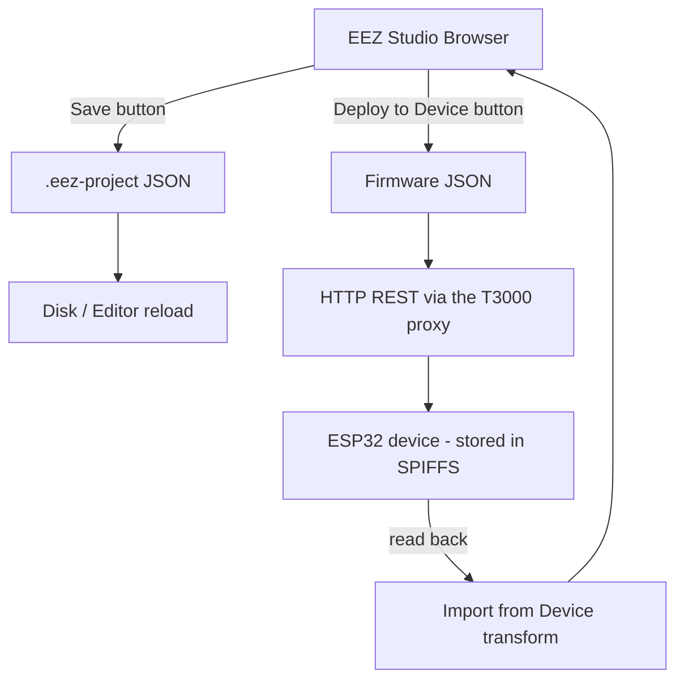
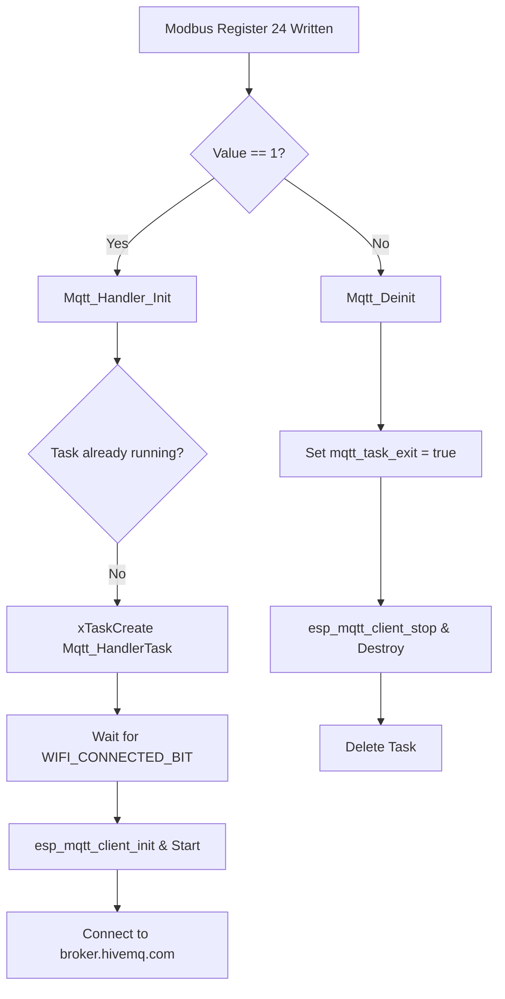
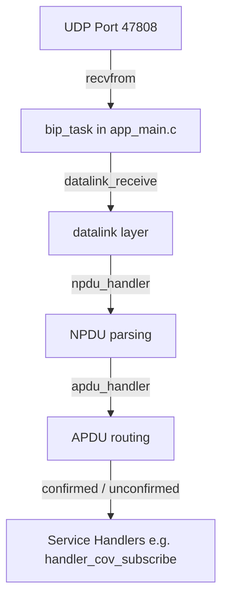

The T3-family controller with a 480 x 320 touchscreen: its IO envelope, the screens it ships with, the Design Studio that edits them, the display API, the firmware and the update path.

## Contents

- [The Tstat11](00-hub.md)
  - [The Tstat11 IO envelope](hardware/model-matrix.md)
  - [How flash is divided](hardware/flash-layout.md)
  - [The screens that ship on the device](display/shipped-screens.md)
    - [Design Studio: overview](t3-eez-studio/manual/01-overview.md)
    - [Design Studio: creating a project](t3-eez-studio/manual/02-creating-projects.md)
    - [Design Studio: designing screens](t3-eez-studio/manual/03-editing-screens.md)
    - [Design Studio: adding logic with EEZ Flow](t3-eez-studio/manual/04-eez-flow.md)
    - [Design Studio: preview, bind and deploy](t3-eez-studio/manual/05-preview-and-deploy.md)
    - [Design Studio: reference and FAQ](t3-eez-studio/manual/06-reference-and-faq.md)
  - [Design Studio: how it is built](t3-eez-studio/README.md)
  - [Design Studio API: overview](bacnet-api/README.md)
  - [Screen JSON: the format](bacnet-api/screen-json.md)
  - [Design Studio API: endpoints](bacnet-api/commands.md)
  - [The device display API](display-api/overview.md)
  - [Display API: endpoints](display-api/endpoints.md)
  - [Display API: payloads and patching](display-api/payloads.md)
  - [Display API: examples](display-api/examples.md)
  - [Importing screens from a device](t3-eez-studio/import-from-device-design.md)
  - [Deploying to a device](t3-eez-studio/device-interface-deployment-via-bacnet-design.md)
  - [The .EEZ-Project JSON format](t3-eez-studio/lvgl-eez-project-json-format.md)
  - [The static-resource asset pipeline](t3-eez-studio/static-resource-copy-build.md)
  - [The LVGL WASM browser build](t3-eez-studio/wasm-browser-build-migration.md)
  - [What the firmware runs](firmware/what-the-firmware-runs.md)
  - [Building the firmware](firmware/building.md)
  - [Loading firmware onto a device](firmware/flashing.md)
  - [MQTT publishing](firmware/mqtt-guide.md)
  - [How the MQTT task works](firmware/mqtt-implementation.md)
  - [How a firmware update runs](bootloader/update-flow.md)
  - [The update registers](bootloader/update-registers.md)
  - [Resuming an interrupted update](bootloader/resuming-an-update.md)
  - [Inside the bootloader](bootloader/inside-the-bootloader.md)
  - [Trying the update commands](bootloader/trying-the-commands.md)
  - [Signing firmware](bootloader/signing-firmware.md)
  - [Skipping signature validation](bootloader/skip-signature-validation.md)
  - [BACnet change of value](bootloader/bacnet-cov.md)
  - [The BACnet protocol stack](bootloader/bacnet-stack.md)
  - [Wi-Fi station mode](bootloader/wifi-station-mode.md)
  - [Testing the firmware without hardware](testing/host-unit-tests.md)
  - [The 729 verified APIs](testing/verified-apis.md)


---

---
title: "The Tstat11"
order: 10
---

The Tstat11 is a T3-family controller with a **480 × 320 landscape touchscreen**. It runs the same ESP32 firmware as the rest of the family — Modbus RTU/IP and BACnet MSTP/IP over Ethernet, Wi-Fi and RS485 — and what makes it different is the screen: the interface is designed in a browser, stored on the device as JSON, and edited without reflashing the firmware.

This manual covers the product from the model id up: how many points it has, how its display is built and edited, what the firmware publishes, and how an image gets onto it.

## The short answer to "how many points?"

**13 universal inputs, 5 digital outputs, 2 analogue outputs, 128 variables, 8 digital inputs, 8 schedules** — the same envelope as a TSTAT10, because `main/commsub.c` maps `MINI_TSTAT11` (id 29) onto the `TSTAT10_*` limits. [The IO envelope](hardware/model-matrix.md) has the whole family in one table.

## Two things are called "the display"

Worth knowing before reading further, because both appear in this manual and they are not the same thing:

| | Static screens | Dynamic screens |
|---|---|---|
| Where | `main/TemcoScreen/` | `components/temco_dynamic_display/` |
| Built by | SquareLine Studio, into C | the Design Studio, into JSON |
| Changed by | recompiling the firmware | writing a document over HTTP |
| Ships with | the 12 `ui_*.c` screens | 13 default screen documents |

The Tstat11 work is a move from the first to the second. Both still exist in the tree, and [the screens that ship](display/shipped-screens.md) counts what the device actually holds today.

## How to read this

**If you are setting up a screen for a site:**

1. [The screens that ship on the device](display/shipped-screens.md) — what is already on it
2. [Design Studio: Overview](t3-eez-studio/manual/01-overview.md) — then chapters 2 to 6, in order
3. [Design Studio API: Overview](bacnet-api/README.md) — what the tool sends to the device

**If you are implementing the device side:**

1. [The device display API](display-api/overview.md) — the contract to satisfy
2. [Display API endpoints](display-api/endpoints.md) — the eleven routes
3. [Screen payloads and patching](display-api/payloads.md) — the shapes and the dot-path delta
4. [Display API examples](display-api/examples.md) — the bodies to compare against

**If you are building or flashing firmware:**

1. [What the firmware runs](firmware/what-the-firmware-runs.md) — which products share this image
2. [Building the firmware](firmware/building.md) — ESP-IDF 5.5.3
3. [Loading firmware onto a device](firmware/flashing.md) — the recovery route
4. [How a firmware update runs](bootloader/update-flow.md) — the normal route, over RS485
5. [How flash is divided](hardware/flash-layout.md) — why an interrupted update survives

**If you are integrating with it:**

1. [MQTT publishing](firmware/mqtt-guide.md) — turning it on and watching it
2. [How the MQTT task works](firmware/mqtt-implementation.md) — topics, COV modes, type mapping
3. [BACnet change of value](bootloader/bacnet-cov.md) — the subscription model underneath

**If you are testing a change:**

1. [Testing the firmware without hardware](testing/host-unit-tests.md) — the host harness
2. [The 729 verified APIs](testing/verified-apis.md) — what the suites reach today

## Where the other manuals are

This project is standalone on purpose: a reader with one question should not have to hop projects. Where a subject belongs to more than this product, the other manual is authoritative:

| Subject | Manual |
|---|---|
| The T3000 application that configures a Tstat11 | **T3000** |
| The REST, WebSocket and message protocols behind it | **T3000 API & Protocol** |
| The browser front end and the Designer shell | **T3000 New UI** |
| Firmware updates and signing for the whole T3 family | **T3 Firmware & Bootloader** |
| The TStat Modbus registers | **Register maps** |

## What this manual does not have

There is no Tstat11 datasheet, schematic or installation drawing in any of the repositories this was built from — the hardware facts here are read out of the firmware's own headers. The one physical document that exists is the T3-Nano schematic, which is a different board.


---

---
title: "The Tstat11 IO envelope"
order: 20
---

The firmware decides how many points a model has from its model id, and `MINI_TSTAT11` is id 29. The limits themselves come from the TSTAT10 set — `main/commsub.c` maps both ids onto `TSTAT10_*` — so a Tstat11 has the same envelope as a TSTAT10, and this table is the authoritative answer to "how many inputs does it have".

| Model | Model id | AI | DO | AO | AV | DI | SC |
|---|---|---|---|---|---|---|---|
| T3-BB (Big Brother) | `MINI_BIG_ARM` = 5 | 32 | 12 | 12 | 128 | 0 | 8 |
| T3-LB (Little Brother) | `MINI_SMALL_ARM` = 6 | 16 | 6 | 4 | 128 | 0 | 8 |
| T3-TB (Tiny Brother) | `MINI_NEW_TINY` = 4 | 8 | 8 | 6 | 128 | 0 | 8 |
| T3-Nano | `MINI_TINY_ARM` = 7 | 11 | 6 | 2 | 128 | 0 | 8 |
| VAV controller | `MINI_VAV` = 10 | 6 | 1 | 2 | 5 | 0 | 8 |
| TSTAT10 | `MINI_TSTAT10` = 9 | 13 | 5 | 2 | 128 | 8 | 8 |
| T10P | `MINI_T10P` = 11 | 17 | 5 | 4 | 128 | 8 | 8 |
| **Tstat11** | `MINI_TSTAT11` = 29 | 13 | 5 | 2 | 128 | 8 | 8 |

AI analog input · DO digital output · AO analog output · AV analog variable · DI digital input · SC schedule

## What the columns are

- **AI / DI** — the input tables. A universal input counts in AI; the DI column is the fixed digital inputs some models add.
- **DO / AO** — the output tables. DO is a relay or triac, AO is an analogue signal.
- **AV** — the variable table, 128 on every model in this family, because variables are memory rather than terminals.
- **SC** — schedules, eight on every model.

The Tstat11 row is the one to read: it is the TSTAT10 envelope, and the firmware special-cases the two ids together in six places in `main/flash.c` as well as in `commsub.c`.


---

---
title: "How flash is divided"
order: 30
---

The bootloader, the factory image, two over-the-air slots and the storage partition. The layout is the reason an update can be interrupted: the new image is written into the slot that is not running, and a completed transfer is what makes it the one that boots.

| Name | Type | Subtype | Offset | Size |
|---|---|---|---|---|
| nvs | data | nvs | 0x9000 | 0x4000 |
| otadata | data | ota | 0xd000 | 0x2000 |
| phy_init | data | phy | 0xf000 | 0x1000 |
| factory | app | factory | 0x10000 | 0x100000 |
| ota_0 | app | ota_0 | 0x110000 | 0x200000 |
| storage | data | nvs | 0x310000 | 0x20000 |

The partition file is `temco_partitions.cvs` in the bootloader repository, and the bootloader and the application both read it. Changing an offset without changing the other image is how a device ends up unable to boot, so treat this table as fixed.


---

---
title: "The screens that ship on the device"
order: 40
---

The controller can hold its screens as JSON rather than as compiled code, and these are the ones it ships with. Each is a document the device serves, so the Design Studio can open it, change it, and write it back — no firmware build. The counts below are measured from the files in `components/temco_dynamic_display/DefaultScreens/`.

| Screen | Root widget | Child widgets | Assets |
|---|---|---|---|
| `ddns_screen` | DdnsScreen | 6 | 1 bitmaps |
| `holiday_calender_screen` | HolidayCalenderScreen | 2 | 1 bitmaps |
| `home_screen` | HomeScreen | 12 | 9 bitmaps |
| `main_menu` | MainMenu | 5 | 6 bitmaps |
| `network_config` | NetworkConfig | 2 | 1 bitmaps |
| `parameters` | Parameters | 2 | 1 bitmaps |
| `protocols` | Protocols | 2 | 1 bitmaps |
| `schedule_edit_screen` | ScheduleEditScreen | 2 | 1 bitmaps |
| `schedule_screen` | ScheduleScreen | 3 | 1 bitmaps |
| `start_up_screen` | StartUpScreen | 2 | 0 bitmaps |
| `time` | Time | 8 | 1 bitmaps |
| `wifi_config` | WifiConfig | 2 | 1 bitmaps |
| `wireguard_screen` | WireGuardScreen | 12 | 1 bitmaps |

13 screens in total. A screen with hundreds of child widgets is a table or a calendar; one with a handful is a menu.

## Which one you are looking at

The **start-up screen** says `Tstat - 11` in a single label — that string is the cheapest way to confirm a device is running the Tstat11 image rather than the TSTAT10 one.


---

---
title: "Design Studio: overview"
order: 50
---

## 01 — Overview

This chapter explains what Design Studio (Tstat11) is, which of the two project types to
choose, where you work, and what you are looking at on each screen.

**In this chapter**

1. [What Design Studio (Tstat11) is](#1-what-design-studio-tstat11-is) — and what you can do with it
2. [The two project types](#2-the-two-project-types) — LVGL 9.5 or LVGL with Flow 9.5
3. [Where you work](#3-where-you-work) — the Design Hub and the editor
4. [Tour: the Design Hub](#4-tour-the-design-hub) — tiles, examples and your projects
5. [Tour: the editor](#5-tour-the-editor) — pages, canvas and inspectors
6. [What you need](#6-what-you-need) — a browser to design, a controller to deploy

---

## 1. What Design Studio (Tstat11) is

Design Studio (Tstat11) is the embedded-touchscreen designer inside T3000. With it you:

- **Draw screens** for a T3 controller's display using ready-made widgets.
- **Add logic** so the UI reacts to touches and to controller data (Flow projects only).
- **Preview** the result in your browser before anything is sent to hardware.
- **Deploy** the finished design to a controller over the network.

You do not need to write C or firmware code, and you do not need the device connected while
you design — you can build the whole UI first and deploy it later.


*Figure 1.1 — The Design Hub, the entry point for all LVGL work.*

---

### 2. The two project types

When you start a project you choose one of two types. They use the same editor; the
difference is whether **Flow** logic is enabled.

| | **LVGL 9.5** | **LVGL with Flow 9.5** |
|---|---|---|
| Screens, widgets, styles, fonts, images | Yes | Yes |
| Variables | Yes | Yes |
| **Flow** logic editor (actions, event handlers, timers) | — | Yes |
| Browser preview / simulator | Yes | Yes |
| Deploy to device | Yes | Yes |

**Choose LVGL 9.5** when the UI only needs to display things and use built-in widget
behaviour (a switch toggles, a slider moves).

**Choose LVGL with Flow 9.5** when the UI must *do* something: a button press that changes a
value, a label that follows a controller reading, a screen that changes automatically, an
animation, or a timed action. See
[04 — Adding Logic with EEZ Flow](04-eez-flow.md).

> You can add Flow later: the Flow editor appears for any project whose **Flow support**
> setting is on. If the Flow tab is missing from your editor, the project was created as
> plain LVGL.

---

### 3. Where you work

There are two places, and it helps to know which one you are in:

| | **Design Hub** | **Editor** |
|---|---|---|
| What it is | The dashboard that lists all your design projects | The place where you draw the screens |
| You go there to | Create, find, bind and deploy projects | Design pages, preview and save |
| Opens at | `#/t3000/design` | `#/t3000/eez` |

The normal journey is:

| Step | Where | What you do |
|---|---|---|
| 1. Create or open | Design Hub | Click an **LVGL tile**, use **LVGL Examples**, or **Open in editor** on an existing project card. |
| 2. Design and preview | Editor | Build your pages, then check them with **Run (F5)**. |
| 3. Bind and deploy | Editor or Design Hub | Choose the controller, then **Deploy to Device**. |

The **project detail page** (reachable from a card's **More (details & manage)**) shows a
preview, statistics and snapshots of one project.

> You normally move between these screens by clicking — the addresses above are listed for
> reference only.

---

### 4. Tour: the Design Hub

This is the screen you land on. It has four parts: the **top bar**, the **4-step guide**,
the **device bar**, and your work under **Create by Type** and **Project History**.

#### Top bar

- **Home** — back to the main T3000 view.
- **New Drawing** — start a new project.
- **File / View / Tools / Help** — menus for hub actions (import, backup/restore, view mode,
  sort order, refresh, sync).
- **Ctrl + K** — opens the **command palette**, a search box for hub actions.
- The right-hand side shows the app version and the signed-in user.

#### The 4-step guide

A short reminder strip: **Choose a type → Pick a device → Design & edit → Deploy**. It is
guidance only — you can work in any order.


*Figure 1.2 — The 4-step guide strip.*

#### Device bar


*Figure 1.3 — The device bar.*

1. **Device selector** — shows the currently selected device ("No device selected — click to
   choose"). The selected device scopes the hub and is pre-selected when you bind or deploy.
2. **Counters** — how many drawings are *On this device*, *Deployed*, and *Unbound*.

#### Create by Type

The tiles are the entry points to the design engines:

| Tile | Opens |
|---|---|
| **HVAC** | The HVAC drawing designer |
| **LCD UI** | The thermostat LCD designer / simulator |
| **LVGL 9.5** | A new LVGL project (no Flow) |
| **LVGL with Flow 9.5** | A new LVGL project with Flow enabled |


*Figure 1.4 — The Create by Type tiles.*

To the right of the tiles is the **LVGL Examples** button, which opens a library of
ready-made LVGL starter projects (see
[02 — Creating a Project](02-creating-projects.md)).

#### Project History


*Figure 1.5 — Project History: sorting, view mode, search and type tabs.*

- **Sort** — Recently updated, Name, or Recently created.
- **View** — grid or list.
- **Select multiple** — batch actions on several projects.
- **Search** — filter by project name.
- **Tabs** — `All`, `HVAC`, `LVGL 9.5`, `LVGL + Flow 9.5` (the count on each tab shows how
  many projects it contains).

Each project card shows the type badge, the project name, its status
(**Unbound / Bound / Deployed**) and when it was last changed.


*Figure 1.6 — A project card and its actions.*

Card actions:

| Action | What it does |
|---|---|
| **Open in editor** | Opens the project in the LVGL editor. |
| **Bind to device** | Chooses the controller this project belongs to. |
| **More (details & manage)** | Opens the project detail page. |
| **Delete** | Removes the project. |

---

### 5. Tour: the editor

Opening a project loads the LVGL editor. (If you open the editor on its own you land on its
home screen first, where your **Recent Projects** are listed.)

The main areas are:

- **Left navigation** — the project's contents: **Pages** (your screens), **Variables**,
  **Actions / Flow** (Flow projects only), **Styles**, **Fonts**, **Bitmaps**, and other
  project sections.
- **Centre** — the **canvas**, where the selected page is designed.
- **Right-hand tabs** — the inspectors for the selected object: **Properties**, **Styles**,
  **Fonts**, **Bitmaps**, **Themes**, and (Flow projects) the **Components Palette**.
- **Top toolbar** — Save, Undo/Redo, Cut/Copy/Paste, build configuration, **Check**,
  **Build**, and the run controls: **Edit mode (Shift+F5)**, **Run (F5)**,
  **Debug (Ctrl+F5)**, **Full Sim (F7)**, and **Deploy to Device**.


*Figure 1.7 — The LVGL project editor.*

Editing is covered in [03 — Designing Screens](03-editing-screens.md).

---

### 6. What you need

- **To design and preview:** nothing but the browser. Projects are saved on the T3000 host.
- **A canvas that matches the display.** The Tstat11 screen is **480 × 320** (landscape), so
  new pages should be designed at that size. If you start from an example, check the project's
  display size in the editor.
- **To deploy:** a T3 controller that is **online and on the network**, and the controller's
  IP/panel information available in T3000. See
  [05 — Preview, Bind & Deploy](05-preview-and-deploy.md).

---

**Next:** [02 — Creating a Project](02-creating-projects.md)


---

---
title: "Design Studio: creating a project"
order: 60
---

## 02 — Creating a Project

There are three ways to get an LVGL project. All three end with the project open in the
editor.

| Way | Use it when… |
|---|---|
| **Create New** | You want to start from a blank LVGL project. |
| **Start from an Example** | You want a ready-made LVGL design to adapt. |
| **Load from Device** | The controller already has screens you want to edit. |

**In this chapter**

1. [Way 1 — Create New](#1-way-1-create-new) — start from a blank project
2. [Way 2 — Start from an Example](#2-way-2-start-from-an-example) — adapt a ready-made design
3. [Way 3 — Load from Device](#3-way-3-load-from-device) — import what a controller already shows
4. [After creation](#4-after-creation) — find and reopen your project
5. [Troubleshooting](#5-troubleshooting)

> **Opening an existing project?** Go to **Project History** on the Design Hub and click
> **Open in editor** — see [4. After creation](#4-after-creation) below.

---

## 1. Way 1 — Create New

1. In the Design Hub, click the **LVGL 9.5** or **LVGL with Flow 9.5** tile — or click
   **New Drawing** in the top bar, which opens the same dialog.
2. The **New …** dialog opens on the **Create New** tab.


*Figure 2.1 — The Create New tab of the New LVGL project dialog.*

3. Fill in:

| Field | Notes |
|---|---|
| **Name** | The project name — it also names the project file. Must start with a letter or `_`, and contain only letters, digits, `-` and `_`. |
| **Location** | The folder inside the project data root. The default is `project`. |
| **Create directory** | On by default. Wraps the project in a folder named after the project. |
| **Project file path** | Read-only preview of where the project will be created — check it before continuing. |

4. Click **Create & Open**. The project is created from the LVGL template and the editor opens
   with it.

The **Flow support** setting comes from the tile you chose: **LVGL 9.5** creates a plain
project, **LVGL with Flow 9.5** enables Flow. Either can be changed later in the project
settings.

*Tip:* with **Create directory** on and Name `my-ui` under Location `project`, the project
file is `project/my-ui/my-ui.eez-project`.

---

### 2. Way 2 — Start from an Example

The examples are real LVGL projects published by EEZ, filtered to the LVGL types.

1. In the Design Hub, click **LVGL Examples** (next to the *Create by Type* tiles).
2. The **LVGL Examples** drawer opens.


*Figure 2.2 — The LVGL Examples drawer.*

3. Narrow the list:

| Filter | Shows |
|---|---|
| **All** | Every LVGL example. |
| **New** | Examples recently added to the catalog. |
| **LVGL** | Examples without Flow. |
| **LVGL + Flow** | Examples that use Flow logic. |

   Use the search box to filter by name or description. Selecting an example shows its
   preview and details.
4. Click **Create & Open**, then fill in **Name**, **Location** and **Create directory**, and
   confirm.


*Figure 2.3 — Naming the project created from an example.*

The example is copied into your project folder and opened in the editor.

> **Examples are made for different displays.** A published example may target a larger screen
> than the Tstat11 (480 × 320). Check the project's display size in the editor and resize the
> pages if needed — see **What you need** in [01 — Overview](01-overview.md).

> The first time you open the drawer, the catalog is downloaded — this can take a moment.
> If the list is empty, wait a few seconds or press **Retry**.

---

### 3. Way 3 — Load from Device

This reads the screens currently on a controller into a new project, so you can view and edit
what the device already shows.

1. Click an LVGL tile, then switch to the **Load from Device** tab.


*Figure 2.4 — Choosing the device to read screens from.*

2. Pick a device. Online devices are grouped by building; offline devices are listed
   separately at the bottom. The device selected in the Design Hub is pre-selected.
3. Click **Import**.

The dialog reports progress and keeps a collapsible **details log**:


*Figure 2.5 — Import progress with the detail log expanded.*

Behind the scenes the import:

- creates the project folder and a `device-import` staging area,
- connects to the device and reads its screens one by one,
- converts them into an `.eez-project`,
- pulls the images used by the screens,
- draws parameter grids from the device's input / output / variable points,
- writes the project file and registers it in **Recent Projects**.

4. When it finishes, the editor opens the imported project. It is already bound to the device
   it came from, so you can edit and deploy it straight back.

The project is named after the device plus its serial number — `<device>_SN<serial>` — so
importing two similarly named panels cannot collide. The raw screens the device returned are
kept in the project's `device-import/` folder.

> **Note:** the device must be online and reachable on the network. Import it while the panel
> is connected — not while it is in Wi-Fi setup mode, where its API is not running. If the
> import stops with an error, the detail log shows the failing step.

---

### 4. After creation

Whichever way you used, the project now appears in **Project History** on the Design Hub,
under the tab for its type, with the status **Unbound** until you bind a device.


*Figure 2.6 — The project you created, in Project History.*

From here you can:

- **Open in editor** to continue designing — see
  [03 — Designing Screens](03-editing-screens.md).
- **Bind to device** and **Deploy** — see
  [05 — Preview, Bind & Deploy](05-preview-and-deploy.md).
- **More (details & manage)** for preview, statistics, snapshots and compare.

#### Reopening a project later

- **From the hub:** find it under **Project History** (use the search box or the type tabs)
  and click **Open in editor**.
- **From the editor:** it is listed under **Recent Projects** on the editor's home screen.

Where a project lives on disk is covered in **Where projects live** in
[06 — Reference & FAQ](06-reference-and-faq.md).

---

### 5. Troubleshooting

| Symptom | What to check |
|---|---|
| No devices in **Load from Device** | The device list comes from the running T3000 host — make sure the host is running and devices are discovered. Only online devices can be imported. |
| The examples list stays empty | The catalog download may still be running, or the host cannot reach the internet. Press **Retry**. |
| "Backend offline" messages | The T3000 host service is not reachable; project files cannot be saved or listed. |
| Name is rejected | Names must start with a letter or `_`, and contain only letters, digits, `-` and `_`. |
| **Create & Open** closes the dialog but no editor opens | The project was not created — usually the name is already in use, or the host backend is unreachable. Try another name. |
| Import fails on the first step | The device is offline, or it is in Wi-Fi setup mode (its API only runs once it is on the network). |
| Imported pages are the wrong size or look cut off | The canvas uses the display size the device reports. Check the project's display size in the editor against the target display. |

---

**Next:** [03 — Designing Screens](03-editing-screens.md)


---

---
title: "Design Studio: designing screens"
order: 70
---

## 03 — Designing Screens

This chapter walks through the LVGL editor and the everyday tasks: creating pages, placing
widgets, and managing styles, fonts and images.

**In this chapter**

1. [The editor at a glance](#1-the-editor-at-a-glance) — the areas and the toolbar
2. [Pages (your screens)](#2-pages-your-screens) — adding screens and the start page
3. [Adding and arranging widgets](#3-adding-and-arranging-widgets) — the palette and Properties
4. [Styles, themes and colours](#4-styles-themes-and-colours)
5. [Fonts](#5-fonts)
6. [Bitmaps (images)](#6-bitmaps-images)
7. [Variables](#7-variables)
8. [Saving your work](#8-saving-your-work)
9. [Where to go next](#9-where-to-go-next)

---

## 1. The editor at a glance


*Figure 3.1 — The LVGL project editor.*

| Area | What it is for |
|---|---|
| **Left navigation** | The project contents: **Pages**, **Variables**, **Actions / Flow** (Flow projects), **Styles**, **Fonts**, **Bitmaps**, … Select an item to edit it. |
| **Canvas (centre)** | The page you are designing. Drag, resize and arrange widgets here. |
| **Right-hand tabs** | Inspectors: **Properties**, **Components Palette**, **Styles**, **Fonts**, **Bitmaps**, **Themes** (and **Breakpoints** in Flow projects). |
| **Top toolbar** | File and edit commands, **Check** / **Build**, run controls, and **Deploy to Device**. |

### Toolbar controls

| Control | Purpose |
|---|---|
| **Save** | Writes the project to disk. |
| **Undo / Redo** | Steps backwards/forwards through your edits. |
| **Cut / Copy / Paste** | Standard clipboard for widgets. |
| **Configuration** | Picks the build configuration when the project has more than one. |
| **Check** | Validates the project and reports problems. |
| **Build** | Generates the output for the target. |
| **Edit mode (Shift+F5)** | Returns the editor to design mode. |
| **Run (F5)** | Runs the project so you can try it out. |
| **Debug (Ctrl+F5)** | Runs with the debugger. |
| **Full Sim (F7)** | Runs the full simulator (when enabled). |
| **Deploy to Device** | Opens the deploy drawer — see [05](05-preview-and-deploy.md). |

---

### 2. Pages (your screens)

A **page** is one screen on the controller's display.

- To add one: right-click **Pages** in the left navigation and choose **New Page**
  (or use the equivalent **+** action in the Pages list).
- Give the page a clear name — this is how you will refer to it in Flow actions and event
  handlers.
- Set the page's size to match the target display, and pick a background colour or image.

The **start page** is the page that appears first when the UI loads. Make sure exactly one
page is set as the start page.

> If a page is not the size you expect, check the project's **display width / height** in the
> project settings — the canvas uses that as the frame. For the Tstat11, design at
> **480 × 320** (see **What you need** in [01 — Overview](01-overview.md)).

---

### 3. Adding and arranging widgets

Open the **Components Palette** on the right, then drag a widget onto the canvas.


*Figure 3.2 — The Components Palette.*

Available widgets include:

| Widget | Typical use |
|---|---|
| **Label** | Static or dynamic text (a value, a title). |
| **Button** | A pressable button, usually with a label inside. |
| **ImageButton** | A button drawn with images for its states. |
| **Image** | A bitmap from the project. |
| **Switch** | An on/off toggle. |
| **Slider** | A draggable value control. |
| **Bar** | A read-only progress/value indicator. |
| **Arc** | A round gauge-style control or indicator. |
| **Dropdown** | A pick-one list. |
| **Textarea** | Text entry. |
| **Roller** | A scrolling picker. |
| **Checkbox** | A tick box. |
| **Calendar** | A date picker. |
| **Keyboard** | An on-screen keyboard for text entry. |
| **Panel** | An invisible container used to group widgets. |

Common actions:

- **Move / resize** — drag the widget or its handles on the canvas.
- **Group things** — place widgets inside a **Panel** so they move together.
- **Name it** — give important widgets a meaningful name: a flow action targets a widget **by
  name**, and the same names appear in the device's screen JSON.

> **What the device stores.** Every widget you place becomes an object in the screen's JSON —
> `sub_type`, position, `style` and `events`. See
> Design Studio (Tstat11) API → Screen JSON Format.

#### Properties

With a widget selected, use the **Properties** tab to set its position, size, text, style and
behaviour.


*Figure 3.3 — Properties for the selected widget.*

Fields you will use most:

| Field | Meaning |
|---|---|
| **left / top** | Position on the page. |
| **width / height** | Size. Can be a number, or `content` to size to the widget's content. |
| **text** | A label's or button's text. Set the **text type** to *literal* for fixed text, or *expression* to build it from variables. |
| **style** | The named style applied to the widget. |
| **hidden / disabled** | Whether the widget is hidden or cannot be interacted with — can be a fixed value or an expression. |
| **event handlers** | Actions to run when the widget is clicked, changed, etc. See [04 — EEZ Flow](04-eez-flow.md). |

---

### 4. Styles, themes and colours

- **Styles** (right-hand **Styles** tab) are reusable appearance definitions — background,
  border, padding, text colour, font. Apply a style to many widgets so a change in one place
  updates all of them.
- **Themes** provide the overall look (for example a dark theme). The project setting
  **dark theme** switches the default theme.
- **Colours** — define named colours once and reuse them, instead of typing hex values
  everywhere.


*Figure 3.4 — The Styles / Fonts / Bitmaps tabs.*

---

### 5. Fonts

Text needs a font that contains the characters you use.

1. Open the **Fonts** section in the left navigation.
2. Add a font, choose the family, size and the character set you need (include only the
   characters you actually use — every extra character costs space on the device).
3. Assign the font to a widget or a style from the **Properties** tab.

> Missing glyphs show as boxes or blanks. If a character does not render, add it to the font's
> character set.

---

### 6. Bitmaps (images)

1. Open **Bitmaps** in the left navigation.
2. Add your image file (PNG works well). Give it a short, meaningful name — this is the name
   you reference from an **Image** widget, an **ImageButton**, or a page background.
3. Set the **Image** widget's **src** to that bitmap name.

The editor pre-processes images into the format the device needs, so you can use ordinary PNG
files while designing. Images reach the device as **separate assets referenced by name** — they
are not embedded inside the screen.

---

### 7. Variables

**Variables** hold values your UI uses — a counter, a mode, a temperature, a flag.

1. Open **Variables** in the left navigation.
2. Add a variable: give it a **name**, a **type** (number, boolean, string, …) and a
   **default value**.
3. Use it:
   - in an **expression** (for example a label whose text is built from the variable), or
   - from **Flow**, where components read and write variables.

Variables are the bridge between what is on screen and what the controller knows. Combining a
controller reading with a variable keeps the screen updated without redeploying.

---

### 8. Saving your work

- **Save** (or the usual save shortcut) writes the project to disk as
  `<project>.eez-project`.
- The project is also saved automatically before a deploy, so what you deploy always matches
  what you see.
- **Recent Projects** on the editor's home screen lists projects you have opened recently.

Good practice: save before previewing or deploying, and check the toolbar's **Check** result
before deploying to catch missing fonts, images or bindings.

---

### 9. Where to go next

- Add behaviour to the screen — [04 — Adding Logic with EEZ Flow](04-eez-flow.md).
- Try it out and send it to the controller —
  [05 — Preview, Bind & Deploy](05-preview-and-deploy.md).
- See exactly what a screen becomes on the device —
  Design Studio (Tstat11) API → Screen JSON Format.

---

**Next:** [04 — Adding Logic with EEZ Flow](04-eez-flow.md)


---

---
title: "Design Studio: adding logic with EEZ Flow"
order: 80
---

## 04 — Adding Logic with EEZ Flow

**EEZ Flow** is the visual logic editor. It lets a screen *do* something when the user
interacts with it or when a value changes — without writing code.

> Flow is available only in **LVGL with Flow 9.5** projects. If your project was created as
> plain **LVGL 9.5**, the Flow section is not shown.

**In this chapter**

1. [What Flow is for](#1-what-flow-is-for) — when you need it and when you do not
2. [The Flow section](#2-the-flow-section) — where flows live in the editor
3. [Components](#3-components) — the building blocks
4. [Starting a flow from a widget event](#4-starting-a-flow-from-a-widget-event)
5. [Worked example — a button that raises a setpoint](#5-worked-example-a-button-that-raises-a-setpoint)
6. [Testing flows](#6-testing-flows)
7. [Notes and limitations](#7-notes-and-limitations)

---

## 1. What Flow is for

Use Flow when the UI must react:

| You want… | Flow gives you… |
|---|---|
| A button that changes a value | An **event handler** on the button that runs a *set variable* action |
| A label that follows a reading | A *watch variable* component that updates text when the value changes |
| A screen that switches automatically | A *change screen* action, possibly after a condition |
| A value that blinks / moves | An *animate* action |
| Something that happens after a delay | A *delay* component |

Simple, built-in behaviour — a switch toggling itself, a slider moving — does **not** need
Flow. Reach for Flow when you need to connect widgets, variables and timing.

---

### 2. The Flow section

Open **Actions / Flow** in the left navigation. Flow projects also get two extra tabs in the
editor:

- **Components Palette** — the building blocks you drag onto the flow canvas.
- **Breakpoints** — for debugging flows.


*Figure 4.1 — A small flow: an event starts it, components run in order.*

A flow is a set of components connected by wires. Data flows along the wires; execution
follows the connections from a starting point (an event) to the end.

---

### 3. Components

Drag components from the palette and wire them together.


*Figure 4.2 — The components palette.*

Typical groups:

| Group | Examples | Purpose |
|---|---|---|
| **Variables** | Get Variable, Set Variable, Watch Variable | Read and write the project's variables. |
| **Actions** | Output, Delay, Animate, Is True | Make something happen, wait, animate, or branch. |
| **Widget events** | Clicked, Value Changed, Screen Loaded | Start a flow when the user interacts with a widget, or when a screen opens. |
| **Screens** | Change Screen | Navigate to another page. |

A component has **inputs** (values it needs), **outputs** (values it produces), and an
**execute** connection that controls when it runs.

---

### 4. Starting a flow from a widget event

The usual pattern is *widget event → action*.

1. Select the widget on the canvas.
2. In **Properties**, find its **event handlers**.
3. Add a handler and choose the event, for example:
   - **CLICKED** — the user tapped the widget.
   - **VALUE_CHANGED** — a slider, switch or dropdown changed.
   - **SCREEN_LOADED** — the screen has just opened. Useful for a splash screen that advances
     by itself.
4. Choose **flow** as the handler type, and create or select the flow it should run.


*Figure 4.3 — A widget event handler pointing at a flow.*

> **What it becomes on the device.** An event handler is stored in the screen's JSON under
> `events`, with one or more `actions`. A button that toggles a panel's visibility exports as
> two `flag_modify` actions on `CLICKED`; the start-up screen exports a `screen_change` on
> `SCREEN_LOADED`. See the worked examples and **Events and actions** in
> Screen JSON — Format Reference.

---

### 5. Worked example — a button that raises a setpoint

Goal: pressing a button increases a `setpoint` variable by 1 and shows the new value.

1. **Create the variable.** In **Variables**, add `setpoint`, type *number*, default `20`.
2. **Show it.** On the page, add a **Label** and set its text type to *expression*, using the
   `setpoint` variable, for example `"Setpoint: " + setpoint`.
3. **Add the button.** Drag a **Button** onto the canvas and name it (for example `upButton`).
4. **Create the flow.** Open **Actions / Flow** and add a new flow.
5. **Add the action.** Drag a **Set Variable** component onto the canvas. Point it at
   `setpoint` and give it the value `setpoint + 1`.
6. **Connect the event.** Select `upButton`, add a **CLICKED** event handler, set its type to
   *flow*, and select the flow you just created.
7. **Test it.** Click **Run (F5)** and press the button — the label should update each time.
8. **Deploy it.** When it behaves correctly, bind a device and
   **Deploy to Device** ([05](05-preview-and-deploy.md)).

---

### 6. Testing flows

- **Run (F5)** runs the project in the editor so you can click through the UI and watch values
  change. Use the variable status readout in the toolbar to see current values.
- **Debug (Ctrl+F5)** runs with the debugger — set **Breakpoints** to pause a flow and inspect
  values at a specific component.
- **Full Sim (F7)** runs the full simulator when it is enabled.

---

### 7. Notes and limitations

- Flow is part of the project: **save** it (and deploy) for your changes to take effect.
- Keep flows small and readable — a screen with one clear flow per action is easier to debug
  than one very large flow.
- Variables that should survive a restart have a **persist** setting; leave it off for purely
  visual values.

If a flow does not run when you expect:

- The project must have Flow support — if there is no **Flow** section, it was created as plain
  LVGL.
- The widget's event handler must be set to type **flow**, and must point at the flow you built.
- The flow must be wired **from** an event component; a flow with no entry point never runs.
- Try **Run (F5)** and watch the variable readout in the toolbar.

---

**Next:** [05 — Preview, Bind & Deploy](05-preview-and-deploy.md)


---

---
title: "Design Studio: preview, bind and deploy"
order: 90
---

## 05 — Preview, Bind & Deploy

This chapter covers the last part of the workflow: checking the UI in the browser, telling
T3000 which controller the project belongs to, and sending the design to that controller.

```
Design  →  Preview (Run)  →  Bind a device  →  Deploy  →  Deployed
```

**In this chapter**

1. [Preview before you deploy](#1-preview-before-you-deploy) — Run, Debug and Full Sim
2. [Bind a project to a device](#2-bind-a-project-to-a-device)
3. [Deploy](#3-deploy) — from the editor or from the hub
4. [What a deploy actually does](#4-what-a-deploy-actually-does) — the incremental pipeline
5. [Watching a deploy](#5-watching-a-deploy) — steps, log and history
6. [Project detail page](#6-project-detail-page) — preview, statistics, snapshots
7. [Troubleshooting deploys](#7-troubleshooting-deploys)

---

## 1. Preview before you deploy

Always preview before deploying. The editor runs your project so you can click through it
exactly as a user would.

| Control | What it does |
|---|---|
| **Run (F5)** | Runs the project in the editor. Buttons respond, values change, flows execute. |
| **Debug (Ctrl+F5)** | Same, with the debugger attached (breakpoints, value inspection). |
| **Full Sim (F7)** | Runs the full simulator, when it is enabled in settings. |
| **Edit mode (Shift+F5)** | Stops running and returns to design mode. |


*Figure 5.1 — Previewing the design with Run mode.*


*Figure 5.2 — The full simulator (F7), when enabled.*

While previewing, use the toolbar's variable status readout to watch the values your flows
produce.

---

### 2. Bind a project to a device

Binding records **which controller this project belongs to**. It is remembered with the
project, so the next deploy already knows the target.

1. In the Design Hub, find the project card and click **Bind to device**
   (or open the project detail page and bind from there).
2. Choose the device.


*Figure 5.3 — Choosing the controller for the project.*

3. Confirm the building / floor / room shown for the device, and accept.

The project status changes from **Unbound** to **Bound**.

> You can also deploy without binding first — the deploy drawer will ask you to pick a device.
> Binding first is recommended so the target is never ambiguous.

---

### 3. Deploy

#### From the editor

1. Save the project (the deploy saves automatically as its first step anyway).
2. Click **Deploy to Device** in the toolbar.
3. In the deploy drawer, confirm the device and start the deploy.

#### From the Design Hub

1. Open the project's detail page (**More (details & manage)** on the card), or use the deploy
   action available for the project.
2. Choose the device and start the deploy.

Either entry point runs the **same** deploy pipeline.


*Figure 5.4 — Deploying: the step list and progress.*

---

### 4. What a deploy actually does

The deploy is **incremental**: after the first time, only what changed is sent to the device.

| Step | What happens |
|---|---|
| 1. Save | The project is written to disk so the deploy reflects your latest edits. |
| 2. Load & export | The project is converted into the per-screen format the controller expects, and its images are extracted. |
| 3. Back up locally | A copy of the exported screens and images is written next to the project, so you always have the last-deployed state on disk. |
| 4. Compare | Each screen and image is compared against the **last successful deploy**. Unchanged screens and images are skipped. |
| 5. Connect | The editor connects to the device over the network. |
| 6. Push | Only the changed screens and images are sent. |
| 7. Record | The deploy log is updated, and the project is marked **Deployed**. |

Because step 4 compares content, re-deploying without changes does nothing — the drawer
reports that everything is already up to date.

> **The first deploy after Load from Device** compares against the screens the device returned
> during the import (`device-import/`). Import a project, change nothing and deploy — nothing
> is sent, because the device already has it.

> If a deploy fails partway through, the comparison baseline is **not** updated, so the next
> deploy retries the remaining changes.

The format the screens are converted into is documented in
Design Studio (Tstat11) API → Screen JSON Format.

---

### 5. Watching a deploy

The drawer shows each step with a status (running, done, skipped, or error) and, when you
expand it, a per-step detail line. After a deploy completes, the project's **deploy history**
keeps the log — device, time, screens and images sent, and any error.


*Figure 5.5 — Deploy history on the project detail page.*

---

### 6. Project detail page

**More (details & manage)** on a project card opens the detail page:


*Figure 5.6 — Project detail: preview, statistics and management.*

| Section | What it gives you |
|---|---|
| **Preview** | A rendered preview of the project. |
| **Details / statistics** | Pages, widgets, LVGL version, file size, and when it last changed. |
| **Snapshots** | Capture the current state, restore an earlier one, or delete snapshots. |
| **Compare** | Side-by-side comparison of a snapshot against the current project. |
| **Manage** | Bind, deploy, rename, duplicate, share, delete. |

Snapshots are useful before a large redesign: capture one, make your changes, and you can
always compare or restore.

---

### 7. Troubleshooting deploys

| Symptom | What to check |
|---|---|
| The device is not listed, or the deploy cannot connect | The controller must be online and reachable on the network from the T3000 host. Check the device's status in T3000 first. |
| Deploy stops with an error | Expand the failing step in the drawer — it names the step and the message. Fix the cause and deploy again; the remaining changes are retried. |
| The deploy reports "nothing changed" | The exported project matches the last successful deploy. Edit and save the project, then deploy again. |
| Deploy is slow on the first run | The first deploy sends every screen and image. Later deploys send only changes. |
| The device does not show the new design | Re-run the deploy and confirm every step finished with a Yes in the log. |
| A large project fails partway with a connection error | A big first deploy can exceed the deploy timeout over a slow link. Deploy again — only the screens that did not make it are retried. |
| The device answers during import but not during deploy (or the reverse) | Its API only runs while the panel is on the network. While it is in Wi-Fi setup mode the API is down. |

---

**Next:** [06 — Reference & FAQ](06-reference-and-faq.md)


---

---
title: "Design Studio: reference and FAQ"
order: 100
---

## 06 — Reference & FAQ

Quick-reference tables, a glossary of the words you'll see in the UI, and answers to common
questions.

**In this chapter**

1. [Feature matrix](#1-feature-matrix)
2. [Routes](#2-routes) — the addresses behind the screens
3. [Where projects live](#3-where-projects-live)
4. [Keyboard shortcuts](#4-keyboard-shortcuts)
5. [Status badges](#5-status-badges)
6. [Glossary](#6-glossary)
7. [FAQ](#7-faq)
8. [Error messages you may see](#8-error-messages-you-may-see)
9. [Where to go next](#9-where-to-go-next)

---

## 1. Feature matrix

| Capability | LVGL 9.5 | LVGL with Flow 9.5 |
|---|:--:|:--:|
| Visual page/screen designer | Yes | Yes |
| Widget library | Yes | Yes |
| Styles, themes, colours | Yes | Yes |
| Fonts | Yes | Yes |
| Bitmaps / images | Yes | Yes |
| Variables | Yes | Yes |
| Flow logic editor | — | Yes |
| Breakpoints / flow debugging | — | Yes |
| Run / preview (F5) | Yes | Yes |
| Full simulator (F7) | Yes | Yes |
| Save & reopen from disk | Yes | Yes |
| Start from an example | Yes | Yes |
| Load screens from a device | Yes | Yes |
| Bind to a device | Yes | Yes |
| Incremental deploy | Yes | Yes |

---

### 2. Routes

| Route | Screen |
|---|---|
| `#/t3000/design` | Design Hub dashboard |
| `#/t3000/design/projects/:id` | Project detail page |
| `#/t3000/eez` | LVGL project editor |

Handy link parameters the editor understands (used internally when you start from the hub):

| Parameter | Meaning |
|---|---|
| `?open=<path>` | Opens an existing project file. |
| `?new=<type>` | Starts the New Project wizard for a type (`LVGL` or `LVGL with EEZ Flow`). |
| `?examples=1&type=<example>` | Starts the wizard from a catalog example. |
| `?name=<name>` | Pre-fills the project name. |
| `?location=<folder>` | Pre-fills the destination folder. |
| `?createDirectory=true\|false` | Pre-fills the *Create directory* option. |

---

### 3. Where projects live

Every project is a folder on the T3000 host, named after the project — or, for an imported
project, `<device>_SN<serial>`:

```
project/<name>/
  ├── <name>.eez-project          ← the file you open and save
  ├── device-import/              ← screens read from the controller, plus imgs/
  └── device-export/              ← screens written by deploy, plus images/ and deploy-manifest.json
```

| Item | Meaning |
|---|---|
| `<name>.eez-project` | The project file. This is the file you open and save. |
| `device-import/` | Created by **Load from Device** — one JSON per screen plus `imgs/`. Kept as the baseline for the project's first deploy. |
| `device-export/` | Created by **Deploy** — the exported screens and images, plus `deploy-manifest.json` used to detect changes. |

The Design Hub's **Project History** reads the projects from this location, so anything you
create appears there.

---

### 4. Keyboard shortcuts

| Shortcut | Action |
|---|---|
| **Ctrl + K** | Command palette on the Design Hub. |
| **F5** | Run the project (preview). |
| **Shift + F5** | Back to edit mode. |
| **Ctrl + F5** | Run with the debugger. |
| **F7** | Full simulator (when enabled). |
| Standard edit keys | Undo, redo, cut, copy, paste. |

---

### 5. Status badges

| Badge | Meaning |
|---|---|
| **Unbound** | The project is not linked to any controller yet. |
| **Bound** | The project is linked to a controller, but has not been deployed to it. |
| **Deployed** | A successful deploy to the bound controller has completed. |
| **Local** | The project exists on this T3000 host. |

---

### 6. Glossary

| Term | Meaning |
|---|---|
| **Design Hub** | The dashboard at `#/t3000/design` where all design projects live. |
| **Page** | One screen of the UI. |
| **Widget** | A single element on a page — a label, button, slider, and so on. |
| **Panel** | An invisible container used to group widgets. |
| **Style** | A reusable appearance definition applied to widgets. |
| **Bitmap** | An image asset in the project. |
| **Variable** | A named value the UI can read and change. |
| **Flow** | The visual logic editor (LVGL with Flow projects). |
| **Event handler** | The link from a widget event (like a click) to a flow. |
| **Bind** | Linking a project to a specific controller. |
| **Deploy** | Sending the project to the controller. |
| **Snapshot** | A saved copy of a project's state, kept for comparison or restore. |
| **Manifest** | The record of the last successful deploy, used to send only changed screens and images. |
| **Screen JSON** | The document the device stores for each screen. See Design Studio (Tstat11) API → Screen JSON Format. |
| **Device API** | The controller's HTTP API (port 80), defined in the ESP32 firmware; T3000 proxies browser requests to the device. |
| **Import baseline** | The `device-import/` screens, used as the comparison for a project's first deploy. |

---

### 7. FAQ

**Which project type should I choose?**
Start with **LVGL 9.5** if the UI only displays things. Choose **LVGL with Flow 9.5** as soon
as you need a click, a value change, a timer, or an animation to *do* something.

**Can I add Flow to an existing LVGL project?**
The Flow editor appears for projects that have Flow support enabled. If the Flow section is
missing, the project was created without it.

**Do I need the device connected while designing?**
No. You can design and preview entirely in the browser, then bind and deploy later.

**Can I keep designing while the device is offline?**
Yes. Deploying is the only step that needs the controller online.

**What does "incremental deploy" mean for me?**
Only screens and images that changed since the last successful deploy are sent. The first
deploy sends everything; later deploys are much quicker.

**What happens if a deploy fails halfway?**
The failed step is reported in the drawer and in the deploy log. Deploy again — the changes
that were not sent are retried.

**Will my screens be overwritten if I load from the device?**
**Load from Device** creates a *new* project from what the device currently has. It does not
modify an existing project.

**Where are my projects stored?**
On the T3000 host, one folder per project (see
[3. Where projects live](#3-where-projects-live)). The Design Hub lists them under
**Project History**.

**How do I back up a project?**
Deploy writes a local copy of the exported screens and images into the project's
`device-export/` folder. Use **Snapshots** on the project detail page to keep point-in-time
copies of the project itself.

**Can two people work on the same project?**
Use **Snapshots** to keep a known-good state before large edits, and **Compare** to review
changes against a snapshot.

**The examples list is empty — what now?**
The catalog is downloaded on first use. Wait a moment and press **Retry**; the host needs
internet access to fetch the examples.

**Why is my text showing boxes instead of characters?**
The font does not contain those characters. Add them to the font's character set.

**What does the device actually store for a screen?**
One JSON document per screen — background colour, fonts, bitmaps and a widget tree with events.
See Design Studio (Tstat11) API → Screen JSON Format.

**Do screens travel over BACnet or over HTTP?**
Design Studio uses the controller's HTTP API — the firmware serves it, and T3000 proxies the
browser's requests to the device. The BACnet JSON commands are a separate path used by T3000's
own tooling — see Design Studio (Tstat11) API → Endpoints.

---

### 8. Error messages you may see

| Message | Meaning / what to do |
|---|---|
| *Backend offline — kept local* | The T3000 host service is not reachable. Local changes are kept, but saving/listing projects needs the host running. |
| *No device selected* | Pick a device in the device bar, or choose one in the deploy drawer. |
| *Cannot load project for deploy* | The project file could not be read. Reopen the project, save it, and deploy again. |
| *Auto-save failed before deploy* | The project could not be written to disk. Check host availability and disk access, then retry. |

---

### 9. Where to go next

- The device API and the screen JSON it stores — Design Studio (Tstat11) API.
- Developer-oriented design documents live in this folder:
  `../device-firmware-lvgl-architecture.md`,
  [`../import-from-device-design.md`](../import-from-device-design.md),
  [`../device-interface-deployment-via-bacnet-design.md`](../device-interface-deployment-via-bacnet-design.md),
  [`../lvgl-eez-project-json-format.md`](../lvgl-eez-project-json-format.md).
- Back to the start: [Getting Started](../README.md).


---

---
title: "Design Studio: how it is built"
order: 110
---

## Design Studio (Tstat11)

**Design Studio (Tstat11)** is T3000's designer for embedded touchscreen UIs. You draw
screens for the **Tstat11** display, preview them in the browser, and deploy them to the
controller — without writing firmware code.

You reach it from the **Design Hub**: open the Design Hub, pick an **LVGL** tile, and the
editor opens.

> **Powered by EEZ Studio**
>
> The editor core — the LVGL project editor, the `.eez-project` file format, the **EEZ Flow**
> logic engine and the browser preview runtime — is integrated from the open-source
> [**EEZ Studio**](https://github.com/eez-open/studio) project (a free, cross-platform,
> GPL-3.0 tool for embedded GUIs, by Envox d.o.o.).
>
> Because of this, the editor looks and behaves like EEZ Studio and uses the same vocabulary:
> *pages*, *widgets*, *styles*, *variables* and *Flow*. **This manual documents the T3000
> workflow around that core** — the Design Hub, creating a project, binding a device and
> deploying — rather than re-teaching the editor itself.

## Start here in 3 steps

| Step | What you do |
|---|---|
| **1. Pick a project type** | In the Design Hub, click the **LVGL 9.5** tile (plain UI) or **LVGL with Flow 9.5** (UI + logic). |
| **2. Create the project** | **Create New** for a blank project, **LVGL Examples** to start from a ready-made design, or **Load from Device** to pull the screens already on a controller. |
| **3. Design, preview, deploy** | Build your screens in the editor, preview with **Run (F5)**, then **Bind** a device and click **Deploy to Device**. |

### The two project types

| Project type | Choose it when you want… |
|---|---|
| **LVGL 9.5** | A touchscreen UI made of pages, widgets, styles, fonts and images. |
| **LVGL with Flow 9.5** | The same UI **plus** visual logic — a button that changes a value, a screen that reacts to data, animations and timers. |

Both types produce an `.eez-project` file, preview in the browser and deploy to a device.
Flow is a project setting, so it is not an irreversible choice.

### Manual chapters

| # | Chapter | What's inside |
|---|---|---|
| 01 | [Overview](manual/01-overview.md) | What Design Studio (Tstat11) is, the two project types, and a tour of every screen. |
| 02 | [Creating a Project](manual/02-creating-projects.md) | The three ways to start: Create New, from an Example, Load from Device. |
| 03 | [Designing Screens](manual/03-editing-screens.md) | The editor tour and how to build pages with widgets, styles, fonts and images. |
| 04 | [Adding Logic with EEZ Flow](manual/04-eez-flow.md) | Flow components, events, variables, and a worked example. |
| 05 | [Preview, Bind & Deploy](manual/05-preview-and-deploy.md) | Preview in the browser, bind a controller, and deploy your design. |
| 06 | [Reference & FAQ](manual/06-reference-and-faq.md) | Feature matrix, routes, file locations, shortcuts, glossary and troubleshooting. |

### What you can do

| Capability | LVGL 9.5 | LVGL with Flow 9.5 |
|---|:--:|:--:|
| Visual page/screen designer | Yes | Yes |
| Widget library (label, button, switch, slider, bar, image, panel…) | Yes | Yes |
| Styles, themes, fonts | Yes | Yes |
| Bitmaps / images | Yes | Yes |
| Variables | Yes | Yes |
| **Flow logic editor** (actions, event handlers, timers) | — | Yes |
| Browser preview (Run mode) | Yes | Yes |
| Full simulator (F7) | Yes | Yes |
| Save / reopen project from disk | Yes | Yes |
| Bind to a device | Yes | Yes |
| Deploy to a device | Yes | Yes |
| Start from an EEZ example project | Yes | Yes |
| Load existing screens off a device | Yes | Yes |

### Related documentation

**Device-side logic** — how the controller receives, stores and renders the screens, and the
display REST API it exposes — is documented with the firmware:

- [DEVICE_REST_API_DISPLAY.md — firmware display REST API](https://github.com/temcocontrols/T3-programmable-controller-on-ESP32/blob/DynamicUI_Tstat11/components/temco_dynamic_display/DEVICE_REST_API_DISPLAY.md)

**Developer design docs** for this feature live in this folder:

- `device-firmware-lvgl-architecture.md`
- [`import-from-device-design.md`](import-from-device-design.md)
- [`device-interface-deployment-via-bacnet-design.md`](device-interface-deployment-via-bacnet-design.md)
- [`lvgl-eez-project-json-format.md`](lvgl-eez-project-json-format.md)


---

---
title: "Design Studio API: overview"
order: 120
---

## Design Studio (Tstat11) API — Overview

How Design Studio (Tstat11) talks to a T3 controller, and how the controller stores its
touchscreen definition as JSON — the reference for the API and the data behind it.

- **HTTP REST** — the path Design Studio / EEZ Studio use: the ESP32 firmware serves the API on
  port 80, and T3000 proxies it for the browser (the device sends no CORS headers).
- **BACnet private transfer** — screens as JSON over BACnet Private Data commands; the firmware
  implements the handlers, T3000 (C++ / T3000.exe) drives them for its own tooling.

Both use the **same screen JSON document**. The format is documented in
[screen-json.md](screen-json.md); the endpoints and commands are in [commands.md](commands.md).

> **Full device-side detail:** every endpoint, payload, status code and limit is specified in
> [DEVICE_REST_API_DISPLAY.md — firmware display REST API](https://github.com/temcocontrols/T3-programmable-controller-on-ESP32/blob/DynamicUI_Tstat11/components/temco_dynamic_display/DEVICE_REST_API_DISPLAY.md)
> (firmware repository). This section is the companion summary — start here, and follow that
> link when you need the exact contract.

---

## 1. The screen model

A controller's UI is a set of **screens**, named by a fixed, canonical list of 13 slots:

| Canonical name | Widget root name |
|---|---|
| `start_up_screen` | `StartUpScreen` |
| `home_screen` | `HomeScreen` |
| `main_menu` | `MainMenu` |
| `network_config` | `NetworkConfig` |
| `parameters` | `Parameters` |
| `protocols` | `Protocols` |
| `schedule_edit_screen` | `ScheduleEditScreen` |
| `schedule_screen` | `ScheduleScreen` |
| `time` | `Time` |
| `wifi_config` | `WifiConfig` |
| `holiday_calender_screen` | `HolidayCalenderScreen` |
| `wireguard_screen` | `WireGuardScreen` |
| `ddns_screen` | `DdnsScreen` |

Both names are accepted on the wire; the firmware normalises them (`HomeScreen` →
`home_screen`), case-insensitively, with or without a `.json` suffix.

Each screen is one JSON document:

```json
{
  "bg_color": "#000000",
  "bitmaps": ["wifisym", "rightarrow", "fan_small"],
  "fonts": [["lv_font_montserrat_18", 18], ["Arial80", 80]],
  "widgets": { "<RootWidgetName>": { "...widget tree..." } }
}
```

Images are **separate assets**, referenced by name from `bitmaps` and from a widget's `src` /
`img_pressed` / `img_released`.

---

## 2. The two transports

| | **BACnet private transfer** | **HTTP REST** |
|---|---|---|
| Where | `temco_bacnet/private/ptransfer.c` (ESP32 firmware) | `components/temco_dynamic_display` (ESP32 firmware) |
| Endpoint / command | `READ_JSON_SCREEN` 86, `READ_JSON_ITEM` 87, `WRITE_JSON_SCREEN` 186, `WRITE_JSON_ITEM` 187 | `GET/PUT /api/eez-device/screens…` |
| Storage | `group_data_new.new_item` in the `GRP_POINT` flash page | SPIFFS partition `screen_data` (`/spiffs/screens/<name>.json`) |
| Chunk size | 50 bytes per screen slot, 200 bytes per item slot | one HTTP request (512 KB cap) |
| Used by | T3000 (C++ / T3000.exe) for internal tooling | Design Studio, EEZ Studio, the tools in this repo |

> **Which path to use.** Design Studio and EEZ Studio use the REST path: deploy a project and
> its screens land in SPIFFS, ready to be read back. The BACnet path carries the same JSON for
> T3000's own tooling. For the device-side picture see
> ../t3-eez-studio/device-firmware-lvgl-architecture.md.

---

## 3. Minimal demo

A real `start_up_screen.json` (from an imported `T3-LB-ESP_SN1028` project) — a black screen
with two labels that, 3 seconds after loading, fades to `home_screen`:

```json
{
  "bg_color": "#000000",
  "bitmaps": [],
  "fonts": [["lv_font_montserrat_40", 40]],
  "widgets": {
    "StartUpScreen": {
      "type": "Widget",
      "sub_type": "screen",
      "obj_text": "",
      "text_type": "literal",
      "x_pos": 0,
      "y_pos": 0,
      "width": 0,
      "height": 0,
      "children": {
        "Label1": {
          "type": "Widget",
          "sub_type": "label",
          "align": "center",
          "obj_text": "Tstat - 11",
          "text_type": "literal",
          "style": { "MAIN": { "DEFAULT": { "text_font": "lv_font_montserrat_40" } } }
        },
        "Label2": {
          "type": "Widget",
          "sub_type": "label",
          "align": "center",
          "y_pos": 110,
          "obj_text": "Initialising . . .",
          "text_type": "literal",
          "scroll_dir": "RIGHT"
        }
      },
      "events": {
        "SCREEN_LOADED": {
          "actions": [
            { "action": "screen_change", "screen": "home_screen",
              "anim": "FADE_IN", "delay": 3000, "speed": 1000 }
          ]
        }
      }
    }
  }
}
```

Because every widget has an **`align`** or a **`x_pos`/`y_pos`**, and `width`/`height` of `0`
means "size to content", this document is the complete definition of that screen — no C code
involved.

---

## 4. Next

- [commands.md](commands.md) — the REST endpoints, and the BACnet private-transfer commands with
  their data structures.
- [screen-json.md](screen-json.md) — the full JSON reference, with worked widgets, events and
  actions from a real controller.


---

---
title: "Screen JSON: the format"
order: 130
---

## Screen JSON — Format Reference

The JSON document a T3 controller stores for each screen. Every example below is taken from a
real import (`T3-LB-ESP_SN1028`).

---

## 1. Document shape

```json
{
  "bg_color": "#000000",
  "bitmaps": ["wifisym", "fan_small"],
  "fonts": [["lv_font_montserrat_18", 18]],
  "widgets": { "<RootWidgetName>": { … } }
}
```

| Key | Type | Meaning |
|---|---|---|
| `bg_color` | string | Screen background colour, `#RRGGBB` |
| `bitmaps` | string[] | Names of the images this screen uses |
| `fonts` | `[name, size][]` | Fonts this screen uses, e.g. `["Arial80", 80]` |
| `widgets` | object | **One** entry: the screen's root widget, keyed by the screen name |

---

## 2. Widget object

Every node — the root and every child — is a widget with the same shape:

```json
{
  "type": "Widget",
  "sub_type": "label",
  "align": "center",
  "x_pos": 0,
  "y_pos": 110,
  "width": 0,
  "height": 0,
  "obj_text": "Initialising . . .",
  "text_type": "literal",
  "style": { "MAIN": { "DEFAULT": { "text_font": "lv_font_montserrat_40" } } },
  "children": { },
  "events": { }
}
```

| Field | Notes |
|---|---|
| `type` | Always `"Widget"` |
| `sub_type` | What kind of widget — see [Widget kinds](#widget-kinds-sub-type) below |
| `align` | `center`, `top_mid`, `bottom_mid`, `left_mid`, `right_mid` — positioning on the parent |
| `x_pos` / `y_pos` | Offset from the alignment (or absolute position) |
| `width` / `height` | Pixels; **`0` means "size to content"** |
| `obj_text` | Text for labels/buttons |
| `text_type` | `literal` (fixed) or `expression` (built from variables) |
| `style` | Named/inline styles — see [Styles](#3-styles) |
| `children` | Nested widgets, keyed by widget name |
| `events` | Event handlers — see [Events and actions](#6-events-and-actions) |

### Widget kinds (`sub_type`)

Observed on a real controller: `screen`, `panel`, `label`, `button`, `imagebutton`, `image`,
`switch`, `checkbox`, `dropdown`, `roller`, `textarea`, `keyboard`, `calendar`, `arc`.

`bar` and `slider` are also supported by the exporter.

Widget **names** are the keys in `children`, and must be unique within a screen — the same
name is what a `flag_modify` action targets.

---

## 3. Styles

A style is keyed by **part**, then by **state**:

```json
"style": { "MAIN": { "DEFAULT": { "bg_color": "#3C3C3C", "bg_opa": 255, "radius": 100 } } }
```

Parts seen in use: `MAIN`, `INDICATOR`, `ITEMS`, `KNOB`, `SCROLLBAR`, `SELECTED`.
`DEFAULT` is the default state (other states follow LVGL, e.g. pressed/checked).

Style properties used by real screens, grouped:

| Group | Properties |
|---|---|
| Geometry | `pad_all`, `pad_top`, `pad_bottom`, `pad_left`, `pad_right`, `radius`, `rotation` |
| Background | `bg_color`, `bg_opa`, `bg_grad_color`, `bg_grad_dir`, `bg_grad_stop`, `bg_main_stop`, `bg_start_angle`, `bg_end_angle` |
| Border / outline | `border_color`, `border_opa`, `border_width`, `border_side`, `outline_color`, `outline_opa`, `outline_width`, `outline_pad` |
| Shadow | `shadow_color`, `shadow_opa`, `shadow_width`, `shadow_spread`, `shadow_offset_x`, `shadow_offset_y` |
| Text | `text_color`, `text_opa`, `text_font`, `text_align`, `text_decor`, `text_letter_space`, `text_line_space` |
| Arc | `arc_color`, `arc_opa`, `arc_width` |
| Layout | `flex_flow`, `flex_main`, `flex_cross`, `flex_track`, `opa` |
| Misc | `scroll_dir`, `long_mode`, `min`, `max`, `value`, `placeholder`, `today_day`, `today_month`, `today_year` |

---

## 4. Worked example — an image button with two actions

This is the real `FanButton` from `home_screen.json`: a 35 × 35 image button that toggles one
panel's visibility and shows another.

```json
"FanButton": {
  "type": "Widget",
  "sub_type": "imagebutton",
  "align": "center",
  "x_pos": -200,
  "y_pos": 130,
  "width": 35,
  "height": 35,
  "obj_text": "",
  "text_type": "literal",
  "img_released": "fan_small",
  "img_pressed": "fan_small",
  "events": {
    "CLICKED": {
      "actions": [
        { "action": "flag_modify", "flag": "hidden", "mode": "toggle", "target": "FanModePanel" },
        { "action": "flag_modify", "flag": "hidden", "mode": "add",    "target": "SysModePanel" }
      ]
    }
  }
}
```

Notes:

- `img_released` / `img_pressed` name **bitmaps** declared in the screen's `bitmaps` array.
- The two actions run in order on one click.
- `mode` is `toggle` or `add` (with `add`, targeting a panel means "show it").

---

## 5. Worked example — an image with a style

A small dot indicator from `main_menu.json`:

```json
"MenuDot": {
  "type": "Widget",
  "sub_type": "image",
  "align": "bottom_mid",
  "height": 19,
  "obj_text": "",
  "text_type": "literal",
  "src": "displayscreendotformenuscreen_gray",
  "style": { "MAIN": { "DEFAULT": { "opa": 150 } } }
}
```

An `image` uses `src`; an `imagebutton` uses `img_released` / `img_pressed`.

---

## 6. Events and actions

**Event names** used by real screens:

| Event | Fires when |
|---|---|
| `CLICKED` | The widget is tapped |
| `VALUE_CHANGED` | A switch / slider / dropdown / roller changed |
| `SCREEN_LOADED` | The screen finished loading |
| `READY` | The widget is ready |
| `FOCUSED` | The widget gained focus |
| `ALL` | Catch-all |

**Actions** used by real screens:

| Action | Fields | Meaning |
|---|---|---|
| `screen_change` | `screen`, `anim`, `delay`, `speed` | Navigate to another screen |
| `flag_modify` | `target`, `flag`, `mode` | Change a widget flag (e.g. `hidden`) |

`screen_change` example — from `start_up_screen.json`, a 3-second splash that fades into the
home screen:

```json
"events": {
  "SCREEN_LOADED": {
    "actions": [
      { "action": "screen_change", "screen": "home_screen",
        "anim": "FADE_IN", "delay": 3000, "speed": 1000 }
    ]
  }
}
```

---

## 7. Naming and files on disk

Screen **root widget names** and their canonical **file names** are fixed — see **The screen
model** in [README.md](README.md). On the wire either spelling is accepted; the firmware
normalises them.

An imported project keeps what the device returned:

```
project/<name>_SN<serial>/
  ├── <name>_SN<serial>.eez-project
  └── device-import/
      ├── start_up_screen.json          ← one file per screen, exactly as received
      ├── home_screen.json
      ├── …
      └── imgs/                         ← bitmaps referenced by the screens
          ├── fan_small.png
          └── …
```

A deploy writes the opposite direction into `device-export/` (one minified JSON per screen,
plus `images/` and `deploy-manifest.json`).

> **Sizes.** Real screens range from ~0.7 KB (`start_up_screen`, 762 B) to ~45 KB
> (`schedule_edit_screen`, 44 817 B). Everything is plain uncompressed JSON.

---

## 8. Round-trip

```
device JSON  ──(Import from Device / firmwareToProject)──▶  .eez-project  ──(editor)──▶  .eez-project
                                                                                             │
                                                       device JSON  ◀──(transformToDeviceJson)┘
```

The exporter emits exactly this schema, so an unedited import re-exports to an equivalent
document — which is why the deploy pipeline can diff the two and skip unchanged screens. See
../t3-eez-studio/import-from-device-design.md
and
../t3-eez-studio/device-interface-deployment-via-bacnet-design.md.

---

## 9. See also

- [commands.md](commands.md) — how a document gets to and from the device.
- [README.md](README.md) — overview and the 13 canonical screen names.


---

---
title: "Design Studio API: endpoints"
order: 140
---

## Design Studio (Tstat11) API — Endpoints

Two independent paths carry the same screen JSON to and from a T3 controller:

- **HTTP REST** — served by the firmware on port 80; this is what Design Studio and the web
  tools call (sections 4–5 below: endpoints and an example).
- **BACnet private transfer** — firmware-side commands driven by T3000's own tooling, **not used
  by the web tools** (sections 1–3 below: command IDs, payload slots, configuration flag).

They are separate APIs — there is no one-command-per-endpoint mapping between them.

---

## 1. BACnet private transfer — command IDs

> Scope: this path is driven by T3000's own tooling, not by Design Studio / EEZ Studio — the web
> tools use the [HTTP REST API](#4-http-rest-the-path-the-tools-use) instead.

Defined in the `CommandRequest` enum (`temco_bacnet/private/ud_str.h`, duplicated in
`main/ud_str.h` — both in the ESP32 firmware):

| Command | Value | Direction | Purpose |
|---|---|---|---|
| `READ_JSON_SCREEN` | **86** | Device → requester | Read screen slots |
| `READ_JSON_ITEM` | **87** | Device → requester | Read item slots |
| `WRITE_JSON_SCREEN` | **186** | Requester → device | Write screen slots |
| `WRITE_JSON_ITEM` | **187** | Requester → device | Write item slots |

Read/write are paired: read ≤ 100, write > 100.

---

## 2. BACnet private transfer — where the payload lands

Both write commands copy their payload into a union member of the group element structure:

```c
typedef struct {
    Str_t3_screen_Json screen[MAX_GRPS];          // MAX_GRPS = 16, 50 bytes each  =  800
    Str_item_Json      item[MAX_ELEMENTS_NEW];    // MAX_ELEMENTS_NEW = 80, 200 B each = 16 000
} Str_json_item;

typedef union {
    Str_grp_element   old_item[MAX_ELEMENTS];     // legacy layout
    Str_json_item     new_item;                   // JSON layout
} Str_grp_element_new;
```

- The global instance is `group_data_new` (`main/user_data.h`), zeroed at boot in
  `init_panel()`.
- It is persisted as one flash page: `save_point_info()` in `main/flash.c` writes
  `sizeof(Str_grp_element_new)` under `GRP_POINT`.
- The handler is in `temco_bacnet/private/ptransfer.c`:

```c
case WRITE_JSON_SCREEN:
    ptr = &group_data_new.new_item.screen[point_start_instance];   // guarded by MAX_GRPS
    break;
case WRITE_JSON_ITEM:
    ptr = &group_data_new.new_item.item[point_start_instance];     // guarded by MAX_ELEMENTS_NEW
    break;
```

The payload is then copied generically:

```
total_length == entitysize * (point_end_instance - point_start_instance + 1) + header_len
header_len   == USER_DATA_HEADER_LEN == 7
memcpy(ptr, &Temp_CS.value[header_len], total_length - header_len);
```

So a write is a *chunked memory copy into a fixed slot array*: the requester supplies the
element size, the slice start/end, and the bytes.

### Limits worth knowing

| Item | Value |
|---|---|
| Screen slots | 16 × 50 bytes = 800 bytes |
| Item slots | 80 × 200 bytes = 16 000 bytes |
| Header | 7 bytes, skipped by the copy |
| Compression | **none** — payloads are plain JSON/text |
| Bounds check | the code checks the slot index range, but **not** `entitysize` against the slot size |

---

## 3. BACnet private transfer — configuration flag

`webview_json_flash` (NVS key `FLASH_JASON`, `main/user_data.h`) selects the layout
convention:

| Value | Meaning |
|---|---|
| `1` | Legacy graphics |
| `2` | JSON layout |

The flag is used to **skip** the legacy graphic updates (`ptransfer.c`,
`temco_bacnet/private/bac_control.c`, `main/tcp_server.c`). It does not route anything into the
JSON slots on its own.

The JSON slots live in the same group element page (`GRP_POINT`) as the rest of the device's
panel data, so they persist across a reboot.

---

## 4. HTTP REST (the path the tools use)

The device exposes HTTP REST (`components/temco_dynamic_display`, `esp_http_server` on
**port 80**). Design Studio and the web tools call this exclusively, through the T3000 proxy:

```
Browser → /api/device-rest/<device-ip>/api/eez-device/<endpoint>
        → T3000 backend (proxy_device_rest) → ESP32
```

| Method & endpoint | Purpose |
|---|---|
| `GET /api/eez-device/device/info` | Screen summary — names + counts |
| `GET /api/eez-device/screens` | Read all screens |
| `GET /api/eez-device/screens/:name` | Read one screen |
| `PUT /api/eez-device/screens` — body `{ "screens": [ { "name", "json" } ] }` | Write all screens |
| `PUT /api/eez-device/screens/:name` — body `{ "json": { … } }` | Write one screen |
| `PATCH /api/eez-device/screens/:name` — body `{ "changes": [ { "path", "value" } ] }` | Delta update |
| `POST /api/eez-device/images/push` — body `{ "name", "data_base64" }` | Push an image |
| `GET /api/eez-device/images/pull/:name` | Read an image |

BACnet-style aliases also exist on the device (`POST /api/eez-device/screens/push/:panelId`,
`POST …/screens/pull/:panelId`) but the client does not use them.

**REST storage:** SPIFFS partition `screen_data` (1 MB) — `/spiffs/screens/<name>.json` and
`/spiffs/images/<name>.json`; images are stored as the raw request body (base64 inside JSON),
not as decoded pixels. 13 screens and 22 images are seeded from `DefaultScreens/` /
`DefaultImages/` on first boot.

Request bodies are capped at **512 KB** (returns `400` when exceeded).

---

## 5. Reading a screen over REST — example

```http
GET /api/device-rest/192.168.1.50/api/eez-device/device/info
```

```json
{
  "panel_name": "T3-ESP32",
  "serial_number": 0,
  "screen_size": { "width": 480, "height": 320 },
  "screen_count": 13,
  "screens": { "screen1": "start_up_screen", "screen2": "home_screen", "screen3": "main_menu" },
  "image_count": 22,
  "lvgl_version": "9.1.0",
  "color_format": "RGB565"
}
```

Then fetch a screen and write it back:

```http
GET /api/device-rest/192.168.1.50/api/eez-device/screens/home_screen
```

```json
{ "name": "home_screen", "json": { "bg_color": "#000000", "bitmaps": [], "fonts": [], "widgets": { } } }
```

```http
PUT /api/device-rest/192.168.1.50/api/eez-device/screens/home_screen
Content-Type: application/json

{ "json": { "bg_color": "#000000", "bitmaps": [], "fonts": [], "widgets": { } } }
```

> `screens` in `device/info` is an **object** keyed `screen1..N`, not an array — the numeric
> suffix is the authoritative order. `serial_number`, `firmware_version` and `lvgl_version` are
> hard-coded literals on the device.

---

## 6. See also

- [screen-json.md](screen-json.md) — the JSON document format.
- [README.md](README.md) — overview and the screen-slot table.


---

---
title: "The device display API"
order: 150
---

The controller serves its own screens over HTTP, so the Design Studio reads and writes the display directly instead of sending a project file and trusting the result. This page is the contract: what the device has to implement, what the editor does, and how the two are wired together.

## Purpose & compatibility

This API lets the EEZ Studio web frontend (and other tooling in the T3000 WebView repo) load, edit, patch, and deploy display screens (LVGL/EEZ projects), images, and metadata from a physical device. The frontend expects the following behavior and JSON shapes used in the repository's mock implementation at `api/src/eez_studio/bacnet_api_mock.rs`.

Implementations must match endpoints, HTTP methods, and JSON structures below for full compatibility.

---

## What you must implement on the device side

### 1. Device-side server (must be implemented on the device)

Your device should expose a small HTTP server that acts as the backend for the display editor. The device/server side is responsible for:

- Listening on a local or network port.
- Implementing the REST endpoints under `/api/eez-device`.
- Parsing and validating incoming JSON payloads.
- Storing screens and images locally (RAM, flash, or filesystem).
- Rendering or refreshing the display when a screen is deployed or patched.
- Returning structured success/error responses.

In practice, this means implementing:

- `GET /device/info`
- `GET /screens` and `GET /screens/:name`
- `PUT /screens` and `PUT /screens/:name`
- `PATCH /screens/:name`
- `POST /images/push/:panelId` and `GET /images/pull/:panelId/:name`
- Optional: `DELETE /images/:panelId/:name`

### 2. Client-side app (implemented in the editor/web host app)

The client is not the device; it is the web UI, desktop app, or host application that talks to the device. The client is responsible for:

- Building or editing the screen JSON.
- Sending screens to the device with `PUT` requests.
- Uploading image assets.
- Sending patch updates for live changes.
- Showing device info and errors returned by the device.

Typical client flow:

1. Read device info from the device.
2. Load current screens from the device.
3. Edit screen JSON in the UI.
4. Deploy the edited screen or patch specific widget fields.
5. Upload any referenced images.

### 3. How to wire them together

A simple architecture is:

- Device server receives HTTP requests.
- Device server stores the screen JSON and image binaries.
- Device server converts the JSON into native drawing commands for the display.
- Device server sends back success/error JSON so the client can update the UI.

Recommended implementation order:

1. Implement the device info endpoint.
2. Implement screen list and single-screen fetch.
3. Implement screen deploy endpoints.
4. Implement patching for live updates.
5. Implement image upload/download.
6. Add rendering logic that redraws the screen after each deploy or patch.

### 4. Minimal first version

If this is your first implementation, keep it small:

- One HTTP server on the device.
- One storage folder for screen JSON files.
- One storage folder for image assets.
- A simple renderer that supports text, image, and button widgets.
- Basic validation and error responses.

That is enough to support a working device-side REST UI pipeline without overcomplicating the first release.

---

## Base path & routing

- Base path: `/api/eez-device`
- Content type: `application/json` for JSON endpoints.
- Accept `serial_number` either as a URL query parameter or inside request JSON bodies where noted.

Mount examples (server side):
- `GET  /api/eez-device/device/info`
- `GET  /api/eez-device/screens`
- `GET  /api/eez-device/screens/:name`
- `PUT  /api/eez-device/screens` (deploy all)
- `PUT  /api/eez-device/screens/:name` (deploy single)
- `PATCH /api/eez-device/screens/:name` (delta apply)
- `PATCH /api/eez-device/screens/:name/widgets/:widgetId`
- `POST /api/eez-device/images/push/:panelId`
- `GET  /api/eez-device/images/pull/:panelId/:name`
- `DELETE /api/eez-device/images/:panelId/:name`
- BACnet-style: `POST /api/eez-device/screens/push/:panelId` and `POST /api/eez-device/screens/pull/:panelId`

---


---

---
title: "Display API: endpoints"
order: 160
---

## Display API endpoints

Eleven endpoints: device information, the screen list, one screen, a whole-deploy, a single deploy, and a patch that changes one widget by path. Every path is under `/api/eez-device`.

## Endpoint details

All request and response examples show canonical shapes; implementors should return matching JSON keys and appropriate HTTP status codes.

### GET /api/eez-device/device/info

Purpose: quick summary for UI (screen list, counts, sizes).

Request:
- Query: optional `serial_number` (int)

Response (200):
```json
{
  "panel_name": "T3-ESP32",
  "serial_number": 12345,
  "screen_size": { "width": 480, "height": 320 },
  "screen_count": 12,
  "screens": ["start_up_screen","home_screen","menu_screen"],
  "image_count": 25,
  "font_count": 4,
  "firmware_version": "1.2.3",
  "lvgl_version": "9.1.0",
  "dark_theme": true,
  "color_format": "RGB"
}
```

Errors:
- 503 Service Unavailable if device cannot report info.
- 500 Internal Server Error on unexpected failures.

---

### GET /api/eez-device/screens

Purpose: return all screens (heavy JSON). This is used by the editor to load projects.

Request:
- Query: optional `serial_number` (int)

Response (200):
```json
{
  "screens": [
    { "name": "home_screen", "json": { /* screen JSON object */ } },
    { "name": "menu_screen", "json": { /* ... */ } }
  ],
  "meta": { /* optional: device meta (panel_name, serial_number) */ }
}
```

Behavior:
- Return screens in the desired UI order.
- For very large responses, streaming or compressed transfer is OK as long as `application/json` is returned.

Errors:
- 200 with `screens: []` if no screens or parse fails but service still available.
- 500 if service cannot produce screens.

---

### GET /api/eez-device/screens/:name

Purpose: fetch a single screen by name.

Response (200):
```json
{ "name": "home_screen", "json": { /* screen JSON object */ } }
```

Errors:
- 404 Not Found if screen not present.
- 500 on parse error.

---

### PUT /api/eez-device/screens

Purpose: deploy/replace all screens on device (editor "deploy" action).

Request body:
```json
{
  "screens": [ { "name": "screen1", "json": { /*...*/ } }, ... ],
  "serial_number": 12345
}
```

Response (200):
```json
{
  "deployed": 10,
  "failed": 0,
  "status": "ok",
  "errors": null
}
```

Errors:
- 400 Bad Request when required fields missing.
- 200 with `status: "partial"` and `errors` array if some screens failed validation.
- 500 on internal failure.

---

### PUT /api/eez-device/screens/:name

Purpose: deploy/replace a single screen by name.

Request body:
```json
{ "json": { /* screen JSON */ }, "serial_number": 12345 }
```

Response (200):
```json
{ "name": "home_screen", "status": "ok", "error": null }
```

Errors: 400/500 as above.

---

### PATCH /api/eez-device/screens/:name

Purpose: apply delta (dot-path) changes to a screen's JSON.

Request body:
```json
{
  "changes": [
    { "path": "widgets.myLabel.text", "value": "New text" },
    { "path": "widgets.tempSensor.value", "value": 22.5 }
  ],
  "serial_number": 12345
}
```

Response (200):
```json
{
  "applied": 2,
  "rejected": 0,
  "status": "ok",
  "errors": null
}
```

Behavior:
- For each change, set the dot-path to provided value. If path missing, mark rejection but continue.
- Apply operations in order.

Errors:
- 200 with `applied`/`rejected` counts and error details for rejected changes.
- 500 if processing fails catastrophically.

---

### PATCH /api/eez-device/screens/:name/widgets/:widgetId

Same as the single-screen PATCH but server should apply each change with a prefix of `widgets.<widgetId>.`.

Request:
```json
{ "changes": [ { "path": "text", "value": "Click" } ], "serial_number": 123 }
```

Server internally applies to `widgets.<widgetId>.text`.

---

### Images

#### POST /api/eez-device/images/push/:panelId

Purpose: upload/replace an image/bitmap on device.

Request JSON:
```json
{ "name": "logo", "data_base64": "<base64-encoded PNG or LVGL binary>" }
```

Response:
```json
{ "name": "logo", "status": "ok" }
```

Behavior:
- Validate `name` non-empty.
- Store image bytes; return 200.
- Reject and return 400 if `data_base64` invalid or too large.

#### GET /api/eez-device/images/pull/:panelId/:name

Response (200):
```json
{ "name": "logo", "data_base64": "<base64>" }
```

Errors: 404 if not found.

#### DELETE /api/eez-device/images/:panelId/:name

Purpose: remove stored image. Return 200 OK.

---

### BACnet-style compatibility (optional but recommended)

Some legacy clients expect RPC POST handlers (used in the repo's mock):

- POST /api/eez-device/screens/push/:panelId
  - Body: { "serial_number": int, "screens": [ {name,json}, ... ] }
  - Response: same structure as PUT /screens (DeployAllResponse)

- POST /api/eez-device/screens/pull/:panelId
  - Body: { "serial_number": int }
  - Response: { "screens": [ ... ], "meta": ... }

Implement these endpoints to ease integration with BACnet fallback clients.

---


---

---
title: "Display API: payloads and patching"
order: 170
---

## Screen payloads and patching

What a screen document looks like, how a delta patch addresses a widget by dot-path, and the headers, limits and status codes a device has to honour.

## Screen JSON format (canonical)

The editor expects a consistent JSON structure for each screen. The repo's mock returns a `json` object for each screen which typically contains keys like `fonts`, `bitmaps`, and `widgets`. The exact widget schema is driven by the EEZ/LVGL flow runtime; below is a general-purpose, implementable shape that is compatible with the editor.

Canonical screen JSON structure:

```json
{
  "fonts": [ { "name": "Roboto", "size": 16 }, ... ],
  "bitmaps": [ "logo", "icon_wifi", ... ],
  "widgets": {
    "widgetId1": {
      "type": "label",
      "x": 10,
      "y": 20,
      "w": 200,
      "h": 40,
      "text": "Hello",
      "style": { "color": "#ffffff", "font": "Roboto" }
    },
    "widgetId2": {
      "type": "image",
      "x": 220,
      "y": 20,
      "w": 48,
      "h": 48,
      "src": "logo"
    },
    "widgetId3": {
      "type": "button",
      "x": 10,
      "y": 70,
      "w": 100,
      "h": 30,
      "label": "Click",
      "onClick": { "action": "navigate", "target": "menu_screen" }
    }
  },
  "bg_color": "#000000",
  "meta": { "panelId": 0, "created": "2026-08-05T12:00:00Z" }
}
```

Notes:
- `widgets` can be an object keyed by widget id (string) — editor code in the repo expects this mapping.
- Widget `type` may be `label`, `image`, `button`, `container`, `slider`, `gauge`, `chart`, etc. Provide properties relevant to LVGL widgets.
- `bitmaps` list names that the screen references; images must be uploaded via `/images/push` or embedded in screen JSON as base64 (embedding not recommended for large assets).
- `fonts` list names and sizes used by screen.

### Recommended widget properties (common)
- `label`: `text`, `font`, `color`, `align`
- `image`: `src` (name), `scale`, `opacity`
- `button`: `label`, `onClick` (action object)
- `container`: `children` (list of widget ids or keys)

The editor will treat screen JSON generically; ensure keys are predictable.

---

## Delta patch semantics (dot-path)

Patch format: `path` is a dot-separated path into the JSON object (no array index syntax unless you implement it). Example paths:
- `widgets.myLabel.text`
- `widgets.myButton.style.color`
- `meta.created`

Patch application rules:
- For each change: resolve path left-to-right. If the intermediate key is missing, consider the change rejected (unless you choose to create intermediate objects—document that behavior).
- Replace the value at the final path with the provided `value` (deep clone semantics).
- Apply changes sequentially and return counts of applied and rejected changes.
- Return per-change error messages for rejections.

Example PATCH request:
```json
{
  "changes": [
    { "path": "widgets.w1.text", "value": "New title" },
    { "path": "widgets.w2.src", "value": "new_icon" }
  ]
}
```

Response example:
```json
{ "applied": 2, "rejected": 0, "status": "ok" }
```

---

## Headers, CORS, content-type & limits

- `Content-Type: application/json` for JSON.
- Add `Access-Control-Allow-Origin: *` or device-specific origin if frontend served from another origin.
- Respect large request bodies for screen catalogs and images. The server-side mock in this project sets `DefaultBodyLimit::max(50 * 1024 * 1024)`. Implement a sensible maximum (e.g., 10–50 MB) and return 413 Payload Too Large if exceeded.
- Consider `Accept: application/json` and respond accordingly.

---

## Error handling & status codes

- 200 OK — normal successful response (even for partial failures; inspect `status` in JSON)
- 400 Bad Request — malformed JSON; missing required fields
- 404 Not Found — missing resource (screen/image)
- 413 Payload Too Large — client sent too-large body
- 500 Internal Server Error — unhandled error
- 503 Service Unavailable — device currently cannot serve the request

Include structured `errors` arrays in partial successes.

---

## Test commands (curl examples)

Fetch device info:

```bash
curl -s http://<device>:<port>/api/eez-device/device/info | jq
```

Fetch all screens:

```bash
curl -s http://<device>:<port>/api/eez-device/screens | jq
```

Fetch single screen:

```bash
curl -s http://<device>:<port>/api/eez-device/screens/home_screen | jq
```

Deploy screens (PUT):

```bash
curl -X PUT -H "Content-Type: application/json" -d @payload.json http://<device>:<port>/api/eez-device/screens | jq
```

Patch a screen (PATCH):

```bash
curl -X PATCH -H "Content-Type: application/json" -d '{"changes":[{"path":"widgets.w1.text","value":"Hello"}]}' http://<device>:<port>/api/eez-device/screens/home_screen | jq
```

Push image:

```bash
curl -X POST -H "Content-Type: application/json" -d '{"name":"logo","data_base64":"<base64>"}' http://<device>:<port>/api/eez-device/images/push/0 | jq
```

Pull image:

```bash
curl -s http://<device>:<port>/api/eez-device/images/pull/0/logo | jq
```

---

## Implementation checklist (developer tasks)

1. Implement `GET /api/eez-device/device/info` (lightweight summary).
2. Implement `GET /api/eez-device/screens` and `GET /api/eez-device/screens/:name`.
3. Implement `PUT /api/eez-device/screens` and `PUT /api/eez-device/screens/:name`.
4. Implement `PATCH /api/eez-device/screens/:name` and widget-level patch.
5. Implement image push/pull/delete endpoints.
6. Return exact JSON keys and response shapes described above.
7. Add logging for requests and errors.
8. Add CORS headers if required by your deployment.
9. Add tests: run the `curl` commands above against your device.
10. (Optional) Add BACnet-style POST endpoints for legacy client compatibility.

---

## Implementation tips & examples

- Storage: store screens as JSON files on disk in a `screens/` folder keyed by `name`. Keep an index file listing order.
- Atomicity: when writing multiple screens, write to temp files then atomically rename into place.
- Concurrency: guard in-memory stores with mutexes to avoid race conditions.
- Validation: before accepting a deployed screen, validate the top-level structure contains `widgets` and at least basic meta keys; return `errors` for invalid screens.
- Memory: for devices with limited RAM, stream larger responses and avoid building huge in-memory JSON blobs.

---

## Example screen JSON (full small example)

```json
{
  "fonts": [{ "name": "Roboto", "size": 16 }],
  "bitmaps": ["logo"],
  "widgets": {
    "w1": { "type": "label", "x": 12, "y": 8, "w": 200, "h": 24, "text": "Welcome", "style": { "color": "#ffffff" } },
    "w2": { "type": "image", "x": 12, "y": 40, "w": 64, "h": 64, "src": "logo" },
    "w3": { "type": "button", "x": 80, "y": 40, "w": 120, "h": 40, "label": "Menu", "onClick": { "action": "navigate", "target": "menu_screen" } }
  },
  "bg_color": "#000000",
  "meta": { "panelId": 0, "created": "2026-08-05T12:00:00Z" }
}
```

Use this example as test payloads during development.

---


---

---
title: "Display API: examples"
order: 180
---

## Display API examples

The exact request and response bodies a working implementation returns, and the curl commands that produce them. Any device that answers these shapes can be driven by the Design Studio.

## JSON request/response formats from the mock implementation

This section lists the exact request and response JSON shapes defined in the repository mock handler `api/src/eez_studio/bacnet_api_mock.rs`.

### Device info response
```json
{
  "panel_name": "T3-ESP32-Firmware",
  "serial_number": 0,
  "screen_size": { "width": 480, "height": 320 },
  "screen_count": 12,
  "screens": ["start_up_screen", "home_screen", "menu_screen"],
  "image_count": 30,
  "font_count": 5,
  "firmware_version": "5.1.0",
  "lvgl_version": "9.1.0",
  "dark_theme": true,
  "color_format": "RGB"
}
```

### Screen list response
```json
{
  "screens": [
    { "name": "home_screen", "json": { /* full screen JSON */ } },
    { "name": "menu_screen", "json": { /* full screen JSON */ } }
  ],
  "meta": {
    "panel_name": "T3-ESP32-Firmware",
    "serial_number": 0
  }
}
```

### Single screen response
```json
{ "name": "home_screen", "json": { /* full screen JSON */ } }
```

### Deploy all screens request body
```json
{
  "screens": [
    { "name": "home_screen", "json": { /* full screen JSON */ } },
    { "name": "menu_screen", "json": { /* full screen JSON */ } }
  ],
  "serial_number": 12345
}
```

### Deploy single screen request body
```json
{
  "json": { /* full screen JSON */ },
  "serial_number": 12345
}
```

### Patch request body
```json
{
  "changes": [
    { "path": "widgets.button1.text", "value": "OK" },
    { "path": "widgets.status.value", "value": 42 }
  ],
  "serial_number": 12345
}
```

### Deploy all screens response
```json
{
  "deployed": 10,
  "failed": 0,
  "status": "ok",
  "errors": null
}
```

### Deploy single screen response
```json
{ "name": "home_screen", "status": "ok", "error": null }
```

### Patch response
```json
{
  "applied": 2,
  "rejected": 0,
  "status": "ok",
  "errors": null
}
```

### BACnet push request body
```json
{
  "serial_number": 12345,
  "screens": [
    { "name": "home_screen", "json": { /* full screen JSON */ } }
  ]
}
```

### BACnet pull request body
```json
{
  "serial_number": 12345
}
```

### Image upload request body
```json
{
  "name": "logo",
  "data_base64": "<base64-encoded image>"
}
```

### Image upload response
```json
{
  "name": "logo",
  "status": "ok"
}
```

### Image download response
```json
{
  "name": "logo",
  "data_base64": "<base64-encoded image>"
}
```

### Patch error example
```json
{
  "applied": 1,
  "rejected": 1,
  "status": "partial",
  "errors": [
    { "path": "widgets.missing.value", "message": "key 'missing' not found" }
  ]
}
```

---

## Where this maps in the T3000 WebView repo

- The server-side mock implementing these endpoints is: `api/src/eez_studio/bacnet_api_mock.rs`.
- The bridge router that mounts `eez-device` endpoints is: `api/src/eez_studio/mod.rs`.
- The frontend client uses `src/t3-eez-studio/bridge/eez-studio-api.ts` to call these endpoints.

Use those files as reference for exact behavior and JSON keys.

---

## Final notes

- Keep the JSON shapes and endpoints stable. If you need to change shapes, version the API (e.g., `/v1/` prefix) and update the editor counterpart accordingly.
- Start with the minimal set (device/info, screens GET, screen GET) then implement PUT/PATCH and images.
- If you want, I can generate a small skeleton server in your device language (Rust/Node/Python/C#) that implements all above endpoints and stores screens on disk — tell me which language and I'll scaffold it.

## Test commnads

IP=192.168.31.164   # replace with your device IP

curl -v http://192.168.31.164/api/eez-device/device/info

# GET all screens
curl -v http://192.168.31.164/api/eez-device/screens

# PUT all screens

curl -s http://192.168.31.164/api/eez-device/screens -o current_screens.json

curl -v -X PUT http://192.168.31.164/api/eez-device/screens -H "Content-Type: application/json" --data-binary "@current_screens.json"

# GET one screen
curl -v http://192.168.31.164/api/eez-device/screens/start_up_screen
curl -v http://192.168.31.164/api/eez-device/screens/home_screen
curl -v http://192.168.31.164/api/eez-device/screens/main_menu
curl -v http://192.168.31.164/api/eez-device/screens/network_config
curl -v http://192.168.31.164/api/eez-device/screens/parameters
curl -v http://192.168.31.164/api/eez-device/screens/protocols
curl -v http://192.168.31.164/api/eez-device/screens/schedule_edit_screen
curl -v http://192.168.31.164/api/eez-device/screens/schedule_screen
curl -v http://192.168.31.164/api/eez-device/screens/time
curl -v http://192.168.31.164/api/eez-device/screens/wifi_config
curl -v http://192.168.31.164/api/eez-device/screens/holiday_calender_screen
curl -v http://192.168.31.164/api/eez-device/screens/ddns_screen
curl -v http://192.168.31.164/api/eez-device/screens/wireguard_screen

# PUT one screen
curl -v -X PUT http://192.168.31.164/api/eez-device/screens/start_up_screen \
  -H "Content-Type: application/json" -d '{"name":"start_up_screen"}'

# PATCH one screen
curl -v -X PATCH http://192.168.31.164/api/eez-device/screens/start_up_screen \
  -H "Content-Type: application/json" -d '{"name":"updated"}'

# Image pull
curl -v http://192.168.31.164/api/eez-device/images/pull/output_40

# Reset/defaults endpoints
curl -v -X POST http://192.168.31.164/api/eez-device/reset-defaults
curl -v -X POST http://192.168.31.164/api/eez-device/set-default-screens
curl -v -X POST http://192.168.31.164/api/eez-device/load-default-screens

# OPTIONS (CORS preflight)
curl -v -X OPTIONS http://192.168.31.164/api/eez-device/screens

---

Generated by the T3000 WebView codebase analysis; meant to be used as a developer integration guide for device-side REST API implementation supporting EEZ Studio and the web editor.


---

---
title: "Importing screens from a device"
order: 190
---

## Import from Device — as built

The pipeline below is the current implementation; the original design is kept at the end as an
appendix.

Import the screens a T3 controller currently holds, convert them into an `.eez-project`, and
open the result in the editor.

- **Where:** EEZ home page → **Load from Device**, or the Design Hub → **LVGL tile** →
  **Load from Device** tab.
- **Entry points:** `src/lib/t3-eez-studio/home/open-projects-v2.tsx` (EEZ home) and
  `src/t3-react/features/design-hub/components/LvglCreateDialog.tsx` (Design Hub).
- **Shared pipeline:** `src/lib/t3-eez-studio/project-editor/build/device-import.ts` →
  `importProjectFromDevice()`. Both entry points call it and then handle their own UI
  (Recent Projects, editor tab, navigation).

The user-facing walkthrough is in the manual:
[manual/02-creating-projects.md](manual/02-creating-projects.md).

---

## 1. Device list

The device picker reads the T3000 **host** backend, not the device:

```
GET http://<host>:9103/api/t3_device/devices
```

Online devices are grouped by building; offline devices are listed separately. The device
selected in the Design Hub is pre-selected (from `localStorage["t3.lastSelectedDevice"]`).

---

## 2. Pipeline (`importProjectFromDevice`)

| Step | What happens | Real call |
|---|---|---|
| — | Project name | `` `${device.name}_SN${serialNumber}` `` — the serial is appended so two panels with the same name cannot collide |
| 0 | Create the folder skeleton | `POST /api/eez-studio/make-folder`, body `{ path: "project/<name>_SN<serial>/device-import" }` |
| 1 | Connect | `client.connect(ip, panelId, serialNumber)` — probes `GET device/info` through `/api/device-rest/<ip>/api/eez-device/…` |
| 2 | Device summary | `client.getDeviceInfo()` → screen / image counts and display size |
| 3 | Load screens **one at a time**, in the device's order | `client.loadScreen(name)` → `GET screens/:name`; each is written immediately via `POST /api/eez-studio/write-file?path=<stagingDir>/<name>.json` |
| 4 | Build the project | `firmwareToProject(screens, { panel_name, serial_number, ip_address, panel_id }, { displaySize, lvglVersion, darkTheme, colorFormat })` |
| 4.5 | Pull images and embed them | `client.pullImage(name)` → written to `device-import/imgs/<name>.png`, embedded as `data:image/png;base64,…` |
| 4.6 | Generate parameter grids | `GET /api/t3_device/devices/<serial>/input-points`, `…/output-points`, `…/variable-points` → `generateAllParameterGrids()` |
| 5 | Save the project | `POST /api/eez-studio/write-text-file?path=<projectDir>/<file>.eez-project` |
| — | Bind | `setDeviceBinding(projectPath, { ip, panelId, serialNumber, panelName, importedAt, status: "bound" })` |

Result: `{ project, projectPath, screenCount, loadedImageCount }`.

Progress is reported through the `onLog` callback using `=>` / `✔` / `X` / `→` markers;
`resolveImportLog()` turns that flat log into the per-step rows the dialogs display.

---

## 3. Files on disk

```
<data_root>/project/<name>_SN<serial>/
  ├── <name>_SN<serial>.eez-project     ← the imported project
  └── device-import/                    ← raw device JSON, kept as the first-deploy baseline
      ├── <screen>.json
      └── imgs/<bitmap>.png
```

`device-import/` is the baseline the **deploy** pipeline diffs against on a project's first
deploy — see
[device-interface-deployment-via-bacnet-design.md](device-interface-deployment-via-bacnet-design.md).

> **Every import re-fetches every screen** and rewrites the staging folder.

---

## 4. Behaviour worth knowing

- The project is **auto-bound** to the device it came from, so **Deploy to Device** works
  immediately.
- The caller registers the project in EEZ **Recent Projects** (`localStorage["eez-mru"]` plus the
  in-memory `settingsController.mru`); the Design Hub also records the path in
  `localStorage["importedProjectPaths"]` for its badge.
- A device that is offline cannot be imported: step 1 fails with the reachability error, and
  nothing beyond the (empty) project folder from step 0 is written.

---

## Appendix — Original import design

> **Historical.** Written before the shared pipeline existed. The endpoints below do not match
> the current code — use [2. Pipeline](#2-pipeline-importprojectfromdevice) above. In particular
> there is no `/api/devices`, no `/api/files/*`,
> no `/api/v1/screens` and no BACnet fallback. The shipped transport is
> `GET/PUT /api/eez-device/screens…` on **port 80**, through the T3000 proxy.

## 1. UI Layout

Two-column layout on the Open tab:

```
┌──────────────────────────────────┬───────────────────────────────────────┐
│  📂 Recent Projects              │  🔌 Load from Device                  │
│                                  │                                       │
│  [Search...]  [Sort A-Z]         │  ┌────────────────────────────────┐   │
│  ┌────────────────────────────┐  │  │ ○ Device A  192.168.1.10       │   │
│  │ 🏠 Smart Home   .eez-proj  │  │  │ ○ Device B  192.168.1.11       │   │
│  │ 📁 .../project/            │  │  │ ● Device C  192.168.1.12       │   │
│  │ 📊 Dashboard    .eez-dash  │  │  └────────────────────────────────┘   │
│  │ 📁 HVAC Control .eez-proj  │  │                                       │
│  │   🔌 Device C (imported)   │  │  [Import from Device]                │
│  └────────────────────────────┘  │                                       │
│                                  │  ─────────────────────────────────── │
│  [Open Project]                  │  📋 History                           │
│                                  │  Device C · 3 screens · 2 min ago     │
└──────────────────────────────────┴───────────────────────────────────────┘
```

---

## 2. Step-by-Step Implementation

### Step 1 — List Devices

**File:** `src/lib/t3-eez-studio/home/open-projects.tsx`

Add a 2-column layout. Right column fetches device list from `/api/devices`:

```tsx
// New state for right column
const [devices, setDevices] = useState<DeviceInfo[]>([]);
const [selectedDevice, setSelectedDevice] = useState<DeviceInfo | null>(null);
const [importLog, setImportLog] = useState<string[]>([]);
const [importing, setImporting] = useState(false);

// Fetch devices on mount
useEffect(() => {
    fetch('/api/devices')
        .then(r => r.json())
        .then(setDevices)
        .catch(() => setDevices([]));
}, []);
```

### Step 2 — Select Device & Click Import

Right column shows radio list of devices. User selects one, clicks [Import from Device]:

```tsx
<button
    disabled={!selectedDevice || importing}
    onClick={() => startImport(selectedDevice)}
>
    Import from Device
</button>
```

### Step 3 — Create Project Skeleton

Create the project folder and `device-import/` staging directory before any network I/O. This ensures the project container exists on disk even if the device never responds.

```tsx
// Step 3 — Create project skeleton
const projectDir = `project/${device.panel_name}`;
const stagingDir = `${projectDir}/device-import`;
await fetch(`/api/files/mkdir?path=${encodeURIComponent(stagingDir)}`, { method: "POST" });
```

### Step 4 — Fetch Screens via REST API (Primary) with BACnet Fallback

Uses `DeviceRestClient` (`src/lib/t3-eez-studio/project-editor/build/device-rest-client.ts`) which probes the device for REST API availability and falls back to BACnet through T3000 if unreachable.

**Primary path (REST):** `GET http://<device-ip>/api/v1/screens` — single request, all screens returned at once.
**Fallback path (BACnet):** `POST /api/devices/:id/read-firmware` through T3000 — 200-byte chunks, per-screen.

The screen JSONs are written to `device-import/<name>.json` immediately — if the connection drops mid-transfer, already-fetched screens are safe on disk.

The `device-import/` folder is **kept after import** — it's a local cache. Re-import reads from disk, skipping already-fetched screens (no re-fetch needed).

```tsx
// Step 4 — Probe device, fetch all screens, save each to device-import/
import { DeviceRestClient } from "project-editor/build/device-rest-client";

const client = new DeviceRestClient();

// Probe: tries REST first, falls back to BACnet if unreachable
const conn = await client.connect(device.ip, device.panel_id, device.serial_number);
addLog(`Connected via ${conn.mode.toUpperCase()}`);

// Fetch all screens in one call (REST) or progressive loop (BACnet)
const result = await client.loadAllScreens();
addLog(`Loaded ${result.screens.length} screens`);

// Save each screen to device-import/ immediately
const stagingScreens: FirmwareScreen[] = [];
for (const screen of result.screens) {
    const screenPath = `${stagingDir}/${screen.name}.json`;
    await fetch(`/api/files/write?path=${encodeURIComponent(screenPath)}`,
        { method: "PUT", body: JSON.stringify(screen.json) });
    stagingScreens.push(screen);
}
```

### Step 5 — Build .eez-project from device-import/

Read the raw device JSONs from `device-import/`, convert to `.eez-project` format, save to project root.

```tsx
// Step 5 — Build .eez-project from staging
const { firmwareToProject } = await import("project-editor/build/firmware-loader");
const project = firmwareToProject(stagingScreens, {
    panel_name: device.panel_name,
    serial_number: device.panel_serial_number,
});

const projectPath = `${projectDir}/${device.panel_name}.eez-project`;
await fetch(`/api/files/write?path=${encodeURIComponent(projectPath)}`,
    { method: "PUT", body: JSON.stringify(project, null, 2) });
```

### Step 6 — Open in Editor

```tsx
// Step 6 — Open project in EEZ editor
settingsController.addItemToMRU(projectPath, { projectType: "LVGL", hasFlowSupport: true });
const readResp = await fetch(`/api/files/read?path=${encodeURIComponent(projectPath)}`);
const projectJson = await readResp.json();
await initProjectEditor(tabs, ProjectEditorTab);
```

### Step 7 — Transport Layer (Implemented: DeviceRestClient)

The transport is handled entirely by `DeviceRestClient` at `src/lib/t3-eez-studio/project-editor/build/device-rest-client.ts`. It encapsulates both paths:

| Path | Load (Import) | Deploy |
|------|--------------|--------|
| **REST (primary)** | `GET http://<ip>/api/v1/screens` | `PUT http://<ip>/api/v1/screens` |
| **BACnet (fallback)** | `POST /api/devices/:id/read-firmware` (through T3000) | `POST /api/devices/:id/deploy-firmware` (through T3000) |

**Connection probe** (`client.connect(ip, panelId, serialNumber)`):
1. Tries `HEAD http://<ip>/api/v1/screens` with 2s timeout
2. If reachable → REST mode
3. If unreachable → BACnet fallback (requires panelId + serialNumber)
4. If neither works → error

**No new Rust endpoints needed** — the REST path goes directly to the ESP32 device. The BACnet fallback path reuses the existing T3000 bridge infrastructure (actions 18/19).

### Step 8 — Import History

After import, save a history entry so the user can reopen the drawer:

```typescript
interface ImportHistoryEntry {
    deviceName: string;
    serialNumber: number;
    screenCount: number;
    timestamp: Date;
    log: string[];
}

// Save to localStorage after import
const history = JSON.parse(localStorage.getItem('importHistory') || '[]');
history.unshift({
    deviceName: device.panel_name,
    serialNumber: device.serial_number,
    screenCount: screens.length,
    timestamp: new Date(),
    log: importLog,
});
localStorage.setItem('importHistory', JSON.stringify(history.slice(0, 20)));
```

### Step 9 — Badge on Imported Projects

Show `🔌 Device C (imported)` badge in the left column for projects with `importedFrom` metadata:

```tsx
// In open-projects.tsx renderNode
const hasImportMeta = mruItem.filePath && /* check project JSON for importedFrom */;
{hasImportMeta && (
    <span className="import-badge" title={`From ${meta.device} · ${meta.importedAt}`}>
        🔌 {meta.device} (imported)
    </span>
)}
```

---

## 3. Project Template

| Setting | Value |
|---------|-------|
| Project type | LVGL with flow support |
| LVGL version | `9.5.0` (fixed, matches hardware) |
| File extension | `.eez-project` |
| Project root | `<data_root>/project/<DeviceName>/` |
| Project file | `<data_root>/project/<DeviceName>/<DeviceName>.eez-project` |
| Staging cache | `<data_root>/project/<DeviceName>/device-import/*.json` (kept, never deleted) |
| Metadata | `importedFrom: { device, serialNumber, importedAt }` |

```
project/<DeviceName>/
  ├── <DeviceName>.eez-project     ← built from device-import/
  └── device-import/               ← raw device JSONs (cache, kept)
        ├── Screen1.json
        ├── Screen2.json
        └── Screen3.json
```

---

## 4. Flow Summary

### Primary: REST API (direct to ESP32 device)

```
┌──────────┐                         ┌──────────┐
│ Browser  │  GET /api/v1/screens    │  ESP32   │
│ (EEZ)    │ ──────────────────────→ │  Device  │
│          │ ←────────────────────── │          │
└──────────┘  { screens: [...] }     └──────────┘
     │
     │  1. mkdir project/<name>/device-import/
     │  2. DeviceRestClient.connect(ip) → HEAD probe → REST mode
     │  3. GET /api/v1/screens → all screens in one response
     │  4. Save each to device-import/<name>.json (cache)
     │  5. firmwareToProject() → .eez-project
     │  6. Save .eez-project to project/<name>/
     │  7. Open in EEZ Editor
     ▼
```

### Fallback: BACnet through T3000 (device unreachable via REST)

```
┌──────────┐  HTTP     ┌──────────┐  FFI   ┌──────────┐  BACnet  ┌──────────┐
│ Browser  │ ────────→ │  Rust    │ ─────→ │   C++    │ ───────→ │  Device  │
│ (EEZ)    │ ←──────── │  (api/)  │ ←───── │ (T3000)  │ ←─────── │  (HW)    │
└──────────┘           └──────────┘        └──────────┘  chunks  └──────────┘
     │
     │  1. mkdir project/<name>/device-import/
     │  2. DeviceRestClient.connect(ip, panelId, serial) → HEAD probe fails → BACnet mode
     │  3. POST /api/devices/:id/read-firmware → T3000 → BACnet → device
     │  4. Save each screen to device-import/<name>.json (cache)
     │  5-7. Same as REST path
     ▼
```

**Key behaviors:**
- `DeviceRestClient` probes REST first, falls back to BACnet automatically
- `device-import/` folder is created before any network I/O (safe if device offline)
- Each screen saved to `device-import/` immediately on arrival (survives connection drop)
- `device-import/` is never deleted — re-import rebuilds `.eez-project` from cache
- REST path: single `GET` returns all screens at once
- BACnet path: 200-byte chunked transfer through T3000


---

---
title: "Deploying to a device"
order: 200
---

## Deploy to Device — as built (REST)

The REST implementation below is the current deployment path. The BACnet-based design this file
originally described is kept at the end as an appendix.

Send a designed UI from the editor to a T3 controller, and load a controller's current
screens back into the editor.

- **Deploy (push)** — export the `.eez-project`, diff it against the last successful deploy,
  and push only what changed to the device.
- **Load from Device (pull)** — read the device's screens and images into a new
  `.eez-project`. See [import-from-device-design.md](import-from-device-design.md).
- **Save** — `.eez-project` → device-native screen JSON. See
  [lvgl-eez-project-json-format.md](lvgl-eez-project-json-format.md).

The user-facing walkthrough is in the manual:
[manual/05-preview-and-deploy.md](manual/05-preview-and-deploy.md).

> The filename still says `bacnet` for link stability. The content is REST.

---

## 1. Transport

Screens travel over **HTTP REST through the T3000 host** — not BACnet:

```
Browser → /api/device-rest/<device-ip>/api/eez-device/<endpoint>
        → T3000 backend proxy → ESP32 HTTP server, port 80
```

| Piece | Where |
|---|---|
| Client | `src/lib/t3-eez-studio/project-editor/build/device-rest-client.ts` |
| Base URL | `restUrl()` → `/api/device-rest/${deviceIp}/api/eez-device/${path}` |
| Proxy | T3000 backend — `api/src/eez_studio/mod.rs` → `proxy_device_rest` (the device sends no CORS headers, so the browser cannot call it directly) |
| Deploy timeout | `DEPLOY_TIMEOUT_MS = 120000` for push operations; 30 s for reads |
| Device server | firmware `components/temco_dynamic_display` (`esp_http_server`, port 80) |
| Device storage | SPIFFS partition `screen_data` → `/spiffs/screens/<name>.json` |

`DeviceRestClient` is **REST-only**. The BACnet fallback from the original design was dropped —
the fallback code paths in `device-rest-client.ts` are commented out, and `USE_MOCK = false`.

`connect(ip, panelId, serialNumber)` probes `GET device/info` and returns
`{ mode: "rest", deviceIp }`, or an `error` when the device is unreachable. Timeouts:
10 s reachability, 30 s request, 120 s deploy.

> The client's own docstring still says it talks "straight to the device" — that comment is
> stale; every request goes through the T3000 proxy path above.

---

## 2. Endpoint contract

Device endpoints (all under `/api/eez-device`):

| Method | Endpoint | Purpose |
|---|---|---|
| `GET` | `/device/info` | Screen list + counts. `screens` is an **object** keyed `screen1..N`, not an array |
| `GET` | `/screens` | All screens |
| `GET` | `/screens/:name` | One screen |
| `PUT` | `/screens` | Deploy all — body `{ screens: [{ name, json }] }` |
| `PUT` | `/screens/:name` | Deploy one — body `{ json }` |
| `PATCH` | `/screens/:name` | Dot-path delta — body `{ changes: [{ path, value }] }` |
| `POST` | `/images/push` | Upload image — body `{ name, data_base64 }` |
| `GET` | `/images/pull/:name` | Download image |
| `DELETE` | `/images/:name` | Remove image |
| `POST` | `/reset-defaults`, `/set-default-screens`, `/load-default-screens` | Default-screen management |

**Limits and gaps (as implemented):**

- Request bodies are capped at **512 KB**; exceeding it returns **400** (not 413).
- `device/info` reports `serial_number: 0`, `firmware_version: "1.0.0"` and
  `lvgl_version: "9.1.0"` as **hard-coded literals** — they are not read from the panel.
- Images are stored as the **raw request body text** (base64 inside JSON), not decoded pixels.
- There is no delete-screen endpoint — only images can be deleted.

Legacy BACnet-style aliases exist on the device (`POST /screens/push/:panelId`,
`POST /screens/pull/:panelId`) but the client does not use them.

---

## 3. Deploy pipeline (incremental)

`src/t3-react/features/design-hub/services/deployService.ts` → `deployEezProject()` is the
single deploy implementation. Both the editor toolbar (**Deploy to Device**) and the Design Hub
drawer call it.

| # | Step | Notes |
|---|---|---|
| 1 | **save** | Editor path only — persist the in-memory project first |
| 2 | **load** | Read `.eez-project` from disk via `GET /api/eez-studio/read-text-file` |
| 3 | **export** | `transformToDeviceJson()` → one device screen per page; `extractDeviceImages()` → bitmaps |
| 4 | **backup** | Write `device-export/<Screen>.json` (minified) + `device-export/images/<name>.png` |
| 5 | **diff** | Compare against `device-export/deploy-manifest.json` |
| 6 | **bind** | `setDeviceBinding(filePath, { ip, panelId, serialNumber, … })` |
| 7 | **push** | Changed images (`POST images/push`), then changed screens (`PUT /screens/:name`). A full deploy calls `deployAllScreens()` → `PUT /screens` |
| 8 | **manifest** | Rewrite `deploy-manifest.json` **only after a fully successful push** |
| 9 | **log** | Append to the deploy log and mark the project **Deployed** |

### Change detection

- `MANIFEST_HASH_VERSION = 2`, stored in `deploy-manifest.json`.
- Screens use `canonicalSignature()` (`project-editor/build/deploy-manifest.ts`) —
  **order-insensitive**, so a re-export that only reorders keys is not a change.
- Images use `contentSignature()`.
- **First deploy / no usable manifest:** the baseline falls back to what the device returned
  during *Load from Device* — `device-import/<screen>.json` and `device-import/imgs/<name>.png`.
  That is the authoritative "what the device already had" snapshot, so an unchanged re-export is
  **not** pushed back.
- Nothing changed → the push step reports *skipped*.
- A **failed** push does not update the manifest, so the next deploy retries the remainder.

---

## 4. Entry points

| Entry point | File |
|---|---|
| Editor toolbar → **Deploy to Device** | `src/lib/t3-eez-studio/project-editor/project/ui/Toolbar.tsx` |
| Design Hub drawer / project detail | `src/t3-react/features/design-hub/components/DeployDeviceDrawer.tsx` |
| Device lookup (both) | `fetchDeployDevices()` → `GET http://<host>:9103/api/t3_device/devices` |

Port **9103** is the T3000 host backend, not the device. It is only used to list devices; the
push itself goes through `/api/device-rest/<ip>/…`.

---

## Appendix — Original BACnet design

> **Historical.** Everything below describes an earlier BACnet deployment proposal rather than
> the shipped pipeline: deployment goes over REST ([1. Transport](#1-transport) through
> [4. Entry points](#4-entry-points) above), there is no
> `POST /api/devices/:id/deploy-firmware`, and `WEBVIEW_MESSAGE_TYPE` has no Action 18. The
> BACnet transfer details (200-byte chunks, zlib) belong to that proposal.
>
> The BACnet Private Data commands the firmware implements are
> `WRITE_JSON_SCREEN = 186` / `WRITE_JSON_ITEM = 187` (read `86` / `87`) in
> `temco_bacnet/private/ptransfer.c`; they copy into fixed slots of 50 bytes (screen) and
> 200 bytes (item), uncompressed. See
> ../bacnet-api/commands.md.

## 1. Current State

`firmware-export.ts` transforms `.eez-project` → per-screen firmware JSON files (one per screen, ~30KB each). "Deploy" button writes files to disk — **does not reach hardware**. See [EEZ Project JSON Format](lvgl-eez-project-json-format.md).

The T3000 already pushes graphic data to devices over BACnet. Firmware deploy can reuse the same path:

**Existing pipe:** `Browser → HTTP → Rust → FFI → C++ → BACnet → Device`

- `write_webview_data()` in `BacnetScreen.cpp:164` reads a zip file, chunks it into 200-byte blocks, and pushes it to the device via `WritePrivateData_Blocking`.
- `WEBVIEW_MESSAGE_TYPE` in `BacnetWebView.cpp:61` defines actions 0–17 — Rust has the same enum in `t3_ffi_sync_service.rs:53`.
- `call_handle_webview_msg()` in `t3_ffi_sync_service.rs:246` is the Rust → C++ bridge, calling `BacnetWebView_HandleWebViewMsg()` in `BacnetWebView_Exports.cpp:97` which dispatches to the handler.

---

## 2. Recommended Approach

Extend the existing `WEBVIEW_MESSAGE_TYPE` enum with a new action (18) and reuse the same 200-byte chunked `WritePrivateData_Blocking` pattern from `SAVE_GRAPHIC_DATA` (action 2).

### 2.1. Send Firmware to Device

| Layer | Change |
|-------|--------|
| **Rust + C++ enum** | Add `DEPLOY_FIRMWARE = 18` to `WebViewMessageType` in `t3_ffi_sync_service.rs:53` and `BacnetWebView.cpp:61` |
| **Rust route** | New `POST /api/devices/:id/deploy-firmware` — wraps firmware JSON with `action=18`, calls `call_handle_webview_msg()` |
| **C++ handler** | New `case DEPLOY_FIRMWARE` in `HandleWebViewMsg()` — compresses JSON, chunks 200B blocks, pushes via `WritePrivateData_Blocking(WRITE_JSON_ITEM)` |
| **Browser** | Wire "Deploy" button in `Toolbar.tsx` to the new endpoint |

#### 2.1.1. Architecture

```
┌──────────┐  HTTP POST      ┌──────────┐  FFI (DLL export)   ┌──────────┐  BACnet chunks  ┌──────────┐
│ Browser  │ ──────────────→ │  Rust    │ ─────────────────→  │  C++     │ ──────────────→ │  Device  │
│ (EEZ)    │ ←────────────── │  (api/)  │ ←─────────────────  │ (T3000)  │ ←────────────── │ (HW)     │
└──────────┘    JSON         └──────────┘   in-place buffer   └──────────┘  200B blocks    └──────────┘
                                │                                    │
                      call_handle_webview_msg()           WritePrivateData_Blocking()
                      t3_ffi_sync_service.rs:246          WRITE_JSON_SCREEN + WRITE_JSON_ITEM
```

**Why this path?** The T3000 already has `SAVE_GRAPHIC_DATA` (action=2) doing exactly this — receiving graphic JSON from browser, writing to disk, zipping, chunking into 200-byte blocks, and pushing to device via `WritePrivateData_Blocking`. Firmware deploy is the same pattern: we skip the disk step and send firmware JSON directly through the Rust→C++ bridge.

#### 2.1.2. New `WEBVIEW_MESSAGE_TYPE` Enum Extension

Both enums must stay in sync. Add to:

**Rust** — `api/src/t3_device/t3_ffi_sync_service.rs:53`:
```rust
pub enum WebViewMessageType {
    // ... existing 0-17 ...
    DEPLOY_FIRMWARE = 18,  // ← NEW: deploy firmware screen JSON to device
}
```

**C++** — `T3000/BacnetWebView.cpp:61`:
```cpp
enum WEBVIEW_MESSAGE_TYPE {
    // ... existing 0-17 ...
    DEPLOY_FIRMWARE = 18,  // ← NEW
};
```

#### 2.1.3. JSON Message Format (Browser → Rust → C++)

Browser sends to Rust endpoint; Rust wraps with action code and forwards to C++:

```json
{
    "action": 18,
    "panelId": 5,
    "serialNumber": 12345,
    "screens": [
        {
            "name": "Home",
            "json": "{\"fonts\":[{\"name\":\"regular_16\",\"size\":16}],\"bitmaps\":[\"bg_home\"],\"widgets\":{\"label_temp\":{\"type\":\"Widget\",\"sub_type\":\"label\",\"x_pos\":100,\"y_pos\":50,\"width\":200,\"height\":30,\"obj_text\":\"zones[selected_zone].temperature\",\"text_type\":\"expression\",\"style\":{\"DEFAULT\":{\"text_font\":\"regular_36\"}}}}}"
        }
    ]
}
```

C++ responds:
```json
{
    "action": "DEPLOY_FIRMWARE_RES",
    "deployed": 3,
    "failed": 0,
    "status": true
}
```

#### 2.1.4. C++ Handler (New in `HandleWebViewMsg`)

```cpp
// T3000/BacnetWebView.cpp — inside HandleWebViewMsg()

case WEBVIEW_MESSAGE_TYPE::DEPLOY_FIRMWARE:
{
    int panelId = json["panelId"].asInt();
    UINT serialNumber = json["serialNumber"].asInt();
    const Json::Value& screens = json["screens"];

    // Find BACnet device instance from panel info
    int deviceInstance = 0;
    for (auto& info : g_bacnet_panel_info) {
        if (info.nseiral_number == serialNumber && info.panel_number == panelId) {
            deviceInstance = info.object_instance; break;
        }
    }
    if (!deviceInstance) {
        WrapErrorMessage(builder, tempjson, outmsg, _T("Device not found"));
        break;
    }

    int deployed = 0, failed = 0;
    for (int i = 0; i < screens.size(); i++) {
        std::string jsonStr = screens[i]["json"].asString();
        int ret = write_firmware_raw(deviceInstance, panelId, serialNumber, i, jsonStr);
        (ret >= 0) ? deployed++ : failed++;
    }

    tempjson["action"] = "DEPLOY_FIRMWARE_RES";
    tempjson["deployed"] = deployed;
    tempjson["failed"]   = failed;
    tempjson["status"]   = (failed == 0);
    outmsg = CString(Json::writeString(builder, tempjson).c_str());
    break;
}
```

#### 2.1.5. BACnet Transfer — New `write_firmware_raw()` (Reuses Existing Pattern)

```cpp
// T3000/BacnetScreen.cpp — new function, variant of write_webview_data() line 164
// Same 200-byte chunked pattern, but accepts raw JSON string (no disk I/O)

int write_firmware_raw(int deviceInstance, int panelId,
                        UINT serialNumber, int screenIndex,
                        const std::string& jsonStr)
{
    // 1. Compress JSON in memory
    std::vector<char> compressed = ZipInMemory(jsonStr.data(), jsonStr.size());

    // 2. Verify device firmware supports the feature
    if (GetPrivateDataSaveSPBlocking(deviceInstance, READ_SETTING_COMMAND, 0, 0,
          sizeof(Str_Setting_Info), 1) <= 0) return -1;
    if (g_Device_Basic_Setting[panelId].reg.pro_info.firmware0_rev_main * 10
        + g_Device_Basic_Setting[panelId].reg.pro_info.firmware0_rev_sub < WEBVIEW_JSON_FEATURE)
        return -1;  // firmware too old (pre-v643)

    // 3. Set JSON flash mode flag
    g_Device_Basic_Setting[panelId].reg.webview_json_flash = 2;
    WritePrivateData_Blocking(deviceInstance, WRITE_SETTING_COMMAND, 0, 0, 5,
                               (char*)&g_Device_Basic_Setting[panelId].reg);

    // 4. Write screen metadata (zip size)
    g_json_screen_data[panelId][screenIndex].file_data.zip_size = compressed.size();
    WritePrivateData_Blocking(deviceInstance, WRITE_JSON_SCREEN,
                               screenIndex, screenIndex, 5,
                               (char*)&g_json_screen_data[panelId][screenIndex]);

    // 5. Chunk and write — 200 bytes per block, 2 blocks per BACnet write
    int totalChunks = compressed.size() / 200 + 1;
    for (int i = 0; i < totalChunks; i++) {
        int copySize = (i < totalChunks - 1) ? 200 : (compressed.size() % 200);
        memcpy(&g_json_item_data[panelId][10 * screenIndex + i],
               &compressed[i * 200], copySize);
    }

    for (int g = 0; g < totalChunks; g += BAC_READ_JSON_ITEM_GROUP_NUMBER) {
        int start = screenIndex * 10 + g;
        int end   = min(start + BAC_READ_JSON_ITEM_GROUP_NUMBER - 1, screenIndex * 10 + 9);
        WritePrivateData_Blocking(deviceInstance, WRITE_JSON_ITEM, start, end, 5,
                                   (char*)&g_json_item_data[panelId][start]);
        if (!offline_mode) Sleep(SEND_COMMAND_DELAY_TIME);
    }
    return 0;
}
```

Constants from `T3000/global_define.h`:
- `WEBVIEW_JSON_FEATURE = 643` — minimum firmware version
- `BAC_READ_JSON_ITEM_GROUP_NUMBER = 2` — chunks per BACnet write
- `SEND_COMMAND_DELAY_TIME` — ~50ms backoff between writes
- Each screen uses 10 slots (screen × 10 to screen × 10 + 9)

#### 2.1.6. Rust Route (New)

```rust
// NEW FILE: api/src/t3_device/firmware_deploy_routes.rs

use axum::{extract::{Path, State}, http::StatusCode, response::Json, routing::post, Router};
use serde::Deserialize;
use serde_json::{json, Value};
use crate::app_state::T3AppState;
use crate::t3_device::t3_ffi_sync_service::{call_handle_webview_msg, WebViewMessageType};

pub fn create_firmware_deploy_routes() -> Router {
    Router::new()
        .route("/api/devices/:id/deploy-firmware", post(deploy_firmware))
}

#[derive(Deserialize)]
struct DeployFirmwareRequest {
    serial_number: i32,
    screens: Vec<FirmwareScreen>,
}

#[derive(Deserialize)]
struct FirmwareScreen {
    name: String,
    json: Value,  // the full screen JSON from firmware-export.ts
}

async fn deploy_firmware(
    State(_state): State<T3AppState>,
    Path(device_id): Path<i32>,
    Json(payload): Json<DeployFirmwareRequest>,
) -> Result<Json<Value>, StatusCode> {
    // Wrap with action code, matching C++ WEBVIEW_MESSAGE_TYPE::DEPLOY_FIRMWARE = 18
    let json_str = serde_json::to_string(&json!({
        "action": WebViewMessageType::DEPLOY_FIRMWARE as i32,
        "panelId": device_id,
        "serialNumber": payload.serial_number,
        "screens": payload.screens.iter().map(|s| json!({
            "name": s.name,
            "json": s.json.to_string()
        })).collect::<Vec<_>>(),
    })).unwrap();

    // Reuse the same 65536-byte buffer pattern as all other FFI calls
    let mut buffer = vec![0u8; 65536];
    buffer[..json_str.len()].copy_from_slice(json_str.as_bytes());

    match call_handle_webview_msg(WebViewMessageType::DEPLOY_FIRMWARE as i32, &mut buffer) {
        Ok(0) => {
            let response: Value = serde_json::from_slice(&buffer)
                .unwrap_or(json!({"status": "ok"}));
            Ok(Json(response))
        }
        _ => Err(StatusCode::INTERNAL_SERVER_ERROR),
    }
}
```

Register in `api/src/t3_device/routes.rs`:
```rust
use crate::t3_device::firmware_deploy_routes::create_firmware_deploy_routes;
// inside the Router builder:
.merge(create_firmware_deploy_routes())
```

#### 2.1.7. Browser Side (Wire Deploy Button)

```typescript
// In Toolbar.tsx — the "Deploy to Device" button handler
// Firmware JSON already generated by firmware-export.ts → transformToDeviceJson()

async function handleDeploy(deviceId: number, serialNumber: number) {
    const project = parseProject();  // parse .eez-project
    const deviceScreens = transformToDeviceJson(project);  // existing function
    const screens = Object.entries(deviceScreens).map(([name, screen]) => ({
        name,
        json: screen  // full DeviceScreen object
    }));

    const response = await fetch(`/api/devices/${deviceId}/deploy-firmware`, {
        method: 'POST',
        headers: { 'Content-Type': 'application/json' },
        body: JSON.stringify({ serial_number: serialNumber, screens })
    });

    const result = await response.json();
    showNotification(`Deployed: ${result.deployed}, Failed: ${result.failed}`);
}
```

---

### 2.2. Read Firmware from Device

**Gap:** `GET_WEBVIEW_LIST` (action 17) reads the graphic editor format, not firmware JSON. To read firmware screens back, we need either:

- A new action (e.g., `READ_FIRMWARE = 19`) in C++ that reads firmware JSON from the device, or
- Extend the existing `Read_Webview_Data_Special()` to return firmware JSON instead of graphic format

The device firmware, on boot, parses the stored JSON and creates LVGL widgets from the definitions.

---

## 3. Why This Approach (Not Others)

| Option | Pros | Cons | Verdict |
|--------|------|------|---------|
| **BACnet/WS (REST)** | Standard, JSON-native | Requires HTTP server on device, complex TLS | No Overkill for embedded |
| **BACnet ObjectFile** | Standard BACnet object | File size limits, complex state machine | No Poor fit for ~30KB JSON |
| **BACnet/SC (WebSocket)** | Modern transport | Requires hub, new stack, certificate mgmt | No Major refactor |
| **Extend existing private transfer** | Already works, proven, devs know it | Non-standard, needs new message type (18) | Yes Fastest, lowest risk |

---

## 4. Implementation Plan

```
Phase 1: C++ Layer (T3000_Building_Automation_System/T3000/)
  ├── BacnetWebView.cpp    — add DEPLOY_FIRMWARE = 18 to enum + case handler
  ├── BacnetScreen.cpp     — add write_firmware_raw() function
  └── BacnetScreen.h       — declare write_firmware_raw()

Phase 2: Rust Layer (api/src/t3_device/)
  ├── t3_ffi_sync_service.rs      — add DEPLOY_FIRMWARE = 18 to enum
  ├── firmware_deploy_routes.rs   — NEW: POST /api/devices/:id/deploy-firmware
  └── routes.rs                   — register create_firmware_deploy_routes()

Phase 3: Browser Layer (src/lib/t3-eez-studio/)
  ├── firmware-export.ts   — already done (transformToDeviceJson exists)
  └── Toolbar.tsx          — wire "Deploy" button to POST /api/devices/:id/deploy-firmware

Phase 4: Device Firmware (T3000 hardware)
  ├── Receive chunks → reassemble → decompress → store to flash
  └── Parse JSON → create LVGL widgets → render UI on boot
```

---

## 5. Data Flow Summary

```
Step 1: User clicks "Deploy" in EEZ Editor
   ↓  firmware-export.ts transforms .eez-project → per-screen JSON

Step 2: Browser POSTs to Rust
   ↓  POST /api/devices/5/deploy-firmware
   ↓  Body: { serial_number: 12345, screens: [{name:"Home", json:{...}}, ...] }

Step 3: Rust wraps + calls FFI
   ↓  Adds "action": 18 (DEPLOY_FIRMWARE)
   ↓  call_handle_webview_msg(18, json_buffer) → BacnetWebView_HandleWebViewMsg(18, msg, 65536)

Step 4: C++ dispatches
   ↓  HandleWebViewMsg → case DEPLOY_FIRMWARE
   ↓  Validates panelId/serialNumber → finds deviceInstance

Step 5: C++ transfers to device via BACnet
   ↓  write_firmware_raw(deviceInstance, panelId, serial#, screenIdx, jsonStr)
   ↓  Compress → chunk 200B blocks → WritePrivateData_Blocking(WRITE_JSON_ITEM)

Step 6: Device receives and stores
   ↓  Reassemble chunks → decompress → flash: /screens/Home.json
   ↓  On reload: parse JSON → create LVGL widgets → render UI
```

---
## 6. Device-Hosted REST API (Direct Communication)

### 6.1. Motivation

The BACnet path routes everything through T3000 (`Browser → Rust → C++ → BACnet → Device`). The new requirement is:

- **ESP32 hosts an embedded HTTP REST API server** (e.g., ESP-IDF HTTP Server or Mongoose)
- **Clients communicate directly** with the device — no mandatory T3000 hop
- **T3000 can still read/write** device data, but as a peer HTTP client, not a mandatory gateway
- **Delta updates**: after the initial full sync, send only changed keys to reduce payload

### 6.2. Architecture Comparison

```
BEFORE (BACnet-only):                          AFTER (REST API primary):
┌──────────┐  HTTP   ┌──────────┐  FFI  ┌──────┐  BACnet  ┌──────────┐
│ Browser  │ ──────→ │  Rust    │ ────→ │ C++  │ ───────→ │  Device  │
│ (EEZ)    │ ←────── │  (api/)  │ ←──── │(T3000)│ ←────── │  (ESP32) │
└──────────┘  JSON   └──────────┘       └──────┘ chunks   └──────────┘

┌──────────┐  HTTP (REST)                          ┌──────────┐
│ Browser  │ ────────────────────────────────────→ │  Device  │
│ (EEZ)    │ ←──────────────────────────────────── │  (ESP32) │
└──────────┘  JSON (direct)                        └──────────┘
     │                                                    │
     └── GET/PUT /api/v1/screens ──────────────────────────┘

┌──────────┐  HTTP (REST)                          ┌──────────┐
│ T3000    │ ────────────────────────────────────→ │  Device  │
│ (Rust)   │ ←──────────────────────────────────── │  (ESP32) │
└──────────┘  peer client                          └──────────┘
```

### 6.3. Default Flow: Full Sync

The primary design is full sync — send all, load all. Delta is an optimization layered on top.

**Import flow (two-step):**

| Step | Endpoint | Purpose |
|------|----------|---------|
| **Device summary** | `GET /api/v1/device/info` | Lightweight metadata: panel name, screen size, screen list, image count |
| **Load all screens** | `GET /api/v1/screens` | Pull ALL screens with full widget JSON |
| **Deploy to device** | `PUT /api/v1/screens` | Push ALL screens to device in one request |

```
First connect / Import:
  Browser ── GET /api/v1/device/info ──→ Device
  Browser ←── {panel_name, screen_size:{width,height}, screen_count,
               screens:["Home","Settings",...], image_count, ...} ── Device

  Browser ── GET /api/v1/screens ──→ Device
  Browser ←── {screens: [{name:"Home", json:{widgets:{...},fonts:[...],...}}, ...]} ── Device

First deploy:
  Browser ── PUT /api/v1/screens {screens: [...]} ──→ Device
  Browser ←── {deployed: 3, status: "ok"} ── Device
```

### 6.4. Full API Surface

| Method | Endpoint | Purpose |
|--------|----------|---------|
| `GET` | `/api/v1/device/info` | **Device summary** — panel name, screen size, screen list, image/font counts (no widget JSON) |
| `GET` | `/api/v1/screens` | **Load all** — full JSON for every screen |
| `PUT` | `/api/v1/screens` | **Deploy all** — full JSON for every screen (body: `{screens: [...]}`) |
| `GET` | `/api/v1/screens/:name` | Load single screen |
| `PUT` | `/api/v1/screens/:name` | Deploy/replace single screen |
| `PATCH` | `/api/v1/screens/:name` | Delta update — only changed keys (optimization, see [6.5. Delta Update Protocol](#6-5-delta-update-protocol-patch-optimization)) |
| `PATCH` | `/api/v1/screens/:name/widgets/:id` | Delta single widget (optimization) |
| `POST` | `/api/v1/screens/:name/actions` | Execute action (button press, setpoint change, etc.) |

#### 6.4.1. Device Info Response (`GET /api/v1/device/info`)

```json
{
    "panel_name": "T3-BB",
    "serial_number": 0,
    "screen_size": { "width": 480, "height": 320 },
    "screen_count": 11,
    "screens": [
        "start_up_screen",
        "home_screen",
        "main_menu",
        "schedule_screen",
        "schedule_edit_screen",
        "holiday_calender_screen",
        "network_config",
        "protocols",
        "parameters",
        "time",
        "wifi_config"
    ],
    "image_count": 16,
    "font_count": 1,
    "firmware_version": "5.1.0"
}
```

### 6.5. Delta Update Protocol (`PATCH` — Optimization)

After the initial full sync is established, subsequent updates can send only modified key paths:

```
PATCH /api/v1/screens/Home
{
  "changes": [
    { "path": "widgets.temp_label.obj_text",           "value": "zones[2].temperature" },
    { "path": "widgets.fan_switch.state",               "value": 1 },
    { "path": "widgets.mode_btn.style.checked.bg_color", "value": 4278190080 }
  ]
}
```

The device merges these changes into its stored JSON and hot-reloads only the affected widgets — avoiding a full screen rebuild.

Response:
```json
{
  "applied": 3,
  "rejected": 0,
  "status": "ok"
}
```

### 6.6. Mixed-Mode: REST Primary + BACnet Fallback

- **Primary path**: Browser → HTTP → ESP32 REST API (direct, no T3000)
- **Fallback path**: Browser → T3000 → BACnet → Device (when device is not on the same local network, or behind a BACnet router)

The EEZ Editor detects reachability at connect time:

```
1. Try GET http://<device-ip>/api/v1/screens
   ├─ 200 OK → Use REST API (direct mode)
   └─ Timeout / Unreachable → Fall back to BACnet path through T3000
```

### 6.7. Device-Side Implementation Notes

**ESP32 HTTP Server options:**
- ESP-IDF HTTP Server (`esp_http_server.h`) — lightweight, built-in
- Mongoose — single-file embedded networking library
- ESPAsyncWebServer — popular Arduino-compatible option

**Storage:**
- Screens stored as individual JSON files in SPIFFS/LittleFS: `/screens/<name>.json`
- On `PUT /api/v1/screens`, each screen is written to flash and validated
- On boot, device reads all screen JSONs and builds LVGL widgets

**Concurrency:**
- The HTTP server runs on a dedicated FreeRTOS task
- Screen updates are queued; the LVGL task applies them on the next render cycle
- Mutex guards the shared screen JSON state

### 6.8. Data Flow Summary (REST API Path)

```
Step 1: User clicks "Deploy" in EEZ Editor
    → firmware-export.ts transforms .eez-project → per-screen JSON

Step 2: Browser sends directly to device
    → PUT http://<device-ip>/api/v1/screens
    → Body: { screens: [{name:"Home", json:{...}}, ...] }

Step 3: ESP32 HTTP server receives
    → Validates JSON structure
    → Writes each screen to flash: /screens/<name>.json

Step 4: ESP32 applies changes
    → Queues screen update for LVGL task
    → LVGL task rebuilds affected widgets on next render cycle

Step 5: Device responds
    → { deployed: 3, failed: 0, status: "ok" }
```

### 6.9. Image/Icon API — Binary Assets

Images and icons (bitmaps, PNGs, compressed LVGL image formats) are binary assets, not JSON. They are transferred as complete files — never partial or delta updates. The display JSON references them by `imageId` rather than embedding raw bytes.

#### 6.9.1. Design Rationale

| Concern | Decision |
|---------|----------|
| **Embed vs. reference** | Reference by `imageId` — keeps display JSON lean (~30KB), avoids base64 bloat |
| **Transfer unit** | Always full file — images are opaque binary blobs; partial updates are meaningless |
| **Caching** | `ETag` + `If-None-Match` — device returns 304 if the image hasn't changed |
| **Format** | LVGL-compatible binary (`.bin` header + RGBA/INDEXED pixel data), or raw PNG for editor convenience |
| **Storage** | Per-image file in SPIFFS/LittleFS: `/images/<id>.bin` |

#### 6.9.2. API Surface

| Method | Endpoint | Purpose |
|--------|----------|---------|
| `GET` | `/api/v1/images` | **List all** — returns `{ images: [{id, name, width, height, format, size, checksum}] }` |
| `GET` | `/api/v1/images/:id` | **Download** — binary image blob (Content-Type: `application/octet-stream`) |
| `GET` | `/api/v1/images/:id/info` | **Metadata** — `{id, name, width, height, format, size, checksum}` without the binary body |
| `PUT` | `/api/v1/images/:id` | **Upload/replace** — binary body, creates or overwrites |
| `POST` | `/api/v1/images` | **Upload new** — multipart form with `id`, `name`, and binary `file` field; returns `{id, status}` |
| `DELETE` | `/api/v1/images/:id` | **Remove** — delete image from device flash |
| `GET` | `/api/v1/images/:id?format=png` | **Convert & download** — device converts `.bin` → PNG on-the-fly for editor previews |

#### 6.9.3. How Display JSON References Images

Screen JSON uses an `imageId` field instead of embedding pixel data:

```json
{
  "name": "Home",
  "bitmaps": [
    { "id": "bg_home",      "name": "bg_home.bin",      "type": "background" },
    { "id": "icon_fan_on",  "name": "icon_fan_on.bin",  "type": "icon" },
    { "id": "icon_fan_off", "name": "icon_fan_off.bin", "type": "icon" }
  ],
  "widgets": {
    "bg": {
      "type": "Image",
      "imageId": "bg_home",
      "x_pos": 0, "y_pos": 0,
      "width": 480, "height": 320
    },
    "fan_icon": {
      "type": "Image",
      "imageId": "icon_fan_off",
      "action": "setImageId",
      "bindings": [
        { "property": "imageId", "expression": "fans[0].running ? 'icon_fan_on' : 'icon_fan_off'" }
      ]
    }
  }
}
```

Key rules:
- `bitmaps` declares all images the screen needs — the editor uses this for bundle calculation.
- `imageId` in a widget is a string key, resolved to a file via the bitmaps table.
- Dynamic image switching (e.g., fan on/off) uses `imageId` binding expressions — the device maps the string to the cached binary at render time.
- The `imageId` namespace is **per-device** (not per-screen). Screens can share images to avoid duplicate transfers.

#### 6.9.4. Upload Flow

```
Step 1: Editor collects all imageIds referenced by the project
    → scans .eez-project bitmaps → resolves to local file paths

Step 2: Check what the device already has
    → GET /api/v1/images
    → Response: { images: [{id:"bg_home", checksum:"a1b2c3"}, ...] }

Step 3: Compute diff — skip images with matching checksums
    → only upload new or changed images

Step 4: Upload each image (parallel for throughput, sequential for embedded devices)
    → PUT /api/v1/images/bg_home
    → Header: Content-Type: application/octet-stream
    → Header: X-Image-Name: bg_home.bin
    → Header: X-Image-Checksum: sha256:a1b2c3d4...
    → Body: <binary pixel data>

Step 5: Device stores
    → Validates binary header (magic bytes, dimensions, format)
    → Writes to flash: /images/bg_home.bin
    → Updates checksum registry for fast diff on next connect
    → Responds: { id: "bg_home", status: "stored", checksum: "sha256:a1b2c3d4..." }
```

#### 6.9.5. Download Flow (Editor: Import from Device)

```
Step 1: Editor requests image list
    → GET /api/v1/images
    → Knows which images exist, their sizes, and checksums

Step 2: For each image needed by the editor:
    → GET /api/v1/images/bg_home
    → Header: If-None-Match: "a1b2c3d4"   ← client's cached checksum

Step 3: Device responds:
    → 200 OK + binary body           (image is new or changed)
    → 304 Not Modified               (client already has this version — skip)
```

#### 6.9.6. Caching & ETag

The device computes an ETag from the image's content hash (SHA-256 or CRC32 for constrained devices):

```
GET /api/v1/images/bg_home
→ 200 OK
  ETag: "a1b2c3d4e5f6..."
  Content-Type: application/octet-stream
  Content-Length: 153600
  X-Image-Format: rgba8888
  X-Image-Width: 480
  X-Image-Height: 320

GET /api/v1/images/bg_home
  If-None-Match: "a1b2c3d4e5f6..."
→ 304 Not Modified
```

This avoids retransferring large images that haven't changed between editing sessions.

#### 6.9.7. Format Negotiation

The device stores images in its native LVGL binary format. The editor can request conversion:

| Query | Response Content-Type | Use Case |
|-------|----------------------|----------|
| (none) | `application/octet-stream` | Raw LVGL `.bin` for display rendering |
| `?format=png` | `image/png` | Editor preview, thumbnail generation |
| `?format=raw` | `application/octet-stream` + headers | Machine-to-machine transfer |

If the device cannot convert (`?format=png` on a memory-constrained MCU), it returns `501 Not Implemented`. The editor falls back to downloading the raw `.bin` and converting client-side (via `lv_img_conv` in the browser).

#### 6.9.8. Device-Side Implementation Notes

**Storage layout:**
```
/spiffs/images/
├── _registry.json          ← { "bg_home": {"file":"bg_home.bin","checksum":"a1b2",...}, ... }
├── bg_home.bin
├── icon_fan_on.bin
└── icon_fan_off.bin
```

**ESP32 handler pseudocode:**
```c
// GET /api/v1/images/:id
esp_err_t image_get_handler(httpd_req_t *req) {
    char id[64];
    get_path_param(req, "id", id);

    // Check ETag for 304
    char etag[65];
    registry_get_checksum(id, etag);
    if (check_if_none_match(req, etag)) {
        httpd_resp_set_status(req, "304 Not Modified");
        return httpd_resp_send(req, NULL, 0);
    }

    // Read from flash
    char path[128];
    snprintf(path, sizeof(path), "/spiffs/images/%s.bin", id);
    FILE *f = fopen(path, "rb");
    if (!f) { httpd_resp_send_404(req); return ESP_FAIL; }

    // Stream binary response
    httpd_resp_set_type(req, "application/octet-stream");
    httpd_resp_set_hdr(req, "ETag", etag);
    httpd_resp_set_hdr(req, "X-Image-Format", "rgba8888");

    char buf[1024];
    size_t n;
    while ((n = fread(buf, 1, sizeof(buf), f)) > 0) {
        httpd_resp_send_chunk(req, buf, n);
    }
    httpd_resp_send_chunk(req, NULL, 0);  // end chunked
    fclose(f);
    return ESP_OK;
}

// PUT /api/v1/images/:id
esp_err_t image_put_handler(httpd_req_t *req) {
    char id[64];
    get_path_param(req, "id", id);

    // Read body in chunks, write to flash
    char path[128];
    snprintf(path, sizeof(path), "/spiffs/images/%s.bin", id);
    FILE *f = fopen(path, "wb");

    char buf[1024];
    int received, total = 0;
    while ((received = httpd_req_recv(req, buf, sizeof(buf))) > 0) {
        fwrite(buf, 1, received, f);
        total += received;
    }
    fclose(f);

    // Update registry
    char checksum[65];
    compute_sha256(path, checksum);
    registry_set(id, path, total, checksum);

    // Respond
    char resp[256];
    snprintf(resp, sizeof(resp), "{\"id\":\"%s\",\"status\":\"stored\",\"size\":%d,\"checksum\":\"%s\"}", id, total, checksum);
    httpd_resp_set_type(req, "application/json");
    return httpd_resp_send(req, resp, HTTPD_RESP_USE_STRLEN);
}
```

**Memory budget (ESP32):**
- 1024-byte streaming buffer (reused for both GET and PUT)
- Registry in RAM: ~100 bytes per image × typical 20 images = 2KB
- Flash budget: depends on SPIFFS partition size — typically 1–4MB for images
- No image decoding in the HTTP handler — LVGL decodes from flash on render demand

#### 6.9.9. Updated Full API Surface

| Method | Endpoint | Purpose |
|--------|----------|---------|
| `GET` | `/api/v1/screens` | Load all screens |
| `PUT` | `/api/v1/screens` | Deploy all screens |
| `GET` | `/api/v1/screens/:name` | Load single screen |
| `PUT` | `/api/v1/screens/:name` | Deploy/replace single screen |
| `PATCH` | `/api/v1/screens/:name` | Delta update — only changed keys |
| `PATCH` | `/api/v1/screens/:name/widgets/:id` | Delta single widget |
| `POST` | `/api/v1/screens/:name/actions` | Execute action |
| `GET` | `/api/v1/images` | **List all images** |
| `GET` | `/api/v1/images/:id` | **Download image binary** |
| `GET` | `/api/v1/images/:id/info` | **Image metadata** |
| `PUT` | `/api/v1/images/:id` | **Upload/replace image** |
| `POST` | `/api/v1/images` | **Upload new image (multipart)** |
| `DELETE` | `/api/v1/images/:id` | **Remove image** |

#### 6.9.10. Full Deploy Flow (Screens + Images)

```
User clicks "Deploy":

Phase 1 — Images first (larger, fewer round-trips)
  ├── GET  /api/v1/images                    → list + checksums
  ├── Diff: skip matching checksums
  └── PUT  /api/v1/images/bg_home            → for each new/changed image
      PUT  /api/v1/images/icon_fan_on
      PUT  /api/v1/images/icon_fan_off
      PUT  /api/v1/images/icon_mode_heat

Phase 2 — Screens (now safe: all imageIds resolve)
  └── PUT  /api/v1/screens                   → full JSON deployment

Result: Device has all images on flash before any screen references them.
```


---

---
title: "The .EEZ-Project JSON format"
order: 210
---

## .EEZ-Project JSON Format — Design Document

## Overview

The `.eez-project` file is a JSON document that describes a complete LVGL UI project created in EEZ Studio. This document covers the full structure of the JSON format.

**Context:** The T3000 Webview platform uses EEZ Studio (browser-based) as its UI designer. Projects designed in the browser export to this JSON format. The format is consumed by:
- The browser-based simulator (renders the UI in a web canvas using LVGL WASM)
- The Rust backend (provides font extraction & file management)
- The embedded firmware — stores and serves the screens over its REST API, and renders the UI
  with LVGL. See device-firmware-lvgl-architecture.md.

### Two Output Formats

EEZ Studio produces **two different JSON formats** — one for the editor, one for the device:



| Button | Output | Consumer | Size (Smart Home example) |
|---|---|---|---|
| **Save** | `.eez-project` JSON | Editor (reopen), build system | ~1.79 MB (full embedded assets) |
| **Deploy to Device** | Per-screen firmware JSON | Hardware firmware | ~30 KB per screen (stripped) |
| **Import from Device** | `.eez-project` JSON (reconstructed) | Editor (open existing device UI) | Reverse of Deploy |

---

## 1. Top-Level Structure

```json
{
  "settings":      { ... },   // Project-wide settings
  "variables":     { ... },   // Global variables & structures
  "actions":       [ ... ],   // Reusable action definitions
  "userPages":     [ ... ],   // All pages (screens)
  "userWidgets":   [ ... ],   // Reusable custom widgets
  "lvglStyles":    [ ... ],   // LVGL style definitions
  "lvglGroups":    [ ... ],   // Widget groups
  "fonts":         [ ... ],   // Font assets
  "bitmaps":       [ ... ],   // Image/bitmap assets
  "colors":        [ ... ],   // Named colors
  "themes":        [ ... ]    // Theme definitions
}
```

---

## 2. Settings

```json
{
  "settings": {
    "general": {
      "projectVersion": "v3",          // project format version
      "projectType": "lvgl",          // undefined | firmware | firmware-module | resource | applet | dashboard | lvgl | iext | eez-gui-lite
      "lvglVersion": "9.5.0",             // "8.4.0" | "9.2.2" | "9.3.0" | "9.4.0" | "9.5.0"
      "flowSupport": true,            // enables flow engine for widget bindings
      "displayWidth": 800,            // target display width in px
      "displayHeight": 480,           // target display height in px
      "colorFormat": "RGB",           // "RGB" | "BGR" | "RGB565" | "ARGB8888" | "XRGB8888"
      "darkTheme": false,             // dark theme enabled
      "cacheFonts": true,             // cache rasterized fonts to disk
      "extensions": [],               // enabled extension IDs
      "imports": []                   // imported project paths
    },
    "build": {
      "configurations": [
        {
          "name": "Default"
          // configuration-specific overrides
        }
      ],
      "files": [
        {
          "fileName": "screens.c",
          "template": "// C template for code generation"
        }
      ]
    }
  }
}
```

**Key fields for embedded runtime:**
| Field | Purpose |
|---|---|
| `projectType` | `"lvgl"` — the only value a T3000 LVGL project uses. Enabling Flow is the separate boolean `flowSupport`, not a project type |
| `lvglVersion` | Select correct LVGL API version (8.x vs 9.x) |
| `displayWidth/Height` | Set LVGL display buffer size |
| `colorFormat` | Set `LV_COLOR_DEPTH` and byte order |
| `flowSupport` | If true, must run flow engine for widget bindings |

---

## 3. Variables (Data Bindings)

```json
{
  "variables": {
    "globalVariables": [
      {
        "name": "temperature",            // variable name (used in expressions)
        "type": "float",                  // "float" | "integer" | "boolean" | "string" | enum/struct name
        "defaultValue": "0.0",             // initial value as string
        "persist": true                    // save value across reboots
      },
      {
        "name": "buttonPressed",
        "type": "boolean",
        "defaultValue": "false",
        "persist": false
      }
    ],
    "structures": [
      {
        "name": "Point",
        "fields": [
          { "name": "x", "type": "float" },
          { "name": "y", "type": "float" }
        ]
      }
    ],
    "enums": [
      {
        "name": "FanSpeed",
        "members": ["OFF", "LOW", "MEDIUM", "HIGH"]
      }
    ]
  }
}
```

**Variables in expressions use dot notation:**
```
variables.temperature        → simple variable
variables.sensor.value      → struct field
variables.speed              → enum value
```

---

## 4. Pages (Screens)

Each page is a full-screen container with widgets:

```json
{
  "userPages": [
    {
      "name": "Main",                       // page name (used by changeScreen action)
      "left": 0,                             // page X offset
      "top": 0,                              // page Y offset
      "width": 800,                          // page width (usually matches display)
      "height": 480,                         // page height (usually matches display)
      "createAtStart": true,                 // load this page on boot
      "deleteOnScreenUnload": false,         // keep page in memory after navigating away

      "components": [
        // Page background (always an LVGLScreenWidget)
        {
          "type": "LVGLScreenWidget",
          "left": 0,
          "top": 0,
          "width": 800,
          "height": 480,
          "style": {
            "useStyle": "main_screen_bg"
          },
          "localStyles": {
            "bg_color": "#1A1A2E",
            "bg_opa": "COVER"
          },
          "children": [
            // ... all widgets on this page
          ]
        }
      ],

      "connectionLines": [],
      "localVariables": []
    }
  ]
}
```

### Page Background

The first `component` is always an `LVGLScreenWidget`. Its:
- `style.useStyle` — references a named style from `lvglStyles`
- `localStyles` — inline style overrides (background color, opacity, etc.)
- `children` — all visible widgets on the page

To set a page background color:
```json
"localStyles": {
  "bg_color": "#1A1A2E",
  "bg_opa": "COVER"
}
```

To set a background image:
```json
"localStyles": {
  "bg_img_src": "my_background_image"
}
```

---

## 5. All Widget Types

### 5.1 Widget Common Properties (every widget has these)

| Property | Type | Example | Description |
|---|---|---|---|
| `type` | string | `"LVGLLabelWidget"` | Widget type identifier |
| `left` | number | `100` | X position (pixels) |
| `top` | number | `50` | Y position (pixels) |
| `width` | number/string | `200` or `"content"` | Width (pixels or auto) |
| `height` | number/string | `30` or `"content"` | Height (pixels or auto) |
| `leftUnit` | string | `"px"` | Unit for left |
| `topUnit` | string | `"px"` | Unit for top |
| `widthUnit` | string | `"px"` or `"content"` | Unit for width |
| `heightUnit` | string | `"px"` or `"content"` | Unit for height |
| `style` | object | `{ "useStyle": "default" }` | Reference to named style |
| `localStyles` | object | `{ "bg_color": "#FF0000" }` | Inline style overrides |
| `eventHandlers` | array | `[{ "trigger": "CLICKED", ... }]` | Event bindings |
| `children` | array | `[ {Widget}, ... ]` | Child widgets |
| `hiddenFlagType` | string | `"literal"` or `"expression"` | Visibility control |
| `hiddenFlag` | string | `""` or `"variables.show"` | Hidden condition |
| `clickableFlag` | bool | `true` | Whether clickable |
| `clickableFlagType` | string | `"literal"` | Clickable control |
| `disabledStateType` | string | `"literal"` or `"expression"` | Disabled control |
| `widgetFlags` | string | `"CLICKABLE|PRESS_LOCK"` | LVGL object flags |
| `groupIndex` | number | `0` | Input group index |
| `customInputs` | array | `[]` | Custom flow inputs |
| `customOutputs` | array | `[]` | Custom flow outputs |
| `timeline` | array | `[]` | Animation timeline |
| `states` | string | `""` | Widget state overrides |

### 5.2 Widget-Specific Properties

#### LVGLLabelWidget (Text Label)

```json
{
  "type": "LVGLLabelWidget",
  "left": 10, "top": 20,
  "width": 200, "height": 30,
  "text": "Temperature: 25.3 °C",
  "textType": "expression",           // "literal" | "expression"
  "longMode": "WRAP",                 // "WRAP" | "DOT" | "SCROLL" | "SCROLL_CIRCULAR" | "CLIP"
  "recolor": false,                   // Enable recolor with #RRGGBB tags
  "style": { "useStyle": "label_style" },
  "eventHandlers": [
    {
      "eventName": "CLICKED",
      "handlerType": "flow",
      "userData": 0
    }
  ]
}
```

**textType values:**
- `"literal"` → static text, `text` is the actual string
- `"expression"` → dynamic, `text` contains an expression like `"Temperature: " + string(variables.temp) + " °C"`

#### LVGLButtonWidget (Button)

```json
{
  "type": "LVGLButtonWidget",
  "left": 100, "top": 200,
  "width": 120, "height": 50,
  "eventHandlers": [
    {
      "trigger": "CLICKED",
      "action": "setVariable",
      "variable": "variables.ledOn",
      "value": "true"
    }
  ],
  "children": [
    {
      "type": "LVGLLabelWidget",
      "width": "content", "height": "content",
      "text": "Turn ON",
      "textType": "literal"
    }
  ]
}
```

**Button has a child Label** — the button's text is a nested `LVGLLabelWidget`.

#### LVGLSwitchWidget (Toggle Switch)

```json
{
  "type": "LVGLSwitchWidget",
  "left": 50, "top": 100,
  "width": 60, "height": 30,
  "checkedStateType": "expression",     // "literal" | "expression"
  "checkedState": "variables.power",    // boolean or expression
  "eventHandlers": [
    {
      "trigger": "VALUE_CHANGED",
      "action": "setVariable",
      "variable": "variables.power",
      "value": "event.value"
    }
  ]
}
```

#### LVGLSliderWidget (Slider)

```json
{
  "type": "LVGLSliderWidget",
  "left": 20, "top": 300,
  "width": 300, "height": 20,
  "minType": "literal", "min": "0",
  "maxType": "literal", "max": "100",
  "valueType": "expression", "value": "variables.brightness",
  "eventHandlers": [
    {
      "trigger": "VALUE_CHANGED",
      "action": "setVariable",
      "variable": "variables.brightness",
      "value": "event.value"
    }
  ]
}
```

#### LVGLArcWidget (Arc Gauge)

```json
{
  "type": "LVGLArcWidget",
  "left": 400, "top": 50,
  "width": 150, "height": 150,
  "minType": "literal", "min": "0",     // "literal" | "expression"
  "maxType": "literal", "max": "100",
  "valueType": "expression", "value": "variables.humidity",
  "rotation": 135,                       // arc rotation in degrees
  "bgStartAngle": 0, "bgEndAngle": 270,  // background arc angles
  "startAngleType": "literal", "startAngle": "135",
  "endAngleType": "literal", "endAngle": "45",
  "mode": "NORMAL",               // "NORMAL" | "REVERSE" | "SYMMETRICAL"
  "localStyles": {
    "arc_color": "#00FF00",
    "arc_width": 5,
    "bg_arc_color": "#333333"
  }
}
```

#### LVGLBarWidget (Progress Bar)

```json
{
  "type": "LVGLBarWidget",
  "left": 20, "top": 400,
  "width": 300, "height": 20,
  "minType": "literal", "min": "0",
  "maxType": "literal", "max": "100",
  "valueType": "expression", "value": "variables.progress",
  "mode": "NORMAL",               // "NORMAL" | "SYMMETRICAL" | "RANGE"
  "orientation": "HORIZONTAL",    // "HORIZONTAL" | "VERTICAL"
  "localStyles": {
    "bg_color": "#00FF00",
    "bg_opa": "COVER"
  }
}
```

#### LVGLImageWidget (Image)

```json
{
  "type": "LVGLImageWidget",
  "left": 10, "top": 10,
  "width": 64, "height": 64,
  "src": "logo",                  // bitmap name from "bitmaps" array
  "pivotX": 32, "pivotY": 32,    // rotation pivot point
  "rotationType": "literal", "rotation": "0",   // "literal" | "expression", 0.1 deg units
  "zoomType": "literal", "zoom": "256"           // "literal" | "expression", 256 = 1x
}
```

#### LVGLMeterWidget (Meter/Gauge)

```json
{
  "type": "LVGLMeterWidget",
  "left": 500, "top": 20,
  "width": 200, "height": 200,
  "scales": [
    {
      "minType": "literal", "min": "0",
      "maxType": "literal", "max": "100",
      "angleRange": 270,
      "rotation": 135,
      "majorTicks": [
        { "valueType": "literal", "value": "0" },
        { "valueType": "literal", "value": "25" },
        { "valueType": "literal", "value": "50" },
        { "valueType": "literal", "value": "75" },
        { "valueType": "literal", "value": "100" }
      ],
      "indicators": [
        {
          "type": "needle_line",
          "valueType": "expression", "value": "variables.speed",
          "localStyles": { "line_color": "#FF0000", "line_width": 2 }
        }
      ]
    }
  ]
}
```

#### LVGLChartWidget (Chart)

```json
{
  "type": "LVGLChartWidget",
  "left": 10, "top": 50,
  "width": 400, "height": 200,
  "chartType": "LINE",          // "LINE" | "BAR" | "SCATTER"
  "series": [
    {
      "color": "#00FF00",
      "pointCount": 50
    }
  ],
  "xAxis": {
    "minType": "literal", "min": "0",
    "maxType": "literal", "max": "100",
    "majorTicks": [{ "value": "0" }, { "value": "50" }, { "value": "100" }]
  },
  "yAxis": {
    "minType": "literal", "min": "0",
    "maxType": "literal", "max": "100"
  }
}
```

#### LVGLContainerWidget (Container)

```json
{
  "type": "LVGLContainerWidget",
  "left": 10, "top": 50,
  "width": 300, "height": 200,
  "layoutType": "FLEX",          // "NONE" | "FLEX" | "GRID"
  "flexFlow": "ROW_WRAP",        // "ROW" | "COLUMN" | "ROW_WRAP" | "COLUMN_WRAP" | "ROW_REVERSE" | "COLUMN_REVERSE"
  "children": [
    // Widgets positioned by the layout engine
  ]
}
```

#### Full Widget Type Reference

| Type | LVGL Object | Key Properties |
|---|---|---|
| `LVGLScreenWidget` | `lv_obj_create(NULL)` | `bg_color`, `bg_img_src` |
| `LVGLLabelWidget` | `lv_label_create()` | `text`, `textType`, `longMode`, `recolor` |
| `LVGLButtonWidget` | `lv_btn_create()` | `children` (contains label) |
| `LVGLSwitchWidget` | `lv_switch_create()` | `checkedState`, `checkedStateType` |
| `LVGLSliderWidget` | `lv_slider_create()` | `min`, `max`, `value` |
| `LVGLArcWidget` | `lv_arc_create()` | `min`, `max`, `value`, `rotation`, `mode` |
| `LVGLBarWidget` | `lv_bar_create()` | `min`, `max`, `value`, `mode`, `orientation` |
| `LVGLImageWidget` | `lv_img_create()` | `src`, `rotation`, `zoom` |
| `LVGLMeterWidget` | `lv_meter_create()` | `scales[].indicators[]` |
| `LVGLChartWidget` | `lv_chart_create()` | `chartType`, `series[]`, `xAxis`, `yAxis` |
| `LVGLContainerWidget` | `lv_obj_create()` | `layoutType`, `flexFlow` |
| `LVGLTextAreaWidget` | `lv_textarea_create()` | `text`, `placeholder`, `maxLength` |
| `LVGLCheckboxWidget` | `lv_checkbox_create()` | `text`, `checkedState` |
| `LVGLDropdownWidget` | `lv_dropdown_create()` | `options`, `selectedIndex` |
| `LVGLRollerWidget` | `lv_roller_create()` | `options`, `selectedIndex`, `visibleRows` |
| `LVGLLedWidget` | `lv_led_create()` | `color`, `brightness` |
| `LVGLSpinnerWidget` | `lv_spinner_create()` | — |
| `LVGLKeyboardWidget` | `lv_keyboard_create()` | `mode` |
| `LVGLCalendarWidget` | `lv_calendar_create()` | — |
| `LVGLTabWidget` | `lv_tabview_create()` | `tabs[]`, `tabPosition` |
| `LVGLCanvasWidget` | `lv_canvas_create()` | `canvasWidth`, `canvasHeight` |
| `LVGLQRCodeWidget` | `lv_qrcode_create()` | `text`, `size` |
| `LVGLLineWidget` | `lv_line_create()` | `points` |
| `LVGLWindowWidget` | `lv_win_create()` | `title` |
| `LVGLTableWidget` | `lv_table_create()` | `rows`, `columns`, `cellValues` |
| `LVGLSpinboxWidget` | `lv_spinbox_create()` | `range`, `value`, `step` |
| `LVGLImgButtonWidget` | `lv_imgbtn_create()` | `srcReleased`, `srcPressed` |
| `LVGLButtonMatrixWidget` | `lv_btnmatrix_create()` | `map[]` |
| `LVGLColorwheelWidget` | `lv_colorwheel_create()` | `mode` |
| `LVGLMenuWidget` | `lv_menu_create()` | `items[]` |
| `LVGLMsgBoxWidget` | `lv_msgbox_create()` | `title`, `text`, `buttons[]` |
| `LVGLLottieWidget` | `lv_lottie_create()` | `src` |
| `LVGLAnimationImageWidget` | `lv_animimg_create()` | `src`, `duration` |
| `LVGLScaleWidget` | `lv_scale_create()` | `mode`, `majorTicks[]` |
| `LVGLPanelWidget` | `lv_obj_create()` | (styled container) |
| `LVGLTileViewWidget` | `lv_tileview_create()` | `tiles[]` |
| `LVGLListWidget` | `lv_list_create()` | `items[]` |
| `LVGLSpanWidget` | `lv_spangroup_create()` | `spans[]` |
| `LVGLUserWidgetWidget` | References `userWidgets[]` | `userWidgetName` |

---

## 6. Style System

Styles define the visual appearance (colors, fonts, borders, shadows, etc.).

### Named Style (global, referenced by `useStyle`)

```json
{
  "lvglStyles": [
    {
      "name": "main_screen_bg",
      "properties": {
        "bg_color": "#1A1A2E",
        "bg_opa": "COVER",
        "border_width": 0,
        "pad_all": 0
      },
      "stateStyles": {
        "PRESSED": {
          "bg_color": "#2A2A3E"
        },
        "FOCUSED": {
          "border_color": "#00FF00",
          "border_width": 2
        }
      }
    },
    {
      "name": "label_style",
      "properties": {
        "text_color": "#FFFFFF",
        "text_font": "roboto_16",
        "text_align": "CENTER"
      }
    }
  ]
}
```

### Local Style Inline

Each widget can have inline style overrides:

```json
"localStyles": {
  "bg_color": "#FF0000",
  "bg_opa": "COVER",
  "border_width": 2,
  "border_color": "#00FF00",
  "radius": 8,
  "pad_all": 5,
  "pad_top": 10,
  "shadow_width": 3,
  "shadow_color": "#000000",
  "shadow_ofs_x": 2,
  "shadow_ofs_y": 2,
  "text_color": "#FFFFFF",
  "text_font": "roboto_16",
  "text_align": "CENTER",
  "text_letter_space": 1,
  "text_line_space": 2,
  "arc_color": "#00FF00",
  "arc_width": 5,
  "arc_rounded": true,
  "bg_img_src": "my_image",
  "bg_img_opa": "COVER",
  "bg_img_recolor": "#FFFFFF",
  "bg_img_tiled": true,
  "line_color": "#FF0000",
  "line_width": 2,
  "line_dash_width": 5,
  "line_dash_gap": 3,
  "line_rounded": true,
  "transform_width": 200,
  "transform_height": 200,
  "transform_angle": 450,        // 0.1 degree units
  "transform_zoom": 256,         // 256 = 1x
  "opa": "COVER"
}
```

### LVGL Style Property Reference

| JSON Property | LVGL Style | Type |
|---|---|---|
| `bg_color` | `LV_STYLE_BG_COLOR` | hex color |
| `bg_opa` | `LV_STYLE_BG_OPA` | 0-255 or "COVER" |
| `bg_img_src` | `LV_STYLE_BG_IMG_SRC` | image name |
| `bg_img_opa` | `LV_STYLE_BG_IMG_OPA` | 0-255 |
| `border_color` | `LV_STYLE_BORDER_COLOR` | hex color |
| `border_width` | `LV_STYLE_BORDER_WIDTH` | px |
| `border_opa` | `LV_STYLE_BORDER_OPA` | 0-255 |
| `radius` | `LV_STYLE_RADIUS` | px |
| `pad_top/bottom/left/right` | `LV_STYLE_PAD_*` | px |
| `pad_all` | all pads | px |
| `shadow_width` | `LV_STYLE_SHADOW_WIDTH` | px |
| `shadow_color` | `LV_STYLE_SHADOW_COLOR` | hex |
| `shadow_ofs_x/y` | `LV_STYLE_SHADOW_OFS_*` | px |
| `text_color` | `LV_STYLE_TEXT_COLOR` | hex color |
| `text_font` | `LV_STYLE_TEXT_FONT` | font name |
| `text_align` | `LV_STYLE_TEXT_ALIGN` | "LEFT"/"CENTER"/"RIGHT" |
| `text_letter_space` | `LV_STYLE_TEXT_LETTER_SPACE` | px |
| `text_line_space` | `LV_STYLE_TEXT_LINE_SPACE` | px |
| `arc_color` | `LV_STYLE_ARC_COLOR` | hex color |
| `arc_width` | `LV_STYLE_ARC_WIDTH` | px |
| `arc_rounded` | `LV_STYLE_ARC_ROUNDED` | bool |
| `line_color` | `LV_STYLE_LINE_COLOR` | hex color |
| `line_width` | `LV_STYLE_LINE_WIDTH` | px |
| `line_dash_width` | `LV_STYLE_LINE_DASH_WIDTH` | px |
| `line_dash_gap` | `LV_STYLE_LINE_DASH_GAP` | px |
| `line_rounded` | `LV_STYLE_LINE_ROUNDED` | bool |
| `transform_angle` | `LV_STYLE_TRANSFORM_ANGLE` | 0.1 deg |
| `transform_zoom` | `LV_STYLE_TRANSFORM_ZOOM` | 256=1x |
| `opa` | `LV_STYLE_OPA` | 0-255 |

---

## 7. Event Handlers & Flow Actions

### In `.eez-project` (editor format)

Flow actions are stored as separate `LVGLActionComponent` components, connected to widgets via `connectionLines`:

```json
// Widget with flow event
{
  "type": "LVGLButtonWidget",
  "objID": "f6315498-...",
  "eventHandlers": [{
    "eventName": "CLICKED",
    "handlerType": "flow",
    "userData": 0
  }]
}

// Action component (separate, in page components)
{
  "type": "LVGLActionComponent",
  "objID": "850d8d9f-...",
  "actions": [{
    "action": "changeScreen",
    "screen": "security_screen",
    "fadeMode": "FADE_IN",
    "speed": 200,
    "useStack": true
  }]
}

// Connection line (in page.connectionLines)
{
  "source": "f6315498-...",   // button's objID
  "output": "CLICKED",
  "target": "850d8d9f-...",   // action's objID
  "input": "@seqin"
}
```

### In firmware JSON (device format)

During export, `connectionLines` are resolved and actions are attached directly to widget events. Action components are stripped from the output:

```json
{
  "events": {
    "CLICKED": {
      "actions": [
        {
          "action": "changeScreen",
          "screen": "security_screen",
          "fadeMode": "FADE_IN",
          "speed": 200,
          "useStack": true
        }
      ]
    }
  }
}
```

### Supported Action Properties

| Property | Type | Description |
|----------|------|-------------|
| `action` | string | `"changeScreen"` |
| `screen` | string | Target screen name |
| `fadeMode` | string | `"FADE_IN"`, `"FADE_OUT"`, `"FADE_ON"`, `"NONE"` |
| `speed` | number | Animation speed in ms |
| `useStack` | bool | Push to navigation stack |

### Trigger Types

| Trigger | LVGL Event | When |
|---|---|---|
| `CLICKED` | `LV_EVENT_CLICKED` | Press+release on widget |
| `PRESSED` | `LV_EVENT_PRESSED` | Widget pressed |
| `RELEASED` | `LV_EVENT_RELEASED` | Widget released |
| `VALUE_CHANGED` | `LV_EVENT_VALUE_CHANGED` | Slider/arc/bar value changed |
| `LONG_PRESSED` | `LV_EVENT_LONG_PRESSED` | Long press |
| `SCROLL` | `LV_EVENT_SCROLL` | Widget scrolled |
| `FOCUSED` | `LV_EVENT_FOCUSED` | Widget focused |
| `DEFOCUSED` | `LV_EVENT_DEFOCUSED` | Widget lost focus |
| `CHECKED` | `LV_EVENT_VALUE_CHANGED` | Switch/checkbox checked |
| `UNCHECKED` | `LV_EVENT_VALUE_CHANGED` | Switch/checkbox unchecked |
| `KEY_DOWN` | `LV_EVENT_KEY` | Key pressed |
| `SCREEN_LOAD_START` | custom | When page loads |
| `SCREEN_UNLOAD_START` | custom | When page unloads |

### Action Types (Flow Actions)

| Action | Description | Parameters |
|---|---|---|
| `changeScreen` | Navigate to another page | `screen: "PageName"`, `fadeMode`, `speed`, `useStack` |
| `setVariable` | Set a variable value | `variable, value` |
| `toggleVariable` | Toggle a boolean variable | `variable` |
| `incrementVariable` | Increment a numeric variable | `variable, value` |
| `executeActions` | Run a list of sub-actions | `actions: [...]` |
| `ifCondition` | Conditional execution | `condition, thenActions, elseActions` |
| `delay` | Wait before next action | `milliseconds` |
| `loop` | Repeat actions | `count, actions` |
| `callAction` | Call a named action from `actions[]` | `actionName` |
| `showWidget` | Show a widget | `widget` |
| `hideWidget` | Hide a widget | `widget` |
| `startAnimation` | Start a timeline animation | `timeline` |
| `setPageVariable` | Set a page-local variable | `variable, value` |

### Expression Syntax for Dynamic Values

When `*Type` is `"expression"`, the value is evaluated dynamically. Expressions use JavaScript-like syntax:

```
// Simple variable reference
variables.temperature

// Math
(variables.temp * 9/5) + 32

// String formatting
"Value: " + string(variables.temp) + " °C"

// Conditional (ternary)
variables.temp > 30 ? "#FF0000" : "#00FF00"

// Function calls
min(variables.a, variables.b)
max(variables.a, variables.b)
round(variables.value, 2)
```

---

## 8. Colors

References used in styles:

```json
{
  "colors": [
    {
      "name": "primary",
      "color": "#FF6B35"
    },
    {
      "name": "background_dark",
      "color": "#1A1A2E"
    },
    {
      "name": "accent_green",
      "color": "#00FF00"
    }
  ]
}
```

---

## 9. Fonts & Bitmaps

### Fonts

Font files are embedded as raw base64 strings (no data URI prefix). Each font entry specifies:

| Field | Type | Description |
|---|---|---|
| `name` | string | Font name referenced by `text_font` in styles |
| `renderingEngine` | string | `"LVGL"` (LVGL rasterizer) |
| `source` | object | `{ objID, filePath, size }` — original source font file metadata |
| `embeddedFontFile` | string | **Raw base64** of the OTF/TTF font file (no `data:` prefix) |
| `lvglBinFile` | string | **Raw base64** of the LVGL pre-rasterized binary font blob |
| `bpp` | number | Bits per pixel: `1`, `2`, `4`, or `8` |
| `threshold` | number | Binarization threshold (typically `128`) |
| `height` | number | Font height in px |
| `ascent` | number | Ascent in px |
| `descent` | number | Descent in px |
| `glyphs` | array | Custom glyph overrides (usually empty) |
| `lvglRanges` | string | Unicode ranges, e.g. `"32 - 127,176"` |
| `lvglSymbols` | string | Extra symbol characters |

```json
{
  "fonts": [
    {
      "name": "regular_16",
      "renderingEngine": "LVGL",
      "source": {
        "objID": "7132b131-8d39-...",
        "filePath": "MyriadPro-Regular.otf",
        "size": 16
      },
      "embeddedFontFile": "T1RUTwANAIAAAwBQQkFTRWUlXb0AAXGYAAAA...",
      "lvglBinFile": "MAAAAGhlYWQBAAAABAAQAAwA/P8MAPz/AwD8/wwA...",
      "bpp": 4,
      "threshold": 128,
      "height": 16,
      "ascent": 12,
      "descent": 4,
      "glyphs": [],
      "lvglRanges": "32 - 127,176",
      "lvglSymbols": ""
    }
  ]
}
```

### Bitmaps (Images)

Images are stored as **data URIs** with PNG base64 encoding:

| Field | Type | Description |
|---|---|---|
| `name` | string | Image name referenced by `src` in widgets or `bg_img_src` in styles |
| `image` | string | **Data URI**: `"data:image/png;base64,<base64_string>"` |
| `bpp` | number | Bits per pixel of the source image (usually `32` for RGBA PNG) |
| `alwaysBuild` | boolean | Force rebuild on every export |
| `lvglBinaryOutputFormat` | number | Target LVGL color format enum (see table below) |
| `lvglDither` | boolean | Apply dithering when converting to lower BPP |

**`lvglBinaryOutputFormat` values:**

| Value | LVGL Constant | Description |
|---|---|---|
| `1` | `LVGL_COLOR_FORMAT_I1` | 1-bit indexed |
| `2` | `LVGL_COLOR_FORMAT_I2` | 2-bit indexed |
| `3` | `LVGL_COLOR_FORMAT_ARGB8888` | 32-bit ARGB |
| `4` | `LVGL_COLOR_FORMAT_I4` | 4-bit indexed |
| `5` | `LVGL_COLOR_FORMAT_I8` | 8-bit indexed |
| `6` | `LVGL_COLOR_FORMAT_RGB565` | 16-bit RGB565 |
| `7` | `LVGL_COLOR_FORMAT_RGB888` | 24-bit RGB |
| `8` | `LVGL_COLOR_FORMAT_XRGB8888` | 32-bit XRGB (no alpha) |
| `9` | `LVGL_COLOR_FORMAT_A8` | 8-bit alpha only |

```json
{
  "bitmaps": [
    {
      "name": "background_1",
      "image": "data:image/png;base64,iVBORw0KGgoAAAANSUhEUgAAAyAAA...",
      "bpp": 32,
      "alwaysBuild": false,
      "lvglBinaryOutputFormat": 3,
      "lvglDither": false
    }
  ]
}
```

---

## 10. Themes

```json
{
  "themes": [
    {
      "name": "Dark",
      "colors": {
        "bg": "#1A1A2E",
        "text": "#FFFFFF",
        "primary": "#FF6B35",
        "secondary": "#16213E"
      }
    },
    {
      "name": "Light",
      "colors": {
        "bg": "#FFFFFF",
        "text": "#000000",
        "primary": "#FF6B35",
        "secondary": "#F0F0F0"
      }
    }
  ]
}
```

---

## 11. Embedded Runtime Algorithm (Pseudocode)

```c
// ====== INITIALIZATION ======
void eez_runtime_init(const char *json_string) {
    project = cJSON_Parse(json_string);

    // Set LVGL display size from settings
    int w = cJSON_GetObjectItem(project, "settings")...["displayWidth"];
    int h = cJSON_GetObjectItem(project, "settings")...["displayHeight"];
    lv_disp_drv_init_with_size(w, h);

    // Load fonts
    cJSON *fonts = cJSON_GetObjectItem(project, "fonts");
    for (font in fonts) {
        lv_font_t *f = load_lvgl_font(font->name, font->size, font->bpp, font->data);
        register_font(font->name, f);
    }

    // Load bitmaps
    cJSON *bitmaps = cJSON_GetObjectItem(project, "bitmaps");
    for (bmp in bitmaps) {
        lv_img_dsc_t *img = load_lvgl_image(bmp->name, bmp->data, bmp->format);
        register_image(bmp->name, img);
    }

    // Build style cache
    cJSON *styles = cJSON_GetObjectItem(project, "lvglStyles");
    for (style in styles) {
        lv_style_t *s = build_lvgl_style(style->properties);
        register_style(style->name, s);
    }
}

// ====== PAGE NAVIGATION ======
void eez_load_page(const char *page_name) {
    cJSON *page = find_page(project, page_name);
    lv_obj_t *screen = lv_obj_create(NULL);
    render_widget(screen, page->components[0]);
    lv_scr_load(screen);
    current_page = page;
}

// ====== WIDGET RENDERING ======
void render_widget(lv_obj_t *parent, cJSON *w) {
    const char *type = cJSON_GetObjectItem(w, "type")->valuestring;
    lv_obj_t *obj = NULL;

    // === Widget Factory ===
    if (strcmp(type, "LVGLScreenWidget") == 0)
        obj = lv_obj_create(parent);
    else if (strcmp(type, "LVGLLabelWidget") == 0) {
        obj = lv_label_create(parent);
        const char *text = cJSON_GetObjectItem(w, "text")->valuestring;
        lv_label_set_text(obj, text);
    }
    else if (strcmp(type, "LVGLButtonWidget") == 0)
        obj = lv_btn_create(parent);
    else if (strcmp(type, "LVGLSwitchWidget") == 0)
        obj = lv_switch_create(parent);
    else if (strcmp(type, "LVGLSliderWidget") == 0) {
        obj = lv_slider_create(parent);
        lv_slider_set_range(obj, get_number(w, "min"), get_number(w, "max"));
    }
    // ... etc for all 43 widget types

    // === Position & Size ===
    lv_obj_set_pos(obj, get_number(w, "left"), get_number(w, "top"));
    if (isContentSize(w, "width"))
        lv_obj_set_width(obj, LV_SIZE_CONTENT);
    else
        lv_obj_set_width(obj, get_number(w, "width"));
    // Same for height

    // === Apply Styles ===
    apply_style(obj, w);  // Combine useStyle + localStyles

    // === Event Handlers ===
    cJSON *handlers = cJSON_GetObjectItem(w, "eventHandlers");
    for (int i = 0; i < cJSON_GetArraySize(handlers); i++) {
        cJSON *h = cJSON_GetArrayItem(handlers, i);
        register_event_handler(obj, h, w);
    }

    // === Render Children ===
    cJSON *children = cJSON_GetObjectItem(w, "children");
    for (int i = 0; i < cJSON_GetArraySize(children); i++) {
        render_widget(obj, cJSON_GetArrayItem(children, i));
    }
}

// ====== DATA BINDING LOOP ======
void eez_update_bindings() {
    cJSON *page = current_page;
    update_widget_recursive(page->components[0]);
}

void update_widget_recursive(cJSON *w) {
    // Check if any property has expression binding
    if (isExpression(w, "text"))      update_label_text(w);
    if (isExpression(w, "value"))     update_slider_value(w);
    if (isExpression(w, "checkedState")) update_switch_state(w);
    if (isExpression(w, "hiddenFlag"))   update_visibility(w);
    // ... etc

    // Recurse
    for (child in w->children)
        update_widget_recursive(child);
}
```

---

## 12. Real-World Example: Smart Home (LVGL 9.0)

**File:** `project/examples/Smart Home (LVGL 9.x)/Smart Home (LVGL 9.x).eez-project`
**Size:** 1.8 MB JSON
**Target:** LVGL 9.0, 800×480 display
**Contents:** 3 pages, 6 fonts (2 typefaces × multiple sizes), 36 bitmaps (all ARGB8888), 2 named styles, 2 widget groups, 1 theme, 4 global variables, 0 actions

### 12.1 Project Settings (Actual)

```json
{
  "settings": {
    "general": {
      "projectVersion": "v3",
      "projectType": "lvgl",
      "lvglVersion": "9.5.0",
      "flowSupport": true,
      "displayWidth": 800,
      "displayHeight": 480,
      "colorFormat": "BGR",
      "description": "Smart home example for the LVGL version 9.x",
      "keywords": "smart-home lvgl9"
    }
  }
}
```

### 12.2 Page Structure

The project has 3 pages defined in `userPages`:
- `heating_screen` — main thermostat panel (createAtStart: `true`)
- `security_screen` — security/lock control (createAtStart: `true`)
- `lighting_screen` — lighting control panel (createAtStart: `true`)

**Widget tree for `heating_screen` (simplified):**

```
heating_screen (Page)
└── LVGLScreenWidget (800×480, dark background)
    ├── LVGLContainerWidget (top bar)
    │   ├── LVGLLabelWidget "Smart Home Control"
    │   └── LVGLLabelWidget (clock display, expression-bound)
    ├── LVGLContainerWidget (main content area)
    │   ├── LVGLArcWidget (temperature gauge, 0-40°C)
    │   ├── LVGLLabelWidget "25.3°C" (expression: variables.currentTemp)
    │   ├── LVGLButtonWidget (mode: HEAT)
    │   │   └── LVGLLabelWidget "HEAT"
    │   ├── LVGLButtonWidget (mode: COOL)
    │   │   └── LVGLLabelWidget "COOL"
    │   └── LVGLSliderWidget (target temp 16-30°C)
    └── LVGLContainerWidget (bottom status bar)
        ├── LVGLImageWidget (WiFi icon)
        ├── LVGLLabelWidget "Connected"
        └── LVGLImageWidget (battery icon)
```

### 12.3 Fonts

Fonts are embedded as raw base64 OTF files in `embeddedFontFile` and pre-rasterized LVGL binary fonts in `lvglBinFile`. Each font entry specifies its source metadata in a nested `source` object.

**Actual font entries from the project:**
```json
{
  "fonts": [
    { "name": "regular_16", "bpp": 4, "height": 16, "ascent": 12, "descent": 4, "renderingEngine": "LVGL",
      "source": { "filePath": "MyriadPro-Regular.otf", "size": 16 },
      "embeddedFontFile": "T1RUTwANAIAAAwBQQkFTRWUlXb0AAXGYAAAA..." },
    { "name": "regular_21", "bpp": 4, "height": 22, "ascent": 16, "descent": 6, "renderingEngine": "LVGL",
      "source": { "filePath": "MyriadPro-Regular.otf", "size": 21 },
      "embeddedFontFile": "T1RUTwANAIAAAwBQQkFTRWUlXb0AAXGYAAAA..." },
    { "name": "regular_36", "bpp": 4, "height": 37, "ascent": 28, "descent": 9, "renderingEngine": "LVGL",
      "source": { "filePath": "MyriadPro-Regular.otf", "size": 36 },
      "embeddedFontFile": "T1RUTwANAIAAAwBQQkFTRWUlXb0AAXGYAAAA..." },
    { "name": "bold_17",    "bpp": 4, "height": 18, "ascent": 14, "descent": 4, "renderingEngine": "LVGL",
      "source": { "filePath": "MyriadPro-Bold.otf", "size": 17 },
      "embeddedFontFile": "T1RUTwANAIAAAwBQQkFTRWUlXb0AAXhkAAAA..." },
    { "name": "bold_21",    "bpp": 4, "height": 22, "ascent": 17, "descent": 5, "renderingEngine": "LVGL",
      "source": { "filePath": "MyriadPro-Bold.otf", "size": 21 },
      "embeddedFontFile": "T1RUTwANAIAAAwBQQkFTRWUlXb0AAXhkAAAA..." },
    { "name": "bold_23",    "bpp": 4, "height": 24, "ascent": 18, "descent": 6, "renderingEngine": "LVGL",
      "source": { "filePath": "MyriadPro-Bold.otf", "size": 23 },
      "embeddedFontFile": "T1RUTwANAIAAAwBQQkFTRWUlXb0AAXhkAAAA..." }
  ]
}
```

> **Note:** The same OTF file (e.g., `MyriadPro-Regular.otf`) is embedded in multiple font entries at different sizes. EEZ Studio rasterizes each size independently, producing unique `lvglBinFile` blobs.

### 12.4 Bitmaps / Images

36 images are embedded in the project. Each bitmap uses a **data URI** (`data:image/png;base64,...`) with an `lvglBinaryOutputFormat` of `3` (ARGB8888). All source images are 32 BPP RGBA PNGs.

```json
{
  "bitmaps": [
    { "name": "background_1",   "bpp": 32, "lvglBinaryOutputFormat": 3, "lvglDither": false,
      "image": "data:image/png;base64,iVBORw0KGgoAAAA..." },
    { "name": "background_2",   "bpp": 32, "lvglBinaryOutputFormat": 3, "lvglDither": false,
      "image": "data:image/png;base64,iVBORw0KGgoAAAA..." },
    { "name": "heating_button", "bpp": 32, "lvglBinaryOutputFormat": 3, "lvglDither": false,
      "image": "data:image/png;base64,iVBORw0KGgoAAAA..." },
    { "name": "switch_on",      "bpp": 32, "lvglBinaryOutputFormat": 3, "lvglDither": false,
      "image": "data:image/png;base64,iVBORw0KGgoAAAA..." }
  ]
}
```

### 12.5 Variables

The project defines 4 global variables with struct-backed array types:

```json
{
  "variables": {
    "globalVariables": [
      { "name": "users",         "type": "array:struct:User" },
      { "name": "zones",         "type": "array:struct:Zone" },
      { "name": "selected_user", "type": "integer", "defaultValue": "0" },
      { "name": "selected_zone", "type": "integer", "defaultValue": "0" }
    ],
    "structures": [
      {
        "name": "User",
        "fields": [{ "name": "name", "type": "string" }]
      },
      {
        "name": "Zone",
        "fields": [
          { "name": "name", "type": "string" },
          { "name": "temperature", "type": "float" },
          { "name": "power", "type": "float" },
          { "name": "locked", "type": "boolean" },
          { "name": "lighting_percent", "type": "float" },
          { "name": "heating_saved", "type": "boolean" },
          { "name": "lighting_saved", "type": "boolean" }
        ]
      }
    ]
  }
}
```

### 12.6 Navigation

Page switching uses `LVGLActionComponent` + `connectionLines`. Example from a button on `heating_screen`:

```json
// Button on heating screen
{
  "type": "LVGLButtonWidget",
  "objID": "btn_heat_1",
  "eventHandlers": [
    {
      "eventName": "CLICKED",
      "handlerType": "flow",
      "userData": 0
    }
  ]
}

// Action component (separate, linked by connectionLine)
{
  "type": "LVGLActionComponent",
  "objID": "act_nav_sec",
  "actions": [
    {
      "action": "changeScreen",
      "screen": "security_screen",
      "fadeMode": "FADE_IN",
      "speed": 200,
      "useStack": true
    }
  ]
}

// Connection line (in page.connectionLines)
{
  "source": "btn_heat_1",
  "output": "CLICKED",
  "target": "act_nav_sec",
  "input": "@seqin"
}
```

**Firmware JSON (exported):** Actions are resolved and attached directly to widget events:

```json
{
  "events": {
    "CLICKED": {
      "actions": [
        { "action": "changeScreen", "screen": "security_screen" }
      ]
    }
  }
}
```

---

## Appendix A: Base64-Encoded Data Types

This appendix documents every base64-encoded field found in real `.eez-project` files, based on analysis of the **Smart Home (LVGL 9.x)** project (1.8 MB, 36 bitmaps, 6 fonts, 3 pages).

### A.1 Summary of Base64 Types

There are **three distinct base64 encoding patterns** used in the JSON:

| # | Field | Location | Encoding | What It Contains |
|---|---|---|---|---|
| 1 | `image` | `bitmaps[].image` | Data URI | PNG image → `data:image/png;base64,...` |
| 2 | `image` | `settings.general.image` | Data URI | PNG preview icon → `data:image/png;base64,...` |
| 3 | `embeddedFontFile` | `fonts[].embeddedFontFile` | Raw base64 | OTF/TTF font binary (no `data:` prefix) |
| 4 | `lvglBinFile` | `fonts[].lvglBinFile` | Raw base64 | LVGL pre-rasterized binary font blob |

### A.2 Type 1 & 2: PNG Data URIs (`image`)

**Used in:** `bitmaps[].image` and `settings.general.image`

**Format:** `"data:image/png;base64,<base64_encoded_png>"`

This is a standard [RFC 2397 Data URI](https://datatracker.ietf.org/doc/html/rfc2397). The base64 payload decodes to a valid PNG file. The MIME type is always `image/png` (even if the source was JPEG or BMP — EEZ Studio converts all images to PNG before embedding).

**Decoding:** Strip the `data:image/png;base64,` prefix, base64-decode the remainder to get the raw PNG bytes.

**Example (truncated):**
```
data:image/png;base64,iVBORw0KGgoAAAANSUhEUgAAAyAAAAHgCAYAAABdBwn1AAAgAElEQVR4nO...
```

**Real project statistics (36 bitmaps):**

| Name | Image Length | BPP | LVGL Output Format |
|---|---|---|---|
| `background_1` | 102,598 | 32 | ARGB8888 (3) |
| `background_2` | 138,406 | 32 | ARGB8888 (3) |
| `background_3` | 109,454 | 32 | ARGB8888 (3) |
| `heating_button` | 7,390 | 32 | ARGB8888 (3) |
| `heating_button_hoover` | 12,122 | 32 | ARGB8888 (3) |
| `security_button` | 6,718 | 32 | ARGB8888 (3) |
| `security_button_hoover` | 11,290 | 32 | ARGB8888 (3) |
| `lighting_button` | 7,246 | 32 | ARGB8888 (3) |
| `lighting_button_hoover` | 11,774 | 32 | ARGB8888 (3) |
| `face_0` | 11,490 | 32 | ARGB8888 (3) |
| `face_1` | 11,182 | 32 | ARGB8888 (3) |
| `face_2` | 10,446 | 32 | ARGB8888 (3) |
| `header_menu` | 7,498 | 32 | ARGB8888 (3) |
| `button_main` | 7,658 | 32 | ARGB8888 (3) |
| `save` | 918 | 32 | ARGB8888 (3) |
| `saved` | 1,398 | 32 | ARGB8888 (3) |
| `temperature_background` | 15,786 | 32 | ARGB8888 (3) |
| `power_background` | 16,090 | 32 | ARGB8888 (3) |
| `watch` | 4,374 | 32 | ARGB8888 (3) |
| `slider_indicator` | 8,638 | 32 | ARGB8888 (3) |
| `slider_knob` | 598 | 32 | ARGB8888 (3) |
| `garage_arrows` | 730 | 32 | ARGB8888 (3) |
| `garage_arrows_hoover` | 770 | 32 | ARGB8888 (3) |
| `account_box` | 5,734 | 32 | ARGB8888 (3) |
| `arrow_account_hoover` | 538 | 32 | ARGB8888 (3) |
| `arrow_account` | 462 | 32 | ARGB8888 (3) |
| `checkmark` | 4,438 | 32 | ARGB8888 (3) |
| `big_checkmark` | 7,422 | 32 | ARGB8888 (3) |
| `switch_off` | 1,582 | 32 | ARGB8888 (3) |
| `switch_on` | 1,978 | 32 | ARGB8888 (3) |
| `light_bulb` | 12,030 | 32 | ARGB8888 (3) |
| `slider_lighting` | 1,234 | 32 | ARGB8888 (3) |
| `arrow_next_hover` | 594 | 32 | ARGB8888 (3) |
| `arrow_prev_hoover` | 618 | 32 | ARGB8888 (3) |
| `arrow_next` | 578 | 32 | ARGB8888 (3) |
| `arrow_prev` | 602 | 32 | ARGB8888 (3) |

### A.3 Type 3: Raw Base64 Font File (`embeddedFontFile`)

**Used in:** `fonts[].embeddedFontFile`

**Format:** Raw base64 string (no `data:` prefix, no MIME type). Decodes to a complete OTF or TTF binary font file.

**Magic bytes:** The first 5 bytes of the base64 string `"T1RUTwA..."` decode to `OTTO\x00` (0x4F54544F00), the standard [OpenType magic number](https://learn.microsoft.com/en-us/typography/opentype/spec/otff).

**Decoding:** Base64-decode the entire string to get the raw OTF/TTF bytes.

**Real project statistics (6 fonts):**

| Name | Source File | Source Size | Font File Length | LVGL Bin Length | BPP |
|---|---|---|---|---|---|
| `regular_16` | MyriadPro-Regular.otf | 16 px | 135,644 | 7,584 | 4 |
| `regular_21` | MyriadPro-Regular.otf | 21 px | 135,644 | 11,080 | 4 |
| `regular_36` | MyriadPro-Regular.otf | 36 px | 135,644 | 24,800 | 4 |
| `bold_17` | MyriadPro-Bold.otf | 17 px | 137,964 | 8,928 | 4 |
| `bold_21` | MyriadPro-Bold.otf | 21 px | 137,964 | 11,816 | 4 |
| `bold_23` | MyriadPro-Bold.otf | 23 px | 137,964 | 13,436 | 4 |

> **Note:** The same OTF file is reused across multiple font sizes (e.g., `regular_16`, `regular_21`, and `regular_36` all embed the same 135,644-byte `MyriadPro-Regular.otf`). EEZ Studio rasterizes at the target `bpp` and generates the `lvglBinFile`.

### A.4 Type 4: Raw Base64 LVGL Binary Font (`lvglBinFile`)

**Used in:** `fonts[].lvglBinFile`

**Format:** Raw base64 string (no `data:` prefix). Decodes to the LVGL internal binary font format — a pre-rasterized font blob that LVGL can load directly via `lv_binfont_create()`.

**Magic bytes:** The first 4 bytes (`"MAAA..."` → `0x30000000`) identify it as an LVGL binary font with glyph bitmaps and kerning data already baked in.

**Decoding:** Base64-decode the entire string → pass the resulting byte array to `lv_binfont_create()`.

### A.5 How the Embedded Runtime Handles Base64

```c
// Image loading (data URI → LVGL image descriptor)
const char *img_field = cJSON_GetObjectItem(bmp, "image")->valuestring;

// 1. Strip the "data:image/png;base64," prefix
const char *prefix = "data:image/png;base64,";
const char *b64 = strstr(img_field, prefix);
if (b64) b64 += strlen(prefix);
else b64 = img_field;  // fallback: raw base64

// 2. Base64 decode → PNG bytes
size_t png_len;
uint8_t *png_data = base64_decode(b64, &png_len);

// 3. PNG decode → raw pixels (RGBA8888)
lv_image_dsc_t *img = png_to_lvgl_image(png_data, png_len);

// 4. Convert to target format if needed (ARGB8888, RGB565, etc.)
if (bmp->lvglBinaryOutputFormat == 6)  // RGB565
    img = convert_to_rgb565(img);

// 5. Register image for use in styles/widgets
register_image(bmp->name, img);

// Font loading (raw base64 → LVGL binary font)
const char *font_b64 = cJSON_GetObjectItem(font, "lvglBinFile")->valuestring;
size_t bin_len;
uint8_t *bin_data = base64_decode(font_b64, &bin_len);
lv_font_t *lvgl_font = lv_binfont_create_from_buffer(bin_data, bin_len);
register_font(font->name, lvgl_font);
```

### A.6 Key Differences from Earlier EEZ Versions

| Aspect | EEZ Studio v2 / LVGL 8.x | EEZ Studio v3 / LVGL 9.x |
|---|---|---|
| Font storage | `data` field containing raw base64 TTF | `embeddedFontFile` (OTF) + `lvglBinFile` (rasterized) |
| Font source metadata | `size`, `bpp` at top level | `source: { filePath, size }` nested object |
| Image fields | `width`, `height`, `format`, `data` | `image` (data URI), `bpp`, `lvglBinaryOutputFormat`, `lvglDither` |
| Image encoding | Raw base64, format specified via `format` string | `data:image/png;base64,...` data URI, always PNG |
| LVGL version | `"8.4.0"` | `"9.2.2"`, `"9.3.0"`, `"9.4.0"`, `"9.5.0"` |
| Rendering engine field | Not present | `renderingEngine: "LVGL"` |

---

## Appendix B: Firmware JSON Format

### B.1 Why

The `.eez-project` JSON is the **editor format** — it contains everything EEZ Studio needs to reopen and edit a project: embedded font binaries (base64 TTF), embedded image data (base64 PNG), editor-internal identifiers, build settings, and animation timelines.

The hardware controller does not need any of this. It has fonts and images pre-loaded in flash, already knows its display resolution and LVGL version, and renders widgets from properties — not from editor metadata.

The **Firmware JSON** strips all editor-only data, keeping only what the controller needs: widget positions, style overrides, event bindings, and font/image **names** (not binaries). Each screen is a separate JSON file — transferred individually so memory usage stays low and screens can be updated independently.

### B.2 What Changed

| .eez-project field | Firmware JSON | Action |
|---|---|---|
| `type: "LVGLLabelWidget"` | `type: "Widget"` + `sub_type: "label"` | Fixed `type` + type in `sub_type` |
| `type: "LVGLButtonWidget"` | `type: "Widget"` + `sub_type: "button"` | Same rule for all widget types |
| `type: "LVGLArcWidget"` | `type: "Widget"` + `sub_type: "arc"` | |
| `type: "LVGLBarWidget"` | `type: "Widget"` + `sub_type: "bar"` | |
| `type: "LVGLImageWidget"` | `type: "Widget"` + `sub_type: "image"` | |
| `type: "LVGLSwitchWidget"` | `type: "Widget"` + `sub_type: "switch"` | |
| `type: "LVGLPanelWidget"` | `type: "Widget"` + `sub_type: "panel"` | |
| `type: "LVGLDropdownWidget"` | `type: "Widget"` + `sub_type: "dropdown"` | |
| `type: "LVGLScreenWidget"` | *(unwrapped)* | Children promoted to `widgets{}` |
| `type: "LVGLActionComponent"` | *(removed)* | Flow logic, not UI |
| `type: "SetVariableActionComponent"` | *(removed)* | Flow logic, not UI |
| `left`, `top` | `x_pos`, `y_pos` | Renamed (present on every widget) |
| `width`, `height` | `width`, `height` | Unchanged (present on every widget) |
| `identifier` | *(becomes key name)* | `"heating_button_1": {...}` |
| `text`, `textType` | `obj_text`, `text_type` | Renamed (present on every widget) |
| `eventHandlers[]` | `events: { EVENT: {...} }` | Array → flat object |
| `localStyles.definition` | `style` | Flattened one level |
| `children[]` | `children: {...}` | Named keys, same structure recursively |
| `embeddedFontFile` (base64 TTF) | `{name, size}` in `fonts[]` | Stripped, names only |
| `image` (base64 PNG) | `"name"` in `bitmaps[]` | Stripped, names only |
| `settings`, `themes`, `lvglStyles`, `lvglGroups` | *(removed)* | Hardware-known or editor-only |
| `objID`, `*Unit`, `*FlagType`, `states`, `timeline`, `groupIndex` | *(removed)* | Editor-only |
| `customInputs`, `customOutputs`, `connectionLines` | *(removed)* | Flow wiring, not UI |
| *(project root)* | `{ "screen_name": { ... } }` | Screen name becomes root key, contains `fonts` + `bitmaps` + `widgets` |

### B.3 Consistent Widget Structure

**Every widget has these 8 fields always present:**

| Field | Type | Always | Arc example | Label example |
|---|---|---|---|---|
| `type` | string | `"Widget"` | `"Widget"` | `"Widget"` |
| `sub_type` | string | Yes | `"arc"` | `"label"` |
| `x_pos` | number | Yes | `480` | `208` |
| `y_pos` | number | Yes | `120` | `160` |
| `width` | number | Yes | `80` | `200` |
| `height` | number | Yes | `80` | `23` |
| `obj_text` | string | Yes | `""` | `"zones[...].temperature"` |
| `text_type` | string | Yes | `"literal"` | `"expression"` |

**Optional on any widget:**
- `style` — per-state overrides (`DEFAULT`, `PRESSED`, `CHECKED`, `DISABLED`)
- `events` — handlers (`CLICKED`, `VALUE_CHANGED`, `PRESSED`, etc.)
- `children` — nested widgets (same structure recursively)

**Type-specific — appended only when needed:**

| `sub_type` | Extra fields |
|---|---|
| `label` | `long_mode`, `recolor` |
| `button` | *(uses `style` + `events`)* |
| `arc`, `bar`, `slider` | `min`, `max`, `value`, `value_type`, `value_left`, `value_left_type`, `mode` |
| `image` | `src`, `rotation`, `pivot_x`, `pivot_y` |
| `switch` | `checked`, `checked_type` |
| `panel` | *(uses `children`)* |
| `dropdown` | `options`, `selected` |
| `user_widget` | `widget` |

### B.4 Final Format

Based on `Smart Home (LVGL 9.x).eez-project` — `heating_screen` transformed:

```json
{
  "heating_screen": {
    "fonts": [
      { "name": "regular_16", "size": 16 },
      { "name": "regular_21", "size": 21 },
      { "name": "regular_36", "size": 36 },
      { "name": "bold_17",    "size": 17 },
      { "name": "bold_21",    "size": 21 },
      { "name": "bold_23",    "size": 23 }
    ],
    "bitmaps": [
      "background_1", "background_2", "background_3",
      "heating_button", "heating_button_hoover",
      "security_button", "security_button_hoover",
      "lighting_button", "lighting_button_hoover",
      "face_0", "face_1", "face_2",
      "arrow_next", "arrow_prev", "arrow_next_hover", "arrow_prev_hoover",
      "switch_on", "switch_off", "light_bulb", "slider_lighting",
      "save", "saved", "checkmark", "big_checkmark",
      "header_menu", "button_main", "account_box",
      "temperature_background", "power_background",
      "watch", "slider_indicator", "slider_knob",
      "garage_arrows", "garage_arrows_hoover",
      "arrow_account", "arrow_account_hoover"
    ],
    "widgets": {
      "background": {
        "type": "Widget",
        "sub_type": "image",
        "x_pos": 0, "y_pos": 0, "width": 800, "height": 480,
        "obj_text": "",
        "text_type": "literal",
        "src": "background_1"
      },
      "heating_button_1": {
        "type": "Widget",
        "sub_type": "button",
        "x_pos": 31, "y_pos": 90, "width": 111, "height": 114,
        "obj_text": "",
        "text_type": "literal",
        "style": {
          "DEFAULT":  { "bg_img_src": "heating_button", "bg_opa": 0, "border_opa": 0, "shadow_opa": 0 },
          "PRESSED":  { "bg_img_src": "heating_button_hoover", "bg_opa": 255 },
          "CHECKED":  { "bg_img_src": "heating_button_hoover" }
        }
      },
      "security_button_1": {
        "type": "Widget",
        "sub_type": "button",
        "x_pos": 31, "y_pos": 217, "width": 111, "height": 114,
        "obj_text": "",
        "text_type": "literal",
        "style": {
          "DEFAULT":  { "bg_img_src": "security_button", "bg_opa": 0, "border_opa": 0, "shadow_opa": 0 },
          "PRESSED":  { "bg_img_src": "security_button_hoover", "bg_opa": 0 },
          "CHECKED":  { "bg_img_src": "security_button_hoover" }
        },
        "events": {
          "CLICKED": { "action": "flow", "user_data": 0 }
        }
      },
      "temperature_label": {
        "type": "Widget",
        "sub_type": "label",
        "x_pos": 208, "y_pos": 160, "width": 200, "height": 23,
        "obj_text": "zones[selected_zone].temperature",
        "text_type": "expression",
        "style": {
          "DEFAULT": { "text_font": "regular_36", "text_color": "#FF6B35", "text_align": "CENTER" }
        }
      },
      "power_arc": {
        "type": "Widget",
        "sub_type": "arc",
        "x_pos": 480, "y_pos": 120, "width": 80, "height": 80,
        "obj_text": "",
        "text_type": "literal",
        "min": 0, "max": 100,
        "value": "zones[selected_zone].power",
        "value_type": "expression",
        "style": {
          "DEFAULT": { "arc_color": "#00AAFF", "arc_width": 4, "bg_opa": 30 }
        }
      },
      "lock_switch": {
        "type": "Widget",
        "sub_type": "switch",
        "x_pos": 520, "y_pos": 300, "width": 60, "height": 30,
        "obj_text": "",
        "text_type": "literal",
        "checked": "zones[selected_zone].locked",
        "checked_type": "expression",
        "style": {
          "DEFAULT": { "bg_img_src": "switch_off" },
          "CHECKED": { "bg_img_src": "switch_on" }
        }
      },
      "header_1": {
        "type": "Widget",
        "sub_type": "user_widget",
        "x_pos": 0, "y_pos": 0, "width": 800, "height": 75,
        "obj_text": "",
        "text_type": "literal",
        "widget": "header"
      },
      "lighting_slider": {
        "type": "Widget",
        "sub_type": "slider",
        "x_pos": 176, "y_pos": 392, "width": 192, "height": 38,
        "obj_text": "",
        "text_type": "literal",
        "min": 0, "max": 100,
        "value": "zones[selected_zone].lighting_percent",
        "value_type": "expression",
        "style": {
          "DEFAULT": { "bg_opa": 0, "border_opa": 0 }
        }
      },
      "heating_temperature_panel": {
        "type": "Widget",
        "sub_type": "panel",
        "x_pos": 164, "y_pos": 90, "width": 303, "height": 298,
        "obj_text": "",
        "text_type": "literal",
        "children": {
          "temp_background": {
            "type": "Widget",
            "sub_type": "image",
            "x_pos": 2, "y_pos": 0, "width": 303, "height": 158,
            "obj_text": "",
            "text_type": "literal",
            "src": "temperature_background"
          },
          "temperature_value": {
            "type": "Widget",
            "sub_type": "label",
            "x_pos": 10, "y_pos": 30, "width": 100, "height": 30,
            "obj_text": "zones[selected_zone].temperature",
            "text_type": "expression",
            "style": {
              "DEFAULT": { "text_font": "regular_36", "text_color": "#FF6B35", "text_align": "CENTER" }
            }
          }
        }
      }
    }
  }
}
```

### B.5 Widget Type Mapping

| .eez-project type | Firmware `sub_type` |
|---|---|
| `LVGLLabelWidget` | `"label"` |
| `LVGLButtonWidget` | `"button"` |
| `LVGLArcWidget` | `"arc"` |
| `LVGLBarWidget` | `"bar"` |
| `LVGLImageWidget` | `"image"` |
| `LVGLSwitchWidget` | `"switch"` |
| `LVGLPanelWidget` | `"panel"` |
| `LVGLDropdownWidget` | `"dropdown"` |
| `LVGLSliderWidget` | `"slider"` |
| `LVGLUserWidgetWidget` | `"user_widget"` + `"widget": "<name>"` |
| `LVGLScreenWidget` | *(unwrapped — children promoted to `widgets{}`)* |
| `LVGLActionComponent` | *(removed)* |
| `SetVariableActionComponent` | *(removed)* |
| `WatchVariableActionComponent` | *(removed)* |

### B.6 Firmware Parser Pseudocode

```c
// ── Entry point: parse one screen JSON ──
void parse_screen(cJSON *root) {
    cJSON *screen = root->child;  // first key = screen name
    if (!screen) return;

    // Load fonts (register name → lv_font_t lookup)
    cJSON *fonts = cJSON_GetObjectItem(screen, "fonts");
    if (fonts) register_fonts(fonts);

    // Load bitmaps (register name → lv_img_dsc_t lookup)
    cJSON *bitmaps = cJSON_GetObjectItem(screen, "bitmaps");
    if (bitmaps) register_bitmaps(bitmaps);

    // Create all widgets
    cJSON *widgets = cJSON_GetObjectItem(screen, "widgets");
    if (widgets) parse_widgets(widgets, lv_scr_act());
}

// ── Recursively parse widgets (named keys) ──
void parse_widgets(cJSON *widgets, lv_obj_t *parent) {
    cJSON *w = widgets->child;  // iterate named children
    for (; w; w = w->next) {
        // ═══ Base fields — EVERY widget has these 8 ═══
        char *sub_type = cJSON_GetObjectItem(w, "sub_type")->valuestring;
        int x  = cJSON_GetObjectItem(w, "x_pos")->valueint;
        int y  = cJSON_GetObjectItem(w, "y_pos")->valueint;
        int wd = cJSON_GetObjectItem(w, "width")->valueint;
        int ht = cJSON_GetObjectItem(w, "height")->valueint;
        char *obj_text = cJSON_GetObjectItem(w, "obj_text")->valuestring;
        char *text_type = cJSON_GetObjectItem(w, "text_type")->valuestring;

        // ── Create base object ──
        lv_obj_t *obj = lv_obj_create(parent);
        lv_obj_set_pos(obj, x, y);
        lv_obj_set_size(obj, wd, ht);

        // ── Optional: style (same for ALL types) ──
        cJSON *style = cJSON_GetObjectItem(w, "style");
        if (style) apply_style(obj, style);

        // ── Type-specific create + props ──
        if (strcmp(sub_type, "label") == 0) {
            obj = lv_label_create(parent);
            lv_label_set_text(obj, obj_text);
            if (strcmp(text_type, "expression") == 0) {
                bind_label_expression(obj, obj_text);
            }
            cJSON *lm = cJSON_GetObjectItem(w, "long_mode");
            if (lm) lv_label_set_long_mode(obj, parse_long_mode(lm->valuestring));
            if (cJSON_GetObjectItem(w, "recolor")) lv_label_set_recolor(obj, true);

        } else if (strcmp(sub_type, "button") == 0) {
            obj = lv_btn_create(parent);
            // style + events already handled above

        } else if (strcmp(sub_type, "arc") == 0 || strcmp(sub_type, "bar") == 0) {
            if (sub_type[0] == 'a') obj = lv_arc_create(parent);
            else obj = lv_bar_create(parent);
            int min = cJSON_GetObjectItem(w, "min")->valueint;
            int max = cJSON_GetObjectItem(w, "max")->valueint;
            lv_arc_set_range(obj, min, max);   // same API for bar
            cJSON *val = cJSON_GetObjectItem(w, "value");
            if (val && cJSON_GetObjectItem(w, "value_type")) {
                bind_value_expression(obj, val->valuestring);
            }

        } else if (strcmp(sub_type, "image") == 0) {
            obj = lv_img_create(parent);
            cJSON *src = cJSON_GetObjectItem(w, "src");
            if (src) lv_img_set_src(obj, lookup_image(src->valuestring));

        } else if (strcmp(sub_type, "switch") == 0) {
            obj = lv_switch_create(parent);
            cJSON *checked = cJSON_GetObjectItem(w, "checked");
            if (checked) bind_switch_state(obj, checked->valuestring);

        } else if (strcmp(sub_type, "dropdown") == 0) {
            obj = lv_dropdown_create(parent);
            cJSON *opts = cJSON_GetObjectItem(w, "options");
            if (opts) {
                lv_dropdown_clear_options(obj);
                cJSON *opt = opts->child;
                for (; opt; opt = opt->next)
                    lv_dropdown_add_option(obj, opt->valuestring, LV_DROPDOWN_POS_LAST);
            }
            cJSON *sel = cJSON_GetObjectItem(w, "selected");
            if (sel) lv_dropdown_set_selected(obj, sel->valueint);

        } else if (strcmp(sub_type, "panel") == 0) {
            // panel = plain container, position/size already set
        }

        // ═══ After setting size/pos on type-specific object ═══
        lv_obj_set_pos(obj, x, y);
        lv_obj_set_size(obj, wd, ht);

        // ── Optional: events (same for ALL types) ──
        cJSON *events = cJSON_GetObjectItem(w, "events");
        if (events) register_events(obj, events);

        // ── Optional: children (same for ALL types) ──
        cJSON *children = cJSON_GetObjectItem(w, "children");
        if (children) parse_widgets(children, obj);
    }
}
```


---

---
title: "The static-resource asset pipeline"
order: 220
---

## Static Resource Copy — Build-Time Asset Pipeline

**Project:** T3000 Webview — EEZ Studio Migration (Electron → Browser)
**Topic:** Automatic resource copy from origin repos into Rust build output for release packaging

---

## 1. Why

The Rust backend serves three categories of static assets at runtime. None of them live in this repo — they must be copied from sibling repos into the Cargo output tree at build time.

| Category | Served at | Content | Origin |
|----------|-----------|---------|--------|
| **Framework sources** | `/api/eez-studio/read-text-file?path=...` | C source files for flow runtime compilation | `studio-wasm-libs/release/` |
| **WASM runtimes** | `/eez-studio-wasm/wasm/...` | Emscripten-compiled LVGL + dashboard runtimes | `studio-wasm-libs/release/wasm/` |
| **Font assets** | `/eez-studio-assets/...` | WOFF/WOFF2/TTF fonts + CSS | `eez-studio/packages/eez-studio-ui/_stylesheets/` |

### Browser runtime path

The browser has no filesystem access. EEZ Studio code (ported from Electron) uses a browser-stub `fs.promises.readFile()` that resolves to HTTP:

```
browser JS → browser-stub fs.promises.readFile()
  → GET /api/eez-studio/read-text-file?path=eez-framework-amalgamation/eez-flow.h
    → Rust server: resolve_path(data_root(), path)
      → ResourceFile/webview/t3web/t3-eez/resources/eez-framework-amalgamation/eez-flow.h
```

`data_root()` (in `api/src/eez_studio/mod.rs`) → `{current_dir}/ResourceFile/webview/t3web/t3-eez/`.

---

## 2. Build Script — `api/build.rs`

Runs automatically on every `cargo build` and `cargo build --release`. All destinations resolve to `{profile_root}/ResourceFile/webview/t3web/t3-eez/resources/`.

### 2.1. Three Copy Helpers

| Helper | What it copies | When to use |
|--------|---------------|-------------|
| `copy_resource_dir(manifest_dir, root, relative_src)` | **All files** in a directory → `resources/{dirname}/` | Whole directories (framework sources, docker-build) |
| `copy_selected_files(manifest_dir, root, relative_src_dir, files, dest_rel)` | **Named files** with optional renaming → `resources/{dest_rel}/` | Picking specific files from a large directory |
| `copy_wasm_and_fonts(manifest_dir, root)` | All WASM runtimes + font assets (uses `copy_selected_files` internally) | One call for the full WASM + fonts pipeline |

### 2.2. Framework Source Directories (whole-directory copy)

```rust
// eez-framework-amalgamation — flow runtime C sources
copy_resource_dir(
    &manifest_dir,
    profile_root,
    "../../studio-wasm-libs/release/eez-framework-amalgamation",
);
// → resources/eez-framework-amalgamation/
//     eez-flow.h, eez-flow.cpp, eez-flow-lz4.c, eez-flow-lz4.h, ...

// docker-build — build scripts for LVGL project compilation
copy_resource_dir(
    &manifest_dir,
    profile_root,
    "../../eez-studio/resources/docker-build",
);
// → resources/docker-build/
```

### 2.3. WASM Runtimes (selected-file copy)

`copy_wasm_and_fonts()` copies three groups:

**Dashboard + GUI Lite runtime** → `resources/eez-studio-wasm/wasm/`:
```
eez_runtime.js, eez_runtime.wasm, eez_gui_lite_runtime.js,
eez_gui_lite_runtime.wasm, lz4.js, lz4.wasm
```

**LVGL per-version runtimes** → `resources/eez-studio-wasm/wasm/lvgl/{version}/`:
```
8.4.0/  lvgl_runtime_v8.4.0.js, lvgl_runtime_v8.4.0.wasm
9.2.2/  lvgl_runtime_v9.2.2.js, lvgl_runtime_v9.2.2.wasm
9.3.0/  lvgl_runtime_v9.3.0.js, lvgl_runtime_v9.3.0.wasm
9.4.0/  lvgl_runtime_v9.4.0.js, lvgl_runtime_v9.4.0.wasm
9.5.0/  lvgl_runtime_v9.5.0.js, lvgl_runtime_v9.5.0.wasm
```

**Font assets** → `resources/eez-studio-assets/`:
```
FontAwesome5-Solid+Brands+Regular.woff, material-icons.css,
MaterialIcons-Regular.woff2, Roboto-Regular.ttf, RobotoMono-Regular.ttf
```

### 2.4. Complete Output Tree

```
target/<profile>/ResourceFile/webview/t3web/t3-eez/resources/
├── eez-framework-amalgamation/      ← copy_resource_dir (studio-wasm-libs)
│   ├── eez-flow.h
│   ├── eez-flow.cpp
│   ├── eez-flow-lz4.c
│   ├── eez-flow-lz4.h
│   ├── eez-flow-sha256.c
│   └── eez-flow-sha256.h
├── docker-build/                    ← copy_resource_dir (eez-studio)
│   ├── Dockerfile
│   └── ...
├── eez-studio-wasm/                 ← copy_wasm_and_fonts (selected files)
│   └── wasm/
│       ├── eez_runtime.js
│       ├── eez_runtime.wasm
│       ├── eez_gui_lite_runtime.js
│       ├── eez_gui_lite_runtime.wasm
│       ├── lz4.js
│       ├── lz4.wasm
│       └── lvgl/
│           ├── 8.4.0/
│           ├── 9.2.2/
│           ├── 9.3.0/
│           ├── 9.4.0/
│           └── 9.5.0/
└── eez-studio-assets/               ← copy_wasm_and_fonts (fonts)
    ├── FontAwesome5-Solid+Brands+Regular.woff
    ├── material-icons.css
    ├── MaterialIcons-Regular.woff2
    ├── Roboto-Regular.ttf
    └── RobotoMono-Regular.ttf
```

---

## 3. Server Routing

The Rust server (`api/src/server.rs`) mounts each resource directory at a URL prefix:

| URL prefix | Serves from | Route function |
|------------|-------------|----------------|
| `/eez-studio-wasm` | `resources/eez-studio-wasm/` | `routes_wasm()` |
| `/eez-studio-assets` | `resources/eez-studio-assets/` | `routes_assets()` |
| `/api/eez-studio` | `data_root()` (via `read_text_file` handler) | `bridge_routes()` |
| `/` (fallback) | SPA dist directory | `routes_static()` |

```rust
// server.rs — create_t3_app()
.nest("/eez-studio-wasm", routes_wasm())
.nest("/eez-studio-assets", routes_assets())
.fallback_service(routes_static())

fn routes_wasm() -> Router {
    Router::new().nest_service("/", get_service(ServeDir::new(
        data_root().join("resources").join("eez-studio-wasm")
    )))
}
```

---

## 4. Vite Dev Server Proxy

In development, Vite runs on port 3003 and proxies WASM/asset requests to the Rust backend on port 9103:

```javascript
// quasar.config.js — extendViteConf
viteConf.server.proxy = {
  "/api/eez-studio": {
    target: "http://localhost:9103",
    changeOrigin: true,
  },
  "/eez-studio-wasm": {
    target: "http://localhost:9103",
    changeOrigin: true,
  },
  "/eez-studio-assets": {
    target: "http://localhost:9103",
    changeOrigin: true,
  },
};
```

> **Note:** The proxy prefix was renamed from `/t3-eez-studio` to `/eez-studio-wasm` to match the Rust-side naming. Both `build.rs` destination and `server.rs` route use `eez-studio-wasm`.

---

## 5. Release Packaging Flow

```
┌─ Dev machine ───────────────────────────────────────────────────┐
│                                                                  │
│  1. vite build                                                   │
│     → dist/spa/                                                  │
│                                                                  │
│  2. cargo build --release                                        │
│     → target/release/*.dll                                       │
│     → target/release/ResourceFile/webview/t3web/                 │
│         t3-eez/resources/                                        │
│         eez-framework-amalgamation/    (framework C sources)     │
│         docker-build/                  (Docker build scripts)    │
│         eez-studio-wasm/wasm/          (WASM runtimes)           │
│         eez-studio-assets/             (fonts)                   │
│                                                                  │
│  3. Manual packaging:                                            │
│     copy target/release/*.dll            → package/              │
│     copy target/release/ResourceFile/    → package/              │
│          webview/t3web/                                          │
│     copy dist/spa/                       → package/www/          │
└──────────────────────────────────────────────────────────────────┘
```

Both the DLL and its runtime resources originate from a single `target/release/` tree.

---

## 6. Relevant Files

| File | Role |
|------|------|
| `api/build.rs` | Three copy helpers; copies all resources into `target/<profile>/ResourceFile/webview/t3web/t3-eez/resources/` |
| `api/src/server.rs` | Mounts `/eez-studio-wasm`, `/eez-studio-assets`, SPA fallback |
| `api/src/eez_studio/mod.rs` | `data_root()` → `{cwd}/ResourceFile/webview/t3web/t3-eez/`; `read_text_file` handler; registers the `/api/eez-studio/*` file routes via `bridge_routes()` |
| `quasar.config.js` | Vite dev proxy for `/eez-studio-wasm` and `/eez-studio-assets` |
| `../../studio-wasm-libs/release/` | Origin: framework amalgamation + WASM runtimes |
| `../../eez-studio/resources/docker-build/` | Origin: Docker build scripts |
| `../../eez-studio/packages/eez-studio-ui/_stylesheets/` | Origin: font assets |

---

## 7. Adding More Static Resources

### Whole directory (all files)

```rust
// In build.rs → main()
copy_resource_dir(
    &manifest_dir,
    profile_root,
    "../../some-repo/path/to/dir",
);
// → resources/dir/
```

### Specific files (with optional renaming)

```rust
copy_selected_files(
    &manifest_dir,
    profile_root,
    "../../some-repo/path/to/source",
    &[
        ("source_name.ext", "sub/dest_name.ext"),
    ],
    "my-dest-dir",  // → resources/my-dest-dir/
);
```

### New server route

```rust
// In server.rs → create_t3_app()
.nest("/my-prefix", routes_my_prefix())

fn routes_my_prefix() -> Router {
    Router::new().nest_service("/", get_service(ServeDir::new(
        data_root().join("resources").join("my-dest-dir")
    )))
}
```

### New Vite proxy

```javascript
// In quasar.config.js → extendViteConf → viteConf.server.proxy
"/my-prefix": {
    target: "http://localhost:9103",
    changeOrigin: true,
},
```


---

---
title: "The LVGL WASM browser build"
order: 230
---

## LVGL WASM Browser Build Migration

**Project:** T3000 Webview — EEZ Studio Migration (Electron → Browser)
**Branch:** WASM runtime for LVGL project editor

---

## Overview

Migrated the EEZ Studio LVGL flow runtime WASM from Electron/Node.js target to browser (Vite/Quasar). The original `studio-wasm-libs` produces WASM modules targeting Node.js APIs (`__dirname`, `NODEJS_CATCH_EXIT`). These were rebuilt with Emscripten targeting `ENVIRONMENT=web` and deployed as static assets served by the Rust backend.

Two WASM runtimes are now served:

| Runtime | Served at | Used by |
|---------|-----------|---------|
| **LVGL per-version** | `/eez-studio-wasm/wasm/lvgl/{version}/` | LVGL project page rendering (lvgl-versions.ts) |
| **Dashboard (eez_runtime)** | `/eez-studio-wasm/wasm/` | Flow runtime for dashboards + GUI lite (wasm-worker.ts) |

---

## Architecture

```
┌─────────────────────────────────────────────────┐
│ Browser (Vite/Quasar)                           │
│                                                 │
│  lvgl-versions.ts                               │
│    │ detect window !== undefined                │
│    │ construct URL:                             │
│    │   /eez-studio-wasm/wasm/lvgl/{v}/...       │
│    ▼                                            │
│  <script src=...> → WebAssembly.instantiate()  │
│    │                                            │
│  LVGL Runtime (Module._lvglInit, _lvglTick...)  │
│                                                 │
│  wasm-worker.ts (Web Worker)                    │
│    │ eez_runtime.js, eez_runtime.wasm           │
│    │   /eez-studio-wasm/wasm/                   │
│    ▼                                            │
│  Flow Runtime (dashboard + GUI lite)            │
└─────────────────────────────────────────────────┘
         │
         │ HTTP GET (dev: Vite proxy → Rust; prod: Rust serve)
         ▼
┌─────────────────────────────────────────────────┐
│ Rust Backend (port 9103)                        │
│                                                 │
│  routes_wasm() — ServeDir at:                   │
│    ResourceFile/webview/t3web/t3-eez/           │
│      resources/eez-studio-wasm/                 │
│                                                 │
│  Contents (copied by build.rs):                 │
│   wasm/                                         │
│   ├── eez_runtime.{js,wasm}                     │
│   ├── eez_gui_lite_runtime.{js,wasm}            │
│   ├── lz4.{js,wasm}                             │
│   └── lvgl/                                     │
│       ├── 8.4.0/lvgl_runtime_v8.4.0.{js,wasm}  │
│       ├── 9.2.2/lvgl_runtime_v9.2.2.{js,wasm}  │
│       ├── 9.3.0/lvgl_runtime_v9.3.0.{js,wasm}  │
│       ├── 9.4.0/lvgl_runtime_v9.4.0.{js,wasm}  │
│       └── 9.5.0/lvgl_runtime_v9.5.0.{js,wasm}  │
└─────────────────────────────────────────────────┘
```

---

## Source Repository

**`https://github.com/eez-open/studio-wasm-libs`**

Local clone: `C:\QN\temcocontrols\studio-wasm-libs`

### Submodules

| Submodule | Path | Version |
|-----------|------|---------|
| `eez-framework` | `eez-framework/` | master |
| `lvgl` | `lvgl-runtime/v8.4.0/lvgl` | v8.4.0 |
| `lvgl` | `lvgl-runtime/v9.2.2/lvgl` | v9.2.2 |
| `lvgl` | `lvgl-runtime/v9.3.0/lvgl` | v9.3.0 |
| `lvgl` | `lvgl-runtime/v9.4.0/lvgl` | v9.4.0 |
| `lvgl` | `lvgl-runtime/v9.5.0/lvgl` | v9.5.0 |

---

## Patches Applied

### 1. `lvgl-runtime/common/pre.js` — Browser file resolution

```diff
- return __dirname + "/" + path;
+ return new URL(path, import.meta.url).href;
```

`__dirname` is a Node.js global. Browsers use `import.meta.url`.

### 2. All 5 `lv_conf.h` files — Disable FreeType

```diff
- #define LV_USE_FREETYPE 1
+ #define LV_USE_FREETYPE 0
```

FreeType requires system font loading (`/home/mvladic/freetype-2.14.1`) not available in browser WASM.

Files: `lvgl-runtime/{v8.4.0,v9.2.2,v9.3.0,v9.4.0,v9.5.0}/lv_conf.h`

### 3. All 5 `CMakeLists.txt` — Remove hardcoded FreeType paths

Removed:
- `-L/home/mvladic/freetype-2.14.1/build -lfreetype` from linker flags
- `include_directories(/home/mvladic/freetype-2.14.1/include)` line

Files: `lvgl-runtime/{v8.4.0,v9.2.2,v9.3.0,v9.4.0,v9.5.0}/CMakeLists.txt`

### 4. `lvgl-runtime/common/src/studio_api.cpp` — Guard FreeType code

Wrapped `lvglCreateFreeTypeFont()` with `#if LV_USE_FREETYPE` / `#endif` preprocessor guards to prevent compilation errors from `lv_ft_info_t` usage in v8.x code path.

### 5. `lvgl-runtime/v9.5.0/exported-functions.txt` — Remove FreeType exports

Removed 17 `_lv_freetype_*` symbols from the Emscripten export list. These functions don't exist when FreeType is disabled, causing `wasm-ld` linker errors.

### 6. `lvgl-runtime/common/src/flow.cpp` — Remove `setNotStopped()`

Removed `eez::flow::setNotStopped()` call. Upstream `eez-framework` removed this function; `g_isStopped` defaults to `true` and is set to `false` by `start()` (called during `_init()`), making the call redundant.

---

## Build Environment

| Tool | Version | Path |
|------|---------|------|
| Emscripten SDK | 6.0.1 | `C:\QN\temcocontrols\emsdk` |
| CMake | 4.3.3 | `C:\Program Files\CMake\bin` |
| Ninja | 1.13.2 | `C:\QN\temcocontrols\ninja` |

### Build Command

```cmd
call C:\QN\temcocontrols\emsdk\emsdk_env.bat
set PATH=C:\Program Files\CMake\bin;C:\QN\temcocontrols\ninja;%PATH%
cd lvgl-runtime\<version>
mkdir build && cd build
emcmake cmake ..
emmake ninja -j4
```

### Build Results

| Version | JS | WASM | Files |
|---------|-----|------|-------|
| v8.4.0 | 608 KB | 1.96 MB | 238 source files |
| v9.2.2 | 763 KB | 1.97 MB | 476 source files |
| v9.3.0 | 815 KB | 2.10 MB | 584 source files |
| v9.4.0 | 856 KB | 2.14 MB | 691 source files |
| v9.5.0 | 889 KB | 2.18 MB | 694 source files |

---

## Build & Deploy Pipeline

```
1. Edit C++ source in studio-wasm-libs/
       │
2. Build all: cd studio-wasm-libs && .\build-all.bat
       │  Output → studio-wasm-libs/release/wasm/
       │    eez_runtime.{js,wasm}
       │    eez_gui_lite_runtime.{js,wasm}
       │    lz4.{js,wasm}
       │    lvgl_runtime_v{8.4.0,9.2.2,9.3.0,9.4.0,9.5.0}.{js,wasm}
       │
3. cargo build (or cargo build --release)
       │  build.rs auto-copies from studio-wasm-libs/release/wasm/
       │  → target/<profile>/ResourceFile/webview/t3web/t3-eez/resources/eez-studio-wasm/wasm/
       │
4. Rust server serves at runtime
       │  /eez-studio-wasm/wasm/... → ResourceFile/webview/t3web/t3-eez/resources/eez-studio-wasm/
```

> **Never manually copy files into `api/target/`.** The pipeline is: edit in `studio-wasm-libs` → `build-all.bat` → `cargo build` (auto-copy) → serve.

---

## Frontend Code Changes

### `lvgl-versions.ts` — LVGL runtime URL

```diff
- const jsUrl = `/t3-eez-studio/wasm/lvgl/${version}/${fileName}`;
+ const jsUrl = `/eez-studio-wasm/wasm/lvgl/${version}/${fileName}`;
```

Also the v8.4.0 hardcoded fallback path:
```diff
- wasmFlowRuntime: "project-editor/flow/runtime/wasm/lvgl_runtime_v8.4.0.js",
+ wasmFlowRuntime: "/eez-studio-wasm/wasm/lvgl/8.4.0/lvgl_runtime_v8.4.0.js",
```

### `wasm-worker.ts` — Dashboard flow runtime (Web Worker)

```typescript
const wasmPath = "/eez-studio-wasm/wasm/eez_runtime.wasm";
(g as any).__dirname = "/eez-studio-wasm/wasm";
s.src = `/eez-studio-wasm/wasm/eez_runtime.js?v=${EEZ_RUNTIME_CACHE_BUSTER}`;
```

---

## Vite Configuration

### Dev proxy (`quasar.config.js`)

In development, Vite (port 3003) proxies WASM requests to the Rust backend (port 9103):

```javascript
viteConf.server.proxy = {
  "/eez-studio-wasm": {
    target: "http://localhost:9103",
    changeOrigin: true,
  },
  "/eez-studio-assets": {
    target: "http://localhost:9103",
    changeOrigin: true,
  },
};
```

### WASM MIME type

```javascript
viteConf.server.headers = { "*.wasm": { "Content-Type": "application/wasm" } };
```

Ensures Vite dev server serves `.wasm` files with correct MIME type for `WebAssembly.instantiateStreaming()`.

---

## Runtime Loading Flow

### LVGL Runtime (lvgl-versions.ts)

1. User opens an LVGL project page in the EEZ Studio editor
2. `page-runtime.ts` creates a runtime instance
3. `lvgl-versions.ts:getLvglWasmFlowRuntimeConstructor()` is called
4. Detects `typeof window !== "undefined"` (browser environment)
5. Extracts version from `wasmFlowRuntime` property (e.g., `"9.5.0"`)
6. Constructs URL: `/eez-studio-wasm/wasm/lvgl/<version>/lvgl_runtime_v<version>.js`
7. Loads Emscripten JS glue via `<script>` tag → sets `globalThis.LVGLWasmRuntime`
8. WASM module exports LVGL functions (`_lvglInit`, `_lvglTick`, etc.)
9. Fallback: Proxy-based no-op if WASM fails to load (prevents crashes)

### Dashboard Flow Runtime (wasm-worker.ts)

1. Web Worker loads `eez_runtime.js` via `importScripts()`
2. `__dirname` set to `/eez-studio-wasm/wasm` for Emscripten's `locateFile`
3. `WebAssembly.instantiateStreaming(fetch(wasmPath))` loads `eez_runtime.wasm`
4. Worker communicates with main thread via `postMessage` (action-based protocol)
5. Flow runtime executes dashboard logic in the worker, sends rendering commands to main thread

---

## Path Rename: `t3-eez-studio` → `eez-studio-wasm`

All WASM-related URLs were renamed to match the Rust-side naming:

| File | Change |
|------|--------|
| `lvgl-versions.ts` (line 199) | Hardcoded v8.4.0 path |
| `lvgl-versions.ts` (line 613) | Dynamic URL construction |
| `wasm-worker.ts` (lines 51, 82, 85) | `wasmPath`, `__dirname`, script `src` |
| `quasar.config.js` (line 231) | Vite proxy entry |
| `api/build.rs` (3 calls) | `copy_selected_files` dest_rel → `"eez-studio-wasm"` |
| `api/src/server.rs` (lines 131, 254) | `ServeDir` path + `.nest("/eez-studio-wasm", ...)` |

---

## Known Limitations

1. **FreeType disabled** — Custom TTF/OTF fonts not supported. Only built-in LVGL bitmap fonts (Montserrat).
2. **No file system** — Emscripten FS not initialized in browser. Image loading via memory buffers only.

---

## Future Rebuilds

When `studio-wasm-libs` upstream updates:

1. `git pull` + `git submodule update --init --recursive`
2. Re-apply patches 1-6 above
3. Run `build-all.bat` (builds all 5 LVGL versions + eez_runtime + eez_gui_lite_runtime + lz4)
4. `cargo build` — `build.rs` auto-copies WASM files to target
5. Restart Rust backend to serve updated files


---

---
title: "What the firmware runs"
order: 240
---

The same firmware image runs on several Temco products. This page is the product list, because a behaviour that looks wrong on one model is often correct on another: the model id decides the IO envelope, the protocol surface and whether there is a display at all.

This project implements the core firmware used in TEMCO programmable HVAC and building automation controllers.

It provides Ethernet, WiFi, and RS485 connectivity, and exposes sensors, I/O, and control logic through standard Modbus and Bacnet protocols. Devices running this firmware can be accessed by third-party systems via Modbus and Bacnet, or automatically scanned, configured, and monitored using TEMCO’s T3000 software.

The same codebase is shared across multiple TEMCO products to provide a consistent, fully programmable building automation platform.

## Products Using This Project

### T3 Series Programmable Bacnet & Modbus Controller
The T3 controllers and Tstat10 are general-purpose programmable HVAC and building automation controllers.

This project provides its core communication, networking, and protocol handling, enabling multi-protocol operation (Modbus RTU/IP and Bacnet MSTP/IP) over Ethernet, WiFi, and RS485, with support for expandable I/O and advanced control logic via T3000.

#### Highlights
- Programmable HVAC and building automation controller
- Ethernet, WiFi, RS485 connectivity supported by this firmware
- Modbus RTU / IP and Bacnet MSTP / IP protocol support
- Expandable I/O architecture for scalable systems
- Discovered, configured, and maintained using T3000 software
- No licenses or recurring cloud fees


### TSTAT10 Fully Programmable Thermostat
TSTAT10 is a programmable thermostat and room controller with a local color LCD display and universal I/O.

This project enables its ESP32 networking stack, RS485 communication, and protocol integration, allowing the device to operate as part of a larger building automation system while remaining configurable through T3000 or direct register access.

#### Highlights

- Fully programmable thermostat and room controller
- Universal I/O configurable by software
- RS485 communication with Modbus and Bacnet support
- Local color LCD display with real-time data visualization
- Well-documented register map for esay integration
- Seamless integration with T3000 software


---

---
title: "Building the firmware"
order: 250
---

ESP-IDF 5.5.3, two components moved into the IDF tree, and an Eclipse project that is imported rather than generated. The path matters: the IDF installer cannot cope with a path that contains spaces.

## Compiling

### ESP32 code
Please download the ESP idf integrated development environment from Espressif to compile the code, the version is **5.5.3**.
> #### 1.	Install the ESP-IDF tool installer
> Go to the
> <https://github.com/espressif/idf-installer/releases/download/offline-5.5.3/esp-idf-tools-setup-offline-5.5.3.exe>
>
> page where you can download the esp - idf - tools - setup.  The IDE should be installed in a path that does not contain spaces in the name.
> #### 2.  Run esp-idf-tools-setup-offline-5.5.3.exe
> You can change the default ESP IDF installation path, which will be used later.
> #### 3.  Once installed, you should get an ESP-IDF Eclipse, which is the compiler we used to compile ESP32 code.
> #### 4.  Move the two folders, temco_bacnet and temco_IO_control, from the code download on Github to the components directory in esp-idf, replacing the original driver folder. This is the change we made to the IDF.
> #### 5.  Open the ESP-IDF Eclipse program, File ->Import, Espressif ->Existing IDF Project, select the project directory downloaded from github, and click Finish to load the project into the compiler.
> #### 6.  Right click the project name and select Build Project to compile. This will take a while the first time.
> #### 7.  Once the compile is complete, you will see the 'temco_app.bin' file in the 'build' directory within your imported project.
> #### 6.  You can get more help from
> <https://esp32.com/index.php><br>
> <https://espressif-docs.readthedocs-hosted.com/projects/esp-idf/en/latest/index.html>

### T3-NANO's STM32 code
> Typically, Keil V5 ARM is used to compile and generate firmware.
> The project file is located at \T3-nano-stm\MDK-ARM
> Much of the code is generated using the STM32CubeMX software.


---

---
title: "Loading firmware onto a device"
order: 260
---

Normally the bootloader is already in the product when it ships, and a firmware update goes through T3000 over RS485. Reloading the bootloader is the recovery route: it needs a USB-to-TTL board, a jumper, and the Espressif flash tool.

***In general, there is no need to personally load the Bootloader firmware to the product, it is already done before the factory.***
***In special cases, follow the steps below to reload the Bootloader firmware.***

## Update the main firmware
Download T3000 software,<https://assets.temcocontrols.com/products/t3_series_programmable_bacnet__amp_modbus_controller/software_file/09T3000Software-4.zip>.
Connect the device to PC with RS485, open T3000, click the icon to search for the device, if the connection is normal, the device will appear in the list.
Select the device you want to update and click *Tools->Load firmware for a single* device to start the update.

## Load the bootloader firmware to T3-nano
> #### 1.   Software tools and firmware
> -	ESP32 download firmware tool and ESP32 firmware
> <https://temcocontrols.com/ftp/file/flash_download_tool_v3.8.5.zip>
> <https://temcocontrols.com/ftp/file/BootloaderT3NanoRev27.zip>
> - CH340SerSetup  for  USB-to-TTL debug board
> <https://temcocontrols.com/ftp/file/CH340SerSetup.zip>
> - UartAssist.exe  print debug messages via USB-to-TTL board
> <https://temcocontrols.com/ftp/file/UartAssist.zip>
> #### 2.	Print Debugging Information
> - Plug USB-to-TTL debug board to your PC , Download and install CH341 driver , you will find a new USB-SERIAL CH340(COMXX) under device manager->Ports .
> 
> - Connect the USB-to-TTL debugging board and motherboard J4 through the male and female connector , pay attention to keep MARK point in the same position .
> 
> - Power on and open commUart  Assistant which print some messages about sensors.
> 
> #### 3.	ESP32 update firmware .
> - Hardware connection
> USB-to-TTL connect to J3 , Short J5 and J6 by a jumper until the end of the download firmware ,  turn on 24V power .
> 
> - Set ESP32 firmware download tool configurations.
> Run flash_download_tool_3.8.5.exe , Tools -> Developer Mode -> ESP32 Download Tool,
Set some options as shown .
> <br>
> <br>
> <br>
> ***ESP32 firmware contains four parts***
> <br>
> <br>
> - Click the Start button to download the latest firmware .
When it show Finish , please remove jumper on J5 & J6 and power on again,
If UartAssist.exe is running  , you can see debugging messages .

## Load the bootloader firmware to TSTAT10
> #### 1.	Connect TSTAT10 J3 to USB with a USB to TTL debug board
> <br>
> Jumper J1, so that after restarting, it will enter flash download mode, momentarily jumper J2, and TSTAT10 will restart and prepare to download the bootloader.
> USB to TTL dongle has a 3.3V power supply, and if power supply is insufficient, you can connect 24V power to the TSTAT10.
> 
> #### 2. The steps to use the ESP32 flash downloader software are the same as the T3-nano.
> #### 3. Keep in mind that the ESP32 flash downloader tool is only used to install the bootloaders and partition information.
> #### 4. On a TSTAT10 with its RS485 port, a USB to RS485 adapter can be used by the flash download tool embedded within the T3000 software
> Power the TSTat10 with 24V AC or DC
> Connect the USB to RS485 adapter to your computer and the jack on the TSTAT10.
> Launch the T3000 software and select Tools -> Load firmware to a single device
> Then select the com port of your adapter, the baud rate as 115200 and the temco_app.bin file from your build path
> Press the flash button and the device will be programmed with your binary before rebooting to launch


---

---
title: "MQTT publishing"
order: 270
---

A controller can publish its points to a broker, so a dashboard or a historian does not have to poll it. This page is the operator side: the control register that turns it on, the broker it expects, and how to watch the topics with MQTTX.

This guide provides instructions on how to enable, configure, and monitor MQTT communication on the **T3 ESP32 Programmable Controller**. It also details how to use **MQTTX** to verify connection status and monitor data transmission.

---

## 1. MQTT Overview
The T3 ESP32 controller integrates a lightweight MQTT client that connects to the public **HiveMQ** broker to publish real-time point changes via **Change of Value (COV)** notifications. This allows integration with cloud platforms, SCADA systems, or custom IoT dashboards.

---

## 2. Modbus Configuration Details

To manage the MQTT service on the T3 controller, you must read or write to specific Modbus register values. The configuration details are as follows:

### MQTT Control Register

| Modbus Register (0-Indexed) | Modbus Address (1-Indexed) | Description | Data Type | Permitted Values | Default |
| :--- | :--- | :--- | :--- | :--- | :--- |
| **24** | **25** | Enable/Disable MQTT Service | Unsigned 8-bit | `0` = Disabled<br>`1` = Enabled | `0` (Disabled) |

> [!NOTE]
> Modbus register changes are automatically saved to the controller's non-volatile storage (NVS) flash partition. This ensures the setting persists across device reboots and power cycles.

### Hardcoded Broker Specifications

Currently, the broker information is hardcoded in the device firmware to facilitate plug-and-play testing:

*   **Broker Address/Host:** `broker.hivemq.com`
*   **Port:** `1883` (Standard unencrypted TCP port)
*   **Protocol:** `mqtt://` (Standard MQTT over TCP)
*   **Encryption/Credentials:** None required (Public testing broker)

> [!WARNING]
> Since the HiveMQ public broker (`broker.hivemq.com`) is a shared, unencrypted public server, it should **not** be used for sensitive production deployments.

---

## 3. Network Prerequisites
For the MQTT client to initiate a connection, the following prerequisites must be met:
1.  The controller must have a valid network connection (Ethernet or Wi-Fi).
2.  The controller must obtain an IP address.
3.  Modbus Register 24 must be written with a value of `1`.

On startup, the MQTT handler task will block and print `Waiting for WiFi connection...` until the network connection is established, after which it will start the MQTT client and connect.

---

## 4. Monitoring MQTT Data with MQTTX

[MQTTX](https://mqttx.app/) is a cross-platform MQTT client tool designed for developers to test MQTT connections, publish, and subscribe to topics.

### A. Downloading and Installing MQTTX
1.  Visit the official website: [https://mqttx.app/](https://mqttx.app/).
2.  Click on the **Download** button.
3.  Choose the installer appropriate for your Operating System:
    *   **Windows:** `.exe` installer or portable version.
    *   **macOS:** `.dmg` installer (Intel or Apple Silicon).
    *   **Linux:** `.AppImage` or `.deb` package.
4.  Run the installer and follow the wizard instructions to complete installation.

### B. Configuring a New Connection in MQTTX
1.  Open the MQTTX application.
2.  Click the **+ New Connection** button in the left sidebar or the center of the window.
3.  Configure the connection settings as follows:
    *   **Name:** `T3 ESP32 Controller` (or any descriptive name)
    *   **Client ID:** Leave as default (randomly generated)
    *   **Host:** `mqtt://broker.hivemq.com`
    *   **Port:** `1883`
    *   **Username / Password:** Leave blank (no credentials required)
    *   **SSL/TLS:** Disabled
    *   **MQTT Version:** `3.1.1` (or `5.0`)
4.  Click the **Connect** button in the top right corner. The connection status circle should turn green and show **Connected**.

### C. Subscribing to T3 Controller Topics
Once connected to the broker, you can subscribe to topics to receive messages published by the controller.

1.  Click the **+ New Subscription** button.
2.  Configure the subscription:
    *   **Topic:** `temco/cov/tstat11/#`
    *   **QoS:** `1`
3.  Click **Confirm**.

> [!IMPORTANT]
> **Active BACnet Subscription Requirement:**
> By default, the controller operates in **BACnet Subscription COV** mode. In this mode, the controller will only publish COV messages to MQTT for objects that have an **active BACnet subscription** registered from a BACnet client/workstation (such as Yabe).
> If no BACnet client is actively subscribed to a point, the controller will **not** publish its updates to the MQTT broker.
> *   To verify and trigger data, connect to the controller using a BACnet tool and subscribe to the Change-of-Value (COV) properties for the objects you want to monitor.
> *   If you want all values to publish automatically without requiring a BACnet subscription, the device firmware configuration must be compiled with `ALL_COV` enabled.

> [!TIP]
> The wildcard `#` in `temco/cov/tstat11/#` allows you to receive notifications for **all** objects on **all** devices. If you only want to monitor a specific device or object type, use a specific topic (see Topic Structure below).

### D. MQTT Topic Structure and Payload

The controller publishes COV events using JSON format.

#### 1. Device Diagnostics & Connection Handshake Topic
Upon a successful connection to the HiveMQ broker, the controller publishes a hello message to confirm its status:
*   **Topic:** `temco/test/tstat11/pub`
*   **Payload Example:**
    ```json
    {
      "status": "online",
      "device": "tstat11",
      "device_id":"1028",
      "broker": "HiveMQ"
    }
    ```

#### 2. COV Notification Topic
When a point's value changes, the controller publishes to a topic structured by its device instance and object type:
*   **Topic Format:** `temco/cov/tstat11/device_<Device_ID>/<Object_Type>_<Instance>`
    *   `<Device_ID>`: The unique BACnet device instance number (e.g., `12345`).
    *   `<Object_Type>`: The object type name (e.g., `ANALOG_INPUT`, `BINARY_VALUE`, etc.).
    *   `<Instance>`: The 1-based index of the object (e.g., `1` for Input 1).
*   **Example Topic:** `temco/cov/tstat11/device_12345/ANALOG_INPUT_1`
*   **Payload Example:**
    ```json
    {
      "subscriber_process_id": 1,
      "initiating_device_id": 12345,
      "time_remaining": 60,
      "monitored_object": {
        "type": 0,
        "type_name": "ANALOG_INPUT",
        "instance": 1
      },
      "values": [
        {
          "property_id": 85,
          "property_name": "PRESENT_VALUE",
          "property_array_index": 4294967295,
          "priority": 16,
          "tag": 4,
          "value": 23.5
        }
      ]
    }
    ```

#### E. Initiating Point Subscriptions via MQTT
If you do not want to use a BACnet tool to subscribe to points, you can initiate subscriptions directly via MQTT by publishing a subscription control JSON payload.

The controller listens for subscription messages on the following topics:
*   `temco/test/tstat11/sub`
*   `temco/cov/tstat11/sub`

##### 1. JSON Subscription Request Format
Publish a JSON message containing the target point details:
```json
{
  "action": "subscribe",
  "object_type": "ANALOG_INPUT",
  "instance": 1,
  "lifetime": 300
}
```
*   `action`: Must be `"subscribe"`.
*   `object_type`: The BACnet object type. Can be numeric (e.g. `0` for Analog Input) or a string:
    *   `0` or `"ANALOG_INPUT"`
    *   `1` or `"ANALOG_OUTPUT"`
    *   `2` or `"ANALOG_VALUE"`
    *   `3` or `"BINARY_INPUT"`
    *   `4` or `"BINARY_OUTPUT"`
    *   `5` or `"BINARY_VALUE"`
*   `instance`: The 1-based point number (e.g. `1` for Input 1).
*   `lifetime`: (Optional) Remaining time in seconds before subscription expires. Defaults to `300` (5 minutes) if omitted.

##### 2. JSON Unsubscribe Request Format
To cancel a subscription before it expires, publish an unsubscribe message:
```json
{
  "action": "unsubscribe",
  "object_type": "ANALOG_INPUT",
  "instance": 1
}
```

##### 3. Unified BACnet Integration Scheme
The controller manages MQTT subscriptions by forwarding them directly to the native BACnet stack's COV engine. This design:
1.  **Supports All 6 Point Types Natively:** It registers and tracks Analog Input, Analog Output, Analog Value, Binary Input, Binary Output, and Binary Value (types 0 to 5) uniformly through the local BACnet stack.
2.  **Fully Event-Driven:** It avoids redundant background loops and polling code inside the MQTT client task. When a point changes, the BACnet stack immediately triggers a callback to package and publish the new value to MQTT.
3.  **No Extra Memory Overhead:** It eliminates the need for duplicate comparison tables, custom flash storage (NVS) arrays, or excessive CPU cycles, keeping the firmware lightweight and optimized for the ESP32-S3 platform.
4.  **No Local Network Traffic:** Since the subscription is processed locally, it does not send requests over the physical network interface; instead, it registers them directly within the local COV subsystem.

This guarantees that subscribing via MQTT works seamlessly and efficiently for all 6 object types.

---

## 5. Troubleshooting Checklist

*   **No Messages Received in MQTTX:**
    1.  Verify that Modbus Register 24 is set to `1` (use a Modbus poll tool like Modscan/Yabe to confirm).
    2.  Check that the controller is connected to the same network and has internet access (required to reach `broker.hivemq.com`).
    3.  Verify your Wi-Fi or Ethernet settings.
    4.  Verify you are subscribed to the correct topic pattern in MQTTX (`temco/cov/tstat11/#`).
    5.  Verify that either a BACnet client has subscribed to the COV, or you have successfully published a subscription JSON request to `temco/cov/tstat11/sub`.
    6.  Enable verbose MQTT debugging prints on the ESP32 console by defining `#define MQTT_DEBUG_EN 1` at the top of [Mqtt_Handler.c](T3-programmable-controller-on-ESP32/main/Mqtt_Handler/Mqtt_Handler.c). Recompile and flash the firmware, then monitor the serial output to trace subscription parsing and forwarding results.
*   **Client disconnects or shows TCP errors:**
    1.  The public HiveMQ broker may be experiencing high load or temporary downtime. Try pinging `broker.hivemq.com` from a PC connected to the same network to check connectivity.


---

---
title: "How the MQTT task works"
order: 280
---

Three ways a change of value can reach the broker, how a point’s type becomes a JSON value, and how the topic name is assembled. Read this when the topic is arriving but the payload is not what a subscriber expected.

This document provides a technical overview of the MQTT client implementation on the **T3 ESP32 Programmable Controller** (ESP32-S3 platform). It outlines the architecture, initialization lifecycle, and details the two primary Change-of-Value (COV) paradigms supported by the system.

---

## 1. Architectural Overview

The MQTT integration is located in the [Mqtt_Handler](T3-programmable-controller-on-ESP32/main/Mqtt_Handler) folder, consisting of:
- [Mqtt_Handler.h](T3-programmable-controller-on-ESP32/main/Mqtt_Handler/Mqtt_Handler.h): Public APIs, constants, and preprocessor configuration switches.
- [Mqtt_Handler.c](T3-programmable-controller-on-ESP32/main/Mqtt_Handler/Mqtt_Handler.c): Task initialization, event loop handling, payload serialization (JSON), and polling/filtering routines.

### Key Dependencies
*   **ESP-IDF v5 MQTT Client (`esp-mqtt`)**: Handles transport, TCP connection, TLS (optional), handshakes, and packet retries.
*   **cJSON**: Used for dynamic serialization of BACnet COV data into JSON strings.
*   **BACnet Protocol Stack**: Integrates with BACnet object types, properties, and values.

---

## 2. Initialization & Lifecycle Management

The MQTT client lifecycle is tightly coupled with the controller's main task scheduler and Modbus registers.



### A. Task Spawning (`Mqtt_Handler_Init`)
The function `Mqtt_Handler_Init()` is called during system startup or when a write operation occurs on Modbus Register 24 (`MODBUS_ENABLE_MQTT`):
```c
void Mqtt_Handler_Init(void)
{
    if(Modbus.enable_mqtt)
    {
        if (main_task_handle[19] != NULL) return; // Prevent duplicate tasks
        mqtt_task_exit = false;
        xTaskCreate(Mqtt_HandlerTask, "mqtt_handler", 4096, NULL, tskIDLE_PRIORITY + 2, &main_task_handle[19]);
    }
}
```

### B. Task De-initialization (`Mqtt_Deinit`)
When Modbus Register 24 is written with `0`, `Mqtt_Deinit()` sets `mqtt_task_exit = true`. The task loops terminates, unregisters event handlers, stops the MQTT client, destroys the client handle, and deletes itself.

---

## 3. The Event Loop and Connection Handshake

Inside `Mqtt_HandlerTask`, execution is blocked until Wi-Fi reports connection status:
1.  **Wi-Fi Check:** Blocks on `s_wifi_event_group` until `WIFI_CONNECTED_BIT` is set.
2.  **Configuration:** Configures the client with standard unencrypted TCP:
    ```c
    esp_mqtt_client_config_t mqtt_cfg = {
        .broker = {
            .address.uri = "mqtt://broker.hivemq.com:1883",
        },
    };
    ```
3.  **Event Registration:** Registers `mqtt_event_handler` for connection updates, publishing failures, subscriptions, and TCP/TLS socket transport diagnostics.
4.  **Handshake Pub/Sub:**
    *   **Subscribes to:** `temco/test/tstat11/sub` (QoS 1)
    *   **Publishes to:** `temco/test/tstat11/pub` with connection payload `{"status":"online","device":"tstat11","broker":"HiveMQ"}`.

---

## 4. Change-of-Value (COV) Execution Paradigms

The codebase supports two distinct mechanisms for detecting and dispatching data changes over MQTT. These are configured via macros in [Mqtt_Handler.h](T3-programmable-controller-on-ESP32/main/Mqtt_Handler/Mqtt_Handler.h).

---

### Mechanism A: "All COV" Mode (`ALL_COV`)
*Note: This mode has been retired and disabled to optimize CPU cycles and minimize RAM usage by removing large global backup arrays (which would occupy over 1.5KB of memory).*

---

### Mechanism B: BACnet Subscription COV Mode (`BACNET_SUB_COV = 1`)

Rather than scanning all points, this mode follows the event-driven BACnet standard, where only points with active BACnet subscriptions are published.

#### 1. Execution Path
When `#define BACNET_SUB_COV 1`, the MQTT engine intercepts changes triggered during standard BACnet operations inside [app_main.c](T3-programmable-controller-on-ESP32/main/app_main.c):
1.  **Received COV Event (`Update_COV_Notify`):**
    Intercepted at line 2428 when a remote BACnet device notifies a change.
2.  **Internal State Change (`Update_Value_List`):**
    Intercepted at line 2522 when local points update, packaging the point's type, instance, value, and lifetime before calling the MQTT publish function.

```c
#if BACNET_SUB_COV
    extern uint32_t Instance;
    cov_data.monitoredObjectIdentifier.type = type;
    cov_data.monitoredObjectIdentifier.instance = original_instance;
    cov_data.initiatingDeviceIdentifier = Instance;
    cov_data.subscriberProcessIdentifier = 1;
    cov_data.timeRemaining = 60;

    Mqtt_Handler_Send_COV(&cov_data);
#endif
```

#### 2. Key Benefits
*   **Bandwidth Efficiency:** Drastically reduces network traffic since unsubscribed points do not generate MQTT payloads.
*   **On-Demand Processing:** CPU resources are only spent on serialization and publishing when a client actively monitors the point.

---

### Mechanism C: MQTT-to-BACnet Subscription Forwarding Mode

This mode allows clients on the MQTT broker to explicitly subscribe to any of the 6 point types (AI, AO, AV, BI, BO, BV) using JSON messages published to `temco/test/tstat11/sub` or `temco/cov/tstat11/sub`. The MQTT handler parses these requests and forwards them directly to the BACnet stack.

#### 1. Execution Workflow
1.  **Subscription JSON Received:** The MQTT client receives a subscription/unsubscription JSON message on `temco/test/tstat11/sub` or `temco/cov/tstat11/sub`.
2.  **JSON Parsing:** The handler extracts the `action` (`"subscribe"` or `"unsubscribe"`), `object_type`, `instance`, and `lifetime` fields.
3.  **Forwarding to BACnet:** In `mqtt_forward_subscription_to_bacnet()`, the handler encodes a standard BACnet `Subscribe COV` request APDU:
    ```c
    cov_data.subscriberProcessIdentifier = 1; // MQTT process identifier
    cov_data.monitoredObjectIdentifier.type = object_type;
    cov_data.monitoredObjectIdentifier.instance = instance;
    cov_data.issueConfirmedNotifications = false;
    cov_data.lifetime = lifetime;
    cov_data.cancellationRequest = is_unsubscribe;
    ```
4.  **Local Stack Registration:** It invokes `handler_cov_subscribe()` locally. The BACnet stack registers this subscription in its internal COV subscription table (`COV_Subscriptions`), bypassing any network transmission logic and directly monitoring the target point.
5.  **Event Dispatch:** When the point's value changes, the BACnet stack triggers a change notification which is intercepted in `Update_Value_List` or `Update_COV_Notify`, automatically calling `Mqtt_Handler_Send_COV()` to publish the update to the broker.

#### 2. Key Benefits
*   **Unified Stack Integration:** Bypasses the need for duplicate subscription tables, polling tasks, or custom flash storage (NVS) implementations in the MQTT handler.
*   **100% Native Compatibility:** Native BACnet deadbands, lifetimes, and object types are leveraged automatically.
*   **Low Memory Footprint:** The subscription is managed inside the existing BACnet COV database, requiring 0 extra bytes of RAM inside the MQTT handler component.

---

## 5. JSON Serialization and Type Mapping

`Mqtt_Handler_Send_COV` translates structured C structures into a nested JSON schema using cJSON.

### Data Type Translation Matrix
The BACnet application tag type is evaluated and converted into native JSON types:

| BACnet Tag Constants | C Data Type | JSON Output Representation |
| :--- | :--- | :--- |
| `BACNET_APPLICATION_TAG_NULL` | N/A | `null` |
| `BACNET_APPLICATION_TAG_BOOLEAN` | `bool` | `true` or `false` |
| `BACNET_APPLICATION_TAG_UNSIGNED_INT` | `uint32_t` | Number |
| `BACNET_APPLICATION_TAG_SIGNED_INT` | `int32_t` | Number |
| `BACNET_APPLICATION_TAG_REAL` | `float` | Number (Float) |
| `BACNET_APPLICATION_TAG_DOUBLE` | `double` | Number (Double) |
| `BACNET_APPLICATION_TAG_ENUMERATED` | `uint32_t` | Number |
| `BACNET_APPLICATION_TAG_CHARACTER_STRING` | `char[]` | String |
| `BACNET_APPLICATION_TAG_OBJECT_ID` | `BACNET_OBJECT_ID` | Object: `{"type": <num>, "instance": <num>}` |
| *Others (Unsupported)* | N/A | String: `"(unsupported_tag)"` |

### Topic Generation Logic
The topic is constructed dynamically using the mapped `display_instance` to prevent namespaces from colliding on public brokers:
```c
char topic[128];
snprintf(topic, sizeof(topic), "temco/cov/tstat11/device_%lu/%s_%lu",
         cov_data->initiatingDeviceIdentifier,
         bactext_object_type_name(cov_data->monitoredObjectIdentifier.type),
         display_instance);
```
*   **Resulting topic:** `temco/cov/tstat11/device_<device_id>/<object_type_name>_<display_instance>`

---

## 6. Debugging and Diagnostics

To inspect the MQTT client operations and troubleshoot point subscription flows, the component contains built-in debug logging.

### A. Enabling Debug Prints
Set the preprocessor flag `MQTT_DEBUG_EN` to `1` at the top of [Mqtt_Handler.c](T3-programmable-controller-on-ESP32/main/Mqtt_Handler/Mqtt_Handler.c):
```c
#define MQTT_DEBUG_EN 1
```

### B. Debug Log Structure
When enabled, debug logs are output via ESP-IDF's logging system under the tag `MQTT_HANDLER` prefixed with `[DEBUG]`. The logs cover:
1.  **Command Reception:** Logs the exact incoming topic and payload.
    `Received topic: temco/cov/tstat11/sub, payload: {"action":"subscribe","object_type":"ANALOG_INPUT","instance":1,"lifetime":300}`
2.  **BACnet Forwarding:** Logs when the parsed MQTT subscription is successfully encoded and forwarded to the BACnet stack.
    `Forwarding subscription to BACnet: type=0, instance=1, lifetime=300, unsubscribe=0`
3.  **Dispatch Outcomes:** Reports success or failure for the MQTT publish (`Mqtt_Handler_Send_COV`).
    `Publishing COV to topic: temco/cov/tstat11/device_1028/Analog Input_1`
    `COV MQTT message queued successfully, msg_id=47021`


---

---
title: "How a firmware update runs"
order: 290
---

An update is not a file transfer: the bootloader checks what it is about to write, keeps a position so an interrupted transfer can continue, and only then replaces the running image. This page follows the route from the partition layout to a completed update.

## 1. Overview

This document describes the complete firmware update flow with:
- **Modbus register mappings** for update control and status
- **Resumable firmware update** mechanism for reliability
- **OTA (Over-The-Air) partition switching**

---

## 2. Partition Layout

```
ESP32-S3 Flash Memory Layout
├─ Bootloader          0x00000   - 0x1EFFF (120 KB)
├─ NVS                 0x09000   - 0x18FFF (64 KB)
├─ OTA Data           0x19000   - 0x1AFFF (8 KB)   ← OTA select info
├─ PHY Init           0x1B000   - 0x1BFFF (4 KB)
├─ Factory App        0x20000   - 0x11FFFF (1 MB)  ← Primary app
├─ OTA_0 App          0x120000  - 0x71FFFF (6 MB)  ← OTA update slot
├─ Matter NVS         0x720000  - 0x75FFFF (256 KB)
└─ Storage           0x760000  - 0x77FFFF (128 KB)
```

**OTA Packet Size:** `128 bytes` (must match ISP.exe configuration)

---


---

---
title: "The update registers"
order: 300
---

The host drives the whole update through a handful of Modbus registers: the control registers that start and stop it, the checksum registers that decide whether the image is the intended one, and the status register that says where the update has got to.

## 3. Modbus Register Mapping for Firmware Update

### Update Control Registers

| Register | Address | Type | Purpose | Values |
|----------|---------|------|---------|--------|
| **UPDATE_STATUS** | 16 | W | Firmware update trigger | See below |
| **UPDATE_PTR_HI** | 17 | R/W | Resume position HIGH byte | 0x00-0xFF |
| **UPDATE_PTR_LO** | 18 | R/W | Resume position LOW byte | 0x00-0xFF |
| **UPDATE_FLAG** | 23 | R/W | Update completion status | 0x55 = success |
| **ISP_RESUME_COUNT** | 1991 | R/W | Packet count for resume | 0-65535 |

### MD5 Checksum Registers

| Register | Address | Type | Purpose | Size |
|----------|---------|------|---------|------|
| **MD5[0]** | 1995 | R/W | MD5 checksum word 0 | 16-bit |
| **MD5[1]** | 1996 | R/W | MD5 checksum word 1 | 16-bit |
| **MD5[2]** | 1997 | R/W | MD5 checksum word 2 | 16-bit |
| **MD5[3]** | 1998 | R/W | MD5 checksum word 3 | 16-bit |

### Test Buffer Registers (Diagnostic)

| Register | Address | Range | Purpose |
|----------|---------|-------|---------|
| **TEST_BUF** | 100-150 | 100-150 | Diagnostic counters |

---

## 4. UPDATE_STATUS Register (Address 16) - Command Values

```
UPDATE_STATUS write values trigger different firmware update modes:

┌─────────────────────────────────────────────────────────────┐
│ Write Value │ Command                  │ Action              │
├─────────────────────────────────────────────────────────────┤
│ 0x00        │ PROGRAM_FINISH           │ End OTA update      │
│ 0x01        │ PROGRAM_FINISH           │ End OTA update      │
│ 0x1F        │ PROGRAM_RESUME           │ Start/Resume update │
│ 0x3F        │ ERASE_ALL_FLASH          │ Erase OTA partition │
│ 0x7F        │ PROGRAM_START (unused)   │ Reserved            │
└─────────────────────────────────────────────────────────────┘

Detailed Command Descriptions:

1. Write 0x1F to UPDATE_STATUS (Address 16):
   ├─ Start new firmware update OR resume interrupted update
   ├─ Retrieves resume position from flash (FLASH_RS_RES_PACKAGE)
   ├─ Calls esp_ota_begin() to prepare OTA partition
   ├─ Expects subsequent firmware data on UPDATE_PTR registers
   └─ Updates com_flash_high/low for resume tracking

2. Write 0x01 to UPDATE_STATUS (Address 16):
   ├─ Complete firmware update process
   ├─ Call esp_ota_end() to finalize image
   ├─ Validate image checksum
   ├─ Call esp_ota_set_boot_partition() to mark active
   ├─ Set UPDATE_FLAG = 0x55 on success
   ├─ Clear resume counter
   └─ Device ready to restart

3. Write 0x3F to UPDATE_STATUS (Address 16):
   ├─ Full erase of OTA partition
   ├─ Reset all resume tracking data
   ├─ Clear flash resume counter
   ├─ Abort any in-progress update
   ├─ com_update_firmware = 0
   └─ Ready for new update from packet 0
```

---


---

---
title: "Resuming an interrupted update"
order: 310
---

A transfer over RS485 to a controller in a plant room will be interrupted. The bootloader records how far it got, so the next attempt continues from there instead of starting again — and there is an erase path when resuming is not what you want.

## 5. Resumable Firmware Update Mechanism

### Packet Structure

```
Each firmware packet is 128 bytes:

Packet Format:
┌────────────────────────────────────┐
│ Packet Header (varies by protocol) │ ← Protocol dependent
├────────────────────────────────────┤
│ Firmware Data (up to 128 bytes)    │ ← Actual firmware code/data
└────────────────────────────────────┘

OTA Packet Addressing:
- Packet 0-N numbered sequentially
- Each packet = 128 bytes
- Flash offset = Packet_Number × 128
- Example: Packet 5 starts at byte offset 640 (5 × 128)
```

### Resume State Tracking

```
Flash Storage (NVS):
┌─────────────────────────────────────────────────────────┐
│ Key: "RS_RES_PACKAGE"                                   │
│ Value: uint32_t rs485_resume_chunk (packet count)       │
│                                                         │
│ On boot, this value is loaded into:                     │
│   rs485_resume_chunk = load_uint32_from_flash(...)      │
│                                                         │
│ Example: rs485_resume_chunk = 100 means:                │
│   ├─ Update successfully wrote packets 0-99             │
│   ├─ Next update should start at packet 100             │
│   ├─ Flash byte offset = 100 × 128 = 12,800 bytes      │
│   └─ UPDATE_PTR_HI = 0x50, UPDATE_PTR_LO = 0x00        │
└─────────────────────────────────────────────────────────┘

Runtime Variables:
┌─────────────────────────────────────────────────────────┐
│ rs485_resume_chunk                                      │
│  └─ Packet count (0 to max packets)                     │
│                                                         │
│ com_flash_high / com_flash_low                          │
│  ├─ Derived from packet count                           │
│  └─ Used for protocol feedback to ISP tool              │
│                                                         │
│ s_rs485_ota_next_offset                                 │
│  ├─ Byte offset in flash = resume_chunk × 128          │
│  └─ esp_ota_write_with_offset() writes starting here   │
│                                                         │
│ s_rs485_ota_chunk_len / s_rs485_ota_chunk_buf[]        │
│  ├─ Buffering: accumulate received data                │
│  ├─ When buffer full (128 bytes), flush to flash       │
│  └─ Ensures atomic flash writes                        │
└─────────────────────────────────────────────────────────┘
```

---

## 6. Complete Firmware Update Flow - Normal Path

```
                        ┌─ User Initiates Update ─┐
                        │   (via ISP.exe or tool)  │
                        └──────────┬────────────────┘
                                   │
                                   ▼
                    ┌──────────────────────────┐
                    │ ISP Tool sends Modbus    │
                    │ Write to Reg 1995-1998   │
                    │ (Set expected MD5)       │
                    └───────────┬──────────────┘
                                │
                                ▼
                    ┌──────────────────────────┐
                    │ Write 0x1F to UPDATE_     │
                    │ STATUS (Reg 16) [START]  │
                    └───────────┬──────────────┘
                                │
                                ▼
                    ┌──────────────────────────┐
                    │ Device Actions:          │
                    │ • Get next OTA partition │
                    │ • Call esp_ota_begin()   │
                    │ • Set com_update_firmware│
                    │   = 1                    │
                    │ • Initialize buffering   │
                    └───────────┬──────────────┘
                                │
                        ┌───────┴───────┐
                        │               │
                        ▼               ▼
            ┌──────────────────┐  ┌─────────────────┐
            │ ISP sends packet │  │ ISP sends packet│
            │ 0 (128 bytes)    │  │ 1 (128 bytes)   │
            │ to UPDATE_PTR_   │  │ to UPDATE_PTR_  │
            │ HI/LO registers  │  │ HI/LO registers │
            └────────┬─────────┘  └────────┬────────┘
                     │                     │
                     └──────────┬──────────┘
                                │
                                ▼
                    ┌──────────────────────────┐
                    │ For Each Packet:         │
                    │ • Receive 128 bytes      │
                    │ • Buffer in RAM          │
                    │ • On full buffer:        │
                    │   - esp_ota_write_with_  │
                    │     offset(handle, data,│
                    │     offset)             │
                    │   - Update flash offset  │
                    │   - Save resume count    │
                    │     to NVS               │
                    └───────────┬──────────────┘
                                │
                        ┌───────┴────────┐
                        │ Repeat for all │
                        │ firmware packets│
                        │ (e.g. 1-1000)  │
                        └────────┬────────┘
                                 │
                                 ▼
                    ┌──────────────────────────┐
                    │ All packets received     │
                    │ Write 0x01 to UPDATE_    │
                    │ STATUS (Reg 16) [END]   │
                    └───────────┬──────────────┘
                                │
                                ▼
                    ┌──────────────────────────┐
                    │ Device Actions:          │
                    │ • esp_ota_end() called   │
                    │   Validates image       │
                    │ • esp_ota_set_boot_     │
                    │   partition() called     │
                    │   → Sets OTA select to   │
                    │     mark ota_0 active   │
                    │ • Update UPDATE_FLAG to  │
                    │   0x55 (success)        │
                    │ • Clear rs485_resume_   │
                    │   chunk = 0             │
                    │ • com_update_firmware=0 │
                    └───────────┬──────────────┘
                                │
                                ▼
                    ┌──────────────────────────┐
                    │ Device Ready:            │
                    │ Waiting for restart or  │
                    │ command                  │
                    │ (esp_restart() at app   │
                    │ discretion)              │
                    └──────────────────────────┘
```

---

## 7. Resumable Firmware Update Flow - Recovery Path

```
            ┌─ Power Loss During Update ─┐
            │ (e.g., after packet 250)   │
            └────────────┬────────────────┘
                         │
                         ▼
            ┌──────────────────────────┐
            │ Device Reboots           │
            │ Bootloader loads app     │
            │ (factory app, since OTA  │
            │  incomplete)             │
            └────────────┬─────────────┘
                         │
                         ▼
            ┌──────────────────────────┐
            │ Boot: Load resume state  │
            │ from NVS:                │
            │ rs485_resume_chunk=250   │
            │ (packet count at save)   │
            │                          │
            │ Calculate:               │
            │ • Byte offset = 250×128  │
            │ • com_flash_high = 1     │
            │ • com_flash_low  = 0x00  │
            └────────────┬─────────────┘
                         │
                         ▼
            ┌──────────────────────────┐
            │ ISP Tool detects failure │
            │ Queries UPDATE_PTR_HI/LO │
            │ Reads packet count: 250  │
            │ (from com_flash_high/low)│
            └────────────┬─────────────┘
                         │
                         ▼
            ┌──────────────────────────┐
            │ ISP Tool sends Modbus    │
            │ Write 0x1F to UPDATE_    │
            │ STATUS (Reg 16) [RESUME]│
            └────────────┬─────────────┘
                         │
                         ▼
            ┌──────────────────────────┐
            │ Device Actions:          │
            │ • Load rs485_resume_     │
            │   chunk from NVS         │
            │ • Set s_rs485_ota_next_  │
            │   offset = 250 × 128     │
            │   (byte 32,000)          │
            │ • Call esp_ota_begin()   │
            │ • Ready for packet 250   │
            └────────────┬─────────────┘
                         │
                         ▼
            ┌──────────────────────────┐
            │ ISP sends packet 250,    │
            │ packet 251, ... (all     │
            │ remaining packets)       │
            │ to UPDATE_PTR_HI/LO      │
            └────────────┬─────────────┘
                         │
                         ▼
            ┌──────────────────────────┐
            │ For each resume packet:  │
            │ • esp_ota_write_with_    │
            │   offset(handle, buf,    │
            │   offset) continues from │
            │   offset 32,000+         │
            │ • Update resume count    │
            └────────────┬─────────────┘
                         │
                         ▼
            ┌──────────────────────────┐
            │ All remaining packets    │
            │ Write 0x01 to UPDATE_    │
            │ STATUS [FINALIZE]       │
            └────────────┬─────────────┘
                         │
                         ▼
            ┌──────────────────────────┐
            │ • esp_ota_end()          │
            │ • esp_ota_set_boot_      │
            │   partition()            │
            │ • UPDATE_FLAG = 0x55     │
            │ • Ready to boot new app  │
            └──────────────────────────┘
```

---

## 8. Erase Operation (Full Reset)

```
            ┌─ ISP Tool Error Detection ─┐
            │ (e.g. wrong image)         │
            └────────────┬────────────────┘
                         │
                         ▼
            ┌──────────────────────────┐
            │ ISP sends Modbus command │
            │ Write 0x3F to UPDATE_    │
            │ STATUS (Reg 16) [ERASE]  │
            └────────────┬─────────────┘
                         │
                         ▼
            ┌──────────────────────────┐
            │ Device Actions:          │
            │ • Abort any in-progress  │
            │   esp_ota_abort()        │
            │ • esp_partition_erase_   │
            │   range() on full OTA    │
            │ • Clear NVS resume data: │
            │   rs485_resume_chunk=0   │
            │ • Reset all buffers:     │
            │   s_rs485_ota_chunk_len  │
            │   = 0                    │
            │ • com_update_firmware=0  │
            │ • Ready for fresh update │
            └──────────────────────────┘
```

---


---

---
title: "Inside the bootloader"
order: 320
---

The variables, the checksum verification and the handler that receives a write, plus the files worth reading and the errors the flow can end in.

## 9. Code Implementation Details

### Key Variables (app_main.c)

```c
// Firmware Update State
uint8_t com_update_firmware = 0;           // Update in progress flag
uint8_t com_update_firmware_timer = 0;     // Watchdog counter
uint8_t update_flag = 0;                   // 0x55 when successful
uint16_t rs485_resume_chunk = 0;           // Packet count for resume

// OTA Handle & Partition
esp_ota_handle_t update_com_handle = 0;
const esp_partition_t *update_com_partition = NULL;

// Buffering
#define OTA_PACKET_SIZE 128u
static uint8_t s_rs485_ota_chunk_buf[OTA_FLASH_CHUNK_SIZE];  // 4096 bytes
static size_t s_rs485_ota_chunk_len = 0;   // Current buffer fill
static uint32_t s_rs485_ota_next_offset = 0;  // Flash write offset

// Resume Tracking
uint8_t com_flash_high = 0;                // Packet count HIGH byte
uint8_t com_flash_low = 0;                 // Packet count LOW byte
uint32_t rs485_resume_bytes = 0;           // Backup variable
uint8_t rs485_run_begin_one_time = 0;      // One-time esp_ota_begin flag
```

### MD5 Verification

```c
// MD5 Registers (1995-1998) store expected firmware checksum
unsigned short firmware_md5[4];

// On completion, device can compare:
// - Hardware computed MD5 from esp_ota_end()
// - vs. ISP tool provided MD5 (in registers 1995-1998)
```

### Modbus Write Handler (Partial Code)

```c
if (address == UPDATE_STATUS) {
    if (*(bufadd+5) == 0x1F) {
        // START/RESUME Update
        com_update_firmware = 1;
        update_com_partition = esp_ota_get_next_update_partition(NULL);
        update_ota_address(rs485_resume_chunk);  // Derive resume offset
        esp_ota_begin(update_com_partition, OTA_SIZE_UNKNOWN, &update_com_handle);
        s_rs485_ota_next_offset = rs485_resume_chunk * OTA_PACKET_SIZE;
        rs485_run_begin_one_time = 1;
    }
    else if (*(bufadd+5) == 0x01) {
        // FINISH Update
        esp_ota_end(update_com_handle);
        esp_ota_set_boot_partition(update_com_partition);
        update_flag = 0x55;  // Success marker
        rs485_resume_chunk = 0;
        save_uint32_to_flash(FLASH_RS_RES_PACKAGE, 0);  // Clear resume
        com_update_firmware = 0;
    }
    else if (*(bufadd+5) == 0x3F) {
        // ERASE OTA Partition
        esp_partition_erase_range(update_com_partition, 0, update_com_partition->size);
        rs485_resume_chunk = 0;
        save_uint32_to_flash(FLASH_RS_RES_PACKAGE, 0);
    }
}
```

---

## 10. Flowchart - State Machine Overview

```
                        ┌─────────────────────┐
                        │   IDLE State        │
                        │ Waiting for command │
                        └──────────┬──────────┘
                                   │
                ┌──────────────────┼──────────────────┐
                │                  │                  │
                ▼                  ▼                  ▼
        ┌───────────────┐  ┌──────────────┐  ┌──────────────┐
        │ Write 0x1F    │  │ Write 0x01   │  │ Write 0x3F   │
        │ (START/RESUME)│  │ (FINALIZE)   │  │ (ERASE)      │
        └───────┬───────┘  └──────┬───────┘  └──────┬───────┘
                │                 │                 │
                ▼                 ▼                 ▼
        ┌───────────────┐  ┌──────────────┐  ┌──────────────┐
        │ PREPARE State │  │ FINISH State │  │ ERASE State  │
        │               │  │              │  │              │
        │ Load resume   │  │ End OTA      │  │ Erase OTA    │
        │ esp_ota_begin │  │ Set partition│  │ Clear resume │
        │ Ready for RX  │  │ Mark success │  │ Back to IDLE │
        └───────┬───────┘  └──────┬───────┘  └──────────────┘
                │                 │
                ▼                 ▼
        ┌───────────────┐  ┌──────────────┐
        │ RX State      │  │ IDLE State   │
        │               │  │ Ready for    │
        │ Receive FW    │  │ reboot/next  │
        │ Data packets  │  │ command      │
        │ Buffer & write│  └──────────────┘
        │ to OTA        │
        └───────┬───────┘
                │
                │ (All packets?)
                ├─ NO ─→ (Stay in RX, wait next packet)
                │
                └─ YES ─→ (Write 0x01 to finish)
                         │
                         ▼
                    (Goto FINISH State above)
```

---

## 11. Error Handling

```
Error Scenarios:

1. Invalid Partition:
   ├─ esp_ota_get_next_update_partition() returns NULL
   ├─ Log: "No OTA partition available"
   └─ Action: Return error, stay in IDLE

2. OTA Begin Failure:
   ├─ esp_ota_begin() returns error
   ├─ Log: "esp_ota_begin failed"
   └─ Action: esp_restart() to recover

3. Flash Write Error:
   ├─ esp_ota_write_with_offset() fails
   ├─ Log: "OTA flash write failed at offset X"
   └─ Action: Return error, but resume position saved

4. Image Validation Failure:
   ├─ esp_ota_end() returns ESP_ERR_OTA_VALIDATE_FAILED
   ├─ Log: "Image validation failed, image is corrupted"
   └─ Action: Do NOT call esp_ota_set_boot_partition()
   └─ Recovery: Write 0x3F to erase and retry

5. Boot Partition Switch Failure:
   ├─ esp_ota_set_boot_partition() returns error
   ├─ Log: "esp_ota_set_boot_partition failed"
   └─ Action: Log error but DO NOT restart (allows retry)
```

---

## 13. Key Files Reference

- **app_main.c** - Main update logic & Modbus handlers (lines 800-1000+)
- **temco_dfu.c** - DFU protocol implementation (if using TFTP)
- **flash.c** - NVS storage for resume state
- **modbus.h** - Register address definitions
- **temco_partitions.csv** - Partition layout definition
- **FIRMWARE_UPDATE_PROCESS.md** - Original detailed process docs

---

## 14. Summary

| Aspect | Details |
|--------|---------|
| **OTA Partition Address** | 0x120000 (6 MB) |
| **OTA Select Data** | 0x19000 (2 KB) |
| **Packet Size** | 128 bytes |
| **Resume Granularity** | 1 packet (128 bytes) |
| **Max Packets** | ~48,000 (6 MB ÷ 128 bytes) |
| **Update Commands** | 0x1F (start/resume), 0x01 (finish), 0x3F (erase) |
| **MD5 Registers** | 1995-1998 |
| **Success Flag** | UPDATE_FLAG = 0x55 |
| **Recovery Method** | Automatic resume on power loss |


---

---
title: "Trying the update commands"
order: 330
---

## Trying the commands

The sequence to send by hand, in order, when you want to watch an update happen rather than trust it.

## 12. Testing Modbus Commands

### Modbus RTU (Serial) Example Commands

```
Python pseudo-code using Modbus:

# 1. Set expected MD5 checksum (registers 1995-1998)
write_registers(1995, [0xABCD, 0xEF12, 0x3456, 0x7890])

# 2. Initiate firmware update (START)
write_register(16, 0x1F)  # UPDATE_STATUS = 0x1F

# 3. Send firmware packets via protocol
# (In serial/TCP stream, not Modbus)

# 4. Check resume position if interrupted
result = read_registers(17, 2)  # READ UPDATE_PTR_HI/LO

# 5. Resume from last position (if needed)
write_register(16, 0x1F)  # UPDATE_STATUS = 0x1F (resume)

# 6. Complete update
write_register(16, 0x01)  # UPDATE_STATUS = 0x01

# 7. Read completion status
status = read_register(23)  # UPDATE_FLAG
if status == 0x55:
    print("Update successful!")
else:
    print("Update failed!")

# 8. Full erase if needed
write_register(16, 0x3F)  # UPDATE_STATUS = 0x3F (erase all)
```

---


---

---
title: "Signing firmware"
order: 340
---

## Firmware Signing Guide

## Requirements
- Python 3.6 or later
- `sign_firmware.py`

---

## Steps

### 1. Build firmware
Build your firmware in ESP-IDF as usual:
```bash
idf.py build
```
This produces `temco_app.bin` (unsigned raw binary).

---

### 2. Sign the firmware
```bash
python sign_firmware.py sign -i temco_app.bin -o temco_app_signed.bin
```

Expected output:
```
[INFO] Input file     : build/firmware.bin
[INFO] Firmware size  : 524288 bytes (512.0 KB)
[INFO] Footer size    : 40 bytes
[INFO] Total size     : 524328 bytes (512.0 KB)

[INFO] Computing HMAC-SHA256...
[INFO] HMAC           : a3f1c2d4e5b6a7...

[OK]  Signed firmware : build/firmware_signed.bin
[OK]  Output size     : 524328 bytes (512.0 KB)

      Ready to flash via ISP / RS485 OTA
```
---

### 3. Validate the firmware (optional)
```bash
python sign_firmware.py verify -i temco_app_signed.bin
```

Expected output:
```

[INFO] File           : temco_app_signed.bin
[INFO] Total size     : 273480 bytes
[INFO] Firmware size  : 273440 bytes
[INFO] Footer magic   : 0x0000 (Secure)
[INFO] Footer fw_size : 273440 bytes
[INFO] Stored HMAC    : 5fdd3bca0fe05ae2..
[INFO] Computed HMAC  : 5fdd3bca0fe05ae2..

[OK]  Firmware signature is VALID

```

### 4. Send via ISP / RS485 OTA tool
Use `firmware_signed.bin` — NOT `firmware.bin`.

```
firmware.bin        ← DO NOT USE THIS
firmware_signed.bin ← USE THIS
```

---

## Important
- Always sign after every new build before sending
- Never send unsigned `firmware.bin` to device — it will be rejected


---

---
title: "Skipping signature validation"
order: 350
---

## Skip Firmware Signature Validation via Modbus Register 1992

This firmware supports bypassing firmware HMAC validation when the Modbus secure key register is written with the special value `0x0BEE`.

## What happens
- Modbus register `1992` is mapped to `MODBUS_SECURE_KEY`.
- When the stored value equals `0x0BEE`, firmware validation is skipped during update.
- The firmware logs: `Skip firmware HMAC validation, secure key found in modbus register`.

## Register details
- Register address: `1992`
- Expected bypass value: `0x0BEE`
- Data type: 16-bit register

## How to write the bypass key
Use your Modbus master / RS485 tool to write register `1992` with value `0x0BEE`.

Example:
- Register: `1992`
- Value: `30574` decimal or `0x0BEE` hexadecimal
- Byte order in the register: the firmware reads the 16-bit value directly and stores it in flash

If your tool allows writing a register word, set it to `0x0BEE`.
If your tool writes high/low bytes separately, send `0x0B` as the high byte and `0xEE` as the low byte.

## How to verify
After writing the register:
1. Reboot or restart the update flow as needed.
2. Start firmware upload/update.
3. The device should skip HMAC validation and continue.

## Important notes
- This bypass is intended for testing, recovery, or controlled validation scenarios only.
- Do not leave the bypass key enabled in production.
- For normal signed firmware validation, clear the register value or restore it to `0`.

## Quick reference
```text
Register   : 1992
Bypass key : 0x0BEE
Result     : skip firmware HMAC validation
```


---

---
title: "BACnet change of value"
order: 360
---

## BACnet Change of Value (COV) Architectural Guide

This document details how the Change of Value (COV) service works in the T3 firmware, including subscription tracking, change detection, state machine execution, and MQTT publishing.

---

## 1. What is COV and why is it used?

**Change of Value (COV)** is a BACnet service designed to minimize network congestion and save processing cycles. Instead of a client constantly polling a device for point values (which consumes CPU and network bandwidth), the client subscribes to specific points of interest.

The controller then monitors these points locally and sends a notification to the subscriber **only when a change occurs** (or when the subscription is first registered).

---

## 2. Subscription Tracking (`COV_Subscriptions[]`)

Subscriptions are tracked in a static array defined in [h_cov.c](file://T3-programmable-controller-on-ESP32/temco_bacnet/src/h_cov.c):

```c
#define MAX_COV_SUBCRIPTIONS 20
static BACNET_COV_SUBSCRIPTION COV_Subscriptions[MAX_COV_SUBCRIPTIONS];
```

Each slot tracks:
- `monitoredObjectIdentifier`: The point type (AI, AO, AV, BI, BO, BV) and its 1-based instance.
- `subscriberProcessIdentifier`: Process ID of the client (usually `1` for MQTT, or client-defined for BACnet).
- `lifetime`: Time remaining in seconds before this subscription expires.
- `dest_index`: Reference to the client's destination address in `COV_Addresses[]`.
- `flag.send_requested`: Set to `true` to request an immediate update.
- `flag.issueConfirmedNotifications`: Indicates whether confirmed or unconfirmed notifications should be sent.

---

## 3. Subscription Lifetime & Expiration

Subscriptions can have a defined lifetime (in seconds):
- **Infinite Subscriptions**: Registered with `lifetime = 0`. These never expire and remain active until manually unsubscribed or the device reboots.
- **Definite Subscriptions**: Registered with `lifetime > 0`.
- **Expiration Process**:
  1. Every 1 second, the main task calls `handler_cov_timer_seconds(1)`.
  2. For each active subscription with a non-zero lifetime, it decrements the remaining time by `1`.
  3. Once `lifetime` reaches `0`, the subscription is expired (`flag.valid = false`).
  4. The address is cleaned up using `cov_address_remove_unused()`.

---

## 4. Change Detection & State Machine

COV changes are monitored and processed through two mechanisms:

### A. Second-by-Second Timer (`handler_cov_timer_seconds`)
Runs every 1 second inside `Bacnet_Control` and executes local change checks on the registered subscriptions:
- Checks value changes using type-specific functions:
  - `Analog_Value_Change_Of_Value(instance)`
  - `Analog_Input_Change_Of_Value(instance)`
  - `Analog_Output_Change_Of_Value(instance)`
  - `Binary_Value_Change_Of_Value(instance)`
  - `Binary_Input_Change_Of_Value(instance)`
  - `Binary_Output_Change_Of_Value(instance)`
- These compare the current hardware value against a stored backup buffer. If they differ, `cov_send_request` is triggered immediately.

### B. State Machine Task (`handler_cov_task`)
Runs every 10ms to manage queueing, clearing, and transmission. It cycles through 5 states:
1. **`COV_STATE_IDLE`**: Resets tracking pointers.
2. **`COV_STATE_MARK`**: Scans the subscriptions. Calls `Device_COV(type, instance)` to see if a point value changed. If yes, sets `flag.send_requested = true`.
3. **`COV_STATE_CLEAR`**: Clears the change flag on the device using `Device_COV_Clear()`.
4. **`COV_STATE_FREE`**: Clean up confirmed transactions that finished or failed.
5. **`COV_STATE_SEND`**: Encodes the property lists (`Device_Encode_Value_List()`) and invokes `cov_send_request()` to transmit the update.

---

## 5. MQTT and BACnet COV Integration Flow

When MQTT and BACnet are unified, the flow behaves as follows:

```mermaid
graph TD
    MQTT[MQTT Client JSON Subscribe] -->|Parse JSON| Mqtt_H[Mqtt_Handler.c]
    Mqtt_H -->|Encode Subscribe APDU| apdu[apdu buffer]
    apdu -->|handler_cov_subscribe| cov_list[Register in COV_Subscriptions with dest = {0}]

    subgraph Detection
        Timer[1s Timer / 10ms Task] -->|Check change| detect[Value changed]
        detect -->|cov_send_request| send[cov_send_request]
    end

    send -->|Update_Value_List| uvl[Update_Value_List in app_main.c]
    uvl -->|#if BACNET_SUB_COV| mqtt_pub[Mqtt_Handler_Send_COV]
    uvl -->|BACnet IP| bacnet_pub[Send unconfirmed broadcast notification]
```

### A. Subscribing via MQTT
1. The MQTT client publishes a JSON payload to `temco/cov/tstat11/sub`.
2. `Mqtt_Handler.c` parses the object type, instance, and lifetime.
3. It builds a standard BACnet APDU subscription packet using `cov_subscribe_encode_apdu()`.
4. It calls `handler_cov_subscribe()` directly with a dummy address `src = {0}` (acting as local broadcast).
5. This registers the subscription directly into BACnet's internal `COV_Subscriptions[]` table.

### B. Publishing Updates (Unification)
When a point changes (whether subscribed to by a BACnet client or an MQTT client):
1. The BACnet stack detects the change and triggers `cov_send_request()`.
2. `cov_send_request()` calls `Update_Value_List(type, instance)` in `app_main.c`.
3. `Update_Value_List()` reads the value, formats it as a BACnet tag, and:
   - Forwards it to MQTT: Calls `Mqtt_Handler_Send_COV()` (if `BACNET_SUB_COV` is `1`), which publishes the update to the MQTT broker.
   - Forwards it to BACnet: Sends the COV notification packet to the subscriber's address (since the MQTT subscriber used address `{0}`, it sends it as a local broadcast packet, updating all BACnet clients on the network).
4. This ensures that **any** subscription triggers updates to **both** MQTT and BACnet simultaneously.


---

---
title: "The BACnet protocol stack"
order: 370
---

## BACnet Protocol Stack & Flow Guide

This document explains the overall architecture and data flow of the BACnet protocol stack within the T3 controller firmware.

---

## 1. Initialization Flow

When the controller boots, the main task starts BACnet-related services. The initialization steps are:

### Device and Stack Startup
1. **Device Initialization**: In [device.c](T3-programmable-controller-on-ESP32/temco_bacnet/src/device.c), the function `Device_Init()` is called to set up the device object database, including device instance numbers, MAC address parameters, and object lists.
2. **COV Subscription Initialization**: In `Bacnet_Control` startup, `handler_cov_init()` (defined in [h_cov.c](T3-programmable-controller-on-ESP32/temco_bacnet/src/h_cov.c)) is called to clear the unified subscription tracking list `COV_Subscriptions[]` and the address routing list `COV_Addresses[]`.
3. **Handler Registration**: APDU service handlers are registered using functions like `apdu_set_confirmed_handler()` and `apdu_set_unconfirmed_handler()`. This maps service types to handler functions:
   - `SERVICE_CONFIRMED_READ_PROPERTY` $\rightarrow$ `handler_read_property()`
   - `SERVICE_CONFIRMED_WRITE_PROPERTY` $\rightarrow$ `handler_write_property()`
   - `SERVICE_CONFIRMED_SUBSCRIBE_COV` $\rightarrow$ `handler_cov_subscribe()`
   - `SERVICE_UNCONFIRMED_WHO_IS` $\rightarrow$ `handler_who_is()`

---

## 2. Packet Processing and Task Execution

The BACnet stack operates across three main ESP-IDF tasks created in [app_main.c](T3-programmable-controller-on-ESP32/main/app_main.c):



### A. Network Packet Reception (`bip_task`)
- **Execution**: Runs a UDP server bound to port `47808` (`0xBAC0`).
- **Packet Intake**: Blocks on `recvfrom` waiting for incoming BACnet/IP packets.
- **Datalink Processing**: Extracts BACnet Virtual Link Control (BVLC) headers and copies the payload via `datalink_receive()`.
- **NPDU Handler**: Invokes `npdu_handler()` (defined in [h_npdu.c](T3-programmable-controller-on-ESP32/temco_bacnet/src/h_npdu.c)) to extract BACnet source and destination network routing parameters.
- **APDU Router**: Passes the request payload to `apdu_handler()` to extract confirmed or unconfirmed requests, invoking the matching registered service handler.

### B. State Machine Task (`Bacnet_Control` task)
- **Execution**: Runs in a continuous loop every 10ms.
- **COV Handler Task**: Invokes `handler_cov_task(BAC_IP_CLIENT)` every 10ms. This processes the COV state machine (`COV_STATE_MARK`, `COV_STATE_CLEAR`, `COV_STATE_SEND`) to check for changes and dispatch unsent notifications.
- **COV Timer Task**: Every 1000ms (1 second), it invokes `handler_cov_timer_seconds(1)`. This updates active subscription lifetimes, expires dead entries, and does a backup check for changed local inputs, outputs, and variables.

---

## 3. Core API and Service Routing

### Reading Properties
- **API**: `handler_read_property()` in [h_rp.c](T3-programmable-controller-on-ESP32/temco_bacnet/src/h_rp.c)
- **Flow**:
  1. Decodes `monitoredObjectIdentifier` and `propertyIdentifier`.
  2. Invokes object-specific encoding callbacks (e.g. `Analog_Input_Encode_Property_APDU`).
  3. Sends back a Read Property Ack payload containing the requested value.

### Writing Properties
- **API**: `handler_write_property()` in [h_wp.c](T3-programmable-controller-on-ESP32/temco_bacnet/src/h_wp.c)
- **Flow**:
  1. Decodes write parameters (value, tag, priority, and object index).
  2. Updates local registers (`inputs[]`, `outputs[]`, or `vars[]`).
  3. Invokes Modbus or hardware updating commands.
  4. Returns a Simple Ack or Error APDU.


---

---
title: "Wi-Fi station mode"
order: 380
---

## Wi-Fi STA Configuration Manual

This manual explains how to configure the controller to connect in STA mode (Station mode) to your existing Wi-Fi network.

## 1. What is STA mode?

STA mode means the device acts as a client and connects to an existing Wi-Fi router or access point.

- The controller does not create its own network for normal operation in STA mode.
- It joins your home or office Wi-Fi network.
- After successful connection, you can access the device over the local network.

## 2. What you need before starting

Make sure you have:

- The controller powered on.
- A phone, laptop, or tablet with Wi-Fi.
- The Wi-Fi network name (SSID).
- The Wi-Fi password.
- A web browser such as Chrome, Edge, or Safari.

Important notes:

- Use a 2.4 GHz Wi-Fi network if possible.
- The password should be entered exactly as it is on the router.
- If your network uses WPA2/WPA3 security, the password is usually required.

## 3. How the device enters Wi-Fi setup mode

If the controller does not have valid Wi-Fi credentials saved, or if it cannot connect to the saved network, it automatically starts a temporary setup access point.

Default setup hotspot details:

- SSID: T3_Admin
- Password: T3_Admin

This hotspot is used only for configuration.

## 4. How to connect and configure Wi-Fi

### Step 1: Connect your phone or laptop to the controller setup hotspot

1. Open the Wi-Fi settings on your phone or laptop.
2. Search for the network named T3_Admin.
3. Connect to it using the password T3_Admin.

You should now be connected to the controller's temporary setup network.

### Step 2: Open the configuration page

Open a browser and visit one of the following:

- http://192.168.4.1
- http://tstat.local

If the page does not open immediately, wait a few seconds and try again.

### Step 3: Select your home Wi-Fi network

On the configuration page:

1. Click the Scan Wi-Fi button.
2. Wait for the list of nearby networks to appear.
3. Select your Wi-Fi network from the list.
4. Enter the Wi-Fi password in the password field.
5. Click Save & Connect.

### Step 4: Wait for the device to connect

After saving:

- The controller will reboot.
- It will try to connect to the Wi-Fi network you selected.
- Wait about 30 to 60 seconds.

### Step 5: Disconnect from the setup hotspot

Once the device connects successfully:

1. Disconnect your phone or laptop from T3_Admin.
2. Reconnect to your normal home or office Wi-Fi network.
3. Open the controller using its IP address or hostname if available.

## 5. Where to connect from

Use the following connection points depending on the situation:

- During initial setup: connect to the temporary hotspot T3_Admin.
- After successful STA connection: connect to your normal Wi-Fi network and access the controller from its local IP address.
- If your network supports mDNS, you may also try the hostname tstat.local.

## 6. Recommended Wi-Fi setup conditions

For best results:

- Place the controller near the router during initial setup.
- Make sure the Wi-Fi signal is strong.
- Avoid using a hidden SSID unless you know the exact name.
- Use a simple password that does not contain unsupported characters.

## 7. Troubleshooting

### Problem: I cannot see the T3_Admin network

Try the following:

- Make sure the controller is powered on.
- Wait a few seconds after startup.
- Restart the controller.
- Check whether the setup hotspot is active.

### Problem: The configuration page does not open

Try the following:

- Connect again to T3_Admin.
- Use http://192.168.4.1 directly.
- Ensure your device is connected to the controller hotspot and not your home Wi-Fi.

### Problem: The device cannot connect to the router

Try the following:

- Confirm the SSID name is correct.
- Confirm the password is correct.
- Use a 2.4 GHz Wi-Fi network.
- Move the controller closer to the router.
- Restart the controller and try again.

### Problem: The device connects but I cannot reach it later

Try the following:

- Check the router's DHCP client list.
- Confirm the device received an IP address.
- Try using the assigned IP address in the browser.

## 8. Summary

To configure Wi-Fi in STA mode:

1. Connect to the temporary hotspot T3_Admin.
2. Open http://192.168.4.1 or http://tstat.local.
3. Scan for your Wi-Fi network.
4. Enter your SSID and password.
5. Save and wait for the device to connect.

Once connected, the controller will operate as a client on your Wi-Fi network.


---

---
title: "Testing the firmware without hardware"
order: 390
---

The production C is compiled for the host by stubbing the parts that only exist on the chip: ESP-IDF drivers, FreeRTOS, LwIP and LVGL. That is what makes a protocol change testable in a pull request instead of on a bench.

This folder contains a complete host-based unit testing framework for the ESP32 T3 programmable controller firmware. It compiles **all production C source files** (from `main/`, `temco_bacnet/`, and `temco_IO_control/`) using a standard GCC toolchain without requiring target ESP32 hardware or physical peripherals.

The framework achieves this by using a suite of mocks under `mocks/` that stub out:
- **ESP-IDF Peripheral Drivers & APIs** (Wi-Fi, Ethernet, Flash/NVS, GPIO, I2C, SPI, SNTP, OTA)
- **FreeRTOS Operating System Interfaces** (Tasks, queues, semaphores, mutexes, event groups)
- **LwIP Network Sockets** (TCP, UDP, sockets)
- **LVGL UI Components** (Objects, styles, table/button widgets, fonts, screens)

---

## 1. Verified APIs Summary

The expanded test suite verifies **729 production APIs** (175 directly invoked and 554 transitively invoked) across different modules.

### Active Test Suites Summary

| Test Suite | Source File | Description |
| :--- | :--- | :--- |
| **IO Control Tests** | [test_io_control.c](Unit_Test/test_io_control.c) | Scales raw input/output voltages and verifies sensor curves. |
| **MQTT Handler Tests** | [test_mqtt.c](Unit_Test/test_mqtt.c) | Formats change-of-value (COV) events into JSON payloads and handles MQTT publication logic. |
| **Modbus Protocol Tests** | [test_modbus.c](Unit_Test/test_modbus.c) | Verifies standard Modbus 16-bit CRC calculations for transmission packets. |
| **Sensor Utility Tests** | [test_sensors.c](Unit_Test/test_sensors.c) | Computes and validates Sensirion-specific 8-bit CRCs for I2C data transfers. |
| **RTC & Time Conversion Tests** | [test_rtc_time.c](Unit_Test/test_rtc_time.c) | Converts calendar time structures to calendar/epoch time (`time_t`). |
| **BACnet Codecs Tests** | [test_bacnet_codecs.c](Unit_Test/test_bacnet_codecs.c) | Verifies tag encoders/decoders, primitive codecs, string codecs, datetime codecs, and packing. |
| **Math & Driver Tests** | [test_math_drivers.c](Unit_Test/test_math_drivers.c) | Tests infrared temperature sensor calculations, INA228 scaling, and general voltage conversions. |
| **BACnet Object Property Tests** | [test_bacnet_objects.c](Unit_Test/test_bacnet_objects.c) | Verifies valid instances, object name access, and APDU encoding for AI, AO, AV, BI, BO, BV, and Device. |
| **System Logic & Local DB Tests** | [test_system_data.c](Unit_Test/test_system_data.c) | Verifies insertion, lookup, reading, and writing to local, remote, and network points databases. |
| **Automatically Generated Verification** | [test_extra_apis.c](Unit_Test/test_extra_apis.c) | Scaled testing verifying other core firmware logic under host mocks. |

> [!NOTE]
> For the complete, dynamically generated list of all **729 verified APIs** grouped by file, refer to the [Verified APIs Report](verified-apis.md).

---

## 2. Local Testing (Windows Host with MSYS2/GCC)

To run the unit tests locally on Windows:

1. **Ensure MSYS2/GCC is installed**: Install MSYS2 (UCRT64 or MinGW64 toolchain).
2. **Open PowerShell** and navigate to the `Unit_Test` directory:
   ```
3. **Configure Path & Execute**:
   ```powershell
   # Add MSYS2 compiler binaries to current terminal environment path
   $env:PATH = "C:\msys64\ucrt64\bin;C:\msys64\usr\bin;" + $env:PATH

   # Clean and build
   make clean
   make
   ```

The test runner will compile all sources, link them into the `run_tests` executable, and automatically run the binary.

---

## 3. CI/CD Integration Strategy

Because all ESP-IDF, FreeRTOS, LwIP, and LVGL libraries are fully mocked locally, the test suite is entirely platform-agnostic and can run on **standard Linux containers** in a CI/CD pipeline (e.g., GitHub Actions, GitLab CI, or Jenkins) without any specialized hardware runner.

### GitHub Actions Workflow Configuration

To automatically build and execute the unit tests on every pull request or branch push, create a file named `.github/workflows/unit_tests.yml` in the root of your project:


---

---
title: "The 729 verified APIs"
order: 400
---

Every production API the host test suites reach, with the file it lives in and whether a test calls it directly or reaches it through a caller. It is generated from the test run, so it is a claim about the current tree rather than a wish.

In total, **729** production APIs are verified (directly or transitively) by the host-runnable unit test suites in `Unit_Test/`.

## Summary of Coverage

- **Directly Invoked APIs**: 175 (called directly by test assertions)
- **Indirectly Verified APIs**: 554 (run transitively through caller code)
- **Total Reachable Production APIs**: 729

## List of Verified APIs

| API / Function Name | Source File | Verification Type |
| --- | --- | --- |
| `Analog_Input_Count` | [ai.c](T3-programmable-controller-on-ESP32/temco_bacnet/src/ai.c) | Transitive |
| `Analog_Input_Encode_Property_APDU` | [ai.c](T3-programmable-controller-on-ESP32/temco_bacnet/src/ai.c) | Direct |
| `Analog_Input_Index_To_Instance` | [ai.c](T3-programmable-controller-on-ESP32/temco_bacnet/src/ai.c) | Direct |
| `Analog_Input_Instance_To_Index` | [ai.c](T3-programmable-controller-on-ESP32/temco_bacnet/src/ai.c) | Transitive |
| `Analog_Input_Object_Name` | [ai.c](T3-programmable-controller-on-ESP32/temco_bacnet/src/ai.c) | Direct |
| `Analog_Input_Property_Lists` | [ai.c](T3-programmable-controller-on-ESP32/temco_bacnet/src/ai.c) | Transitive |
| `Analog_Input_Valid_Instance` | [ai.c](T3-programmable-controller-on-ESP32/temco_bacnet/src/ai.c) | Direct |
| `Analog_Input_Write_Property` | [ai.c](T3-programmable-controller-on-ESP32/temco_bacnet/src/ai.c) | Transitive |
| `Analog_Output_Count` | [ao.c](T3-programmable-controller-on-ESP32/temco_bacnet/src/ao.c) | Transitive |
| `Analog_Output_Encode_Property_APDU` | [ao.c](T3-programmable-controller-on-ESP32/temco_bacnet/src/ao.c) | Direct |
| `Analog_Output_Index_To_Instance` | [ao.c](T3-programmable-controller-on-ESP32/temco_bacnet/src/ao.c) | Direct |
| `Analog_Output_Instance_To_Index` | [ao.c](T3-programmable-controller-on-ESP32/temco_bacnet/src/ao.c) | Transitive |
| `Analog_Output_Object_Name` | [ao.c](T3-programmable-controller-on-ESP32/temco_bacnet/src/ao.c) | Direct |
| `Analog_Output_Present_Value` | [ao.c](T3-programmable-controller-on-ESP32/temco_bacnet/src/ao.c) | Transitive |
| `Analog_Output_Present_Value1` | [ao.c](T3-programmable-controller-on-ESP32/temco_bacnet/src/ao.c) | Transitive |
| `Analog_Output_Present_Value_Relinquish` | [ao.c](T3-programmable-controller-on-ESP32/temco_bacnet/src/ao.c) | Transitive |
| `Analog_Output_Present_Value_Set` | [ao.c](T3-programmable-controller-on-ESP32/temco_bacnet/src/ao.c) | Transitive |
| `Analog_Output_Property_Lists` | [ao.c](T3-programmable-controller-on-ESP32/temco_bacnet/src/ao.c) | Transitive |
| `Analog_Output_Valid_Instance` | [ao.c](T3-programmable-controller-on-ESP32/temco_bacnet/src/ao.c) | Direct |
| `Analog_Output_Write_Property` | [ao.c](T3-programmable-controller-on-ESP32/temco_bacnet/src/ao.c) | Transitive |
| `Analog_Value_Count` | [av.c](T3-programmable-controller-on-ESP32/temco_bacnet/src/av.c) | Transitive |
| `Analog_Value_Encode_Property_APDU` | [av.c](T3-programmable-controller-on-ESP32/temco_bacnet/src/av.c) | Direct |
| `Analog_Value_Index_To_Instance` | [av.c](T3-programmable-controller-on-ESP32/temco_bacnet/src/av.c) | Direct |
| `Analog_Value_Instance_To_Index` | [av.c](T3-programmable-controller-on-ESP32/temco_bacnet/src/av.c) | Transitive |
| `Analog_Value_Object_Name` | [av.c](T3-programmable-controller-on-ESP32/temco_bacnet/src/av.c) | Direct |
| `Analog_Value_Present_Value` | [av.c](T3-programmable-controller-on-ESP32/temco_bacnet/src/av.c) | Transitive |
| `Analog_Value_Present_Value_Set` | [av.c](T3-programmable-controller-on-ESP32/temco_bacnet/src/av.c) | Transitive |
| `Analog_Value_Property_Lists` | [av.c](T3-programmable-controller-on-ESP32/temco_bacnet/src/av.c) | Transitive |
| `Analog_Value_Valid_Instance` | [av.c](T3-programmable-controller-on-ESP32/temco_bacnet/src/av.c) | Direct |
| `Analog_Value_Write_Property` | [av.c](T3-programmable-controller-on-ESP32/temco_bacnet/src/av.c) | Transitive |
| `Bacnet_Initial_Data` | [user_data.c](T3-programmable-controller-on-ESP32/temco_bacnet/private/user_data.c) | Transitive |
| `Binary_Input_Count` | [bi.c](T3-programmable-controller-on-ESP32/temco_bacnet/src/bi.c) | Transitive |
| `Binary_Input_Index_To_Instance` | [bi.c](T3-programmable-controller-on-ESP32/temco_bacnet/src/bi.c) | Direct |
| `Binary_Input_Instance_To_Index` | [bi.c](T3-programmable-controller-on-ESP32/temco_bacnet/src/bi.c) | Transitive |
| `Binary_Input_Object_Name` | [bi.c](T3-programmable-controller-on-ESP32/temco_bacnet/src/bi.c) | Direct |
| `Binary_Input_Out_Of_Service` | [bi.c](T3-programmable-controller-on-ESP32/temco_bacnet/src/bi.c) | Transitive |
| `Binary_Input_Out_Of_Service_Set` | [bi.c](T3-programmable-controller-on-ESP32/temco_bacnet/src/bi.c) | Transitive |
| `Binary_Input_Polarity` | [bac_interface.c](T3-programmable-controller-on-ESP32/temco_bacnet/private/bac_interface.c) | Transitive |
| `Binary_Input_Polarity_Set` | [bac_interface.c](T3-programmable-controller-on-ESP32/temco_bacnet/private/bac_interface.c) | Transitive |
| `Binary_Input_Present_Value_Set` | [bi.c](T3-programmable-controller-on-ESP32/temco_bacnet/src/bi.c) | Transitive |
| `Binary_Input_Read_Property` | [bi.c](T3-programmable-controller-on-ESP32/temco_bacnet/src/bi.c) | Direct |
| `Binary_Input_Valid_Instance` | [bi.c](T3-programmable-controller-on-ESP32/temco_bacnet/src/bi.c) | Direct |
| `Binary_Input_Write_Property` | [bi.c](T3-programmable-controller-on-ESP32/temco_bacnet/src/bi.c) | Transitive |
| `Binary_Output_Count` | [bo.c](T3-programmable-controller-on-ESP32/temco_bacnet/src/bo.c) | Transitive |
| `Binary_Output_Encode_Property_APDU` | [bo.c](T3-programmable-controller-on-ESP32/temco_bacnet/src/bo.c) | Direct |
| `Binary_Output_Index_To_Instance` | [bo.c](T3-programmable-controller-on-ESP32/temco_bacnet/src/bo.c) | Direct |
| `Binary_Output_Instance_To_Index` | [bo.c](T3-programmable-controller-on-ESP32/temco_bacnet/src/bo.c) | Transitive |
| `Binary_Output_Object_Name` | [bo.c](T3-programmable-controller-on-ESP32/temco_bacnet/src/bo.c) | Direct |
| `Binary_Output_Polarity` | [bac_interface.c](T3-programmable-controller-on-ESP32/temco_bacnet/private/bac_interface.c) | Transitive |
| `Binary_Output_Polarity_Set` | [bac_interface.c](T3-programmable-controller-on-ESP32/temco_bacnet/private/bac_interface.c) | Transitive |
| `Binary_Output_Present_Value` | [bo.c](T3-programmable-controller-on-ESP32/temco_bacnet/src/bo.c) | Transitive |
| `Binary_Output_Present_Value1` | [bo.c](T3-programmable-controller-on-ESP32/temco_bacnet/src/bo.c) | Transitive |
| `Binary_Output_Property_Lists` | [bo.c](T3-programmable-controller-on-ESP32/temco_bacnet/src/bo.c) | Transitive |
| `Binary_Output_Valid_Instance` | [bo.c](T3-programmable-controller-on-ESP32/temco_bacnet/src/bo.c) | Direct |
| `Binary_Output_Write_Property` | [bo.c](T3-programmable-controller-on-ESP32/temco_bacnet/src/bo.c) | Transitive |
| `Binary_Value_Count` | [bv.c](T3-programmable-controller-on-ESP32/temco_bacnet/src/bv.c) | Transitive |
| `Binary_Value_Encode_Property_APDU` | [bv.c](T3-programmable-controller-on-ESP32/temco_bacnet/src/bv.c) | Direct |
| `Binary_Value_Index_To_Instance` | [bv.c](T3-programmable-controller-on-ESP32/temco_bacnet/src/bv.c) | Direct |
| `Binary_Value_Instance_To_Index` | [bv.c](T3-programmable-controller-on-ESP32/temco_bacnet/src/bv.c) | Transitive |
| `Binary_Value_Object_Name` | [bv.c](T3-programmable-controller-on-ESP32/temco_bacnet/src/bv.c) | Direct |
| `Binary_Value_Polarity` | [bac_interface.c](T3-programmable-controller-on-ESP32/temco_bacnet/private/bac_interface.c) | Transitive |
| `Binary_Value_Polarity_Set` | [bac_interface.c](T3-programmable-controller-on-ESP32/temco_bacnet/private/bac_interface.c) | Transitive |
| `Binary_Value_Property_Lists` | [bv.c](T3-programmable-controller-on-ESP32/temco_bacnet/src/bv.c) | Transitive |
| `Binary_Value_Valid_Instance` | [bv.c](T3-programmable-controller-on-ESP32/temco_bacnet/src/bv.c) | Direct |
| `Binary_Value_Write_Property` | [bv.c](T3-programmable-controller-on-ESP32/temco_bacnet/src/bv.c) | Transitive |
| `Byte_to_Float` | [decode.c](T3-programmable-controller-on-ESP32/temco_bacnet/private/decode.c) | Transitive |
| `CO2_check_calibration` | [co2.c](T3-programmable-controller-on-ESP32/main/co2.c) | Transitive |
| `CRC_Calc_Data` | [crc.c](T3-programmable-controller-on-ESP32/temco_bacnet/src/crc.c) | Transitive |
| `CRC_Calc_Header` | [crc.c](T3-programmable-controller-on-ESP32/temco_bacnet/src/crc.c) | Transitive |
| `Calculate_DSL_Time` | [rtc.c](T3-programmable-controller-on-ESP32/main/rtc.c) | Transitive |
| `Calendar_Count` | [calendar.c](T3-programmable-controller-on-ESP32/temco_bacnet/src/calendar.c) | Transitive |
| `Calendar_Encode_Property_APDU` | [calendar.c](T3-programmable-controller-on-ESP32/temco_bacnet/src/calendar.c) | Transitive |
| `Calendar_Index_To_Instance` | [calendar.c](T3-programmable-controller-on-ESP32/temco_bacnet/src/calendar.c) | Transitive |
| `Calendar_Instance_To_Index` | [calendar.c](T3-programmable-controller-on-ESP32/temco_bacnet/src/calendar.c) | Transitive |
| `Calendar_Valid_Instance` | [calendar.c](T3-programmable-controller-on-ESP32/temco_bacnet/src/calendar.c) | Transitive |
| `Calendar_Write_Property` | [calendar.c](T3-programmable-controller-on-ESP32/temco_bacnet/src/calendar.c) | Transitive |
| `Check_All_WR` | [bac_interface.c](T3-programmable-controller-on-ESP32/temco_bacnet/private/bac_interface.c) | Transitive |
| `Check_Pulse_Counter` | [io.c](T3-programmable-controller-on-ESP32/main/io.c) | Direct |
| `Check_wr_time_on_off` | [bac_interface.c](T3-programmable-controller-on-ESP32/temco_bacnet/private/bac_interface.c) | Transitive |
| `Clear_Time_Value` | [bac_interface.c](T3-programmable-controller-on-ESP32/temco_bacnet/private/bac_interface.c) | Transitive |
| `Comm_Tstat_Initial_Data` | [commsub.c](T3-programmable-controller-on-ESP32/main/commsub.c) | Transitive |
| `Count_IN_Object_Number` | [bac_interface.c](T3-programmable-controller-on-ESP32/temco_bacnet/private/bac_interface.c) | Transitive |
| `Count_OUT_Object_Number` | [bac_interface.c](T3-programmable-controller-on-ESP32/temco_bacnet/private/bac_interface.c) | Transitive |
| `Count_VAR_Object_Number` | [bac_interface.c](T3-programmable-controller-on-ESP32/temco_bacnet/private/bac_interface.c) | Transitive |
| `Count_com_config` | [scan.c](T3-programmable-controller-on-ESP32/main/scan.c) | Transitive |
| `Device_Encode_Property_APDU` | [device.c](T3-programmable-controller-on-ESP32/temco_bacnet/src/device.c) | Direct |
| `Device_Object_Instance_Number` | [device.c](T3-programmable-controller-on-ESP32/temco_bacnet/src/device.c) | Transitive |
| `Device_Object_List_Count` | [device.c](T3-programmable-controller-on-ESP32/temco_bacnet/src/device.c) | Transitive |
| `Device_Object_List_Identifier` | [device.c](T3-programmable-controller-on-ESP32/temco_bacnet/src/device.c) | Transitive |
| `Device_Object_Name_Copy` | [device.c](T3-programmable-controller-on-ESP32/temco_bacnet/src/device.c) | Transitive |
| `Device_Objects_Property_List` | [device.c](T3-programmable-controller-on-ESP32/temco_bacnet/src/device.c) | Transitive |
| `Device_Objects_RR_Info` | [device.c](T3-programmable-controller-on-ESP32/temco_bacnet/src/device.c) | Transitive |
| `Device_Property_Lists` | [device.c](T3-programmable-controller-on-ESP32/temco_bacnet/src/device.c) | Transitive |
| `Device_Read_Property` | [device.c](T3-programmable-controller-on-ESP32/temco_bacnet/src/device.c) | Transitive |
| `Device_Set_Object_Instance_Number` | [device.c](T3-programmable-controller-on-ESP32/temco_bacnet/src/device.c) | Direct |
| `Device_Valid_Object_Id` | [device.c](T3-programmable-controller-on-ESP32/temco_bacnet/src/device.c) | Transitive |
| `Device_Valid_Object_Instance_Number` | [device.c](T3-programmable-controller-on-ESP32/temco_bacnet/src/device.c) | Direct |
| `Device_Valid_Object_Name` | [ms-input.c](T3-programmable-controller-on-ESP32/temco_bacnet/src/ms-input.c) | Transitive |
| `Device_Value_List_Supported` | [device.c](T3-programmable-controller-on-ESP32/temco_bacnet/src/device.c) | Transitive |
| `Device_Vendor_Identifier` | [device.c](T3-programmable-controller-on-ESP32/temco_bacnet/src/device.c) | Transitive |
| `Device_Write_Property` | [device.c](T3-programmable-controller-on-ESP32/temco_bacnet/src/device.c) | Transitive |
| `Device_Write_Property_Local` | [device.c](T3-programmable-controller-on-ESP32/temco_bacnet/src/device.c) | Transitive |
| `ENALBE_LSW_Ethernet` | [airlab.c](T3-programmable-controller-on-ESP32/main/airlab.c) | Transitive |
| `Encode_Property_APDU` | [h_rp.c](T3-programmable-controller-on-ESP32/temco_bacnet/src/h_rp.c) | Transitive |
| `Encode_RR_payload` | [h_rr.c](T3-programmable-controller-on-ESP32/temco_bacnet/src/h_rr.c) | Transitive |
| `FIFO_Count` | [fifo.c](T3-programmable-controller-on-ESP32/temco_bacnet/src/fifo.c) | Transitive |
| `FIFO_Empty` | [fifo.c](T3-programmable-controller-on-ESP32/temco_bacnet/src/fifo.c) | Transitive |
| `FIFO_Get` | [fifo.c](T3-programmable-controller-on-ESP32/temco_bacnet/src/fifo.c) | Transitive |
| `FIFO_Init` | [fifo.c](T3-programmable-controller-on-ESP32/temco_bacnet/src/fifo.c) | Transitive |
| `Filter` | [store.c](T3-programmable-controller-on-ESP32/main/store.c) | Direct |
| `Flash_Inital` | [flash.c](T3-programmable-controller-on-ESP32/main/flash.c) | Direct |
| `Float_to_Byte` | [decode.c](T3-programmable-controller-on-ESP32/temco_bacnet/private/decode.c) | Transitive |
| `Get_AOx_by_index` | [bac_interface.c](T3-programmable-controller-on-ESP32/temco_bacnet/private/bac_interface.c) | Transitive |
| `Get_AVS` | [airlab.c](T3-programmable-controller-on-ESP32/main/airlab.c) | Transitive |
| `Get_BOx_by_index` | [bac_interface.c](T3-programmable-controller-on-ESP32/temco_bacnet/private/bac_interface.c) | Transitive |
| `Get_Bacnet_Index_by_Number` | [bac_interface.c](T3-programmable-controller-on-ESP32/temco_bacnet/private/bac_interface.c) | Transitive |
| `Get_CALENDAR_count` | [bac_interface.c](T3-programmable-controller-on-ESP32/temco_bacnet/private/bac_interface.c) | Transitive |
| `Get_Calendar_Date` | [bac_interface.c](T3-programmable-controller-on-ESP32/temco_bacnet/private/bac_interface.c) | Transitive |
| `Get_Mini_Type` | [app_main.c](T3-programmable-controller-on-ESP32/main/app_main.c) | Transitive |
| `Get_Number_by_Bacnet_Index` | [bac_interface.c](T3-programmable-controller-on-ESP32/temco_bacnet/private/bac_interface.c) | Transitive |
| `Get_Object_Name` | [bac_interface.c](T3-programmable-controller-on-ESP32/temco_bacnet/private/bac_interface.c) | Transitive |
| `Get_Out_Of_Service` | [bac_interface.c](T3-programmable-controller-on-ESP32/temco_bacnet/private/bac_interface.c) | Transitive |
| `Get_Output_Relinguish` | [bac_interface.c](T3-programmable-controller-on-ESP32/temco_bacnet/private/bac_interface.c) | Transitive |
| `Get_Pkt_Bac_to_Modbus` | [ptransfer.c](T3-programmable-controller-on-ESP32/temco_bacnet/private/ptransfer.c) | Transitive |
| `Get_RTC_by_timestamp` | [rtc.c](T3-programmable-controller-on-ESP32/main/rtc.c) | Transitive |
| `Get_TV_count` | [bac_interface.c](T3-programmable-controller-on-ESP32/temco_bacnet/private/bac_interface.c) | Transitive |
| `Get_Time_Value` | [bac_interface.c](T3-programmable-controller-on-ESP32/temco_bacnet/private/bac_interface.c) | Transitive |
| `Get_Time_by_sec` | [rtc.c](T3-programmable-controller-on-ESP32/main/rtc.c) | Transitive |
| `Get_Vendor_Name` | [bac_interface.c](T3-programmable-controller-on-ESP32/temco_bacnet/private/bac_interface.c) | Transitive |
| `Get_Vendor_Product` | [bac_interface.c](T3-programmable-controller-on-ESP32/temco_bacnet/private/bac_interface.c) | Transitive |
| `Get_WR_ON_OFF` | [bac_interface.c](T3-programmable-controller-on-ESP32/temco_bacnet/private/bac_interface.c) | Transitive |
| `Get_address_by_panel` | [user_data.c](T3-programmable-controller-on-ESP32/temco_bacnet/private/user_data.c) | Transitive |
| `Get_bacnet_value_from_buf` | [bac_interface.c](T3-programmable-controller-on-ESP32/temco_bacnet/private/bac_interface.c) | Transitive |
| `Get_bip_len` | [app_main.c](T3-programmable-controller-on-ESP32/main/app_main.c) | Transitive |
| `Get_current_panel` | [ptransfer.c](T3-programmable-controller-on-ESP32/temco_bacnet/private/ptransfer.c) | Transitive |
| `Get_device_id_by_panel` | [user_data.c](T3-programmable-controller-on-ESP32/temco_bacnet/private/user_data.c) | Transitive |
| `Get_index_by_AIx` | [bac_interface.c](T3-programmable-controller-on-ESP32/temco_bacnet/private/bac_interface.c) | Direct |
| `Get_index_by_AOx` | [bac_interface.c](T3-programmable-controller-on-ESP32/temco_bacnet/private/bac_interface.c) | Transitive |
| `Get_index_by_AVx` | [bac_interface.c](T3-programmable-controller-on-ESP32/temco_bacnet/private/bac_interface.c) | Transitive |
| `Get_index_by_BIx` | [bac_interface.c](T3-programmable-controller-on-ESP32/temco_bacnet/private/bac_interface.c) | Transitive |
| `Get_index_by_BOx` | [bac_interface.c](T3-programmable-controller-on-ESP32/temco_bacnet/private/bac_interface.c) | Transitive |
| `Get_index_by_BVx` | [bac_interface.c](T3-programmable-controller-on-ESP32/temco_bacnet/private/bac_interface.c) | Transitive |
| `Get_panel_by_deviceid` | [ptransfer.c](T3-programmable-controller-on-ESP32/temco_bacnet/private/ptransfer.c) | Transitive |
| `Get_product_by_id` | [scan.c](T3-programmable-controller-on-ESP32/main/scan.c) | Transitive |
| `Handler_Complex_Ack` | [ptransfer.c](T3-programmable-controller-on-ESP32/temco_bacnet/private/ptransfer.c) | Transitive |
| `Initial_points` | [flash.c](T3-programmable-controller-on-ESP32/main/flash.c) | Direct |
| `Is_Leap_Year` | [rtc.c](T3-programmable-controller-on-ESP32/main/rtc.c) | Transitive |
| `LcdThemeMarkForUpdate` | [lcdTheme.c](T3-programmable-controller-on-ESP32/main/lcdTheme.c) | Transitive |
| `MSTP_Master_Node_FSM` | [dlmstp.c](T3-programmable-controller-on-ESP32/temco_bacnet/src/dlmstp.c) | Transitive |
| `MSTP_Receive_Frame_FSM` | [dlmstp.c](T3-programmable-controller-on-ESP32/temco_bacnet/src/dlmstp.c) | Transitive |
| `MSTP_Send_Frame` | [dlmstp.c](T3-programmable-controller-on-ESP32/temco_bacnet/src/dlmstp.c) | Transitive |
| `Mqtt_Deinit` | [Mqtt_Handler.c](T3-programmable-controller-on-ESP32/main/Mqtt_Handler/Mqtt_Handler.c) | Transitive |
| `Mqtt_HandlerTask` | [Mqtt_Handler.c](T3-programmable-controller-on-ESP32/main/Mqtt_Handler/Mqtt_Handler.c) | Transitive |
| `Mqtt_Handler_Init` | [Mqtt_Handler.c](T3-programmable-controller-on-ESP32/main/Mqtt_Handler/Mqtt_Handler.c) | Transitive |
| `Mqtt_Handler_Publish` | [Mqtt_Handler.c](T3-programmable-controller-on-ESP32/main/Mqtt_Handler/Mqtt_Handler.c) | Transitive |
| `Mqtt_Handler_Send_COV` | [Mqtt_Handler.c](T3-programmable-controller-on-ESP32/main/Mqtt_Handler/Mqtt_Handler.c) | Direct |
| `MulWrite_IO_reg` | [modbus.c](T3-programmable-controller-on-ESP32/main/modbus.c) | Transitive |
| `Multistate_Value_Count` | [msv.c](T3-programmable-controller-on-ESP32/temco_bacnet/src/msv.c) | Transitive |
| `Multistate_Value_Index_To_Instance` | [msv.c](T3-programmable-controller-on-ESP32/temco_bacnet/src/msv.c) | Transitive |
| `Multistate_Value_Instance_To_Index` | [msv.c](T3-programmable-controller-on-ESP32/temco_bacnet/src/msv.c) | Transitive |
| `Multistate_Value_Present_Value` | [msv.c](T3-programmable-controller-on-ESP32/temco_bacnet/src/msv.c) | Transitive |
| `Multistate_Value_Present_Value_Set` | [msv.c](T3-programmable-controller-on-ESP32/temco_bacnet/src/msv.c) | Transitive |
| `Multistate_Value_Read_Property` | [msv.c](T3-programmable-controller-on-ESP32/temco_bacnet/src/msv.c) | Transitive |
| `Multistate_Value_Valid_Instance` | [msv.c](T3-programmable-controller-on-ESP32/temco_bacnet/src/msv.c) | Transitive |
| `Multistate_Value_Write_Property` | [msv.c](T3-programmable-controller-on-ESP32/temco_bacnet/src/msv.c) | Transitive |
| `PCF_SetDateTime` | [rtc.c](T3-programmable-controller-on-ESP32/main/rtc.c) | Transitive |
| `PCF_Write` | [rtc.c](T3-programmable-controller-on-ESP32/main/rtc.c) | Transitive |
| `RPM_Encode_Property` | [h_rpm.c](T3-programmable-controller-on-ESP32/temco_bacnet/src/h_rpm.c) | Transitive |
| `RPM_Object_Property` | [h_rpm.c](T3-programmable-controller-on-ESP32/temco_bacnet/src/h_rpm.c) | Transitive |
| `RPM_Object_Property_Count` | [h_rpm.c](T3-programmable-controller-on-ESP32/temco_bacnet/src/h_rpm.c) | Transitive |
| `RS485_DataAvailable` | [rs485.c](T3-programmable-controller-on-ESP32/temco_bacnet/private/rs485.c) | Transitive |
| `RS485_ReceiveError` | [rs485.c](T3-programmable-controller-on-ESP32/temco_bacnet/private/rs485.c) | Transitive |
| `RS485_Send_Data` | [rs485.c](T3-programmable-controller-on-ESP32/temco_bacnet/private/rs485.c) | Transitive |
| `RS485_Transmitter_Enable` | [rs485.c](T3-programmable-controller-on-ESP32/temco_bacnet/private/rs485.c) | Transitive |
| `RS485_Turnaround_Delay` | [rs485.c](T3-programmable-controller-on-ESP32/temco_bacnet/private/rs485.c) | Transitive |
| `RTC_GetCounter` | [rtc.c](T3-programmable-controller-on-ESP32/main/rtc.c) | Transitive |
| `RTC_Get_Week` | [rtc.c](T3-programmable-controller-on-ESP32/main/rtc.c) | Transitive |
| `ReadMonitor` | [user_data.c](T3-programmable-controller-on-ESP32/temco_bacnet/private/user_data.c) | Transitive |
| `Read_Property_Common` | [device.c](T3-programmable-controller-on-ESP32/temco_bacnet/src/device.c) | Transitive |
| `Readable_timeo` | [app_main.c](T3-programmable-controller-on-ESP32/main/app_main.c) | Transitive |
| `Recievebuf_Initialize` | [rs485.c](T3-programmable-controller-on-ESP32/temco_bacnet/private/rs485.c) | Transitive |
| `Rtc_Set` | [rtc.c](T3-programmable-controller-on-ESP32/main/rtc.c) | Transitive |
| `SHT10_CalcuAbsHumi` | [led_pwm.c](T3-programmable-controller-on-ESP32/main/led_pwm.c) | Direct |
| `SHT10_CalcuDewPoint` | [led_pwm.c](T3-programmable-controller-on-ESP32/main/led_pwm.c) | Direct |
| `SHT10_CalcuEnthalpy` | [led_pwm.c](T3-programmable-controller-on-ESP32/main/led_pwm.c) | Direct |
| `Save_Email_Setting` | [flash.c](T3-programmable-controller-on-ESP32/main/flash.c) | Direct |
| `Save_Lcd_config` | [flash.c](T3-programmable-controller-on-ESP32/main/flash.c) | Transitive |
| `Save_MSV` | [flash.c](T3-programmable-controller-on-ESP32/main/flash.c) | Direct |
| `Save_SNTP_sever` | [flash.c](T3-programmable-controller-on-ESP32/main/flash.c) | Direct |
| `Save_SPD_CNT` | [flash.c](T3-programmable-controller-on-ESP32/main/flash.c) | Transitive |
| `Schedule_Count` | [schedule.c](T3-programmable-controller-on-ESP32/temco_bacnet/src/schedule.c) | Transitive |
| `Schedule_Encode_Property_APDU` | [schedule.c](T3-programmable-controller-on-ESP32/temco_bacnet/src/schedule.c) | Transitive |
| `Schedule_Index_To_Instance` | [schedule.c](T3-programmable-controller-on-ESP32/temco_bacnet/src/schedule.c) | Transitive |
| `Schedule_Instance_To_Index` | [schedule.c](T3-programmable-controller-on-ESP32/temco_bacnet/src/schedule.c) | Transitive |
| `Schedule_Property_Lists` | [schedule.c](T3-programmable-controller-on-ESP32/temco_bacnet/src/schedule.c) | Transitive |
| `Schedule_Valid_Instance` | [schedule.c](T3-programmable-controller-on-ESP32/temco_bacnet/src/schedule.c) | Transitive |
| `Schedule_Write_Property` | [schedule.c](T3-programmable-controller-on-ESP32/temco_bacnet/src/schedule.c) | Transitive |
| `Send_ConfirmedPrivateTransfer` | [s_upt.c](T3-programmable-controller-on-ESP32/temco_bacnet/src/s_upt.c) | Transitive |
| `Send_I_Am` | [s_iam.c](T3-programmable-controller-on-ESP32/temco_bacnet/src/s_iam.c) | Transitive |
| `Send_I_Have` | [s_ihave.c](T3-programmable-controller-on-ESP32/temco_bacnet/src/s_ihave.c) | Transitive |
| `Send_MSTP_to_BIPsocket` | [app_main.c](T3-programmable-controller-on-ESP32/main/app_main.c) | Transitive |
| `Send_Mstp` | [ptransfer.c](T3-programmable-controller-on-ESP32/temco_bacnet/private/ptransfer.c) | Transitive |
| `Send_SUB_I_Am` | [user_data.c](T3-programmable-controller-on-ESP32/temco_bacnet/private/user_data.c) | Transitive |
| `Send_TimeSync` | [s_ts.c](T3-programmable-controller-on-ESP32/temco_bacnet/src/s_ts.c) | Transitive |
| `Send_TimeSync_Broadcast` | [bac_interface.c](T3-programmable-controller-on-ESP32/temco_bacnet/private/bac_interface.c) | Transitive |
| `Send_TimeSync_Remote` | [s_ts.c](T3-programmable-controller-on-ESP32/temco_bacnet/src/s_ts.c) | Transitive |
| `Send_UnconfirmedPrivateTransfer` | [s_upt.c](T3-programmable-controller-on-ESP32/temco_bacnet/src/s_upt.c) | Transitive |
| `Send_WhoIs` | [s_whois.c](T3-programmable-controller-on-ESP32/temco_bacnet/src/s_whois.c) | Transitive |
| `Send_WhoIs_Global` | [s_whois.c](T3-programmable-controller-on-ESP32/temco_bacnet/src/s_whois.c) | Transitive |
| `Send_WhoIs_To_Network` | [s_whois.c](T3-programmable-controller-on-ESP32/temco_bacnet/src/s_whois.c) | Transitive |
| `Send_Write_Property_Request` | [s_wp.c](T3-programmable-controller-on-ESP32/temco_bacnet/src/s_wp.c) | Transitive |
| `Send_Write_Property_Request_Data` | [s_wp.c](T3-programmable-controller-on-ESP32/temco_bacnet/src/s_wp.c) | Transitive |
| `Send_whois_to_mstp` | [user_data.c](T3-programmable-controller-on-ESP32/temco_bacnet/private/user_data.c) | Transitive |
| `Set_AO_raw` | [bac_control.c](T3-programmable-controller-on-ESP32/temco_bacnet/private/bac_control.c) | Transitive |
| `Set_Input_Type` | [io.c](T3-programmable-controller-on-ESP32/main/io.c) | Direct |
| `Set_Object_Name` | [flash.c](T3-programmable-controller-on-ESP32/main/flash.c) | Direct |
| `Set_Vendor_ID` | [bac_interface.c](T3-programmable-controller-on-ESP32/temco_bacnet/private/bac_interface.c) | Transitive |
| `Set_Vendor_Name` | [bac_interface.c](T3-programmable-controller-on-ESP32/temco_bacnet/private/bac_interface.c) | Transitive |
| `Set_Vendor_Product` | [bac_interface.c](T3-programmable-controller-on-ESP32/temco_bacnet/private/bac_interface.c) | Transitive |
| `Set_broadcast_bip_address` | [bip.c](T3-programmable-controller-on-ESP32/temco_bacnet/private/bip.c) | Transitive |
| `Store_MASTER_To_Eeprom` | [bac_interface.c](T3-programmable-controller-on-ESP32/temco_bacnet/private/bac_interface.c) | Transitive |
| `Store_Pulse_Counter` | [io.c](T3-programmable-controller-on-ESP32/main/io.c) | Direct |
| `Sync_Panel_Info` | [user_data.c](T3-programmable-controller-on-ESP32/temco_bacnet/private/user_data.c) | Transitive |
| `Sync_timestamp` | [rtc.c](T3-programmable-controller-on-ESP32/main/rtc.c) | Transitive |
| `TL_BAC_Time_To_Local` | [trendlog.c](T3-programmable-controller-on-ESP32/temco_bacnet/src/trendlog.c) | Transitive |
| `TL_Insert_Status_Rec` | [trendlog.c](T3-programmable-controller-on-ESP32/temco_bacnet/src/trendlog.c) | Transitive |
| `TL_Is_Enabled` | [trendlog.c](T3-programmable-controller-on-ESP32/temco_bacnet/src/trendlog.c) | Transitive |
| `TemcoVars_Count` | [proprietary.c](T3-programmable-controller-on-ESP32/temco_bacnet/src/proprietary.c) | Transitive |
| `TemcoVars_Encode_Property_APDU` | [proprietary.c](T3-programmable-controller-on-ESP32/temco_bacnet/src/proprietary.c) | Transitive |
| `TemcoVars_Index_To_Instance` | [proprietary.c](T3-programmable-controller-on-ESP32/temco_bacnet/src/proprietary.c) | Transitive |
| `TemcoVars_Instance_To_Index` | [proprietary.c](T3-programmable-controller-on-ESP32/temco_bacnet/src/proprietary.c) | Transitive |
| `TemcoVars_Present_Value` | [proprietary.c](T3-programmable-controller-on-ESP32/temco_bacnet/src/proprietary.c) | Transitive |
| `TemcoVars_Present_Value_Set` | [proprietary.c](T3-programmable-controller-on-ESP32/temco_bacnet/src/proprietary.c) | Transitive |
| `TemcoVars_Valid_Instance` | [proprietary.c](T3-programmable-controller-on-ESP32/temco_bacnet/src/proprietary.c) | Transitive |
| `TemcoVars_Write_Property` | [proprietary.c](T3-programmable-controller-on-ESP32/temco_bacnet/src/proprietary.c) | Transitive |
| `Timer_Silence` | [timer.c](T3-programmable-controller-on-ESP32/temco_bacnet/src/timer.c) | Transitive |
| `Timer_Silence_Reset` | [timer.c](T3-programmable-controller-on-ESP32/temco_bacnet/src/timer.c) | Transitive |
| `Transfer_Bip_To_Mstp_pdu` | [ptransfer.c](T3-programmable-controller-on-ESP32/temco_bacnet/private/ptransfer.c) | Transitive |
| `Transfer_Mstp_To_Bip_pdu` | [ptransfer.c](T3-programmable-controller-on-ESP32/temco_bacnet/private/ptransfer.c) | Transitive |
| `Trend_Log_Count` | [trendlog.c](T3-programmable-controller-on-ESP32/temco_bacnet/src/trendlog.c) | Transitive |
| `Trend_Log_Encode_Property_APDU` | [trendlog.c](T3-programmable-controller-on-ESP32/temco_bacnet/src/trendlog.c) | Transitive |
| `Trend_Log_Index_To_Instance` | [trendlog.c](T3-programmable-controller-on-ESP32/temco_bacnet/src/trendlog.c) | Transitive |
| `Trend_Log_Instance_To_Index` | [trendlog.c](T3-programmable-controller-on-ESP32/temco_bacnet/src/trendlog.c) | Transitive |
| `Trend_Log_Object_Name` | [trendlog.c](T3-programmable-controller-on-ESP32/temco_bacnet/src/trendlog.c) | Transitive |
| `Trend_Log_Valid_Instance` | [trendlog.c](T3-programmable-controller-on-ESP32/temco_bacnet/src/trendlog.c) | Transitive |
| `Trend_Log_Write_Property` | [trendlog.c](T3-programmable-controller-on-ESP32/temco_bacnet/src/trendlog.c) | Transitive |
| `Update_LCD_IconArray` | [app_main.c](T3-programmable-controller-on-ESP32/main/app_main.c) | Transitive |
| `WPValidateArgType` | [msv.c](T3-programmable-controller-on-ESP32/temco_bacnet/src/msv.c) | Transitive |
| `WritePrivateBacnetToModbusData` | [ptransfer.c](T3-programmable-controller-on-ESP32/temco_bacnet/private/ptransfer.c) | Transitive |
| `WriteRemotePoint` | [ptransfer.c](T3-programmable-controller-on-ESP32/temco_bacnet/private/ptransfer.c) | Transitive |
| `Write_IO_reg` | [modbus.c](T3-programmable-controller-on-ESP32/main/modbus.c) | Transitive |
| `Write_SD` | [user_data.c](T3-programmable-controller-on-ESP32/temco_bacnet/private/user_data.c) | Transitive |
| `abort_convert_error_code` | [abort.c](T3-programmable-controller-on-ESP32/temco_bacnet/src/abort.c) | Transitive |
| `abort_encode_apdu` | [abort.c](T3-programmable-controller-on-ESP32/temco_bacnet/src/abort.c) | Transitive |
| `adc_init` | [led_pwm.c](T3-programmable-controller-on-ESP32/main/led_pwm.c) | Direct |
| `adc_task` | [led_pwm.c](T3-programmable-controller-on-ESP32/main/led_pwm.c) | Transitive |
| `add_Trend_Log` | [trendlog.c](T3-programmable-controller-on-ESP32/temco_bacnet/src/trendlog.c) | Transitive |
| `add_network_point` | [user_data.c](T3-programmable-controller-on-ESP32/temco_bacnet/private/user_data.c) | Transitive |
| `add_remote_panel_db` | [user_data.c](T3-programmable-controller-on-ESP32/temco_bacnet/private/user_data.c) | Transitive |
| `add_remote_point` | [user_data.c](T3-programmable-controller-on-ESP32/temco_bacnet/private/user_data.c) | Transitive |
| `address_add` | [address.c](T3-programmable-controller-on-ESP32/temco_bacnet/src/address.c) | Transitive |
| `address_get_by_device` | [address.c](T3-programmable-controller-on-ESP32/temco_bacnet/src/address.c) | Transitive |
| `address_list_encode` | [address.c](T3-programmable-controller-on-ESP32/temco_bacnet/src/address.c) | Transitive |
| `address_match` | [address.c](T3-programmable-controller-on-ESP32/temco_bacnet/src/address.c) | Transitive |
| `adjust_trend_log` | [bac_interface.c](T3-programmable-controller-on-ESP32/temco_bacnet/private/bac_interface.c) | Transitive |
| `apdu_confirmed_dcc_disabled` | [apdu.c](T3-programmable-controller-on-ESP32/temco_bacnet/src/apdu.c) | Transitive |
| `apdu_decode_confirmed_service_request` | [apdu.c](T3-programmable-controller-on-ESP32/temco_bacnet/src/apdu.c) | Transitive |
| `apdu_handler` | [apdu.c](T3-programmable-controller-on-ESP32/temco_bacnet/src/apdu.c) | Transitive |
| `apdu_service_supported` | [apdu.c](T3-programmable-controller-on-ESP32/temco_bacnet/src/apdu.c) | Transitive |
| `apdu_timeout` | [apdu.c](T3-programmable-controller-on-ESP32/temco_bacnet/src/apdu.c) | Transitive |
| `apdu_unconfirmed_dcc_disabled` | [apdu.c](T3-programmable-controller-on-ESP32/temco_bacnet/src/apdu.c) | Transitive |
| `bacapp_context_tag_type` | [bacapp.c](T3-programmable-controller-on-ESP32/temco_bacnet/src/bacapp.c) | Transitive |
| `bacapp_data_len` | [bacapp.c](T3-programmable-controller-on-ESP32/temco_bacnet/src/bacapp.c) | Transitive |
| `bacapp_decode_application_data` | [bacapp.c](T3-programmable-controller-on-ESP32/temco_bacnet/src/bacapp.c) | Transitive |
| `bacapp_decode_application_data_len` | [bacapp.c](T3-programmable-controller-on-ESP32/temco_bacnet/src/bacapp.c) | Transitive |
| `bacapp_decode_context_data` | [bacapp.c](T3-programmable-controller-on-ESP32/temco_bacnet/src/bacapp.c) | Transitive |
| `bacapp_decode_context_data_len` | [bacapp.c](T3-programmable-controller-on-ESP32/temco_bacnet/src/bacapp.c) | Transitive |
| `bacapp_decode_data` | [bacapp.c](T3-programmable-controller-on-ESP32/temco_bacnet/src/bacapp.c) | Transitive |
| `bacapp_decode_data_len` | [bacapp.c](T3-programmable-controller-on-ESP32/temco_bacnet/src/bacapp.c) | Transitive |
| `bacapp_decode_time_value` | [bactimevalue.c](T3-programmable-controller-on-ESP32/temco_bacnet/src/bactimevalue.c) | Transitive |
| `bacapp_encode_application_data` | [bacapp.c](T3-programmable-controller-on-ESP32/temco_bacnet/src/bacapp.c) | Transitive |
| `bacapp_encode_context_data_value` | [bacapp.c](T3-programmable-controller-on-ESP32/temco_bacnet/src/bacapp.c) | Transitive |
| `bacapp_encode_data` | [bacapp.c](T3-programmable-controller-on-ESP32/temco_bacnet/src/bacapp.c) | Transitive |
| `bacapp_encode_device_obj_property_ref` | [bacdevobjpropref.c](T3-programmable-controller-on-ESP32/temco_bacnet/src/bacdevobjpropref.c) | Transitive |
| `bacapp_encode_time_value` | [bactimevalue.c](T3-programmable-controller-on-ESP32/temco_bacnet/src/bactimevalue.c) | Transitive |
| `bacapp_parse_application_data` | [bacapp.c](T3-programmable-controller-on-ESP32/temco_bacnet/src/bacapp.c) | Transitive |
| `bacerror_encode_apdu` | [bacerror.c](T3-programmable-controller-on-ESP32/temco_bacnet/src/bacerror.c) | Transitive |
| `bacfile_count` | [bacfile.c](T3-programmable-controller-on-ESP32/temco_bacnet/src/bacfile.c) | Transitive |
| `bacfile_file_size` | [bacfile.c](T3-programmable-controller-on-ESP32/temco_bacnet/src/bacfile.c) | Transitive |
| `bacfile_index_to_instance` | [bacfile.c](T3-programmable-controller-on-ESP32/temco_bacnet/src/bacfile.c) | Transitive |
| `bacfile_instance_to_index` | [bacfile.c](T3-programmable-controller-on-ESP32/temco_bacnet/src/bacfile.c) | Transitive |
| `bacfile_read_property` | [bacfile.c](T3-programmable-controller-on-ESP32/temco_bacnet/src/bacfile.c) | Transitive |
| `bacfile_valid_instance` | [bacfile.c](T3-programmable-controller-on-ESP32/temco_bacnet/src/bacfile.c) | Transitive |
| `bacfile_write_property` | [bacfile.c](T3-programmable-controller-on-ESP32/temco_bacnet/src/bacfile.c) | Transitive |
| `bacnet_address_copy` | [bacaddr.c](T3-programmable-controller-on-ESP32/temco_bacnet/src/bacaddr.c) | Transitive |
| `bacnet_address_same` | [bacaddr.c](T3-programmable-controller-on-ESP32/temco_bacnet/src/bacaddr.c) | Transitive |
| `bip_get_my_address` | [bip.c](T3-programmable-controller-on-ESP32/temco_bacnet/private/bip.c) | Transitive |
| `bip_receive` | [bip.c](T3-programmable-controller-on-ESP32/temco_bacnet/private/bip.c) | Transitive |
| `bip_set_broadcast_addr` | [bip.c](T3-programmable-controller-on-ESP32/temco_bacnet/private/bip.c) | Transitive |
| `bip_set_port` | [bip.c](T3-programmable-controller-on-ESP32/temco_bacnet/private/bip.c) | Transitive |
| `bitstring_bit` | [bacstr.c](T3-programmable-controller-on-ESP32/temco_bacnet/src/bacstr.c) | Direct |
| `bitstring_bits_used` | [bacstr.c](T3-programmable-controller-on-ESP32/temco_bacnet/src/bacstr.c) | Direct |
| `bitstring_bytes_used` | [bacstr.c](T3-programmable-controller-on-ESP32/temco_bacnet/src/bacstr.c) | Transitive |
| `bitstring_copy` | [bacstr.c](T3-programmable-controller-on-ESP32/temco_bacnet/src/bacstr.c) | Direct |
| `bitstring_init` | [bacstr.c](T3-programmable-controller-on-ESP32/temco_bacnet/src/bacstr.c) | Direct |
| `bitstring_octet` | [bacstr.c](T3-programmable-controller-on-ESP32/temco_bacnet/src/bacstr.c) | Transitive |
| `bitstring_same` | [bacstr.c](T3-programmable-controller-on-ESP32/temco_bacnet/src/bacstr.c) | Direct |
| `bitstring_set_bit` | [bacstr.c](T3-programmable-controller-on-ESP32/temco_bacnet/src/bacstr.c) | Direct |
| `bitstring_set_bits_used` | [bacstr.c](T3-programmable-controller-on-ESP32/temco_bacnet/src/bacstr.c) | Direct |
| `bitstring_set_octet` | [bacstr.c](T3-programmable-controller-on-ESP32/temco_bacnet/src/bacstr.c) | Transitive |
| `bvlc_bdt_forward_npdu` | [bvlc.c](T3-programmable-controller-on-ESP32/temco_bacnet/src/bvlc.c) | Transitive |
| `bvlc_bdt_member_mask_is_unicast` | [bvlc.c](T3-programmable-controller-on-ESP32/temco_bacnet/src/bvlc.c) | Transitive |
| `bvlc_create_bdt` | [bvlc.c](T3-programmable-controller-on-ESP32/temco_bacnet/src/bvlc.c) | Transitive |
| `bvlc_decode_bip_address` | [bvlc.c](T3-programmable-controller-on-ESP32/temco_bacnet/src/bvlc.c) | Transitive |
| `bvlc_delete_foreign_device` | [bvlc.c](T3-programmable-controller-on-ESP32/temco_bacnet/src/bvlc.c) | Transitive |
| `bvlc_encode_address_entry` | [bvlc.c](T3-programmable-controller-on-ESP32/temco_bacnet/src/bvlc.c) | Transitive |
| `bvlc_encode_bip_address` | [bvlc.c](T3-programmable-controller-on-ESP32/temco_bacnet/src/bvlc.c) | Transitive |
| `bvlc_encode_bvlc_result` | [bvlc.c](T3-programmable-controller-on-ESP32/temco_bacnet/src/bvlc.c) | Transitive |
| `bvlc_encode_forwarded_npdu` | [bvlc.c](T3-programmable-controller-on-ESP32/temco_bacnet/src/bvlc.c) | Transitive |
| `bvlc_encode_read_bdt_ack` | [bvlc.c](T3-programmable-controller-on-ESP32/temco_bacnet/src/bvlc.c) | Transitive |
| `bvlc_encode_read_bdt_ack_init` | [bvlc.c](T3-programmable-controller-on-ESP32/temco_bacnet/src/bvlc.c) | Transitive |
| `bvlc_encode_read_fdt_ack` | [bvlc.c](T3-programmable-controller-on-ESP32/temco_bacnet/src/bvlc.c) | Transitive |
| `bvlc_encode_read_fdt_ack_init` | [bvlc.c](T3-programmable-controller-on-ESP32/temco_bacnet/src/bvlc.c) | Transitive |
| `bvlc_fdt_forward_npdu` | [bvlc.c](T3-programmable-controller-on-ESP32/temco_bacnet/src/bvlc.c) | Transitive |
| `bvlc_forward_npdu` | [bvlc.c](T3-programmable-controller-on-ESP32/temco_bacnet/src/bvlc.c) | Transitive |
| `bvlc_internet_to_bacnet_address` | [bvlc.c](T3-programmable-controller-on-ESP32/temco_bacnet/src/bvlc.c) | Transitive |
| `bvlc_register_foreign_device` | [bvlc.c](T3-programmable-controller-on-ESP32/temco_bacnet/src/bvlc.c) | Transitive |
| `bvlc_send_bdt` | [bvlc.c](T3-programmable-controller-on-ESP32/temco_bacnet/src/bvlc.c) | Transitive |
| `bvlc_send_fdt` | [bvlc.c](T3-programmable-controller-on-ESP32/temco_bacnet/src/bvlc.c) | Transitive |
| `bvlc_send_mpdu` | [bvlc.c](T3-programmable-controller-on-ESP32/temco_bacnet/src/bvlc.c) | Transitive |
| `bvlc_send_result` | [bvlc.c](T3-programmable-controller-on-ESP32/temco_bacnet/src/bvlc.c) | Transitive |
| `byte_reverse_bits` | [bacdcode.c](T3-programmable-controller-on-ESP32/temco_bacnet/src/bacdcode.c) | Transitive |
| `calculate_RPM` | [io.c](T3-programmable-controller-on-ESP32/main/io.c) | Direct |
| `change_panel_number_in_code` | [ptransfer.c](T3-programmable-controller-on-ESP32/temco_bacnet/private/ptransfer.c) | Transitive |
| `change_value_by_range` | [io.c](T3-programmable-controller-on-ESP32/main/io.c) | Direct |
| `characterstring_ansi_copy` | [bacstr.c](T3-programmable-controller-on-ESP32/temco_bacnet/src/bacstr.c) | Direct |
| `characterstring_append` | [bacstr.c](T3-programmable-controller-on-ESP32/temco_bacnet/src/bacstr.c) | Direct |
| `characterstring_copy` | [bacstr.c](T3-programmable-controller-on-ESP32/temco_bacnet/src/bacstr.c) | Direct |
| `characterstring_encoding` | [bacstr.c](T3-programmable-controller-on-ESP32/temco_bacnet/src/bacstr.c) | Transitive |
| `characterstring_init` | [bacstr.c](T3-programmable-controller-on-ESP32/temco_bacnet/src/bacstr.c) | Transitive |
| `characterstring_init_ansi` | [bacstr.c](T3-programmable-controller-on-ESP32/temco_bacnet/src/bacstr.c) | Direct |
| `characterstring_length` | [bacstr.c](T3-programmable-controller-on-ESP32/temco_bacnet/src/bacstr.c) | Direct |
| `characterstring_printable` | [bacstr.c](T3-programmable-controller-on-ESP32/temco_bacnet/src/bacstr.c) | Direct |
| `characterstring_same` | [bacstr.c](T3-programmable-controller-on-ESP32/temco_bacnet/src/bacstr.c) | Direct |
| `characterstring_truncate` | [bacstr.c](T3-programmable-controller-on-ESP32/temco_bacnet/src/bacstr.c) | Direct |
| `characterstring_valid` | [bacstr.c](T3-programmable-controller-on-ESP32/temco_bacnet/src/bacstr.c) | Direct |
| `chech_mstp_collision` | [user_data.c](T3-programmable-controller-on-ESP32/temco_bacnet/private/user_data.c) | Transitive |
| `check_cov_data` | [app_main.c](T3-programmable-controller-on-ESP32/main/app_main.c) | Transitive |
| `check_external_in_on_line` | [io.c](T3-programmable-controller-on-ESP32/main/io.c) | Direct |
| `check_external_out_on_line` | [io.c](T3-programmable-controller-on-ESP32/main/io.c) | Direct |
| `check_graphic_element` | [bac_control.c](T3-programmable-controller-on-ESP32/temco_bacnet/private/bac_control.c) | Transitive |
| `check_monitor_sample_points` | [user_data.c](T3-programmable-controller-on-ESP32/temco_bacnet/private/user_data.c) | Transitive |
| `check_mstp_packet_error` | [user_data.c](T3-programmable-controller-on-ESP32/temco_bacnet/private/user_data.c) | Transitive |
| `check_mstp_timeout` | [user_data.c](T3-programmable-controller-on-ESP32/temco_bacnet/private/user_data.c) | Transitive |
| `check_network_point_list` | [user_data.c](T3-programmable-controller-on-ESP32/temco_bacnet/private/user_data.c) | Transitive |
| `check_output_priority_array` | [bac_control.c](T3-programmable-controller-on-ESP32/temco_bacnet/private/bac_control.c) | Transitive |
| `check_output_priority_array_without_AM` | [bac_control.c](T3-programmable-controller-on-ESP32/temco_bacnet/private/bac_control.c) | Transitive |
| `check_point_type` | [user_data.c](T3-programmable-controller-on-ESP32/temco_bacnet/private/user_data.c) | Transitive |
| `check_remote_point_list` | [user_data.c](T3-programmable-controller-on-ESP32/temco_bacnet/private/user_data.c) | Transitive |
| `check_weekly_routines` | [bac_control.c](T3-programmable-controller-on-ESP32/temco_bacnet/private/bac_control.c) | Transitive |
| `check_whehter_running_code` | [ptransfer.c](T3-programmable-controller-on-ESP32/temco_bacnet/private/ptransfer.c) | Transitive |
| `clear_calendar_data` | [bac_interface.c](T3-programmable-controller-on-ESP32/temco_bacnet/private/bac_interface.c) | Transitive |
| `clear_conflict_id` | [scan.c](T3-programmable-controller-on-ESP32/main/scan.c) | Transitive |
| `clear_currnet_page` | [flash.c](T3-programmable-controller-on-ESP32/main/flash.c) | Transitive |
| `clear_dead_master` | [bac_control.c](T3-programmable-controller-on-ESP32/temco_bacnet/private/bac_control.c) | Transitive |
| `clear_pulse_counter` | [io.c](T3-programmable-controller-on-ESP32/main/io.c) | Direct |
| `clear_scan_db` | [scan.c](T3-programmable-controller-on-ESP32/main/scan.c) | Transitive |
| `conver_by_unit_10v` | [io.c](T3-programmable-controller-on-ESP32/main/io.c) | Direct |
| `conver_by_unit_5v` | [io.c](T3-programmable-controller-on-ESP32/main/io.c) | Direct |
| `conver_by_unit_custable` | [io.c](T3-programmable-controller-on-ESP32/main/io.c) | Direct |
| `count_output_reg` | [commsub.c](T3-programmable-controller-on-ESP32/main/commsub.c) | Transitive |
| `cov_address_add` | [h_cov.c](T3-programmable-controller-on-ESP32/temco_bacnet/src/h_cov.c) | Transitive |
| `cov_address_remove_unused` | [h_cov.c](T3-programmable-controller-on-ESP32/temco_bacnet/src/h_cov.c) | Transitive |
| `cov_list_subscribe` | [h_cov.c](T3-programmable-controller-on-ESP32/temco_bacnet/src/h_cov.c) | Transitive |
| `cov_notify_decode_service_request` | [cov.c](T3-programmable-controller-on-ESP32/temco_bacnet/src/cov.c) | Transitive |
| `cov_subscribe` | [h_cov.c](T3-programmable-controller-on-ESP32/temco_bacnet/src/h_cov.c) | Transitive |
| `cov_subscribe_decode_service_request` | [cov.c](T3-programmable-controller-on-ESP32/temco_bacnet/src/cov.c) | Transitive |
| `cov_subscribe_encode_apdu` | [cov.c](T3-programmable-controller-on-ESP32/temco_bacnet/src/cov.c) | Transitive |
| `crc16` | [modbus.c](T3-programmable-controller-on-ESP32/main/modbus.c) | Direct |
| `crc16_byte` | [modbus.c](T3-programmable-controller-on-ESP32/main/modbus.c) | Direct |
| `datalink_get_broadcast_address` | [tsm.c](T3-programmable-controller-on-ESP32/temco_bacnet/src/tsm.c) | Transitive |
| `datalink_get_my_address` | [datalink.c](T3-programmable-controller-on-ESP32/temco_bacnet/src/datalink.c) | Transitive |
| `datalink_receive` | [datalink.c](T3-programmable-controller-on-ESP32/temco_bacnet/src/datalink.c) | Transitive |
| `datalink_send_pdu` | [tsm.c](T3-programmable-controller-on-ESP32/temco_bacnet/src/tsm.c) | Transitive |
| `datetime_compare` | [datetime.c](T3-programmable-controller-on-ESP32/temco_bacnet/src/datetime.c) | Direct |
| `datetime_compare_date` | [datetime.c](T3-programmable-controller-on-ESP32/temco_bacnet/src/datetime.c) | Direct |
| `datetime_compare_time` | [datetime.c](T3-programmable-controller-on-ESP32/temco_bacnet/src/datetime.c) | Direct |
| `datetime_copy` | [datetime.c](T3-programmable-controller-on-ESP32/temco_bacnet/src/datetime.c) | Direct |
| `datetime_copy_date` | [datetime.c](T3-programmable-controller-on-ESP32/temco_bacnet/src/datetime.c) | Direct |
| `datetime_copy_time` | [datetime.c](T3-programmable-controller-on-ESP32/temco_bacnet/src/datetime.c) | Direct |
| `datetime_date_is_valid` | [datetime.c](T3-programmable-controller-on-ESP32/temco_bacnet/src/datetime.c) | Direct |
| `datetime_date_wildcard_set` | [datetime.c](T3-programmable-controller-on-ESP32/temco_bacnet/src/datetime.c) | Direct |
| `datetime_day_of_week` | [datetime.c](T3-programmable-controller-on-ESP32/temco_bacnet/src/datetime.c) | Transitive |
| `datetime_is_leap_year` | [datetime.c](T3-programmable-controller-on-ESP32/temco_bacnet/src/datetime.c) | Transitive |
| `datetime_month_days` | [datetime.c](T3-programmable-controller-on-ESP32/temco_bacnet/src/datetime.c) | Transitive |
| `datetime_set_date` | [datetime.c](T3-programmable-controller-on-ESP32/temco_bacnet/src/datetime.c) | Direct |
| `datetime_set_time` | [datetime.c](T3-programmable-controller-on-ESP32/temco_bacnet/src/datetime.c) | Direct |
| `datetime_set_values` | [datetime.c](T3-programmable-controller-on-ESP32/temco_bacnet/src/datetime.c) | Transitive |
| `datetime_time_is_valid` | [datetime.c](T3-programmable-controller-on-ESP32/temco_bacnet/src/datetime.c) | Direct |
| `datetime_time_wildcard_set` | [datetime.c](T3-programmable-controller-on-ESP32/temco_bacnet/src/datetime.c) | Transitive |
| `datetime_wildcard` | [datetime.c](T3-programmable-controller-on-ESP32/temco_bacnet/src/datetime.c) | Direct |
| `datetime_wildcard_present` | [datetime.c](T3-programmable-controller-on-ESP32/temco_bacnet/src/datetime.c) | Transitive |
| `datetime_wildcard_set` | [datetime.c](T3-programmable-controller-on-ESP32/temco_bacnet/src/datetime.c) | Direct |
| `datetime_ymd_is_valid` | [datetime.c](T3-programmable-controller-on-ESP32/temco_bacnet/src/datetime.c) | Transitive |
| `day_of_year` | [datetime.c](T3-programmable-controller-on-ESP32/temco_bacnet/src/datetime.c) | Transitive |
| `days_since_epoch` | [datetime.c](T3-programmable-controller-on-ESP32/temco_bacnet/src/datetime.c) | Transitive |
| `dcc_communication_disabled` | [dcc.c](T3-programmable-controller-on-ESP32/temco_bacnet/src/dcc.c) | Transitive |
| `dcc_communication_enabled` | [dcc.c](T3-programmable-controller-on-ESP32/temco_bacnet/src/dcc.c) | Transitive |
| `dcc_communication_initiation_disabled` | [dcc.c](T3-programmable-controller-on-ESP32/temco_bacnet/src/dcc.c) | Transitive |
| `dealwithMonitor` | [user_data.c](T3-programmable-controller-on-ESP32/temco_bacnet/private/user_data.c) | Transitive |
| `dealwith_write_setting` | [modbus.c](T3-programmable-controller-on-ESP32/main/modbus.c) | Transitive |
| `debug_info` | [wifi.c](T3-programmable-controller-on-ESP32/main/wifi.c) | Transitive |
| `decode_application_date` | [bacdcode.c](T3-programmable-controller-on-ESP32/temco_bacnet/src/bacdcode.c) | Transitive |
| `decode_application_time` | [bacdcode.c](T3-programmable-controller-on-ESP32/temco_bacnet/src/bacdcode.c) | Transitive |
| `decode_bacnet_time` | [bacdcode.c](T3-programmable-controller-on-ESP32/temco_bacnet/src/bacdcode.c) | Transitive |
| `decode_bacnet_time_safe` | [bacdcode.c](T3-programmable-controller-on-ESP32/temco_bacnet/src/bacdcode.c) | Transitive |
| `decode_bitstring` | [bacdcode.c](T3-programmable-controller-on-ESP32/temco_bacnet/src/bacdcode.c) | Transitive |
| `decode_boolean` | [bacdcode.c](T3-programmable-controller-on-ESP32/temco_bacnet/src/bacdcode.c) | Direct |
| `decode_character_string` | [bacdcode.c](T3-programmable-controller-on-ESP32/temco_bacnet/src/bacdcode.c) | Transitive |
| `decode_context_boolean` | [bacdcode.c](T3-programmable-controller-on-ESP32/temco_bacnet/src/bacdcode.c) | Direct |
| `decode_context_double` | [bacreal.c](T3-programmable-controller-on-ESP32/temco_bacnet/src/bacreal.c) | Direct |
| `decode_context_enumerated` | [bacdcode.c](T3-programmable-controller-on-ESP32/temco_bacnet/src/bacdcode.c) | Direct |
| `decode_context_object_id` | [bacdcode.c](T3-programmable-controller-on-ESP32/temco_bacnet/src/bacdcode.c) | Direct |
| `decode_context_real` | [bacreal.c](T3-programmable-controller-on-ESP32/temco_bacnet/src/bacreal.c) | Direct |
| `decode_context_signed` | [bacdcode.c](T3-programmable-controller-on-ESP32/temco_bacnet/src/bacdcode.c) | Direct |
| `decode_context_unsigned` | [bacdcode.c](T3-programmable-controller-on-ESP32/temco_bacnet/src/bacdcode.c) | Direct |
| `decode_date` | [bacdcode.c](T3-programmable-controller-on-ESP32/temco_bacnet/src/bacdcode.c) | Transitive |
| `decode_date_safe` | [bacdcode.c](T3-programmable-controller-on-ESP32/temco_bacnet/src/bacdcode.c) | Transitive |
| `decode_double` | [bacreal.c](T3-programmable-controller-on-ESP32/temco_bacnet/src/bacreal.c) | Direct |
| `decode_double_safe` | [bacreal.c](T3-programmable-controller-on-ESP32/temco_bacnet/src/bacreal.c) | Transitive |
| `decode_enumerated` | [bacdcode.c](T3-programmable-controller-on-ESP32/temco_bacnet/src/bacdcode.c) | Direct |
| `decode_is_closing_tag` | [bacdcode.c](T3-programmable-controller-on-ESP32/temco_bacnet/src/bacdcode.c) | Direct |
| `decode_is_closing_tag_number` | [bacdcode.c](T3-programmable-controller-on-ESP32/temco_bacnet/src/bacdcode.c) | Direct |
| `decode_is_context_tag` | [bacdcode.c](T3-programmable-controller-on-ESP32/temco_bacnet/src/bacdcode.c) | Direct |
| `decode_is_context_tag_with_length` | [bacdcode.c](T3-programmable-controller-on-ESP32/temco_bacnet/src/bacdcode.c) | Transitive |
| `decode_is_opening_tag` | [bacdcode.c](T3-programmable-controller-on-ESP32/temco_bacnet/src/bacdcode.c) | Direct |
| `decode_is_opening_tag_number` | [bacdcode.c](T3-programmable-controller-on-ESP32/temco_bacnet/src/bacdcode.c) | Direct |
| `decode_max_apdu` | [bacdcode.c](T3-programmable-controller-on-ESP32/temco_bacnet/src/bacdcode.c) | Transitive |
| `decode_max_segs` | [bacdcode.c](T3-programmable-controller-on-ESP32/temco_bacnet/src/bacdcode.c) | Transitive |
| `decode_object_id` | [bacdcode.c](T3-programmable-controller-on-ESP32/temco_bacnet/src/bacdcode.c) | Direct |
| `decode_object_id_safe` | [bacdcode.c](T3-programmable-controller-on-ESP32/temco_bacnet/src/bacdcode.c) | Transitive |
| `decode_octet_string` | [bacdcode.c](T3-programmable-controller-on-ESP32/temco_bacnet/src/bacdcode.c) | Transitive |
| `decode_real` | [bacreal.c](T3-programmable-controller-on-ESP32/temco_bacnet/src/bacreal.c) | Direct |
| `decode_real_safe` | [bacreal.c](T3-programmable-controller-on-ESP32/temco_bacnet/src/bacreal.c) | Transitive |
| `decode_signed` | [bacdcode.c](T3-programmable-controller-on-ESP32/temco_bacnet/src/bacdcode.c) | Direct |
| `decode_signed16` | [bacint.c](T3-programmable-controller-on-ESP32/temco_bacnet/src/bacint.c) | Transitive |
| `decode_signed24` | [bacint.c](T3-programmable-controller-on-ESP32/temco_bacnet/src/bacint.c) | Transitive |
| `decode_signed32` | [bacint.c](T3-programmable-controller-on-ESP32/temco_bacnet/src/bacint.c) | Transitive |
| `decode_signed8` | [bacint.c](T3-programmable-controller-on-ESP32/temco_bacnet/src/bacint.c) | Transitive |
| `decode_tag_number` | [bacdcode.c](T3-programmable-controller-on-ESP32/temco_bacnet/src/bacdcode.c) | Direct |
| `decode_tag_number_and_value` | [bacdcode.c](T3-programmable-controller-on-ESP32/temco_bacnet/src/bacdcode.c) | Direct |
| `decode_unsigned` | [bacdcode.c](T3-programmable-controller-on-ESP32/temco_bacnet/src/bacdcode.c) | Direct |
| `decode_unsigned16` | [bacint.c](T3-programmable-controller-on-ESP32/temco_bacnet/src/bacint.c) | Direct |
| `decode_unsigned24` | [bacint.c](T3-programmable-controller-on-ESP32/temco_bacnet/src/bacint.c) | Transitive |
| `decode_unsigned32` | [bacint.c](T3-programmable-controller-on-ESP32/temco_bacnet/src/bacint.c) | Direct |
| `delay_ms` | [app_main.c](T3-programmable-controller-on-ESP32/main/app_main.c) | Transitive |
| `dlmstp_encode_unconfirmed_frame` | [dlmstp.c](T3-programmable-controller-on-ESP32/temco_bacnet/src/dlmstp.c) | Transitive |
| `dlmstp_get_my_address` | [dlmstp.c](T3-programmable-controller-on-ESP32/temco_bacnet/src/dlmstp.c) | Transitive |
| `dlmstp_init` | [dlmstp.c](T3-programmable-controller-on-ESP32/temco_bacnet/src/dlmstp.c) | Transitive |
| `dlmstp_max_info_frames` | [dlmstp.c](T3-programmable-controller-on-ESP32/temco_bacnet/src/dlmstp.c) | Transitive |
| `dlmstp_max_master` | [dlmstp.c](T3-programmable-controller-on-ESP32/temco_bacnet/src/dlmstp.c) | Transitive |
| `dlmstp_receive` | [dlmstp.c](T3-programmable-controller-on-ESP32/temco_bacnet/src/dlmstp.c) | Transitive |
| `dlmstp_set_max_master` | [dlmstp.c](T3-programmable-controller-on-ESP32/temco_bacnet/src/dlmstp.c) | Transitive |
| `encode_application_bitstring` | [bacdcode.c](T3-programmable-controller-on-ESP32/temco_bacnet/src/bacdcode.c) | Transitive |
| `encode_application_boolean` | [bacdcode.c](T3-programmable-controller-on-ESP32/temco_bacnet/src/bacdcode.c) | Direct |
| `encode_application_character_string` | [bacdcode.c](T3-programmable-controller-on-ESP32/temco_bacnet/src/bacdcode.c) | Transitive |
| `encode_application_date` | [bacdcode.c](T3-programmable-controller-on-ESP32/temco_bacnet/src/bacdcode.c) | Transitive |
| `encode_application_double` | [bacdcode.c](T3-programmable-controller-on-ESP32/temco_bacnet/src/bacdcode.c) | Direct |
| `encode_application_enumerated` | [bacdcode.c](T3-programmable-controller-on-ESP32/temco_bacnet/src/bacdcode.c) | Direct |
| `encode_application_null` | [bacdcode.c](T3-programmable-controller-on-ESP32/temco_bacnet/src/bacdcode.c) | Direct |
| `encode_application_object_id` | [bacdcode.c](T3-programmable-controller-on-ESP32/temco_bacnet/src/bacdcode.c) | Direct |
| `encode_application_octet_string` | [bacdcode.c](T3-programmable-controller-on-ESP32/temco_bacnet/src/bacdcode.c) | Transitive |
| `encode_application_real` | [bacdcode.c](T3-programmable-controller-on-ESP32/temco_bacnet/src/bacdcode.c) | Direct |
| `encode_application_signed` | [bacdcode.c](T3-programmable-controller-on-ESP32/temco_bacnet/src/bacdcode.c) | Direct |
| `encode_application_time` | [bacdcode.c](T3-programmable-controller-on-ESP32/temco_bacnet/src/bacdcode.c) | Transitive |
| `encode_application_unsigned` | [bacdcode.c](T3-programmable-controller-on-ESP32/temco_bacnet/src/bacdcode.c) | Direct |
| `encode_bacnet_character_string` | [bacdcode.c](T3-programmable-controller-on-ESP32/temco_bacnet/src/bacdcode.c) | Transitive |
| `encode_bacnet_character_string_safe` | [bacdcode.c](T3-programmable-controller-on-ESP32/temco_bacnet/src/bacdcode.c) | Transitive |
| `encode_bacnet_date` | [bacdcode.c](T3-programmable-controller-on-ESP32/temco_bacnet/src/bacdcode.c) | Transitive |
| `encode_bacnet_double` | [bacreal.c](T3-programmable-controller-on-ESP32/temco_bacnet/src/bacreal.c) | Transitive |
| `encode_bacnet_enumerated` | [bacdcode.c](T3-programmable-controller-on-ESP32/temco_bacnet/src/bacdcode.c) | Transitive |
| `encode_bacnet_object_id` | [bacdcode.c](T3-programmable-controller-on-ESP32/temco_bacnet/src/bacdcode.c) | Transitive |
| `encode_bacnet_real` | [bacreal.c](T3-programmable-controller-on-ESP32/temco_bacnet/src/bacreal.c) | Transitive |
| `encode_bacnet_signed` | [bacdcode.c](T3-programmable-controller-on-ESP32/temco_bacnet/src/bacdcode.c) | Transitive |
| `encode_bacnet_time` | [bacdcode.c](T3-programmable-controller-on-ESP32/temco_bacnet/src/bacdcode.c) | Transitive |
| `encode_bacnet_unsigned` | [bacdcode.c](T3-programmable-controller-on-ESP32/temco_bacnet/src/bacdcode.c) | Transitive |
| `encode_bitstring` | [bacdcode.c](T3-programmable-controller-on-ESP32/temco_bacnet/src/bacdcode.c) | Transitive |
| `encode_closing_tag` | [bacdcode.c](T3-programmable-controller-on-ESP32/temco_bacnet/src/bacdcode.c) | Direct |
| `encode_context_bitstring` | [bacdcode.c](T3-programmable-controller-on-ESP32/temco_bacnet/src/bacdcode.c) | Transitive |
| `encode_context_boolean` | [bacdcode.c](T3-programmable-controller-on-ESP32/temco_bacnet/src/bacdcode.c) | Direct |
| `encode_context_character_string` | [bacdcode.c](T3-programmable-controller-on-ESP32/temco_bacnet/src/bacdcode.c) | Transitive |
| `encode_context_date` | [bacdcode.c](T3-programmable-controller-on-ESP32/temco_bacnet/src/bacdcode.c) | Transitive |
| `encode_context_double` | [bacdcode.c](T3-programmable-controller-on-ESP32/temco_bacnet/src/bacdcode.c) | Direct |
| `encode_context_enumerated` | [bacdcode.c](T3-programmable-controller-on-ESP32/temco_bacnet/src/bacdcode.c) | Direct |
| `encode_context_null` | [bacdcode.c](T3-programmable-controller-on-ESP32/temco_bacnet/src/bacdcode.c) | Direct |
| `encode_context_object_id` | [bacdcode.c](T3-programmable-controller-on-ESP32/temco_bacnet/src/bacdcode.c) | Direct |
| `encode_context_octet_string` | [bacdcode.c](T3-programmable-controller-on-ESP32/temco_bacnet/src/bacdcode.c) | Transitive |
| `encode_context_real` | [bacdcode.c](T3-programmable-controller-on-ESP32/temco_bacnet/src/bacdcode.c) | Direct |
| `encode_context_signed` | [bacdcode.c](T3-programmable-controller-on-ESP32/temco_bacnet/src/bacdcode.c) | Direct |
| `encode_context_time` | [bacdcode.c](T3-programmable-controller-on-ESP32/temco_bacnet/src/bacdcode.c) | Transitive |
| `encode_context_unsigned` | [bacdcode.c](T3-programmable-controller-on-ESP32/temco_bacnet/src/bacdcode.c) | Direct |
| `encode_max_segs_max_apdu` | [bacdcode.c](T3-programmable-controller-on-ESP32/temco_bacnet/src/bacdcode.c) | Transitive |
| `encode_octet_string` | [bacdcode.c](T3-programmable-controller-on-ESP32/temco_bacnet/src/bacdcode.c) | Transitive |
| `encode_opening_tag` | [bacdcode.c](T3-programmable-controller-on-ESP32/temco_bacnet/src/bacdcode.c) | Direct |
| `encode_signed16` | [bacint.c](T3-programmable-controller-on-ESP32/temco_bacnet/src/bacint.c) | Transitive |
| `encode_signed24` | [bacint.c](T3-programmable-controller-on-ESP32/temco_bacnet/src/bacint.c) | Transitive |
| `encode_signed32` | [bacint.c](T3-programmable-controller-on-ESP32/temco_bacnet/src/bacint.c) | Transitive |
| `encode_signed8` | [bacint.c](T3-programmable-controller-on-ESP32/temco_bacnet/src/bacint.c) | Transitive |
| `encode_simple_ack` | [bacdcode.c](T3-programmable-controller-on-ESP32/temco_bacnet/src/bacdcode.c) | Transitive |
| `encode_tag` | [bacdcode.c](T3-programmable-controller-on-ESP32/temco_bacnet/src/bacdcode.c) | Direct |
| `encode_unsigned16` | [bacint.c](T3-programmable-controller-on-ESP32/temco_bacnet/src/bacint.c) | Direct |
| `encode_unsigned24` | [bacint.c](T3-programmable-controller-on-ESP32/temco_bacnet/src/bacint.c) | Transitive |
| `encode_unsigned32` | [bacint.c](T3-programmable-controller-on-ESP32/temco_bacnet/src/bacint.c) | Direct |
| `esp_retboot` | [app_main.c](T3-programmable-controller-on-ESP32/main/app_main.c) | Transitive |
| `eth_start` | [ethernet_task.c](T3-programmable-controller-on-ESP32/main/ethernet_task.c) | Direct |
| `fan_led_task` | [led_pwm.c](T3-programmable-controller-on-ESP32/main/led_pwm.c) | Transitive |
| `find_local_point` | [user_data.c](T3-programmable-controller-on-ESP32/temco_bacnet/private/user_data.c) | Direct |
| `find_network_point` | [user_data.c](T3-programmable-controller-on-ESP32/temco_bacnet/private/user_data.c) | Direct |
| `find_remote_point` | [user_data.c](T3-programmable-controller-on-ESP32/temco_bacnet/private/user_data.c) | Direct |
| `fsize` | [bacfile.c](T3-programmable-controller-on-ESP32/temco_bacnet/src/bacfile.c) | Transitive |
| `get_TemcoAVS_airlab` | [flash.c](T3-programmable-controller-on-ESP32/main/flash.c) | Direct |
| `get_bacnet_date_by_dayofyear` | [bac_interface.c](T3-programmable-controller-on-ESP32/temco_bacnet/private/bac_interface.c) | Transitive |
| `get_current_time` | [rtc.c](T3-programmable-controller-on-ESP32/main/rtc.c) | Transitive |
| `get_current_time_with_timezone` | [rtc.c](T3-programmable-controller-on-ESP32/main/rtc.c) | Transitive |
| `get_description` | [bac_interface.c](T3-programmable-controller-on-ESP32/temco_bacnet/private/bac_interface.c) | Transitive |
| `get_high_spd_counter` | [io.c](T3-programmable-controller-on-ESP32/main/io.c) | Direct |
| `get_input_raw` | [io.c](T3-programmable-controller-on-ESP32/main/io.c) | Direct |
| `get_ip_addr` | [app_main.c](T3-programmable-controller-on-ESP32/main/app_main.c) | Transitive |
| `get_label` | [bac_interface.c](T3-programmable-controller-on-ESP32/temco_bacnet/private/bac_interface.c) | Direct |
| `get_max_input` | [io.c](T3-programmable-controller-on-ESP32/main/io.c) | Direct |
| `get_max_internal_input` | [io.c](T3-programmable-controller-on-ESP32/main/io.c) | Direct |
| `get_max_internal_output` | [io.c](T3-programmable-controller-on-ESP32/main/io.c) | Direct |
| `get_max_output` | [io.c](T3-programmable-controller-on-ESP32/main/io.c) | Direct |
| `get_net_point_value` | [user_data.c](T3-programmable-controller-on-ESP32/temco_bacnet/private/user_data.c) | Direct |
| `get_netpoint_index_by_invoke_id` | [ptransfer.c](T3-programmable-controller-on-ESP32/temco_bacnet/private/ptransfer.c) | Transitive |
| `get_network_number` | [user_data.c](T3-programmable-controller-on-ESP32/temco_bacnet/private/user_data.c) | Transitive |
| `get_output_raw` | [io.c](T3-programmable-controller-on-ESP32/main/io.c) | Direct |
| `get_point_info_by_instacne` | [user_data.c](T3-programmable-controller-on-ESP32/temco_bacnet/private/user_data.c) | Transitive |
| `get_point_value` | [user_data.c](T3-programmable-controller-on-ESP32/temco_bacnet/private/user_data.c) | Direct |
| `get_range` | [bac_interface.c](T3-programmable-controller-on-ESP32/temco_bacnet/private/bac_interface.c) | Transitive |
| `get_reg_from_list` | [ptransfer.c](T3-programmable-controller-on-ESP32/temco_bacnet/private/ptransfer.c) | Transitive |
| `get_rpm` | [io.c](T3-programmable-controller-on-ESP32/main/io.c) | Direct |
| `handler_ccov_notification` | [h_ccov.c](T3-programmable-controller-on-ESP32/temco_bacnet/src/h_ccov.c) | Transitive |
| `handler_conf_private_trans_ack` | [ptransfer.c](T3-programmable-controller-on-ESP32/temco_bacnet/private/ptransfer.c) | Transitive |
| `handler_cov_subscribe` | [h_cov.c](T3-programmable-controller-on-ESP32/temco_bacnet/src/h_cov.c) | Transitive |
| `handler_i_am_add` | [h_iam.c](T3-programmable-controller-on-ESP32/temco_bacnet/src/h_iam.c) | Transitive |
| `handler_private_transfer` | [ptransfer.c](T3-programmable-controller-on-ESP32/temco_bacnet/private/ptransfer.c) | Transitive |
| `handler_read_property` | [h_rp.c](T3-programmable-controller-on-ESP32/temco_bacnet/src/h_rp.c) | Transitive |
| `handler_read_property_multiple` | [h_rpm.c](T3-programmable-controller-on-ESP32/temco_bacnet/src/h_rpm.c) | Transitive |
| `handler_read_range` | [h_rr.c](T3-programmable-controller-on-ESP32/temco_bacnet/src/h_rr.c) | Transitive |
| `handler_timesync` | [h_ts.c](T3-programmable-controller-on-ESP32/temco_bacnet/src/h_ts.c) | Transitive |
| `handler_timesync_utc` | [h_ts.c](T3-programmable-controller-on-ESP32/temco_bacnet/src/h_ts.c) | Transitive |
| `handler_ucov_notification` | [h_ucov.c](T3-programmable-controller-on-ESP32/temco_bacnet/src/h_ucov.c) | Transitive |
| `handler_unrecognized_service` | [noserv.c](T3-programmable-controller-on-ESP32/temco_bacnet/src/noserv.c) | Transitive |
| `handler_who_has` | [h_whohas.c](T3-programmable-controller-on-ESP32/temco_bacnet/src/h_whohas.c) | Transitive |
| `handler_who_is` | [h_whois.c](T3-programmable-controller-on-ESP32/temco_bacnet/src/h_whois.c) | Transitive |
| `handler_write_property` | [h_wp.c](T3-programmable-controller-on-ESP32/temco_bacnet/src/h_wp.c) | Transitive |
| `handler_write_property_multiple` | [h_wpm.c](T3-programmable-controller-on-ESP32/temco_bacnet/src/h_wpm.c) | Transitive |
| `i2c_read_buf` | [INA228.c](T3-programmable-controller-on-ESP32/main/INA228.c) | Transitive |
| `i2c_read_short` | [INA228.c](T3-programmable-controller-on-ESP32/main/INA228.c) | Transitive |
| `i2c_write_buf` | [INA228.c](T3-programmable-controller-on-ESP32/main/INA228.c) | Transitive |
| `iam_decode_service_request` | [iam.c](T3-programmable-controller-on-ESP32/temco_bacnet/src/iam.c) | Transitive |
| `iam_encode_apdu` | [iam.c](T3-programmable-controller-on-ESP32/temco_bacnet/src/iam.c) | Transitive |
| `iam_encode_pdu` | [s_iam.c](T3-programmable-controller-on-ESP32/temco_bacnet/src/s_iam.c) | Transitive |
| `ihave_encode_apdu` | [ihave.c](T3-programmable-controller-on-ESP32/temco_bacnet/src/ihave.c) | Transitive |
| `ina228_current` | [INA228.c](T3-programmable-controller-on-ESP32/main/INA228.c) | Direct |
| `ina228_dietemp` | [INA228.c](T3-programmable-controller-on-ESP32/main/INA228.c) | Direct |
| `ina228_voltage` | [INA228.c](T3-programmable-controller-on-ESP32/main/INA228.c) | Direct |
| `init_crc16` | [modbus.c](T3-programmable-controller-on-ESP32/main/modbus.c) | Direct |
| `init_info_table` | [user_data.c](T3-programmable-controller-on-ESP32/temco_bacnet/private/user_data.c) | Transitive |
| `init_new_analog_block` | [user_data.c](T3-programmable-controller-on-ESP32/temco_bacnet/private/user_data.c) | Transitive |
| `init_new_digital_block` | [user_data.c](T3-programmable-controller-on-ESP32/temco_bacnet/private/user_data.c) | Transitive |
| `init_panel` | [user_data.c](T3-programmable-controller-on-ESP32/temco_bacnet/private/user_data.c) | Transitive |
| `init_scan_db` | [scan.c](T3-programmable-controller-on-ESP32/main/scan.c) | Transitive |
| `initial_HSP` | [io.c](T3-programmable-controller-on-ESP32/main/io.c) | Direct |
| `insert_local_point` | [user_data.c](T3-programmable-controller-on-ESP32/temco_bacnet/private/user_data.c) | Direct |
| `insert_network_point` | [user_data.c](T3-programmable-controller-on-ESP32/temco_bacnet/private/user_data.c) | Direct |
| `insert_remote_point` | [user_data.c](T3-programmable-controller-on-ESP32/temco_bacnet/private/user_data.c) | Direct |
| `internalDeal` | [modbus.c](T3-programmable-controller-on-ESP32/main/modbus.c) | Transitive |
| `led_init` | [led_pwm.c](T3-programmable-controller-on-ESP32/main/led_pwm.c) | Direct |
| `led_pwm_init` | [led_pwm.c](T3-programmable-controller-on-ESP32/main/led_pwm.c) | Direct |
| `local_ProcessPTA` | [ptransfer.c](T3-programmable-controller-on-ESP32/temco_bacnet/private/ptransfer.c) | Transitive |
| `main` | [wp.c](T3-programmable-controller-on-ESP32/temco_bacnet/src/wp.c) | Direct |
| `map_extern_output` | [io.c](T3-programmable-controller-on-ESP32/main/io.c) | Direct |
| `match_name_or_object` | [h_whohas.c](T3-programmable-controller-on-ESP32/temco_bacnet/src/h_whohas.c) | Transitive |
| `memcopy` | [memcopy.c](T3-programmable-controller-on-ESP32/temco_bacnet/src/memcopy.c) | Transitive |
| `mlx90632_calc_temp_ambient` | [mlx90632.c](T3-programmable-controller-on-ESP32/main/mlx90632.c) | Direct |
| `mlx90632_calc_temp_object` | [mlx90632.c](T3-programmable-controller-on-ESP32/main/mlx90632.c) | Direct |
| `mlx90632_calc_temp_object_iteration` | [mlx90632.c](T3-programmable-controller-on-ESP32/main/mlx90632.c) | Transitive |
| `mlx90632_calc_temp_object_iteration_reflected` | [mlx90632.c](T3-programmable-controller-on-ESP32/main/mlx90632.c) | Transitive |
| `mlx90632_calc_temp_object_reflected` | [mlx90632.c](T3-programmable-controller-on-ESP32/main/mlx90632.c) | Direct |
| `mlx90632_get_emissivity` | [mlx90632.c](T3-programmable-controller-on-ESP32/main/mlx90632.c) | Direct |
| `mlx90632_i2c_read` | [i2c_task.c](T3-programmable-controller-on-ESP32/main/i2c_task.c) | Transitive |
| `mlx90632_i2c_write` | [i2c_task.c](T3-programmable-controller-on-ESP32/main/i2c_task.c) | Transitive |
| `mlx90632_preprocess_temp_ambient` | [mlx90632.c](T3-programmable-controller-on-ESP32/main/mlx90632.c) | Transitive |
| `mlx90632_set_emissivity` | [mlx90632.c](T3-programmable-controller-on-ESP32/main/mlx90632.c) | Direct |
| `mlx90632_start_measurement` | [mlx90632.c](T3-programmable-controller-on-ESP32/main/mlx90632.c) | Direct |
| `mlx_usleep` | [i2c_task.c](T3-programmable-controller-on-ESP32/main/i2c_task.c) | Transitive |
| `mqtt_event_handler` | [Mqtt_Handler.c](T3-programmable-controller-on-ESP32/main/Mqtt_Handler/Mqtt_Handler.c) | Transitive |
| `mqtt_forward_subscription_to_bacnet` | [Mqtt_Handler.c](T3-programmable-controller-on-ESP32/main/Mqtt_Handler/Mqtt_Handler.c) | Transitive |
| `my_get_input_value_by_range` | [led_pwm.c](T3-programmable-controller-on-ESP32/main/led_pwm.c) | Transitive |
| `my_mktime` | [user_data.c](T3-programmable-controller-on-ESP32/temco_bacnet/private/user_data.c) | Transitive |
| `npdu_copy_data` | [npdu.c](T3-programmable-controller-on-ESP32/temco_bacnet/src/npdu.c) | Transitive |
| `npdu_decode` | [npdu.c](T3-programmable-controller-on-ESP32/temco_bacnet/src/npdu.c) | Transitive |
| `npdu_encode_npdu_data` | [npdu.c](T3-programmable-controller-on-ESP32/temco_bacnet/src/npdu.c) | Transitive |
| `npdu_encode_pdu` | [npdu.c](T3-programmable-controller-on-ESP32/temco_bacnet/src/npdu.c) | Transitive |
| `npdu_handler` | [h_npdu.c](T3-programmable-controller-on-ESP32/temco_bacnet/src/h_npdu.c) | Transitive |
| `octetstring_copy` | [bacstr.c](T3-programmable-controller-on-ESP32/temco_bacnet/src/bacstr.c) | Direct |
| `octetstring_init` | [bacstr.c](T3-programmable-controller-on-ESP32/temco_bacnet/src/bacstr.c) | Direct |
| `octetstring_init_ascii_hex` | [bacstr.c](T3-programmable-controller-on-ESP32/temco_bacnet/src/bacstr.c) | Transitive |
| `octetstring_length` | [bacstr.c](T3-programmable-controller-on-ESP32/temco_bacnet/src/bacstr.c) | Direct |
| `octetstring_value_same` | [bacstr.c](T3-programmable-controller-on-ESP32/temco_bacnet/src/bacstr.c) | Direct |
| `property_list_count` | [proplist.c](T3-programmable-controller-on-ESP32/temco_bacnet/src/proplist.c) | Transitive |
| `property_list_encode` | [proplist.c](T3-programmable-controller-on-ESP32/temco_bacnet/src/proplist.c) | Transitive |
| `pt_encode_apdu` | [ptransfer.c](T3-programmable-controller-on-ESP32/temco_bacnet/private/ptransfer.c) | Transitive |
| `ptransfer_ack_encode_apdu` | [ptransfer.c](T3-programmable-controller-on-ESP32/temco_bacnet/private/ptransfer.c) | Transitive |
| `ptransfer_decode_apdu` | [ptransfer.c](T3-programmable-controller-on-ESP32/temco_bacnet/private/ptransfer.c) | Transitive |
| `ptransfer_decode_service_request` | [ptransfer.c](T3-programmable-controller-on-ESP32/temco_bacnet/private/ptransfer.c) | Transitive |
| `ptransfer_encode_apdu` | [ptransfer.c](T3-programmable-controller-on-ESP32/temco_bacnet/private/ptransfer.c) | Transitive |
| `push_expansion_in_stack` | [commsub.c](T3-programmable-controller-on-ESP32/main/commsub.c) | Transitive |
| `push_expansion_out_stack` | [commsub.c](T3-programmable-controller-on-ESP32/main/commsub.c) | Transitive |
| `put_io_buf` | [user_data.c](T3-programmable-controller-on-ESP32/temco_bacnet/private/user_data.c) | Direct |
| `put_net_point_value` | [user_data.c](T3-programmable-controller-on-ESP32/temco_bacnet/private/user_data.c) | Direct |
| `put_point_value` | [user_data.c](T3-programmable-controller-on-ESP32/temco_bacnet/private/user_data.c) | Direct |
| `read_IO_reg` | [modbus.c](T3-programmable-controller-on-ESP32/main/modbus.c) | Transitive |
| `read_airlab_by_block` | [airlab.c](T3-programmable-controller-on-ESP32/main/airlab.c) | Transitive |
| `read_co2_by_block` | [co2.c](T3-programmable-controller-on-ESP32/main/co2.c) | Transitive |
| `read_lightswitch_by_block` | [LightSwitch.c](T3-programmable-controller-on-ESP32/main/LightSwitch.c) | Transitive |
| `read_point_info` | [flash.c](T3-programmable-controller-on-ESP32/main/flash.c) | Direct |
| `read_trendlog` | [flash.c](T3-programmable-controller-on-ESP32/main/flash.c) | Transitive |
| `read_tstat10_data_by_block` | [modbus.c](T3-programmable-controller-on-ESP32/main/modbus.c) | Transitive |
| `read_user_data_by_block` | [modbus.c](T3-programmable-controller-on-ESP32/main/modbus.c) | Transitive |
| `read_wifi_data_by_block` | [modbus.c](T3-programmable-controller-on-ESP32/main/modbus.c) | Transitive |
| `readable__timeo` | [app_main.c](T3-programmable-controller-on-ESP32/main/app_main.c) | Transitive |
| `refresh_extio_by_database` | [commsub.c](T3-programmable-controller-on-ESP32/main/commsub.c) | Transitive |
| `refresh_zone` | [commsub.c](T3-programmable-controller-on-ESP32/main/commsub.c) | Transitive |
| `reject_convert_error_code` | [reject.c](T3-programmable-controller-on-ESP32/temco_bacnet/src/reject.c) | Transitive |
| `reject_encode_apdu` | [reject.c](T3-programmable-controller-on-ESP32/temco_bacnet/src/reject.c) | Transitive |
| `responseCmd` | [modbus.c](T3-programmable-controller-on-ESP32/main/modbus.c) | Transitive |
| `responseModbusCmd` | [modbus.c](T3-programmable-controller-on-ESP32/main/modbus.c) | Transitive |
| `responseModbusData` | [modbus.c](T3-programmable-controller-on-ESP32/main/modbus.c) | Transitive |
| `rp_ack_encode_apdu_init` | [rp.c](T3-programmable-controller-on-ESP32/temco_bacnet/src/rp.c) | Transitive |
| `rp_ack_encode_apdu_object_property_end` | [rp.c](T3-programmable-controller-on-ESP32/temco_bacnet/src/rp.c) | Transitive |
| `rp_decode_service_request` | [rp.c](T3-programmable-controller-on-ESP32/temco_bacnet/src/rp.c) | Transitive |
| `rpm_ack_encode_apdu_init` | [rpm.c](T3-programmable-controller-on-ESP32/temco_bacnet/src/rpm.c) | Transitive |
| `rpm_ack_encode_apdu_object_begin` | [rpm.c](T3-programmable-controller-on-ESP32/temco_bacnet/src/rpm.c) | Transitive |
| `rpm_ack_encode_apdu_object_end` | [rpm.c](T3-programmable-controller-on-ESP32/temco_bacnet/src/rpm.c) | Transitive |
| `rpm_ack_encode_apdu_object_property` | [rpm.c](T3-programmable-controller-on-ESP32/temco_bacnet/src/rpm.c) | Transitive |
| `rpm_ack_encode_apdu_object_property_error` | [rpm.c](T3-programmable-controller-on-ESP32/temco_bacnet/src/rpm.c) | Transitive |
| `rpm_ack_encode_apdu_object_property_value` | [rpm.c](T3-programmable-controller-on-ESP32/temco_bacnet/src/rpm.c) | Transitive |
| `rpm_decode_object_id` | [rpm.c](T3-programmable-controller-on-ESP32/temco_bacnet/src/rpm.c) | Transitive |
| `rpm_decode_object_property` | [rpm.c](T3-programmable-controller-on-ESP32/temco_bacnet/src/rpm.c) | Transitive |
| `rr_ack_encode_apdu` | [readrange.c](T3-programmable-controller-on-ESP32/temco_bacnet/src/readrange.c) | Transitive |
| `rr_decode_service_request` | [readrange.c](T3-programmable-controller-on-ESP32/temco_bacnet/src/readrange.c) | Transitive |
| `save_LSW_ON_OFF_TIME` | [flash.c](T3-programmable-controller-on-ESP32/main/flash.c) | Direct |
| `save_TemcoAV_AIRALB` | [flash.c](T3-programmable-controller-on-ESP32/main/flash.c) | Direct |
| `save_block` | [flash.c](T3-programmable-controller-on-ESP32/main/flash.c) | Transitive |
| `save_point_info` | [flash.c](T3-programmable-controller-on-ESP32/main/flash.c) | Transitive |
| `save_uint16_to_flash` | [flash.c](T3-programmable-controller-on-ESP32/main/flash.c) | Transitive |
| `save_uint8_to_flash` | [flash.c](T3-programmable-controller-on-ESP32/main/flash.c) | Transitive |
| `save_wifi_info` | [flash.c](T3-programmable-controller-on-ESP32/main/flash.c) | Transitive |
| `save_wireguard_config_to_flash` | [flash.c](T3-programmable-controller-on-ESP32/main/flash.c) | Transitive |
| `sensirion_i2c_check_crc` | [sensirion_common.c](T3-programmable-controller-on-ESP32/main/sensirion_common.c) | Direct |
| `sensirion_i2c_generate_crc` | [sensirion_common.c](T3-programmable-controller-on-ESP32/main/sensirion_common.c) | Direct |
| `set_default_parameters` | [app_main.c](T3-programmable-controller-on-ESP32/main/app_main.c) | Transitive |
| `set_mstp_master` | [app_main.c](T3-programmable-controller-on-ESP32/main/app_main.c) | Transitive |
| `set_output_raw` | [io.c](T3-programmable-controller-on-ESP32/main/io.c) | Direct |
| `show_bacnet_date_time` | [h_ts.c](T3-programmable-controller-on-ESP32/temco_bacnet/src/h_ts.c) | Transitive |
| `sntp_do_init` | [sntp_app.c](T3-programmable-controller-on-ESP32/main/sntp_app.c) | Transitive |
| `sntp_select_time_server` | [sntp_app.c](T3-programmable-controller-on-ESP32/main/sntp_app.c) | Transitive |
| `sntp_stop_safe` | [sntp_app.c](T3-programmable-controller-on-ESP32/main/sntp_app.c) | Transitive |
| `start_fw_update` | [app_main.c](T3-programmable-controller-on-ESP32/main/app_main.c) | Transitive |
| `sub_mkgmt` | [timegm.c](T3-programmable-controller-on-ESP32/main/timegm.c) | Transitive |
| `swap_word` | [inputs.c](T3-programmable-controller-on-ESP32/temco_IO_control/src/inputs.c) | Transitive |
| `testWriteProperty` | [wp.c](T3-programmable-controller-on-ESP32/temco_bacnet/src/wp.c) | Transitive |
| `testWritePropertyTag` | [wp.c](T3-programmable-controller-on-ESP32/temco_bacnet/src/wp.c) | Transitive |
| `time_sync_notification_cb` | [sntp_app.c](T3-programmable-controller-on-ESP32/main/sntp_app.c) | Transitive |
| `timegm` | [timegm.c](T3-programmable-controller-on-ESP32/main/timegm.c) | Direct |
| `timestamp_is_sane` | [sntp_app.c](T3-programmable-controller-on-ESP32/main/sntp_app.c) | Transitive |
| `timesync_decode_service_request` | [timesync.c](T3-programmable-controller-on-ESP32/temco_bacnet/src/timesync.c) | Transitive |
| `timesync_encode_apdu` | [timesync.c](T3-programmable-controller-on-ESP32/temco_bacnet/src/timesync.c) | Transitive |
| `timesync_encode_apdu_service` | [timesync.c](T3-programmable-controller-on-ESP32/temco_bacnet/src/timesync.c) | Transitive |
| `transducer_output_task` | [led_pwm.c](T3-programmable-controller-on-ESP32/main/led_pwm.c) | Transitive |
| `transducer_switch_init` | [led_pwm.c](T3-programmable-controller-on-ESP32/main/led_pwm.c) | Direct |
| `tsm_find_first_free_index` | [tsm.c](T3-programmable-controller-on-ESP32/temco_bacnet/src/tsm.c) | Transitive |
| `tsm_find_invokeID_index` | [tsm.c](T3-programmable-controller-on-ESP32/temco_bacnet/src/tsm.c) | Transitive |
| `tsm_free_all_invoke_id` | [tsm.c](T3-programmable-controller-on-ESP32/temco_bacnet/src/tsm.c) | Transitive |
| `tsm_free_invoke_id` | [tsm.c](T3-programmable-controller-on-ESP32/temco_bacnet/src/tsm.c) | Transitive |
| `tsm_next_free_invokeID` | [tsm.c](T3-programmable-controller-on-ESP32/temco_bacnet/src/tsm.c) | Transitive |
| `tsm_set_confirmed_unsegmented_transaction` | [tsm.c](T3-programmable-controller-on-ESP32/temco_bacnet/src/tsm.c) | Transitive |
| `tsm_transaction_available` | [tsm.c](T3-programmable-controller-on-ESP32/temco_bacnet/src/tsm.c) | Transitive |
| `uart_init` | [modbus.c](T3-programmable-controller-on-ESP32/main/modbus.c) | Transitive |
| `uart_send_string` | [app_main.c](T3-programmable-controller-on-ESP32/main/app_main.c) | Transitive |
| `udp_client_send` | [app_main.c](T3-programmable-controller-on-ESP32/main/app_main.c) | Transitive |
| `udpate_zone_table` | [commsub.c](T3-programmable-controller-on-ESP32/main/commsub.c) | Transitive |
| `update_timers` | [rtc.c](T3-programmable-controller-on-ESP32/main/rtc.c) | Transitive |
| `uptransfer_encode_apdu` | [ptransfer.c](T3-programmable-controller-on-ESP32/temco_bacnet/private/ptransfer.c) | Transitive |
| `utf8_isvalid` | [bacstr.c](T3-programmable-controller-on-ESP32/temco_bacnet/src/bacstr.c) | Transitive |
| `whohas_decode_service_request` | [whohas.c](T3-programmable-controller-on-ESP32/temco_bacnet/src/whohas.c) | Transitive |
| `whois_decode_service_request` | [whois.c](T3-programmable-controller-on-ESP32/temco_bacnet/src/whois.c) | Transitive |
| `whois_encode_apdu` | [whois.c](T3-programmable-controller-on-ESP32/temco_bacnet/src/whois.c) | Transitive |
| `wireguard_read_by_block` | [WireGuard_App.c](T3-programmable-controller-on-ESP32/main/WireGuard_App/WireGuard_App.c) | Transitive |
| `wireguard_write_by_block` | [WireGuard_App.c](T3-programmable-controller-on-ESP32/main/WireGuard_App/WireGuard_App.c) | Transitive |
| `wireguard_write_register` | [WireGuard_App.c](T3-programmable-controller-on-ESP32/main/WireGuard_App/WireGuard_App.c) | Transitive |
| `wirte_bacnet_value_to_buf` | [bac_interface.c](T3-programmable-controller-on-ESP32/temco_bacnet/private/bac_interface.c) | Transitive |
| `wp_decode_apdu` | [wp.c](T3-programmable-controller-on-ESP32/temco_bacnet/src/wp.c) | Transitive |
| `wp_decode_service_request` | [wp.c](T3-programmable-controller-on-ESP32/temco_bacnet/src/wp.c) | Transitive |
| `wp_encode_apdu` | [wp.c](T3-programmable-controller-on-ESP32/temco_bacnet/src/wp.c) | Transitive |
| `wpm_ack_encode_apdu_init` | [wpm.c](T3-programmable-controller-on-ESP32/temco_bacnet/src/wpm.c) | Transitive |
| `wpm_decode_object_id` | [wpm.c](T3-programmable-controller-on-ESP32/temco_bacnet/src/wpm.c) | Transitive |
| `wpm_decode_object_property` | [wpm.c](T3-programmable-controller-on-ESP32/temco_bacnet/src/wpm.c) | Transitive |
| `wpm_error_ack_encode_apdu` | [wpm.c](T3-programmable-controller-on-ESP32/temco_bacnet/src/wpm.c) | Transitive |
| `write_Local_Date` | [bac_interface.c](T3-programmable-controller-on-ESP32/temco_bacnet/private/bac_interface.c) | Transitive |
| `write_Local_Time` | [bac_interface.c](T3-programmable-controller-on-ESP32/temco_bacnet/private/bac_interface.c) | Transitive |
| `write_NP_Bacnet_to_nodes` | [app_main.c](T3-programmable-controller-on-ESP32/main/app_main.c) | Transitive |
| `write_NP_Modbus_to_nodes` | [scan.c](T3-programmable-controller-on-ESP32/main/scan.c) | Transitive |
| `write_Out_Of_Service` | [bac_interface.c](T3-programmable-controller-on-ESP32/temco_bacnet/private/bac_interface.c) | Transitive |
| `write_Output_Relinguish` | [bac_interface.c](T3-programmable-controller-on-ESP32/temco_bacnet/private/bac_interface.c) | Transitive |
| `write_Time_Value` | [bac_interface.c](T3-programmable-controller-on-ESP32/temco_bacnet/private/bac_interface.c) | Transitive |
| `write_airlab_by_block` | [airlab.c](T3-programmable-controller-on-ESP32/main/airlab.c) | Transitive |
| `write_bacnet_description_to_buf` | [bac_interface.c](T3-programmable-controller-on-ESP32/temco_bacnet/private/bac_interface.c) | Transitive |
| `write_bacnet_name_to_buf` | [bac_interface.c](T3-programmable-controller-on-ESP32/temco_bacnet/private/bac_interface.c) | Transitive |
| `write_bacnet_unit_to_buf` | [bac_interface.c](T3-programmable-controller-on-ESP32/temco_bacnet/private/bac_interface.c) | Transitive |
| `write_co2_by_block` | [co2.c](T3-programmable-controller-on-ESP32/main/co2.c) | Transitive |
| `write_lightswitch_by_block` | [LightSwitch.c](T3-programmable-controller-on-ESP32/main/LightSwitch.c) | Transitive |
| `write_parameters_to_nodes` | [scan.c](T3-programmable-controller-on-ESP32/main/scan.c) | Transitive |
| `write_tstat10_data_by_block` | [modbus.c](T3-programmable-controller-on-ESP32/main/modbus.c) | Transitive |
| `write_user_data_by_block` | [modbus.c](T3-programmable-controller-on-ESP32/main/modbus.c) | Transitive |
| `write_wifi_data_by_block` | [modbus.c](T3-programmable-controller-on-ESP32/main/modbus.c) | Transitive |
